# Informe del Trabajo TB1
<div>
  <p align="center"></p>
  <p align="center">Universidad Peruana de Ciencias Aplicadas</p>
  <p align="center">Facultad de Ingeniería</p>
  <p align="center">Carrera: Ingeniería de Software</p>
  <p align="center"><b>Periodo: 2026-20</b></p>
  <p align="center">Código del curso: 1ASI0732</p>
  <p align="center">Nombre del curso: Diseño de Experimentos de Ingeniería de Software</p>
  <p align="center">NRC: 9100</p>
  <p align="center">Nombre del profesor: Sánchez Ponce Alex Humberto</p>
  <p align="center"><b>Informe de Trabajo Final</b></p>
  <p align="center">Nombre del startup: NeuroDraw</p>
  <p align="center">Nombre del producto: NeuroZen</p>
</div>

<h3 align="center">Relación de integrantes</h3>

<div align="center">

<table>
  <thead>
    <tr>
      <th>Código</th>
      <th>Apellidos y Nombres</th>
    </tr>
  </thead>
  <tbody>
    <tr>
      <td>U20231G159</td>
      <td>Castro Picón, Manuel Fernando Joao</td>
    </tr>
    <tr>
      <td>U20201E781</td>
      <td>Huaman De La Cruz, Jean Pool</td>
    </tr>
    <tr>
      <td>U202321613</td></td>
      <td>Paredes Chavez, Carlos Augusto </td>
    </tr>
      <tr>
      <td>U20321774</td>
      <td>Requena Gutiérrez, Diego Gabriel</td>
    </tr>
    <tr>
      <td>U20231G054</td>
      <td>Vila Guillen, Miguel Angel</td>
    </tr>
  </tbody>
</table>

</div>

<p align="center"><b>Tabla 0.1.</b> Relación de integrantes del equipo.</p>

<div>
  
  <p align="center"><b>Septiembre, 2026</b></p>
</div>

---
<div style="page-break-after: always;"></div>
<!--Registro de versiones-->
<h1 align="left">Registro de versiones del Informe</h1>
</br>
<table border="1" cellpadding="10" cellspacing="0" style="border-collapse: collapse; width: 100%;">
  <tr>
    <td align="center" style="border: 1px solid #ddd; padding: 8px;">Versión</td>
    <td align="center" style="border: 1px solid #ddd; padding: 8px;">Fecha</td>
    <td align="center" style="border: 1px solid #ddd; padding: 8px;">Autores</td>
    <td align="center" style="border: 1px solid #ddd; padding: 8px;">Descripción</td>
  </tr>
  <tr>
    <td style="border: 1px solid #ddd; padding: 8px;">AV1</td>
    <td style="border: 1px solid #ddd; padding: 8px;">15/09/2026</td>
    <td style="border: 1px solid #ddd; padding: 8px;">
      <ul>
        <li>Requena Gutiérrez, Diego Gabriel</li>
      </ul>
    </td>
    <td style="border: 1px solid #ddd; padding: 8px;">            
      <ul>
        <li>Capítulo I: 1.1 Startup Profile, 1.2 Solution Profile, 1.3 Segmentos objetivo</li>
        <li>Capítulo II: 2.1 Competidores, 2.2 Entrevistas, 2.3 Needfinding, 2.4 Ubiquitous Language</li>
        <li>Capítulo III: 3.1 To-Be Scenario Mapping, 3.2 User Stories, 3.3 Product Backlog, 3.4 Impact Mapping</li>
        <li>Capítulo IV: 4.1 Style Guidelines, 4.2 Information Architecture, 4.3 Landing Page UI Design, 4.6 Web Applications UX/UI Design, 4.8 Domain-Driven Software Architecture, 4.9 Software Object-Oriented Design, 4.10 Database Design</li>
        <li>Capítulo V: 5.1 Software Configuration Management, 5.3 Video About-the-Product</li>
      </ul>
    </td>
  </tr>
  <tr>
    <td style="border: 1px solid #ddd; padding: 8px;">AV1</td>
    <td style="border: 1px solid #ddd; padding: 8px;">15/09/2026</td>
    <td style="border: 1px solid #ddd; padding: 8px;">
      <ul>
        <li>Vila Guillen, Miguel Angel</li>
      </ul>
    </td>
    <td style="border: 1px solid #ddd; padding: 8px;">            
      <ul>
        <li>Capítulo V: 5.1.1 Software Development Environment Configuration, 5.2 Product Implementation & Deployment, 5.2.1 Sprint Backlogs, 5.2.2 Implemented Landing Page Evidence, 5.2.3 Implemented Frontend-Web Application Evidence, 5.2.4 Acuerdo de Servicio - SaaS, 5.2.5 Implemented Native-Mobile Application Evidence, 5.2.6 Implemented RESTful API and/or Serverless Backend Evidence, 5.2.7 RESTful API documentation, 5.2.8 Team Collaboration Insights</li>
        <li>Imágenes de apoyo para Capítulos I, II, III y IV</li>
        <li>Mock-ups images</li>
      </ul>
    </td>
  </tr>
  <tr>
    <td style="border: 1px solid #ddd; padding: 8px;">AV1</td>
    <td style="border: 1px solid #ddd; padding: 8px;">15/09/2026</td>
    <td style="border: 1px solid #ddd; padding: 8px;">
      <ul>
        <li>Castro Picón, Manuel Fernando Joao</li>
      </ul>
    </td>
    <td style="border: 1px solid #ddd; padding: 8px;">            
      <ul>
        <li>Student Outcome / Matriz de Evaluación Ética y de Impacto</li>
        <li>Capítulo IV: 4.6.1 Web Applications Wireframes, 4.6.3 Web Applications Mock-ups</li>
        <li>Actualizaciones de README</li>
      </ul>
    </td>
  </tr>
  <tr>
    <td style="border: 1px solid #ddd; padding: 8px;">AV1</td>
    <td style="border: 1px solid #ddd; padding: 8px;">15/09/2026</td>
    <td style="border: 1px solid #ddd; padding: 8px;">
      <ul>
        <li>Jean Pool Huaman de la Cruz</li>
      </ul>
    </td>
    <td style="border: 1px solid #ddd; padding: 8px;">            
      <ul>
        <li>Estructura inicial del repositorio, tabla de contenidos (Contenido)</li>
        <li>Carátula, Student Outcome</li>
        <li>Capítulo IV: 4.1.3 Mobile Style Guidelines, 4.1.3.1 iOS Mobile Style Guidelines, 4.1.3.2 Android Mobile Style Guidelines, 4.5 Mobile Applications Prototyping</li>
        <li>Assets</li>
      </ul>
    </td>
  </tr>
  <tr>
    <td style="border: 1px solid #ddd; padding: 8px;">AV1</td>
    <td style="border: 1px solid #ddd; padding: 8px;">15/09/2026</td>
    <td style="border: 1px solid #ddd; padding: 8px;">
      <ul>
        <li>Paredes Chavez, Carlos Augusto</li>
      </ul>
    </td>
    <td style="border: 1px solid #ddd; padding: 8px;">            
      <ul>
        <li>Capítulo I: 1.2 Solution Profile (refinamiento Lean UX)</li>
        <li>Capítulo II: 2.1 Competidores, 2.2 Entrevistas, 2.3 Needfinding, 2.4 Ubiquitous Language</li>
        <li>Capítulo IV: 4.1 Style Guidelines, 4.2 Information Architecture, 4.3 Landing Page UI Design, 4.4 Mobile Applications UX/UI Design, 4.5 Mobile Applications Prototyping</li>
        <li>Integración de ramas y revisión de PRs</li>
      </ul>
    </td>
  </tr>
    <tr>
    <td style="border: 1px solid #ddd; padding: 8px;">TB1</td>
    <td style="border: 1px solid #ddd; padding: 8px;">05/10/2026</td>
    <td style="border: 1px solid #ddd; padding: 8px;">
      <ul>
        <li>Requena Gutiérrez, Diego Gabriel</li>
      </ul>
    </td>
    <td style="border: 1px solid #ddd; padding: 8px;">
      <ul>
        <li>Capítulo IV: elaboración de wireframes y wireflows de las plataformas, correcciones de diseños en Figma y actualización de la documentación relacionada</li>
        <li>Capítulo V: desarrollo de la landing page, sección 5.2.2 Implemented Landing Page Evidence</li>
        <li>Capítulo VI: pruebas unitarias e integrales del frontend y backend</li>
        <li>Correcciones generales del reporte</li>
      </ul>
    </td>
  </tr>
  <tr>
    <td style="border: 1px solid #ddd; padding: 8px;">TB1</td>
    <td style="border: 1px solid #ddd; padding: 8px;">05/10/2026</td>
    <td style="border: 1px solid #ddd; padding: 8px;">
      <ul>
        <li>Vila Guillen, Miguel Angel</li>
      </ul>
    </td>
    <td style="border: 1px solid #ddd; padding: 8px;">
      <ul>
        <li>Capítulo VI: pruebas unitarias e integrales del backend, incluyendo pruebas de servicios y del controlador Triggers</li>
        <li>Capítulo VII: elaboración de archivos YAML para la integración continua y el despliegue del backend</li>
        <li>Configuración de la ejecución de pruebas y del despliegue del backend en Render</li>
      </ul>
    </td>
  </tr>
  <tr>
    <td style="border: 1px solid #ddd; padding: 8px;">TB1</td>
    <td style="border: 1px solid #ddd; padding: 8px;">05/10/2026</td>
    <td style="border: 1px solid #ddd; padding: 8px;">
      <ul>
        <li>Castro Picón, Manuel Fernando Joao</li>
      </ul>
    </td>
    <td style="border: 1px solid #ddd; padding: 8px;">
      <ul>
        <li>Capítulo VI: pruebas unitarias, de integración y automatizadas de la aplicación móvil</li>
        <li>Capítulo VII: automatización de las pruebas móviles mediante GitHub Actions</li>
        <li>Coordinación del equipo como Team Leader, distribución de tareas y toma de decisiones</li>
      </ul>
    </td>
  </tr>
  <tr>
    <td style="border: 1px solid #ddd; padding: 8px;">TB1</td>
    <td style="border: 1px solid #ddd; padding: 8px;">05/10/2026</td>
    <td style="border: 1px solid #ddd; padding: 8px;">
      <ul>
        <li>Jean Pool Huaman de la Cruz</li>
      </ul>
    </td>
    <td style="border: 1px solid #ddd; padding: 8px;">
      <ul>
        <li>Capítulo VI: pruebas unitarias del frontend web con Vitest y Vue Test Utils</li>
        <li>Capítulo VI: pruebas de integración del frontend web</li>
      </ul>
    </td>
  </tr>
  <tr>
    <td style="border: 1px solid #ddd; padding: 8px;">TB1</td>
    <td style="border: 1px solid #ddd; padding: 8px;">05/10/2026</td>
    <td style="border: 1px solid #ddd; padding: 8px;">
      <ul>
        <li>Paredes Chavez, Carlos Augusto</li>
      </ul>
    </td>
    <td style="border: 1px solid #ddd; padding: 8px;">
      <ul>
        <li>Capítulo VI: estructuración de escenarios Gherkin para las pruebas BDD a partir de los criterios de aceptación</li>
        <li>Capítulo VI: consolidación de las pruebas de sistema</li>
      </ul>
    </td>
  </tr>
</table><br>


# Project Report Collaboration Insights

El equipo ha trabajado de manera colaborativa en el repositorio de GitHub, registrando avances constantes en la construcción del informe. Repositorio del informe: [https://github.com/Proyecto-1ASI0732-2620-Experimentos/Report-NeuroZen-Experimento](https://github.com/Proyecto-1ASI0732-2620-Experimentos/Report-NeuroZen-Experimentos)

A continuación, se presentan las evidencias de participación y colaboración de los integrantes:

- Cada integrante del grupo realizó commits, modificaciones y carga de archivos en distintas secciones del informe.
- Se refleja la división de tareas entre redacción, correcciones de estilo, incorporación de imágenes y ajustes técnicos en Markdown.
- Todos los miembros participaron en mayor o menor medida, garantizando que el documento evolucionara de forma colaborativa y transparente.
- La evidencia gráfica incluye la vista de contribuciones, así como el historial de actividad donde se observa el detalle de commits y cambios en el repositorio.

<p align="center">
  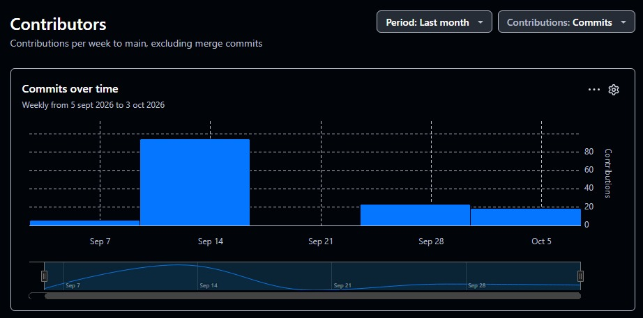
</p>
<p align="center">
  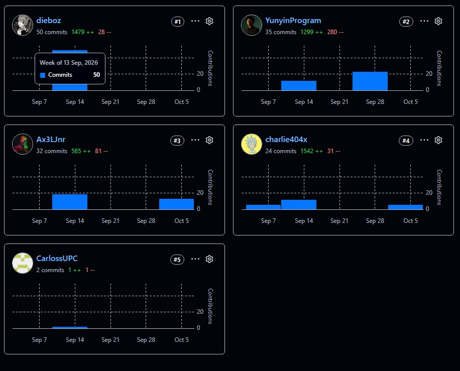
</p>
<p align="center">
  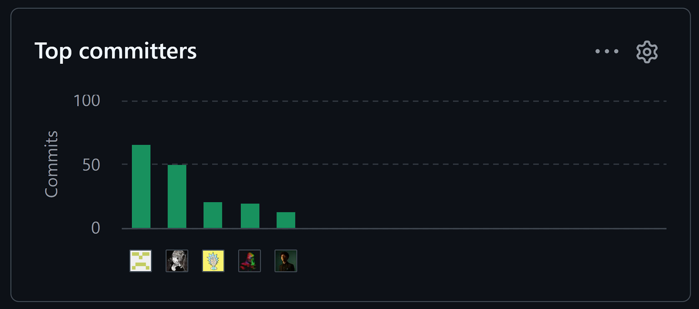
</p>

## Contribuciones por integrante

| Integrante | Tareas Asignadas |
| :--- | :--- |
| **Castro Picón, Manuel Fernando Joao** | • **Student Outcome**<br>• **Capítulo I – Introducción**<br>&nbsp;&nbsp;&nbsp;&nbsp;• **1.1 Startup Profile**<br>&nbsp;&nbsp;&nbsp;&nbsp;&nbsp;&nbsp;&nbsp;&nbsp;1.1.1 Descripción de la Startup<br>&nbsp;&nbsp;&nbsp;&nbsp;&nbsp;&nbsp;&nbsp;&nbsp;1.1.2 Perfiles de integrantes del equipo<br>&nbsp;&nbsp;&nbsp;&nbsp;• **1.2 Solution Profile**<br>&nbsp;&nbsp;&nbsp;&nbsp;&nbsp;&nbsp;&nbsp;&nbsp;1.2.1 Antecedentes y problemática<br>&nbsp;&nbsp;&nbsp;&nbsp;&nbsp;&nbsp;&nbsp;&nbsp;1.2.2 Lean UX Process<br>&nbsp;&nbsp;&nbsp;&nbsp;&nbsp;&nbsp;&nbsp;&nbsp;1.2.2.1 Lean UX Problem Statements<br>&nbsp;&nbsp;&nbsp;&nbsp;&nbsp;&nbsp;&nbsp;&nbsp;1.2.2.2 Lean UX Assumptions<br>&nbsp;&nbsp;&nbsp;&nbsp;&nbsp;&nbsp;&nbsp;&nbsp;1.2.2.3 Lean UX Hypothesis Statements<br>&nbsp;&nbsp;&nbsp;&nbsp;&nbsp;&nbsp;&nbsp;&nbsp;1.2.2.4 Lean UX Canvas<br>&nbsp;&nbsp;&nbsp;&nbsp;• **1.3 Segmentos objetivo**<br>• **4.1 Style Guidelines**<br>&nbsp;&nbsp;&nbsp;&nbsp;4.1.1 General Style Guidelines<br>&nbsp;&nbsp;&nbsp;&nbsp;4.1.2 Web Style Guidelines<br>&nbsp;&nbsp;&nbsp;&nbsp;4.1.3 Mobile Style Guidelines<br>• **4.9 Software Object-Oriented Design**<br>&nbsp;&nbsp;&nbsp;&nbsp;4.9.1 Class Diagrams<br>&nbsp;&nbsp;&nbsp;&nbsp;4.9.2 Class Dictionary<br>• **6.1 Testing Suites & Validation**<br>&nbsp;&nbsp;&nbsp;&nbsp;6.1.1 Core Entities Unit Tests<br>&nbsp;&nbsp;&nbsp;&nbsp;6.1.2 Core Integration Tests<br>• **7.1 Continuous Integration**<br>&nbsp;&nbsp;&nbsp;&nbsp;7.1.1 Tools and Practices<br>&nbsp;&nbsp;&nbsp;&nbsp;7.1.2 Build & Test Suite Pipeline Components |
| **Requena Gutiérrez, Diego Gabriel** | • **Capítulo II – Requirements Elicitation & Analysis**<br>&nbsp;&nbsp;&nbsp;&nbsp;• **2.1 Competidores**<br>&nbsp;&nbsp;&nbsp;&nbsp;&nbsp;&nbsp;&nbsp;&nbsp;2.1.1 Análisis competitivo<br>&nbsp;&nbsp;&nbsp;&nbsp;&nbsp;&nbsp;&nbsp;&nbsp;2.1.2 Estrategias y tácticas frente a competidores<br>&nbsp;&nbsp;&nbsp;&nbsp;• **2.2 Entrevistas**<br>&nbsp;&nbsp;&nbsp;&nbsp;&nbsp;&nbsp;&nbsp;&nbsp;2.2.1 Diseño de entrevistas<br>&nbsp;&nbsp;&nbsp;&nbsp;&nbsp;&nbsp;&nbsp;&nbsp;2.2.2 Registro de entrevistas<br>&nbsp;&nbsp;&nbsp;&nbsp;&nbsp;&nbsp;&nbsp;&nbsp;2.2.3 Análisis de entrevistas<br>• **4.10 Database Design**<br>&nbsp;&nbsp;&nbsp;&nbsp;4.10.1 Relational/Non-Relational Database Diagram<br>• **5.1 Software Configuration Management**<br>&nbsp;&nbsp;&nbsp;&nbsp;5.1.1 Software Development Environment Configuration<br>&nbsp;&nbsp;&nbsp;&nbsp;5.1.2 Source Code Management<br>&nbsp;&nbsp;&nbsp;&nbsp;5.1.3 Source Code Style Guide & Conventions<br>&nbsp;&nbsp;&nbsp;&nbsp;5.1.4 Software Deployment Configuration<br>• **5.2 Product Implementation & Deployment**<br>&nbsp;&nbsp;&nbsp;&nbsp;5.2.4 Acuerdo de Servicio - SaaS<br>&nbsp;&nbsp;&nbsp;&nbsp;5.2.6 Implemented RESTful API and/or Serverless Backend Evidence<br>&nbsp;&nbsp;&nbsp;&nbsp;5.2.7 RESTful API documentation<br>• **6.3 Validation Interviews**<br>&nbsp;&nbsp;&nbsp;&nbsp;6.3.1 Diseño de Entrevistas<br>&nbsp;&nbsp;&nbsp;&nbsp;6.3.2 Registro de Entrevistas<br>&nbsp;&nbsp;&nbsp;&nbsp;6.3.3 Evaluaciones según heurísticas |
| **Huaman De La Cruz, Jean Pool** | • **2.3 Needfinding**<br>&nbsp;&nbsp;&nbsp;&nbsp;2.3.1 User Personas<br>&nbsp;&nbsp;&nbsp;&nbsp;2.3.2 User Task Matrix<br>&nbsp;&nbsp;&nbsp;&nbsp;2.3.3 User Journey Mapping<br>&nbsp;&nbsp;&nbsp;&nbsp;2.3.4 Empathy Mapping<br>&nbsp;&nbsp;&nbsp;&nbsp;2.3.5 As-is Scenario Mapping<br>• **2.4 Ubiquitous Language**<br>• **4.2 Information Architecture**<br>&nbsp;&nbsp;&nbsp;&nbsp;4.2.1 Organization Systems<br>&nbsp;&nbsp;&nbsp;&nbsp;4.2.2 Labeling Systems<br>&nbsp;&nbsp;&nbsp;&nbsp;4.2.3 SEO Tags and Meta Tags<br>&nbsp;&nbsp;&nbsp;&nbsp;4.2.4 Searching Systems<br>&nbsp;&nbsp;&nbsp;&nbsp;4.2.5 Navigation Systems<br>• **4.5 Mobile Applications Prototyping**<br>&nbsp;&nbsp;&nbsp;&nbsp;4.5.1 Android Mobile Applications Prototyping<br>&nbsp;&nbsp;&nbsp;&nbsp;4.5.2 iOS Mobile Applications Prototyping<br>• **4.7 Web Applications Prototyping**<br>• **6.2 Static testing & Verification**<br>&nbsp;&nbsp;&nbsp;&nbsp;6.2.1 Static Code Analysis<br>&nbsp;&nbsp;&nbsp;&nbsp;6.2.2 Reviews<br>• **6.4 Auditoría de Experiencias de Usuario**<br>&nbsp;&nbsp;&nbsp;&nbsp;6.4.1 Auditoría realizada<br>&nbsp;&nbsp;&nbsp;&nbsp;6.4.2 Auditoría recibida |
| **Paredes Chavez, Carlos Augusto** | • **Capítulo IV – Product Design**<br>&nbsp;&nbsp;&nbsp;&nbsp;• **4.3 Landing Page UI Design**<br>&nbsp;&nbsp;&nbsp;&nbsp;&nbsp;&nbsp;&nbsp;&nbsp;4.3.1 Landing Page Wireframe<br>&nbsp;&nbsp;&nbsp;&nbsp;&nbsp;&nbsp;&nbsp;&nbsp;4.3.2 Landing Page Mock-up<br>&nbsp;&nbsp;&nbsp;&nbsp;• **4.4 Mobile Applications UX/UI Design**<br>&nbsp;&nbsp;&nbsp;&nbsp;&nbsp;&nbsp;&nbsp;&nbsp;4.4.1 Mobile Applications Wireframes<br>&nbsp;&nbsp;&nbsp;&nbsp;&nbsp;&nbsp;&nbsp;&nbsp;4.4.2 Mobile Applications Wireflow Diagrams<br>&nbsp;&nbsp;&nbsp;&nbsp;&nbsp;&nbsp;&nbsp;&nbsp;4.4.3 Mobile Applications Mock-ups<br>&nbsp;&nbsp;&nbsp;&nbsp;&nbsp;&nbsp;&nbsp;&nbsp;4.4.4 Mobile Applications User Flow Diagrams<br>&nbsp;&nbsp;&nbsp;&nbsp;• **4.6 Web Applications UX/UI Design**<br>&nbsp;&nbsp;&nbsp;&nbsp;&nbsp;&nbsp;&nbsp;&nbsp;4.6.1 Web Applications Wireframes<br>&nbsp;&nbsp;&nbsp;&nbsp;&nbsp;&nbsp;&nbsp;&nbsp;4.6.2 Web Applications Wireflow Diagrams<br>&nbsp;&nbsp;&nbsp;&nbsp;&nbsp;&nbsp;&nbsp;&nbsp;4.6.3 Web Applications Mock-ups<br>&nbsp;&nbsp;&nbsp;&nbsp;&nbsp;&nbsp;&nbsp;&nbsp;4.6.4 Web Applications User Flow Diagrams<br>• **5.2 Product Implementation & Deployment**<br>&nbsp;&nbsp;&nbsp;&nbsp;5.2.2 Implemented Landing Page Evidence<br>&nbsp;&nbsp;&nbsp;&nbsp;5.2.3 Implemented Frontend-Web Application Evidence<br>&nbsp;&nbsp;&nbsp;&nbsp;5.2.5 Implemented Native-Mobile Application Evidence<br>• **5.3 Video About-the-Product** |
| **Vila Guillen, Miguel Angel** | • **Capítulo III – Requirements Specification**<br>&nbsp;&nbsp;&nbsp;&nbsp;3.1 To-Be Scenario Mapping<br>&nbsp;&nbsp;&nbsp;&nbsp;3.2 User Stories<br>&nbsp;&nbsp;&nbsp;&nbsp;3.3 Product Backlog<br>&nbsp;&nbsp;&nbsp;&nbsp;3.4 Impact Mapping<br>• **4.8 Domain-Driven Software Architecture**<br>&nbsp;&nbsp;&nbsp;&nbsp;4.8.1 Software Architecture Context Diagram<br>&nbsp;&nbsp;&nbsp;&nbsp;4.8.2 Software Architecture Container Diagrams<br>&nbsp;&nbsp;&nbsp;&nbsp;4.8.3 Software Architecture Components Diagrams<br>• **5.2 Product Implementation & Deployment**<br>&nbsp;&nbsp;&nbsp;&nbsp;5.2.1 Sprint Backlogs<br>&nbsp;&nbsp;&nbsp;&nbsp;5.2.8 Team Collaboration Insights<br>• **6.1 Testing Suites & Validation**<br>&nbsp;&nbsp;&nbsp;&nbsp;6.1.3 Core Behavior-Driven Development<br>&nbsp;&nbsp;&nbsp;&nbsp;6.1.4 Core System Tests<br>• **7.2 Continuous Delivery**<br>&nbsp;&nbsp;&nbsp;&nbsp;7.2.1 Tools and Practices<br>&nbsp;&nbsp;&nbsp;&nbsp;7.2.2 Stages Deployment Pipeline Components<br>• **7.3 Continuous deployment**<br>&nbsp;&nbsp;&nbsp;&nbsp;7.3.1 Tools and Practices<br>&nbsp;&nbsp;&nbsp;&nbsp;7.3.2 Production Deployment Pipeline Components |


<div style="page-break-after: always;"></div>

# Contenido

- [Student Outcome](#student-outcome)

**Parte I: As-Is Software Project**

- [Capítulo I: Introducción](#capítulo-i-introducción)
  - [1.1. Startup Profile](#11-startup-profile)
    - [1.1.1. Descripción de la Startup](#111-descripción-de-la-startup)
    - [1.1.2. Perfiles de integrantes del equipo](#112-perfiles-de-integrantes-del-equipo)
  - [1.2. Solution Profile](#12-solution-profile)
    - [1.2.1. Antecedentes y problemática](#121-antecedentes-y-problemática)
    - [1.2.2. Lean UX Process](#122-lean-ux-process)
      - [1.2.2.1. Lean UX Problem Statements](#1221-lean-ux-problem-statements)
      - [1.2.2.2. Lean UX Assumptions](#1222-lean-ux-assumptions)
      - [1.2.2.3. Lean UX Hypothesis Statements](#1223-lean-ux-hypothesis-statements)
      - [1.2.2.4. Lean UX Canvas](#1224-lean-ux-canvas)
  - [1.3. Segmentos objetivo](#13-segmentos-objetivo)

- [Capítulo II: Requirements Elicitation & Analysis](#capítulo-ii-requirements-elicitation--analysis)
  - [2.1. Competidores](#21-competidores)
    - [2.1.1. Análisis competitivo](#211-análisis-competitivo)
    - [2.1.2. Estrategias y tácticas frente a competidores](#212-estrategias-y-tácticas-frente-a-competidores)
  - [2.2. Entrevistas](#22-entrevistas)
    - [2.2.1. Diseño de entrevistas](#221-diseño-de-entrevistas)
    - [2.2.2. Registro de entrevistas](#222-registro-de-entrevistas)
    - [2.2.3. Análisis de entrevistas](#223-análisis-de-entrevistas)
  - [2.3. Needfinding](#23-needfinding)
    - [2.3.1. User Personas](#231-user-personas)
    - [2.3.2. User Task Matrix](#232-user-task-matrix)
    - [2.3.3. User Journey Mapping](#233-user-journey-mapping)
    - [2.3.4. Empathy Mapping](#234-empathy-mapping)
    - [2.3.5. As-is Scenario Mapping](#235-as-is-scenario-mapping)
  - [2.4. Ubiquitous Language](#24-ubiquitous-language)

- [Capítulo III: Requirements Specification](#capítulo-iii-requirements-specification)
  - [3.1. To-Be Scenario Mapping](#31-to-be-scenario-mapping)
  - [3.2. User Stories](#32-user-stories)
  - [3.3. Product Backlog](#33-product-backlog)
  - [3.4. Impact Mapping](#34-impact-mapping)

- [Capítulo IV: Product Design](#capítulo-iv-product-design)
  - [4.1. Style Guidelines](#41-style-guidelines)
    - [4.1.1. General Style Guidelines](#411-general-style-guidelines)
    - [4.1.2. Web Style Guidelines](#412-web-style-guidelines)
    - [4.1.3. Mobile Style Guidelines](#413-mobile-style-guidelines)
      - [4.1.3.1. iOS Mobile Style Guidelines](#4131-ios-mobile-style-guidelines)
      - [4.1.3.2. Android Mobile Style Guidelines](#4132-android-mobile-style-guidelines)
  - [4.2. Information Architecture](#42-information-architecture)
    - [4.2.1. Organization Systems](#421-organization-systems)
    - [4.2.2. Labeling Systems](#422-labeling-systems)
    - [4.2.3. SEO Tags and Meta Tags](#423-seo-tags-and-meta-tags)
    - [4.2.4. Searching Systems](#424-searching-systems)
    - [4.2.5. Navigation Systems](#425-navigation-systems)
  - [4.3. Landing Page UI Design](#43-landing-page-ui-design)
    - [4.3.1. Landing Page Wireframe](#431-landing-page-wireframe)
    - [4.3.2. Landing Page Mock-up](#432-landing-page-mock-up)
  - [4.4. Mobile Applications UX/UI Design](#44-mobile-applications-uxui-design)
    - [4.4.1. Mobile Applications Wireframes](#441-mobile-applications-wireframes)
    - [4.4.2. Mobile Applications Wireflow Diagrams](#442-mobile-applications-wireflow-diagrams)
    - [4.4.3. Mobile Applications Mock-ups](#443-mobile-applications-mock-ups)
    - [4.4.4. Mobile Applications User Flow Diagrams](#444-mobile-applications-user-flow-diagrams)
  - [4.5. Mobile Applications Prototyping](#45-mobile-applications-prototyping)
    - [4.5.1. Android Mobile Applications Prototyping](#451-android-mobile-applications-prototyping)
    - [4.5.2. iOS Mobile Applications Prototyping](#452-ios-mobile-applications-prototyping)
  - [4.6. Web Applications UX/UI Design](#46-web-applications-uxui-design)
    - [4.6.1. Web Applications Wireframes](#461-web-applications-wireframes)
    - [4.6.2. Web Applications Wireflow Diagrams](#462-web-applications-wireflow-diagrams)
    - [4.6.3. Web Applications Mock-ups](#463-web-applications-mock-ups)
    - [4.6.4. Web Applications User Flow Diagrams](#464-web-applications-user-flow-diagrams)
  - [4.7. Web Applications Prototyping](#47-web-applications-prototyping)
  - [4.8. Domain-Driven Software Architecture](#48-domain-driven-software-architecture)
    - [4.8.1. Software Architecture Context Diagram](#481-software-architecture-context-diagram)
    - [4.8.2. Software Architecture Container Diagrams](#482-software-architecture-container-diagrams)
    - [4.8.3. Software Architecture Components Diagrams](#483-software-architecture-components-diagrams)
  - [4.9. Software Object-Oriented Design](#49-software-object-oriented-design)
    - [4.9.1. Class Diagrams](#491-class-diagrams)
    - [4.9.2. Class Dictionary](#492-class-dictionary)
  - [4.10. Database Design](#410-database-design)
    - [4.10.1. Relational/Non-Relational Database Diagram](#4101-relationalnon-relational-database-diagram)

- [Capítulo V: Product Implementation](#capítulo-v-product-implementation)
  - [5.1. Software Configuration Management](#51-software-configuration-management)
    - [5.1.1. Software Development Environment Configuration](#511-software-development-environment-configuration)
    - [5.1.2. Source Code Management](#512-source-code-management)
    - [5.1.3. Source Code Style Guide & Conventions](#513-source-code-style-guide--conventions)
    - [5.1.4. Software Deployment Configuration](#514-software-deployment-configuration)
  - [5.2. Product Implementation & Deployment](#52-product-implementation--deployment)
    - [5.2.1. Sprint Backlogs](#521-sprint-backlogs)
    - [5.2.2. Implemented Landing Page Evidence](#522-implemented-landing-page-evidence)
    - [5.2.3. Implemented Frontend-Web Application Evidence](#523-implemented-frontend-web-application-evidence)
    - [5.2.4. Acuerdo de Servicio - SaaS](#524-acuerdo-de-servicio---saas)
    - [5.2.5. Implemented Native-Mobile Application Evidence](#525-implemented-native-mobile-application-evidence)
    - [5.2.6. Implemented RESTful API and/or Serverless Backend Evidence](#526-implemented-restful-api-andor-serverless-backend-evidence)
    - [5.2.7. RESTful API documentation](#527-restful-api-documentation)
    - [5.2.8. Team Collaboration Insights](#528-team-collaboration-insights)
  - [5.3. Video About-the-Product](#53-video-about-the-product)

**Parte II: Verification, Validation & Pipeline**

- [Capítulo VI: Product Verification & Validation](#capítulo-vi-product-verification--validation)
  - [6.1. Testing Suites & Validation](#61-testing-suites--validation)
    - [6.1.1. Core Entities Unit Tests](#611-core-entities-unit-tests)
    - [6.1.2. Core Integration Tests](#612-core-integration-tests)
    - [6.1.3. Core Behavior-Driven Development](#613-core-behavior-driven-development)
    - [6.1.4. Core System Tests](#614-core-system-tests)
  - [6.2. Static testing & Verification](#62-static-testing--verification)
    - [6.2.1. Static Code Analysis](#621-static-code-analysis)
      - [6.2.1.1. Coding standard & Code conventions](#6211-coding-standard--code-conventions)
      - [6.2.1.2. Code Quality & Code Security](#6212-code-quality--code-security)
    - [6.2.2. Reviews](#622-reviews)
  - [6.3. Validation Interviews](#63-validation-interviews)
    - [6.3.1. Diseño de Entrevistas](#631-diseño-de-entrevistas)
    - [6.3.2. Registro de Entrevistas](#632-registro-de-entrevistas)
    - [6.3.3. Evaluaciones según heurísticas](#633-evaluaciones-según-heurísticas)
  - [6.4. Auditoría de Experiencias de Usuario](#64-auditoría-de-experiencias-de-usuario)
    - [6.4.1. Auditoría realizada](#641-auditoría-realizada)
      - [6.4.1.1. Información del grupo auditado](#6411-información-del-grupo-auditado)
      - [6.4.1.2. Cronograma de auditoría realizada](#6412-cronograma-de-auditoría-realizada)
      - [6.4.1.3. Contenido de auditoría realizada](#6413-contenido-de-auditoría-realizada)
    - [6.4.2. Auditoría recibida](#642-auditoría-recibida)
      - [6.4.2.1. Información del grupo auditor](#6421-información-del-grupo-auditor)
      - [6.4.2.2. Cronograma de auditoría recibida](#6422-cronograma-de-auditoría-recibida)
      - [6.4.2.3. Contenido de auditoría recibida](#6423-contenido-de-auditoría-recibida)
      - [6.4.2.4. Resumen de modificaciones para subsanar hallazgos](#6424-resumen-de-modificaciones-para-subsanar-hallazgos)

- [Capítulo VII: DevOps Practices](#capítulo-vii-devops-practices)
  - [7.1. Continuous Integration](#71-continuous-integration)
    - [7.1.1. Tools and Practices](#711-tools-and-practices)
    - [7.1.2. Build & Test Suite Pipeline Components](#712-build--test-suite-pipeline-components)
  - [7.2. Continuous Delivery](#72-continuous-delivery)
    - [7.2.1. Tools and Practices](#721-tools-and-practices)
    - [7.2.2. Stages Deployment Pipeline Components](#722-stages-deployment-pipeline-components)
  - [7.3. Continuous deployment](#73-continuous-deployment)
    - [7.3.1. Tools and Practices](#731-tools-and-practices)
    - [7.3.2. Production Deployment Pipeline Components](#732-production-deployment-pipeline-components)
  - [7.4. Continuous Monitoring](#74-continuous-monitoring)
    - [7.4.1. Tools and Practices](#741-tools-and-practices)
    - [7.4.2. Monitoring Pipeline Components](#742-monitoring-pipeline-components)
    - [7.4.3. Alerting Pipeline Components](#743-alerting-pipeline-components)
    - [7.4.4. Notification Pipeline Components](#744-notification-pipeline-components)

**Parte III: Experiment-Driven Lifecycle**

- [Capítulo VIII: Experiment-Driven Development](#capítulo-viii-experiment-driven-development)
  - [8.1. Experiment Planning](#81-experiment-planning)
    - [8.1.1. As-Is Summary](#811-as-is-summary)
    - [8.1.2. Raw Material: Assumptions, Knowledge Gaps, Ideas, Claims](#812-raw-material-assumptions-knowledge-gaps-ideas-claims)
    - [8.1.3. Experiment-Ready Questions](#813-experiment-ready-questions)
    - [8.1.4. Question Backlog](#814-question-backlog)
    - [8.1.5. Experiment Cards](#815-experiment-cards)
  - [8.2. Experiment Design](#82-experiment-design)
    - [8.2.1. Hypotheses](#821-hypotheses)
    - [8.2.2. Domain Business Metrics](#822-domain-business-metrics)
    - [8.2.3. Measures](#823-measures)
    - [8.2.4. Conditions](#824-conditions)
    - [8.2.5. Scale Calculations and Decisions](#825-scale-calculations-and-decisions)
    - [8.2.6. Methods Selection](#826-methods-selection)
    - [8.2.7. Data Analytics: Goals, KPIs and Metrics Selection](#827-data-analytics-goals-kpis-and-metrics-selection)
    - [8.2.8. Web and Mobile Tracking Plan](#828-web-and-mobile-tracking-plan)
  - [8.3. Experimentation](#83-experimentation)
    - [8.3.1. To-Be User Stories](#831-to-be-user-stories)
    - [8.3.2. To-Be Product Backlog](#832-to-be-product-backlog)
    - [8.3.3. Pipeline-supported, Experiment-Driven To-Be Software Platform Lifecycle](#833-pipeline-supported-experiment-driven-to-be-software-platform-lifecycle)
      - [8.3.3.1. To-Be Sprint Backlogs](#8331-to-be-sprint-backlogs)
      - [8.3.3.2. Implemented To-Be Landing Page Evidence](#8332-implemented-to-be-landing-page-evidence)
      - [8.3.3.3. Implemented To-Be Frontend-Web Application Evidence](#8333-implemented-to-be-frontend-web-application-evidence)
      - [8.3.3.4. Implemented To-Be Native-Mobile Application Evidence](#8334-implemented-to-be-native-mobile-application-evidence)
      - [8.3.3.5. Implemented To-Be RESTful API and/or Serverless Backend Evidence](#8335-implemented-to-be-restful-api-andor-serverless-backend-evidence)
      - [8.3.3.6. Team Collaboration Insights](#8336-team-collaboration-insights)
    - [8.3.4. To-Be Validation Interviews](#834-to-be-validation-interviews)
      - [8.3.4.1. Diseño de Entrevistas](#8341-diseño-de-entrevistas)
      - [8.3.4.2. Registro de Entrevistas](#8342-registro-de-entrevistas)
  - [8.4. Experiment Aftermath & Analysis](#84-experiment-aftermath--analysis)
    - [8.4.1. Analysis and Interpretation of Results](#841-analysis-and-interpretation-of-results)
    - [8.4.2. Re-scored and Re-prioritized Question Backlog](#842-re-scored-and-re-prioritized-question-backlog)
  - [8.5. Continuous Learning](#85-continuous-learning)
    - [8.5.1. Shareback Session Artifacts: Learning Workflow](#851-shareback-session-artifacts-learning-workflow)
  - [8.6. To-Be Software Platform Pre-launch](#86-to-be-software-platform-pre-launch)
    - [8.6.1. About-the-Product Intro Video](#861-about-the-product-intro-video)
    - [8.6.2. Resumen usando Gees Framework](#862-resumen-usando-gees-framework)
    - [8.6.3. Matriz de Evaluación Ética y de Impacto](#863-matriz-de-evaluación-ética-y-de-impacto)

- [Conclusiones](#conclusiones)
  - [Conclusiones y recomendaciones](#conclusiones-y-recomendaciones)
  - [Video App Validation](#video-app-validation)
  - [Video About-the-Team](#video-about-the-team)

- [Bibliografía](#bibliografía)

- [Anexos](#anexos)
  - [Anexo A. Estructura para la sección Objetivo del Estudiante (Student Outcome)](#anexo-a-estructura-para-la-sección-objetivo-del-estudiante-student-outcome)
  - [Anexo B. Estructura para el Informe de participación](#anexo-b-estructura-para-el-informe-de-participación)
  - [Anexo C. Indicaciones para secciones que incluyen Videos](#anexo-c-indicaciones-para-secciones-que-incluyen-videos)
  - [Anexo D. Formato para Evaluación de User Experience según Heurísticas](#anexo-d-formato-para-evaluación-de-user-experience-según-heurísticas)
  - [Anexo E. Errores típicos en la traducción y uso de términos para Ingeniería de Software](#anexo-e-errores-típicos-en-la-traducción-y-uso-de-términos-para-ingeniería-de-software)
  - [Anexo F. Matriz de Evaluación Ética y de Impacto](#anexo-f-matriz-de-evaluación-ética-y-de-impacto)
  - [Anexo G. Videos de Exposiciones](#anexo-g-videos-de-exposiciones)

<div style="page-break-after: always;"></div>

## Student Outcome

<div align="center">

## ABET – EAC - Student Outcome 4

</div>

**Criterio:** La capacidad de reconocer responsabilidades éticas y profesionales en situaciones de ingeniería y hacer juicios informados, que deben considerar el impacto de las soluciones de ingeniería en contextos globales, económicos, ambientales y sociales.

En el siguiente cuadro se describen las acciones realizadas y enunciados de conclusiones por parte del equipo del proyecto **NeuroZen**, que permiten sustentar el haber alcanzado el logro del ABET – EAC - Student Outcome 4 durante el **Segundo Hito: TRABAJO PARCIAL - Stage Review**.

<br>

| Criterio específico | Acciones realizadas | Conclusiones |
| :--- | :--- | :--- |
| **4.c.1 Reconoce responsabilidad ética y profesional en situaciones de ingeniería de software** | **Castro Picón, Manuel Fernando Joao:** Diseñó la arquitectura de software y la base de datos asegurando la privacidad de los datos de salud y perfiles biométricos de los usuarios en el AV1[cite: 1].<br>**TB1:** Desarrolló pruebas unitarias, de integración y automatizadas para la aplicación móvil, verificando el funcionamiento de sus componentes y flujos. Como Team Leader, coordinó la distribución de tareas y las decisiones del equipo, asumiendo la responsabilidad de organizar las verificaciones necesarias antes de presentar el producto.<br><br>**Huaman De La Cruz, Jean Pool:** Implementó módulos del Frontend Web Application en el AV1, garantizando una experiencia de usuario segura y un manejo ético de las sesiones de los psicólogos[cite: 1].<br>**TB1:** Desarrolló pruebas del frontend web para verificar reglas relacionadas con niveles de estrés, pausas activas, citas y datos de suscripción. Estas verificaciones contribuyen a detectar cálculos y entradas incorrectas antes de que afecten la información mostrada al usuario.<br><br>**Paredes Chavez, Carlos Augusto:** Configuró el contexto de *Auth & Profile* durante el AV1, asegurando que el registro y el manejo de datos personales cumplan con los estándares éticos de privacidad[cite: 1].<br>**TB1:** Estructuró escenarios BDD a partir de los criterios de aceptación, incluyendo la reserva de citas y el manejo de horarios ocupados. Definir el comportamiento esperado ante estos casos permite reconocer la responsabilidad de evitar confirmaciones incorrectas que afecten al usuario y al profesional.<br><br>**Requena Gutiérrez, Diego Gabriel:** Diseñó el *Dashboard & Navigation* en el AV1, aplicando principios éticos para que el usuario visualice sus métricas de estrés de forma segura[cite: 1].<br>**TB1:** Participó en pruebas unitarias e integrales del frontend y backend, desarrolló la landing page y realizó correcciones de wireframes, wireflows y del reporte. Estas actividades permiten revisar la coherencia entre las funciones implementadas, los recorridos de uso y la información comunicada sobre el producto.<br><br>**Vila Guillen, Miguel Angel:** Desarrolló los *endpoints* de la API para el *Service Booking* en el AV1, siguiendo convenciones de código profesional y asegurando transacciones seguras[cite: 1].<br>**TB1:** Elaboró pruebas unitarias para servicios del backend y una prueba de integración del controlador de Triggers. Además, configuró la integración continua para ejecutar las pruebas automáticamente, incorporando verificaciones de calidad al proceso de desarrollo y reduciendo el riesgo de integrar cambios con errores. | **AV1:** Como equipo, logramos establecer una sólida base ética y profesional en el desarrollo del sistema NeuroZen. Garantizamos la confidencialidad de la información médica y biométrica de los trabajadores mediante una arquitectura segura, interfaces confiables y el cumplimiento de estándares de codificación, reflejando nuestra máxima responsabilidad técnica con la privacidad de los usuarios y especialistas[cite: 1].<br><br>**TB1:** Como equipo, reforzamos nuestra responsabilidad profesional mediante pruebas del backend, frontend y aplicación móvil, escenarios de aceptación y automatización de verificaciones. Estas actividades permiten detectar errores en el manejo de datos y en los flujos del producto antes de su entrega. Asimismo, la coordinación de tareas y la actualización del reporte ayudan a mantener la correspondencia entre el trabajo realizado y las evidencias presentadas. |
| **4.c.2 Emite juicios informados considerando el impacto de las soluciones de ingeniería de software en contextos globales, económicos, ambientales y sociales** | **Castro Picón, Manuel Fernando Joao:** Evaluó el impacto económico en el *Startup Profile* (AV1), determinando que NeuroZen aumentará la productividad y reducirá el ausentismo laboral[cite: 1].<br>**TB1:** Mediante las pruebas de la aplicación móvil, abordó fallos que podrían interrumpir el uso de funciones como la gestión de citas y la sesión del usuario. Su aporte permite considerar las consecuencias de estas interrupciones sobre el tiempo de los usuarios y su acceso a los servicios de la plataforma.<br><br>**Huaman De La Cruz, Jean Pool:** Analizó el impacto social en el AV1 al estructurar las *User Personas*, enfocándose en cómo el estrés afecta la calidad de vida de los profesionales[cite: 1].<br>**TB1:** Verificó reglas del frontend relacionadas con el cálculo del nivel de estrés y la gestión de citas. La revisión de estos resultados permite considerar cómo una información incorrecta puede influir en las decisiones del usuario y afectar su confianza en NeuroZen.<br><br>**Paredes Chavez, Carlos Augusto:** Realizó el análisis competitivo de la plataforma en el AV1, evaluando el impacto global de soluciones de salud mental existentes en el mercado digital[cite: 1].<br>**TB1:** Definió escenarios de aceptación que contemplan conflictos de disponibilidad al reservar citas. Considerar estos casos permite analizar las consecuencias sociales y económicas de una reserva incorrecta, como la pérdida de tiempo del usuario y del profesional o la interrupción de una atención programada.<br><br>**Requena Gutiérrez, Diego Gabriel:** Diseñó el *Impact Mapping* en el AV1, emitiendo juicios sobre el impacto social en el segmento vulnerable de trabajadores informales[cite: 1].<br>**TB1:** Trabajó en la landing page y en los wireframes y wireflows de las plataformas. La revisión de la información y los recorridos contribuye a que los usuarios comprendan la propuesta de NeuroZen y puedan utilizar sus funciones con mayor claridad, considerando las necesidades de los segmentos objetivo.<br><br>**Vila Guillen, Miguel Angel:** Planificó la infraestructura tecnológica (*Deployment Configuration*) en el AV1, tomando decisiones informadas para un despliegue en la nube eficiente y ambientalmente responsable[cite: 1].<br>**TB1:** Configuró la ejecución de pruebas y el despliegue del backend mediante integración continua y automatización. Estas decisiones permiten considerar los costos de las fallas y del trabajo de corrección, así como el uso de recursos de infraestructura durante las compilaciones, pruebas y despliegues. | **AV1:** El grupo ha demostrado capacidad para analizar el entorno integral de NeuroZen, concluyendo que la plataforma tendrá un impacto social y económico positivo al reducir el estrés laboral crónico, mejorar la productividad empresarial y brindar apoyo accesible a distintos segmentos de trabajadores. Asimismo, tomamos decisiones tecnológicas conscientes para minimizar la huella ambiental mediante un despliegue optimizado en la nube[cite: 1].<br><br>**TB1:** El equipo relacionó las decisiones de diseño, verificación y despliegue con sus posibles consecuencias para usuarios y profesionales. Las pruebas permiten abordar riesgos asociados con información incorrecta, reservas conflictivas e interrupciones del servicio, mientras que la automatización ayuda a organizar el trabajo de revisión. También reconocemos que el alcance de la plataforma y el uso de infraestructura deben evaluarse considerando accesibilidad, costos y consumo de recursos, para sustentar sus efectos sociales, económicos, globales y ambientales. |

<br>

<div style="page-break-after: always;"></div>

# Parte I: As-Is Software Project

# Capítulo I: Introducción

## 1.1. Startup Profile

### 1.1.1. Descripción de la Startup

Nuestro startup llamado NeuroDraw está enfocado en una rápida detección del estrés en el ámbito
laboral de personas entre 20 a 50 años de edad. Abarcando temas como salud mental, presión laboral
y servicios, el software facilita el tratamiento del estrés laboral.
Los usuarios pueden realizar un test que recabará información de salud, comportamiento, actitudes y
patrones en la persona. La plataforma permite el contacto con un psicólogo. Además, fomenta
diversas actividades para complementar el tratamiento contra el estrés.

### 1.1.2. Perfiles de integrantes del equipo

| Foto                                                    | Nombres y Apellidos               | Carrera                | Descripción                                                                                                                                                                                                                                                 |
| ------------------------------------------------------- | --------------------------------- | ---------------------- | ----------------------------------------------------------------------------------------------------------------------------------------------------------------------------------------------------------------------------------------------------------- |
|     | Manuel Fernando Joao Castro Picón | Ingeniería de Software | Tengo 20 años y curso el 7to ciclo en la Universidad Peruana de Ciencias Aplicadas. Me gusta entrenar calistenia, escuchar música y jugar fútbol. Me considero responsable, adaptable al trabajo en equipo y con metas claras para ser un gran profesional. |
|     | Carlos Augusto Paredes Chavez | Ingeniería de Software | Soy estudiante de Ingeniería de Software con experiencia en proyectos de desarrollo, documentación técnica y trabajo colaborativo con Git y GitHub. Me interesa fortalecer mis conocimientos en pruebas de software, aseguramiento de calidad, DevOps e integración continua. Me considero responsable, constante y orientado a desarrollar soluciones bien estructuradas y alineadas con las necesidades de los usuarios. |
|   | Miguel Angel Vila Guillen         | Ingeniería de Software | Tengo 21 años y estudio el 7to ciclo en la Universidad Peruana de Ciencias Aplicadas. Me gusta jugar videojuegos, tocar la guitarra y el fútbol. Me considero capaz de trabajar en equipo y aspiro a ser un profesional competente.                         |
|  | Diego Gabriel Requena Gutiérrez   | Ingeniería de Software | Tengo 20 años y curso el 7to ciclo en la Universidad Peruana de Ciencias Aplicadas. Soy una persona comprometida con mis objetivos, busco optimizar mi rendimiento y mantener un equilibrio entre la excelencia y una vida saludable.                       |
|     | Huaman De La Cruz Jean Pool       | Ingeniería de Software | Tengo 23 años; Estoy cursando la carrera de ingeniería de software en quinto ciclo. Soy una persona orientada a objetivos y con una meta clara, quiero poder crear soluciones disruptivas que revolucionen el mercado.                                      |

## 1.2. Solution Profile

### 1.2.1. Antecedentes y problemática

El estrés laboral constituye una problemática de salud pública de alcance global que afecta de manera directa a la población económicamente activa. Se estima que el 15% de los adultos en edad de trabajar padece algún trastorno mental, siendo el entorno laboral uno de sus principales determinantes (OMS, 2024), mientras que anualmente se pierden alrededor de 12,000 millones de días de trabajo a causa de la depresión y la ansiedad, con un costo aproximado de un billón de dólares para la economía mundial (OIT, 2022). Frente a este escenario, el proyecto Neuro Zen propone un sistema de identificación y gestión del estrés laboral dirigido a adultos de entre 20 y 50 años, mediante el registro de señales corporales visibles —como postura, tensión muscular facial, cambios respiratorios, sudoración, temblores y rojeces en la piel— integradas en una aplicación móvil que permite al usuario autoevaluar su nivel de estrés, recibir recomendaciones personalizadas y acceder a estrategias prácticas, con el fin de mejorar el bienestar del trabajador, prevenir el estrés crónico y fortalecer la productividad organizacional.

### 1.2.2. Lean UX Process

#### 1.2.2.1. Lean UX Problem Statements

Nuestra app permite a los usuarios identificar y gestionar su estrés laboral mediante un
test de autoevaluación y la observación de señales físicas visibles como la postura, la
respiración y la tensión facial. Además, brinda acceso a psicólogos y actividades
prácticas para mejorar el bienestar.
Hemos observado que muchos adultos entre 20 y 50 años sufren niveles elevados de
estrés en el trabajo, pero no cuentan con herramientas simples, accesibles y efectivas
para reconocer estos niveles a tiempo ni saber cómo actuar al respecto.
¿Cómo pueden los trabajadores detectar y manejar su estrés de forma temprana y
efectiva en su entorno laboral, usando una herramienta accesible, fácil de usar e
integrada en su rutina diaria?

#### 1.2.2.2. Lean UX Assumptions

**Feature:** Sistema de identificación y gestión del estrés laboral en NeuroZen

**Registro Bio-métrico y Perfil del Usuario:**
Creemos que nuestros usuarios (adultos de 20 a 50 años en el ámbito laboral) necesitan una forma sencilla y segura de registrar sus parámetros bio-métricos (por medio de la cámara o sensores de sus dispositivos móviles) junto con información de salud y comportamiento. Esto permitirá personalizar el seguimiento y el manejo del estrés en función de las características individuales.

**Detección Temprana de Estrés mediante Patrones Físicos:**
Creemos que la identificación de señales bio-métricas observables (postura, tensión muscular, patrones de respiración y sudoración) permitirá detectar de forma temprana niveles de estrés. Esto facilitará la intervención oportuna antes de que se agraven los síntomas, impactando positivamente en la salud mental y física de los usuarios.

**Integración de Evaluaciones Psicológicas y Recomendaciones Personalizadas:**
Creemos que los usuarios se beneficiarán al combinar la autoevaluación bio-métrica con tests emocionales y recomendaciones personalizadas (ejercicios de respiración, pausas activas, contacto con especialistas). Esta integración permitirá al usuario conocer su estado en tiempo real y acceder a soluciones prácticas y adaptadas a su contexto.

**Seguimiento y Análisis de Datos de Estrés:**
Creemos que disponer de un registro histórico del nivel de estrés y obtener estadísticas personalizadas ayudará al usuario a identificar patrones y cambios en su salud, promoviendo acciones preventivas y
mejoras en su entorno laboral y personal.

**Business Outcomes (Resultados del negocio)**

- Se aumentará la productividad laboral y se reducirá el ausentismo, ya que los trabajadores podrán identificar y gestionar su estrés de manera proactiva.

- Se generarán ingresos a través de planes de suscripción individuales y acuerdos corporativos con empresas interesadas en el bienestar de sus empleados.

- NeuroZen se posicionará como una herramienta innovadora y confiable para la salud mental en el ámbito laboral, ampliando su alcance en el mercado latinoamericano.

**Users (Usuarios)**

- Profesionales y empleados de 20 a 50 años que desarrollan sus actividades en ambientes laborales exigentes y de alta presión.

- Personas que desean mejorar sus niveles de bienestar integral mediante el monitoreo de señales físicas y emocionales.

- Usuarios que utilizan dispositivos móviles y buscan soluciones digitales para la autogestión de su salud mental.

**User Outcomes (Beneficios para el usuario)**

- Identificar sus niveles de estrés de manera temprana y objetiva, mediante el análisis de patrones bio-métricos.

- Acceder a recomendaciones personalizadas que les ayuden a manejar y reducir los síntomas de estrés.

- Visualizar estadísticas y tendencias de su bienestar, facilitando el seguimiento a lo largo del tiempo.

- Mejorar su calidad de vida laboral y personal gracias a estrategias adaptadas a sus necesidades específicas.

**Features (Características)**

- **Registro de Datos Biométricos:** Herramienta de captura de señales físicas a través de la cámara y sensores del móvil.

- **Autoevaluación Integral:** Tests combinados que evalúan tanto aspectos emocionales como físicos del estrés.

- **Recomendaciones Personalizadas:** Sugerencias de ejercicios, pausas activas y consejos de salud mental basados en el perfil del usuario.

- **Historial y Seguimiento:** Dashboard interactivo que muestra evolución, tendencias y alertas de niveles de estrés.

- **Integración con Profesionales:** Opción de contactar con psicólogos o especialistas en bienestar para intervenciones personalizadas.


#### 1.2.2.3. Lean UX Hypothesis Statements

Hypothesis Statement 01

**Creemos** que la implementación de un sistema de registro biométrico y autoevaluación permitirá a los usuarios identificar tempranamente sus niveles de estrés laboral.

**Sabemos** la hipótesis se confirma cuando se observe una correlación significativa entre los datos bio-métricos capturados y las autoevaluaciones realizadas por los usuarios.

**Cuando** al menos el 65% de los usuarios completen de forma regular la evaluación en la plataforma y se detecten cambios relevantes en sus patrones bio-métricos.

Hypothesis Statement 02

**Creemos** que al ofrecer recomendaciones personalizadas basadas en el análisis del estrés, los usuarios
adoptarán prácticas de autogestión más efectivas para reducir sus síntomas.

**Sabemos** que la hipótesis es correcta cuando los usuarios reporten mejoras en su bienestar y se
registre una disminución en los indicadores de estrés en los seguimientos mensuales.

**Cuando** se logre una reducción del 20% en la frecuencia e intensidad de síntomas reportados durante
los primeros seis meses de uso.

Hypothesis Statement 03

**Creemos** que la visualización de un historial interactivo y tendencias de estrés motivará a los usuarios a llevar un control continuo de su salud mental.

**Sabemos** que esto es cierto cuando se registre un aumento en la interacción con el dashboard y una mayor adherencia a las recomendaciones sugeridas

**Cuando** el uso constante de las herramientas de seguimiento genere datos que indiquen una mayor
consciencia y manejo proactivo del estrés en el entorno laboral.

#### 1.2.2.4. Lean UX Canvas

Lean UX Canvas es una de las herramientas que hemos utilizado para comprender a nuestros posibles usuarios y sus necesidades. Esta es usada en el campo del diseño centrado en el usuario y la metodología Lean con la intención de desarrollar productos de forma eficientes y práctica para los usuarios. A su vez, esta puede ser utilizada por equipos multidisciplinarios para que colaboración de forma ordenada dentro un marco estructurado.

<div>
  <p align="center">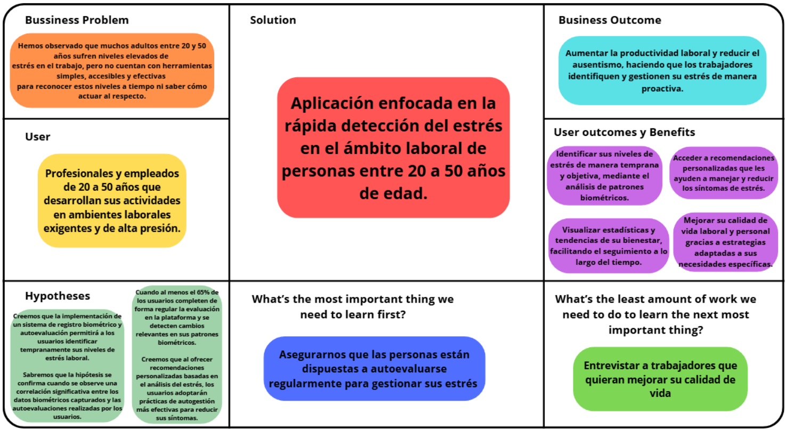</p>
</div>

## 1.3. Segmentos objetivo

#### Segmento objetivo #1: Trabajadores formales con jornadas extensas

Este segmento está compuesto por personas que cumplen horarios laborales prolongados, generalmente mayores a 8 horas diarias, y que enfrentan altos niveles de presión psicológica en su entorno profesional. La sobrecarga de trabajo y la falta de límites claros entre lo personal y lo laboral generan cuadros de estrés que afectan su rendimiento y calidad de vida. Según estudios realizados en distintos sectores, alrededor del 70% de los trabajadores presenta síntomas de estrés agudo en sus actividades cotidianas (Estudio LATAM, 2020). Este grupo constituye un eje clave para el éxito de la plataforma, al ser los principales beneficiarios de las capacidades que propone NeuroZen.

#### Segmento objetivo #2: Trabajadores informales o con horarios flexibles

Este segmento está compuesto por adultos que no necesariamente forman parte del empleo formal y cuyas actividades se desarrollan sin horarios fijos. A menudo, experimentan mayores niveles de estrés debido a la disponibilidad permanente que exige su trabajo, la inestabilidad económica y la dificultad para establecer límites entre la vida laboral y personal. Un estudio realizado a 250 trabajadores informales muestra que el 56% presenta un nivel medio de estrés, el 33.3% un nivel bajo y el 10.6% un nivel alto (Porcayo, 2022). Este grupo también se beneficiará de la plataforma, destacando su potencial para ampliar el alcance del producto en contextos laborales diversos y cada vez más comunes.

---

<div style="page-break-after: always;"></div>

# Capítulo II: Requirements Elicitation & Analysis

## 2.1. Competidores

En este apartado analizaremos las posibles competencias para nuestra página web,
viendo en ello sus descripciones y planes de negocios.

| Competidores | Características                                                                                                                                                                                                                                                                              | Diferencias                                                                                                                                                                                              | Limitaciones                                                                                                                                                          |
| ------------ | -------------------------------------------------------------------------------------------------------------------------------------------------------------------------------------------------------------------------------------------------------------------------------------------- | -------------------------------------------------------------------------------------------------------------------------------------------------------------------------------------------------------- | --------------------------------------------------------------------------------------------------------------------------------------------------------------------- |
| **Calm**     | - Contiene un ejercicio de respiración para reducir el estrés.<br>- Cursos de 10 minutos al día para reducir el estrés.<br>- Ejercicios físicos tipo meditaciones para relajar el cuerpo.<br>- Historias en audiolibro para dormir mejor.                                                    | - Enfoque multimedia de alta producción con audios narrados por celebridades y música profesional.<br>- Contenido especializado por necesidad (estrés, concentración, sueño).                            | - La mayoría del contenido requiere suscripción de pago.<br>- No tiene controles parentales para gestionar el uso infantil.                                           |
| **Wysa**     | - Chatbot de apoyo emocional impulsado por IA.<br>- Ejercicios como respiraciones guiadas, meditaciones y relajación muscular.<br>- Privacidad: no requiere nombre real y las conversaciones son anónimas.<br>- Versión de pago con acceso a terapeutas profesionales.                       | - Interfaz conversacional con IA (diferente a Calm con audio y Equoo con juegos).<br>- Incorpora técnicas de CBT y DBT guiadas.<br>- Modelo freemium claro (chatbot gratuito + coaching humano de pago). | - No puede atender emergencias de salud mental ni sustituir atención profesional.<br>- Limitaciones técnicas para comprender lenguaje complejo y matices emocionales. |
| **Equoo**    | - Usa Terapia Cognitiva Conductual y psicología positiva para enseñar habilidades emocionales.<br>- Juego con 52 niveles sobre neuroticismo, amabilidad y reciprocidad.<br>- Chatbot personalizado de apoyo.<br>- Estudios clínicos respaldan su eficacia para reducir ansiedad y depresión. | - Experiencia gamificada con misiones y recompensas.<br>- Orientación a jóvenes con narrativa adaptada.<br>- Progresión tipo “nivel” con estadísticas, ausente en Calm y Wysa.                           | - Variedad limitada de juegos emocionales, lo que puede volverse repetitivo.<br>- El enfoque gamificado puede no resonar con quienes prefieren métodos más directos.  |

### 2.1.1. Análisis competitivo

| Criterio                                          | Calm                                                                                                                                                                                                      | Wysa                                                                                                                                                                          | Equoo                                                                                                                             |
| :------------------------------------------------ | :-------------------------------------------------------------------------------------------------------------------------------------------------------------------------------------------------------- | :---------------------------------------------------------------------------------------------------------------------------------------------------------------------------- | :-------------------------------------------------------------------------------------------------------------------------------- |
| **Perfil: Descripción**                           | Aplicación de bienestar mental para relajarse, dormir mejor y reducir el estrés. Ofrece meditaciones guiadas, historias para dormir, música relajante, ejercicios de respiración y clases de mindfulness. | Asistente de bienestar emocional basado en IA que ofrece terapia cognitivo-conductual (CBT), terapia dialéctica conductual (DBT), journaling y meditaciones, disponible 24/7. | Plataforma gamificada que desarrolla inteligencia emocional mediante juegos interactivos basados en psicología.                   |
| **Ventaja Competitiva**                           | Diversidad de maneras para relajarse; efectivo para cualquier necesidad.                                                                                                                                  | Combina un chatbot accesible 24/7 con técnicas terapéuticas validadas, y la opción de coaching humano para apoyo más profundo.                                                | Combina entretenimiento con técnicas psicológicas efectivas, aumentando la adherencia y el compromiso en el desarrollo emocional. |
| **Perfil de Marketing: Mercado Objetivo**         | Adultos entre 30 y 35 años con ingresos medio-altos que puedan pagar una suscripción.                                                                                                                     | Adultos jóvenes (18-35) y empresas que buscan herramientas de salud mental accesibles 24/7.                                                                                   | Adultos jóvenes (18-35), profesionales estresados, empresas e instituciones educativas.                                           |
| **Perfil de Marketing: Estrategias de marketing** | Modelo freemium, marketing con celebridades y alianzas con empresas.                                                                                                                                      | Marketing de contenidos, alianzas B2B y ASO con campañas en Instagram y LinkedIn.                                                                                             | Contenido educativo, partnerships B2B, campañas en redes sociales y pruebas gratuitas.                                            |
| **Perfil de Producto: Productos & Servicios**     | Meditaciones guiadas, historias para dormir, música relajante, ejercicios de respiración, clases de movimientos.                                                                                          | Chatbot gratuito con CBT/DBT y "pathways" temáticos; sesiones premium con coaches humanos.                                                                                    | App de entrenamiento emocional, versión empresarial y evaluaciones personalizadas.                                                |
| **Perfil de Producto: Precios & Costos**          | **Freemium**; plan mensual **15 USD**, anual **70 USD**, familiar **100 USD**, de por vida **400 USD**.                                                                                                   | **Freemium**; plan mensual **12 USD**, anual **19 USD**; tarifas corporativas variables.                                                                                      | **Freemium**; plan individual **$5-10/mes**, planes corporativos por volumen.                                                     |
| **Perfil de Producto: Canales de Distribución**   | App móvil (iOS/Android); plataforma web para empresas y coaching.                                                                                                                                         | App móvil (iOS/Android); plataforma web para empresas y coaching.                                                                                                             | Apps móviles (iOS/Android); plataforma web; integración con sistemas corporativos.                                                |
| **Análisis SWOT: Fortalezas**                     | Disponible 24/7, diversidad de opciones en la aplicación.                                                                                                                                                 | Disponible 24/7, técnicas terapéuticas validadas e interfaz intuitiva.                                                                                                        | Base científica sólida, formato atractivo, enfoque preventivo.                                                                    |
| **Análisis SWOT: Debilidades**                    | Precio elevado, no ofrece sesiones en vivo, enfoque principal para angloparlantes.                                                                                                                        | No reemplaza terapia presencial, contenido gratuito limitado, calidad dependiente de la IA.                                                                                   | Alta competencia, creación continua de contenido, percepción de ser una solución "ligera".                                        |
| **Análisis SWOT: Oportunidades**                  | Expansión internacional, integración con servicios de salud mental profesional.                                                                                                                           | Expansión en nuevos mercados, alianzas con telemedicina y wearables, localización cultural.                                                                                   | Creciente interés en salud mental, expansión internacional, integraciones tecnológicas.                                           |
| **Análisis SWOT: Amenazas**                       | Competencia intensa, precios más asequibles en otras apps.                                                                                                                                                | Competencia intensa, regulaciones de salud digital, preocupaciones por privacidad de datos.                                                                                   | Saturación del mercado, cambios en políticas de privacidad, escepticismo sobre la eficacia digital.                               |


### 2.1.2. Estrategias y tácticas frente a competidores

**FODA de nuestra empresa: "NeuroZen"**

F: Sistema de detección rápida de estrés laboral con test personalizados y conexión directa a
profesionales de salud mental.

O: Creciente conciencia sobre salud mental en empresas y mayor disposición a invertir en bienestar
laboral.

D: Posible resistencia de los usuarios a reconocer problemas de estrés y dependencia de la honestidad
en las respuestas al test.

A: Aparición de soluciones similares en el mercado y preocupaciones sobre confidencialidad de datos
sensibles de salud mental.

Para aprovechar las fortalezas y oportunidades de "NeuroZen", y al mismo tiempo enfrentar las
debilidades y contrarrestar las amenazas del entorno competitivo, podemos considerar las siguientes
estrategias y tácticas:

● Desarrollar programas de implementación corporativa que incluyan talleres de sensibilización
sobre la importancia de la salud mental.

● Establecer alianzas con empresas de seguros médicos para ofrecer descuentos a
organizaciones que implementen nuestro sistema preventivo.

● Implementar tecnología de análisis de comportamiento que complemente las respuestas
subjetivas del test con indicadores objetivos.

● Crear un sólido programa de certificación en privacidad de datos y comunicarlo claramente a
usuarios y empresas clientes.

● Generar reportes anónimos agregados para departamentos de RR.HH. que muestren el ROI en
términos de reducción de ausentismo y mejora de productividad.

## 2.2. Entrevistas

### 2.2.1. Diseño de entrevistas

**Segmento: Personas activas en el ámbito laboral con jornadas extendidas**

Para evaluar las necesidades y experiencias de profesionales con horarios laborales extensos que
enfrentan altos niveles de estrés, hemos desarrollado una serie de preguntas enfocadas en comprender
su rutina diaria, factores estresantes, y estrategias actuales para manejar la presión laboral. Esta
información nos permitirá identificar oportunidades para que nuestra plataforma ofrezca soluciones
efectivas que mejoren su calidad de vida y rendimiento profesional.

Introducción:

Buenos días/tardes, soy [...], representante de [Nombre del Proyecto]. Estamos
desarrollando una plataforma destinada a ayudar a profesionales con horarios laborales extensos a
manejar mejor el estrés y mejorar su calidad de vida. Nos gustaría conocer más sobre tu experiencia
laboral y los desafíos que enfrentas en tu día a día. Tu perspectiva será muy valiosa para desarrollar
una solución que realmente responda a las necesidades de personas como tú.

Preguntas:

1. Para comenzar, ¿podrías presentarte y contarnos brevemente sobre tu profesión y el sector en
   el que trabajas?
2. ¿Cómo describirías una jornada laboral típica para ti? ¿Cuántas horas trabajas habitualmente?
3. ¿Qué aspectos de tu trabajo consideras que generan mayor presión o estrés?
4. ¿Has notado cambios en tu salud física o mental que atribuyas al estrés laboral?
5. ¿Cómo suele afectar el estrés laboral a tu rendimiento en el trabajo y a tu vida personal?
6. ¿Qué estrategias utilizas actualmente para manejar el estrés relacionado con tu trabajo?
7. ¿Tu empresa o lugar de trabajo ofrece algún programa o recurso para ayudar a los empleados
   a manejar el estrés?
8. En los momentos de mayor presión laboral, ¿qué tipo de apoyo o herramientas te resultarían
   más útiles?
9. ¿Utilizas actualmente alguna aplicación o plataforma digital para gestionar el estrés o mejorar
   tu bienestar? Si es así, ¿cuál y qué te parece?
10. ¿Qué características o funcionalidades consideras importantes en una plataforma diseñada
    para ayudar a reducir el estrés laboral?

**Segmento: Adultos entre 20 y 50 años con trabajo informal o sin horarios definidos**

Para evaluar las necesidades y experiencias de adultos que trabajan en el sector informal o con
horarios no definidos, hemos desarrollado preguntas orientadas a comprender cómo manejan sus
tiempos, los factores estresantes específicos de su situación laboral y sus mecanismos actuales para
gestionar el estrés. Esta información nos permitirá adaptar nuestra plataforma para ofrecer soluciones
que respondan a las características particulares de este segmento, que según estudios, experimenta
niveles variables de estrés debido a la naturaleza omnipresente de su trabajo.

Introducción:

Buenos días/tardes, soy [...], representante de NeuroZen. Estamos desarrollando una
plataforma para ayudar a personas que trabajan sin horarios fijos o en el sector informal a manejar
mejor el estrés y mejorar su calidad de vida. Nos interesa conocer tu experiencia para crear una
solución que realmente funcione para personas como tú. Agradecemos mucho tu tiempo y sinceridad
en esta conversación.

Preguntas:

1. Para empezar, ¿podrías contarnos a qué te dedicas y cómo es tu rutina de trabajo habitual?
2. ¿Cómo organizas tu tiempo entre el trabajo y otras actividades? ¿Tienes algún método para
   establecer límites?
3. ¿Sientes que tu trabajo "te sigue a todas partes"? ¿Puedes describir cómo es esa experiencia?
4. ¿Cuáles son los principales factores que te generan estrés en tu trabajo?
5. ¿Cómo describirías el nivel de estrés que experimentas habitualmente (bajo, medio, alto)?
   ¿Varía mucho dependiendo de las temporadas o circunstancias?
6. ¿De qué manera crees que el no tener un horario fijo afecta tu nivel de estrés, en comparación
   con trabajos formales con horarios establecidos?
7. ¿Has notado algún impacto en tu salud física o mental debido al estrés relacionado con tu
   trabajo?
8. ¿Qué estrategias o métodos utilizas actualmente para manejar el estrés cuando sientes que el
   trabajo invade todos los aspectos de tu vida?
9. ¿Utilizas alguna aplicación, plataforma o recurso digital para ayudarte a organizar tu trabajo o
   manejar el estrés? ¿Cuál ha sido tu experiencia?
10. ¿Qué momentos del día considerarías más apropiados para dedicar tiempo a actividades para
    reducir el estrés?

### 2.2.2. Registro de entrevistas

**Segmento 1: Personas activas en el ámbito laboral con jornadas extendidas**

Entrevista N°1

● Nombre: Enzo Joaquín Alatrista Amaya.

● Sexo: Masculino.

● Edad: 25.

● Estado Civil: Soltero.

● Labor: Ingeniero de Sistemas.

Detalles de la entrevista:

● Duración: 03:26

[● Link: https://drive.google.com/file/d/13V0bp8f4mNgHBX6nU5c74mhhuCYzXYmT/view?usp=sharing](https://drive.google.com/file/d/13V0bp8f4mNgHBX6nU5c74mhhuCYzXYmT/view?usp=sharing)

Resumen de los puntos clave en la entrevista:

La entrevista con Enzo, ingeniero de sistemas de 25 años, revela el alto nivel de presión en el
sector tecnológico. Sus jornadas laborales de hasta 11 horas, sumadas a la disponibilidad
constante y los cambios de último minuto, han afectado su salud con insomnio, dolores de
cabeza e irritabilidad. Esto impacta su productividad y vida personal, generando agotamiento
emocional. Aunque intenta manejar el estrés con caminatas y ejercicios de respiración, su
rutina no le permite ser constante. Su empresa no ofrece apoyo real para el manejo del estrés,
más allá de charlas esporádicas. Enzo valora herramientas simples y accesibles, con
recordatorios para pausas, ejercicios rápidos y la opción de contactar a un profesional desde
la misma app.

Entrevista N°2

● Nombre: Andrés Luján Carrión

● Sexo: Masculino

● Edad: 40

● Estado Civil: Soltero

● Labor: Rector(USL)

Detalles de la entrevista:

● Duración: 4min11seg

[● Link: https://drive.google.com/file/d/1aePzhaW86rM-1leKeeb1c65SbWk9Y0yZ/view?usp=sharing](https://drive.google.com/file/d/1aePzhaW86rM-1leKeeb1c65SbWk9Y0yZ/view?usp=sharing)

Resumen de los puntos clave en la entrevista:

- El entrevistado trabaja entre 10 y 12 horas diarias.
- Su principal fuente de estrés son la necesidad de resultados rápidos frente a cambios que
  requieren tiempo.
- Ha notado fatiga mental, insomnio y tensión muscular.
- Le parecerían útiles herramientas como coaching personalizado y plataformas digitales.
- Le gustaría que la aplicación contase con coaching emocional, seguimiento de estrés y una
  comunidad de apoyo.

  Entrevista N°3

● Nombre: Valentina Flores.

● Sexo: Femenino.

● Edad: 24 años.

● Estado Civil: Soltera.

● Labor: Analista de Recursos Humanos.

Detalles de la entrevista:

● Duración: 02:25

[● Link: https://drive.google.com/file/d/10gpZrHKXRZATb-VCJ6RAm-Zu81CONRbT/view?usp=sharing](https://drive.google.com/file/d/10gpZrHKXRZATb-VCJ6RAm-Zu81CONRbT/view?usp=sharing)

Resumen de los puntos clave en la entrevista:

La entrevista con Valentina Flores (24 años), analista de Recursos Humanos, evidencia cómo las
jornadas extensas y la alta carga laboral generan estrés, insomnio y agotamiento emocional.
El estrés afecta su concentración, estado de ánimo y vida personal. Aunque intenta aliviarlo con
pausas o caminatas, la falta de tiempo y apoyo institucional limita sus esfuerzos. Valentina
considera útil una app con ejercicios guiados, recordatorios y seguimiento emocional, que le
ayude a equilibrar su bienestar en el entorno laboral.

**Segmento 2: Adultos entre 20 y 50 años con trabajo informal o sin horarios definidos**

Entrevista N°4

● Nombre: Cristofer Pablo Paucar

● Sexo: Masculino

● Edad: 21

● Estado Civil: Soltero

● Labor: Repartidor

Detalles de la entrevista:

● Duración: 6:27

[● Link: https://drive.google.com/file/d/1SRe3Ilrde37SMS8YGALvpk9OqU4jpwh0/view?usp=sharing](https://drive.google.com/file/d/1SRe3Ilrde37SMS8YGALvpk9OqU4jpwh0/view?usp=sharing)

Resumen de los puntos clave en la entrevista:

La entrevista con Cristofer Paucar, un repartidor delivery de 21 años que trabaja sin un
horario fijo. Organiza su jornada en función de la demanda y necesidades económicas, lo que
implica horarios variables que a menudo se extienden hasta la noche. Reconoce que tiene
dificultades para establecer límites entre su vida personal y laboral, ya que su trabajo "lo
sigue a todas partes" debido a la constante atención al celular.
Los principales factores de estrés que enfrenta son la inestabilidad laboral, la incertidumbre
económica, fallas en las aplicaciones de reparto, el tráfico, clientes exigentes y el desgaste
físico. Califica su nivel de estrés como medio, aunque se eleva en situaciones específicas
como fines de mes o días lluviosos.

Cristofer considera que la falta de un horario fijo agrava el estrés al dificultar la separación
entre el trabajo y la vida personal. Ha notado efectos negativos en su salud física y mental,
incluyendo dolores corporales, cansancio, insomnio e irritabilidad. Para manejar el estrés,
intenta desconectarse ocasionalmente, escuchar música o realizar actividades recreativas,
aunque no siempre lo logra. Si bien usa aplicaciones básicas para organizar su vida personal,
no emplea herramientas específicas para el manejo del estrés, pero le gustaría explorar
alguna. Identifica la mañana y la noche como los momentos más adecuados para realizar
actividades relajantes, aunque muchas veces depende del flujo de trabajo diario.

Entrevista N°5

● Nombre: Laura Méndez

● Sexo: Mujer

● Edad: 24 años

● Estado Civil: Soltera

● Labor: Freelancer diseñadora gráfica y fotógrafa de eventos

Detalles de la entrevista:

● Duración: 8 minutos con 39 segundos

[● Link: https://drive.google.com/file/d/1qmh7C8VD0SDWj4DvPe7hUj3HFCdga7o5/view?usp=sharing](https://drive.google.com/file/d/1qmh7C8VD0SDWj4DvPe7hUj3HFCdga7o5/view?usp=sharing)

Resumen de los puntos clave en la entrevista:

La entrevista con Laura Méndez, una diseñadora gráfica freelance y fotógrafa de 24 años,
revela los desafíos únicos que enfrenta como trabajadora con horarios irregulares. Su
situación laboral se caracteriza por la ausencia de límites entre vida personal y profesional,
con un teléfono que funciona como "oficina móvil" y clientes que esperan disponibilidad
constante. Los principales factores de estrés identificados incluyen la inestabilidad económica
que la lleva a sobrecargarse de trabajo, las expectativas poco realistas de los clientes, y la
imposibilidad de desconectar completamente, resultando en un nivel de estrés medio-alto con
picos que afectan su salud física y creatividad. Aunque intenta implementar estrategias como
yoga o ejercicio, estas prácticas son inconsistentes debido a su carga laboral, por lo que
necesita soluciones flexibles que se adapten a su ritmo caótico: herramientas rápidas
accesibles desde el móvil, técnicas para establecer límites sin perder clientes y métodos
efectivos para "apagar" su mente al finalizar la jornada.

Entrevista N°6

● Nombre: Jose Feliciano

● Sexo: Hombre

● Edad: 56 años

● Estado Civil: Casado

● Labor: Trabajador independiente en Software.

Detalles de la entrevista:

● Duración: 2 minutos con 50 segundos

[● Link:https://drive.google.com/file/d/1x6wdR-u7jdTX1J-8nMbbKf8xzeWVYhVH/view](https://drive.google.com/file/d/1x6wdR-u7jdTX1J-8nMbbKf8xzeWVYhVH/view)

Resumen de los puntos clave en la entrevista:

La entrevista con José Feliciano, un trabajador independiente en software de 56 años, muestra las dificultades de mantener equilibrio entre la vida laboral y personal cuando se trabaja por cuenta propia. Su rutina varía constantemente, sin horarios fijos, lo que le genera complicaciones para desconectarse del trabajo. José comenta que su celular y laptop son herramientas esenciales pero también fuentes de distracción y presión constante. Entre los principales factores de estrés menciona los plazos ajustados, los cambios imprevistos y la falta de pausas reales durante el día. Describe su nivel de estrés como medio, con aumentos en épocas de alta carga laboral. Este estilo de trabajo flexible le otorga libertad, pero también incrementa su dificultad para descansar y cuidar su salud, notando síntomas como dolores de cabeza y cansancio. Para manejar el estrés recurre a caminatas, música y pausas cortas, además de apoyarse en herramientas digitales como Google Calendar y Notion. Considera que los mejores momentos para relajarse son las noches o las mañanas antes de empezar la jornada.


### 2.2.3. Análisis de entrevistas

**Segmento 1: Personas activas en el ámbito laboral con jornadas extendidas**

Hallazgos:

● Los profesionales experimentan jornadas laborales extendidas de 10-12 horas diarias,
sin límites claros entre vida laboral y personal.

● Enfrentan presión constante por resultados inmediatos ante cambios que requieren
tiempo.

● Presentan síntomas físicos y emocionales similares: fatiga mental, insomnio, tensión
muscular, irritabilidad y dolores de cabeza.

● Las empresas ofrecen poco o nulo apoyo real para el manejo del estrés laboral.

● Aunque intentan implementar técnicas de manejo del estrés, la carga laboral impide
ser constantes.

● Valoran soluciones digitales accesibles, rápidas y adaptables a sus horarios saturados.

Conclusión:

Los profesionales con jornadas extendidas constituyen un segmento vulnerable al estrés
crónico debido a la combinación de largas horas de trabajo, disponibilidad permanente y
presión por resultados inmediatos. Sus intentos individuales de manejar el estrés mediante
técnicas convencionales resultan insuficientes ante la falta de límites laborales claros y apoyo
institucional. Este grupo necesita soluciones tecnológicas personalizadas que se integren
fácilmente a su rutina, ofrezcan intervenciones breves pero efectivas, y proporcionen tanto
seguimiento automatizado como acceso a apoyo profesional cuando sea necesario. La
aplicación debe enfocarse en crear micro hábitos de bienestar que puedan sostenerse incluso
en entornos laborales exigentes, permitiéndoles recuperar el equilibrio sin comprometer su
desempeño profesional.

**Segmento 2: Adultos entre 20 y 50 años con trabajo informal o sin horarios definidos**

Hallazgos:

● Ausencia de límites trabajo-vida personal: Ambos experimentan una fusión entre su
vida laboral y personal, con el teléfono móvil como vínculo constante al trabajo.

● Horarios irregulares: Ninguno tiene un horario fijo, organizándose según demanda y
necesidades económicas.

● Principales factores de estrés: Comparten preocupaciones por la inestabilidad
económica, las expectativas de disponibilidad constante y la dificultad para
desconectar.

● Impacto en la salud: Ambos reportan efectos negativos como dolores físicos,
cansancio e irritabilidad.

● Estrategias de afrontamiento inconsistentes: Aunque intentan aplicar métodos para
manejar el estrés (música, ejercicio, yoga), no logran mantenerlos de forma regular.

● Necesidad de herramientas adaptables: Los dos expresan interés en explorar
soluciones que se ajusten a sus horarios variables.

Conclusión:

Los testimonios de Cristofer y Laura revelan una realidad laboral cada vez más común:
trabajadores con horarios flexibles que enfrentan una constante disponibilidad laboral
mediada por dispositivos móviles, generando una difuminación de límites entre trabajo y vida
personal que impacta negativamente su bienestar. Esta situación crea un ciclo donde la
inestabilidad económica los impulsa a aceptar más trabajo, intensificando el estrés y
deteriorando su salud física y mental. Sus casos evidencian la necesidad urgente de
desarrollar herramientas y estrategias específicamente diseñadas para trabajadores con
horarios irregulares, que sean accesibles desde dispositivos móviles, requieran poco tiempo
de implementación y ayuden efectivamente a establecer límites saludables sin comprometer
su sustento económico.

## 2.3. Needfinding

Al recopilar toda la información de los segmentos objetivo y realizar las entrevistas se hará
un análisis de estos mismos haciendo uso de User Persona, Task Matrix, Journey Mapping,
Empathy Mapping y As-Is Scenario Mapping.

### 2.3.1. User Personas

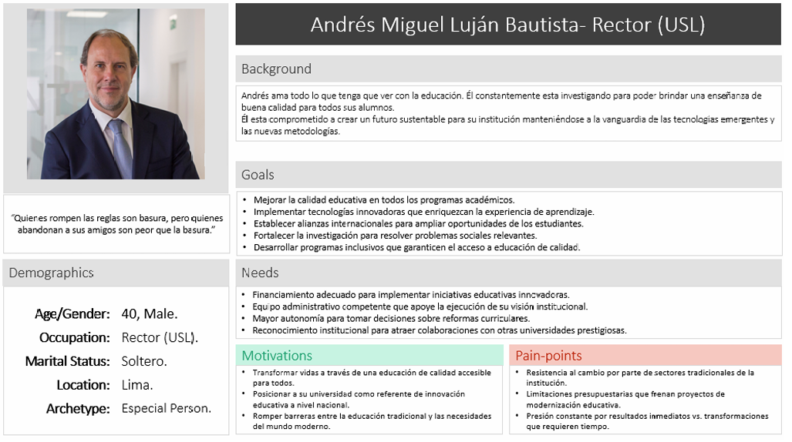<br>

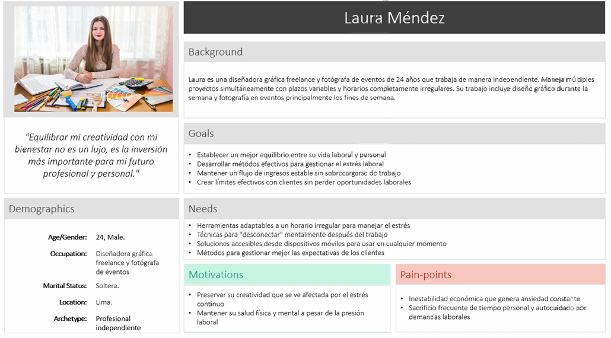<br>

### 2.3.2. User Task Matrix

| Tareas                                                 | Laura Frecuencia | Laura Importancia | Andrés Frecuencia | Andrés Importancia |
| ------------------------------------------------------ | ---------------- | ----------------- | ----------------- | ------------------ |
| Registrar señales corporales de estrés                 | Media            | Media             | Alta              | Alta               |
| Completar autoevaluación de niveles de estrés          | Media            | Alta              | Alta              | Media              |
| Consultar análisis de patrones de estrés               | Alta             | Media             | Media             | Alta               |
| Acceder a recomendaciones personalizadas               | Media            | Alta              | Alta              | Alta               |
| Registrar seguimiento de implementación de estrategias | Media            | Alta              | Alta              | Alta               |

### 2.3.3. User Journey Mapping

#### User Journey Mapping – Andrés Luján

**Figura 2.3.3.1. Journey Map de Andrés Luján – Parte 1**  
<div>
  <p align="center">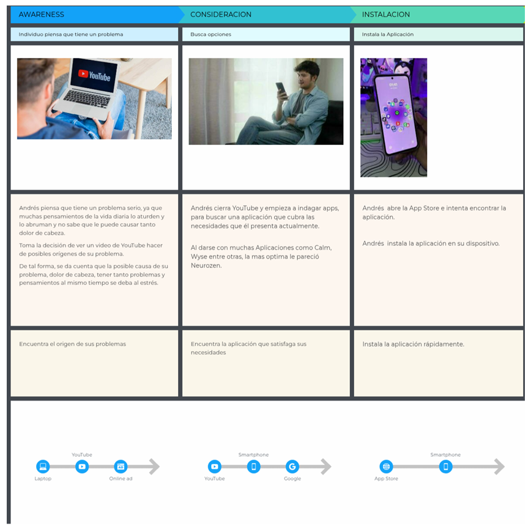</p>
</div>

**Figura 2.3.3.2. Journey Map de Andrés Luján – Parte 2**  
<div>
  <p align="center">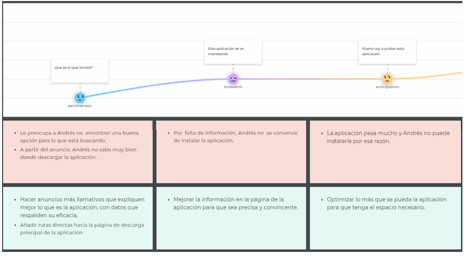</p>
</div>

**Figura 2.3.3.3. Journey Map de Andrés Luján – Parte 3**  
<div>
  <p align="center">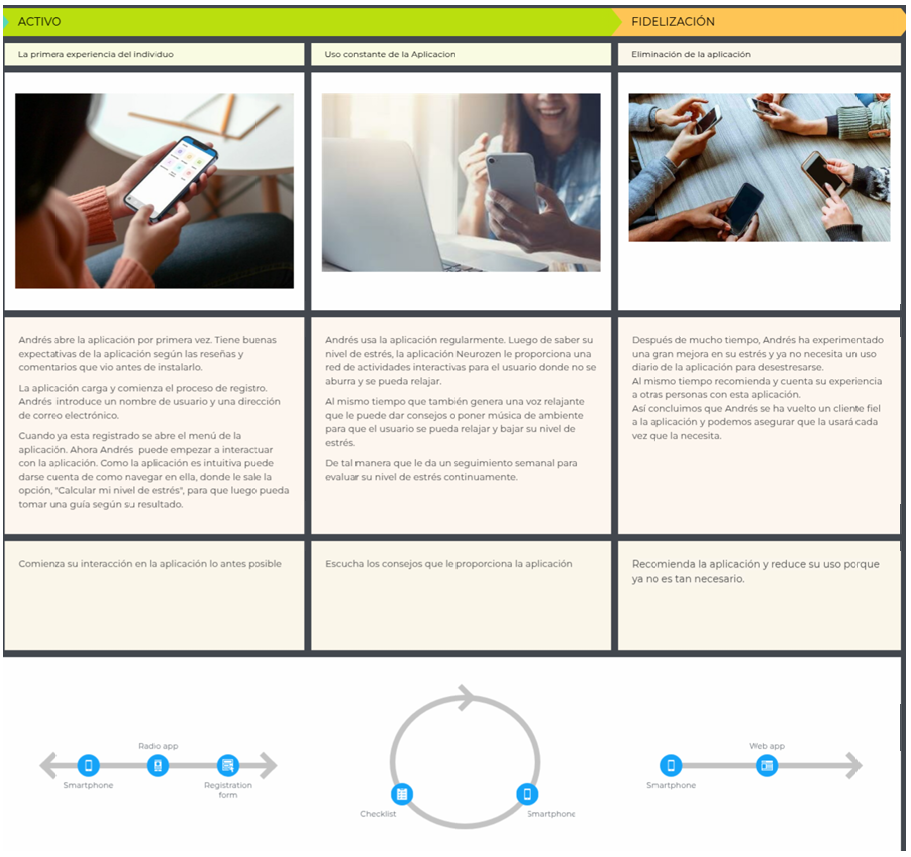</p>
</div>

**Figura 2.3.3.4. Journey Map de Andrés Luján – Parte 4**  
<div>
  <p align="center">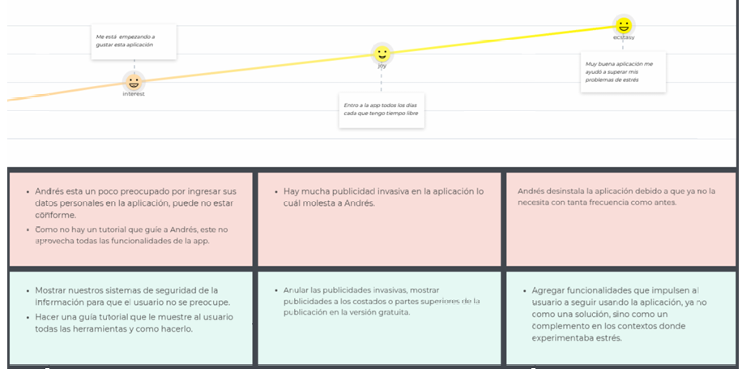</p>
</div>

#### User Journey Mapping – Laura Méndez

**Figura 2.3.3.5. Journey Map de Laura Méndez – Parte 1**  
<div>
  <p align="center">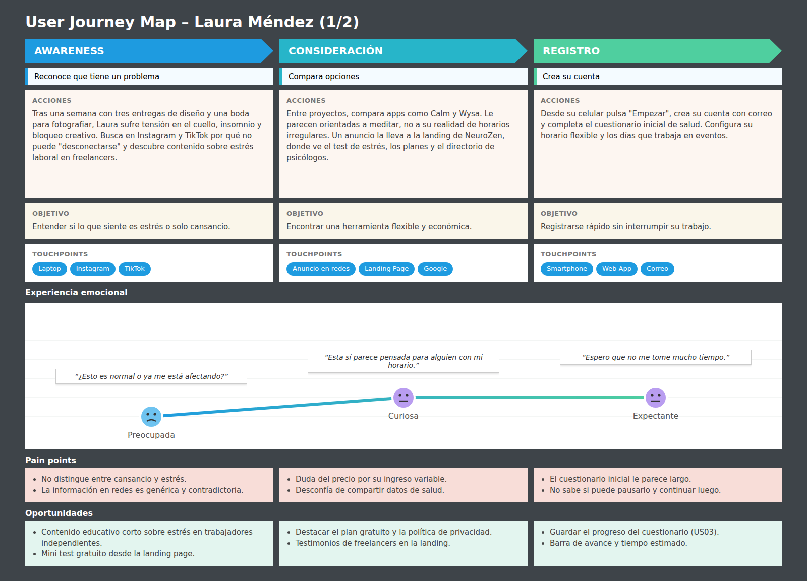</p>
</div>

**Figura 2.3.3.6. Journey Map de Laura Méndez – Parte 2**  
<div>
  <p align="center">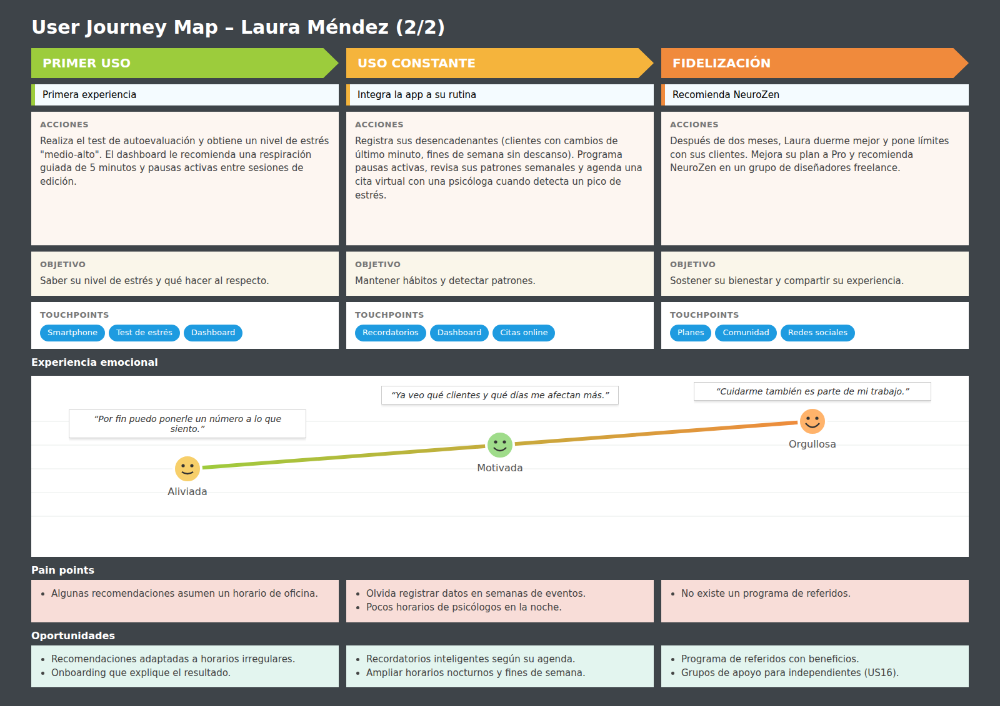</p>
</div>

### 2.3.4. Empathy Mapping

<div>
  <p align="center">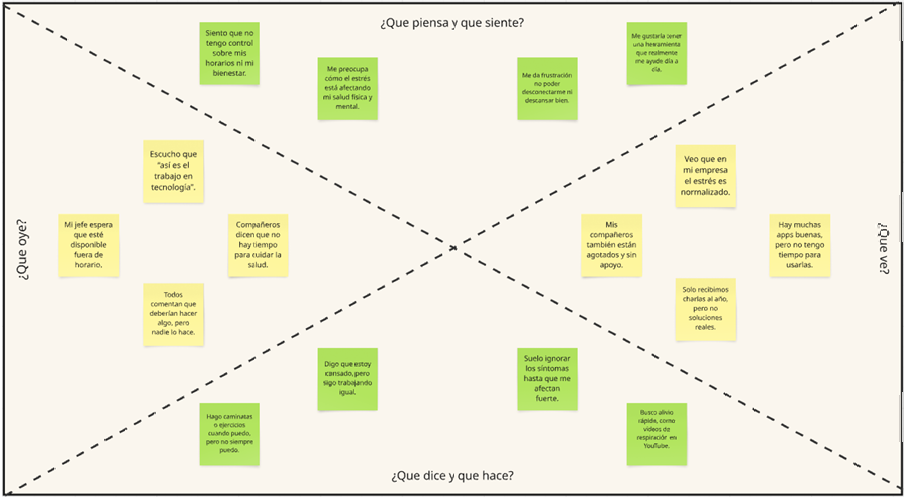</p>
</div>

<div>
  <p align="center">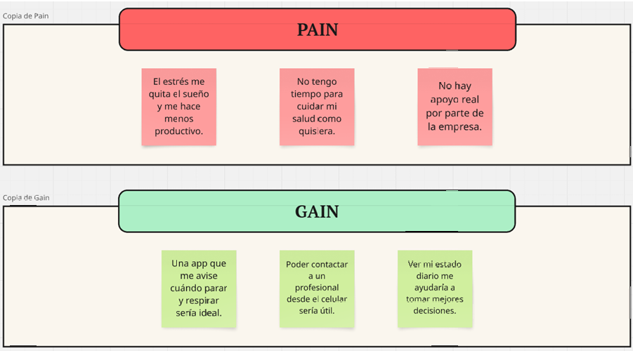</p>
</div>

<div>
  <p align="center">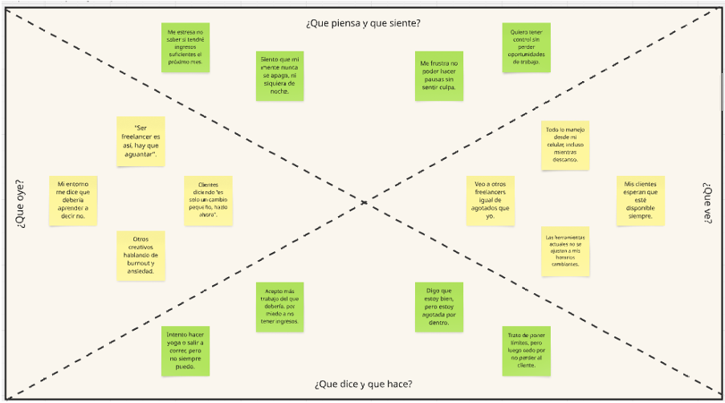</p>
</div>

<div>
  <p align="center">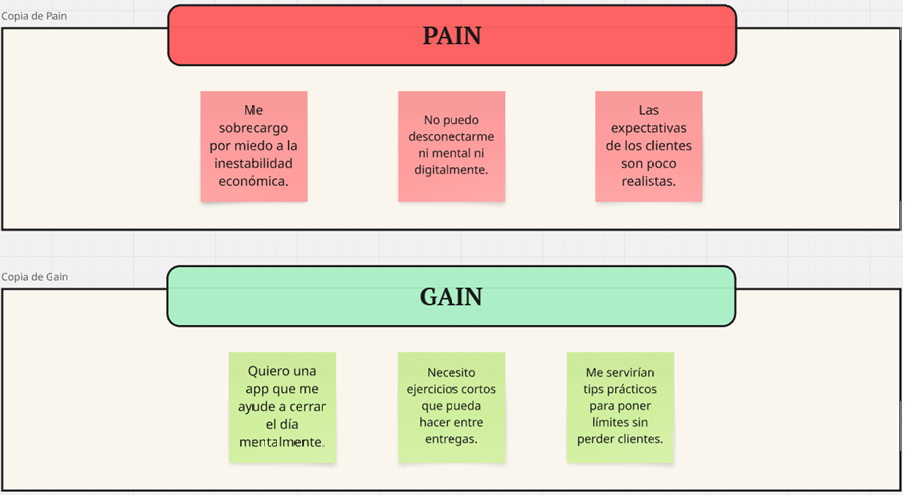</p>
</div>

### 2.3.5. As-is Scenario Mapping

**As-is Scenario Mapping de Laura Méndez**

| Phases       | Registrar señales corporales de estrés                | Completar autoevaluación de niveles de estrés   | Consultar análisis de patrones de estrés            | Acceder a recomendaciones personalizadas                         | Registrar seguimiento de implementación de estrategias                |
| :----------- | :---------------------------------------------------- | :---------------------------------------------- | :-------------------------------------------------- | :--------------------------------------------------------------- | :-------------------------------------------------------------------- |
| **Doing**    | Toma fotos de su postura durante horas de trabajo.    | Completa cuestionarios rápidos entre proyectos. | Revisa los gráficos semanales de estrés.            | Accede a recomendaciones desde su teléfono móvil.                | Registra la efectividad de las técnicas implementadas.                |
| **Thinking** | Duda si está estresada o solo cansada.                | Evalúa si está aceptando demasiados proyectos.  | Busca patrones relacionados con ciertos clientes.   | Cuestiona si las recomendaciones se adaptan a su estilo de vida. | Se pregunta si está siendo constante con las técnicas.                |
| **Feeling**  | Se siente abrumada al notar signos físicos de estrés. | Siente alivio al cuantificar su estrés.         | Muestra curiosidad al descubrir patrones de estrés. | Experimenta esperanza al recibir nuevas estrategias.             | Siente orgullo cuando logra implementar estrategias consistentemente. |

**As-is Scenario Mapping de Andrés Luján**

| Phases       | Registrar señales corporales de estrés                          | Completar autoevaluación de niveles de estrés                            | Consultar análisis de patrones de estrés                                | Acceder a recomendaciones personalizadas                                   | Registrar seguimiento de implementación de estrategias                   |
| :----------- | :-------------------------------------------------------------- | :----------------------------------------------------------------------- | :---------------------------------------------------------------------- | :------------------------------------------------------------------------- | :----------------------------------------------------------------------- |
| **Doing**    | Documenta su tensión muscular después de reuniones prolongadas. | Realiza evaluaciones al final de su jornada laboral.                     | Analiza tendencias de estrés durante diferentes períodos académicos.    | Revisa el coaching emocional personalizado entre reuniones.                | Registra diariamente la efectividad de las estrategias implementadas.    |
| **Thinking** | Se pregunta si su fatiga es visible para su equipo.             | Considera cómo los cambios institucionales afectan su nivel de estrés.   | Reflexiona sobre la relación entre sus horas de trabajo y su bienestar. | Evalúa qué recomendaciones son viables con su apretada agenda.             | Analiza qué técnicas funcionan mejor durante temporadas de alta presión. |
| **Feeling**  | Se siente frustrado al reconocer signos físicos de agotamiento. | Experimenta preocupación al constatar altos niveles de estrés sostenido. | Siente determinación al identificar patrones problemáticos.             | Muestra optimismo al encontrar soluciones adaptadas a su rol de liderazgo. | Siente satisfacción cuando logra incorporar nuevos hábitos a su rutina.  |

## 2.4. Ubiquitous Language

Este glosario define los términos clave que usamos en el proyecto para mantener un lenguaje común entre el equipo de desarrollo y los expertos en salud mental.

| Término                            | Definición                                                                                                                     |
| ---------------------------------- | ------------------------------------------------------------------------------------------------------------------------------ |
| **Usuario**                        | Persona adulta (20–50 años) que utiliza la app para evaluar, monitorear y gestionar su estrés laboral.                         |
| **Perfil biométrico**              | Conjunto de datos físicos iniciales del usuario (postura, rostro, respiración) que sirven como línea base.                     |
| **Test de autoevaluación**         | Cuestionario digital que mide síntomas y sensaciones de estrés percibidas por el usuario.                                      |
| **Análisis biométrico**            | Proceso de escaneo mediante la cámara/sensores para detectar señales físicas de estrés.                                        |
| **Síntomas físicos**               | Manifestaciones registradas por el usuario, como dolores de cabeza, insomnio, tensión muscular.                                |
| **Nivel de estrés**                | Clasificación automática (bajo, medio, alto) que combina datos de tests y biometría.                                           |
| **Recomendaciones personalizadas** | Consejos, ejercicios o pausas sugeridas por la app en base al estado actual del usuario.                                       |
| **Ejercicios de respiración**      | Actividad guiada por la app para reducir la tensión y ansiedad en pocos minutos.                                               |
| **Pausas activas**                 | Recordatorios programados que invitan al usuario a descansar o hacer micro ejercicios durante la jornada laboral.              |
| **Dashboard personal**             | Panel con estadísticas, tendencias y patrones de estrés en el tiempo.                                                          |
| **Desencadenante de estrés**       | Evento o situación registrada por el usuario que provoca incremento de su estrés (ej. exceso de trabajo, conflictos, tráfico). |
| **Informe de progreso**            | Documento generado con evolución de estrés y hábitos del usuario, que puede compartirse con un psicólogo.                      |
| **Especialista en salud mental**   | Psicólogo disponible en la plataforma para consultas y tratamiento profesional.                                                |
| **Cita**                           | Programación de una sesión con un especialista, virtual o presencial.                                                      |
| **Grupo de apoyo**                 | Comunidad virtual de usuarios que comparten experiencias y consejos sobre el manejo del estrés.                                |
| **Biblioteca de recursos**         | Colección digital de artículos, videos o guías relacionadas al bienestar laboral y manejo del estrés.                          |

<div style="page-break-after: always;"></div>

# Capítulo III: Requirements Specification

## 3.1. To-Be Scenario Mapping

**User Journey Mapping – Laura Méndez**

| Fases                                         | Doing                                                    | Thinking                                                                | Feeling                                             |
| --------------------------------------------- | -------------------------------------------------------- | ----------------------------------------------------------------------- | --------------------------------------------------- |
| Registrar señales corporales de estrés        | La app detecta automáticamente postura y signos faciales | “Es útil que el sistema registre señales sin que yo tenga que hacerlo.” | Tranquilidad por el monitoreo pasivo                |
| Completar autoevaluación de niveles de estrés | Recibe notificaciones de autoevaluación guiada con IA    | “Ahora sé si lo que siento es estrés o solo cansancio.”                 | Alivio por entender rápidamente su estado emocional |
| Consultar análisis de patrones de estrés      | Visualiza resúmenes visuales con predicción de picos     | “Ya puedo ver cómo ciertos clientes o días afectan mi bienestar.”       | Curiosidad y sensación de control                   |
| Acceder a recomendaciones personalizadas      | Recibe sugerencias integradas a su rutina diaria         | “Esto se adapta a mí y no interrumpe mi día.”                           | Esperanza al ver opciones viables                   |
| Registrar seguimiento de estrategias          | Ve sus avances con ayuda de recordatorios motivacionales | “Estoy logrando mantener el hábito, y se nota en mi bienestar.”         | Orgullo y motivación al ver progresos               |

**User Journey Mapping – Andrés Luján**

| Fases                                         | Doing                                                  | Thinking                                                   | Feeling                                      |
| --------------------------------------------- | ------------------------------------------------------ | ---------------------------------------------------------- | -------------------------------------------- |
| Registrar señales corporales de estrés        | El sistema registra tensión y postura automáticamente  | “El sistema me ayuda a notar lo que mi cuerpo expresa.”    | Alivio al no depender solo de su percepción  |
| Completar autoevaluación de niveles de estrés | Usa voz o toques rápidos para autoevaluarse            | “Esta evaluación se adapta a mis tiempos.”                 | Comodidad y sensación de autonomía           |
| Consultar análisis de patrones de estrés      | El sistema anticipa picos de estrés según su agenda    | “Puedo prever cuándo debo cuidarme más o delegar.”         | Seguridad al planificar estratégicamente     |
| Acceder a recomendaciones personalizadas      | Recibe recomendaciones justo después de momentos clave | “Estas estrategias están hechas para mi rol de liderazgo.” | Optimismo por la personalización del sistema |
| Registrar seguimiento de estrategias          | Revisa un resumen mensual con IA                       | “Sé qué funcionó y qué debo ajustar para el próximo mes.”  | Satisfacción por tener una guía continua     |


## 3.2. User Stories

| **Epic ID** | **Nombre del Epic**                                | **Descripción**                                                                                                                                                                                                  |
| ----------- | -------------------------------------------------- | ---------------------------------------------------------------------------------------------------------------------------------------------------------------------------------------------------------------- |
| EP01        | Registro y Configuración de Cuenta                 | Como usuario nuevo, quiero registrarme, configurar mi perfil biométrico y completar un cuestionario inicial de salud, para acceder a la plataforma con un perfil personalizado y preciso.                        |
| EP02        | Detección y Evaluación del Estrés                  | Como usuario, quiero evaluar mi nivel de estrés mediante autoevaluaciones, análisis biométricos y registro de síntomas, para obtener un diagnóstico completo de mi estado actual.                                |
| EP03        | Recomendaciones y Gestión del Estrés               | Como usuario diagnosticado con estrés, quiero recibir recomendaciones personalizadas, acceder a ejercicios de respiración y programar pausas activas, para reducir mis niveles de estrés y mejorar mi bienestar. |
| EP04        | Seguimiento y Análisis del Progreso                | Como usuario, quiero visualizar un dashboard personal, generar informes de progreso y registrar desencadenantes de estrés, para dar seguimiento a mi evolución y entender mis patrones de estrés.                |
| EP05        | Conexión con Especialistas en Salud Mental         | Como usuario con necesidad de apoyo profesional, quiero buscar psicólogos, programar citas y compartir informes, para recibir tratamiento especializado dentro de la plataforma.                                   |
| EP06        | Comunidad y Soporte Social                         | Como usuario, quiero participar en grupos de apoyo, acceder a una biblioteca de recursos y unirme a desafíos antiestrés, para sentir acompañamiento social y mantener la motivación en la gestión de mi estrés.  |
| EP07        | Integración con Entorno Laboral                    | Como trabajador, quiero analizar mi carga laboral y recibir recordatorios de ergonomía, para prevenir sobrecarga y mejorar mi productividad sin comprometer mi bienestar.                                        |

| ID Épica | Épica                              | ID HU | Título HU                               | Descripción HU                                                                                                                     | Criterios de Aceptación                                                                                                                                                                                                                                                                                                                                                                                                                                                                                                                                                                                                                                 |
| -------- | ---------------------------------- | ----- | --------------------------------------- | ---------------------------------------------------------------------------------------------------------------------------------- | ------------------------------------------------------------------------------------------------------------------------------------------------------------------------------------------------------------------------------------------------------------------------------------------------------------------------------------------------------------------------------------------------------------------------------------------------------------------------------------------------------------------------------------------------------------------------------------------------------------------------------------------------------- |
| EP01     | Registro y Configuración de Cuenta | US01  | Registrar cuenta de usuario             | Como nuevo usuario, quiero registrar una cuenta con mi correo o número de teléfono, para acceder a las funciones de la aplicación. | **Scenario 1: Successful registration**<ul><li>**Given** the user does not have an account</li><li>**When** the user enters mandatory data and accepts the terms</li><li>**Then** the system creates the account</li><li>**And** sends a verification message</li></ul>**Scenario 2: Failed registration**<ul><li>**Given** the user enters invalid data</li><li>**When** the user attempts to register</li><li>**Then** the system displays an error message</li><li>**And** does not create the account</li></ul>                                                                                                                                   |
| EP01     | Registro y Configuración de Cuenta | US02  | Configurar perfil biométrico            | Como usuario, quiero registrar mis datos biométricos para personalizar el análisis de estrés.                                      | **Scenario 1: Initial configuration**<ul><li>**Given** the user has an active account</li><li>**When** the user registers or synchronizes biometric data</li><li>**Then** the system saves the data</li><li>**And** uses it in future analyses</li></ul>**Scenario 2: Synchronization error**<ul><li>**Given** the user connects a device</li><li>**When** an error occurs</li><li>**Then** the system displays a warning</li><li>**And** allows the user to retry</li></ul>                                                                                                                                                                          |
| EP01     | Registro y Configuración de Cuenta | US03  | Completar cuestionario inicial de salud | Como usuario nuevo, quiero completar un cuestionario de salud para generar mi plan inicial.                                        | **Scenario 1: Completed questionnaire**<ul><li>**Given** the user accesses the initial questionnaire</li><li>**When** the user answers all questions</li><li>**Then** the system saves the responses</li><li>**And** generates an initial profile</li></ul>**Scenario 2: Incomplete questionnaire**<ul><li>**Given** the user abandons the questionnaire</li><li>**When** the user returns</li><li>**Then** the system allows resuming from the saved progress</li></ul>                                                                                                                                                                              |

| ID Épica | Épica                             | ID HU | Título HU                                 | Descripción HU                                                                                      | Criterios de Aceptación                                                                                                                                                                                                                                                                                                                                                                                                                                                                                     |
| -------- | --------------------------------- | ----- | ----------------------------------------- | --------------------------------------------------------------------------------------------------- | ----------------------------------------------------------------------------------------------------------------------------------------------------------------------------------------------------------------------------------------------------------------------------------------------------------------------------------------------------------------------------------------------------------------------------------------------------------------------------------------------------------- |
| EP02     | Detección y Evaluación del Estrés | US04  | Realizar test de autoevaluación de estrés | Como usuario, quiero realizar un test de estrés para conocer mi nivel actual.                       | **Scenario 1: Completed test**<ul><li>**Given** the user accesses the test</li><li>**When** the user answers all questions</li><li>**Then** the system displays the immediate result</li></ul>**Scenario 2: Incomplete test**<ul><li>**Given** the user abandons the test</li><li>**When** the user returns</li><li>**Then** the system saves the progress</li><li>**And** allows the user to resume it</li></ul>                                                                                           |
| EP02     | Detección y Evaluación del Estrés | US05  | Análisis biométrico de señales de estrés  | Como usuario, quiero que la app analice mis datos biométricos para detectar estrés automáticamente. | **Scenario 1: Successful analysis**<ul><li>**Given** the user synchronized their device</li><li>**When** the data is received</li><li>**Then** the system calculates the stress level</li></ul>**Scenario 2: Insufficient data**<ul><li>**Given** there is missing data</li><li>**When** the system attempts to analyze</li><li>**Then** the system notifies the user</li></ul>                                                                                                                             |
| EP02     | Detección y Evaluación del Estrés | US06  | Registro de síntomas físicos              | Como usuario, quiero registrar manualmente mis síntomas físicos para complementar el análisis.      | **Scenario 1: Successful record**<ul><li>**Given** the user accesses the "Symptoms" section</li><li>**When** the user enters information</li><li>**Then** the system saves the data</li></ul>**Scenario 2: Validation error**<ul><li>**Given** the user omits a mandatory field</li><li>**When** the user attempts to save</li><li>**Then** the system requests to complete the field</li></ul>                                                                                                             |

| ID Épica | Épica                                | ID HU | Título HU                                  | Descripción HU                                                                | Criterios de Aceptación                                                                                                                                                                                                                                                                                                                                                                                                                                                                                                                                           |
| -------- | ------------------------------------ | ----- | ------------------------------------------ | ----------------------------------------------------------------------------- | ----------------------------------------------------------------------------------------------------------------------------------------------------------------------------------------------------------------------------------------------------------------------------------------------------------------------------------------------------------------------------------------------------------------------------------------------------------------------------------------------------------------------------------------------------------------- |
| EP03     | Recomendaciones y Gestión del Estrés | US07  | Recibir recomendaciones personalizadas     | Como usuario, quiero recibir recomendaciones basadas en mi perfil de estrés.  | **Scenario 1: Recommendations generated**<ul><li>**Given** the user completed the questionnaire and biometrics</li><li>**When** the user accesses recommendations</li><li>**Then** the system displays personalized suggestions</li></ul>**Scenario 2: Missing data**<ul><li>**Given** the user did not complete their profile</li><li>**When** the user attempts to view recommendations</li><li>**Then** the system displays a message indicating missing data</li></ul>                                                                                          |
| EP03     | Recomendaciones y Gestión del Estrés | US08  | Realizar ejercicios de respiración guiados | Como usuario, quiero realizar ejercicios guiados para reducir el estrés.      | **Scenario 1: Completed exercise**<ul><li>**Given** the user selects an exercise</li><li>**When** the user finishes it</li><li>**Then** the system records the activity</li></ul>**Scenario 2: Interruption**<ul><li>**Given** the user abandons the exercise</li><li>**When** the user returns</li><li>**Then** the system allows restarting or continuing</li></ul>                                                                                                                                                                                             |
| EP03     | Recomendaciones y Gestión del Estrés | US09  | Programar pausas activas laborales         | Como usuario, quiero programar pausas para reducir mi carga laboral y estrés. | **Scenario 1: Scheduled pause**<ul><li>**Given** the user accesses the agenda</li><li>**When** the user schedules a pause</li><li>**Then** the system saves a reminder</li></ul>**Scenario 2: Notification**<ul><li>**Given** a scheduled pause is approaching</li><li>**When** the scheduled time arrives</li><li>**Then** the system sends a reminder</li></ul>                                                                                                                                                                                                  |

| ID Épica | Épica                               | ID HU | Título HU                               | Descripción HU                                                                     | Criterios de Aceptación                                                                                                                                                                                                                                                                                                                                                                                                                                                                                     |
| -------- | ----------------------------------- | ----- | --------------------------------------- | ---------------------------------------------------------------------------------- | ----------------------------------------------------------------------------------------------------------------------------------------------------------------------------------------------------------------------------------------------------------------------------------------------------------------------------------------------------------------------------------------------------------------------------------------------------------------------------------------------------------- |
| EP04     | Seguimiento y Análisis del Progreso | US10  | Visualizar dashboard personal de estrés | Como usuario, quiero ver mi estado actual de estrés en un dashboard.               | **Scenario 1: Dashboard with data**<ul><li>**Given** the user has records</li><li>**When** the user enters the dashboard</li><li>**Then** the system displays their metrics</li></ul>**Scenario 2: Without data**<ul><li>**Given** there are no records</li><li>**When** the user accesses the dashboard</li><li>**Then** the system indicates that there is no information yet</li></ul>                                                                                                                   |
| EP04     | Seguimiento y Análisis del Progreso | US11  | Generar informes de progreso            | Como usuario, quiero generar informes para evaluar mis avances.                    | **Scenario 1: Generated report**<ul><li>**Given** the user selects a period</li><li>**When** the user requests a report</li><li>**Then** the system generates a downloadable report</li></ul>**Scenario 2: Missing data**<ul><li>**Given** the user has no records</li><li>**When** the user attempts to generate a report</li><li>**Then** the system displays a warning</li></ul>                                                                                                                         |
| EP04     | Seguimiento y Análisis del Progreso | US12  | Registrar desencadenantes de estrés     | Como usuario, quiero registrar situaciones que detonan mi estrés para analizarlas. | **Scenario 1: Successful record**<ul><li>**Given** the user accesses "Triggers"</li><li>**When** the user enters information</li><li>**Then** the system saves the record</li></ul>**Scenario 2: Incomplete record**<ul><li>**Given** the user does not fill in mandatory fields</li><li>**When** the user attempts to save</li><li>**Then** the system requests completion</li></ul>                                                                                                                       |

| ID Épica | Épica                      | ID HU | Título HU                            | Descripción HU                                                                | Criterios de Aceptación                                                                                                                                                                                                                                                                                                                                                                                                                                                                                                                   |
| -------- | -------------------------- | ----- | ------------------------------------ | ----------------------------------------------------------------------------- | ----------------------------------------------------------------------------------------------------------------------------------------------------------------------------------------------------------------------------------------------------------------------------------------------------------------------------------------------------------------------------------------------------------------------------------------------------------------------------------------------------------------------------------------- |
| EP05     | Conexión con Especialistas | US13  | Buscar psicólogos especializados     | Como usuario, quiero buscar psicólogos según especialidad para recibir apoyo. | **Scenario 1: Successful search**<ul><li>**Given** the user accesses the search function</li><li>**When** the user enters criteria</li><li>**Then** the system displays available psychologists</li></ul>**Scenario 2: No results**<ul><li>**Given** there are no matches</li><li>**When** the user searches</li><li>**Then** the system displays a message indicating no psychologists were found</li></ul>                                                                                                                              |
| EP05     | Conexión con Especialistas | US14  | Reservar cita con psicólogo          | Como usuario, quiero reservar una cita en línea con un psicólogo.             | **Scenario 1: Scheduled appointment**<ul><li>**Given** the user selects a specialist and time</li><li>**When** the user confirms</li><li>**Then** the system saves the appointment</li></ul>**Scenario 2: Schedule conflict**<ul><li>**Given** an appointment already exists at that time</li><li>**When** the user attempts to book</li><li>**Then** the system displays an error</li><li>**And** requests another option</li></ul>                                                                                                      |
| EP05     | Conexión con Especialistas | US15  | Compartir informes con especialistas | Como usuario, quiero compartir mis informes de progreso con un psicólogo.     | **Scenario 1: Shared report**<ul><li>**Given** the user selects a report</li><li>**When** the user sends it</li><li>**Then** the specialist receives access</li></ul>**Scenario 2: Send error**<ul><li>**Given** a failure occurs</li><li>**When** the user attempts to share</li><li>**Then** the system displays an error message</li></ul>                                                                                                                                                                                             |

| ID Épica | Épica                      | ID HU | Título HU                         | Descripción HU                                                               | Criterios de Aceptación                                                                                                                                                                                                                                                                                                                                                                                                                                                                                        |
| -------- | -------------------------- | ----- | --------------------------------- | ---------------------------------------------------------------------------- | -------------------------------------------------------------------------------------------------------------------------------------------------------------------------------------------------------------------------------------------------------------------------------------------------------------------------------------------------------------------------------------------------------------------------------------------------------------------------------------------------------------- |
| EP06     | Comunidad y Soporte Social | US16  | Participar en grupos de apoyo     | Como usuario, quiero unirme a grupos de apoyo para compartir experiencias.   | **Scenario 1: Successful join**<ul><li>**Given** the user accesses groups</li><li>**When** the user selects one</li><li>**Then** the system adds them</li></ul>**Scenario 2: Closed group**<ul><li>**Given** the group requires approval</li><li>**When** the user requests to join</li><li>**Then** the system notifies them to wait for confirmation</li></ul>                                                                                                                                             |
| EP06     | Comunidad y Soporte Social | US17  | Acceder a biblioteca de recursos  | Como usuario, quiero acceder a artículos y videos sobre manejo del estrés.   | **Scenario 1: Successful access**<ul><li>**Given** the user accesses the library</li><li>**When** the user selects a resource</li><li>**Then** the system opens it</li></ul>**Scenario 2: Resource unavailable**<ul><li>**Given** a resource was removed</li><li>**When** the user selects it</li><li>**Then** the system notifies them of its unavailability</li></ul>                                                                                                                                       |
| EP06     | Comunidad y Soporte Social | US18  | Participar en desafíos antiestrés | Como usuario, quiero unirme a retos que me ayuden a mejorar mi salud mental. | **Scenario 1: Join challenge**<ul><li>**Given** the user accesses challenges</li><li>**When** the user selects one</li><li>**Then** the system registers them</li></ul>**Scenario 2: Finished challenge**<ul><li>**Given** the challenge has already concluded</li><li>**When** the user attempts to join</li><li>**Then** the system notifies them that it is not available</li></ul>                                                                                                                       |

| ID Épica | Épica                           | ID HU | Título HU                          | Descripción HU                                                                                | Criterios de Aceptación                                                                                                                                                                                                                                                                                                                                                                                                                                                                                      |
| -------- | ------------------------------- | ----- | ---------------------------------- | --------------------------------------------------------------------------------------------- | ------------------------------------------------------------------------------------------------------------------------------------------------------------------------------------------------------------------------------------------------------------------------------------------------------------------------------------------------------------------------------------------------------------------------------------------------------------------------------------------------------------ |
| EP07     | Integración con Entorno Laboral | US19  | Analizar carga laboral             | Como empleado, quiero registrar y analizar mi carga laboral para identificar estrés laboral.  | **Scenario 1: Successful record**<ul><li>**Given** the user enters worked hours</li><li>**When** the user saves the information</li><li>**Then** the system calculates the workload</li></ul>**Scenario 2: Validation error**<ul><li>**Given** the user omits required data</li><li>**When** the user attempts to save</li><li>**Then** the system requests them to be completed</li></ul>                                                                                                                     |
| EP07     | Integración con Entorno Laboral | US20  | Recibir recordatorios de ergonomía | Como usuario, quiero recibir recordatorios de ergonomía para cuidar mi postura en el trabajo. | **Scenario 1: Reminder sent**<ul><li>**Given** the user configured notifications</li><li>**When** the scheduled time arrives</li><li>**Then** the system sends a reminder</li></ul>**Scenario 2: Notifications disabled**<ul><li>**Given** the user deactivated reminders</li><li>**When** the scheduled time arrives</li><li>**Then** the system does not send a notification</li></ul>                                                                                                                         |

---

## 3.3. Product Backlog

_Orden de User Stories y Technical Stories_

| Orden | ID   | User Story / Technical Story               | Story Points | Bounded Context |
| ----- | ---- | ------------------------------------------ | ------------ | --------------- |
| 01    | US01 | Registrar cuenta de usuario                | 3            | IAM             |
| 02    | US02 | Configurar perfil biométrico               | 5            | Biometrics      |
| 03    | US03 | Completar cuestionario inicial de salud    | 3            | Assessments     |
| 04    | US04 | Realizar test de autoevaluación de estrés  | 5            | Assessments     |
| 05    | US05 | Análisis biométrico de señales de estrés   | 5            | Biometrics      |
| 06    | US06 | Registrar síntomas físicos                 | 3            | Health Tracking |
| 07    | US07 | Recibir recomendaciones personalizadas     | 5            | Recommendations |
| 08    | US08 | Realizar ejercicios de respiración guiados | 3            | Activities      |
| 09    | US09 | Programar pausas activas laborales         | 3            | Activities      |
| 10    | US10 | Visualizar dashboard personal de estrés    | 5            | Dashboard       |
| 11    | US11 | Generar informes de progreso               | 5            | Reports         |
| 12    | US12 | Registrar desencadenantes de estrés        | 3            | Health Tracking |
| 13    | US13 | Buscar psicólogos especializados           | 3            | Professionals   |
| 14    | US14 | Programar cita con psicólogo               | 5            | Appointments    |
| 15    | US15 | Compartir informes con especialistas       | 3            | Reports         |
| 16    | US16 | Participar en grupos de apoyo              | 3            | Community       |
| 17    | US17 | Acceder a biblioteca de recursos           | 2            | Resources       |
| 18    | US18 | Participar en desafíos antiestrés          | 3            | Community       |
| 19    | US19 | Analizar carga laboral                     | 5            | Analytics       |
| 20    | US20 | Recibir recordatorios de ergonomía         | 2            | Notifications   |

## 3.4. Impact Mapping

Impact Mapping - Segmento 1

<div>
  <p align="center">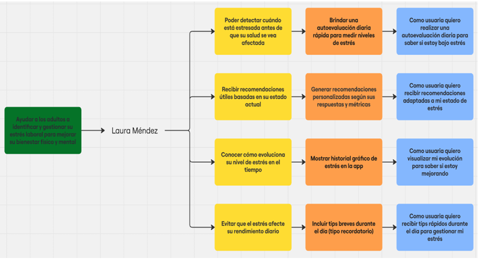</p>
</div>

Impact Mapping - Segmento 2

<div>
  <p align="center">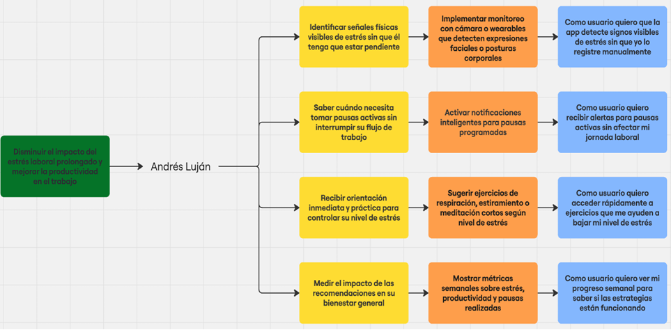</p>
</div>

---

<div style="page-break-after: always;"></div>

# Capítulo IV: Product Design

## 4.1. Style Guidelines

NeuroDraw, dedicado a la detección rápida y manejo del estrés laboral, transmite calma, confianza y profesionalismo. Nuestra identidad visual combina tonos azules y verdes para evocar tranquilidad, con tipografía clara y espacios limpios. Comunicamos con un lenguaje accesible pero riguroso, transformando conceptos complejos de neurociencia en soluciones prácticas para el bienestar laboral.

### 4.1.1. General Style Guidelines

Logo: El logo de NeuroZen fusiona elementos neurológicos y serenidad en un diseño significativo. La silueta de perfil humano en Verde Bosque muestra circuitos cerebrales que simbolizan cómo nuestra plataforma conecta ciencia y bienestar mental.

<div>
  <p align="center">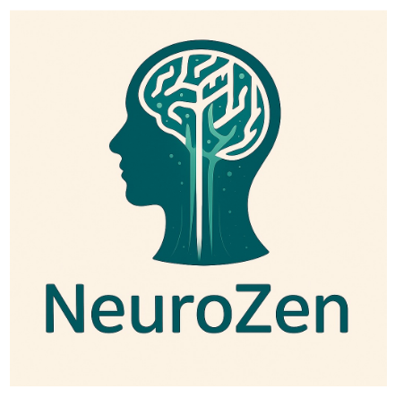</p>
</div>

Tipografía:

La tipografía de la página debe ser fácil de leer, adaptándose al dispositivo en el que se encuentre. Para ello, se emplearán dos fuentes sans-serif (sin remates decorativos) porque son más legibles y claras. Además, el contenido mostrado debe de resaltar.

Color Guide:

1. Verde Bosque (#2D5A4A)
Representación: El verde bosque simboliza estabilidad, crecimiento y conexión con la naturaleza. En el contexto de NeuroZen, este color representa la base sólida que ofrece la plataforma para ayudar a los usuarios a manejar su estrés. Se utiliza en elementos principales como el logotipo y encabezados, transmitiendo confianza y un ambiente relajante que invita a la calma mental.
<div>
  <p align="center">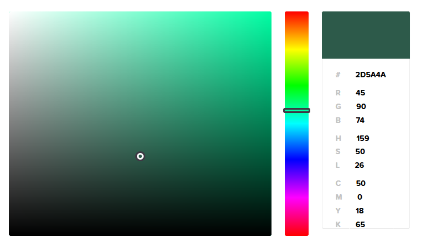</p>
</div>

2. Verde Menta (#A2C4B5)
Representación: El verde menta evoca frescura, renovación y claridad mental. Este color más suave complementa al verde bosque y se utiliza en áreas secundarias de la plataforma. Representa la sensación refrescante que experimentan los usuarios al reducir su estrés mediante las técnicas proporcionadas por NeuroZen, creando un ambiente digital que respira tranquilidad.
<div>
  <p align="center">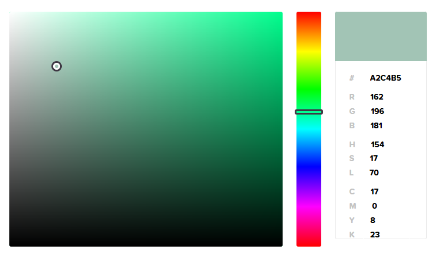</p>
</div>

3. Beige Cálido (#F1E9D4)
Representación: El beige cálido transmite neutralidad, confort y serenidad. En NeuroZen, este color se utiliza para fondos y espacios de descanso visual, proporcionando un ambiente acogedor que reduce la fatiga visual durante las sesiones de meditación o ejercicios anti-estrés. El beige crea un entorno digital que se siente como un refugio seguro.
<div>
  <p align="center">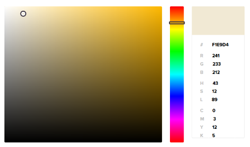</p>
</div>

4. Turquesa Profundo (#1A6F78)
Representación: El turquesa profundo simboliza la profundidad emocional, la comunicación y la sabiduría. Este color representa el componente científico y psicológico de NeuroZen, destacando las herramientas basadas en evidencia para el manejo del estrés. Se utiliza en elementos interactivos y botones de acción, invitando a los usuarios a explorar soluciones más profundas.
<div>
  <p align="center">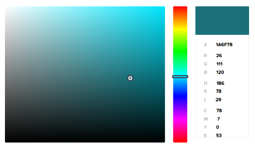</p>
</div>

5. Gris Piedra (#8C9893)
Representación: El gris piedra evoca neutralidad, equilibrio y estabilidad. En NeuroZen, este color funciona como un ancla visual que equilibra los verdes y turquesas más expresivos. Se utiliza para texto secundario y elementos de interfaz sutiles, aportando sofisticación sin competir con los colores principales que transmiten calma y bienestar.
<div>
  <p align="center">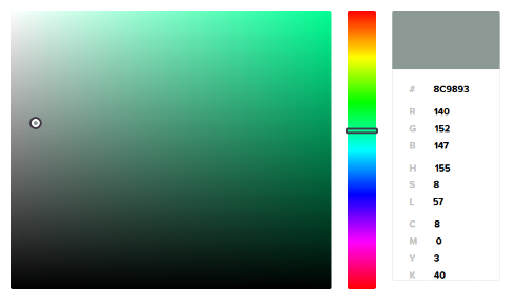</p>
</div>

La paleta de colores de NeuroZen combina verdes y turquesas para transmitir naturaleza y tecnología, beige para crear un entorno acogedor y gris piedra para aportar profesionalismo. En conjunto, el diseño busca generar una experiencia visual relajante y coherente con la misión de reducir el estrés del usuario.

Buttons:

La plataforma NeuroZen para control del estrés presenta una interfaz intuitiva con botones fácilmente identificables en toda la experiencia. Los botones principales utilizan Verde Bosque (#2D5A4A) para acciones importantes como iniciar meditaciones, mientras que los secundarios aparecen en Verde Menta (#A2C4B5), creando jerarquía visual. El fondo en Beige Cálido (#F1E9D4) proporciona un ambiente relajante, complementado por elementos interactivos en Turquesa Profundo (#1A6F78) para funciones especiales y Gris Piedra (#8C9893) para textos y detalles sutiles. Todos los botones tienen formas redondeadas y tamaños generosos, facilitando su uso incluso en momentos de estrés, mientras que los estados de hover y feedback ofrecen respuestas visuales claras que refuerzan la sensación de calma y control que define la experiencia de NeuroZen.

Variaciones del logo en diferentes representaciones:

<div>
  <p align="center">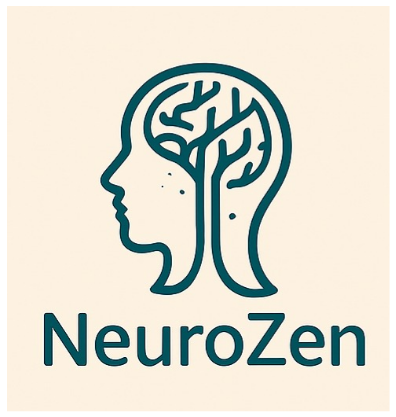</p>
</div>
-Una opción minimalista, sin muchos detalles y relajante a la vista.
<div>
  <p align="center">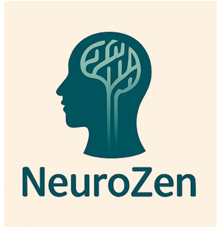</p>
</div>
-Una opción con mejor detalle y uso de colores.
<div>
  <p align="center">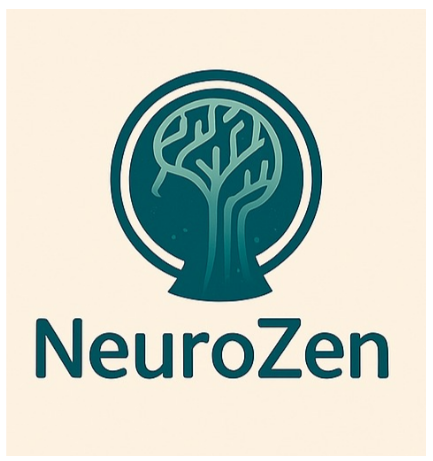</p>
</div>
-Una representación más abstracta que inspira relajación.
<div>
  <p align="center">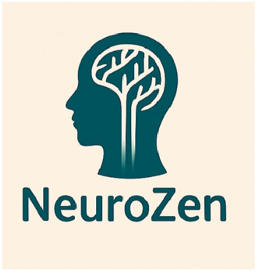</p>
</div>
-Una opción que combina las dos primeras ideas.

---

### 4.1.2. Web Style Guidelines

Para NeuroZen, estamos desarrollando una plataforma web y una landing page enfocada en el bienestar laboral. Por ello, implementaremos un diseño adaptable (Web Responsive Design) que optimice la presentación de la información en cualquier dispositivo, ya sea computadora, tablet o smartphone. Esto garantizará que el contenido sea accesible y claro en todo momento, mejorando la experiencia de los usuarios.

Como equipo, hemos decidido incorporar el patrón de diseño en forma de Z para la página principal. Esta técnica es ideal para dirigir la atención de los visitantes hacia los elementos más importantes de NeuroZen, como el objetivo del proyecto, el acceso al test de estrés y los beneficios de la plataforma. Colocaremos el logotipo de NeuroZen en la esquina superior izquierda para reforzar el reconocimiento de marca, mientras que en la esquina superior derecha estará la barra de navegación y un botón de llamado a la acción destacado que invite a registrarse o probar el test inicial.

---

### 4.1.3. Mobile Style Guidelines

---

#### 4.1.3.1. iOS Mobile Style Guidelines

Para el entorno de iOS, la interfaz de NeuroZen se regirá bajo las Human Interface Guidelines (HIG) de Apple para garantizar una experiencia nativa y fluida. Se priorizará el uso de la tipografía del sistema (San Francisco) y el estricto respeto por los márgenes de seguridad (Safe Areas) para evitar que la interfaz choque con el hardware (como el notch o la Dynamic Island). La navegación principal se gestionará mediante un Bottom Tab Bar translúcido e incluirá el gesto nativo de retroceso lateral (swipe-to-go-back). Además, se integrarán componentes visuales característicos del ecosistema Apple, como selectores de fecha tipo rodillo (Cupertino) para el agendamiento de citas y desenfoques de fondo (blur) en los modales superpuestos.

---

#### 4.1.3.2. Android Mobile Style Guidelines

Para los dispositivos Android, el diseño visual y funcional de la aplicación se basará en los principios de Material Design 3 de Google. Se utilizará la tipografía Roboto estructurada bajo jerarquías claras, y se aplicará un sistema visual de profundidad mediante sombras y diferentes niveles de elevación para destacar las tarjetas de los psicólogos y los elementos del Dashboard. Toda interacción del usuario generará una respuesta táctil inmediata a través del efecto Ripple (onda de color) en los componentes interactivos. Finalmente, las acciones clave del paciente se centralizarán a través de un Botón Flotante de Acción (FAB) persistente, diseñado con los tonos verdes de la marca para invocar rápidamente al asistente Zenbot.

---

## 4.2. Information Architecture

NeuroZen detecta el estrés laboral combinando datos biométricos (postura, tensión facial, respiración) con autoevaluaciones emocionales para generar un perfil de estrés personalizado. La app ofrece recomendaciones y ejercicios para reducir los síntomas, envía notificaciones en tiempo real ante aumentos de estrés y permite revisar un historial de tendencias para identificar patrones.

A futuro, se integrará con psicólogos y programas de bienestar laboral para empresas, convirtiéndose en una herramienta completa de prevención y gestión del estrés.

---

### 4.2.1. Organization Systems

La información se organiza de forma lógica para que el usuario encuentre rápido lo que necesita:

Estructura basada en módulos claros: inicio, autoevaluación, recomendaciones, profesionales, comunidad y recursos.

Jerarquización de contenidos: lo más usado (tests y recomendaciones) aparece en posiciones destacadas.

---

### 4.2.2. Labeling Systems

El etiquetado debe ser claro, breve y familiar para los usuarios:

Uso de términos simples como: Inicio, Test de Estrés, Recomendaciones, Comunidad, Psicólogos, Recursos.

Evitar tecnicismos clínicos, priorizando un lenguaje cotidiano.

Consistencia en los nombres en toda la app y web.

---

### 4.2.3. SEO Tags and Meta Tags

Meta títulos: deben incluir palabras clave relacionadas con salud mental, estrés laboral y bienestar.

Meta descripciones: claras, con llamado a la acción (ejemplo: “Evalúa tu nivel de estrés y recibe recomendaciones personalizadas”).

Etiquetas alt en imágenes con descripciones concisas.

Uso de headings (H1, H2, H3) para mejorar la indexación en buscadores.

---

### 4.2.4. Searching Systems

Búsqueda interna intuitiva, con autocompletado y sugerencias rápidas.

Posibilidad de filtrar resultados (ejemplo: artículos, psicólogos, recursos, ejercicios).

Optimización para resultados relevantes según la necesidad del usuario.

---

### 4.2.5. Navigation Systems

Menú principal: siempre visible, con las secciones clave (Inicio, Autoevaluación, Recomendaciones, Comunidad, Contacto).

Breadcrumbs para indicar dónde se encuentra el usuario.

CTA (Call To Action) claros y visibles, guiando al usuario hacia las acciones más importantes (hacer test, contactar especialista, unirse a un grupo).

Compatibilidad responsive, manteniendo la navegación fluida en móviles y escritorio.

---

## 4.3. Landing Page UI Design

El diseño de la interfaz de usuario para la landing page de NeuroZen será un elemento clave, ya que representará la primera impresión que recibirán los usuarios sobre la aplicación. Su objetivo es ofrecer una experiencia visual atractiva y fácil de usar que despierte el interés de los visitantes y los motive a conocer más sobre las funciones de la plataforma.

---

### 4.3.1. Landing Page Wireframe

Los Wireframes de la página son una versión simplificada de la manera en la que se organizará la información. Se hace una organización de la estructura visual de todos los componentes previo a centrarse en la parte visual de la página. Gracias a esto, podemos observar que cosas se necesitan cambiar si fuera necesario, agilizando el tiempo de organizar los datos.

<div>
  <p align="center">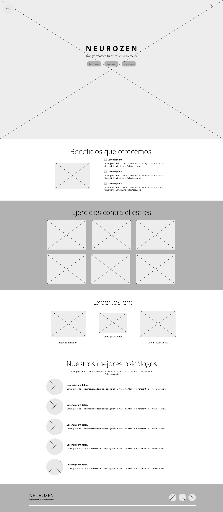</p>
</div>

<div>
  <p align="center">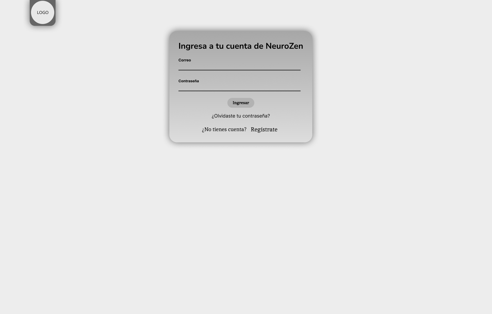</p>
</div>

<div>
  <p align="center">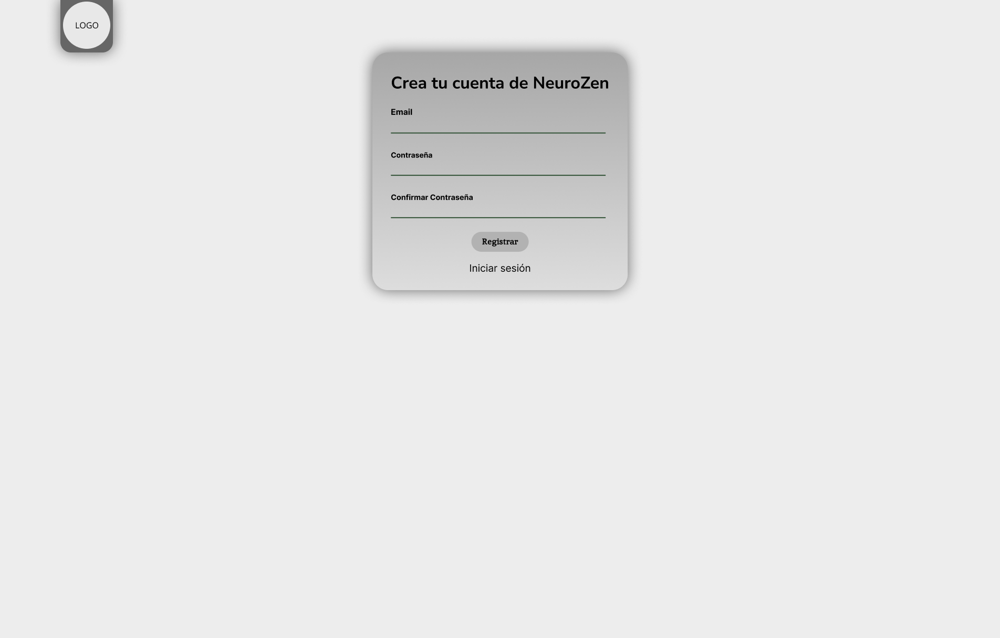</p>
</div>

<div>
  <p align="center">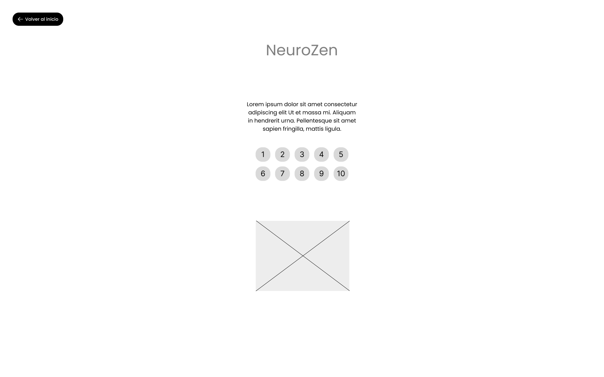</p>
</div>

---

### 4.3.2. Landing Page Mock-up

Un mockup es una representación visual de un producto que muestra cómo lucirá, a diferencia de un wireframe, que se enfoca en la estructura. Aunque no es interactivo, puede ser de media o alta fidelidad y ayuda a tomar decisiones finales sobre aspectos como esquemas de colores, estilo visual y tipografía. Es una herramienta valiosa en el proceso de diseño para alinear expectativas y obtener retroalimentación antes de la implementación.

<div>
  <p align="center">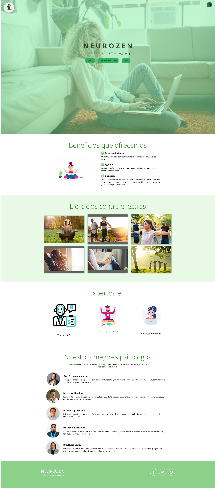</p>
</div>

<div>
  <p align="center"></p>
</div>

<div>
  <p align="center">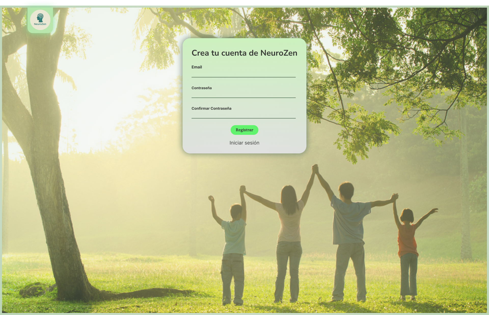</p>
</div>

<div>
  <p align="center">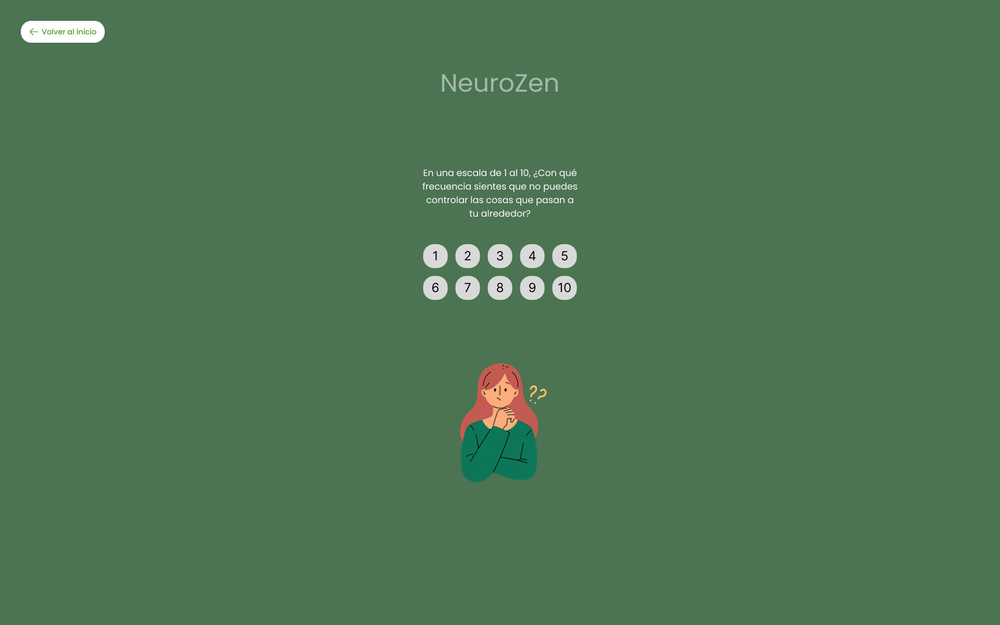</p>
</div>

Nuestro Landing Page:

## [● Link: [https://neurozen-landing.netlify.app/en/)]


---

## 4.4. Mobile Applications UX/UI Design

El diseño de experiencia de usuario (UX) y de interfaz de usuario (UI) busca ofrecer una interacción digital clara, sencilla y motivadora. La UX se enfoca en entender las necesidades de las personas que buscan manejar su estrés y en crear flujos que les permitan registrar sus datos, evaluar su estado y recibir recomendaciones de forma rápida. La UI complementa esta experiencia con un diseño visual relajante y ordenado, usando colores, íconos y botones que transmiten calma y profesionalismo. Al combinar funcionalidad intuitiva con una estética agradable, se logra que el usuario se sienta acompañado y en control de su bienestar.

---

### 4.4.1. Mobile Applications Wireframes

Los wireframes representan la estructura básica de las pantallas clave de la aplicación web, evidenciando la aplicación de principios de simplicidad, consistencia visual y accesibilidad.

**Boarding**

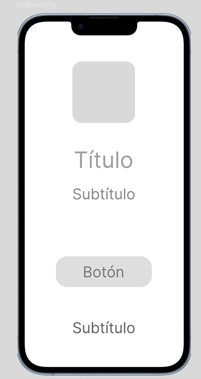 

**Login / Registro**

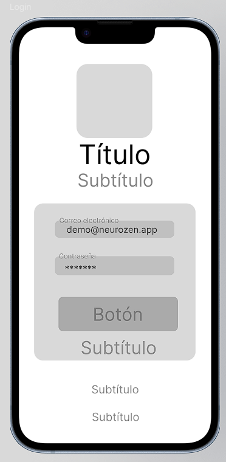

**Home**

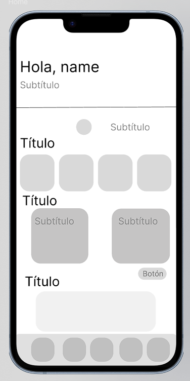

**Sessions**

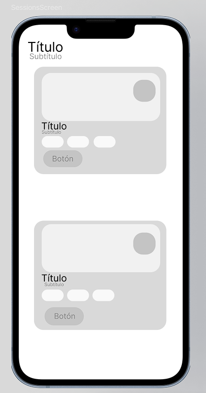

**Breathing**

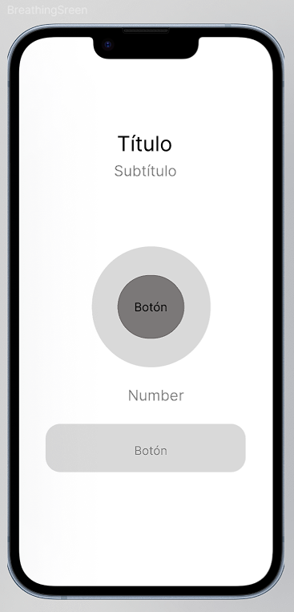

**Profile**

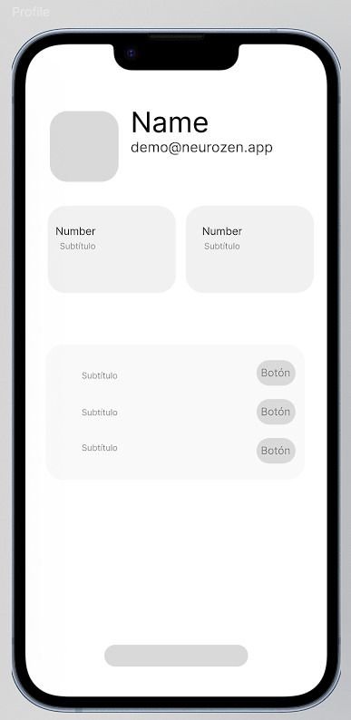

**Product Detail**

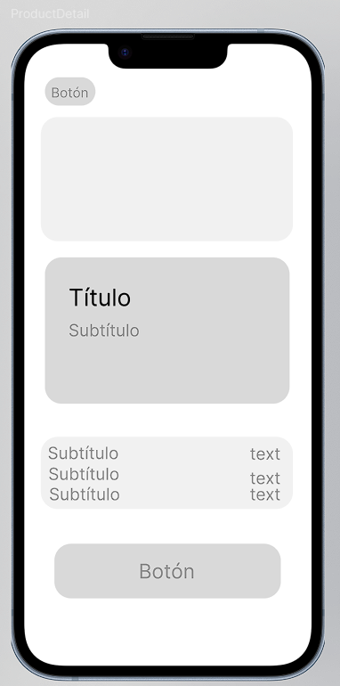


---

### 4.4.2. Mobile Applications Wireflow Diagrams

Los wireflows ilustran cómo se enlazan los wireframes a través de interacciones típicas de los usuarios (User Goals).

**Wireflow 1: Boarding e inicio de sesión**

Este wireflow representa el proceso inicial de acceso a la aplicación. El usuario comienza visualizando la pantalla de bienvenida (Boarding), donde conoce las principales funcionalidades y beneficios de la plataforma. Desde esta ventana puede continuar hacia la pantalla de Login para autenticarse y acceder a una experiencia personalizada dentro de la aplicación.

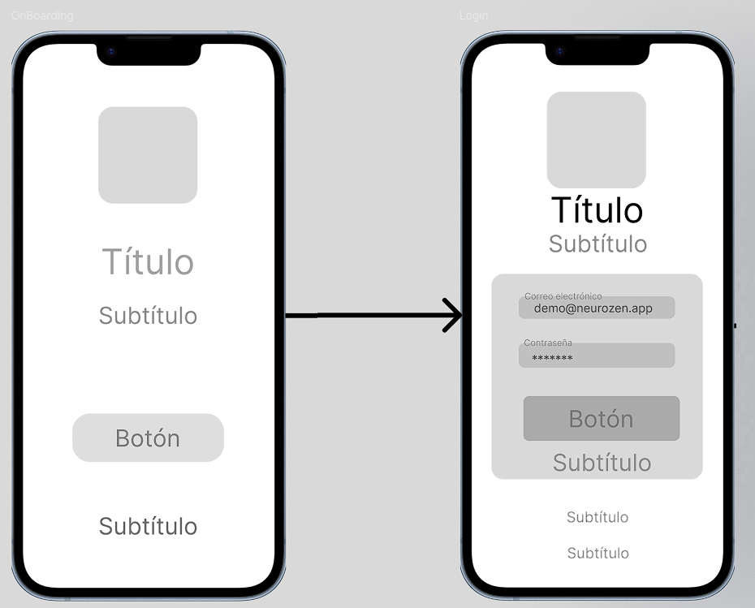

**Wireflow 2: Inicio de sesión y acceso al Home**

Este wireflow muestra el proceso mediante el cual el usuario inicia sesión dentro de la aplicación y accede a la pantalla principal Home. Una vez autenticado, el usuario puede visualizar las principales funcionalidades y navegar hacia sesiones, ejercicios de respiración, perfil y recursos disponibles dentro de la plataforma.

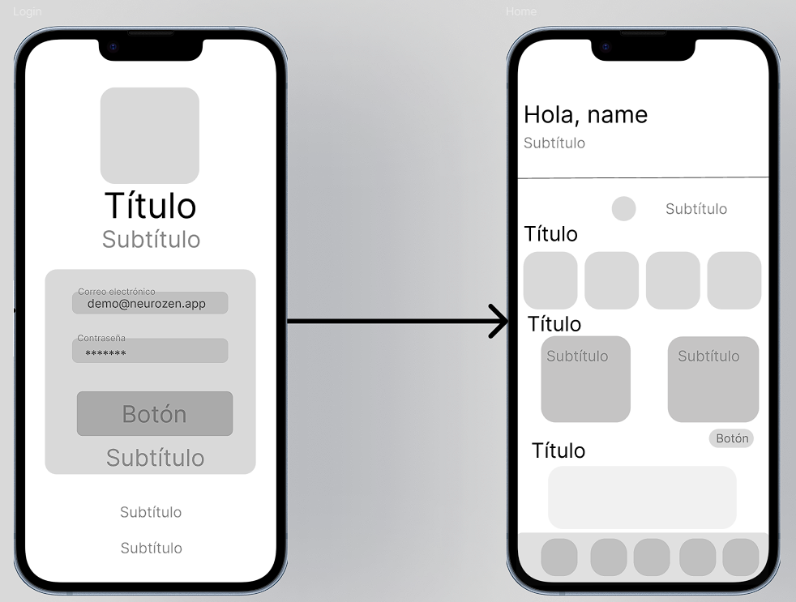


**Wireflow 3: Navegación hacia sesiones y ejercicios de respiración**

Este wireflow representa la navegación principal desde la pantalla Home hacia las funcionalidades de sesiones guiadas y ejercicios de respiración. El usuario puede acceder rápidamente a herramientas enfocadas en el bienestar, relajación y seguimiento de actividades de mindfulness dentro de la aplicación.

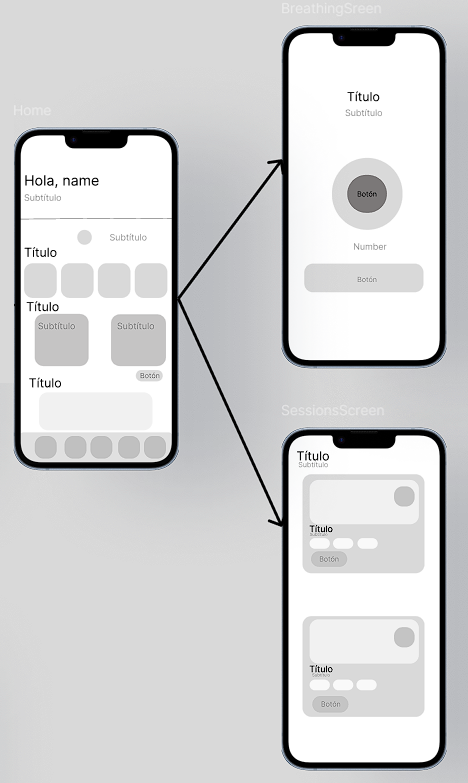

**Wireflow 4: Acceso al perfil de usuario**

Este wireflow muestra el recorrido del usuario desde la pantalla Home hacia la sección Profile. Dentro de esta ventana, el usuario puede visualizar y administrar su información personal, configuraciones, preferencias y progreso registrado dentro de la plataforma.

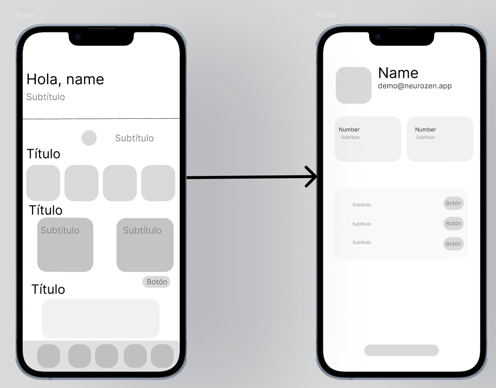


**Wireflow 5: Visualización de detalle de producto o recurso**

Este wireflow representa el flujo de navegación desde la pantalla Home hacia la visualización detallada de un producto, recurso o contenido específico de la aplicación. El usuario puede revisar información relevante y explorar contenido relacionado antes de interactuar con el recurso seleccionado.

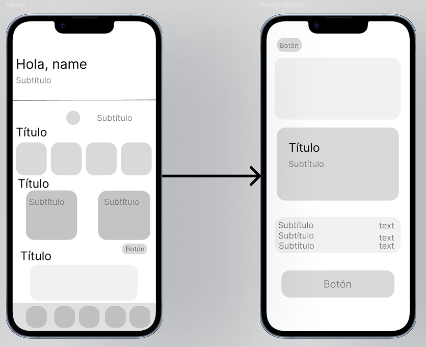


### 4.4.3. Mobile Applications Mock-ups

Los mock-ups muestran la versión visual detallada de las pantallas, aplicando la identidad visual de NeuroZen (colores, tipografías y estilos inclusivos). Aquí se evidencian las decisiones finales de diseño.

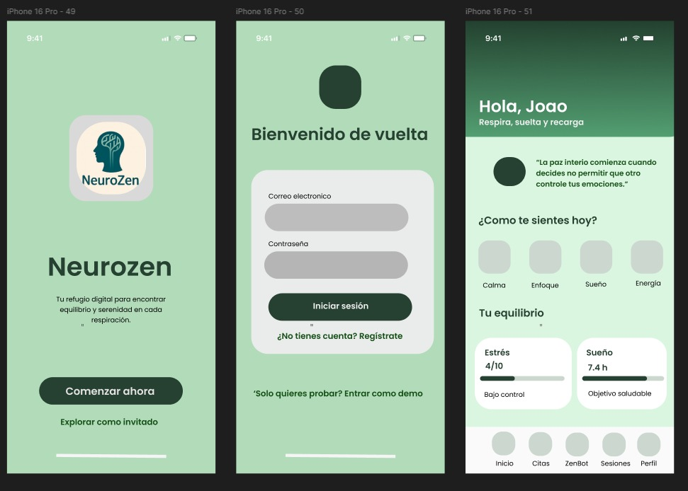

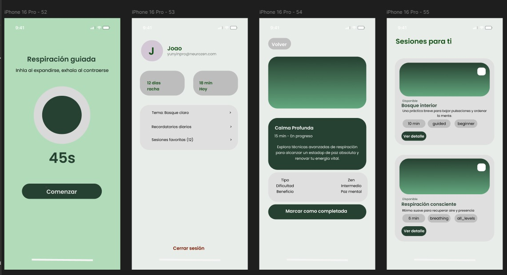

### 4.4.4. Mobile Applications User Flow Diagrams

Los **User Flow Diagrams** representan los caminos que siguen los usuarios dentro de la aplicación para cumplir sus objetivos.  
Estos flujos integran los **mock-ups** y los **wireflows**, mostrando tanto la ruta esperada (**happy path**) como las rutas alternativas en caso de error (**unhappy path**).

A continuación, presentamos los principales **User Goals** identificados y sus respectivos flujos:

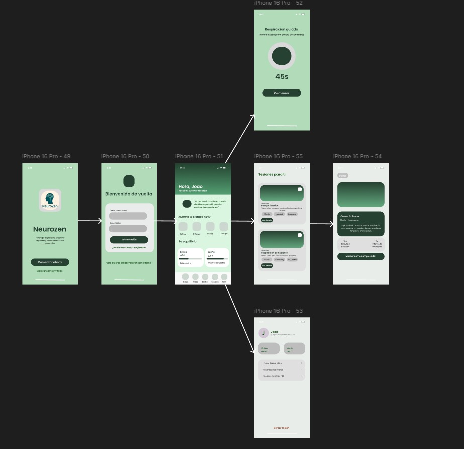
---

## 4.5. Mobile Applications Prototyping

##### Introducción

En esta sección se presentan los prototipos interactivos de la aplicación **NeuroZen**.  
Estos prototipos simulan la navegación y los principales flujos de interacción, basados en los **User Flow Diagrams** previamente definidos.

---

<div style="page-break-after: always;"></div>

---

### 4.5.1. Android Mobile Applications Prototyping

En esta sección se expone el prototipo interactivo de alta fidelidad orientado al sistema operativo Android. Este modelo funcional materializa los flujos de usuario (User Flows) definidos en etapas previas, integrando la identidad visual del proyecto y los componentes basados en los lineamientos de Material Design 3. El objetivo de este prototipo es simular la experiencia de usuario final, permitiendo la validación de la navegación, la legibilidad de la información biométrica y la correcta respuesta de los elementos interactivos (formularios, botones flotantes y barras de navegación) en un entorno que emula las dimensiones y el comportamiento de un dispositivo Android.

**Enlace de simulación interactiva:**
[Prototipo Interactivo Android - NeuroZen (Figma)](https://www.figma.com/proto/3qSFFC8I2yfjeDz3pt3k2Y/Neurozen?node-id=1-2&p=f&t=vDeMhU3mg5UDftzt-1&scaling=scale-down&content-scaling=fixed&page-id=0%3A1&starting-point-node-id=1%3A2)

---

### 4.5.2. iOS Mobile Applications Prototyping

En este apartado se presenta el prototipo interactivo correspondiente al ecosistema iOS. El diseño ha sido validado considerando los principios de las Human Interface Guidelines (HIG) de Apple, asegurando que la distribución espacial de los componentes respete los márgenes de seguridad (Safe Areas) y la integración de elementos de hardware específicos de la marca. A través de este entorno de simulación, es posible evaluar la adaptabilidad transversal de la interfaz gráfica, el comportamiento de las jerarquías de navegación y la coherencia visual de la aplicación multiplataforma dentro de los estándares exigidos para dispositivos iPhone.

**Enlace de simulación interactiva:**
[Prototipo Interactivo iOS - NeuroZen (Figma)](https://www.figma.com/proto/3qSFFC8I2yfjeDz3pt3k2Y/Neurozen?node-id=1-2&p=f&t=vDeMhU3mg5UDftzt-1&scaling=scale-down&content-scaling=fixed&page-id=0%3A1&starting-point-node-id=1%3A2)

---

## 4.6. Web Applications UX/UI Design

El diseño de experiencia de usuario (UX) y de interfaz de usuario (UI) busca ofrecer una interacción digital clara, sencilla y motivadora. La UX se enfoca en entender las necesidades de las personas que buscan manejar su estrés y en crear flujos que les permitan registrar sus datos, evaluar su estado y recibir recomendaciones de forma rápida. La UI complementa esta experiencia con un diseño visual relajante y ordenado, usando colores, íconos y botones que transmiten calma y profesionalismo. Al combinar funcionalidad intuitiva con una estética agradable, se logra que el usuario se sienta acompañado y en control de su bienestar.

---

### 4.6.1. Web Applications Wireframes

Los wireframes representan la estructura básica de las pantallas clave de la aplicación web, evidenciando la aplicación de principios de simplicidad, consistencia visual y accesibilidad.

- **Wireframe – Login**
<p align="center"></p>

- **Wireframe – Register**
<p align="center"></p>

- **Wireframe – Landing Page**
<p align="center"></p>

<p align="center"></p>

- **Wireframe – Test**
<p align="center"></p>

- **Wireframe – Menú**
<p align="center"></p>

- **Wireframe – Recommended Activity**
<p align="center"></p>

- **Wireframe – Professional Contact**
<p align="center"></p>

- **Wireframe – Profile**
<p align="center"></p>

- **Wireframe – Zen IA**
<p align="center"></p>

- **Wireframe – Selected Activity**
<p align="center"></p>

- **Wireframe – Favorites**
<p align="center"></p>

- **Wireframe – Planes**
<p align="center"></p>

---

### 4.6.2. Web Applications Wireflow Diagrams

Los wireflows ilustran cómo se enlazan los wireframes a través de interacciones típicas de los usuarios (User Goals). En este caso, el flujo refleja el proceso de acceso al landing page → registro → inicio de sesión → acceso al menú → entrada a las funcionalidades de NeuroZen.

<p align="center"></p>

---

### 4.6.3. Web Applications Mock-ups

Los mock-ups muestran la versión visual detallada de las pantallas, aplicando la identidad visual de NeuroZen (colores, tipografías y estilos inclusivos). Aquí se evidencian las decisiones finales de diseño.

- **Wireframe – Login**
<p align="center"></p>

- **Wireframe – Register**
<p align="center"></p>

- **Wireframe – Landing Page**
<p align="center"></p>

<p align="center"></p>

- **Wireframe – Test**
<p align="center"></p>

- **Wireframe – Menú**
<p align="center"></p>
<p align="center"></p>

- **Wireframe – Recommended Activity**
<p align="center"></p>

- **Wireframe – Professional Contact**
<p align="center"></p>

- **Wireframe – Profile**
<p align="center"></p>

- **Wireframe – Zen IA**
<p align="center"></p>

- **Wireframe – Selected Activity**
<p align="center"></p>

- **Wireframe – Favorites**
<p align="center"></p>

- **Wireframe – Planes**
<p align="center"></p>

---

### 4.6.4. Web Applications User Flow Diagrams

Los **User Flow Diagrams** representan los caminos que siguen los usuarios dentro de la aplicación para cumplir sus objetivos.  
Estos flujos integran los **mock-ups** y los **wireflows**, mostrando tanto la ruta esperada (**happy path**) como las rutas alternativas en caso de error (**unhappy path**).

A continuación, presentamos los principales **User Goals** identificados y sus respectivos flujos:

---

#### User Flow 1: Registro de nuevo usuario

| **Elemento**               | **Descripción**                                                                                                                       |
| -------------------------- | ------------------------------------------------------------------------------------------------------------------------------------- |
| **User Goal**              | Crear una cuenta en la plataforma para acceder a las funcionalidades de NeuroZen.                                                     |
| **Happy Path**             | El usuario ingresa su correo, contraseña y confirmación → Presiona **Registrarse** → Recibe confirmación → Redirige al **login**.     |
| **Unhappy Path**           | El usuario deja campos vacíos o ingresa una contraseña inválida → El sistema muestra mensajes de error sin avanzar al siguiente paso. |
| **Pantallas involucradas** | Wireframe **Register** → **Login**.                                                                                                   |
| **Usuario Destinado**      | Usuario nuevo.                                                                                                                        |

---

#### User Flow 2: Inicio de sesión

| **Elemento**               | **Descripción**                                                                                              |
| -------------------------- | ------------------------------------------------------------------------------------------------------------ |
| **User Goal**              | Acceder a la plataforma con credenciales válidas para usar las herramientas.                                 |
| **Happy Path**             | El usuario ingresa correo y contraseña válidos → Presiona **Iniciar Sesión** → Accede a la **Landing Page**. |
| **Unhappy Path**           | Contraseña incorrecta o email inválido → Se muestra error y se mantiene en la misma pantalla.                |
| **Pantallas involucradas** | Wireframe **Login** → **Landing Page**.                                                                      |
| **Usuario Destinado**      | Usuario recurrente.                                                                                          |

---

#### User Flow 3: Exploración de la Landing Page

| **Elemento**               | **Descripción**                                                                                                                    |
| -------------------------- | ---------------------------------------------------------------------------------------------------------------------------------- |
| **User Goal**              | Navegar por los beneficios, ejercicios y lista de psicólogos ofrecidos por NeuroZen.                                               |
| **Happy Path**             | Desde la **Landing Page** el usuario accede a secciones: **Beneficios**, **Ejercicios contra el estrés**, **Nuestros psicólogos**. |
| **Unhappy Path**           | El usuario no logra encontrar la sección buscada → Recurre al menú principal para reorientarse.                                    |
| **Pantallas involucradas** | **Landing Page** (mock-up).                                                                                                        |
| **Usuario Destinado**      | Usuarios registrados y no registrados.                                                                                             |

---

#### User Flow 4: Contacto con psicólogos

| **Elemento**               | **Descripción**                                                                                               |
| -------------------------- | ------------------------------------------------------------------------------------------------------------- |
| **User Goal**              | Conectarse con un psicólogo desde la sección “Nuestros mejores psicólogos”.                                   |
| **Happy Path**             | El usuario selecciona un psicólogo → Accede a la ficha → Obtiene información de contacto o agenda una sesión. |
| **Unhappy Path**           | El sistema no carga la información del psicólogo → El usuario recibe un mensaje de error.                     |
| **Pantallas involucradas** | **Landing Page** → **Sección Psicólogos**.                                                                    |
| **Usuario Destinado**      | Usuarios interesados en asesoría profesional.                                                                 |

---


## 4.7. Web Applications Prototyping
En esta sección se presenta el prototipo interactivo de alta fidelidad para la aplicación web de NeuroZen, desarrollado en la herramienta Figma. El objetivo principal de este prototipo es simular la navegación y las interacciones clave del usuario, permitiendo validar la arquitectura de información y la experiencia de usuario (UX) antes de la implementación final.

##### Criterios de Interacción y Navegación

Las decisiones de interacción se basaron en la necesidad de ofrecer una experiencia fluida, intuitiva y libre de fricciones para los trabajadores que buscan gestionar su estrés. Se optó por un diseño responsive que se adapta a navegadores de escritorio y móviles. La interacción principal se da a través de clics y toques (tap), representados en el diagrama mediante flechas que conectan cada pantalla. El sistema de navegación se centraliza en un **Menú principal** (Hub de navegación), desde el cual el usuario puede acceder a los módulos funcionales de manera rápida y sin pasos innecesarios.

##### Descripción del Flujo del Prototipo (Happy Path)

El flujo modelado en el prototipo abarca desde la adquisición del usuario hasta la gestión de su bienestar, estructurado de la siguiente manera:

1. **Punto de Entrada y Autenticación:** El usuario ingresa a través de la *Landing Page* (1), se registra (2) y luego inicia sesión (3).
2. **Núcleo de Navegación:** Al autenticarse, el usuario accede al *Menú principal* (4), que actúa como el centro de operaciones. Desde aquí se despliegan las funcionalidades clave:
   - **Evaluación:** El usuario puede realizar el *Test de estrés* (5), correspondiente a la User Story US04.
   - **Gestión y Bienestar:** Accede a la sección de *Actividades* (6) (US07), selecciona una *Actividad* específica (7) (US08) y puede interactuar con el soporte emocional a través de *ZenBot IA* (8).
   - **Soporte Profesional y Administración:** El usuario puede contactar a *Psicólogos* (9) (US13/US14), revisar los *Planes* de suscripción (10), gestionar su *Perfil* (11) y revisar sus *Favoritos* (12).

##### Relación con la Arquitectura de Información y User Flows

Este prototipo materializa los Wireflows y User Flow Diagrams previamente definidos en la sección 4.6. La estructura jerárquica del menú principal responde a los sistemas de organización y etiquetado (Labeling Systems) establecidos, asegurando que los términos utilizados (Actividades, Psicólogos, Planes, ZenBot) sean claros y consistentes con el lenguaje ubicuo del proyecto. La navegación entre los módulos 5 al 12 demuestra la ruta esperada (happy path) para que los User Personas (Laura y Andrés) logren sus objetivos de bienestar laboral dentro de la plataforma.


## 4.8. Domain-Driven Software Architecture

La arquitectura de software orientada al dominio es un enfoque de diseño que se centra en la estructura y organización del software en torno a los conceptos y procesos clave de un dominio específico. Este enfoque nos permite crear sistemas que reflejen con precisión los requisitos y la lógica del negocio, lo que facilita la implementación de funcionalidades específicas y la adaptación a los cambios en el dominio. Con NeuroZen, utilizamos una arquitectura de software orientada al dominio para estructurar nuestro sistema de manera coherente y escalable, lo que nos permitirá desarrollar una aplicación robusta y fácil de mantener.

---

### 4.8.1. Software Architecture Context Diagram

En esta sección se presenta el diagrama de contexto del sistema NeuroZen, el cual permite visualizar de manera general la interacción entre la plataforma y los diferentes actores externos que participan en su funcionamiento. Este tipo de diagrama es fundamental dentro de la arquitectura de software, ya que delimita el alcance del sistema y muestra sus relaciones con usuarios y servicios externos, sin entrar en detalles internos de implementación.

El sistema NeuroZen se representa como un único bloque central, actuando como una plataforma digital enfocada en la detección temprana, monitoreo continuo y gestión del estrés laboral. A través de la integración de tecnologías de análisis biométrico, evaluaciones psicológicas y herramientas de bienestar, el sistema busca mejorar la calidad de vida de los usuarios en entornos laborales exigentes.


---

### 4.8.2. Software Architecture Container Diagrams


El diagrama de contenedores de NeuroZen muestra los principales bloques tecnológicos de la plataforma. Incluye una Landing Page (React) como punto de entrada informativo, una aplicación móvil (Flutter) como cliente principal, un backend único (Spring Boot/Node.js) que centraliza toda la lógica de negocio, una base de datos PostgreSQL y cuatro sistemas externos: Payment Gateway, Cloud Storage, Biometric API y Notification Provider.

La comunicación se da así: los actores acceden a la Landing Page y a la app móvil; la Landing Page redirige a la app; la app se comunica por HTTPS/REST con el backend; y el backend interactúa con la base de datos y con los cuatro sistemas externos para pagos, archivos, biometría y notificaciones.


### 4.8.3. Software Architecture Components Diagrams

En esta sección se detallan los diagramas de despliegue, componentes internos, flujo de mensajes y spikes técnicos que especifican la distribución física y lógica de los servicios que componen el ecosistema de NeuroZen.

##### Component Diagram – Backend Internal Structure

El siguiente diagrama muestra la estructura interna del contenedor único **Backend**, desglosado en sus componentes principales: IAM, Assessments, Recommendations, Analytics, Professionals, Appointments, Community y Notification. Cada componente se comunica con la base de datos NeuroZen DB y, en algunos casos, con servicios externos especializados.


A continuación se presentan los diagramas de cada contexto de dominio que opera dentro del backend, mostrando sus relaciones específicas con la base de datos y servicios externos.


##### Identity & Access Management (IAM) Context

Para la seguridad, roles y cuentas de usuario.


##### Assessments Context

Para los tests psicológicos y cuestionarios.


##### Recommendations & Activities Context

Para las pausas activas y ejercicios de respiración.


##### Health Tracking & Dashboard Context

Para el historial, estadísticas y reportes.


##### Professionals & Appointments Context

Para el directorio de psicólogos y gestión de citas.


##### Community & Resources Context

Para los foros de apoyo y artículos de bienestar.


##### Notification Context

Para las alertas, recordatorios y correos.


### Spike Stories

Para mitigar riesgos técnicos y validar decisiones de arquitectura, se ejecutaron los siguientes spikes:

- **Spike: Integración con Biometric API**  
  *Objetivo:* Verificar disponibilidad, latencia y formato de datos de la API externa de procesamiento biométrico.  
  *Resultado:* Se implementó un cliente de prueba con latencia media de 300 ms.  
  *Decisión:* Se usará comunicación asíncrona mediante cola de mensajes (RabbitMQ).

- **Spike: Rendimiento del backend único**  
  *Objetivo:* Evaluar si un único backend (Spring Boot/Node.js) soporta 1000 usuarios concurrentes.  
  *Resultado:* Pruebas con JMeter dieron 180 ms de respuesta promedio bajo carga normal.  
  *Decisión:* El backend único es suficiente inicialmente, con capacidad de escalado horizontal mediante réplicas.

- **Spike: Autenticación con JWT**  
  *Objetivo:* Definir flujo de emisión, validación y renovación de tokens.  
  *Resultado:* Prototipo con Spring Security y JWT; expiración 24h + refresh token con validez de 7 días.  
  *Decisión:* Se implementará JWT con almacenamiento de refresh tokens en base de datos.

- **Spike: Notificaciones push**  
  *Objetivo:* Comparar Firebase Cloud Messaging (FCM) y OneSignal para envío de notificaciones a la app móvil.  
  *Resultado:* FCM tiene mejor integración con Flutter y menor costo.  
  *Decisión:* Se elige Firebase Cloud Messaging como proveedor de notificaciones.


## 4.9. Software Object-Oriented Design

En esta sección se muestran y describen los **diagramas de clases** que detallan la implementación de los componentes en cada _bounded context_.

La propuesta incluye las **clases, interfaces y enumeraciones**, junto con sus relaciones.  
Se representan los **atributos, métodos y niveles de visibilidad** (public, private, protected).  
Además, se indican las **multiplicidades y asociaciones** entre clases, garantizando que estén alineadas con los _bounded contexts_ definidos anteriormente.

---

### 4.9.1. Class Diagrams


---

### 4.9.2. Class Dictionary

A continuación se describe cada clase y sus atributos:

**Clase: User**
Representa a los usuarios de la aplicación

| Atributo | Tipo de dato | Descripción                     |
| -------- | ------------ | ------------------------------- |
| id       | int          | Identificador único del usuario |
| name     | string       | Nombre del usuario              |
| email    | string       | Correo electrónico registrado   |
| password | string       | Contraseña de acceso            |
| role     | string       | Rol del usuario (user, admin)   |

**Clase: Psychologist**
Especialista que puede agendar sesiones con usuarios.

| Atributo  | Tipo de dato | Descripción                       |
| --------- | ------------ | --------------------------------- |
| id        | int          | Identificador único del psicólogo |
| name      | string       | Nombre completo                   |
| specialty | string       | Área de especialidad              |
| email     | string       | Correo electrónico                |
| phone     | string       | Número de contacto                |

**Clase: CheckIn**
Registro de los niveles de estrés de los usuarios

| Atributo | Tipo de dato | Descripción                                      |
| -------- | ------------ | ------------------------------------------------ |
| id       | int          | Identificador único del check-in                 |
| userId   | int          | Referencia al usuario                            |
| date     | DateTime     | Fecha y hora del check-in                        |
| mood     | string       | Estado del usuario (Calm, Stressed, Overwhelmed) |
| notes    | string       | Observaciones adicionales                        |

**Clase: Plan**
Planes personalizados de bienestar asignados a los usuarios

| Atributo    | Tipo de dato | Descripción                         |
| ----------- | ------------ | ----------------------------------- |
| id          | int          | Identificador del plan              |
| userId      | int          | Referencia al usuario               |
| title       | string       | Nombre del plan                     |
| description | string       | Detalles del plan                   |
| duration    | int          | Duración en días                    |
| status      | string       | Estado del plan (Active, Completed) |

**Clase: Notification**
Notificaciones enviadas a los usuarios para recordatorios o alertas

| Atributo | Tipo de dato | Descripción                            |
| -------- | ------------ | -------------------------------------- |
| id       | int          | Identificador único de la notificación |
| userId   | int          | Referencia al usuario                  |
| message  | string       | Contenido de la notificación           |
| sentAt   | DateTime     | Fecha y hora de envío                  |
| read     | boolean      | Indica si fue leída                    |

**Clase: Session**
Registra citas agendadas con psicólogos

| Atributo       | Tipo de dato | Descripción                                           |
| -------------- | ------------ | ----------------------------------------------------- |
| id             | int          | Identificador único de la sesión                      |
| userId         | int          | Referencia al usuario                                 |
| psychologistId | int          | Referencia al psicólogo                               |
| scheduledAt    | DateTime     | Fecha y hora programada                               |
| status         | string       | Estado de la sesión (Scheduled, Completed, Cancelled) |

---

## 4.10. Database Design


<div>
  <p align="center"></p>
</div>

La estructura mostrada soporta los procesos core del negocio digital: registro y perfil biométrico, autoevaluación de estrés, recomendaciones personalizadas, seguimiento de progreso, conexión con especialistas, comunidad y suscripciones. Cada tabla se relaciona con los servicios definidos en los diagramas de componentes, asegurando que la persistencia de datos sea consistente con la lógica de negocio y los flujos de usuario especificados en los capítulos anteriores.


### 4.10.1. Relational/Non-Relational Database Diagram


---

<div style="page-break-after: always;"></div>

# Capítulo V: Product Implementation

## 5.1. Software Configuration Management

El equipo ha establecido un ecosistema de desarrollo estandarizado para garantizar la trazabilidad, colaboración y calidad del software. Se detallan a continuación las herramientas y normativas que rigen el ciclo de vida del producto.


### 5.1.1. Software Development Environment Configuration

**Project Management:**

La gestión de los proyectos tiene como objetivo mejorar los procesos y su entorno para alcanzar los resultados esperados.

- **Project Management:  Trello** es una herramienta visual que permite gestionar cualquier tipo de proyecto y el flujo de trabajo que el equipo desarrollador seguirá para implementar correctamente las tareas de código para el Landing Page y el web Application.

<table>
    <tbody>
        <tr>
            <td>Link de referencia: </td>
            <td>https://trello.com/es </td>
        </tr>
    </tbody>
</table>

**Requirements Management:**

Es el proceso de garantizar que una organización documente verifique y satisfaga las necesidades, expectativas de sus clientes con las partes interesadas internas o externas.

- **Pivotal Tracker:** Esta herramienta se define como una plataforma en la que se realiza la gestión de user stories, agrupándolos en epics y clasificando su presencia en el programa, por puntaje. Se usó porque permite que cada miembro del equipo comparta la misma vista en tiempo real de lo que está sucediendo con cada proyecto, ya sea aportando con diferentes secciones o corrigiendo el flujo del proyecto.

<table>
    <tbody>
        <tr>
            <td>Link de referencia: </td>
            <td>https://www.pivotaltracker.com/  </td>
        </tr>
    </tbody>
</table>

**Product UX/UI Design:**

Nos permite desarrollar el modelo en nuestro producto de manera digital y forme parte de la vida del consumidor. En este caso realizar un modelo de sitio web para computadoras y celulares.

- **Uxpressia:** es una herramienta en línea para el mapeo de la trayectoria del cliente que crea mapas de impacto y personas. Sus herramientas nos permitieron establecer las bases del modelado de User Persona, Empathy Map y Journey Map

<table>
    <tbody>
        <tr>
            <td>Link de referencia: </td>
            <td>https://uxpressia.com/ </td>
        </tr>
    </tbody>
</table>

- **MIRO:** es una pizarra digital colaborativa en línea, que puede ser usada para la investigación, la ideación, la creación de lluvias de ideas, mapas mentales y una variedad de otras actividades colaborativas.

<table>
    <tbody>
        <tr>
            <td>Link de referencia: </td>
            <td>https://www.miro.com/</td>
        </tr>
    </tbody>
</table>

- **Figma:** es una herramienta de prototipo web y editor de gráficos vectorial, que, a diferencia de las otras herramientas, se aloja en la web, permitiendo establecer los modelos para versión en Web Browser y Landing Page.

<table>
    <tbody>
        <tr>
            <td>Link de referencia: </td>
            <td>https://www.figma.com/ </td>
        </tr>
    </tbody>
</table>

- **LucidChart:** es una herramienta de diagramación basada en la web, que permite a los usuarios colaborar y trabajar juntos en tiempo real, creando diseños UML, mapas mentales, prototipos de software y muchos otros tipos de diagrama.

<table>
    <tbody>
        <tr>
            <td>Link de referencia: </td>
            <td>https://www.lucidchart.com </td>
        </tr>
    </tbody>
</table>

- **Structurizr:** es una herramienta de diseño que soporta el modelo C4, para visualizar la arquitectura de software de nuestra solución.

<table>
    <tbody>
        <tr>
            <td>Link de referencia: </td>
            <td>https://structurizr.com/ </td>
        </tr>
    </tbody>
</table>

**Software Development:**

Es una estructura aplicada al desarrollo de un producto de software. Se utiliza para el establecimiento de un proceso para el desarrollo de software, cada uno de los cuales describe un enfoque diferente para diferentes actividades que tienen lugar durante el proceso.

- **Github:** Es un repositorio comunitario cuya función es almacenar los avances de un proyecto elaborado por un grupo de personas.

<table>
    <tbody>
        <tr>
            <td>Link de referencia: </td>
            <td> https://github.com/  </td>
        </tr>
    </tbody>
</table>

- **WebStorm:** Es un entorno de JetBrains, empresa desarrolladora de Software. Este nos ofrece facilidad en probar nuestro entorno web en navegadores web. Para el proyecto se implementará la ayuda de los lenguajes HTML, CSS y TypeScript.

<table>
    <tbody>
        <tr>
            <td>Link de referencia: </td>
            <td> https://www.jetbrains.com/webstorm/ 
            </td>
        </tr>
    </tbody>
</table>

- **HTML:** Es un lenguaje que sirve como desarrollador de plataformas web que trabaja con hipertextos, que enlace a otros documentos. Este lenguaje ofrece herramientas para el diseño del sitio web.

<table>
    <tbody>
        <tr>
            <td>Link de referencia: </td>
            <td> https://www.jetbrains.com/help/webstorm/editing-html-files.html 
             </td>
        </tr>
    </tbody>
</table>

- **CSS:** Es un lenguaje de diseño para el entorno web. Permite elaborar el interfaz de usuario diseñada anteriormente, agregando colores, tamaños entre otros elementos.

<table>
    <tbody>
        <tr>
            <td>Link de referencia: </td>
            <td> https://www.jetbrains.com/help/webstorm/style-sheets.html#ws_css_completion 
             </td>
        </tr>
    </tbody>
</table>

- **TypeScript:** Es un superconjunto de JavaScript, que esencialmente añade tipos estáticos y objetos basados en clases

<table>
    <tbody>
        <tr>
            <td>Link de referencia: </td>
            <td> https://www.typescriptlang.org/ 
             </td>
        </tr>
    </tbody>
</table>

- **Angular:** Framework de TypeScript, de código abierto, utilizado para desarrollar SPA(Single Page Application).

<table>
    <tbody>
        <tr>
            <td>Link de referencia: </td>
            <td> https://angular.io  </td>
        </tr>
    </tbody>
</table>

**Software Testing:**

Es el acto de examinar los artefactos y el comportamiento del software bajo prueba mediante validación y verificación.

- **Lenguaje Gherkins:** Es un DSL o Lenguaje Específico de Dominio (Domain-Specific Language), es decir, un lenguaje que está creado para resolver un problema. Además de ser interpretado en código, se puede agregar los users stories del programa con sus respectivas partes: Feature, Scenario, Example, Scenario Outline, Given, When, Then y And.

**Software Development:**

- **Github pages:** Servicio de Github que nos permitió alojar nuestra landing page y nos permitirá alojar nuestro web applications.

<table>
    <tbody>
        <tr>
            <td>Link de referencia: </td>
            <td> https://pages.github.com/ </td>
        </tr>
    </tbody>
</table>

### 5.1.2. Source Code Management

En esta sección se presenta la gestión de código fuente o como es conocido por sus siglas en inglés SCM (Source Code Management). Su función principal es realizar un seguimiento de las modificaciones que el equipo realizará a lo largo del desarrollo de sus proyectos en los repositorios de código fuente. Se emplea como un sistema de control de versiones que permite dar seguimiento a los cambios que cada integrante o desarrollador realice en el proyecto. Asimismo, cabe resaltar que para el sistema de control de versiones emplearemos GitHub.

**GitFlow**

Es el modelo alternativo de creación de ramas en Git que en los últimos años se ha vuelto una herramienta indispensable para muchos desarrolladores. Este flujo de trabajo de control de versiones utiliza ramas y fue publicado y popularizado por Vincent Driessen. Su principal función es ayudar en la organización de la versión de un código, permitiendo la creación de nuevos Features y Hotfixes de manera organizada.

**Main Branches:**

- **main:** es la rama principal, a partir de ella se recorrerán todas las ramas y contendrá la última versión y las anteriores creadas por los desarrolladores.

- **Develop:** Esta rama puede ser creada a partir de la rama main(master) y contará con todos los Features estables. Esto significa que a través de esta rama el equipo podrá integrar las funciones.

**Support Branches:**

- **Feature:** se ramifica de developer y al finalizar debe fusionarse de nuevo en develop. Se emplea para desarrollar nuevas funciones que se integrarán en versiones posteriores.

- **Release:** también se ramifica de develop, es la rama que admite la preparación de una nueva versión de producción.

- **Hotfix:** también está destinado a una nueva versión de producción, pero esta se ramifica de main. Su función es reparar rápidamente las publicaciones de producción.

**Conventional Commits:**

Son una convención para nombrar mensajes de commit en Git de forma estructurada, clara y semántica.

- feat: Se añade una nueva funcionalidad.
- fix: Se corrige un error.
- docs: Cambios en la documentación.
- style: Cambios de formato o estilo de código (sin impacto en la lógica).
- refactor: Mejoras en el código que no añaden nuevas funcionalidades ni corrigen errores.
- test: Añadir o modificar tests.
- chore: Cambios menores sin impacto en el código de producción (actualización de dependencias, configuración, etc.).


### 5.1.3. Software Deployment Configuration

Como se mencionó previamente, la gestión de nuestro código fuente se realizará a través de GitHub. Asimismo, se utilizará GitHub Pages para la publicación y despliegue de la página.

Para el desarrollo del Landing Page de NeuroZen se han usado las siguientes herramientas:

- HTML: lenguaje con el cual está estructurado nuestro landing page.

- CSS: diseño y formato para el html desarrollado.

El despliegue de nuestro landing page es posible gracias a la herramienta de Github Pages. El cual es un servicio que nos permite alojar nuestro landing directamente desde el
repositorio de GitHub.

Para lograr el despliegue seguimos lo siguientes pasos:

1. Dirigirnos al repositorio de la página y entrar en la sección de configuración.

2. Ir a la opción de “Pages”, donde se encontrarán todas las opciones de publicación de página.

3. Se debe seleccionar la rama la cual se va a publicar en el vínculo. También se debe seleccionar la carpeta donde se localizara la publicación.

4. Finalmente, el link vínculo de nuestra página aparecerá en la parte superior.

---

## 5.2. Product Implementation & Deployment

### 5.2.1. Sprint Backlogs

**Sprint 3**
   - **Sprint Goal:** Proveer a los psicólogos la estructura base de la aplicación móvil, permitiéndoles crear su cuenta, gestionar su perfil profesional y visualizar sus próximas sesiones en un dashboard centralizado, soportado por una actualización integral de los servicios del backend para la sincronización de datos.
   - **Velocity:** 42 story points.

**Sprint Backlog Table:**

<div align="center">

<table>
  <thead>
    <tr>
      <th>ID</th>
      <th>Titles</th>
      <th>Estimation(h)</th>
      <th>Assigned To</th>
      <th>Status</th>
      <th>Story Points</th>
    </tr>
  </thead>
  <tbody>
    <tr>
      <td>US18</td>
      <td>Bounded Context: Auth & Profile</td>
      <td>4</td>
      <td>Carlos Paredes</td>
      <td>Done</td>
      <td>5</td>
    </tr>
    <tr>
      <td>US18</td>
      <td>Bounded Context: Auth & Profile</td>
      <td>4</td>
      <td>Jean Pool</td>
      <td>Done</td>
      <td>5</td>
    </tr>
    <tr>
      <td>US19</td>
      <td>Bounded Context: Dashboard & Navigation</td>
      <td>3</td>
      <td>Diego Requena</td>
      <td>Done</td>
      <td>3</td>
    </tr>
    <tr>
      <td>US11</td>
      <td>Bounded Context: Service Booking</td>
      <td>6</td>
      <td>Joao Castro</td>
      <td>Done</td>
      <td>5</td>
    </tr>
    <tr>
      <td>US11</td>
      <td>ervice Booking Endpoints</td>
      <td>7</td>
      <td>Miguel Vila</td>
      <td>Done</td>
      <td>5</td>
    </tr>
  </tbody>
</table>

</div>

### 5.2.2. Implemented Landing Page Evidence

**URL en Producción:** 

**Tecnologías:** Astro & TypeScript.

**Tabla de Evidencias**

<div align="center">

<table>
  <thead>
    <tr>
      <th>Funcionalidad</th>
      <th>Descripción</th>
      <th>Evidencia</th>
    </tr>
  </thead>
  <tbody>
    <tr>
      <td>Inicio</td>
      <td>Página de presentación de nuestra landing page.</td>
      <td></td>
    </tr>
    <tr>
      <td>Sobre Nosotros</td>
      <td>Sección para darnos a conocer como  equipo, y videos probando el producto en distintas plataformas.</td>
      <td></td>
    </tr>
    <tr>
      <td>Planes</td>
      <td>Sección para mostrar los distintos planes que ofrecemos a los clientes.</td>
      <td></td>
    </tr>
    <tr>
      <td>Profesionales</td>
      <td>Sección para dar a conocer algunos de los profesionales que trabajan usando nuestra plataforma.</td>
      <td></td>
    </tr>
  </tbody>
</table>
 
</div>

### 5.2.3. Implemented Frontend-Web Application Evidence

**URL en Producción:**  https://neurozen-web-frontend.vercel.app 

**Tecnologías:** Vue & JavaScript.

**Tabla de Evidencias**

<div align="center">

<table>
  <thead>
    <tr>
      <th>Funcionalidad</th>
      <th>Descripción</th>
      <th>Evidencia</th>
    </tr>
  </thead>
  <tbody>
    <tr>
      <td>Inicio</td>
      <td>Menú Principal de Neurozen, presentando un atajo a todas las funcionalidades y un reporte estadístico.</td>
      <td></td>
    </tr>
    <tr>
      <td>Perfil</td>
      <td>Perfil del usuario(paciente) mostrando detalles como su suscripción</td>
      <td></td>
    </tr>
    <tr>
      <td>Ejercicios</td>
      <td>Apartado de ejercicios que puede realizar el usuario.</td>
      <td></td>
    </tr>
    <tr>
      <td>Reservar Cita</td>
      <td>Apartado para iniciar con la reserva de una cita en la plataforma.</td>
      <td></td>
    </tr>
    <tr>
      <td>Configuracion</td>
      <td>Apartado para que el usuario pueda configurar el diseño de la plataforma.</td>
      <td></td>
    </tr>
  </tbody>
</table>
 
</div>

### 5.2.4. Acuerdo de Servicio - SaaS

El presente Acuerdo de Nivel de Servicio (SLA) establece los compromisos de calidad, disponibilidad y soporte que el startup NeuroDraw garantiza para el producto NeuroZen, ofrecido bajo el modelo de Software como Servicio (SaaS) a usuarios finales (trabajadores formales e informales) y profesionales de la salud mental.

 - **DisDisponibilidad del Servicio (Uptime)**
   NeuroZen garantiza una disponibilidad del servicio del 99.9% mensual para las funciones principales, incluyendo el acceso a la plataforma web y aplicaciones móviles, las autoevaluaciones de estrés y el agendamiento de citas con psicólogos.
   
 - **Privacidad y Seguridad de la Información**
   NeuroZen se compromete a aplicar protocolos estrictos de encriptación de extremo a extremo.
   
 - **Mantenimiento y Despliegues**
   Cualquier actualización de la plataforma o tarea de despliegue continuo se realizará en horarios de menor actividad (ej. madrugada) para minimizar el impacto en la experiencia del usuario.
   
 - **Responsabilidad y Limitación del Servicio**
   NeuroZen es una herramienta preventiva enfocada en la identificación y gestión del estrés laboral. Se deja constancia de que los tests y análisis de la plataforma no sustituyen un diagnóstico psiquiátrico oficial ni la atención de emergencia para crisis severas de salud mental.

### 5.2.5. Implemented Native-Mobile Application Evidence

<div align="center">

<table>
  <thead>
    <tr>
      <th>Funcionalidad</th>
      <th>Descripción</th>
      <th>Evidencia</th>
    </tr>
  </thead>
  <tbody>
    <tr>
      <td>Login y Registro</td>
      <td>Gestión de identidad, control de acceso y registro de nuevos usuarios (psicólogos).</td>
      <td></td>
    </tr>
    <tr>
      <td>Login y Registro</td>
      <td>Gestión de identidad, control de acceso y registro de nuevos usuarios (psicólogos).</td>
      <td></td>
    </tr>
    <tr>
      <td>Auth & Profile</td>
      <td>Muestra la información personal y profesional del usuario (biografía, experiencia, precio por sesión, valoración).</td>
      <td></td>
    </tr>
    <tr>
      <td>Service Booking</td>
      <td>Muestra las citas programadas con los pacientes, los motivos y el estado de la cita (Confirmada, Pendiente)</td>
      <td></td>
    </tr>
    <tr>
      <td>Dashboard & Navigation</td>
      <td>Obtiene el saludo y el estado del perfil, del contexto de Auth & Profile. Además del Service Booking.</td>
      <td></td>
    </tr>
  </tbody>
</table>
 
</div>

### 5.2.6. Implemented RESTful API and/or Serverless Backend Evidence

La documentación técnica fue actualizada para reflejar los nuevos Bounded Contexts y asegurar la integración con los clientes Android y Flutter.

Se expandió el backend para incluir nueva lógica del negocio.

  - **Dashboard:** Gestión de reporte de estadísticas del usuario.
  - **Subscriptions:** Gestión de suscripciones del usuario.

### 5.2.7. RESTful API documentation

  - **URL Swagger UI:** https://neurozen-backend-mobile.onrender.com/swagger/index.html

  - **Entorno de Producción:** Render

**Evidencia de Documentación:**


### 5.2.8. Team Collaboration Insights

El equipo operó en un modelo de desarrollo paralelo para cubrir tres frentes: Backend, Android Nativo y Flutter.


## 5.3. Video About-the-Product

- Link: https://drive.google.com/file/d/1-_v0KUTrHYfdEqTVUWcZBBUHyfarLtC4/view?usp=sharing

---

<div style="page-break-after: always;"></div>

# Parte II: Verification, Validation & Pipeline

# Capítulo VI: Product Verification & Validation

En este capítulo se detallan las estrategias, herramientas y resultados de las pruebas realizadas para garantizar la calidad, fiabilidad y correcto funcionamiento de la plataforma **NeuroZen**. El proceso de validación abarca los tres frentes tecnológicos del proyecto: **Backend** (C# ASP.NET Core, .NET 9), **Frontend Web** (Vue 3 + Vite) y **Aplicación Móvil** (Android nativo con Kotlin y Jetpack Compose, arquitectura MVVM + Clean Architecture con Hilt).

Todas las pruebas siguen el patrón **AAA (Arrange, Act, Assert)**. En el backend y en el frontend web cada prueba incluye una **NOTA DE PRUEBA** que explica *por qué se realizó* y *qué hace*. Se prueban tanto los casos de éxito como los de error de las reglas de negocio.

## 6.1. Testing Suites & Validation

### Resumen general de la ejecución

| Frente | Framework principal | Responsable | Pruebas ejecutadas | Resultado |
|---|---|---|---|---|
| Backend API (C# / ASP.NET Core) | xUnit + Moq + Reqnroll + Testcontainers | Miguel Vila | **106** (72 unitarias, 19 de integración, 15 escenarios BDD) | ✅ 106 / 106 correctas |
| Frontend Web (Vue 3) | Vitest + Vue Test Utils + MSW | Jean Pool Huaman | **91** (62 unitarias, 29 de integración) | ✅ 91 / 91 correctas |
| Aplicación Móvil (Android nativo) | JUnit 4 + MockK + MockWebServer + Compose UI Test | Manuel Fernando Joao Castro | **73**: 66 locales en la JVM (56 unitarias, 10 de integración) y 7 instrumentadas en emulador (4 de Room, 3 de Compose) | ✅ 66 / 66 y 7 / 7 correctas |

En total se ejecutaron **270 pruebas** en los tres frentes, todas aprobadas. Las 7 pruebas instrumentadas de la app móvil (`app/src/androidTest/`) se ejecutaron en el emulador Pixel 10 Pro XL y se describen en las secciones 6.1.2 (Room) y 6.1.4 (Jetpack Compose).

| Frente | Comando de ejecución | Tiempo de la ejecución registrada |
|---|---|---|
| Backend | `dotnet test --logger "console;verbosity=detailed"` | 1,36 minutos (81,9 s) |
| Frontend Web | `npm run test` (ejecuta `vitest run`) | 81,04 s |
| Móvil (JVM) | `.\gradlew.bat testDebugUnitTest --rerun-tasks --console=plain` | 14,610 s de pruebas (compilación completa: 5 min 5 s) |
| Móvil (instrumentadas) | `.\gradlew.bat connectedDebugAndroidTest` | 45,536 s de pruebas (compilación completa: 4 min 7 s) |

---

### 6.1.1. Core Entities Unit Tests

Las pruebas unitarias validan, de forma aislada, la lógica interna de las entidades y servicios principales del dominio de NeuroZen: usuarios y autenticación, test de estrés (PSS-10), desencadenantes de estrés, citas, profesionales, reseñas, informes y suscripciones. Las dependencias externas (repositorios, red, base de datos) se reemplazan por **dobles de prueba** (mocks), de modo que cada prueba solo depende del código que valida.

#### Backend API (C# / ASP.NET Core) — Responsable: Miguel Vila

**Herramientas:** xUnit 2.9.2, Moq 4.20.72, Entity Framework Core InMemory 9.0.0 (solo para la consulta del directorio)  
**Ubicación en el proyecto:** `neurozen.API.Tests/Unit/`  
**Ejecución sin Docker ni MySQL:** `dotnet test --filter "FullyQualifiedName~Unit"`

Se utilizó **xUnit** junto con **Moq** para aislar los *command services* y *query services* de cada *bounded context*. Los repositorios y la unidad de trabajo (`IUnitOfWork`) se simulan, y con `Verify(..., Times.Once)` y `Times.Never` se comprueba que los datos se guardan solo cuando la operación es válida. Se usan dos ayudas propias: `FakeCurrentUser` (el usuario autenticado que normalmente vendría en el JWT) y `TestEntities.PassThroughUnitOfWork()` (una unidad de trabajo que ejecuta la operación y permite saber si algo ocurrió dentro de la transacción).

| # | Clase de prueba | Prueba | Casos | Qué valida |
|---|---|---|---|---|
| 1 | `HashingServiceTests` | `PasswordHash_ShouldNeverStorePlainText` | 1 | La contraseña se guarda como hash BCrypt de costo 12, nunca en texto plano |
| 2 | `PasswordPolicyTests` | `PasswordPolicy_WithLettersAndNumbers_ShouldBeValid` | 1 | Una contraseña con letras y números cumple la política |
| 3 | `PasswordPolicyTests` | `PasswordPolicy_ShortOrOnlyLettersOrOnlyNumbers_ShouldBeInvalid` | 4 | Se rechazan contraseñas cortas, solo letras, solo números o vacías |
| 4 | `PasswordResetCommandServiceTests` | `ForgotPassword_UnknownEmail_ShouldNotFailNorSendEmail` | 1 | «Olvidé mi contraseña» no revela qué correos están registrados |
| 5 | `PasswordResetCommandServiceTests` | `ForgotPassword_KnownEmail_ShouldStoreHashedTokenAndSendOnce` | 1 | Se guarda solo el hash SHA-256 del token, vence en 1 hora y el correo se envía una vez |
| 6 | `PasswordResetCommandServiceTests` | `ResetPassword_ValidToken_ShouldChangePasswordAndMarkTokenUsed` | 1 | Con un enlace válido cambia la contraseña y el token queda usado |
| 7 | `PasswordResetCommandServiceTests` | `ResetPassword_ExpiredOrUsedToken_ShouldBeRejected` | 2 | Un enlace vencido o ya usado se rechaza sin cambiar nada |
| 8 | `UserAccountCommandServiceTests` | `ChangePassword_WrongCurrentPassword_ShouldThrowValidationNotUnauthorized` | 1 | Contraseña actual incorrecta = error 400 (no 401, que cerraría la sesión) |
| 9 | `UserCommandServiceSignInTests` | `SignIn_ValidCredentials_ShouldReturnTokenWithSubRoleAndExp` | 1 | El JWT incluye `sub`, `role` y una expiración de 2 horas |
| 10 | `UserCommandServiceSignInTests` | `SignIn_WrongPasswordOrUnknownEmail_ShouldReturnSameError` | 1 | Correo inexistente y contraseña incorrecta dan el mismo error (evita enumerar cuentas) |
| 11 | `UserCommandServiceSignUpTests` | `SignUp_Worker_ShouldCreateUserWithUserRole` | 1 | El trabajador se registra con rol `USER` y sin perfil profesional |
| 12 | `UserCommandServiceSignUpTests` | `SignUp_Psychologist_ShouldCreateProfessionalInPendingInSameTransaction` | 1 | Usuario y perfil `PENDING` del psicólogo se crean en la misma transacción |
| 13 | `UserCommandServiceSignUpTests` | `SignUp_WithAdminRole_ShouldThrowValidation` | 1 | Nadie puede crearse una cuenta `ADMIN` desde el registro público |
| 14 | `UserCommandServiceSignUpTests` | `SignUp_WithoutAcceptedTerms_ShouldThrowValidation` | 1 | Sin aceptar los términos (Ley 29733) no se crea la cuenta |
| 15 | `UserCommandServiceSignUpTests` | `SignUp_DuplicateEmail_ShouldThrowConflict` | 1 | Un correo ya registrado devuelve 409 |
| 16 | `UserCommandServiceSignUpTests` | `SignUp_DuplicateLicense_ShouldThrowConflictMentioningColegiatura` | 1 | Una colegiatura ya registrada devuelve 409 |
| 17 | `AppointmentCommandServiceTests` | `Book_WithVerifiedProfessionalFutureFreeSlot_ShouldCreatePending` | 1 | Reserva válida (US14): la cita se crea en estado `PENDING` |
| 18 | `AppointmentCommandServiceTests` | `Book_WithPendingProfessional_ShouldThrowNotFound` | 1 | No se puede reservar con un psicólogo no verificado (404) |
| 19 | `AppointmentCommandServiceTests` | `Book_PastDate_ShouldThrowValidation` | 1 | No se puede reservar en el pasado |
| 20 | `AppointmentCommandServiceTests` | `Book_AlreadyTakenSlot_ShouldThrowConflict` | 1 | Doble reserva: horario ocupado devuelve 409 |
| 21 | `AppointmentCommandServiceTests` | `Confirm_ByOwnPsychologist_ShouldChangePendingToConfirmed` | 1 | El psicólogo de la cita la confirma (`PENDING` → `CONFIRMED`) |
| 22 | `AppointmentCommandServiceTests` | `Complete_BeforeAppointmentDate_ShouldBeRejected` | 1 | Una cita no puede marcarse como atendida antes de su hora |
| 23 | `AppointmentCommandServiceTests` | `Cancel_ByPatient_ShouldBeAllowed` | 1 | El paciente cancela su cita y el horario queda libre |
| 24 | `AppointmentCommandServiceTests` | `Patient_TryingToConfirmOrComplete_ShouldBeForbidden` | 2 | El paciente no puede confirmar ni completar (403) |
| 25 | `AppointmentCommandServiceTests` | `ChangeStatus_FromFinalState_ShouldBeRejected` | 2 | `CANCELLED` y `COMPLETED` son estados finales |
| 26 | `AssessmentTests` | `Assessment_ShouldRecalculateScoreWithReversedQuestions4578` | 2 | El puntaje PSS-10 se calcula en el servidor con las preguntas 4, 5, 7 y 8 invertidas |
| 27 | `AssessmentTests` | `Assessment_LevelBoundaries_13_14_26_27` | 4 | Cortes de nivel: 0-13 bajo, 14-26 moderado, 27-40 alto |
| 28 | `AssessmentTests` | `Assessment_NotTenAnswersOrOutOfRange_ShouldThrowValidation` | 5 | El test exige exactamente 10 respuestas entre 0 y 4 |
| 29 | `ReportCommandServiceTests` | `Report_ForOwnActiveAppointment_ShouldBeCreated` | 1 | El paciente comparte su informe (US15) con el psicólogo de su cita activa |
| 30 | `ReportCommandServiceTests` | `Report_ForOthersOrCancelledAppointment_ShouldBeRejected` | 3 | No se puede compartir un informe de otro paciente, a otro profesional o de una cita cancelada |
| 31 | `ReportCommandServiceTests` | `Report_SecondForSameAppointment_ShouldThrowConflict` | 1 | Un solo informe por cita (409 si se repite) |
| 32 | `StressTriggerCommandServiceTests` | `Trigger_IntensityShouldBeCalculatedOnServer` | 6 | La intensidad (low/medium/high) se calcula en el servidor según el nivel 1-10 |
| 33 | `StressTriggerCommandServiceTests` | `Trigger_FutureDateOrShortDescription_ShouldThrowValidation` | 2 | Se rechazan registros con fecha futura o descripción corta |
| 34 | `ProfessionalProfileCommandServiceTests` | `UpdateMyProfile_ChangingLicense_ShouldReturnToPending` | 1 | Si el psicólogo cambia su colegiatura, vuelve a revisión (`PENDING`) |
| 35 | `ProfessionalProfileCommandServiceTests` | `UpdateMyProfile_Resubmit_AfterRejected_ShouldReturnToPending` | 1 | Un psicólogo rechazado puede reenviar su solicitud |
| 36 | `ProfessionalProfileCommandServiceTests` | `UpdateMyProfile_InvalidRanges_ShouldThrowValidation` | 1 | Biografía > 800 caracteres, tarifa > 1000 u horario inválido se rechazan |
| 37 | `ProfessionalQueryServiceTests` | `Directory_ShouldOnlyReturnVerifiedProfessionals` | 1 | El directorio solo muestra psicólogos verificados |
| 38 | `ProfessionalQueryServiceTests` | `AvailableSlots_ShouldExcludeBookedAndPastHours` | 1 | No se ofrecen horarios reservados ni horas que ya pasaron |
| 39 | `ProfessionalQueryServiceTests` | `AvailableSlots_DayOutsideSchedule_ShouldReturnEmpty` | 1 | Sin horarios si el psicólogo no atiende ese día |
| 40 | `ProfessionalVerificationCommandServiceTests` | `Verify_PendingProfessional_ShouldSetVerifiedWithAuditData` | 1 | El admin verifica al psicólogo y la decisión queda auditada |
| 41 | `ProfessionalVerificationCommandServiceTests` | `Verify_AlreadyVerified_ShouldThrowConflict` | 1 | No se puede verificar dos veces (409) |
| 42 | `ProfessionalVerificationCommandServiceTests` | `Reject_WithoutReasonOrShortReason_ShouldThrowValidation` | 3 | Rechazar exige un motivo de al menos 10 caracteres |
| 43 | `ReviewCommandServiceTests` | `Review_CompletedAppointment_ShouldRecalculateRatingAndMarkReviewed` | 1 | La reseña recalcula la calificación del psicólogo y marca la cita |
| 44 | `ReviewCommandServiceTests` | `Review_NotCompletedOrSecondTime_ShouldBeRejected` | 2 | Solo se califica una sesión atendida y una sola vez |
| 45 | `SubscriptionCommandServiceTests` | `Subscription_ShouldStoreOnlyLast4AndNeverCvv` | 1 | PCI DSS: solo se guardan los últimos 4 dígitos, nunca el CVV ni el número completo |
| 46 | `SubscriptionCommandServiceTests` | `Subscription_InvalidLuhnOrExpiredCard_ShouldThrowValidation` | 2 | Tarjeta que no pasa Luhn o vencida se rechaza |
| | | **Total** | **72** | |

**Código (extractos de las pruebas unitarias del backend)**

`neurozen.API.Tests/Unit/Appointments/AppointmentCommandServiceTests.cs`

```csharp
/// <summary>
/// NOTA DE PRUEBA:
/// - ¿Por qué se realizó esta prueba?: es el camino feliz de la reserva (US14): profesional verificado, fecha
///   futura y horario libre deben crear la cita PENDING a nombre del paciente autenticado.
/// - ¿Qué hace esta prueba?: reserva y comprueba estado, paciente, profesional y que el horario queda ocupado,
///   con una sola inserción y un solo guardado.
/// </summary>
[Fact]
public async Task Book_WithVerifiedProfessionalFutureFreeSlot_ShouldCreatePending()
{
    // Arrange
    var startUtc = DateTime.UtcNow.AddDays(1);
    Appointment? saved = null;
    _appointments.Setup(a => a.AddAsync(It.IsAny<Appointment>()))
        .Callback<Appointment>(a => saved = a).Returns(Task.CompletedTask);

    // Act
    var result = await CreateService(Patient()).Handle(Booking(startUtc));

    // Assert
    Assert.NotNull(saved);
    Assert.Equal(AppointmentStatus.Pending, result.Appointment.Status);
    Assert.Equal(PatientId, saved!.PatientId);
    Assert.Equal(ProfessionalId, saved.ProfessionalId);
    Assert.Equal(startUtc, saved.ActiveSlot);
    Assert.False(saved.Reviewed);
    _appointments.Verify(a => a.AddAsync(It.IsAny<Appointment>()), Times.Once);
    _unitOfWork.Verify(u => u.CompleteAsync(), Times.Once);
}

/// <summary>
/// NOTA DE PRUEBA:
/// - ¿Por qué se realizó esta prueba?: doble reserva; dos pacientes no pueden tener la misma hora con el mismo
///   psicólogo.
/// - ¿Qué hace esta prueba?: simula un horario ya tomado y comprueba el 409 «El horario ya no está disponible»
///   sin crear la cita.
/// </summary>
[Fact]
public async Task Book_AlreadyTakenSlot_ShouldThrowConflict()
{
    // Arrange
    _appointments.Setup(a => a.IsSlotTakenAsync(ProfessionalId, It.IsAny<DateTime>())).ReturnsAsync(true);

    // Act
    var exception = await Assert.ThrowsAsync<ConflictException>(
        () => CreateService(Patient()).Handle(Booking(DateTime.UtcNow.AddDays(1))));

    // Assert
    Assert.Equal("El horario ya no está disponible", exception.Message);
    _appointments.Verify(a => a.AddAsync(It.IsAny<Appointment>()), Times.Never);
}
```

`neurozen.API.Tests/Unit/Stress/StressTriggerCommandServiceTests.cs`

```csharp
/// <summary>
/// NOTA DE PRUEBA:
/// - ¿Por qué se realizó esta prueba?: la intensidad alimenta los gráficos y los informes al psicólogo; si se
///   confiara en la del cliente, se podría registrar un nivel 9 como «low». Se calcula siempre en el servidor
///   (1-3 low, 4-6 medium, 7-10 high).
/// - ¿Qué hace esta prueba?: registra situaciones en los límites de cada tramo y comprueba la intensidad guardada.
///   El comando ni siquiera tiene un campo de intensidad: lo que envíe el cliente se ignora.
/// </summary>
[Theory]
[InlineData(1, "low")]
[InlineData(3, "low")]
[InlineData(4, "medium")]
[InlineData(6, "medium")]
[InlineData(7, "high")]
[InlineData(10, "high")]
public async Task Trigger_IntensityShouldBeCalculatedOnServer(int stressLevel, string expectedIntensity)
{
    // Arrange
    StressTrigger? saved = null;
    _triggers.Setup(t => t.AddAsync(It.IsAny<StressTrigger>()))
        .Callback<StressTrigger>(t => saved = t).Returns(Task.CompletedTask);
    var command = new CreateTriggerCommand(7, "Tres entregas el mismo día", "workOverload", stressLevel,
        DateTime.UtcNow.AddHours(-1));

    // Act
    await CreateService().Handle(command);

    // Assert
    Assert.NotNull(saved);
    Assert.Equal(expectedIntensity, saved!.Intensity.ToWire());
    Assert.Equal(TriggerCategory.WorkOverload, saved.Category);
}
```

`neurozen.API.Tests/Unit/Subscriptions/SubscriptionCommandServiceTests.cs`

```csharp
/// <summary>
/// NOTA DE PRUEBA:
/// - ¿Por qué se realizó esta prueba?: PCI DSS; nunca se guarda el CVV (ni cifrado) ni el número completo de la
///   tarjeta, solo los últimos 4 dígitos y el vencimiento.
/// - ¿Qué hace esta prueba?: suscribe con una tarjeta de prueba, captura la entidad que se guardaría y comprueba
///   cardLast4 = 1111, el vencimiento normalizado, que no existe ninguna propiedad para el CVV o el número, y que
///   ningún valor guardado contiene el número completo ni es igual al CVV.
/// </summary>
[Fact]
public async Task Subscription_ShouldStoreOnlyLast4AndNeverCvv()
{
    // Arrange
    Subscription? saved = null;
    _subscriptions.Setup(s => s.AddAsync(It.IsAny<Subscription>()))
        .Callback<Subscription>(s => saved = s).Returns(Task.CompletedTask);

    // Act
    var result = await CreateService().Handle(Subscribe());

    // Assert
    Assert.True(result.Created);
    Assert.NotNull(saved);
    Assert.Equal("1111", saved!.CardLast4);
    Assert.Equal("12/30", saved.CardExpiry);
    var properties = typeof(Subscription).GetProperties();
    Assert.DoesNotContain(properties, p =>
        p.Name.Contains("cvv", StringComparison.OrdinalIgnoreCase) ||
        p.Name.Contains("CardNumber", StringComparison.OrdinalIgnoreCase) ||
        p.Name.Contains("NumberCard", StringComparison.OrdinalIgnoreCase));
    var storedStrings = properties.Where(p => p.PropertyType == typeof(string))
        .Select(p => (string?)p.GetValue(saved) ?? string.Empty).ToList();
    Assert.DoesNotContain(storedStrings, value => value.Contains(FullCardNumber) || value == Cvv);
}
```

> *Evidencia de ejecución del backend (inicio de la corrida con `dotnet test`; se ven pruebas unitarias aprobadas, como las de `ProfessionalQueryServiceTests`):*


#### Frontend Web (Vue 3) — Responsable: Jean Pool Huaman

**Herramientas:** Vitest 5.0.3, Vue Test Utils, jsdom (navegador simulado), MSW (servidor de API simulado)  
**Ubicación en el proyecto:** `tests/unit/` (20 archivos, 62 pruebas)

Las pruebas unitarias del frontend se enfocan en las **reglas de negocio** que viven en los servicios y utilidades: autenticación y sesión, roles, test de estrés, citas, directorio de psicólogos, validación de tarjetas y contraseñas, ZenBot, pausas activas, informes y suscripciones. Cuando un servicio depende de la API, esta se reemplaza por **mocks** con `vi.fn()` (equivalente a `mock()` de Mockito) o por el servidor simulado **MSW**; las llamadas se verifican con `toHaveBeenCalledTimes(1)` (como `verify(times(1))`) y `not.toHaveBeenCalled()` (como `verifyNoInteractions`).

| # | Archivo | Prueba | Qué valida |
|---|---|---|---|
| 1 | `ActiveBreaksService.spec.js` | `breaks_shouldOnlyBeScheduledOnWorkingDays` | Con la jornada de lunes a viernes, el viernes tiene pausas y el sábado no |
| 2 | `ActiveBreaksService.spec.js` | `disabledBreaks_shouldNotBeScheduled` | Con las pausas desactivadas no se programa ninguna |
| 3 | `ActiveBreaksService.spec.js` | `workdayStartingAt0930_shouldRespectMinutes` | Jornada 09:30-12:00 cada 45 min: pausas a las 10:15, 11:00 y 11:45 |
| 4 | `AdminService.spec.js` | `approve_shouldVerifyTheSelectedPsychologist` | La aprobación llega a la API con el id del psicólogo elegido |
| 5 | `AdminService.spec.js` | `reject_shouldSendTheReason` | El motivo del rechazo llega a la API sin espacios sobrantes |
| 6 | `AppointmentService.spec.js` | `appointmentData_shouldUseBackendFormat` | La cita se envía con números, el paciente real y la hora en UTC |
| 7 | `AppointmentService.spec.js` | `todaySlots_shouldNotIncludePastHours` | No se ofrecen horarios que ya pasaron en el día actual |
| 8 | `AppointmentService.spec.js` | `appointmentTypesWithoutBackend_shouldUseNumericDefaults` | Si la API responde 404, se usan tipos de sesión por defecto con ids numéricos |
| 9 | `AppointmentService.spec.js` | `cancelAppointment_shouldSendCancelledStatus` | Cancelar envía `{ status: 'CANCELLED' }` a la cita correcta |
| 10 | `AssessmentService.spec.js` | `positiveQuestions_shouldBeScoredInReverse` | Las preguntas positivas se puntúan al revés (10 respuestas «3» = 22) |
| 11 | `AssessmentService.spec.js` | `scoreBoundaries_shouldMapToTheCorrectLevel` | Límites de nivel 13, 14, 26 y 27 |
| 12 | `AssessmentService.spec.js` | `incompleteAnswers_shouldThrowError` | Un test con 9 respuestas lanza error |
| 13 | `AssessmentService.spec.js` | `submitWithoutServer_shouldKeepTheResultLocally` | Con la API caída, el resultado se guarda en el dispositivo |
| 14 | `AuthService.spec.js` | `successfulLogin_shouldCallApiOnceAndSaveSession` | El login llama una vez a la API con el correo limpio y guarda el token |
| 15 | `AuthService.spec.js` | `wrongPassword_shouldThrowErrorAndNotSaveSession` | Con 401 no se guarda sesión ni se pide el perfil |
| 16 | `AuthService.spec.js` | `psychologistLogin_shouldLoadVerificationStatus` | La psicóloga obtiene su rol, estado `verified` e id profesional |
| 17 | `AuthService.spec.js` | `psychologistRegistration_shouldSendLicenseAndRole` | El registro envía rol, especialidad, colegiatura y aceptación de términos |
| 18 | `BreathingService.spec.js` | `completedSessions_shouldBeSavedNewestFirst` | El historial de respiración muestra primero la sesión más reciente |
| 19 | `BreathingService.spec.js` | `sessionNotes_shouldBeTrimmedAndLimited` | Las notas se recortan a 500 caracteres |
| 20 | `DashboardService.spec.js` | `userWithoutStressData_shouldCalculateFromTriggers` | Con registros de nivel 8 y 4: nivel actual 80 y promedio 60, consultando una sola vez |
| 21 | `DashboardService.spec.js` | `userWithStressData_shouldNotRequestTriggers` | Si ya hay datos de estrés, no se consultan los registros |
| 22 | `HttpClient.spec.js` | `response401_shouldCloseSessionAndNotifyOnce` | Un 401 cierra la sesión y avisa una sola vez |
| 23 | `HttpClient.spec.js` | `loginWithWrongPassword_shouldNotBeTreatedAsExpiredSession` | El 401 del login no se trata como sesión vencida |
| 24 | `HttpClient.spec.js` | `noConnection_shouldThrowNetworkError` | Sin red se lanza un error con estado 0 |
| 25 | `ProfessionalService.spec.js` | `verifiedButEmptyProfile_shouldHaveOnlyOneStepDone` | Un perfil verificado pero vacío tiene 1 de 4 pasos completos |
| 26 | `ProfessionalService.spec.js` | `availability_shouldBeShownAsReadableText` | La disponibilidad se muestra como «Lun, Mié · 09:00 - 13:00» |
| 27 | `ProfessionalService.spec.js` | `appointmentStatuses_shouldBeGroupedForTheInterface` | Los estados de cita del backend se agrupan correctamente |
| 28 | `ProfessionalService.spec.js` | `savingOnlyAvailability_shouldKeepTheOtherProfileData` | Guardar solo la disponibilidad envía el perfil completo en el PUT |
| 29 | `ReportService.spec.js` | `summary_shouldCountLastWeekTriggersAndTopCategory` | El resumen cuenta los registros de la última semana y la categoría más frecuente |
| 30 | `ReportService.spec.js` | `sharedReport_shouldBeSentToTheAppointmentPsychologist` | El informe se envía al psicólogo de la cita, sin datos internos de la app |
| 31 | `ResourceLibraryService.spec.js` | `durationInMinutesAndSeconds_shouldBeEqual` | 15 minutos y 900 segundos se normalizan a la misma duración |
| 32 | `ResourceLibraryService.spec.js` | `libraryWithoutServer_shouldShowSampleResources` | Con la API caída se muestran recursos de ejemplo marcados como demostración |
| 33 | `StaticAPIAdapter.spec.js` | `demoLogin_shouldReturnTokenWithoutPassword` | El modo demostración devuelve token sin contraseña y 401 con clave incorrecta |
| 34 | `StaticAPIAdapter.spec.js` | `demoDirectory_shouldHidePendingPsychologists` | El modo demostración oculta a los psicólogos pendientes |
| 35 | `StaticAPIAdapter.spec.js` | `adminEndpoints_shouldRequireAdminRole` | Los endpoints de administración devuelven 403 a un trabajador |
| 36 | `SubscriptionService.spec.js` | `subscription_shouldSendPlanIdAndCleanCardNumber` | Se envía el `planId` correcto y la tarjeta sin espacios |
| 37 | `SubscriptionService.spec.js` | `subscriptionData_shouldOnlyKeepLastFourDigits` | Solo se conservan los últimos 4 dígitos de la tarjeta |
| 38 | `SubscriptionService.spec.js` | `userWithoutSubscription_shouldReturnNull` | Un 404 se interpreta como «sin suscripción» |
| 39 | `TherapistService.spec.js` | `directory_shouldOnlyShowVerifiedPsychologists` | El directorio solo muestra psicólogos verificados |
| 40 | `TherapistService.spec.js` | `pendingPsychologistProfile_shouldBeTreatedAsNotFound` | El perfil de un psicólogo pendiente se trata como 404 |
| 41 | `TherapistService.spec.js` | `reviewRating_shouldBeLimitedBetweenOneAndFive` | Una reseña de 7 estrellas llega como 5 |
| 42 | `UserService.spec.js` | `changePassword_shouldSendCurrentAndNewPassword` | El cambio de contraseña envía la actual y la nueva |
| 43 | `UserService.spec.js` | `onboardingData_shouldBeSavedInTheProfile` | Los datos del onboarding llegan al perfil |
| 44 | `date.spec.js` | `limaLocalTime_shouldBeSentAsCorrectUtc` | Las 09:00 de Lima se envían como 14:00 UTC |
| 45 | `date.spec.js` | `after7pm_todayShouldBeTheLocalDate` | A las 20:30 del día 10, «hoy» sigue siendo el 10 |
| 46 | `roles.spec.js` | `backendRoleNames_shouldBeNormalized` | `PSYCHOLOGIST`, `ROLE_ADMIN` y roles desconocidos se interpretan bien |
| 47 | `roles.spec.js` | `pendingPsychologist_shouldStartOnVerificationStatus` | El psicólogo pendiente inicia en su pantalla de estado |
| 48 | `roles.spec.js` | `verifiedPsychologist_shouldSeeWelcomeOnlyOnce` | La bienvenida del psicólogo se muestra una sola vez |
| 49 | `roles.spec.js` | `adminAndWorker_shouldStartOnTheirOwnHome` | Administrador y trabajador inician en su propia página |
| 50 | `session.spec.js` | `expiredToken_shouldNotBeAuthenticated` | Un token vencido cierra la sesión |
| 51 | `session.spec.js` | `anotherUser_shouldNotSeePreviousUserData` | Un usuario no ve los datos guardados por otro |
| 52 | `validation.spec.js` | `cardNumberWithWrongDigit_shouldBeRejected` | Algoritmo de Luhn: se acepta la tarjeta válida y se rechaza la mal escrita |
| 53 | `validation.spec.js` | `cardExpiredLastMonth_shouldBeRejected` | En octubre, septiembre está vencido y octubre todavía es válido |
| 54 | `validation.spec.js` | `passwordWithLettersAndNumbers_shouldBeAccepted` | Se acepta una contraseña que cumple las reglas |
| 55 | `validation.spec.js` | `weakPasswords_shouldBeRejected` | Se rechazan contraseñas cortas, solo letras o solo números |
| 56 | `validation.spec.js` | `licenseNumberInCommonFormats_shouldBeAcceptedAndNormalized` | «C.Ps.P. 45821», «CPsP 45821» y «45821» se normalizan a «45821» |
| 57 | `validation.spec.js` | `invalidLicenseNumber_shouldBeRejected` | Se rechazan colegiaturas sin números, muy cortas o con letras |
| 58 | `zenbotEngine.spec.js` | `crisisMessage_shouldHavePriorityOverOtherTopics` | Un mensaje de crisis tiene prioridad sobre otros temas |
| 59 | `zenbotEngine.spec.js` | `stressMessageWithAccents_shouldSuggestBreathing` | «ESTRÉS» se reconoce y sugiere respiración |
| 60 | `zenbotEngine.spec.js` | `shortKeyword_shouldNotMatchInsideOtherWords` | «hice ejercicio» no se toma como saludo |
| 61 | `zenbotEngine.spec.js` | `unknownMessage_shouldReturnFallbackWithSpecialist` | Un mensaje sin sentido recibe la respuesta de «no entendí» |
| 62 | `zenbotEngine.spec.js` | `secondUnknownMessage_shouldRecommendSpecialist` | Al segundo mensaje no entendido se recomienda un especialista |

**Código (extractos de las pruebas unitarias del frontend)**

`tests/unit/AuthService.spec.js`

```javascript
/**
 * NOTA DE PRUEBA:
 * - ¿Por qué se realizó esta prueba?: El login debe llamar a la API una sola vez con el correo limpio y guardar la sesión.
 * - ¿Qué hace esta prueba?: Usa mocks (como Mockito) y verifica la llamada (times(1)) y el token guardado.
 */
it('successfulLogin_shouldCallApiOnceAndSaveSession', async () => {
  // Arrange
  const service = new AuthService()
  service.httpClient.post = vi.fn().mockResolvedValue({ id: 7, token: 'token-123', role: 'USER' })
  service.httpClient.get = vi.fn().mockResolvedValue({ id: 7, fullName: 'Ana Torres' })

  // Act
  await service.login('  ana@neurozen.com ', 'Secreta123')

  // Assert
  expect(service.httpClient.post).toHaveBeenCalledTimes(1)
  expect(service.httpClient.post).toHaveBeenCalledWith('/api/v1/authentication/sign-in', { username: 'ana@neurozen.com', password: 'Secreta123' })
  expect(getToken()).toBe('token-123')
})

/**
 * NOTA DE PRUEBA:
 * - ¿Por qué se realizó esta prueba?: Con una contraseña incorrecta no debe quedar ninguna sesión guardada.
 * - ¿Qué hace esta prueba?: La API responde 401 (mock); verifica el error y que no se pida el perfil (verifyNoInteractions).
 */
it('wrongPassword_shouldThrowErrorAndNotSaveSession', async () => {
  // Arrange
  const service = new AuthService()
  service.httpClient.post = vi.fn().mockRejectedValue(new ApiError('Unauthorized', { status: 401 }))
  service.httpClient.get = vi.fn()

  // Act + Assert
  await expect(service.login('ana@neurozen.com', 'mala')).rejects.toThrow()
  expect(getToken()).toBeNull()
  expect(service.httpClient.get).not.toHaveBeenCalled()
})
```

`tests/unit/AssessmentService.spec.js`

```javascript
/**
 * NOTA DE PRUEBA:
 * - ¿Por qué se realizó esta prueba?: Las preguntas 4, 5, 7 y 8 son positivas y se puntúan al revés;
 *   si no, el resultado del test sería incorrecto.
 * - ¿Qué hace esta prueba?: Responde "Con frecuencia" (3) a todo y verifica el puntaje 22 (6×3 + 4×1).
 */
it('positiveQuestions_shouldBeScoredInReverse', () => {
  // Arrange
  const answers = Array(10).fill(3)

  // Act
  const score = scoreAnswers(answers)

  // Assert
  expect(score).toBe(22)
})

/**
 * NOTA DE PRUEBA:
 * - ¿Por qué se realizó esta prueba?: El nivel define las recomendaciones; con nivel alto se sugiere un especialista.
 * - ¿Qué hace esta prueba?: Verifica los valores límite de cada nivel (13, 14, 26 y 27).
 */
it('scoreBoundaries_shouldMapToTheCorrectLevel', () => {
  // Act + Assert
  expect(levelFor(13)).toBe('low')
  expect(levelFor(14)).toBe('moderate')
  expect(levelFor(26)).toBe('moderate')
  expect(levelFor(27)).toBe('high')
})
```

`tests/unit/validation.spec.js`

```javascript
/**
 * NOTA DE PRUEBA:
 * - ¿Por qué se realizó esta prueba?: Una suscripción no debe enviarse con un número de tarjeta mal escrito.
 * - ¿Qué hace esta prueba?: Valida con Luhn una tarjeta correcta (se acepta) y la misma con un dígito cambiado (se rechaza).
 */
it('cardNumberWithWrongDigit_shouldBeRejected', () => {
  // Act
  const valid = isCardNumber('4111 1111 1111 1111')
  const wrong = isCardNumber('4111 1111 1111 1112')

  // Assert
  expect(valid).toBe(true)
  expect(wrong).toBe(false)
})
```

> *Evidencia de ejecución del frontend (pruebas unitarias aprobadas y resumen: 34 archivos y 91 pruebas aprobadas):*


#### Aplicación Móvil (Android nativo) — Responsable: Manuel Fernando Joao Castro

**Herramientas:** JUnit 4.13.2, MockK 1.13.13, `kotlinx-coroutines-test` 1.10.2 (`runTest`, `StandardTestDispatcher`)  
**Tipo:** Pruebas locales en la JVM (no requieren emulador)  
**Ubicación en el proyecto:** `app/src/test/java/com/example/neurozen_front/` (paquetes `domain`, `data` y `presentation`)  
**Ejecución:** `.\gradlew.bat testDebugUnitTest` (en Linux/macOS: `./gradlew testDebugUnitTest`)

La aplicación móvil (versión 2.2.0, `minSdk` 26, `targetSdk` 36) fue desarrollada en Android Studio con Kotlin y Jetpack Compose, siguiendo MVVM + Clean Architecture. La capa `domain/` es Kotlin puro, sin dependencias de Android, por lo que sus reglas se prueban directamente en la JVM. Las pruebas unitarias validan la lógica del dominio (reglas de citas, puntaje del test PSS-10, validación de tarjetas, fechas en hora de Lima, recordatorios de pausas, estadísticas de estrés, recomendaciones y ZenBot), el mapeo de errores HTTP y los ViewModels. En los ViewModels los repositorios se reemplazan con **MockK** (`mockk`, `coEvery`, `coVerify`), y con `coVerify(exactly = 0)` se comprueba que no se llama al backend cuando los datos son inválidos.

| # | Clase de prueba | Prueba | Qué valida |
|---|---|---|---|
| 1 | `AppointmentRulesTest` | `psychologist_canConfirmOrCancelPending` | Desde `PENDING` el psicólogo solo puede confirmar o cancelar |
| 2 | `AppointmentRulesTest` | `psychologist_canCompleteOrCancelConfirmed` | Desde `CONFIRMED` el psicólogo solo puede completar o cancelar |
| 3 | `AppointmentRulesTest` | `user_canOnlyCancel` | El trabajador solo puede cancelar sus citas |
| 4 | `AppointmentRulesTest` | `finalStates_haveNoTransitions` | `COMPLETED` y `CANCELLED` no admiten cambios para ningún rol |
| 5 | `AppointmentRulesTest` | `pendingCannotJumpToCompleted` | Una cita `PENDING` no puede pasar directo a `COMPLETED` |
| 6 | `AppointmentRulesTest` | `admin_hasNoTransitionsOnMobile` | El administrador no cambia estados de citas desde la app |
| 7 | `AppointmentRulesTest` | `shareReport_onlyPendingOrConfirmed` | Solo se comparte informe en citas `PENDING` o `CONFIRMED` |
| 8 | `AppointmentRulesTest` | `review_onlyCompletedAndNotReviewed` | Solo se califica una cita `COMPLETED` y no calificada |
| 9 | `AppointmentRulesTest` | `upcoming_requiresFutureAndActiveStatus` | Una cita «próxima» debe ser futura y estar activa |
| 10 | `AppointmentRulesTest` | `statusParsing_isCaseInsensitive` | Estados y roles se leen sin importar mayúsculas; los desconocidos son `UNKNOWN` |
| 11 | `AssessmentScoringTest` | `allZeros_reverseItemsCountAsFour` | Con todo en 0, las 4 preguntas invertidas suman 16 |
| 12 | `AssessmentScoringTest` | `allFours_reverseItemsCountAsZero` | Con todo en 4, el puntaje es 24 |
| 13 | `AssessmentScoringTest` | `maximumStress_is40` | El puntaje máximo es 40 y corresponde a nivel alto |
| 14 | `AssessmentScoringTest` | `minimumStress_is0` | El puntaje mínimo es 0 y corresponde a nivel bajo |
| 15 | `AssessmentScoringTest` | `levelThresholds` | Límites de nivel 13, 14, 26 y 27 |
| 16 | `AssessmentScoringTest` | `incompleteOrOutOfRange_isRejected` | Test incompleto, con respuesta vacía o fuera de rango no es válido |
| 17 | `AssessmentScoringTest` | `score_throwsOnWrongSize` | Calcular con una cantidad incorrecta de respuestas lanza `IllegalArgumentException` |
| 18 | `CardValidatorTest` | `luhn_validTestCards` | Tarjetas de prueba válidas pasan el algoritmo de Luhn |
| 19 | `CardValidatorTest` | `luhn_invalidNumbers` | Números alterados, cortos, con letras o vacíos se rechazan |
| 20 | `CardValidatorTest` | `expiration_validUntilEndOfMonth` | La tarjeta vale hasta el final de su mes; formatos inválidos se rechazan |
| 21 | `CardValidatorTest` | `cvv_threeOrFourDigits` | El CVV debe tener 3 o 4 dígitos |
| 22 | `CardValidatorTest` | `last4` | Se obtienen los últimos 4 dígitos de la tarjeta |
| 23 | `DateTimeAndReminderTest` | `limaSlot_isConvertedToUtc` | 10:00 en Lima = 15:00 UTC; 23:30 pasa al día siguiente en UTC |
| 24 | `DateTimeAndReminderTest` | `parseInstant_acceptsBackendFormats` | Se aceptan los formatos de fecha del backend y se descartan los inválidos |
| 25 | `DateTimeAndReminderTest` | `utcToLima_isMinusFiveHours` | La hora UTC se convierte a Lima restando 5 horas |
| 26 | `DateTimeAndReminderTest` | `nextBreak_sameDayNextSlot` | La siguiente pausa es el próximo intervalo del mismo día |
| 27 | `DateTimeAndReminderTest` | `nextBreak_afterWorkDay_jumpsToNextWorkingDay` | Un viernes a las 19:00, la siguiente pausa es el lunes a las 09:00 |
| 28 | `DateTimeAndReminderTest` | `nextBreak_exactlyOnSlot_returnsFollowingOne` | Si la hora coincide con una pausa, se devuelve la siguiente |
| 29 | `DateTimeAndReminderTest` | `nextBreak_invalidConfig_returnsNull` | Sin días, con horario invertido o intervalo 0 no hay pausa |
| 30 | `DateTimeAndReminderTest` | `appointmentReminder_oneHourBefore_onlyIfFuture` | El recordatorio de cita es 1 hora antes y solo si aún no pasó |
| 31 | `StatsAndRecommendationsTest` | `emptyData_givesZeros` | Sin datos, las estadísticas quedan en cero y «Sin datos» |
| 32 | `StatsAndRecommendationsTest` | `stats_currentAverageWeeklyChangePeakAndCategory` | Nivel actual, promedio, cambio semanal, hora pico y último test |
| 33 | `StatsAndRecommendationsTest` | `highLevel_recommendsProfessional` | Con estrés alto, la primera recomendación es un profesional |
| 34 | `StatsAndRecommendationsTest` | `noAssessment_recommendsTestFirst` | Sin test previo, primero se recomienda hacer el test |
| 35 | `StatsAndRecommendationsTest` | `overtime_recommendsWorkload` | Con más de 48 h semanales se recomienda revisar la carga laboral |
| 36 | `ValidatorsTest` | `email` | Validación del formato de correo |
| 37 | `ValidatorsTest` | `password` | Mínimo 8 caracteres, con letras y números, y su mensaje de error |
| 38 | `ValidatorsTest` | `licenseAndHours` | Colegiatura, formato de hora y nombre completo |
| 39 | `ValidatorsTest` | `jwtExpiration_isRead` | Se lee la expiración (`exp`) del JWT; un texto no JWT devuelve `null` |
| 40 | `ValidatorsTest` | `dayCodec_keepsBackendStyle` | Los días de la semana se leen y escriben en el formato que usa el backend |
| 41 | `ZenBotEngineTest` | `crisis_isDetectedWithAccentsAndCase` | Se detectan mensajes de crisis sin importar tildes ni mayúsculas |
| 42 | `ZenBotEngineTest` | `normalMessages_areNotCrisis` | Mensajes cotidianos no se marcan como crisis |
| 43 | `ZenBotEngineTest` | `crisisReply_hasPriorityAndHelplines` | La respuesta de crisis tiene prioridad e incluye la Línea 113 |
| 44 | `ZenBotEngineTest` | `keywordRules` | Ansiedad → respiración; jefe → registro de estrés; terapia → profesionales |
| 45 | `ZenBotEngineTest` | `unknownMessage_getsDefaultReply` | Un mensaje desconocido recibe una respuesta por defecto |
| 46 | `ErrorMapperTest` | `backendMessage_isShownAsIs` | El mensaje del backend se muestra tal cual |
| 47 | `ErrorMapperTest` | `validationErrors_useFirstFieldMessageWhenNoMessage` | Sin `message`, se usa el primer error de campo |
| 48 | `ErrorMapperTest` | `statusCodes_mapToTypes` | 401, 403, 404 y 503 se convierten en el tipo de error correcto |
| 49 | `ErrorMapperTest` | `exceptions_mapToNetworkOrTimeout` | Tiempo de espera y falta de red se distinguen |
| 50 | `ViewModelTests` | `login_invalidEmail_showsErrorAndDoesNotCallBackend` | Con correo inválido se muestra el error y no se llama al backend |
| 51 | `ViewModelTests` | `login_wrongCredentials_showsBackendMessage` | Con credenciales incorrectas se muestra el mensaje del backend |
| 52 | `ViewModelTests` | `login_success_clearsPassword` | Tras un login exitoso se borra la contraseña del estado |
| 53 | `ViewModelTests` | `register_psychologistRequiresLicense_userRequiresHealthConsent` | El psicólogo debe indicar colegiatura; el trabajador, aceptar el uso de datos de salud |
| 54 | `ViewModelTests` | `zenBot_crisisMessageIsFlagged` | El mensaje de crisis queda marcado en la conversación |
| 55 | `ViewModelTests` | `shareReport_completedAppointment_isRejectedLocally` | No se comparte informe de una cita completada (sin llamar al servidor) |
| 56 | `ViewModelTests` | `shareReport_buildsStatsFromRealData` | El informe se arma con los registros reales del usuario |

**Código (extractos de las pruebas unitarias móviles)**

`app/src/test/java/com/example/neurozen_front/domain/AssessmentScoringTest.kt`

```kotlin
package com.example.neurozen_front.domain

import com.example.neurozen_front.domain.logic.AssessmentScoring
import com.example.neurozen_front.domain.model.StressLevel
import org.junit.Assert.assertEquals
import org.junit.Assert.assertFalse
import org.junit.Assert.assertTrue
import org.junit.Test

class AssessmentScoringTest {

    @Test
    fun allZeros_reverseItemsCountAsFour() {
        // Questions 4, 5, 7 and 8 are reversed: 4 * 4 = 16
        assertEquals(16, AssessmentScoring.score(List(10) { 0 }))
    }

    @Test
    fun allFours_reverseItemsCountAsZero() {
        assertEquals(24, AssessmentScoring.score(List(10) { 4 }))
    }

    @Test
    fun maximumStress_is40() {
        val answers = List(10) { i -> if (i in AssessmentScoring.REVERSED_INDEXES) 0 else 4 }
        assertEquals(40, AssessmentScoring.score(answers))
        assertEquals(StressLevel.HIGH, AssessmentScoring.level(40))
    }

    @Test
    fun minimumStress_is0() {
        val answers = List(10) { i -> if (i in AssessmentScoring.REVERSED_INDEXES) 4 else 0 }
        assertEquals(0, AssessmentScoring.score(answers))
        assertEquals(StressLevel.LOW, AssessmentScoring.level(0))
    }

    @Test
    fun levelThresholds() {
        assertEquals(StressLevel.LOW, AssessmentScoring.level(13))
        assertEquals(StressLevel.MODERATE, AssessmentScoring.level(14))
        assertEquals(StressLevel.MODERATE, AssessmentScoring.level(26))
        assertEquals(StressLevel.HIGH, AssessmentScoring.level(27))
    }

    @Test
    fun incompleteOrOutOfRange_isRejected() {
        assertFalse(AssessmentScoring.isComplete(List(9) { 1 }))
        assertFalse(AssessmentScoring.isComplete(List(10) { if (it == 3) null else 1 }))
        assertFalse(AssessmentScoring.isComplete(List(10) { 5 }))
        assertTrue(AssessmentScoring.isComplete(List(10) { 2 }))
    }

    @Test(expected = IllegalArgumentException::class)
    fun score_throwsOnWrongSize() {
        AssessmentScoring.score(listOf(1, 2, 3))
    }
}
```

`app/src/test/java/com/example/neurozen_front/presentation/ViewModelTests.kt`

```kotlin
@Test
fun login_invalidEmail_showsErrorAndDoesNotCallBackend() = runTest(dispatcher) {
    val auth = mockk<AuthRepository>()
    val vm = LoginViewModel(auth)
    vm.onEmail("ana@")
    vm.onPassword("x")
    vm.submit()
    assertEquals("Ingresa un correo válido", vm.state.value.emailError)
    coVerify(exactly = 0) { auth.signIn(any(), any()) }
}

@Test
fun shareReport_completedAppointment_isRejectedLocally() = runTest(dispatcher) {
    val stress = mockk<StressRepository>()
    val reports = mockk<ReportRepository>()
    val useCase = ShareReportUseCase(GetStressStatsUseCase(stress), reports)
    val result = useCase(appointment(AppointmentStatus.COMPLETED), null)
    assertTrue((result as Outcome.Failure).error is AppError.Validation)
    coVerify(exactly = 0) { reports.share(any(), any(), any(), any()) }
}
```

> *Evidencia de ejecución móvil (`testDebugUnitTest`):*


Reporte HTML generado por Gradle en `app/build/reports/tests/testDebugUnitTest/index.html`: **66 pruebas, 0 fallas, 0 omitidas, 100 % de éxito**.


**Ejecución automática en CI.** El workflow `.github/workflows/ci.yml` del repositorio móvil ejecuta `./gradlew testDebugUnitTest` en cada *push* y *pull request* a las ramas `develop` y `main`, luego compila el APK (`assembleDebug`) y publica el reporte HTML de pruebas como artefacto (`reporte-pruebas-unitarias`), incluso si alguna prueba falla.

---

### 6.1.2. Core Integration Tests

Las pruebas de integración validan que los módulos de NeuroZen funcionen juntos: la API con su base de datos real, los middlewares de seguridad y autorización, y, en los clientes, las pantallas o repositorios con la comunicación HTTP hacia la API.

#### Integración API y Base de Datos (MySQL 8) — Responsable: Miguel Vila

**Herramientas:** `Microsoft.AspNetCore.Mvc.Testing` 9.0.0 (`WebApplicationFactory`), Testcontainers.MySql 4.0.0, xUnit  
**Ubicación en el proyecto:** `neurozen.API.Tests/Integration/`

Las pruebas de integración levantan la **API real** (`Program.cs`) en un `TestServer` mediante `NeuroZenApiFactory`, con el entorno `Testing`. Solo se reemplazan dos piezas: los correos se capturan en memoria en lugar de enviarse (`CapturingEmailQueue`) y la IP del cliente se toma de la cabecera `X-Test-Client-Ip`, para que el límite de intentos por IP no mezcle unas pruebas con otras.

La base de datos es un **MySQL 8 real**. Si existe la variable `NEUROZEN_TEST_MYSQL` (por ejemplo, en CI) se usa ese servidor; si no, **Testcontainers** levanta automáticamente un contenedor `mysql:8.0` en Docker. En cada ejecución se crea una base de datos nueva con nombre único (`neurozen_tests_...`) y se elimina al terminar. Las pruebas de integración y los escenarios BDD comparten esta misma instancia de API y de base de datos, y se ejecutan de forma secuencial (`DisableTestParallelization = true`).

`neurozen.API.Tests/Integration/Support/NeuroZenApiFactory.cs`

```csharp
/// <summary>
///     The real API (Program.cs) on a TestServer, environment "Testing", with two test-only replacements:
///     emails are captured instead of sent, and the client IP comes from the X-Test-Client-Ip header so that
///     per-IP rate limits isolate tests from each other.
/// </summary>
public sealed class NeuroZenApiFactory : WebApplicationFactory<Program>
{
    public CapturingEmailQueue Emails { get; } = new();

    protected override void ConfigureWebHost(IWebHostBuilder builder)
    {
        builder.UseEnvironment("Testing");
        builder.ConfigureTestServices(services =>
        {
            services.RemoveAll<IEmailQueue>();
            services.AddSingleton<IEmailQueue>(Emails);
            services.AddSingleton<IStartupFilter, TestClientIpStartupFilter>();
        });
    }
}
```

`neurozen.API.Tests/Integration/Support/TestEnvironment.cs` (resolución de MySQL)

```csharp
    private static async Task<string> ResolveServerConnectionStringAsync()
    {
        var configured = Environment.GetEnvironmentVariable("NEUROZEN_TEST_MYSQL");
        if (!string.IsNullOrWhiteSpace(configured)) return configured;

        try
        {
            _container = new MySqlBuilder()
                .WithImage("mysql:8.0")
                .WithUsername("root")
                .WithPassword("root")
                .Build();
            await _container.StartAsync();
        }
        catch (Exception exception)
        {
            throw new InvalidOperationException(
                "Las pruebas de integración y BDD necesitan MySQL 8 y no hay ninguno disponible. " +
                "Opción 1: abre Docker Desktop y espera a que diga «Engine running» (Testcontainers levanta MySQL solo). " +
                "Opción 2: usa un MySQL 8 propio con la variable NEUROZEN_TEST_MYSQL, por ejemplo " +
                "$env:NEUROZEN_TEST_MYSQL = \"server=127.0.0.1;port=3306;user=root;password=TU_CLAVE\". " +
                "Las pruebas unitarias no lo necesitan: dotnet test --filter \"FullyQualifiedName~Unit\"",
                exception);
        }

        return new MySqlConnectionStringBuilder(_container.GetConnectionString())
        {
            Database = string.Empty,
            UserID = "root",
            Password = "root"
        }.ConnectionString;
    }
```

La clase `SecurityIntegrationTests` (11 pruebas) valida la seguridad de la API de punta a punta, contra la base de datos real:

| # | Prueba | Casos | Qué valida |
|---|---|---|---|
| 1 | `ProtectedEndpoint_WithoutToken_ShouldReturn401` | 1 | Sin JWT, un endpoint protegido responde 401 con `message` |
| 2 | `ProtectedEndpoint_WithExpiredOrTamperedToken_ShouldReturn401` | 2 | Un token vencido o con el rol alterado responde 401 |
| 3 | `GetUser_OfAnotherUser_ShouldReturn403` | 1 | BOLA (OWASP API1): no se puede leer la cuenta de otro usuario |
| 4 | `GetAppointment_OfOtherPatients_ShouldReturn404` | 1 | Las citas de otro paciente responden 404 (no se revela que existen) |
| 5 | `Worker_CallingAdminEndpoints_ShouldReturn403` | 1 | Un trabajador no puede usar el panel de administración |
| 6 | `PendingPsychologist_CannotListAppointments` | 1 | Un psicólogo no verificado no puede ver citas |
| 7 | `UpdateUser_WithRoleInBody_ShouldNotChangeRole` | 1 | Asignación masiva (OWASP API3): enviar `role` no convierte al usuario en ADMIN |
| 8 | `Responses_ShouldNeverContainPasswordHashCvvOrFullCard` | 1 | Ninguna respuesta incluye hash de contraseña, CVV ni número completo de tarjeta |
| 9 | `BusinessError_ShouldReturnJsonMessageNot500` | 1 | Los errores de negocio responden 400/409 con JSON legible, nunca 500 |
| 10 | `SignIn_RepeatedFailures_ShouldBeRateLimited` | 1 | Tras 10 intentos fallidos por minuto desde la misma IP, la API responde 429 |
| | **Total** | **11** | |

Las otras 8 pruebas de la carpeta `Integration/` (`BusinessFlowIntegrationTests`) recorren flujos completos de negocio y se describen en la sección **6.1.4. Core System Tests**.

`neurozen.API.Tests/Integration/Security/SecurityIntegrationTests.cs`

```csharp
/// <summary>
/// NOTA DE PRUEBA:
/// - ¿Por qué se realizó esta prueba?: BOLA (OWASP API1); cambiar el id en la URL no debe exponer la cuenta de
///   otra persona.
/// - ¿Qué hace esta prueba?: un trabajador pide la cuenta de otro y recibe 403 con mensaje, sin datos de la otra
///   cuenta en la respuesta.
/// </summary>
[Fact]
public async Task GetUser_OfAnotherUser_ShouldReturn403()
{
    // Arrange
    var ana = await Env.Api.AsUser();
    var luis = await Env.Api.AsUser("Luis Paredes");

    // Act
    var response = await ana.Client.GetAsync($"/api/v1/users/{luis.UserId}");

    // Assert
    Assert.Equal(HttpStatusCode.Forbidden, response.StatusCode);
    var raw = await response.Content.ReadAsStringAsync();
    Assert.DoesNotContain(luis.Email, raw);
    Assert.False(string.IsNullOrWhiteSpace(await response.MessageAsync()));
}

/// <summary>
/// NOTA DE PRUEBA:
/// - ¿Por qué se realizó esta prueba?: fuerza bruta contra el inicio de sesión; tras 10 intentos por minuto
///   desde la misma IP la API debe frenar con 429.
/// - ¿Qué hace esta prueba?: desde una misma IP hace 10 intentos con contraseña incorrecta (401) y comprueba que
///   el undécimo recibe 429 con message.
/// </summary>
[Fact]
public async Task SignIn_RepeatedFailures_ShouldBeRateLimited()
{
    // Arrange
    var user = await Env.Api.AsUser();
    var attacker = Env.Api.Anonymous(TestApi.NextIp());
    var body = new { username = user.Email, password = "Incorrecta1" };

    // Act
    var statuses = new List<HttpStatusCode>();
    for (var attempt = 0; attempt < 10; attempt++)
        statuses.Add((await attacker.PostAsJsonAsync("/api/v1/authentication/sign-in", body)).StatusCode);
    var blocked = await attacker.PostAsJsonAsync("/api/v1/authentication/sign-in", body);

    // Assert
    Assert.All(statuses, status => Assert.Equal(HttpStatusCode.Unauthorized, status));
    Assert.Equal(HttpStatusCode.TooManyRequests, blocked.StatusCode);
    Assert.False(string.IsNullOrWhiteSpace(await blocked.MessageAsync()));
}
```

> *Evidencia de integración Backend-BD: contenedores levantados por Testcontainers durante la ejecución (`mysql:8.0` y el contenedor de control de Testcontainers) en Docker Desktop:*


#### Frontend Web (Vue 3) — Responsable: Jean Pool Huaman

**Herramientas:** Vitest 5.0.3, Vue Test Utils, MSW (Mock Service Worker), jsdom  
**Tipo:** Pruebas de integración del frontend, sin backend real  
**Ubicación en el proyecto:** `tests/integration/` (14 archivos, 29 pruebas)

Estas pruebas montan la **aplicación real** (`App.vue`) con sus piezas reales: pantallas Vue, servicios, cliente HTTP, sesión del usuario, router con sus guardas de acceso por rol e internacionalización (textos en español). Lo único que se simula es el backend, mediante **MSW**, que intercepta las peticiones a `http://localhost:5059/api/v1/...` y responde con datos de prueba. Así se verifica que el frontend envía correctamente los datos a la API y reacciona bien a sus respuestas (éxito, 400, 401, 404 y 500), sin depender de que el backend esté encendido.

| # | Archivo | Prueba | Qué valida |
|---|---|---|---|
| 1 | `accountSecurity.spec.js` | `wrongCurrentPassword_shouldShowErrorAndKeepSession` | Ante un 400, se muestra el error en el campo y la sesión sigue activa |
| 2 | `accountSecurity.spec.js` | `deleteAccount_shouldRequireTypingTheEmail` | Eliminar la cuenta exige escribir el correo; luego se cierra la sesión |
| 3 | `accountSecurity.spec.js` | `resetPasswordLink_shouldSaveNewPassword` | El enlace de recuperación guarda la nueva contraseña y vuelve al login |
| 4 | `adminVerification.spec.js` | `approve_shouldRequireBothChecksBeforeVerifying` | «Aprobar» se bloquea hasta marcar las 2 comprobaciones del CPsP |
| 5 | `adminVerification.spec.js` | `reject_shouldRequireAReason` | Rechazar sin motivo no envía nada; con motivo sí |
| 6 | `assessment.spec.js` | `completeTest_shouldShowModerateResultWithRecommendations` | 10 respuestas «Con frecuencia» muestran 22/40, «Estrés moderado» y recomendaciones |
| 7 | `bookSession.spec.js` | `fullFlow_bookASession` | Reserva en 4 pasos; la API recibe paciente 7, profesional 1 y 14:00 UTC |
| 8 | `bookSession.spec.js` | `serverErrorOnBooking_shouldKeepDataAndAllowRetry` | Ante un 500 se muestra el error, se conservan los datos y se puede reintentar |
| 9 | `loginRoles.spec.js` | `wrongPassword_shouldShowErrorAndNotLogIn` | Contraseña incorrecta muestra el mensaje y no crea sesión |
| 10 | `loginRoles.spec.js` | `adminLogin_shouldGoToVerificationPanel` | El administrador llega a su panel de verificación |
| 11 | `proPortal.spec.js` | `confirmAppointment_shouldSendConfirmedStatus` | El psicólogo confirma una cita y la API recibe `CONFIRMED` |
| 12 | `proPortal.spec.js` | `completingBio_shouldCompleteProfileAndSaveIt` | Completar la biografía sube el perfil a 4 de 4 pasos |
| 13 | `proPortal.spec.js` | `patientCard_shouldShowSharedReport` | La ficha del paciente muestra el informe compartido |
| 14 | `purchase.spec.js` | `invalidCard_shouldShowErrorsAndNotBeSent` | Tarjeta mal escrita, vencida y CVV corto muestran 3 errores y no se envían |
| 15 | `purchase.spec.js` | `validCard_shouldSubscribeToTheSelectedPlan` | La compra válida envía el plan elegido y la tarjeta sin espacios |
| 16 | `registerAccount.spec.js` | `psychologistRegistration_shouldEndInPendingReview` | El psicólogo registrado llega a «Tu cuenta está en revisión» |
| 17 | `registerAccount.spec.js` | `registrationWithoutTerms_shouldNotBeSent` | Sin aceptar los términos no se llama a la API |
| 18 | `registerTrigger.spec.js` | `incompleteForm_shouldNotBeSentToApi` | Un formulario incompleto muestra errores y no llama a la API |
| 19 | `registerTrigger.spec.js` | `completeForm_shouldBeSavedAndShownInList` | Un registro válido se guarda y aparece en el historial |
| 20 | `registerTrigger.spec.js` | `serverErrorOnSave_shouldKeepWhatTheUserWrote` | Ante un 500, el texto escrito se conserva en el formulario |
| 21 | `resourceLibrary.spec.js` | `clickOnResource_shouldOpenItsDetail` | Al hacer clic en un recurso se abre su detalle con el reproductor |
| 22 | `routeGuards.spec.js` | `worker_shouldNotAccessPsychologistOrAdminAreas` | El trabajador no entra al portal del psicólogo ni al de administración |
| 23 | `routeGuards.spec.js` | `pendingPsychologist_shouldOnlySeeVerificationStatus` | El psicólogo pendiente solo ve su estado de verificación |
| 24 | `therapistDirectory.spec.js` | `weekendFilter_shouldShowOnlyWeekendPsychologists` | El filtro «Fines de semana» deja solo a los psicólogos que atienden esos días |
| 25 | `therapistDirectory.spec.js` | `directBooking_shouldSendPatientTimeAndContact` | La reserva directa envía paciente, hora y datos de contacto |
| 26 | `userAppointments.spec.js` | `cancelUpcomingAppointment_shouldMarkItAsCancelled` | Cancelar desde «Mis citas» envía `CANCELLED` y actualiza la vista |
| 27 | `userAppointments.spec.js` | `reviewCompletedSession_shouldRequireStars` | Calificar sin estrellas muestra error; con 5 estrellas se envía |
| 28 | `zenbot.spec.js` | `crisisMessage_shouldShowHelpLines` | «ya no quiero vivir» muestra la Línea 113 y la opción de especialista |
| 29 | `zenbot.spec.js` | `sleepMessage_shouldSuggestResources` | «no puedo dormir» sugiere recursos sobre el sueño |

`tests/integration/registerTrigger.spec.js`

```javascript
/**
 * NOTA DE PRUEBA:
 * - ¿Por qué se realizó esta prueba?: Un registro incompleto daría estadísticas de estrés falsas.
 * - ¿Qué hace esta prueba?: Envía el formulario vacío y verifica los errores y que nunca se llame a la API.
 */
it('incompleteForm_shouldNotBeSentToApi', async () => {
  // Arrange
  loginAs()
  const save = vi.spyOn(StressTriggerService.prototype, 'addStressTrigger')
  const { page } = await openPage('/stress/triggers')

  // Act
  await page.find('form').trigger('submit')

  // Assert
  expect(page.text()).toContain('Este campo es obligatorio.')
  expect(save).not.toHaveBeenCalled()
})

/**
 * NOTA DE PRUEBA:
 * - ¿Por qué se realizó esta prueba?: Si el servidor falla, el usuario no debe perder lo que escribió.
 * - ¿Qué hace esta prueba?: Simula un error 500 y verifica el mensaje de error y que el texto siga en el formulario.
 */
it('serverErrorOnSave_shouldKeepWhatTheUserWrote', async () => {
  // Arrange
  loginAs()
  server.use(http.post(API + '/triggers', () => new HttpResponse(null, { status: 500 })))
  const { page } = await openPage('/stress/triggers')

  // Act
  await page.find('#trigger-category').setValue('meeting')
  await page.find('#trigger-description').setValue('Reunión improvisada')
  await page.find('form').trigger('submit')

  // Assert
  await waitFor(() => expect(page.text()).toContain('Error al guardar el registro'))
  expect(page.find('#trigger-description').element.value).toBe('Reunión improvisada')
})
```

`tests/integration/routeGuards.spec.js`

```javascript
/**
 * NOTA DE PRUEBA:
 * - ¿Por qué se realizó esta prueba?: Un trabajador no debe entrar al portal del psicólogo ni al panel de administración.
 * - ¿Qué hace esta prueba?: Con sesión de trabajador abre /pro y /admin, y verifica que vuelva a su inicio.
 */
it('worker_shouldNotAccessPsychologistOrAdminAreas', async () => {
  // Arrange
  loginAs('user')

  // Act
  const { router } = await openPage('/pro')
  const fromPro = router.currentRoute.value.name
  await router.push('/admin/professionals')

  // Assert
  expect(fromPro).toBe('Dashboard')
  expect(router.currentRoute.value.name).toBe('Dashboard')
})
```

> *Evidencia de ejecución de las pruebas de integración del frontend:*


**Comunicación Cliente-Servidor (Frontend/Móvil con RESTful API)**
 
Se validó que los clientes web (Vue.js) y móvil (Android Nativo con Kotlin) envíen correctamente las peticiones HTTP (GET, POST) hacia la API RESTful del backend y gestionen de forma adecuada los códigos de respuesta del protocolo (200 OK en autenticación y operaciones exitosas, y 401 Unauthorized ante intentos de acceso no autorizados sin token JWT).
Para la aplicación móvil Android, se implementaron clientes de red basados en Retrofit y OkHttp, utilizando la herramienta Network Inspector de Android Studio para auditar el tráfico en tiempo real sobre un dispositivo físico (ZTE). Asimismo, se validaron los contratos de datos mediante MockWebServer y pruebas unitarias automáticas. Por su parte, la aplicación web (Vue.js) utilizó Axios para el consumo de servicios web.

Evidencia de Integración Cliente Web - API (Vue.js)
Se ejecutaron pruebas de comunicación desde el cliente web mediante peticiones asíncronas con Axios y la suite de pruebas de Postman (Collection Runner), validando el intercambio de datos en formato JSON y el almacenamiento del token de autorización en el cliente web.
[INSERTAR AQUÍ CAPTURA DE POSTMAN RUNNER O NETWORK INSPECTOR DEL NAVEGADOR PARA VUE WEB]

Evidencia de Integración Cliente Móvil - API (Android Nativo)

Se verificó el flujo completo de autenticación y consumo de recursos desde el dispositivo móvil hacia el backend local (http://192.168.0.90:5059/api/v1/). La captura de la herramienta Network Inspector confirma la emisión de la solicitud POST al endpoint /authentication/sign-in y la recepción correcta del código 200 OK junto con el objeto JSON que contiene el identificador de usuario y el token de sesión JWT.


#### Comunicación Cliente Móvil - API (Android nativo) — Responsable: Manuel Fernando Joao Castro

**Herramientas:** JUnit 4.13.2, **MockWebServer** (OkHttp 4.12.0), Retrofit 3.0.0 + Gson, MockK 1.13.13, `kotlinx-coroutines-test` 1.10.2  
**Tipo:** Pruebas de integración locales en la JVM  
**Ubicación en el proyecto:** `app/src/test/java/com/example/neurozen_front/data/`

Estas pruebas integran el **repositorio real**, **Retrofit** y el conversor **Gson** contra un servidor HTTP simulado (`MockWebServer`) que responde como el backend (200, 201, 401, 409 y error de red). Se verifica tanto lo que la app interpreta de la respuesta como el cuerpo y la ruta exactos de la petición que envía (`server.takeRequest()`). La sesión y el caché local se simulan con MockK.

| # | Clase de prueba | Prueba | Qué valida |
|---|---|---|---|
| 1 | `AuthRepositoryIntegrationTest` | `signIn_200_returnsSessionWithRoleAndSavesIt` | Un 200 devuelve la sesión con su rol y la guarda; la petición va a `/api/v1/authentication/sign-in` |
| 2 | `AuthRepositoryIntegrationTest` | `signIn_401_returnsBackendMessage_andDoesNotSave` | Un 401 muestra el mensaje del backend y no guarda sesión |
| 3 | `AuthRepositoryIntegrationTest` | `signUp_409_licenseAlreadyRegistered` | Un 409 por colegiatura repetida; el cuerpo incluye rol, colegiatura y términos |
| 4 | `AuthRepositoryIntegrationTest` | `signUp_user_marksNewAccountForOnboarding` | El registro de un trabajador marca la cuenta para el onboarding |
| 5 | `AuthRepositoryIntegrationTest` | `networkError_returnsNetworkFailure` | Sin servidor disponible se devuelve un error de red |
| 6 | `AppointmentRepositoryIntegrationTest` | `book_sendsLimaSlotAsUtc_andCallerAsPatient` | La reserva envía las 10:00 de Lima como 15:00 UTC y al usuario como paciente |
| 7 | `AppointmentRepositoryIntegrationTest` | `book_409_slotTaken` | Un horario ocupado (409) se muestra con el mensaje del backend |
| 8 | `AppointmentRepositoryIntegrationTest` | `getMine_usesPatientQuery_andCachesResult` | «Mis citas» consulta `?patientId=` y guarda el resultado en caché |
| 9 | `AppointmentRepositoryIntegrationTest` | `updateStatus_sendsUppercaseStatus` | El cambio de estado se envía por `PATCH` con el estado en mayúsculas |
| 10 | `AppointmentRepositoryIntegrationTest` | `trigger_inTheFuture_isRejectedWithoutCallingServer` | Un registro de estrés con fecha futura se rechaza sin llamar al servidor |

`app/src/test/java/com/example/neurozen_front/data/AuthRepositoryIntegrationTest.kt`

```kotlin
/** Repository + Retrofit + Gson against a fake HTTP server (200, 401, 409 and network error). */
class AuthRepositoryIntegrationTest {
    private lateinit var server: MockWebServer
    private lateinit var repo: AuthRepositoryImpl
    private val sessions = mockk<SessionRepository>(relaxed = true)

    @Before
    fun setUp() {
        server = MockWebServer().apply { start() }
        val api = Retrofit.Builder()
            .baseUrl(server.url("/api/v1/"))
            .addConverterFactory(GsonConverterFactory.create())
            .build()
            .create(NeuroZenApi::class.java)
        repo = AuthRepositoryImpl(api, sessions)
    }

    @After
    fun tearDown() = runCatching { server.shutdown() }.let { }

    @Test
    fun signIn_200_returnsSessionWithRoleAndSavesIt() = runTest {
        server.enqueue(MockResponse().setResponseCode(200).setBody(
            """{"id":7,"fullName":"Ana Pérez","email":"ana@empresa.pe","role":"PSYCHOLOGIST","token":"a.b.c"}"""
        ))
        val result = repo.signIn("ana@empresa.pe", "Clave2026")

        assertTrue(result is Outcome.Success)
        val session = (result as Outcome.Success).data
        assertEquals(7L, session.userId)
        assertEquals(Role.PSYCHOLOGIST, session.role)
        coVerify { sessions.save(match { it.userId == 7L && it.token == "a.b.c" }, false) }

        val request = server.takeRequest()
        assertEquals("/api/v1/authentication/sign-in", request.path)
        assertTrue(request.body.readUtf8().contains("\"username\":\"ana@empresa.pe\""))
    }
```

> *Evidencia de ejecución (pruebas de integración de repositorios aprobadas):*


#### Persistencia local con Room (pruebas instrumentadas) — Responsable: Manuel Fernando Joao Castro

**Herramientas:** AndroidJUnit4 (`androidx.test.ext:junit` 1.3.0), Room 2.8.4 (`Room.inMemoryDatabaseBuilder`), `kotlinx-coroutines-test` 1.10.2 (Flow)  
**Tipo:** Pruebas de integración instrumentadas, sin mocks; se ejecutan en un dispositivo Android o emulador  
**Ubicación en el proyecto:** `app/src/androidTest/java/com/example/neurozen_front/RoomIntegrationTest.kt`  
**Ejecución:** `.\gradlew.bat connectedDebugAndroidTest` (con un emulador o dispositivo conectado)

Se instancia una base de datos **Room real en memoria** y se prueba el repositorio `WellnessRepositoryImpl` con sus DAO reales (respiración, carga laboral, desafíos y caché de citas).

En CI, el job `instrumented-tests` de `ci.yml` ejecuta `connectedDebugAndroidTest` en un emulador (API 34, x86_64). Ese job se lanza de forma manual (`workflow_dispatch`) porque tarda alrededor de 10 minutos.

| # | Prueba | Qué valida |
|---|---|---|
| 1 | `breathingSessions_areStoredNewestFirst` | Las sesiones de respiración se guardan y se listan de la más reciente a la más antigua |
| 2 | `workload_addAndDelete` | Un registro de carga laboral se guarda y se elimina |
| 3 | `challenge_countsOncePerDay` | Un desafío cuenta como máximo un avance por día |
| 4 | `clearAll_removesEveryLocalTable_onLogout` | Al cerrar sesión se borran todas las tablas locales |

**Resultado:** 4 pruebas, 0 fallas, 0 omitidas, 100 % de éxito (1,980 s), ejecutadas en el emulador `Pixel_10_Pro_XL(AVD) - 17` (Pixel 10 Pro XL API 37.0).

```kotlin
@Test
fun clearAll_removesEveryLocalTable_onLogout() = runTest {
    repo.addBreathingSession("box", 64)
    repo.addWorkload(LocalDate.of(2026, 11, 10), 8.0, "")
    repo.completeChallengeDay("walk7", LocalDate.of(2026, 11, 10))
    db.appointmentCacheDao().insertAll(listOf(AppointmentCacheEntity(1, 5, null, 3, 0L, 1, "PENDING", false)))

    repo.clearAll()

    assertTrue(repo.observeBreathingSessions().first().isEmpty())
    assertTrue(repo.observeWorkload().first().isEmpty())
    assertTrue(repo.observeChallenges().first().isEmpty())
    assertTrue(db.appointmentCacheDao().observeAll().first().isEmpty())
}
```

> *Evidencia de ejecución de las pruebas instrumentadas (`connectedDebugAndroidTest`): 7 de 7 pruebas completadas en el emulador, 0 fallidas, `BUILD SUCCESSFUL`:*


Reporte HTML generado por Gradle en `app/build/reports/androidTests/connected/debug/index.html`: **7 pruebas, 0 fallas, 0 omitidas, 100 % de éxito (45,536 s)**.


> *Detalle de la clase `RoomIntegrationTest` (4 de 4 aprobadas):*


---

### 6.1.3. Core Behavior-Driven Development

Los escenarios de comportamiento se escribieron en **Gherkin** a partir de los criterios de aceptación de las historias de usuario. En el backend se escribieron en español (`# language: es`, configurado en `reqnroll.json`) y se implementaron con **Reqnroll** (`Reqnroll.xUnit` 2.2.1); en el frontend web se implementaron con **Cypress + Cucumber** (Jean Pool Huaman). Cada paso llama a la API real por HTTP, con usuarios reales creados en la base de datos MySQL de prueba, igual que las pruebas de integración.

**Responsables:** Carlos Paredes (estructura de los escenarios) y Miguel Vila (implementación en el backend)  
**Ubicación en el proyecto:** `neurozen.API.Tests/BDD/` (`Features/`, `Steps/NeuroZenSteps.cs`, `Support/BddHooks.cs`)  
**Ejecución:** `dotnet test --filter "FullyQualifiedName~BDD"`

| ID | Feature | Escenarios | Qué cubre |
|---|---|---|---|
| F1 | `ReservaDeSesion.feature` | 3 | Reserva de una sesión con un psicólogo verificado (US14), horario ocupado y psicólogo no verificado |
| F2 | `CicloDeLaCita.feature` | 5 | Confirmar, cancelar, permisos del paciente y calificación solo de sesiones atendidas |
| F3 | `VerificacionDePsicologos.feature` | 4 | Aprobación y rechazo de psicólogos por el administrador tras validar la colegiatura en el CPsP |
| F4 | `SeguridadDeLaCuenta.feature` | 3 | Recuperación de contraseña, enlace vencido y cambio con contraseña actual incorrecta |
| F5 | `US01-account.feature` (Web) | 2 | US01 – Registrar cuenta |
| F6 | `US12-register-trigger.feature` (Web) | 2 | US12 – Registrar desencadenantes |
| F7 | `US13-search-psychologists.feature` (Web) | 2 | US13 – Buscar psicólogos |
| F8 | `US14-book-session.feature` (Web) | 2 | US14 – Programar cita |
| | **Total** | **23** | |

#### Backend (Reqnroll) — Features

`neurozen.API.Tests/BDD/Features/ReservaDeSesion.feature`

```gherkin
# language: es
Característica: Reserva de sesión
  Como trabajador que necesita apoyo
  quiero reservar una sesión con un psicólogo verificado en un horario libre
  para recibir atención profesional (US14)

  Antecedentes:
    Dado un trabajador con sesión iniciada

  Escenario: Reserva exitosa en un horario libre
    Dado un psicólogo verificado con disponibilidad todos los días
    Cuando el trabajador reserva la sesión de mañana a las 10:00
    Entonces la respuesta es 201
    Y la cita queda en estado "PENDING"

  Escenario: El horario ya fue reservado por otro trabajador
    Dado un psicólogo verificado con disponibilidad todos los días
    Y otro trabajador ya reservó la sesión de mañana a las 10:00
    Cuando el trabajador reserva la sesión de mañana a las 10:00
    Entonces la respuesta es un error 409 con el mensaje "El horario ya no está disponible"

  Escenario: No se puede reservar con un psicólogo no verificado
    Dado un psicólogo pendiente de verificación con disponibilidad todos los días
    Cuando el trabajador reserva la sesión de mañana a las 10:00
    Entonces la respuesta es un error 404
```

`neurozen.API.Tests/BDD/Features/CicloDeLaCita.feature`

```gherkin
# language: es
Característica: Ciclo de la cita
  Como paciente y como psicólogo
  queremos que cada cita siga un ciclo claro
  para que solo se califiquen las sesiones que realmente ocurrieron

  Antecedentes:
    Dado un trabajador con una cita pendiente con un psicólogo verificado

  Escenario: El psicólogo confirma la cita
    Cuando el psicólogo confirma la cita
    Entonces la cita queda en estado "CONFIRMED"

  Escenario: El paciente cancela su cita
    Cuando el trabajador cancela la cita
    Entonces la cita queda en estado "CANCELLED"

  Escenario: El paciente no puede marcar la cita como atendida
    Cuando el trabajador intenta marcar la cita como atendida
    Entonces la respuesta es un error 403
    Y la cita queda en estado "PENDING"

  Escenario: No se puede calificar una sesión que no fue atendida
    Cuando el trabajador califica la sesión con 5 estrellas
    Entonces la respuesta es un error 400 con el mensaje "Solo se puede calificar una sesión atendida"

  Escenario: El paciente califica una sesión atendida
    Dado que el psicólogo confirmó la cita
    Y la sesión ya ocurrió
    Y el psicólogo marcó la cita como atendida
    Cuando el trabajador califica la sesión con 5 estrellas
    Entonces la respuesta es 201
    Y la calificación del psicólogo es "5.0" con 1 reseña
```

`neurozen.API.Tests/BDD/Features/VerificacionDePsicologos.feature`

```gherkin
# language: es
Característica: Verificación de psicólogos
  Para que los trabajadores solo reserven con profesionales colegiados
  como administrador de NeuroZen
  quiero aprobar o rechazar a los psicólogos después de validar su colegiatura en el CPsP

  Escenario: El administrador aprueba a un psicólogo con la colegiatura habilitada
    Dado un psicólogo registrado pendiente de verificación
    Cuando el administrador lo aprueba tras validar su colegiatura en el CPsP
    Entonces el estado del psicólogo es "VERIFIED"
    Y el psicólogo aparece en el directorio de profesionales

  Escenario: El administrador rechaza a un psicólogo indicando el motivo
    Dado un psicólogo registrado pendiente de verificación
    Cuando el administrador lo rechaza con el motivo "La colegiatura no figura como HABILITADO en el CPsP"
    Entonces el estado del psicólogo es "REJECTED"
    Y el psicólogo ve el motivo "La colegiatura no figura como HABILITADO en el CPsP"

  Escenario: Un psicólogo pendiente no aparece en el directorio
    Dado un psicólogo registrado pendiente de verificación
    Cuando un trabajador consulta el directorio de profesionales
    Entonces el psicólogo no aparece en el directorio de profesionales

  Escenario: No se puede rechazar sin un motivo suficiente
    Dado un psicólogo registrado pendiente de verificación
    Cuando el administrador lo rechaza con el motivo "Corto"
    Entonces la respuesta es un error 400
    Y el estado del psicólogo es "PENDING"
```

`neurozen.API.Tests/BDD/Features/SeguridadDeLaCuenta.feature`

```gherkin
# language: es
Característica: Seguridad de la cuenta
  Como usuario de NeuroZen
  quiero recuperar y cambiar mi contraseña de forma segura
  para que nadie más pueda entrar a mi cuenta

  Escenario: Recuperar la contraseña con un enlace válido
    Dado un trabajador registrado que olvidó su contraseña
    Cuando solicita recuperar su contraseña
    Y usa el enlace recibido para elegir la contraseña "NuevaClave2026"
    Entonces puede iniciar sesión con la contraseña "NuevaClave2026"
    Y ya no puede iniciar sesión con su contraseña anterior

  Escenario: El enlace de recuperación ya venció
    Dado un trabajador registrado que olvidó su contraseña
    Cuando solicita recuperar su contraseña
    Y el enlace recibido vence
    Y usa el enlace recibido para elegir la contraseña "NuevaClave2026"
    Entonces la respuesta es un error 400 con el mensaje "El enlace no es válido o ya venció"
    Y puede iniciar sesión con su contraseña anterior

  Escenario: Cambiar la contraseña indicando mal la contraseña actual
    Dado un trabajador con sesión iniciada
    Cuando cambia su contraseña indicando "Incorrecta99" como contraseña actual
    Entonces la respuesta es un error 400 con el mensaje "La contraseña actual es incorrecta"
    Y puede iniciar sesión con su contraseña anterior
```

#### Definición de pasos (extracto)

`BddHooks` inicia, antes de cada escenario, el mismo entorno de API + MySQL que usan las pruebas de integración (solo la primera vez), y `ScenarioState` guarda los datos que comparten los pasos de un escenario.

`neurozen.API.Tests/BDD/Support/BddHooks.cs`

```csharp
[Binding]
public sealed class BddHooks
{
    /// <summary>
    ///     Starts (only the first time) the same API + MySQL environment used by the integration tests.
    ///     A scenario hook, not [BeforeTestRun]: with xUnit, a failing test-run hook becomes an assembly fixture
    ///     failure and would also fail the unit tests, which must never depend on Docker or MySQL.
    /// </summary>
    [BeforeScenario(Order = 0)]
    public static async Task EnsureApiAsync() => await TestEnvironment.GetAsync();
}
```

`neurozen.API.Tests/BDD/Steps/NeuroZenSteps.cs`

```csharp
[Binding]
public sealed class NeuroZenSteps(ScenarioState state)
{
    private static Task<TestEnvironment> Env() => TestEnvironment.GetAsync();

    private TestAccount Worker => state.Worker ?? throw new InvalidOperationException("No hay trabajador");
    private TestPsychologist Psychologist => state.Psychologist ?? throw new InvalidOperationException("No hay psicólogo");
    private HttpResponseMessage LastResponse => state.LastResponse ?? throw new InvalidOperationException("Sin respuesta");

    // ------------------------------------------------------------------ Dado

    [Given("un psicólogo registrado pendiente de verificación")]
    [Given("un psicólogo pendiente de verificación con disponibilidad todos los días")]
    public async Task GivenPendingPsychologist() =>
        state.Psychologist = await (await Env()).Api.AsPsychologist(verified: false);

    [Given("un psicólogo verificado con disponibilidad todos los días")]
    public async Task GivenVerifiedPsychologist() =>
        state.Psychologist = await (await Env()).Api.AsPsychologist(verified: true);

    [Given("un trabajador con sesión iniciada")]
    [Given("un trabajador registrado que olvidó su contraseña")]
    public async Task GivenWorker() => state.Worker = await (await Env()).Api.AsUser();

    [Given("otro trabajador ya reservó la sesión de mañana a las 10:00")]
    public async Task GivenOtherWorkerBooked()
    {
        state.OtherWorker = await (await Env()).Api.AsUser("Luis Paredes");
        var response = await TestApi.BookAsync(state.OtherWorker.Client, state.OtherWorker.UserId,
            Psychologist.ProfessionalId, TestApi.SlotUtc(1, 10));
        await TestApi.EnsureStatusAsync(response, HttpStatusCode.Created);
    }

    // (...)

    [When("el trabajador reserva la sesión de mañana a las 10:00")]
    public async Task WhenWorkerBooks()
    {
        state.LastResponse = await TestApi.BookAsync(Worker.Client, Worker.UserId, Psychologist.ProfessionalId,
            TestApi.SlotUtc(1, 10));
        if (state.LastResponse.StatusCode == HttpStatusCode.Created)
            state.AppointmentId = (await state.LastResponse.ReadJsonAsync()).GetProperty("id").GetInt64();
    }

    // (...)

    [Then("la respuesta es {int}")]
    public void ThenStatus(int status) => Assert.Equal(status, (int)LastResponse.StatusCode);

    [Then("la respuesta es un error {int}")]
    public async Task ThenError(int status)
    {
        Assert.Equal(status, (int)LastResponse.StatusCode);
        Assert.False(string.IsNullOrWhiteSpace(await LastResponse.MessageAsync()));
    }

    [Then("la respuesta es un error {int} con el mensaje {string}")]
    public async Task ThenErrorWithMessage(int status, string message)
    {
        Assert.Equal(status, (int)LastResponse.StatusCode);
        Assert.Equal(message, await LastResponse.MessageAsync());
    }

    // (...)
```

> *Evidencia de ejecución de los escenarios BDD (salida detallada de Reqnroll con los pasos Dado / Cuando / Entonces) y resumen final de la corrida del backend: 106 pruebas, 0 errores:*


#### Frontend Web (Cypress + Cucumber) — `cypress/e2e/features/`

```gherkin
@US01
Feature: User account registration
  Scenario: Successful registration
    Given I visit "/register"
    When I fill the registration form
    Then the API responds successfully to "sign-up"
  Scenario: Incomplete form
    Given I visit "/register"
    When I click "register-submit"
    Then I see "Este campo es obligatorio."

@US12
Feature: Register stress triggers
  Background:
    Given I am logged in
    And I visit "/stress/triggers"
  Scenario: Trigger registered successfully
    When I fill the trigger form
    Then the API responds successfully to "triggers"
    And I see "Desencadenante registrado exitosamente"
  Scenario: Incomplete form
    When I submit the form
    Then I see "Este campo es obligatorio."

@US13
Feature: Search specialized psychologists
  Scenario: Psychologists are listed
    Given I am logged in
    And I visit "/book-session"
    Then I see at least one psychologist
  Scenario: No psychologists found
    Given I am logged in
    And the API returns no psychologists
    And I visit "/book-session"
    Then I see the element "professionals-empty"

@US14
Feature: Scheduling sessions with psychologists
  Background:
    Given I am logged in
  Scenario: Appointment scheduled successfully
    Given I visit "/book-session"
    When I complete the booking
    Then the API responds successfully to "appointments"
    And the URL contains "/appointment-confirmation/"
  Scenario: Time slot no longer available
    Given the time slot is already taken
    And I visit "/book-session"
    When I complete the booking
    Then I see the element "booking-error"
```

```js
// cypress/support/step_definitions/neurozen.steps.js
import { Given, When, Then } from '@badeball/cypress-cucumber-preprocessor'

const api = Cypress.env('apiUrl')
const id = () => `e2e_${Date.now().toString(36)}`

Given('I visit {string}', (url) => {
  cy.intercept('POST', /\/api\/v1\//i).as('post')
  cy.visit(url)
})

Given('I am logged in', () => {
  const u = id()
  cy.request('POST', `${api}/Authentication/sign-up`, { username: u, email: `${u}@gmail.com`, password: 'Password123.' })
  cy.visit('/login')
  cy.get('[data-cy=login-username]').type(u)
  cy.get('[data-cy=login-password]').type('Password123.')
  cy.get('[data-cy=login-submit]').click()
  cy.location('pathname').should('not.eq', '/login')
})

Given('the API returns no psychologists', () => {
  cy.intercept('GET', /\/professionals(\?.*)?$/i, { body: [] })
})

Given('the time slot is already taken', () => {
  cy.intercept('POST', /\/appointments/i, { statusCode: 409, body: {} })
})

When('I fill the registration form', () => {
  const u = id()
  cy.get('[data-cy=register-username]').type(u)
  cy.get('[data-cy=register-email]').type(`${u}@gmail.com`)
  cy.get('[data-cy=register-password]').type('Password123.')
  cy.get('[data-cy=register-submit]').click()
})

When('I fill the trigger form', () => {
  cy.get('#trigger-category').select('workOverload')
  cy.get('#trigger-description').type('Tres entregas el mismo día')
  cy.get('form').submit()
})

When('I submit the form', () => cy.get('form').submit())
When('I click {string}', (el) => cy.get(`[data-cy=${el}]`).click())

When('I complete the booking', () => {
  cy.get('[role="radio"]').first().click(); cy.contains('button', 'Siguiente').click()
  cy.get('.grid-cols-7 button:not([disabled])').last().click()
  cy.get('button.slot').first().click(); cy.contains('button', 'Siguiente').click()
  cy.get('[role="radio"]').first().click(); cy.contains('button', 'Siguiente').click()
  cy.contains('button', 'Confirmar Reserva').click()
})

Then('the API responds successfully to {string}', (path) => {
  cy.wait('@post').its('request.url').should('match', new RegExp(path, 'i'))
  cy.get('@post').its('response.statusCode').should('be.oneOf', [200, 201])
})

Then('I see {string}', (text) => cy.contains(text).should('be.visible'))
Then('I see the element {string}', (el) => cy.get(`[data-cy=${el}]`).should('be.visible'))
Then('I see at least one psychologist', () => cy.get('[role="radio"]').should('have.length.greaterThan', 0))
Then('the URL contains {string}', (path) => cy.url().should('include', path))
```

```bash
npx cypress run --spec "cypress/e2e/features/**/*.feature"
```


#### Repositorios y commits de Testing

| Repositorio | Ruta de pruebas | Commit ID | Mensaje | Fecha |
|---|---|---|---|---|
| [Backend](https://github.com/Proyecto-1ASI0732-2620-Experimentos/<repo-backend>) | `neurozen.API.Tests/BDD/` | `<hash>` | test(bdd): add Reqnroll features and steps | `<fecha>` |
| [Frontend Web](https://github.com/Proyecto-1ASI0732-2620-Experimentos/<repo-web>) | `cypress/e2e/` | `<hash>` | test(bdd): add Cucumber features and steps | `<fecha>` |
| [Frontend Web](https://github.com/Proyecto-1ASI0732-2620-Experimentos/<repo-web>) | `cypress/e2e/system/` | `<hash>` | test(system): add E2E system tests | `<fecha>` |
| [Móvil](https://github.com/Proyecto-1ASI0732-2620-Experimentos/<repo-mobile>) | `app/src/androidTest/` | `<hash>` | test(system): add Compose E2E tests | `<fecha>` |

---

### 6.1.4. Core System Tests

Las pruebas de sistema validan NeuroZen como un producto completo, recorriendo flujos de negocio de principio a fin con varios actores (trabajador, psicólogo y administrador) y comprobando el resultado tanto en las respuestas de la API como en la base de datos.

#### Flujos de negocio de punta a punta en la API — Responsable: Miguel Vila

**Herramientas:** `WebApplicationFactory` (API real), MySQL 8 con Testcontainers, xUnit  
**Ubicación en el proyecto:** `neurozen.API.Tests/Integration/Flows/BusinessFlowIntegrationTests.cs`

Estas 8 pruebas usan la API completa (autenticación JWT, middlewares, autorización por rol, controladores, servicios, Entity Framework Core y MySQL real) exactamente como la consumen los clientes: solo por HTTP. Cada prueba crea sus propias cuentas con la API pública (registro e inicio de sesión) y, cuando el flujo lo requiere, verifica el estado final directamente en la base de datos. Para simular que la hora de una cita ya pasó, la prueba mueve la fecha de la cita en la base de datos.

| # | Prueba | Flujo recorrido |
|---|---|---|
| 1 | `PsychologistLifecycle_RegisterVerifyAppearInDirectory` | Registro del psicólogo → no aparece en el directorio (404) → el admin lo aprueba → aparece en el directorio, sin exponer su colegiatura |
| 2 | `RejectedPsychologist_ShouldSeeReasonAndResubmitToPending` | El admin rechaza con motivo → el psicólogo ve `REJECTED` y el motivo → reenvía su perfil → vuelve a `PENDING` |
| 3 | `BookingFlow_BookConfirmCompleteReview` | Reserva (201 `PENDING`) → el psicólogo confirma → la sesión ocurre → se marca atendida → el paciente califica con 5 → calificación pública 5.0 con 1 reseña |
| 4 | `Booking_SameSlotTwice_SecondShouldReturn409` | Dos pacientes reservan el mismo horario: el primero 201, el segundo 409, y en la base queda una sola cita activa |
| 5 | `SharedReport_VisibleToItsPsychologistOnly` | El paciente comparte su informe con el psicólogo A: A lo ve, B no lo ve y recibe 403 si pide los informes de A |
| 6 | `PasswordRecovery_ForgotResetSignInWithNewPassword` | Solicitud de recuperación → token del correo capturado → nueva contraseña → inicia sesión con la nueva (200) y no con la anterior (401) |
| 7 | `DeleteAccount_ShouldRemoveDataAndInvalidateAccess` | Registro de estrés → eliminación de la cuenta (204) → el token deja de servir, no puede iniciar sesión y sus datos de salud se borran (Ley 29733) |
| 8 | `Subscription_CreateAndGet_ShouldOnlyExposeLast4` | Suscripción (201) y consulta (200): solo se expone y se guarda `cardLast4`, nunca el CVV ni el número completo |

`neurozen.API.Tests/Integration/Flows/BusinessFlowIntegrationTests.cs`

```csharp
/// <summary>
/// NOTA DE PRUEBA:
/// - ¿Por qué se realizó esta prueba?: es el ciclo completo de una sesión: reservar, confirmar, atender y
///   calificar; al final la calificación pública del psicólogo debe reflejar la reseña.
/// - ¿Qué hace esta prueba?: reserva (201 PENDING), el psicólogo confirma, se simula que la hora pasó (se mueve
///   la cita al pasado en la base), el psicólogo la marca atendida, el paciente califica con 5 y el psicólogo
///   pasa a rating 5.0 con 1 reseña; la cita queda reviewed.
/// </summary>
[Fact]
public async Task BookingFlow_BookConfirmCompleteReview()
{
    // Arrange
    var psychologist = await Env.Api.AsPsychologist();
    var patient = await Env.Api.AsUser();

    // Act
    var booking = await TestApi.BookAsync(patient.Client, patient.UserId, psychologist.ProfessionalId,
        TestApi.SlotUtc(1, 10));
    var appointmentId = (await booking.ReadJsonAsync()).GetProperty("id").GetInt64();
    var confirm = await psychologist.Client.PatchAsJsonAsync($"/api/v1/appointments/{appointmentId}/status",
        new { status = "CONFIRMED" });
    await Env.WithDatabaseAsync(db => db.Set<Appointment>().Where(a => a.Id == appointmentId)
        .ExecuteUpdateAsync(s => s
            .SetProperty(a => a.AppointmentDateTime, DateTime.UtcNow.AddHours(-2))
            .SetProperty(a => a.ActiveSlot, DateTime.UtcNow.AddHours(-2))));
    var complete = await psychologist.Client.PatchAsJsonAsync($"/api/v1/appointments/{appointmentId}/status",
        new { status = "COMPLETED" });
    var review = await patient.Client.PostAsJsonAsync(
        $"/api/v1/professionals/{psychologist.ProfessionalId}/reviews",
        new { appointmentId, rating = 5, comment = "Muy útil" });
    var profile = await (await patient.Client.GetAsync($"/api/v1/professionals/{psychologist.ProfessionalId}"))
        .ReadJsonAsync();

    // Assert
    Assert.Equal(HttpStatusCode.Created, booking.StatusCode);
    Assert.Equal("CONFIRMED", (await confirm.ReadJsonAsync()).GetProperty("status").GetString());
    Assert.Equal("COMPLETED", (await complete.ReadJsonAsync()).GetProperty("status").GetString());
    Assert.Equal(HttpStatusCode.Created, review.StatusCode);
    Assert.Equal("Ana T.", (await review.ReadJsonAsync()).GetProperty("userName").GetString());
    Assert.Equal(5.0m, profile.GetProperty("rating").GetDecimal());
    Assert.Equal(1, profile.GetProperty("reviews").GetInt32());
    var reviewed = await Env.QueryDatabaseAsync(db =>
        db.Set<Appointment>().Where(a => a.Id == appointmentId).Select(a => a.Reviewed).SingleAsync());
    Assert.True(reviewed);
}
```

Estas pruebas se ejecutaron en la misma corrida de `dotnet test` del backend (106 / 106 correctas), cuya evidencia se muestra en las secciones 6.1.1, 6.1.2 y 6.1.3.

#### Frontend Web (Cypress) — Jean Pool Huaman

**Flujo crítico:** registro → inicio de sesión → registro de estrés → reserva de cita → confirmación.

| ID | Frente | Prueba | Cubre |
|---|---|---|---|
| ST-W01 | Web | Ruta privada sin sesión redirige a login | Navegación |
| ST-W02 | Web | Flujo crítico completo | Navegación + API |
| ST-W03 | Web | Recorrido por todo el menú principal | Navegación + API |
| ST-W04 | Web | Credenciales inválidas | API + error |
| ST-W05 | Web | Error 500 al guardar un trigger | API + error |
| ST-W06 | Web | Logout bloquea rutas privadas | Navegación |

```js
// cypress/e2e/system/neurozen-e2e.cy.js
const login = (u, p = 'Password123.') => {
  cy.visit('/login')
  cy.get('[data-cy=login-username]').type(u)
  cy.get('[data-cy=login-password]').type(p)
  cy.get('[data-cy=login-submit]').click()
}
const newUser = () => {
  const u = `sys_${Date.now().toString(36)}`
  cy.request('POST', `${Cypress.env('apiUrl')}/Authentication/sign-up`, { username: u, email: `${u}@gmail.com`, password: 'Password123.' })
  return u
}

describe('NeuroZen Web — System Tests', () => {
  it('ST-W01 private route redirects to login', () => {
    cy.visit('/book-session')
    cy.location('pathname').should('eq', '/login')
  })

  it('ST-W02 full business flow', () => {
    cy.intercept('POST', /triggers/i).as('trigger')
    cy.intercept('POST', /appointments/i).as('appointment')
    login(newUser())
    cy.get('[data-cy=nav-triggers]').click()
    cy.get('#trigger-category').select('workOverload')
    cy.get('#trigger-description').type('Cierre de mes')
    cy.get('form').submit()
    cy.wait('@trigger').its('response.statusCode').should('be.oneOf', [200, 201])
    cy.get('[data-cy=nav-book-session]').click()
    cy.get('[role="radio"]').first().click(); cy.contains('button', 'Siguiente').click()
    cy.get('.grid-cols-7 button:not([disabled])').last().click()
    cy.get('button.slot').first().click(); cy.contains('button', 'Siguiente').click()
    cy.get('[role="radio"]').first().click(); cy.contains('button', 'Siguiente').click()
    cy.contains('button', 'Confirmar Reserva').click()
    cy.wait('@appointment').its('response.statusCode').should('be.oneOf', [200, 201])
    cy.url().should('include', '/appointment-confirmation/')
  })

  it('ST-W03 main menu navigation', () => {
    login(newUser())
    ;['nav-home', 'nav-profile', 'nav-exercises', 'nav-book-session', 'nav-settings'].forEach((nav) => {
      cy.get(`[data-cy=${nav}]`).click()
      cy.get('main').should('be.visible')
    })
  })

  it('ST-W04 invalid credentials', () => {
    login('no_existe', 'Incorrecta1')
    cy.get('[data-cy=login-error]').should('be.visible')
  })

  it('ST-W05 server error on save trigger', () => {
    login(newUser())
    cy.intercept('POST', /triggers/i, { statusCode: 500 })
    cy.visit('/stress/triggers')
    cy.get('#trigger-category').select('workOverload')
    cy.get('#trigger-description').type('Error')
    cy.get('form').submit()
    cy.get('[data-cy=trigger-error]').should('be.visible')
  })

  it('ST-W06 logout blocks private routes', () => {
    login(newUser())
    cy.get('[data-cy=nav-logout]').click()
    cy.visit('/stress/triggers')
    cy.location('pathname').should('eq', '/login')
  })
})
```

**System Tests en Frontend Web**
 
Se utilizó **Cypress** para ejecutar de forma automatizada la aplicación web e interactuar con la interfaz gráfica como lo haría un usuario.
 
Código fuente de la prueba realizada: 

Evidencia de la prueba realizada:

#### Pruebas de interfaz en la aplicación móvil (Jetpack Compose) — Responsable: Joao Castro

**Herramientas:** AndroidJUnit4, Compose UI Test (`ui-test-junit4`, Compose BOM 2026.05.00, `createComposeRule`)  
**Tipo:** Pruebas instrumentadas, ejecutadas en un dispositivo Android o emulador  
**Ubicación en el proyecto:** `app/src/androidTest/java/com/example/neurozen_front/ComposeUiTest.kt`  
**Ejecución:** `.\gradlew.bat connectedDebugAndroidTest` (en CI: job manual `instrumented-tests` de `ci.yml`)

Estas pruebas dibujan las pantallas reales de Compose (con el tema `NeuroZenTheme`) e interactúan con ellas como lo haría un usuario: escriben en los campos, pulsan botones y comprueban lo que se muestra en pantalla. Los elementos se ubican por las etiquetas `testTag` definidas en el código de las pantallas (`login_email`, `login_submit`, `zenbot_input`, `zenbot_send`, `crisis_message`).

| # | Prueba | Qué valida |
|---|---|---|
| 1 | `login_typingAndSubmitting_callsCallbacks` | Escribir el correo (`login_email`) y pulsar «Iniciar Sesión» (`login_submit`) en `LoginScreen` dispara los eventos correctos |
| 2 | `login_showsBackendError` | El mensaje de error del backend se muestra en la pantalla de login |
| 3 | `zenBot_crisisMessage_showsHelplines` | En `ZenBotScreen`, el mensaje «ya no quiero vivir» muestra el aviso de crisis y el botón «Llamar 113» |

**Resultado:** 3 pruebas, 0 fallas, 0 omitidas, 100 % de éxito (43,556 s), ejecutadas en el emulador `Pixel_10_Pro_XL(AVD) - 17`, en la misma corrida de `connectedDebugAndroidTest` mostrada en la sección 6.1.2.

```kotlin
@Test
fun zenBot_crisisMessage_showsHelplines() {
    compose.setContent { NeuroZenTheme { ZenBotScreen(onBack = {}, onSuggestion = {}, vm = ZenBotViewModel()) } }
    compose.onNodeWithTag("zenbot_input").performTextInput("ya no quiero vivir")
    compose.onNodeWithTag("zenbot_send").performClick()
    compose.onNodeWithTag("crisis_message").assertIsDisplayed()
    compose.onNodeWithText("Llamar 113").assertIsDisplayed()
}
```

> *Detalle de la clase `ComposeUiTest` (3 de 3 aprobadas):*


> *Reporte por paquete `com.example.neurozen_front`: `ComposeUiTest` y `RoomIntegrationTest`, 7 pruebas al 100 %:*


## 6.2. Static testing & Verification

### 6.2.1. Static Code Analysis

El análisis estático de código se implementó en los tres frentes tecnológicos (Móvil, Frontend Web y Backend API) como un paso obligatorio dentro de nuestros pipelines de CI. El objetivo es garantizar que el código fuente escrito por todos los desarrolladores mantenga una alta cohesión, baja complejidad ciclomática, respete las reglas de formato establecidas y esté libre de vulnerabilidades de seguridad conocidas (como Inyecciones SQL o XSS), antes de ser compilado o desplegado.

#### 6.2.1.1. Coding standard & Code conventions

Para asegurar la uniformidad en el estilo de codificación a lo largo de todo el proyecto, hemos adoptado las siguientes convenciones y herramientas de validación (linters y formateadores automáticos):

*   **Backend API (C# / ASP.NET Core) - Responsable: Miguel Vila**
    Se aplicó la convención de Microsoft (`Microsoft C# Coding Conventions`). Para forzar su cumplimiento, se habilitó el analizador `.editorconfig` nativo de .NET 9. El pipeline de GitHub Actions ejecuta `dotnet format --verify-no-changes` para rechazar cualquier Pull Request que contenga código mal tabulado, variables no utilizadas o incumplimientos en la nomenclatura (PascalCase para clases/métodos, camelCase para variables locales).

*   **Frontend Web (Vue.js / Vite) - Responsable: Jean Pool Huaman**
    Se adoptó la `Vue.js Style Guide` junto con las convenciones de `Airbnb JavaScript Style Guide`. Se configuró **ESLint** (con reglas recomendadas para Vue 3) y **Prettier** para el formateo automático de los archivos `.vue` y `.js`. Antes de cada commit, la herramienta `husky` ejecuta un *pre-commit hook* para validar que el código frontend cumpla estos estándares.

*   **Aplicación Móvil (Kotlin / Jetpack Compose) - Responsable: Joao Castro**
    Se siguió la `Kotlin Coding Conventions` de JetBrains. La herramienta utilizada para el análisis de formato y convenciones de Kotlin fue **ktlint**. Se integró como un plugin en Gradle (`org.jlleitschuh.gradle.ktlint`), de manera que el comando `./gradlew ktlintCheck` se ejecuta en la máquina local de los desarrolladores y en el pipeline de GitHub Actions, garantizando que el espaciado, importaciones y longitud de líneas sean consistentes.

#### 6.2.1.2. Code Quality & Code Security

La calidad técnica y la seguridad del código fuente (Code Quality & Security) fueron evaluadas exhaustivamente mediante la herramienta **SonarCloud** (versión SaaS de SonarQube), la cual fue integrada directamente en los tres repositorios a través de GitHub Actions. 

SonarCloud escanea el código en cada Pull Request, evaluando:
1.  **Bugs y Code Smells:** Identificación de código duplicado, variables no utilizadas, o lógica redundante que aumenta la deuda técnica.
2.  **Seguridad (Vulnerabilidades):** Detección de posibles brechas (Ej. inyección de dependencias inseguras, falta de sanitización de entradas, exposición de datos sensibles).
3.  **Security Hotspots:** Fragmentos de código donde se requiere una revisión manual de seguridad (como el manejo de JWT en el backend o el uso de Retrofit en móvil).
4.  **Coverage (Cobertura de pruebas):** Asegurar que el código nuevo esté respaldado por pruebas (Unit y BDD).

**A. Evidencia de Calidad y Seguridad - Backend API (C#)**
En el análisis del backend, SonarCloud verificó la seguridad de los *endpoints* JWT, la sanitización de los inputs en los controladores de Citas y el uso correcto de Entity Framework Core para prevenir Inyecciones SQL. 

> *Evidencia SonarCloud Backend:*
> `[Insertar captura de pantalla del Dashboard de SonarCloud para el proyecto Backend mostrando el "Quality Gate Passed" (0 Bugs, 0 Vulnerabilities, 0 Security Hotspots)]`

**B. Evidencia de Calidad y Seguridad - Frontend Web (Vue.js)**
En el frontend web, el análisis se centró en asegurar que no existan vulnerabilidades de tipo XSS (Cross-Site Scripting) al renderizar los datos del test PSS-10 o el chat de ZenBot, además de reducir la deuda técnica en los componentes de Vue.

> *Evidencia SonarCloud Frontend Web:*
> `[Insertar captura de pantalla del Dashboard de SonarCloud para el proyecto Frontend mostrando el "Quality Gate Passed"]`

**C. Evidencia de Calidad y Seguridad - Aplicación Móvil (Android/Kotlin)**
Para la aplicación móvil, SonarCloud revisó la correcta implementación de *Clean Architecture*, detectando cualquier acoplamiento indebido entre la capa de presentación (Compose) y la capa de dominio. También se validó la seguridad en la persistencia local de Room Database.

> *Evidencia SonarCloud App Móvil:*
> `[Insertar captura de pantalla del Dashboard de SonarCloud para el proyecto Móvil mostrando el "Quality Gate Passed"]`


### 6.2.2. Reviews

Además de las herramientas automatizadas (Linters y SonarCloud), el equipo de NeuroZen estableció una política estricta de revisiones manuales de código (**Code Reviews**) mediante *Pull Requests* (PR) obligatorios en GitHub, aplicando un enfoque de *Peer Review* (revisión por pares).

**Reglas de Review aplicadas en el flujo GitFlow:**
1. Ningún desarrollador puede hacer un *push* directo a las ramas `develop` o `main`. Todo el código nuevo debe originarse en una rama `feature/*`.
2. Para integrar una rama `feature/*` a `develop`, se debe abrir un Pull Request.
3. El Pull Request requiere al menos **1 aprobación (Approval)** de otro miembro del equipo (por ejemplo, Carlos Paredes revisa el PR de Jean Pool; Miguel Vila revisa el PR de Joao).
4. El revisor debe comprobar que la lógica cumpla los Criterios de Aceptación (User Stories), que no altere la arquitectura (C4 Model) y que la documentación (comentarios) sea clara.

A continuación, se presentan las evidencias de las revisiones de código realizadas en la plataforma de GitHub durante el desarrollo de los módulos de NeuroZen:

> *Evidencia de Code Review (Frontend/Web):*
> `[Insertar captura de pantalla de un Pull Request en GitHub del repositorio Web, mostrando los comentarios de revisión de un compañero y el "Approved"]`
> 
> *Evidencia de Code Review (Backend/API):*
> `[Insertar captura de pantalla de un Pull Request en GitHub del repositorio Backend, mostrando la revisión técnica y la posterior fusión (Merge) a develop]`
>
> *Evidencia de Code Review (Mobile):*
> `[Insertar captura de pantalla de un Pull Request en GitHub del repositorio Móvil, mostrando la revisión de código y la aprobación requerida]`

## 6.3. Validation Interviews

Para asegurar que NeuroZen realmente resuelve el problema del estrés laboral y cumple con las expectativas de nuestros segmentos objetivo, se llevó a cabo un proceso formal de validación cualitativa. Los usuarios interactuaron directamente con los productos desplegados (Landing Page, Frontend Web y Aplicación Móvil), brindando retroalimentación valiosa.

### 6.3.1. Diseño de Entrevistas

Para esta fase de validación, el diseño de las entrevistas tiene como objetivo evaluar la usabilidad, la arquitectura de información y la utilidad de NeuroZen directamente con nuestros usuarios finales. Se han diseñado sesiones estructuradas donde los participantes interactúan con la Landing Page y con una de las plataformas (Frontend Web o Aplicación Móvil), de acuerdo con su segmento objetivo.

El documento oficial del proyecto especifica que se deben realizar entre **3 a 5 entrevistas por cada segmento objetivo**. Para estructurar estas sesiones, hemos definido los siguientes perfiles representativos y sus respectivos guiones de validación (User Flows).

#### Protocolo de grabación de las sesiones

De acuerdo con el Anexo C del curso, cada sesión se graba compartiendo pantalla y con la cámara encendida, con una duración sugerida de 3 a 5 minutos por entrevista. El moderador asigna las tareas sin indicar dónde hacer clic e invita a la participante a pensar en voz alta (*Thinking Aloud*). Todas las sesiones se consolidan luego en un único video editado.

Cada sesión sigue la misma estructura en tres partes:

| Parte | Contenido | Tiempo aproximado |
| :--- | :--- | :---: |
| **A. Bienvenida y contexto** | Presentación del moderador, datos de la participante (nombre, edad, distrito, jornada laboral) y aclaración de que se evalúa la plataforma, no a la persona. | 00:00 – 00:40 |
| **B. Ejecución de tareas** | La participante realiza los tres User Flows asignados mientras comparte pantalla y comenta en voz alta. | 00:40 – 03:20 |
| **C. Preguntas de cierre** | Preguntas abiertas sobre la adecuación del producto a su rutina y sugerencias de mejora. | 03:20 – 04:10 |

#### Ficha técnica de las sesiones

| Entrevista | Perfil de usuario | Plataformas a mostrar | User Flows evaluados |
| :--- | :--- | :--- | :--- |
| **Entrevista 1 (Segmento 1)** | Mujer, 25 años. Trabajadora formal con jornada extensa (9–10 h/día). | 1. Landing Page (Desktop)<br>2. Frontend Web (Vue.js) | • Exploración de Landing y Registro<br>• Test de autoevaluación PSS-10<br>• Reserva de cita con psicólogo |
| **Entrevista 2 (Segmento 2)** | Mujer, 20 años. Trabajadora independiente / horarios flexibles. | 1. Landing Page (Móvil)<br>2. Aplicación Móvil (Android) | • Exploración de Landing y Dashboard<br>• Registro de desencadenante de estrés<br>• Consulta rápida en ZenBot + Respiración |

#### A. Diseño de Entrevista - Segmento 1: Trabajadora Formal con Jornada Extensa
*   **Perfil de prueba:** Mujer, 25 años. Trabaja en oficina con horario fijo y experimenta estrés por la carga laboral y la falta de tiempo libre.
*   **Contexto del perfil:** Joven profesional que cumple un horario de oficina extendido, sufre fatiga mental y busca una plataforma web rápida que pueda usar desde su laptop sin interrumpir su trabajo.
*   **Plataformas a evaluar:** Landing Page + Frontend Web (Escritorio).
*   **Objetivo:** Validar si la plataforma web permite una evaluación rápida del estrés y facilita agendar una cita profesional sin interrumpir su ocupada jornada.

**Guion de Validación (User Flows asignados):**
1.  **Introducción (Voz del moderador):** *"Hola, bienvenida y muchas gracias por tu tiempo. Soy integrante del equipo de NeuroZen. Hoy estamos validando nuestra plataforma web para la gestión del estrés laboral. Primero, ¿podrías comentarnos tu nombre, tu edad, en qué distrito vives y cómo es tu jornada de trabajo habitual? Recuerda que hoy evaluamos la plataforma, no a ti; no hay respuestas incorrectas. Por favor, piensa en voz alta mientras navegas y dime qué ves y qué esperas que haga cada botón."*
2.  **Flow 1 - Exploración y Registro (Landing Page):** 
    *   *Tarea:* "Imagina que un compañero del trabajo te recomendó NeuroZen. Explora la página principal, dime qué te transmite y, cuando estés lista, crea una cuenta como trabajadora."
3.  **Flow 2 - Autoevaluación PSS-10 (Frontend Web):** 
    *   *Tarea:* "Ahora que ingresaste al menú principal de la aplicación web, busca la opción para conocer tu nivel actual de estrés, completa el cuestionario y cuéntanos qué opinas del resultado."
4.  **Flow 3 - Reserva de Cita Profesional (Frontend Web):** 
    *   *Tarea:* "Dado tu resultado, deseas hablar con un especialista. Busca un psicólogo en la plataforma que te inspire confianza y reserva una sesión en un horario que no se cruce con tu oficina."

**Preguntas de Cierre (Segmento 1):**
*   ¿Qué te pareció el proceso para medir tu estrés en la web? ¿Fue muy largo para tu ritmo de trabajo?
*   ¿Te generó confianza la información mostrada de los psicólogos antes de reservar la cita?
*   ¿Sentiste que la plataforma web se adapta al poco tiempo libre que tienes en tu jornada, y hubo algún detalle visual que cambiarías?

---

#### B. Diseño de Entrevista - Segmento 2: Trabajadora con Horario Flexible / Freelance
*   **Perfil de prueba:** Mujer, 20 años. Trabaja de forma independiente (freelance) o estudia y trabaja, con horarios caóticos que fusionan su vida personal y laboral.
*   **Contexto del perfil:** No tiene horarios fijos, gestiona todo desde su smartphone y necesita herramientas inmediatas para desconectarse y controlar picos de estrés.
*   **Plataformas a evaluar:** Landing Page (Móvil) + Aplicación Móvil Android nativa (Kotlin + Jetpack Compose).
*   **Objetivo:** Validar si la aplicación móvil resulta accesible "sobre la marcha" (on-the-go) y si las herramientas de intervención rápida (ZenBot y Desencadenantes) se adaptan a un estilo de vida irregular.

**Guion de Validación (User Flows asignados):**
1.  **Introducción (Voz del moderador):** *"Hola, muchas gracias por participar en esta sesión de validación de NeuroZen, una app diseñada para ayudarte a manejar el estrés cuando sientes que el trabajo invade todo tu día. Para comenzar, ¿podrías presentarte indicando tu nombre, edad, distrito y a qué te dedicas actualmente? Vamos a probar primero nuestra página informativa y luego la aplicación móvil. Actúa con naturalidad y comenta en voz alta qué te parece cada pantalla."*
2.  **Flow 1 - Exploración Móvil y Dashboard (Landing Page en navegador móvil + App):** 
    *   *Tarea:* "Estás navegando desde tu celular y ves un anuncio de NeuroZen. Revisa brevemente la página y sus planes, busca la opción para ir a la app y luego inicia sesión en la aplicación móvil. Cuéntanos qué información identificas en la pantalla de inicio."
3.  **Flow 2 - Registro de Desencadenante (Aplicación Móvil):** 
    *   *Tarea:* "Imagina que un cliente acaba de pedirte un cambio urgente a última hora y sientes mucha tensión. Registra esa situación estresante dentro de la app."
4.  **Flow 3 - Soporte Emocional Rápido con ZenBot (Aplicación Móvil):** 
    *   *Tarea:* "Sigues sintiendo ansiedad y solo tienes cinco minutos libres antes de continuar trabajando. Usa el asistente ZenBot para pedir ayuda rápida y sigue su recomendación (ej. un ejercicio de respiración)."

**Preguntas de Cierre (Segmento 2):**
*   Teniendo un horario impredecible, ¿sientes que usar esta app desde tu celular es algo que podrías hacer en tus momentos libres?
*   ¿Qué opinas de la respuesta de ZenBot? ¿Te resultó útil y empática, o prefieres hablar directamente con un profesional?
*   Teniendo horarios tan variables, ¿consideras que la aplicación móvil te ayudaría a poner límites y manejar el estrés en tu día a día?

### 6.3.2. Registro de Entrevistas

De acuerdo con los lineamientos del curso, las sesiones de validación se registraron en un único video consolidado que documenta la interacción real de los usuarios pertenecientes a nuestros dos segmentos objetivo con la **Landing Page**, el **Frontend Web** y la **Aplicación Móvil** de **NeuroZen**. En cada sesión se evaluaron los *User Flows* principales aplicando el protocolo de pensamiento en voz alta (*Thinking Aloud*).

*   **Nombre del video:** `upc-pre-202620-1asi0732-<NRC>-neurodraw-validation-sprint-<n>.mp4`
*   **URL del video consolidado (Microsoft Stream):** `[Insertar URL del video]`

#### Segmento Objetivo #1: Trabajadores formales con jornadas extensas

##### Entrevista de Validación N.° 1 (Landing Page + Frontend Web)

*   **Nombres y Apellidos:** Valeria Gómez `[Completar segundo apellido si corresponde]`
*   **Sexo:** Femenino
*   **Edad:** 25 años
*   **Distrito de residencia:** `[Insertar distrito mencionado en el video]`
*   **Ocupación / Sector:** Trabajadora de oficina a tiempo completo, con entregas frecuentes bajo presión (jornada formal de 9 a 10 horas diarias frente a la computadora)
*   **Plataformas validadas:** Landing Page (Escritorio) y Frontend Web Application (`https://neurozen-web-frontend.vercel.app`)
*   **Timing en el video consolidado:** Inicio: `00:00` — Fin: `04:00` (Duración: `04:00 min`)
*   **URL directa al segmento del video:** `[Insertar URL del video con parámetro de tiempo t=0]`

<p align="center">
  
</p>
<p align="center"><b>Figura 6.3.2.1.</b> Captura de cuadro de video durante la validación de Landing Page y Frontend Web (Segmento 1).</p>

**Resumen descriptivo de apreciaciones respecto a las tareas asignadas:**

Al iniciar la sesión, Valeria se presentó como trabajadora de oficina a tiempo completo que pasa entre 9 y 10 horas diarias frente a la computadora, con bastantes entregas bajo presión.

Exploró primero la **Landing Page** desde el navegador de escritorio. Destacó que la paleta de colores en tonos verde bosque y beige cálido le relaja la vista y transmite tranquilidad tras una jornada de oficina, y comprendió con rapidez que la propuesta de valor está enfocada en el estrés laboral, así como los planes de suscripción. Al ejecutar el **User Flow 1 (Registro e Inicio de Sesión)** en el Frontend Web, se registró con su correo, completó el formulario sin errores y valoró que se solicite explícitamente el consentimiento informado sobre datos de salud.

Durante el **User Flow 2 (Autoevaluación de Estrés PSS-10)**, respondió las 10 preguntas en menos de dos minutos y obtuvo un puntaje de **22/40 (Estrés Moderado)**. Comentó que la escala de opciones es clara y que recibir el puntaje inmediato con recomendaciones puntuales le ayudó a notar que lo que siente no es solo cansancio diario de la oficina, sino estrés acumulado.

En el **User Flow 3 (Búsqueda de Psicólogo y Reserva de Cita)**, revisó el directorio de profesionales y señaló que le genera mucha confianza ver que los psicólogos están verificados con número de colegiatura y especialidad. Utilizó los filtros de modalidad y disponibilidad, pero intentó filtrar por presupuesto y, al no encontrar un filtro de tarifa, tuvo que abrir varias fichas para comparar precios. Al llegar al resumen final del asistente de reserva quiso cambiar únicamente la hora de su sesión (de 18:00 a 19:00) y tuvo que retroceder con el botón "Anterior" hasta el paso de fecha y hora. Finalmente logró reservar una sesión fuera de su horario laboral.

**Preguntas de cierre:** Valeria indicó que la plataforma web es muy directa y fácil de usar entre reuniones, por lo que se adapta a su poco tiempo libre. Como oportunidades de mejora, sugirió incorporar un filtro por rango de tarifa en el directorio de psicólogos y dar un color más fuerte al botón "Guardar" del formulario de desencadenantes para ubicarlo al instante.

---

#### Segmento Objetivo #2: Trabajadores informales o con horarios flexibles

##### Entrevista de Validación N.° 2 (Landing Page + Aplicación Móvil)

*   **Nombres y Apellidos:** Camila Rojas `[Completar segundo apellido si corresponde]`
*   **Sexo:** Femenino
*   **Edad:** 20 años
*   **Distrito de residencia:** `[Insertar distrito mencionado en el video]`
*   **Ocupación / Sector:** Trabajadora independiente; atiende pedidos y clientes desde su celular durante casi todo el día (horarios variables sin hora fija de desconexión)
*   **Plataformas validadas:** Landing Page (Vista responsiva móvil) y Aplicación Móvil Nativa Android (`NeuroZen v2.2.0`)
*   **Timing en el video consolidado:** Inicio: `04:00` — Fin: `08:10` (Duración: `04:10 min`)
*   **URL directa al segmento del video:** `[Insertar URL del video con parámetro de tiempo t=240]`

<p align="center">
  
</p>
<p align="center"><b>Figura 6.3.2.2.</b> Captura de cuadro de video durante la validación de Landing Page y Aplicación Móvil (Segmento 2).</p>

**Resumen descriptivo de apreciaciones respecto a las tareas asignadas:**

Al iniciar la sesión, Camila se presentó como trabajadora independiente con horarios variables, que atiende pedidos y clientes desde su celular casi todo el día y sin un horario fijo.

Revisó la **Landing Page** desde una vista móvil. Indicó que la estructura es limpia y que le permitió entender de inmediato que existe un plan gratuito accesible ("lo cual es genial para mí") y herramientas rápidas para gestionar picos de ansiedad entre entregas o encargos de clientes. Al presionar el botón principal "Comenzar ahora" dudó antes de hacer clic, porque no le quedaba claro si la llevaría a la versión web en el navegador o si descargaría la aplicación Android.

Al pasar a la **Aplicación Móvil (Android)** para cumplir el **User Flow 1 (Inicio de Sesión y Exploración del Dashboard)**, resaltó que la pantalla de inicio carga rápido y la fluidez de las pantallas construidas en Material Design 3, aunque observó que para visualizar el gráfico de evolución de su estrés tuvo que desplazarse hacia la parte inferior, sugiriendo ubicar el resumen estadístico más arriba.

En el **User Flow 2 (Registro de Desencadenante de Estrés)**, registró un evento reciente de sobrecarga por un cambio urgente de último minuto pedido por un cliente: eligió la categoría "Sobrecarga", el nivel de estrés en la escala del 1 al 10 y escribió una descripción. Afirmó que le gusta poder elegir la categoría y el nivel muy rápido, y que en menos de un minuto el registro ya estaba guardado en su historial.

Por último, en el **User Flow 3 (Interacción con ZenBot y Ejercicio de Respiración)**, escribió que sentía mucha presión, estrés y dificultad para desconectarse. Destacó con entusiasmo que **ZenBot** respondiera al instante sugiriéndole un ejercicio guiado de respiración de corta duración y opciones de consulta profesional. Al iniciar el ejercicio ("Respiración en caja 4-4-4-4") intentó cerrar los ojos para relajarse, pero tuvo que mantener la vista en la pantalla porque el cambio entre las fases de inhalar, retener y exhalar solo se indica de forma visual.

**Preguntas de cierre:** Camila afirmó que la aplicación móvil sí le ayudaría a poner límites y manejar el estrés en su día a día, porque siempre lleva el celular consigo. Señaló que poder conversar con ZenBot o hacer una pausa de respiración de tres minutos le ayuda a desconectarse sin perder tiempo de trabajo, y que se adapta a sus pausas breves e impredecibles durante el día.

---

#### Tabla Resumen de Cumplimiento de Tareas en las Sesiones de Validación

| Participante | Segmento | Edad | Plataformas Evaluadas | Tareas Asignadas (User Flows) | Tasa de Éxito | Observaciones Principales (Heurística asociada) |
| :--- | :--- | :---: | :--- | :--- | :---: | :--- |
| **Valeria Gómez** | Segmento 1 (Formal / Jornada extensa) | 25 años | Landing Page + Frontend Web | 1. Exploración de Landing y Registro<br>2. Autoevaluación PSS-10<br>3. Búsqueda de psicólogo y Reserva de cita | 100 % (3/3) | • Solicita filtro por rango de precios en el directorio (*Information Architecture: Is it findable?*).<br>• No puede editar la hora directamente desde el resumen de reserva (*Usability: Libertad y control del usuario*).<br>• Pide mayor contraste en el botón "Guardar" de desencadenantes (*Inclusive Design*). |
| **Camila Rojas** | Segmento 2 (Flexible / Independiente) | 20 años | Landing Page + App Móvil Android | 1. Exploración de Landing y Dashboard Móvil<br>2. Registro de desencadenante de estrés<br>3. Soporte en ZenBot y ejercicio guiado | 100 % (3/3) | • Sugiere subir la tarjeta de progreso en el Dashboard móvil (*Usability: Visibilidad del estado del sistema*).<br>• El ejercicio de respiración no tiene guía háptica ni sonora (*Inclusive Design*).<br>• Duda sobre el destino del botón "Comenzar ahora" de la Landing (*Information Architecture: Is it usable?*). |

**Análisis general de las sesiones:** ambas participantes completaron el 100 % de las tareas asignadas (6 de 6 User Flows), lo que indica que los flujos principales de NeuroZen son comprensibles para los dos segmentos. Los hallazgos no impidieron completar ninguna tarea, pero sí aumentaron el tiempo o la carga cognitiva en puntos concretos: comparación de precios y edición de la reserva en la web (Segmento 1), y jerarquía del dashboard, guía multimodal de la respiración y etiquetado de la Landing móvil (Segmento 2). Estos hallazgos se formalizan en la evaluación heurística de la sección 6.3.3.

### 6.3.3. Evaluaciones según heurísticas

A partir de las sesiones de validación ejecutadas con las representantes de ambos segmentos objetivo (Segmento 1 en Landing Page + Frontend Web y Segmento 2 en Landing Page + Aplicación Móvil), el equipo consolidó los hallazgos aplicando el formato oficial de evaluación heurística en las dimensiones de **Usability**, **Inclusive Design** e **Information Architecture**.

#### UX Heuristics & Principles Evaluation
**Usability - Inclusive Design - Information Architecture**

| Campo | Detalle |
| :--- | :--- |
| **CARRERA** | Ingeniería de Software |
| **CURSO** | Diseño de Experimentos de Ingeniería de Software (1ASI0732) |
| **NRC** | 9100 |
| **PROFESORES** | Sánchez Ponce, Alex Humberto |
| **AUDITOR** | Startup **NeuroDraw** (Castro Picón, Manuel Fernando Joao; Huaman De La Cruz, Jean Pool; Paredes Chavez, Carlos Augusto; Requena Gutiérrez, Diego Gabriel; Vila Guillen, Miguel Angel) |
| **CLIENTE(S)** | Representantes de validación:<br>• **Segmento 1 (Trabajadora formal, 25 años):** Valeria Gómez<br>• **Segmento 2 (Trabajadora independiente / horario flexible, 20 años):** Camila Rojas |
| **SITE / APP A EVALUAR** | **NeuroZen** — Landing Page (`neurozen-landing.netlify.app`), Frontend Web Application (`neurozen-web-frontend.vercel.app`) y Aplicación Móvil Android Nativa (`v2.2.0`) |

#### TAREAS A EVALUAR

**El alcance de esta evaluación incluye la revisión de la usabilidad de las siguientes tareas:**
1. Exploración de beneficios, planes de suscripción y propuesta de valor en la Landing Page (versión Desktop y Mobile).
2. Registro e inicio de sesión de un usuario nuevo aceptando los términos de privacidad (Ley N.° 29733).
3. Resolución completa del Test de Autoevaluación de Estrés (PSS-10 de 10 preguntas) y visualización del resultado.
4. Búsqueda y filtrado de psicólogos verificados en el directorio de profesionales.
5. Reserva de una sesión psicológica en el flujo de agendamiento (selección de especialista, fecha, horario y modalidad).
6. Registro manual de un desencadenante de estrés (*Stress Trigger*) indicando categoría, nivel de tensión y descripción.
7. Interacción con el asistente conversacional **ZenBot** y ejecución de un ejercicio de respiración guiado.

**No están incluidas en esta versión de la evaluación las siguientes tareas:**
1. Verificación, aprobación o rechazo de colegiaturas CPsP desde el panel exclusivo de Administrador.
2. Configuración de disponibilidad horaria y confirmación de citas desde el portal exclusivo del Psicólogo.
3. Envío de informes de progreso a especialistas en formato descargable.
4. Participación en grupos de apoyo comunitarios y desafíos grupales de varios días.
5. Flujo de cancelación de suscripción o solicitud de reembolsos.

#### ESCALA DE SEVERIDAD

Los errores identificados durante las sesiones de validación fueron puntuados tomando en cuenta la siguiente escala de severidad:

| Nivel | Descripción |
| :---: | :--- |
| **1** | **Problema superficial:** puede ser fácilmente superado por el usuario u ocurre con muy poca frecuencia. No necesita ser arreglado a no ser que exista disponibilidad de tiempo. |
| **2** | **Problema menor:** puede ocurrir un poco más frecuentemente o es un poco más difícil de superar para el usuario. Se le debería asignar una prioridad baja de cara al siguiente *release*. |
| **3** | **Problema mayor:** ocurre frecuentemente o los usuarios no son capaces de resolverlo de forma directa. Es importante que sea corregido y se le debe asignar una prioridad alta. |
| **4** | **Problema muy grave:** un error de gran impacto que impide al usuario continuar con el uso de la herramienta. Es imperativo que sea corregido antes del lanzamiento. |

#### TABLA RESUMEN

| # | Problema | Escala de severidad | Heurística / Principio violado(a) |
| :---: | :--- | :---: | :--- |
| **1** | En el directorio de psicólogos (Frontend Web), no existe un filtro por rango de tarifa por sesión, obligando a entrar perfil por perfil para comparar precios. | **3** | **Information Architecture:** *Is it findable?* (Capacidad de búsqueda y filtrado) |
| **2** | En el asistente de reserva de cita en 4 pasos (Frontend Web), no hay un botón directo en el resumen final para editar solo la hora sin retroceder paso por paso. | **3** | **Usability:** Libertad y control del usuario |
| **3** | En la pantalla principal de la App Móvil, el resumen estadístico de evolución del estrés queda desplazado hacia la parte inferior y requiere hacer *scroll* para notarlo. | **2** | **Usability:** Visibilidad del estado del sistema (Jerarquía visual) |
| **4** | En el formulario de registro de desencadenantes (Web) y textos auxiliares, el color Gris Piedra (`#8C9893`) sobre fondo Beige Cálido (`#F1E9D4`) presenta bajo contraste visual. | **2** | **Inclusive Design:** Proporciona experiencias comparables (Contraste y legibilidad WCAG) |
| **5** | En los ejercicios de respiración guiados de la App Móvil (invocados desde ZenBot), la guía es únicamente visual en pantalla, sin vibración háptica ni aviso sonoro al cambiar de fase (inhalar/retener/exhalar). | **2** | **Inclusive Design:** Proporciona experiencias comparables (Soporte multimodal) |
| **6** | En la versión móvil de la Landing Page, el botón principal de acceso a la aplicación no diferencia explícitamente entre ir a la versión web o descargar el instalador APK de Android. | **1** | **Information Architecture:** *Is it usable?* (Claridad en el sistema de etiquetado) |

#### DESCRIPCIÓN DE PROBLEMAS

**PROBLEMA #1: Ausencia de filtro por rango de tarifa en el directorio de psicólogos (Frontend Web)**
*   **Severidad:** 3
*   **Heurística violada:** Information Architecture — *Is it findable?* / Usability — Flexibilidad y eficiencia de uso.
*   **Problema:** Durante la sesión de validación del Segmento 1 (Valeria, 25 años), al ejecutar la tarea de buscar un especialista y agendar una sesión, la usuaria utilizó los filtros de modalidad y disponibilidad de horarios, pero intentó filtrar a los psicólogos según su presupuesto mensual. Al no contar con un selector de rango de precios en la barra superior del directorio, tuvo que abrir las fichas individuales de varios especialistas para comparar tarifas, incrementando el tiempo de la tarea y la carga cognitiva.


*   **Recomendación:** Incorporar un filtro desplegable o control deslizante (*range slider*) de tarifa por sesión (ej. S/ 50 – S/ 200) y opción de ordenamiento por precio ascendente/descendente en la cabecera del directorio de profesionales, conectándolo con los parámetros de consulta de `TherapistService`.

**PROBLEMA #2: Falta de edición directa de pasos previos en el resumen de reserva de cita (Frontend Web)**
*   **Severidad:** 3
*   **Heurística violada:** Usability — Libertad y control del usuario.
*   **Problema:** En el flujo de agendamiento de 4 pasos (1. Especialista → 2. Fecha y Hora → 3. Modalidad → 4. Confirmación), cuando la usuaria del Segmento 1 llegó al paso 4 de revisión final y quiso cambiar únicamente la hora de su sesión de las 18:00 a las 19:00, no encontró un enlace de "Cambiar horario" junto al dato en el resumen. Para modificarlo, tuvo que presionar repetidamente el botón "Anterior" hasta regresar al paso 2 y volver a avanzar.


*   **Recomendación:** Habilitar enlaces de acción rápida ("Editar") junto a cada bloque del resumen de confirmación (Especialista, Fecha/Hora y Tipo de sesión) y permitir hacer clic directamente en los indicadores numerados de la barra de progreso superior del *wizard* para saltar al paso deseado sin perder las selecciones posteriores.

**PROBLEMA #3: Ubicación poco visible del resumen estadístico de estrés en el Home (Aplicación Móvil)**
*   **Severidad:** 2
*   **Heurística violada:** Usability — Visibilidad del estado del sistema / Reconocimiento antes que recuerdo.
*   **Problema:** En la validación del Segmento 2 (Camila, 20 años), luego de registrar un desencadenante de estrés por sobrecarga de un cliente, la usuaria regresó a la pantalla de inicio (`HomeScreen`) esperando ver de inmediato cómo había cambiado su indicador de nivel de estrés del día. Dado que los accesos rápidos a actividades y tarjetas informativas ocupan la mitad superior de la pantalla, el resumen estadístico queda desplazado hacia abajo y requirió hacer *scroll* vertical para localizarlo.


*   **Recomendación:** Reorganizar la jerarquía de componentes en Jetpack Compose dentro de `HomeScreen`, ubicando una tarjeta compacta de estado actual ("Nivel de estrés hoy", promedio semanal y variación) inmediatamente debajo del saludo principal al usuario.

**PROBLEMA #4: Contraste insuficiente en textos auxiliares y botones secundarios sobre fondo beige (Frontend Web)**
*   **Severidad:** 2
*   **Heurística violada:** Inclusive Design — Proporciona experiencias comparables (Accesibilidad visual WCAG 2.2 AA).
*   **Problema:** Al revisar el formulario de desencadenantes de estrés en la web, la usuaria del Segmento 1 notó que el botón "Guardar", los textos de ayuda y los bordes en Gris Piedra (`#8C9893`) sobre el fondo Beige Cálido (`#F1E9D4`) se perciben tenues, especialmente con un nivel de brillo alto, exigiendo mayor esfuerzo visual para ubicar la acción principal y distinguir los campos opcionales de los obligatorios.

*   **Recomendación:** Oscurecer el tono de texto secundario a una variante de mayor contraste (por ejemplo, `#4A5550` o Verde Bosque `#2D5A4A` para etiquetas de formulario) y usar el color primario sólido en el botón "Guardar", garantizando una relación de contraste mínima de 4.5:1 conforme al estándar WCAG 2.2 Nivel AA.

**PROBLEMA #5: Ausencia de guía háptica o sonora en los ejercicios de respiración (Aplicación Móvil)**
*   **Severidad:** 2
*   **Heurística violada:** Inclusive Design — Proporciona experiencias comparables (Retroalimentación multimodal).
*   **Problema:** Cuando la usuaria del Segmento 2 siguió la sugerencia de **ZenBot** e inició un ejercicio de respiración guiado ("Respiración en caja 4-4-4-4") desde el celular, intentó cerrar los ojos para relajarse mejor. Sin embargo, tuvo que mantener la vista fija en la pantalla porque el cambio entre las fases de *Inhalar*, *Retener* y *Exhalar* solo se comunica mediante el temporizador visual en pantalla.


*   **Recomendación:** Integrar retroalimentación háptica suave (`VibrationEffect` en Android) y un indicador auditivo opcional (campana suave o voz guía activable/desactivable) en cada transición de fase del temporizador de respiración, permitiendo realizar el ejercicio con los ojos cerrados.

**PROBLEMA #6: Etiquetado ambiguo en los botones CTA de la Landing Page móvil**
*   **Severidad:** 1
*   **Heurística violada:** Information Architecture — *Is it usable?* (Claridad en *Labeling Systems*).
*   **Problema:** Durante el primer flujo de la entrevistada del Segmento 2 desde el navegador de su teléfono, al presionar el botón principal de llamado a la acción ("Comenzar ahora") en la Landing Page, no le quedó claro antes de hacer clic si el botón la llevaría a la versión web en el navegador o si descargaría directamente la aplicación móvil para Android.

*   **Recomendación:** Diferenciar explícitamente las etiquetas de los botones de acción en la sección principal (*Hero*) de la Landing Page: utilizar **"Ingresar a NeuroZen Web"** para la aplicación web y **"Descargar App Android (APK)"** para la aplicación nativa.


## 6.4. Auditoría de Experiencias de Usuario

### 6.4.1. Auditoría realizada

#### 6.4.1.1. Información del grupo auditado

#### 6.4.1.2. Cronograma de auditoría realizada

#### 6.4.1.3. Contenido de auditoría realizada

### 6.4.2. Auditoría recibida

#### 6.4.2.1. Información del grupo auditor

#### 6.4.2.2. Cronograma de auditoría recibida

#### 6.4.2.3. Contenido de auditoría recibida

#### 6.4.2.4. Resumen de modificaciones para subsanar hallazgos

---

<div style="page-break-after: always;"></div>

# Capítulo VII: DevOps Practices
 
## 7.1. Continuous Integration
 
### 7.1.1. Tools and Practices
 
| Herramienta | Uso en NeuroZen |
|---|---|
| **GitHub** | Repositorio de código y control de versiones |
| **GitHub Actions** | Ejecución automática de los pipelines de CI/CD |
| **GitFlow simplificado** | Ramas `feature/*` → `develop` → `main` |
| **Branch protection rules** | Impiden hacer merge a `develop`/`main` si el pipeline falla o no hay revisión |
| **Conventional Commits** | Mensajes estandarizados (`feat:`, `fix:`, `test:`, `docs:`, `ci:`) |
| **Testcontainers** | PostgreSQL real dentro del pipeline para las pruebas de integración |
 
**Prácticas aplicadas:**
 
- **Integración frecuente:** cada integrante trabaja en una rama `feature/*` y la integra a `develop` mediante Pull Request.
- **Validación automática:** el pipeline se ejecuta en cada `push` y en cada Pull Request hacia `develop` y `main`.
- **Pull Request obligatorio:** requiere al menos 1 revisión de otro integrante y todos los checks en verde antes del merge.
- **Feedback rápido:** si una compilación o prueba falla, el PR queda bloqueado hasta corregirlo.
- **Pipelines por componente:** backend, frontend y móvil tienen workflows independientes que se activan solo cuando cambian sus carpetas (`paths`), reduciendo tiempos de ejecución.
---
 
### 7.1.2. Build & Test Suite Pipeline Components
 
El pipeline de CI compila cada componente y ejecuta las pruebas descritas en el Capítulo VI.
 
**Backend (C# / ASP.NET Core)** — `.github/workflows/ci-backend.yml`

Se configuró el workflow de Integración Continua en GitHub Actions en el archivo .github/workflows/main_neurozen-api.yml. El pipeline se ejecuta automáticamente ante cada evento de push o pull_request en la rama main o develop, ejecutando la suite de pruebas unitarias (./neurozen.API.Tests) generando un DB MySQL en la VM de GithubActions para permitir las pruebas integrales dondse será necesario.
 
```yaml
name: CI - Backend

on:
  push:
    branches: [develop, main]
  pull_request:
    branches: [develop, main]

jobs:
  build-and-test:
    runs-on: ubuntu-latest
    env:
      ConnectionStrings__DefaultConnection: "server=127.0.0.1;port=3306;user=root;password=root;database=neurozenIntegrationTests"

    services:
      mysql:
        image: mysql:8.0
        env:
          MYSQL_ROOT_PASSWORD: root
          MYSQL_DATABASE: neurozenIntegrationTests
        ports:
          - 3306:3306
        options: >-
          --health-cmd="mysqladmin ping -h 127.0.0.1 -uroot -proot"
          --health-interval=10s
          --health-timeout=5s
          --health-retries=10

    steps:
      - uses: actions/checkout@v4

      - name: Setup .NET 9
        uses: actions/setup-dotnet@v4
        with:
          dotnet-version: '9.0.x'

      - name: Restore dependencies
        run: dotnet restore

      - name: Build
        run: dotnet build --no-restore --configuration Release

      # Ejecuta todas las pruebas del proyecto (Unitarias, Integrales y BDD si existen)
      - name: Run all tests
        run: dotnet test --no-build -c Release
```
Evidencia de Despliegue Continuo en el repositorio del Backend:


 
**Frontend Web (Vue.js)** — `.github/workflows/ci-frontend.yml`

Se configuró el workflow de Integración Continua en GitHub Actions en el archivo .github/workflows/ci-frontend.yml. El pipeline se ejecuta automáticamente ante cada evento de push o pull_request en las ramas main, master o develop, y también puede ejecutarse manualmente (workflow_dispatch). Sobre un contenedor virtual de Ubuntu con Node.js 22, instala las dependencias exactas del proyecto (npm ci), ejecuta la suite de 10 pruebas del frontend con Vitest (7 unitarias y 3 de integración) y genera la compilación de producción de la aplicación Vue (npm run build). Si alguna prueba falla, el pipeline se detiene y el cambio no se considera válido.

```yaml
# Integración continua del frontend de NeuroZen (basado en el workflow visto en clase).
# En cada push o Pull Request: instala dependencias, ejecuta las pruebas y compila la app.
# Si alguna prueba falla, el workflow queda en rojo y el cambio no se considera válido.
name: Vue CI - Tests

on:
  push:
    branches: [main, master, develop]
  pull_request:
    branches: [main, master, develop]
  workflow_dispatch: # permite ejecutarlo a mano desde la pestaña Actions

permissions:
  contents: read

jobs:
  test-and-build:
    name: Test and build
    runs-on: ubuntu-latest

    steps:
      # 1. Descarga el código del repositorio
      - name: Checkout repository
        uses: actions/checkout@v4

      # 2. Instala Node.js 22 (las herramientas de prueba necesitan Node 22 o superior)
      - name: Setup Node.js
        uses: actions/setup-node@v4
        with:
          node-version: 22
          cache: npm

      # 3. Instala las dependencias exactas de package-lock.json
      - name: Install dependencies
        run: npm ci

      # 4. Ejecuta las pruebas unitarias y de integración (Vitest)
      - name: Run unit and integration tests
        run: npx vitest run --reporter=verbose

      # 5. Compila la aplicación para comprobar que el build no se rompe
      - name: Build Vue app
        run: npm run build
```

Evidencia de Integración Continua en Frontend Web:


Ejecución exitosa del pipeline de CI para el frontend web (Vue CI - Tests) en GitHub Actions, validando las 10 pruebas unitarias y de integración y la compilación de la aplicación en 31s.

 
**Pipeline de Integración Continua para Aplicación Móvil (Android)**

Se configuró el workflow de Integración Continua en GitHub Actions en el archivo .github/workflows/ci-mobile.yml. El pipeline se ejecuta automáticamente ante cada evento de push o pull_request en la rama main o develop, ejecutando la suite de pruebas unitarias (./gradlew testDebugUnitTest) y generando la compilación de depuración del paquete Android (./gradlew assembleDebug) sobre un contenedor virtual de Ubuntu con Java 17. 

```yaml
name: CI - Mobile

on:
  push:
    branches: [develop, main]
  pull_request:
    branches: [develop, main]

jobs:
  build-and-test:
    runs-on: ubuntu-latest
    steps:
      - uses: actions/checkout@v4

      - uses: actions/setup-java@v4
        with:
          distribution: temurin
          java-version: 17

      - uses: gradle/actions/setup-gradle@v4

      - name: Permisos de gradlew
        run: chmod +x gradlew

      - name: Unit tests
        run: ./gradlew testDebugUnitTest

      - name: Build APK (debug)
        run: ./gradlew assembleDebug
```
 
Evidencia de Integración Continua en Móvil:


Ejecución exitosa del pipeline de CI/CD para la aplicación móvil Android (CI - Mobile) en GitHub Actions, validando las pruebas unitarias y la compilación automatizada del APK en 5m 15s.
 
---
 
## 7.2. Continuous Delivery
 
### 7.2.1. Tools and Practices
 
| Herramienta | Uso |
|---|---|
| **GitHub Actions** | Orquesta el despliegue automático a staging |
| **Docker** | Empaqueta el backend para que sea idéntico en todos los entornos |
| **Render (servicio Staging)** | Hospeda el backend y la base de datos PostgreSQL de pruebas |
| **Vercel / Netlify (Preview)** | Publica el frontend web de staging |
| **Gradle + artefactos de GitHub** (opcional: Firebase App Distribution) | Genera y distribuye el APK de pruebas al equipo y al cliente |
| **GitHub Environments** | Variables y secretos separados por entorno (`staging`, `production`) |
 
**Prácticas aplicadas:**
 
- La rama `develop` siempre debe estar en estado desplegable: solo se integra código con el pipeline de CI en verde.
- Cada merge a `develop` despliega automáticamente en **staging**.
- Los entornos tienen configuraciones y bases de datos separadas; las credenciales se guardan en *GitHub Secrets*, nunca en el repositorio.
- Staging es el entorno donde QA y el cliente validan nuevas funcionalidades antes de publicarlas.
- Las migraciones de base de datos (EF Core) se aplican de forma automática en staging, para verificarlas antes de llegar a producción.
---
 
### 7.2.2. Stages Deployment Pipeline Components
 
Se despliega a staging cada vez que hay un push a `develop`, una vez que la CI pasa correctamente.
 
**Backend → Render (Staging)** — `.github/workflows/cd-staging-backend.yml`
 
```yaml
name: CD - Staging Backend

on:
  workflow_run:
    workflows: ["CI - Backend"]
    branches: [develop]
    types: [completed]

jobs:
  deploy-staging:
    if: >
      github.event.workflow_run.conclusion == 'success' &&
      github.event.workflow_run.event == 'push' &&
      github.event.workflow_run.head_branch == 'develop'
    runs-on: ubuntu-latest
    environment:
      name: staging

    steps:
      - name: Trigger Render deploy
        run: |
          curl --fail --show-error --silent \
            --request POST \
            "${{ secrets.RENDER_STAGING_DEPLOY_HOOK }}"
```
Evidencia de Despliegue Continuo en el Backend:


 
**Frontend → Vercel/Netlify (Staging)**
 
El proyecto de hosting se conecta al repositorio y toma la rama `develop` como entorno de staging. Cada Pull Request genera además una URL de *preview* para revisar los cambios antes del merge.
 
```yaml
# Variables de entorno del entorno staging
VITE_API_URL: https://neurozen-api-staging.onrender.com
```
 
**Móvil → Generación y Despliegue de APK de Pruebas (Staging)**

Para la aplicación móvil de NeuroZen, se configuró el pipeline de Despliegue Continuo (CD) en el archivo .github/workflows/cd-staging-mobile.yml. Cada vez que se integra código en las ramas de trabajo (develop o main), GitHub Actions compila automáticamente el paquete ejecutable (./gradlew assembleDebug) y publica el artefacto resultante (neurozen-staging-apk) en la plataforma.
Este proceso automatizado permite al equipo de QA, desarrolladores y clientes descargar e instalar la versión más reciente de la aplicación móvil en sus dispositivos físicos directamente desde los artefactos de GitHub sin necesidad de compilar manualmente.
 
```yaml
name: CD - Staging Mobile

on:
  push:
    branches: [develop, main]

jobs:
  build-apk:
    runs-on: ubuntu-latest
    steps:
      - uses: actions/checkout@v4

      - uses: actions/setup-java@v4
        with:
          distribution: temurin
          java-version: 17

      - uses: gradle/actions/setup-gradle@v4

      - name: Permisos de gradlew
        run: chmod +x gradlew

      - name: Build APK (staging)
        run: ./gradlew assembleDebug

      - name: Upload Staging APK Artifact
        uses: actions/upload-artifact@v4
        with:
          name: neurozen-staging-apk
          path: app/build/outputs/apk/debug/app-debug.apk
```
 
Evidencia de Despliegue Continuo en Móvil:


> *Evidencia:*
> [CI - NeuroZen App Móvil: ejecución #37090257267](https://github.com/Proyecto-1ASI0732-2620-Experimentos/NeuroZen_AppMovil/actions/runs/37090257267)

---
 
## 7.3. Continuous Deployment
 
### 7.3.1. Tools and Practices
 
| Herramienta | Uso |
|---|---|
| **GitHub Actions** | Dispara el despliegue automático al integrar en `main` |
| **Render** | Hosting de producción del backend (ASP.NET Core en Docker) y PostgreSQL |
| **Vercel / Netlify** | Hosting de producción del frontend web, conectado a la rama `main` |
| **GitHub Releases** | Publicación del APK versionado de la aplicación móvil |
| **Semantic Versioning** | Versionado de releases (`v1.0.0`, `v1.1.0`, …) |
 
**Prácticas aplicadas:**
 
- Solo se hace merge a `main` desde `develop` mediante Pull Request aprobado, con CI en verde y validación previa en staging.
- Cada push a `main` despliega automáticamente a producción, sin pasos manuales.
- Cada release se etiqueta con un tag semántico, lo que permite identificar la versión y hacer *rollback* redeplegando un commit/tag anterior.
- Las variables y secretos de producción (cadena de conexión, clave JWT) están aislados en el entorno `production` de GitHub y en el panel de Render.
- Se verifica la salud del servicio tras el despliegue mediante un endpoint `/health`.
---
 
### 7.3.2. Production Deployment Pipeline Components
 
**Backend → Render (Producción)** — `.github/workflows/deploy-production.yml`
 
```yaml
name: CD - Production Backend

on:
  workflow_run:
    workflows: ["CI - Backend"]
    branches: [main]
    types: [completed]

jobs:
  deploy-production:
    if: >
      github.event.workflow_run.conclusion == 'success' &&
      github.event.workflow_run.event == 'push' &&
      github.event.workflow_run.head_branch == 'main'
    runs-on: ubuntu-latest
    environment:
      name: production

    steps:
      - name: Validate Render deploy hook
        env:
          RENDER_PROD_DEPLOY_HOOK: ${{ secrets.RENDER_PROD_DEPLOY_HOOK }}
        run: |
          if [ -z "$RENDER_PROD_DEPLOY_HOOK" ]; then
            echo "::error::The RENDER_PROD_DEPLOY_HOOK secret is missing from the production environment."
            exit 1
          fi

      - name: Trigger Render deploy (production)
        env:
          RENDER_PROD_DEPLOY_HOOK: ${{ secrets.RENDER_PROD_DEPLOY_HOOK }}
        run: |
          curl --fail --show-error --silent \
            --request POST \
            "$RENDER_PROD_DEPLOY_HOOK"

      - name: Health check
        run: |
          for attempt in {1..18}; do
            if curl --fail --show-error --silent \
              "https://neurozen-api.onrender.com/health"; then
              exit 0
            fi
            echo "Production is not ready yet (attempt $attempt/18)."
            sleep 10
          done
          echo "::error::Production health check failed after 180 seconds."
          exit 1
```
Evidencia de Despliegue Continuo a Producción (Render):


 
**Frontend → Vercel/Netlify (Producción)**
 
El hosting está conectado a la rama `main`: cada merge dispara automáticamente el build (`npm run build`) y publica en la URL pública.
 
```yaml
# Variables de entorno del entorno production
VITE_API_URL: https://neurozen-api.onrender.com
```
 
**Móvil → Despliegue en Producción y GitHub Release (v1.0.0)**

Para la aplicación móvil de NeuroZen, se implementó el pipeline de Despliegue Continuo a Producción en el archivo .github/workflows/cd-production-mobile.yml. El flujo se activa automáticamente ante la creación de etiquetas semánticas de versión (tags v*.*.*).
Cuando se publica una nueva versión oficial, GitHub Actions compila el paquete de la aplicación y utiliza softprops/action-gh-release para publicar de forma automatizada una Release oficial en GitHub, adjuntando el APK distribuible para la instalación en dispositivos móviles de producción.
name: CD - Production Mobile
on: push: tags: ['v*..']
jobs: release-apk: runs-on: ubuntu-latest permissions: contents: write steps: - uses: actions/checkout@v4

 
```yaml
 - uses: actions/setup-java@v4
    with:
      distribution: temurin
      java-version: 17

  - uses: gradle/actions/setup-gradle@v4

  - name: Permisos de gradlew
    run: chmod +x gradlew

  - name: Build APK (Release/Debug)
    run: ./gradlew assembleDebug

  - name: Create GitHub Release
    uses: softprops/action-gh-release@v2
    with:
      files: app/build/outputs/apk/debug/app-debug.apk
      name: NeuroZen Mobile Release ${{ github.ref_name }}
      draft: false
      prerelease: false
    env:
      GITHUB_TOKEN: ${{ secrets.GITHUB_TOKEN }}
```
Evidencia de Despliegue Continuo a Producción (GitHub Release):


> *Evidencia:*
> [Release v1.0.0 publicado en GitHub Releases](https://github.com/Proyecto-1ASI0732-2620-Experimentos/NeuroZen_AppMovil/releases/tag/v1.0.0)
 
**URLs de producción:**
 
| Componente | URL |
|---|---|
| Backend API | [neurozen.API v1.0] (https://neurozen-backend-mobile.onrender.com/swagger/index.html) |
| Frontend Web | https://neurozen-web-frontend.vercel.app |
| App Móvil | [Release v1.0.0 publicado en GitHub Releases](https://github.com/Proyecto-1ASI0732-2620-Experimentos/NeuroZen_AppMovil/releases/tag/v1.0.0) |
 
> *Evidencia:*
> `[Insertar captura del despliegue en producción (Render/Vercel) y de las URLs públicas funcionando]`

## 7.4. Continuous Monitoring

### 7.4.1. Tools and Practices

### 7.4.2. Monitoring Pipeline Components

### 7.4.3. Alerting Pipeline Components

### 7.4.4. Notification Pipeline Components

---

<div style="page-break-after: always;"></div>

# Parte III: Experiment-Driven Lifecycle

# Capítulo VIII: Experiment-Driven Development

## 8.1. Experiment Planning

### 8.1.1. As-Is Summary

### 8.1.2. Raw Material: Assumptions, Knowledge Gaps, Ideas, Claims

### 8.1.3. Experiment-Ready Questions

### 8.1.4. Question Backlog

### 8.1.5. Experiment Cards

## 8.2. Experiment Design

### 8.2.1. Hypotheses

### 8.2.2. Domain Business Metrics

### 8.2.3. Measures

### 8.2.4. Conditions

### 8.2.5. Scale Calculations and Decisions

### 8.2.6. Methods Selection

### 8.2.7. Data Analytics: Goals, KPIs and Metrics Selection

### 8.2.8. Web and Mobile Tracking Plan

## 8.3. Experimentation

### 8.3.1. To-Be User Stories

### 8.3.2. To-Be Product Backlog

### 8.3.3. Pipeline-supported, Experiment-Driven To-Be Software Platform Lifecycle

#### 8.3.3.1. To-Be Sprint Backlogs

#### 8.3.3.2. Implemented To-Be Landing Page Evidence

#### 8.3.3.3. Implemented To-Be Frontend-Web Application Evidence

#### 8.3.3.4. Implemented To-Be Native-Mobile Application Evidence

#### 8.3.3.5. Implemented To-Be RESTful API and/or Serverless Backend Evidence

#### 8.3.3.6. Team Collaboration Insights

### 8.3.4. To-Be Validation Interviews

#### 8.3.4.1. Diseño de Entrevistas

#### 8.3.4.2. Registro de Entrevistas

## 8.4. Experiment Aftermath & Analysis

### 8.4.1. Analysis and Interpretation of Results

### 8.4.2. Re-scored and Re-prioritized Question Backlog

## 8.5. Continuous Learning

### 8.5.1. Shareback Session Artifacts: Learning Workflow

## 8.6. To-Be Software Platform Pre-launch

### 8.6.1. About-the-Product Intro Video

### 8.6.2. Resumen usando Gees Framework

### 8.6.3. Matriz de Evaluación Ética y de Impacto

<div style="page-break-after: always;"></div>

# Conclusiones

## Conclusiones y recomendaciones

1. El análisis del problema confirmó que el estrés laboral afecta tanto a trabajadores formales con jornadas extensas como a trabajadores independientes con horarios irregulares. Las entrevistas, User Personas y Journey Maps evidenciaron que ambos segmentos necesitan una herramienta accesible desde el móvil, flexible y que les ayude a distinguir el estrés del simple cansancio.
2. El proceso Lean UX (problem statements, assumptions, hipótesis y canvas) permitió definir una propuesta de valor clara para NeuroZen: detección temprana del estrés, recomendaciones personalizadas y conexión con psicólogos.
3. El análisis competitivo frente a Calm, Wysa y Equoo mostró una oportunidad en el enfoque específico en el estrés laboral y en el acceso directo a profesionales de salud mental dentro de la misma plataforma.
4. La especificación de requisitos quedó organizada en épicas, User Stories, Technical Stories y Spike Stories con criterios de aceptación en Gherkin, lo que facilitó la planificación de los sprints y la trazabilidad con el Product Backlog.
5. La arquitectura basada en Domain-Driven Design y el modelo C4 permitió dividir el sistema en bounded contexts (IAM, Assessments, Recommendations, Health Tracking, Professionals & Appointments, Community y Notifications), lo que ordenó el trabajo paralelo del equipo.
6. A la fecha se cuenta con la Landing Page, la aplicación web, las aplicaciones móviles (Android nativo y Flutter) orientadas al psicólogo y un backend RESTful documentado con Swagger y desplegado en Render, cubriendo autenticación, perfiles, profesionales, citas, suscripciones, desencadenantes y biblioteca de recursos.
7. El uso de GitFlow, Conventional Commits y guías de estilo por tecnología mejoró la colaboración y la calidad del código entre los repositorios.

**Recomendaciones**

1. Unificar en el informe las tecnologías reales de la Landing Page y del Frontend Web, y publicar las URLs de producción.
2. Implementar las funcionalidades pendientes de mayor valor para el usuario: análisis biométrico (US05), dashboard personal (US10) e informes de progreso (US11).
3. Ejecutar pruebas unitarias, de integración y BDD (Capítulo VI) antes de agregar nuevas funcionalidades.
4. Validar con usuarios reales las oportunidades detectadas en los Journey Maps, en especial las recomendaciones para horarios irregulares y los recordatorios inteligentes.
5. Reforzar la seguridad y privacidad de los datos de salud (cifrado, consentimiento informado y control de acceso por roles), dado el carácter sensible de la información.
6. Definir las hipótesis y métricas del Capítulo VIII para guiar el desarrollo basado en experimentos.

## Video About-the-Team


<div style="page-break-after: always;"></div>

# Bibliografía

Airbnb. (s. f.). *Airbnb JavaScript Style Guide*. GitHub. https://github.com/airbnb/javascript

Brown, S. (s. f.). *The C4 model for visualising software architecture*. https://c4model.com/

Calm. (s. f.). *Calm – Sleep, meditate, relax*. https://www.calm.com/

Cohn, M. (2004). *User stories applied: For agile software development*. Addison-Wesley.

Conventional Commits. (s. f.). *Conventional Commits 1.0.0*. https://www.conventionalcommits.org/en/v1.0.0/

Dart. (s. f.). *Effective Dart*. https://dart.dev/effective-dart

Driessen, V. (2010). *A successful Git branching model*. https://nvie.com/posts/a-successful-git-branching-model/

Evans, E. (2003). *Domain-driven design: Tackling complexity in the heart of software*. Addison-Wesley.

Google. (s. f.). *Google HTML/CSS Style Guide*. https://google.github.io/styleguide/htmlcssguide.html

Gothelf, J., & Seiden, J. (2021). *Lean UX: Designing great products with agile teams* (3.ª ed.). O'Reilly Media.

JetBrains. (s. f.). *Kotlin coding conventions*. https://kotlinlang.org/docs/coding-conventions.html

Microsoft. (s. f.). *Common C# code conventions*. Microsoft Learn. https://learn.microsoft.com/dotnet/csharp/fundamentals/coding-style/coding-conventions

Organización Mundial de la Salud. (2024). *La salud mental en el trabajo* [Nota descriptiva]. https://www.who.int/es/news-room/fact-sheets/detail/mental-health-at-work

Organización Mundial de la Salud & Organización Internacional del Trabajo. (2022). *Mental health at work: Policy brief*. https://www.who.int/publications/i/item/9789240057944

SmartBear. (s. f.). *OpenAPI Specification*. Swagger. https://swagger.io/specification/

Vernon, V. (2013). *Implementing domain-driven design*. Addison-Wesley.

Vue.js. (s. f.). *Style Guide*. https://vuejs.org/style-guide/

Wysa. (s. f.). *Wysa – Everyday mental health*. https://www.wysa.com/

<div style="page-break-after: always;"></div>

# Anexos

## Anexo A. Estructura para la sección Objetivo del Estudiante (Student Outcome)

La sección **Student Outcome** del informe sigue la estructura solicitada: criterio ABET – EAC – Student Outcome 4, criterios específicos 4.c.1 y 4.c.2, acciones realizadas por cada integrante y conclusiones del equipo por hito. Para los siguientes hitos se agregará una nueva línea de acciones (TB1, AV2, TB2) debajo de las del AV1, sin borrar las anteriores.

## Anexo B. Estructura para el Informe de participación

Evidencia de participación del equipo en el repositorio del informe y en los repositorios del producto:

<!-- Imágenes de commits y colaboración - descomentar cuando estén disponibles -->

<p align="center">
  
</p>
<p align="center">
  
</p>


| Integrante | Contribución principal (a la fecha) |
| :--- | :--- |
| Castro Picón, Manuel Fernando Joao | Arquitectura de software, base de datos y Service Booking. |
| Huaman De La Cruz, Jean Pool | Frontend Web Application, Auth & Profile y User Personas. |
| Paredes Chavez, Carlos Augusto | Auth & Profile y análisis competitivo. |
| Requena Gutiérrez, Diego Gabriel | Dashboard & Navigation e Impact Mapping. |
| Vila Guillen, Miguel Angel | Endpoints de Service Booking y configuración de despliegue. |

## Anexo C. Indicaciones para secciones que incluyen Videos

| Video | Sección | Duración sugerida | Link |
| :--- | :--- | :--- | :--- |
| About-the-Product | 5.3 | 3–5 min | https://drive.google.com/file/d/1-_v0KUTrHYfdEqTVUWcZBBUHyfarLtC4/view?usp=sharing |

Todos los videos deben estar en Google Drive o YouTube con acceso público ("Cualquier persona con el enlace"), incluir subtítulos o narración en español y mostrar a los integrantes que participaron.

## Anexo D. Formato para Evaluación de User Experience según Heurísticas


| # | Problema | Escala de severidad (0–4) | Heurística violada | Recomendación |
| :--- | :--- | :--- | :--- | :--- |
| 1 | | | | |

## Anexo E. Errores típicos en la traducción y uso de términos para Ingeniería de Software

| Término en inglés | Uso correcto en el informe | Evitar |
| :--- | :--- | :--- |
| Software | software | "el programa" |
| Framework | framework | "marco de trabajo" (en contexto técnico) |
| Bounded Context | bounded context | "contexto limitado" |
| Endpoint | endpoint | "punto final" |
| Deployment | despliegue | "desplegamiento" |
| Wireframe / Mock-up | wireframe / mock-up | "maqueta de alambre" |
| User Story | User Story / historia de usuario | "cuento de usuario" |
| Commit | commit | "cometer" |
| Feature | funcionalidad | "característica" (cuando es funcionalidad) |
| Library | biblioteca | "librería" |

## Anexo F. Matriz de Evaluación Ética y de Impacto


| Dimensión | Riesgo | Impacto | Medida de mitigación |
| :--- | :--- | :--- | :--- |
| Privacidad | Filtración de datos de salud y biométricos | Alto | Cifrado, control de acceso por roles y consentimiento informado. |
| Salud del usuario | Que el usuario reemplace la atención profesional por la app | Alto | Aviso de que NeuroZen no sustituye un diagnóstico; derivación a psicólogos. |
| Social | Exclusión de usuarios sin smartphone o sin conexión estable | Medio | Versión web liviana y plan gratuito. |
| Económico | Costo de los planes para trabajadores informales | Medio | Plan Free y planes corporativos. |
| Ambiental | Consumo de recursos en la nube | Bajo | Despliegue optimizado y escalado solo bajo demanda. |

## Anexo G. Enlaces de Productos Desplegados

| Producto | Enlace |
| :--- | :--- |
| Landing Page | [https://neurozen-landing.netlify.app/](https://neurozen-landing.netlify.app/) |
| Frontend |  https://neurozen-web-frontend.vercel.app |
| Backend | https://neurozen-backend-mobile.onrender.com/swagger/index.html |
Este es un simulador conectado con github:
| Aplicación Móvil | [https://appetize.io/app/android/com.example.neurozen_front?device=pixel7&osVersion=13.0&toolbar=true](https://appetize.io/app/android/com.example.neurozen_front?device=pixel7&osVersion=13.0&toolbar=true) |
Este es nuestro NeuroZen Mobile Release v1.0.0 para descarga directa del apk:
| Aplicación Móvil | [https://github.com/Proyecto-1ASI0732-2620-Experimentos/NeuroZen_AppMovil/releases/tag/v1.0.0](https://github.com/Proyecto-1ASI0732-2620-Experimentos/NeuroZen_AppMovil/releases/tag/v1.0.0) |

