# Informe del Trabajo AV2
<div>
  <p align="center"></p>
  <p align="center">Universidad Peruana de Ciencias Aplicadas</p>
  <p align="center">Facultad de Ingeniería</p>
  <p align="center">Carrera: Ingeniería de Software</p>
  <p align="center"><b>Periodo: 2026-20</b></p>
  <p align="center">Código del curso: 1ASI0732</p>
  <p align="center">Nombre del curso: Diseño de Experimentos de Ingeniería de Software</p>
  <p align="center">NRC: 9100</p>
  <p align="center">Nombre del profesor: Sánchez Ponce Alex Humberto</p>
  <p align="center"><b>Informe de Trabajo Final</b></p>
  <p align="center">Nombre del startup: NeuroDraw</p>
  <p align="center">Nombre del producto: NeuroZen</p>
</div>

<h3 align="center">Relación de integrantes</h3>

<div align="center">

<table>
  <thead>
    <tr>
      <th>Código</th>
      <th>Apellidos y Nombres</th>
    </tr>
  </thead>
  <tbody>
    <tr>
      <td>U20231G159</td>
      <td>Castro Picón, Manuel Fernando Joao</td>
    </tr>
    <tr>
      <td>U20201E781</td>
      <td>Huaman De La Cruz, Jean Pool</td>
    </tr>
    <tr>
      <td>U202321613</td></td>
      <td>Paredes Chavez, Carlos Augusto </td>
    </tr>
      <tr>
      <td>U20321774</td>
      <td>Requena Gutiérrez, Diego Gabriel</td>
    </tr>
    <tr>
      <td>U20231G054</td>
      <td>Vila Guillen, Miguel Angel</td>
    </tr>
  </tbody>
</table>

</div>

<p align="center"><b>Tabla 0.1.</b> Relación de integrantes del equipo.</p>

<div>
  
  <p align="center"><b>Septiembre, 2026</b></p>
</div>

---
<div style="page-break-after: always;"></div>
<!--Registro de versiones-->
<h1 align="left">Registro de versiones del Informe</h1>
<br>
<table border="1" cellpadding="10" cellspacing="0" style="border-collapse: collapse; width: 100%;">
  <tr>
    <td align="center" style="border: 1px solid #ddd; padding: 8px;">Versión</td>
    <td align="center" style="border: 1px solid #ddd; padding: 8px;">Fecha</td>
    <td align="center" style="border: 1px solid #ddd; padding: 8px;">Autores</td>
    <td align="center" style="border: 1px solid #ddd; padding: 8px;">Descripción</td>
  </tr>
  <tr>
    <td style="border: 1px solid #ddd; padding: 8px;">AV1</td>
    <td style="border: 1px solid #ddd; padding: 8px;">15/09/2026</td>
    <td style="border: 1px solid #ddd; padding: 8px;">
      <ul>
        <li>Requena Gutiérrez, Diego Gabriel</li>
      </ul>
    </td>
    <td style="border: 1px solid #ddd; padding: 8px;">
      <ul>
        <li>Capítulo I: 1.1 Startup Profile, 1.2 Solution Profile, 1.3 Segmentos objetivo</li>
        <li>Capítulo II: 2.1 Competidores, 2.2 Entrevistas, 2.3 Needfinding, 2.4 Ubiquitous Language</li>
        <li>Capítulo III: 3.1 To-Be Scenario Mapping, 3.2 User Stories, 3.3 Product Backlog, 3.4 Impact Mapping</li>
        <li>Capítulo IV: 4.1 Style Guidelines, 4.2 Information Architecture, 4.3 Landing Page UI Design, 4.6 Web Applications UX/UI Design, 4.8 Domain-Driven Software Architecture, 4.9 Software Object-Oriented Design, 4.10 Database Design</li>
        <li>Capítulo V: 5.1 Software Configuration Management, 5.3 Video About-the-Product</li>
      </ul>
    </td>
  </tr>
  <tr>
    <td style="border: 1px solid #ddd; padding: 8px;">AV1</td>
    <td style="border: 1px solid #ddd; padding: 8px;">15/09/2026</td>
    <td style="border: 1px solid #ddd; padding: 8px;">
      <ul>
        <li>Vila Guillen, Miguel Angel</li>
      </ul>
    </td>
    <td style="border: 1px solid #ddd; padding: 8px;">
      <ul>
        <li>Capítulo V: 5.1.1 Software Development Environment Configuration, 5.2 Product Implementation & Deployment, 5.2.1 Sprint Backlogs, 5.2.2 Implemented Landing Page Evidence, 5.2.3 Implemented Frontend-Web Application Evidence, 5.2.4 Acuerdo de Servicio - SaaS, 5.2.5 Implemented Native-Mobile Application Evidence, 5.2.6 Implemented RESTful API and/or Serverless Backend Evidence, 5.2.7 RESTful API documentation, 5.2.8 Team Collaboration Insights</li>
        <li>Imágenes de apoyo para Capítulos I, II, III y IV</li>
        <li>Mock-ups images</li>
      </ul>
    </td>
  </tr>
  <tr>
    <td style="border: 1px solid #ddd; padding: 8px;">AV1</td>
    <td style="border: 1px solid #ddd; padding: 8px;">15/09/2026</td>
    <td style="border: 1px solid #ddd; padding: 8px;">
      <ul>
        <li>Castro Picón, Manuel Fernando Joao</li>
      </ul>
    </td>
    <td style="border: 1px solid #ddd; padding: 8px;">
      <ul>
        <li>Student Outcome / Matriz de Evaluación Ética y de Impacto</li>
        <li>Capítulo IV: 4.6.1 Web Applications Wireframes, 4.6.3 Web Applications Mock-ups</li>
        <li>Actualizaciones de README</li>
      </ul>
    </td>
  </tr>
  <tr>
    <td style="border: 1px solid #ddd; padding: 8px;">AV1</td>
    <td style="border: 1px solid #ddd; padding: 8px;">15/09/2026</td>
    <td style="border: 1px solid #ddd; padding: 8px;">
      <ul>
        <li>Jean Pool Huaman de la Cruz</li>
      </ul>
    </td>
    <td style="border: 1px solid #ddd; padding: 8px;">
      <ul>
        <li>Estructura inicial del repositorio, tabla de contenidos (Contenido)</li>
        <li>Carátula, Student Outcome</li>
        <li>Capítulo IV: 4.1.3 Mobile Style Guidelines, 4.1.3.1 iOS Mobile Style Guidelines, 4.1.3.2 Android Mobile Style Guidelines, 4.5 Mobile Applications Prototyping</li>
        <li>Assets</li>
      </ul>
    </td>
  </tr>
  <tr>
    <td style="border: 1px solid #ddd; padding: 8px;">AV1</td>
    <td style="border: 1px solid #ddd; padding: 8px;">15/09/2026</td>
    <td style="border: 1px solid #ddd; padding: 8px;">
      <ul>
        <li>Paredes Chavez, Carlos Augusto</li>
      </ul>
    </td>
    <td style="border: 1px solid #ddd; padding: 8px;">
      <ul>
        <li>Capítulo I: 1.2 Solution Profile (refinamiento Lean UX)</li>
        <li>Capítulo II: 2.1 Competidores, 2.2 Entrevistas, 2.3 Needfinding, 2.4 Ubiquitous Language</li>
        <li>Capítulo IV: 4.1 Style Guidelines, 4.2 Information Architecture, 4.3 Landing Page UI Design, 4.4 Mobile Applications UX/UI Design, 4.5 Mobile Applications Prototyping</li>
        <li>Integración de ramas y revisión de PRs</li>
      </ul>
    </td>
  </tr>
  <tr>
    <td style="border: 1px solid #ddd; padding: 8px;">TB1</td>
    <td style="border: 1px solid #ddd; padding: 8px;">05/10/2026</td>
    <td style="border: 1px solid #ddd; padding: 8px;">
      <ul>
        <li>Requena Gutiérrez, Diego Gabriel</li>
      </ul>
    </td>
    <td style="border: 1px solid #ddd; padding: 8px;">
      <ul>
        <li>Capítulo IV: elaboración de wireframes y wireflows de las plataformas, correcciones de diseños en Figma y actualización de la documentación relacionada</li>
        <li>Capítulo V: desarrollo de la landing page, sección 5.2.2 Implemented Landing Page Evidence</li>
        <li>Capítulo VI: pruebas unitarias e integrales del frontend y backend</li>
        <li>Correcciones generales del reporte</li>
      </ul>
    </td>
  </tr>
  <tr>
    <td style="border: 1px solid #ddd; padding: 8px;">TB1</td>
    <td style="border: 1px solid #ddd; padding: 8px;">05/10/2026</td>
    <td style="border: 1px solid #ddd; padding: 8px;">
      <ul>
        <li>Vila Guillen, Miguel Angel</li>
      </ul>
    </td>
    <td style="border: 1px solid #ddd; padding: 8px;">
      <ul>
        <li>Capítulo VI: pruebas unitarias e integrales del backend, incluyendo pruebas de servicios y del controlador Triggers</li>
        <li>Capítulo VII: elaboración de archivos YAML para la integración continua y el despliegue del backend</li>
        <li>Configuración de la ejecución de pruebas y del despliegue del backend en Render</li>
      </ul>
    </td>
  </tr>
  <tr>
    <td style="border: 1px solid #ddd; padding: 8px;">TB1</td>
    <td style="border: 1px solid #ddd; padding: 8px;">05/10/2026</td>
    <td style="border: 1px solid #ddd; padding: 8px;">
      <ul>
        <li>Castro Picón, Manuel Fernando Joao</li>
      </ul>
    </td>
    <td style="border: 1px solid #ddd; padding: 8px;">
      <ul>
        <li>Capítulo VI: pruebas unitarias, de integración y automatizadas de la aplicación móvil</li>
        <li>Capítulo VII: automatización de las pruebas móviles mediante GitHub Actions</li>
        <li>Coordinación del equipo como Team Leader, distribución de tareas y toma de decisiones</li>
      </ul>
    </td>
  </tr>
  <tr>
    <td style="border: 1px solid #ddd; padding: 8px;">TB1</td>
    <td style="border: 1px solid #ddd; padding: 8px;">05/10/2026</td>
    <td style="border: 1px solid #ddd; padding: 8px;">
      <ul>
        <li>Jean Pool Huaman de la Cruz</li>
      </ul>
    </td>
    <td style="border: 1px solid #ddd; padding: 8px;">
      <ul>
        <li>Capítulo VI: pruebas unitarias del frontend web con Vitest y Vue Test Utils</li>
        <li>Capítulo VI: pruebas de integración del frontend web</li>
      </ul>
    </td>
  </tr>
  <tr>
    <td style="border: 1px solid #ddd; padding: 8px;">TB1</td>
    <td style="border: 1px solid #ddd; padding: 8px;">05/10/2026</td>
    <td style="border: 1px solid #ddd; padding: 8px;">
      <ul>
        <li>Paredes Chavez, Carlos Augusto</li>
      </ul>
    </td>
    <td style="border: 1px solid #ddd; padding: 8px;">
      <ul>
        <li>Capítulo VI: estructuración de escenarios Gherkin para las pruebas BDD a partir de los criterios de aceptación</li>
        <li>Capítulo VI: consolidación de las pruebas de sistema</li>
      </ul>
    </td>
  </tr>
  <tr>
    <td style="border: 1px solid #ddd; padding: 8px;">AV2</td>
    <td style="border: 1px solid #ddd; padding: 8px;">08/11/2026</td>
    <td style="border: 1px solid #ddd; padding: 8px;">
      <ul>
        <li>Requena Gutiérrez, Diego Gabriel</li>
      </ul>
    </td>
    <td style="border: 1px solid #ddd; padding: 8px;">
      <ul>
        <li>Capítulo VI: 6.4 Auditoría de Experiencias de Usuario (inspección ejecutable de la APK móvil CareConnect v1.0.0 en emulador Android Studio y consolidación de hallazgos)</li>
        <li>Capítulo VII: 7.4 Continuous Monitoring (herramientas, pipeline de monitoreo, alertas y notificaciones)</li>
        <li>Actualización del reporte de auditoría y estructuración de la matriz de Student Outcome para el Hito AV2</li>
      </ul>
    </td>
  </tr>
  <tr>
    <td style="border: 1px solid #ddd; padding: 8px;">AV2</td>
    <td style="border: 1px solid #ddd; padding: 8px;">08/11/2026</td>
    <td style="border: 1px solid #ddd; padding: 8px;">
      <ul>
        <li>Vila Guillen, Miguel Angel</li>
      </ul>
    </td>
    <td style="border: 1px solid #ddd; padding: 8px;">
      <ul>
        <li>Capítulo VI: 6.1 Testing Suites & Validation (Unit, Integration y System Tests) y 6.2 Static Testing & Verification</li>
        <li>Capítulo VII: 7.1 Continuous Integration, 7.2 Continuous Delivery y 7.3 Continuous Deployment (configuración de pipelines de CI/CD para web y backend)</li>
        <li>Actualización de artefactos de despliegue en Render y GitHub Actions</li>
      </ul>
    </td>
  </tr>
  <tr>
    <td style="border: 1px solid #ddd; padding: 8px;">AV2</td>
    <td style="border: 1px solid #ddd; padding: 8px;">08/11/2026</td>
    <td style="border: 1px solid #ddd; padding: 8px;">
      <ul>
        <li>Castro Picón, Manuel Fernando Joao</li>
      </ul>
    </td>
    <td style="border: 1px solid #ddd; padding: 8px;">
      <ul>
        <li>Capítulo VI: 6.1.3 Core Behavior-Driven Development (diseño de escenarios BDD con Cucumber/Gherkin)</li>
        <li>Capítulo VIII: 8.1 Experiment Planning (As-Is Summary, Raw Material, Question Backlog, Experiment Cards)</li>
        <li>Coordinación general del Hito AV2 como Team Leader e integración del paquete de entregables</li>
      </ul>
    </td>
  </tr>
  <tr>
    <td style="border: 1px solid #ddd; padding: 8px;">AV2</td>
    <td style="border: 1px solid #ddd; padding: 8px;">08/11/2026</td>
    <td style="border: 1px solid #ddd; padding: 8px;">
      <ul>
        <li>Jean Pool Huaman de la Cruz</li>
      </ul>
    </td>
    <td style="border: 1px solid #ddd; padding: 8px;">
      <ul>
        <li>Capítulo VI: 6.3 Validation Interviews (Diseño, Registro y Evaluaciones Heurísticas)</li>
        <li>Capítulo VIII: 8.2 Experiment Design (Hypotheses, Domain Business Metrics, Measures, Conditions, Scale Calculations)</li>
      </ul>
    </td>
  </tr>
  <tr>
    <td style="border: 1px solid #ddd; padding: 8px;">AV2</td>
    <td style="border: 1px solid #ddd; padding: 8px;">08/11/2026</td>
    <td style="border: 1px solid #ddd; padding: 8px;">
      <ul>
        <li>Paredes Chavez, Carlos Augusto</li>
      </ul>
    </td>
    <td style="border: 1px solid #ddd; padding: 8px;">
      <ul>
        <li>Capítulo VI: 6.4.2 Auditoría recibida y 6.4.2.4 Resumen de modificaciones para subsanar hallazgos</li>
        <li>Capítulo VIII: 8.2.7 Data Analytics, 8.2.8 Web and Mobile Tracking Plan y 8.3 Experimentation (To-Be User Stories y Product Backlog)</li>
      </ul>
    </td>
  </tr>
</table>
<br>


# Project Report Collaboration Insights

El equipo ha trabajado de manera colaborativa en el repositorio de GitHub, registrando avances constantes en la construcción del informe. Repositorio del informe: [https://github.com/Proyecto-1ASI0732-2620-Experimentos/Report-NeuroZen-Experimento](https://github.com/Proyecto-1ASI0732-2620-Experimentos/Report-NeuroZen-Experimentos)

A continuación, se presentan las evidencias de participación y colaboración de los integrantes:

- Cada integrante del grupo realizó commits, modificaciones y carga de archivos en distintas secciones del informe.
- Se refleja la división de tareas entre redacción, correcciones de estilo, incorporación de imágenes y ajustes técnicos en Markdown.
- Todos los miembros participaron en mayor o menor medida, garantizando que el documento evolucionara de forma colaborativa y transparente.
- La evidencia gráfica incluye la vista de contribuciones, así como el historial de actividad donde se observa el detalle de commits y cambios en el repositorio.

<p align="center">
  
</p>
<p align="center">
  
</p>
<p align="center">
  
</p>

## Contribuciones por integrante

| Integrante | Tareas Asignadas |
| :--- | :--- |
| **Castro Picón, Manuel Fernando Joao** | • **Student Outcome**<br>• **Capítulo I – Introducción**<br>&nbsp;&nbsp;&nbsp;&nbsp;• **1.1 Startup Profile**<br>&nbsp;&nbsp;&nbsp;&nbsp;&nbsp;&nbsp;&nbsp;&nbsp;1.1.1 Descripción de la Startup<br>&nbsp;&nbsp;&nbsp;&nbsp;&nbsp;&nbsp;&nbsp;&nbsp;1.1.2 Perfiles de integrantes del equipo<br>&nbsp;&nbsp;&nbsp;&nbsp;• **1.2 Solution Profile**<br>&nbsp;&nbsp;&nbsp;&nbsp;&nbsp;&nbsp;&nbsp;&nbsp;1.2.1 Antecedentes y problemática<br>&nbsp;&nbsp;&nbsp;&nbsp;&nbsp;&nbsp;&nbsp;&nbsp;1.2.2 Lean UX Process<br>&nbsp;&nbsp;&nbsp;&nbsp;&nbsp;&nbsp;&nbsp;&nbsp;1.2.2.1 Lean UX Problem Statements<br>&nbsp;&nbsp;&nbsp;&nbsp;&nbsp;&nbsp;&nbsp;&nbsp;1.2.2.2 Lean UX Assumptions<br>&nbsp;&nbsp;&nbsp;&nbsp;&nbsp;&nbsp;&nbsp;&nbsp;1.2.2.3 Lean UX Hypothesis Statements<br>&nbsp;&nbsp;&nbsp;&nbsp;&nbsp;&nbsp;&nbsp;&nbsp;1.2.2.4 Lean UX Canvas<br>&nbsp;&nbsp;&nbsp;&nbsp;• **1.3 Segmentos objetivo**<br>• **4.1 Style Guidelines**<br>&nbsp;&nbsp;&nbsp;&nbsp;4.1.1 General Style Guidelines<br>&nbsp;&nbsp;&nbsp;&nbsp;4.1.2 Web Style Guidelines<br>&nbsp;&nbsp;&nbsp;&nbsp;4.1.3 Mobile Style Guidelines<br>• **4.9 Software Object-Oriented Design**<br>&nbsp;&nbsp;&nbsp;&nbsp;4.9.1 Class Diagrams<br>&nbsp;&nbsp;&nbsp;&nbsp;4.9.2 Class Dictionary<br>• **6.1 Testing Suites & Validation**<br>&nbsp;&nbsp;&nbsp;&nbsp;6.1.1 Core Entities Unit Tests<br>&nbsp;&nbsp;&nbsp;&nbsp;6.1.2 Core Integration Tests<br>&nbsp;&nbsp;&nbsp;&nbsp;6.1.3 Core Behavior-Driven Development<br>• **7.1 Continuous Integration**<br>&nbsp;&nbsp;&nbsp;&nbsp;7.1.1 Tools and Practices<br>&nbsp;&nbsp;&nbsp;&nbsp;7.1.2 Build & Test Suite Pipeline Components<br>• **Capítulo VIII – Experiment-Driven Development**<br>&nbsp;&nbsp;&nbsp;&nbsp;• **8.1 Experiment Planning**<br>&nbsp;&nbsp;&nbsp;&nbsp;&nbsp;&nbsp;&nbsp;&nbsp;8.1.1 As-Is Summary<br>&nbsp;&nbsp;&nbsp;&nbsp;&nbsp;&nbsp;&nbsp;&nbsp;8.1.2 Raw Material: Assumptions, Knowledge Gaps, Ideas, Claims<br>&nbsp;&nbsp;&nbsp;&nbsp;&nbsp;&nbsp;&nbsp;&nbsp;8.1.3 Experiment-Ready Questions<br>&nbsp;&nbsp;&nbsp;&nbsp;&nbsp;&nbsp;&nbsp;&nbsp;8.1.4 Question Backlog<br>&nbsp;&nbsp;&nbsp;&nbsp;&nbsp;&nbsp;&nbsp;&nbsp;8.1.5 Experiment Cards |
| **Requena Gutiérrez, Diego Gabriel** | • **Capítulo II – Requirements Elicitation & Analysis**<br>&nbsp;&nbsp;&nbsp;&nbsp;• **2.1 Competidores**<br>&nbsp;&nbsp;&nbsp;&nbsp;&nbsp;&nbsp;&nbsp;&nbsp;2.1.1 Análisis competitivo<br>&nbsp;&nbsp;&nbsp;&nbsp;&nbsp;&nbsp;&nbsp;&nbsp;2.1.2 Estrategias y tácticas frente a competidores<br>&nbsp;&nbsp;&nbsp;&nbsp;• **2.2 Entrevistas**<br>&nbsp;&nbsp;&nbsp;&nbsp;&nbsp;&nbsp;&nbsp;&nbsp;2.2.1 Diseño de entrevistas<br>&nbsp;&nbsp;&nbsp;&nbsp;&nbsp;&nbsp;&nbsp;&nbsp;2.2.2 Registro de entrevistas<br>&nbsp;&nbsp;&nbsp;&nbsp;&nbsp;&nbsp;&nbsp;&nbsp;2.2.3 Análisis de entrevistas<br>• **4.10 Database Design**<br>&nbsp;&nbsp;&nbsp;&nbsp;4.10.1 Relational/Non-Relational Database Diagram<br>• **5.1 Software Configuration Management**<br>&nbsp;&nbsp;&nbsp;&nbsp;5.1.1 Software Development Environment Configuration<br>&nbsp;&nbsp;&nbsp;&nbsp;5.1.2 Source Code Management<br>&nbsp;&nbsp;&nbsp;&nbsp;5.1.3 Source Code Style Guide & Conventions<br>&nbsp;&nbsp;&nbsp;&nbsp;5.1.4 Software Deployment Configuration<br>• **5.2 Product Implementation & Deployment**<br>&nbsp;&nbsp;&nbsp;&nbsp;5.2.4 Acuerdo de Servicio - SaaS<br>&nbsp;&nbsp;&nbsp;&nbsp;5.2.6 Implemented RESTful API and/or Serverless Backend Evidence<br>&nbsp;&nbsp;&nbsp;&nbsp;5.2.7 RESTful API documentation<br>• **6.3 Validation Interviews**<br>&nbsp;&nbsp;&nbsp;&nbsp;6.3.1 Diseño de Entrevistas<br>&nbsp;&nbsp;&nbsp;&nbsp;6.3.2 Registro de Entrevistas<br>&nbsp;&nbsp;&nbsp;&nbsp;6.3.3 Evaluaciones según heurísticas<br>• **6.4 Auditoría de Experiencias de Usuario**<br>&nbsp;&nbsp;&nbsp;&nbsp;6.4.1 Auditoría realizada<br>&nbsp;&nbsp;&nbsp;&nbsp;&nbsp;&nbsp;&nbsp;&nbsp;6.4.1.1 Información del grupo auditado<br>&nbsp;&nbsp;&nbsp;&nbsp;&nbsp;&nbsp;&nbsp;&nbsp;6.4.1.2 Cronograma de auditoría realizada<br>&nbsp;&nbsp;&nbsp;&nbsp;&nbsp;&nbsp;&nbsp;&nbsp;6.4.1.3 Contenido de auditoría realizada<br>• **7.4 Continuous Monitoring**<br>&nbsp;&nbsp;&nbsp;&nbsp;7.4.1 Tools and Practices<br>&nbsp;&nbsp;&nbsp;&nbsp;7.4.2 Monitoring Pipeline Components<br>&nbsp;&nbsp;&nbsp;&nbsp;7.4.3 Alerting Pipeline Components<br>&nbsp;&nbsp;&nbsp;&nbsp;7.4.4 Notification Pipeline Components |
| **Huaman De La Cruz, Jean Pool** | • **2.3 Needfinding**<br>&nbsp;&nbsp;&nbsp;&nbsp;2.3.1 User Personas<br>&nbsp;&nbsp;&nbsp;&nbsp;2.3.2 User Task Matrix<br>&nbsp;&nbsp;&nbsp;&nbsp;2.3.3 User Journey Mapping<br>&nbsp;&nbsp;&nbsp;&nbsp;2.3.4 Empathy Mapping<br>&nbsp;&nbsp;&nbsp;&nbsp;2.3.5 As-is Scenario Mapping<br>• **2.4 Ubiquitous Language**<br>• **4.2 Information Architecture**<br>&nbsp;&nbsp;&nbsp;&nbsp;4.2.1 Organization Systems<br>&nbsp;&nbsp;&nbsp;&nbsp;4.2.2 Labeling Systems<br>&nbsp;&nbsp;&nbsp;&nbsp;4.2.3 SEO Tags and Meta Tags<br>&nbsp;&nbsp;&nbsp;&nbsp;4.2.4 Searching Systems<br>&nbsp;&nbsp;&nbsp;&nbsp;4.2.5 Navigation Systems<br>• **4.5 Mobile Applications Prototyping**<br>&nbsp;&nbsp;&nbsp;&nbsp;4.5.1 Android Mobile Applications Prototyping<br>&nbsp;&nbsp;&nbsp;&nbsp;4.5.2 iOS Mobile Applications Prototyping<br>• **4.7 Web Applications Prototyping**<br>• **6.2 Static testing & Verification**<br>&nbsp;&nbsp;&nbsp;&nbsp;6.2.1 Static Code Analysis<br>&nbsp;&nbsp;&nbsp;&nbsp;6.2.2 Reviews<br>• **6.3 Validation Interviews**<br>&nbsp;&nbsp;&nbsp;&nbsp;6.3.1 Diseño de Entrevistas<br>&nbsp;&nbsp;&nbsp;&nbsp;6.3.2 Registro de Entrevistas<br>&nbsp;&nbsp;&nbsp;&nbsp;6.3.3 Evaluaciones según heurísticas<br>• **Capítulo VIII – Experiment-Driven Development**<br>&nbsp;&nbsp;&nbsp;&nbsp;• **8.2 Experiment Design**<br>&nbsp;&nbsp;&nbsp;&nbsp;&nbsp;&nbsp;&nbsp;&nbsp;8.2.1 Hypotheses<br>&nbsp;&nbsp;&nbsp;&nbsp;&nbsp;&nbsp;&nbsp;&nbsp;8.2.2 Domain Business Metrics<br>&nbsp;&nbsp;&nbsp;&nbsp;&nbsp;&nbsp;&nbsp;&nbsp;8.2.3 Measures<br>&nbsp;&nbsp;&nbsp;&nbsp;&nbsp;&nbsp;&nbsp;&nbsp;8.2.4 Conditions<br>&nbsp;&nbsp;&nbsp;&nbsp;&nbsp;&nbsp;&nbsp;&nbsp;8.2.5 Scale Calculations and Decisions<br>&nbsp;&nbsp;&nbsp;&nbsp;&nbsp;&nbsp;&nbsp;&nbsp;8.2.6 Methods Selection |
| **Paredes Chavez, Carlos Augusto** | • **Capítulo IV – Product Design**<br>&nbsp;&nbsp;&nbsp;&nbsp;• **4.3 Landing Page UI Design**<br>&nbsp;&nbsp;&nbsp;&nbsp;&nbsp;&nbsp;&nbsp;&nbsp;4.3.1 Landing Page Wireframe<br>&nbsp;&nbsp;&nbsp;&nbsp;&nbsp;&nbsp;&nbsp;&nbsp;4.3.2 Landing Page Mock-up<br>&nbsp;&nbsp;&nbsp;&nbsp;• **4.4 Mobile Applications UX/UI Design**<br>&nbsp;&nbsp;&nbsp;&nbsp;&nbsp;&nbsp;&nbsp;&nbsp;4.4.1 Mobile Applications Wireframes<br>&nbsp;&nbsp;&nbsp;&nbsp;&nbsp;&nbsp;&nbsp;&nbsp;4.4.2 Mobile Applications Wireflow Diagrams<br>&nbsp;&nbsp;&nbsp;&nbsp;&nbsp;&nbsp;&nbsp;&nbsp;4.4.3 Mobile Applications Mock-ups<br>&nbsp;&nbsp;&nbsp;&nbsp;&nbsp;&nbsp;&nbsp;&nbsp;4.4.4 Mobile Applications User Flow Diagrams<br>&nbsp;&nbsp;&nbsp;&nbsp;• **4.6 Web Applications UX/UI Design**<br>&nbsp;&nbsp;&nbsp;&nbsp;&nbsp;&nbsp;&nbsp;&nbsp;4.6.1 Web Applications Wireframes<br>&nbsp;&nbsp;&nbsp;&nbsp;&nbsp;&nbsp;&nbsp;&nbsp;4.6.2 Web Applications Wireflow Diagrams<br>&nbsp;&nbsp;&nbsp;&nbsp;&nbsp;&nbsp;&nbsp;&nbsp;4.6.3 Web Applications Mock-ups<br>&nbsp;&nbsp;&nbsp;&nbsp;&nbsp;&nbsp;&nbsp;&nbsp;4.6.4 Web Applications User Flow Diagrams<br>• **5.2 Product Implementation & Deployment**<br>&nbsp;&nbsp;&nbsp;&nbsp;5.2.2 Implemented Landing Page Evidence<br>&nbsp;&nbsp;&nbsp;&nbsp;5.2.3 Implemented Frontend-Web Application Evidence<br>&nbsp;&nbsp;&nbsp;&nbsp;5.2.5 Implemented Native-Mobile Application Evidence<br>• **5.3 Video About-the-Product**<br>• **6.4 Auditoría de Experiencias de Usuario**<br>&nbsp;&nbsp;&nbsp;&nbsp;6.4.2 Auditoría recibida<br>&nbsp;&nbsp;&nbsp;&nbsp;&nbsp;&nbsp;&nbsp;&nbsp;6.4.2.1 Información del grupo auditor<br>&nbsp;&nbsp;&nbsp;&nbsp;&nbsp;&nbsp;&nbsp;&nbsp;6.4.2.2 Cronograma de auditoría recibida<br>&nbsp;&nbsp;&nbsp;&nbsp;&nbsp;&nbsp;&nbsp;&nbsp;6.4.2.3 Contenido de auditoría recibida<br>&nbsp;&nbsp;&nbsp;&nbsp;&nbsp;&nbsp;&nbsp;&nbsp;6.4.2.4 Resumen de modificaciones para subsanar hallazgos<br>• **Capítulo VIII – Experiment-Driven Development**<br>&nbsp;&nbsp;&nbsp;&nbsp;8.2.7 Data Analytics: Goals, KPIs and Metrics Selection<br>&nbsp;&nbsp;&nbsp;&nbsp;8.2.8 Web and Mobile Tracking Plan<br>&nbsp;&nbsp;&nbsp;&nbsp;• **8.3 Experimentation**<br>&nbsp;&nbsp;&nbsp;&nbsp;&nbsp;&nbsp;&nbsp;&nbsp;8.3.1 To-Be User Stories<br>&nbsp;&nbsp;&nbsp;&nbsp;&nbsp;&nbsp;&nbsp;&nbsp;8.3.2 To-Be Product Backlog |
| **Vila Guillen, Miguel Angel** | • **Capítulo III – Requirements Specification**<br>&nbsp;&nbsp;&nbsp;&nbsp;3.1 To-Be Scenario Mapping<br>&nbsp;&nbsp;&nbsp;&nbsp;3.2 User Stories<br>&nbsp;&nbsp;&nbsp;&nbsp;3.3 Product Backlog<br>&nbsp;&nbsp;&nbsp;&nbsp;3.4 Impact Mapping<br>• **4.8 Domain-Driven Software Architecture**<br>&nbsp;&nbsp;&nbsp;&nbsp;4.8.1 Software Architecture Context Diagram<br>&nbsp;&nbsp;&nbsp;&nbsp;4.8.2 Software Architecture Container Diagrams<br>&nbsp;&nbsp;&nbsp;&nbsp;4.8.3 Software Architecture Components Diagrams<br>• **5.2 Product Implementation & Deployment**<br>&nbsp;&nbsp;&nbsp;&nbsp;5.2.1 Sprint Backlogs<br>&nbsp;&nbsp;&nbsp;&nbsp;5.2.8 Team Collaboration Insights<br>• **6.1 Testing Suites & Validation**<br>&nbsp;&nbsp;&nbsp;&nbsp;6.1.1 Core Entities Unit Tests<br>&nbsp;&nbsp;&nbsp;&nbsp;6.1.2 Core Integration Tests<br>&nbsp;&nbsp;&nbsp;&nbsp;6.1.4 Core System Tests<br>• **7.2 Continuous Delivery**<br>&nbsp;&nbsp;&nbsp;&nbsp;7.2.1 Tools and Practices<br>&nbsp;&nbsp;&nbsp;&nbsp;7.2.2 Stages Deployment Pipeline Components<br>• **7.3 Continuous deployment**<br>&nbsp;&nbsp;&nbsp;&nbsp;7.3.1 Tools and Practices<br>&nbsp;&nbsp;&nbsp;&nbsp;7.3.2 Production Deployment Pipeline Components |

<div style="page-break-after: always;"></div>

# Contenido

- [Student Outcome](#student-outcome)

**Parte I: As-Is Software Project**

- [Capítulo I: Introducción](#capítulo-i-introducción)
  - [1.1. Startup Profile](#11-startup-profile)
    - [1.1.1. Descripción de la Startup](#111-descripción-de-la-startup)
    - [1.1.2. Perfiles de integrantes del equipo](#112-perfiles-de-integrantes-del-equipo)
  - [1.2. Solution Profile](#12-solution-profile)
    - [1.2.1. Antecedentes y problemática](#121-antecedentes-y-problemática)
    - [1.2.2. Lean UX Process](#122-lean-ux-process)
      - [1.2.2.1. Lean UX Problem Statements](#1221-lean-ux-problem-statements)
      - [1.2.2.2. Lean UX Assumptions](#1222-lean-ux-assumptions)
      - [1.2.2.3. Lean UX Hypothesis Statements](#1223-lean-ux-hypothesis-statements)
      - [1.2.2.4. Lean UX Canvas](#1224-lean-ux-canvas)
  - [1.3. Segmentos objetivo](#13-segmentos-objetivo)

- [Capítulo II: Requirements Elicitation & Analysis](#capítulo-ii-requirements-elicitation--analysis)
  - [2.1. Competidores](#21-competidores)
    - [2.1.1. Análisis competitivo](#211-análisis-competitivo)
    - [2.1.2. Estrategias y tácticas frente a competidores](#212-estrategias-y-tácticas-frente-a-competidores)
  - [2.2. Entrevistas](#22-entrevistas)
    - [2.2.1. Diseño de entrevistas](#221-diseño-de-entrevistas)
    - [2.2.2. Registro de entrevistas](#222-registro-de-entrevistas)
    - [2.2.3. Análisis de entrevistas](#223-análisis-de-entrevistas)
  - [2.3. Needfinding](#23-needfinding)
    - [2.3.1. User Personas](#231-user-personas)
    - [2.3.2. User Task Matrix](#232-user-task-matrix)
    - [2.3.3. User Journey Mapping](#233-user-journey-mapping)
    - [2.3.4. Empathy Mapping](#234-empathy-mapping)
    - [2.3.5. As-is Scenario Mapping](#235-as-is-scenario-mapping)
  - [2.4. Ubiquitous Language](#24-ubiquitous-language)

- [Capítulo III: Requirements Specification](#capítulo-iii-requirements-specification)
  - [3.1. To-Be Scenario Mapping](#31-to-be-scenario-mapping)
  - [3.2. User Stories](#32-user-stories)
  - [3.3. Product Backlog](#33-product-backlog)
  - [3.4. Impact Mapping](#34-impact-mapping)

- [Capítulo IV: Product Design](#capítulo-iv-product-design)
  - [4.1. Style Guidelines](#41-style-guidelines)
    - [4.1.1. General Style Guidelines](#411-general-style-guidelines)
    - [4.1.2. Web Style Guidelines](#412-web-style-guidelines)
    - [4.1.3. Mobile Style Guidelines](#413-mobile-style-guidelines)
      - [4.1.3.1. iOS Mobile Style Guidelines](#4131-ios-mobile-style-guidelines)
      - [4.1.3.2. Android Mobile Style Guidelines](#4132-android-mobile-style-guidelines)
  - [4.2. Information Architecture](#42-information-architecture)
    - [4.2.1. Organization Systems](#421-organization-systems)
    - [4.2.2. Labeling Systems](#422-labeling-systems)
    - [4.2.3. SEO Tags and Meta Tags](#423-seo-tags-and-meta-tags)
    - [4.2.4. Searching Systems](#424-searching-systems)
    - [4.2.5. Navigation Systems](#425-navigation-systems)
  - [4.3. Landing Page UI Design](#43-landing-page-ui-design)
    - [4.3.1. Landing Page Wireframe](#431-landing-page-wireframe)
    - [4.3.2. Landing Page Mock-up](#432-landing-page-mock-up)
  - [4.4. Mobile Applications UX/UI Design](#44-mobile-applications-uxui-design)
    - [4.4.1. Mobile Applications Wireframes](#441-mobile-applications-wireframes)
    - [4.4.2. Mobile Applications Wireflow Diagrams](#442-mobile-applications-wireflow-diagrams)
    - [4.4.3. Mobile Applications Mock-ups](#443-mobile-applications-mock-ups)
    - [4.4.4. Mobile Applications User Flow Diagrams](#444-mobile-applications-user-flow-diagrams)
  - [4.5. Mobile Applications Prototyping](#45-mobile-applications-prototyping)
    - [4.5.1. Android Mobile Applications Prototyping](#451-android-mobile-applications-prototyping)
    - [4.5.2. iOS Mobile Applications Prototyping](#452-ios-mobile-applications-prototyping)
  - [4.6. Web Applications UX/UI Design](#46-web-applications-uxui-design)
    - [4.6.1. Web Applications Wireframes](#461-web-applications-wireframes)
    - [4.6.2. Web Applications Wireflow Diagrams](#462-web-applications-wireflow-diagrams)
    - [4.6.3. Web Applications Mock-ups](#463-web-applications-mock-ups)
    - [4.6.4. Web Applications User Flow Diagrams](#464-web-applications-user-flow-diagrams)
  - [4.7. Web Applications Prototyping](#47-web-applications-prototyping)
  - [4.8. Domain-Driven Software Architecture](#48-domain-driven-software-architecture)
    - [4.8.1. Software Architecture Context Diagram](#481-software-architecture-context-diagram)
    - [4.8.2. Software Architecture Container Diagrams](#482-software-architecture-container-diagrams)
    - [4.8.3. Software Architecture Components Diagrams](#483-software-architecture-components-diagrams)
  - [4.9. Software Object-Oriented Design](#49-software-object-oriented-design)
    - [4.9.1. Class Diagrams](#491-class-diagrams)
    - [4.9.2. Class Dictionary](#492-class-dictionary)
  - [4.10. Database Design](#410-database-design)
    - [4.10.1. Relational/Non-Relational Database Diagram](#4101-relationalnon-relational-database-diagram)

- [Capítulo V: Product Implementation](#capítulo-v-product-implementation)
  - [5.1. Software Configuration Management](#51-software-configuration-management)
    - [5.1.1. Software Development Environment Configuration](#511-software-development-environment-configuration)
    - [5.1.2. Source Code Management](#512-source-code-management)
    - [5.1.3. Source Code Style Guide & Conventions](#513-source-code-style-guide--conventions)
    - [5.1.4. Software Deployment Configuration](#514-software-deployment-configuration)
  - [5.2. Product Implementation & Deployment](#52-product-implementation--deployment)
    - [5.2.1. Sprint Backlogs](#521-sprint-backlogs)
    - [5.2.2. Implemented Landing Page Evidence](#522-implemented-landing-page-evidence)
    - [5.2.3. Implemented Frontend-Web Application Evidence](#523-implemented-frontend-web-application-evidence)
    - [5.2.4. Acuerdo de Servicio - SaaS](#524-acuerdo-de-servicio---saas)
    - [5.2.5. Implemented Native-Mobile Application Evidence](#525-implemented-native-mobile-application-evidence)
    - [5.2.6. Implemented RESTful API and/or Serverless Backend Evidence](#526-implemented-restful-api-andor-serverless-backend-evidence)
    - [5.2.7. RESTful API documentation](#527-restful-api-documentation)
    - [5.2.8. Team Collaboration Insights](#528-team-collaboration-insights)
  - [5.3. Video About-the-Product](#53-video-about-the-product)

**Parte II: Verification, Validation & Pipeline**

- [Capítulo VI: Product Verification & Validation](#capítulo-vi-product-verification--validation)
  - [6.1. Testing Suites & Validation](#61-testing-suites--validation)
    - [6.1.1. Core Entities Unit Tests](#611-core-entities-unit-tests)
    - [6.1.2. Core Integration Tests](#612-core-integration-tests)
    - [6.1.3. Core Behavior-Driven Development](#613-core-behavior-driven-development)
    - [6.1.4. Core System Tests](#614-core-system-tests)
  - [6.2. Static testing & Verification](#62-static-testing--verification)
    - [6.2.1. Static Code Analysis](#621-static-code-analysis)
      - [6.2.1.1. Coding standard & Code conventions](#6211-coding-standard--code-conventions)
      - [6.2.1.2. Code Quality & Code Security](#6212-code-quality--code-security)
    - [6.2.2. Reviews](#622-reviews)
  - [6.3. Validation Interviews](#63-validation-interviews)
    - [6.3.1. Diseño de Entrevistas](#631-diseño-de-entrevistas)
    - [6.3.2. Registro de Entrevistas](#632-registro-de-entrevistas)
    - [6.3.3. Evaluaciones según heurísticas](#633-evaluaciones-según-heurísticas)
  - [6.4. Auditoría de Experiencias de Usuario](#64-auditoría-de-experiencias-de-usuario)
    - [6.4.1. Auditoría realizada](#641-auditoría-realizada)
      - [6.4.1.1. Información del grupo auditado](#6411-información-del-grupo-auditado)
      - [6.4.1.2. Cronograma de auditoría realizada](#6412-cronograma-de-auditoría-realizada)
      - [6.4.1.3. Contenido de auditoría realizada](#6413-contenido-de-auditoría-realizada)
    - [6.4.2. Auditoría recibida](#642-auditoría-recibida)
      - [6.4.2.1. Información del grupo auditor](#6421-información-del-grupo-auditor)
      - [6.4.2.2. Cronograma de auditoría recibida](#6422-cronograma-de-auditoría-recibida)
      - [6.4.2.3. Contenido de auditoría recibida](#6423-contenido-de-auditoría-recibida)
      - [6.4.2.4. Resumen de modificaciones para subsanar hallazgos](#6424-resumen-de-modificaciones-para-subsanar-hallazgos)

- [Capítulo VII: DevOps Practices](#capítulo-vii-devops-practices)
  - [7.1. Continuous Integration](#71-continuous-integration)
    - [7.1.1. Tools and Practices](#711-tools-and-practices)
    - [7.1.2. Build & Test Suite Pipeline Components](#712-build--test-suite-pipeline-components)
  - [7.2. Continuous Delivery](#72-continuous-delivery)
    - [7.2.1. Tools and Practices](#721-tools-and-practices)
    - [7.2.2. Stages Deployment Pipeline Components](#722-stages-deployment-pipeline-components)
  - [7.3. Continuous deployment](#73-continuous-deployment)
    - [7.3.1. Tools and Practices](#731-tools-and-practices)
    - [7.3.2. Production Deployment Pipeline Components](#732-production-deployment-pipeline-components)
  - [7.4. Continuous Monitoring](#74-continuous-monitoring)
    - [7.4.1. Tools and Practices](#741-tools-and-practices)
    - [7.4.2. Monitoring Pipeline Components](#742-monitoring-pipeline-components)
    - [7.4.3. Alerting Pipeline Components](#743-alerting-pipeline-components)
    - [7.4.4. Notification Pipeline Components](#744-notification-pipeline-components)

**Parte III: Experiment-Driven Lifecycle**

- [Capítulo VIII: Experiment-Driven Development](#capítulo-viii-experiment-driven-development)
  - [8.1. Experiment Planning](#81-experiment-planning)
    - [8.1.1. As-Is Summary](#811-as-is-summary)
    - [8.1.2. Raw Material: Assumptions, Knowledge Gaps, Ideas, Claims](#812-raw-material-assumptions-knowledge-gaps-ideas-claims)
    - [8.1.3. Experiment-Ready Questions](#813-experiment-ready-questions)
    - [8.1.4. Question Backlog](#814-question-backlog)
    - [8.1.5. Experiment Cards](#815-experiment-cards)
  - [8.2. Experiment Design](#82-experiment-design)
    - [8.2.1. Hypotheses](#821-hypotheses)
    - [8.2.2. Domain Business Metrics](#822-domain-business-metrics)
    - [8.2.3. Measures](#823-measures)
    - [8.2.4. Conditions](#824-conditions)
    - [8.2.5. Scale Calculations and Decisions](#825-scale-calculations-and-decisions)
    - [8.2.6. Methods Selection](#826-methods-selection)
    - [8.2.7. Data Analytics: Goals, KPIs and Metrics Selection](#827-data-analytics-goals-kpis-and-metrics-selection)
    - [8.2.8. Web and Mobile Tracking Plan](#828-web-and-mobile-tracking-plan)
  - [8.3. Experimentation](#83-experimentation)
    - [8.3.1. To-Be User Stories](#831-to-be-user-stories)
    - [8.3.2. To-Be Product Backlog](#832-to-be-product-backlog)
    - [8.3.3. Pipeline-supported, Experiment-Driven To-Be Software Platform Lifecycle](#833-pipeline-supported-experiment-driven-to-be-software-platform-lifecycle)
      - [8.3.3.1. To-Be Sprint Backlogs](#8331-to-be-sprint-backlogs)
      - [8.3.3.2. Implemented To-Be Landing Page Evidence](#8332-implemented-to-be-landing-page-evidence)
      - [8.3.3.3. Implemented To-Be Frontend-Web Application Evidence](#8333-implemented-to-be-frontend-web-application-evidence)
      - [8.3.3.4. Implemented To-Be Native-Mobile Application Evidence](#8334-implemented-to-be-native-mobile-application-evidence)
      - [8.3.3.5. Implemented To-Be RESTful API and/or Serverless Backend Evidence](#8335-implemented-to-be-restful-api-andor-serverless-backend-evidence)
      - [8.3.3.6. Team Collaboration Insights](#8336-team-collaboration-insights)
    - [8.3.4. To-Be Validation Interviews](#834-to-be-validation-interviews)
      - [8.3.4.1. Diseño de Entrevistas](#8341-diseño-de-entrevistas)
      - [8.3.4.2. Registro de Entrevistas](#8342-registro-de-entrevistas)
  - [8.4. Experiment Aftermath & Analysis](#84-experiment-aftermath--analysis)
    - [8.4.1. Analysis and Interpretation of Results](#841-analysis-and-interpretation-of-results)
    - [8.4.2. Re-scored and Re-prioritized Question Backlog](#842-re-scored-and-re-prioritized-question-backlog)
  - [8.5. Continuous Learning](#85-continuous-learning)
    - [8.5.1. Shareback Session Artifacts: Learning Workflow](#851-shareback-session-artifacts-learning-workflow)
  - [8.6. To-Be Software Platform Pre-launch](#86-to-be-software-platform-pre-launch)
    - [8.6.1. About-the-Product Intro Video](#861-about-the-product-intro-video)
    - [8.6.2. Resumen usando Gees Framework](#862-resumen-usando-gees-framework)
    - [8.6.3. Matriz de Evaluación Ética y de Impacto](#863-matriz-de-evaluación-ética-y-de-impacto)

- [Conclusiones](#conclusiones)
  - [Conclusiones y recomendaciones](#conclusiones-y-recomendaciones)
  - [Video App Validation](#video-app-validation)
  - [Video About-the-Team](#video-about-the-team)

- [Bibliografía](#bibliografía)

- [Anexos](#anexos)
  - [Anexo A. Estructura para la sección Objetivo del Estudiante (Student Outcome)](#anexo-a-estructura-para-la-sección-objetivo-del-estudiante-student-outcome)
  - [Anexo B. Estructura para el Informe de participación](#anexo-b-estructura-para-el-informe-de-participación)
  - [Anexo C. Indicaciones para secciones que incluyen Videos](#anexo-c-indicaciones-para-secciones-que-incluyen-videos)
  - [Anexo D. Formato para Evaluación de User Experience según Heurísticas](#anexo-d-formato-para-evaluación-de-user-experience-según-heurísticas)
  - [Anexo E. Errores típicos en la traducción y uso de términos para Ingeniería de Software](#anexo-e-errores-típicos-en-la-traducción-y-uso-de-términos-para-ingeniería-de-software)
  - [Anexo F. Matriz de Evaluación Ética y de Impacto](#anexo-f-matriz-de-evaluación-ética-y-de-impacto)
  - [Anexo G. Videos de Exposiciones](#anexo-g-videos-de-exposiciones)

<div style="page-break-after: always;"></div>

## Student Outcome

<div align="center">

## ABET – EAC - Student Outcome 4

</div>

**Criterio:** La capacidad de reconocer responsabilidades éticas y profesionales en situaciones de ingeniería y hacer juicios informados, que deben considerar el impacto de las soluciones de ingeniería en contextos globales, económicos, ambientales y sociales.

En el siguiente cuadro se describen las acciones realizadas y enunciados de conclusiones por parte del equipo del proyecto **NeuroZen**, que permiten sustentar el haber alcanzado el logro del ABET – EAC - Student Outcome 4 durante el **Tercer Hito: AVANCE 2 - Sprint Review**.

<br>

| Criterio específico | Acciones realizadas | Conclusiones |
| :--- | :--- | :--- |
| **4.c.1 Reconoce responsabilidad ética y profesional en situaciones de ingeniería de software** | **Castro Picón, Manuel Fernando Joao:** Diseñó la arquitectura de software y la base de datos asegurando la privacidad de los datos de salud y perfiles biométricos de los usuarios en el AV1[cite: 1].<br>**TB1:** Desarrolló pruebas unitarias, de integración y automatizadas para la aplicación móvil, verificando el funcionamiento de sus componentes y flujos. Como Team Leader, coordinó la distribución de tareas y las decisiones del equipo, asumiendo la responsabilidad de organizar las verificaciones necesarias antes de presentar el producto.<br>**AV2:** Diseñó los escenarios de prueba BDD del Capítulo VI y lideró la fase de *Experiment Planning* del Capítulo VIII, garantizando la trazabilidad y la honestidad en el registro de preguntas e hipótesis de experimentación sin sesgar la información del backlog.<br><br>**Huaman De La Cruz, Jean Pool:** Implementó módulos del Frontend Web Application en el AV1, garantizando una experiencia de usuario segura y un manejo ético de las sesiones de los psicólogos[cite: 1].<br>**TB1:** Desarrolló pruebas del frontend web para verificar reglas relacionadas con niveles de estrés, pausas activas, citas y datos de suscripción. Estas verificaciones contribuyen a detectar cálculos y entradas incorrectas antes de que afecten la información mostrada al usuario.<br>**AV2:** Condujo el diseño y registro de las entrevistas de validación (Sección 6.3) y estructuró las métricas y condiciones del *Experiment Design* (Sección 8.2), documentando hallazgos con objetividad y transparencia ética hacia los entrevistados.<br><br>**Paredes Chavez, Carlos Augusto:** Configuró el contexto de *Auth & Profile* durante el AV1, asegurando que el registro y el manejo de datos personales cumplan con los estándares éticos de privacidad[cite: 1].<br>**TB1:** Estructuró escenarios BDD a partir de los criterios de aceptación, incluyendo la reserva de citas y el manejo de horarios ocupados. Definir el comportamiento esperado ante estos casos permite reconocer la responsabilidad de evitar confirmaciones incorrectas que afecten al usuario y al profesional.<br>**AV2:** Gestionó la auditoría recibida (Sección 6.4.2) y la reformulación de las Historias de Usuario *To-Be* en el Capítulo VIII, asumiendo la responsabilidad profesional de corregir las deficiencias detectadas sin alterar las observaciones de los auditores.<br><br>**Requena Gutiérrez, Diego Gabriel:** Diseñó el *Dashboard & Navigation* en el AV1, aplicando principios éticos para que el usuario visualice sus métricas de estrés de forma segura[cite: 1].<br>**TB1:** Participó en pruebas unitarias e integrales del frontend y backend, desarrolló la landing page y realizó correcciones de wireframes, wireflows y del reporte. Estas actividades permiten revisar la coherencia entre las funciones implementadas, los recorridos de uso y la información comunicada sobre el producto.<br>**AV2:** Ejecutó la auditoría de Experiencias de Usuario sobre la APK móvil de CareConnect (Sección 6.4.1) y configuró las prácticas de *Continuous Monitoring* (Sección 7.4), reportando hallazgos reales de usabilidad y errores sin ocultar inconsistencias del sistema.<br><br>**Vila Guillen, Miguel Angel:** Desarrolló los *endpoints* de la API para el *Service Booking* en el AV1, siguiendo convenciones de código profesional y asegurando transacciones seguras[cite: 1].<br>**TB1:** Elaboró pruebas unitarias para servicios del backend y una prueba de integración del controlador de Triggers. Además, configuró la integración continua para ejecutar las pruebas automáticamente, incorporando verificaciones de calidad al proceso de desarrollo y reduciendo el riesgo de integrar cambios con errores.<br>**AV2:** Construyó las pipelines completas de *Continuous Delivery* y *Continuous Deployment* (Secciones 7.2 y 7.3) e implementó las suites de *Unit, Integration* y *System Testing* (Sección 6.1), garantizando que solo código verificado técnicamente sea desplegado a producción. | **AV1:** Como equipo, logramos establecer una sólida base ética y profesional en el desarrollo del sistema NeuroZen. Garantizamos la confidencialidad de la información médica y biométrica de los trabajadores mediante una arquitectura segura, interfaces confiables y el cumplimiento de estándares de codificación, reflejando nuestra máxima responsabilidad técnica con la privacidad de los usuarios y especialistas[cite: 1].<br><br>**TB1:** Como equipo, reforzamos nuestra responsabilidad profesional mediante pruebas del backend, frontend y aplicación móvil, escenarios de aceptación y automatización de verificaciones. Estas actividades permiten detectar errores en el manejo de datos y en los flujos del producto antes de su entrega. Asimismo, la coordinación de tareas y la actualización del reporte ayudan a mantener la correspondencia entre el trabajo realizado y las evidencias presentadas.<br><br>**AV2:** Como equipo, evidenciamos responsabilidad profesional al documentar de forma honesta y trazable los resultados de testing, auditorías de UX, pipelines de despliegue continuo y experimentos de software, reconociendo abiertamente las limitaciones de la solución y subsanando los hallazgos sin alterar los datos recolectados. |
| **4.c.2 Emite juicios informados considerando el impacto de las soluciones de ingeniería de software en contextos globales, económicos, ambientales y sociales** | **Castro Picón, Manuel Fernando Joao:** Evaluó el impacto económico en el *Startup Profile* (AV1), determinando que NeuroZen aumentará la productividad y reducirá el ausentismo laboral[cite: 1].<br>**TB1:** Mediante las pruebas de la aplicación móvil, abordó fallos que podrían interrumpir el uso de funciones como la gestión de citas y la sesión del usuario. Su aporte permite considerar las consecuencias de estas interrupciones sobre el tiempo de los usuarios y su acceso a los servicios de la plataforma.<br>**AV2:** Formuló las tarjetas de experimento (*Experiment Cards*) en el Capítulo VIII, evaluando cómo las nuevas funciones impactan en el tiempo de atención de cuidadores y en los costos operativos de las familias.<br><br>**Huaman De La Cruz, Jean Pool:** Analizó el impacto social en el AV1 al estructurar las *User Personas*, enfocándose en cómo el estrés afecta la calidad de vida de los profesionales[cite: 1].<br>**TB1:** Verificó reglas del frontend relacionadas con el cálculo del nivel de estrés y la gestión de citas. La revisión de estos resultados permite considerar cómo una información incorrecta puede influir en las decisiones del usuario y afectar su confianza en NeuroZen.<br>**AV2:** Interpretó los hallazgos de las entrevistas de validación en la Sección 6.3, analizando el impacto social y emocional del software en el día a día de cuidadores y adultos mayores.<br><br>**Paredes Chavez, Carlos Augusto:** Realizó el análisis competitivo de la plataforma en el AV1, evaluando el impacto global de soluciones de salud mental existentes en el mercado digital[cite: 1].<br>**TB1:** Definió escenarios de aceptación que contemplan conflictos de disponibilidad al reservar citas. Considerar estos casos permite analizar las consecuencias sociales y económicas de una reserva incorrecta, como la pérdida de tiempo del usuario y del profesional o la interrupción de una atención programada.<br>**AV2:** Diseñó el *Web and Mobile Tracking Plan* y refinó el *To-Be Product Backlog* en la Sección 8.3, midiendo el impacto real del producto a través de KPIs analíticos de uso y retención.<br><br>**Requena Gutiérrez, Diego Gabriel:** Diseñó el *Impact Mapping* en el AV1, emitiendo juicios sobre el impacto social en el segmento vulnerable de trabajadores informales[cite: 1].<br>**TB1:** Trabajó en la landing page y en los wireframes y wireflows de las plataformas. La revisión de la información y los recorridos contribuye a que los usuarios comprendan la propuesta de NeuroZen y puedan utilizar sus funciones con mayor claridad, considerando las necesidades de los segmentos objetivo.<br>**AV2:** Evaluó el impacto del monitoreo continuo (Sección 7.4) y los hallazgos de la auditoría ejecutable móvil (Sección 6.4.1), analizando cómo la disponibilidad de la plataforma influye en la confianza y seguridad del paciente.<br><br>**Vila Guillen, Miguel Angel:** Planificó la infraestructura tecnológica (*Deployment Configuration*) en el AV1, tomando decisiones informadas para un despliegue en la nube eficiente y ambientalmente responsable[cite: 1].<br>**TB1:** Configuró la ejecución de pruebas y el despliegue del backend mediante integración continua y automatización. Estas decisiones permiten considerar los costos de las fallas y del trabajo de corrección, así como el uso de recursos de infraestructura durante las compilaciones, pruebas y despliegues.<br>**AV2:** Evaluó el impacto económico y ambiental de las prácticas de *Continuous Delivery* y *Deployment* en la nube (Secciones 7.2 y 7.3), optimizando el uso de recursos de servidor durante los ciclos de prueba e integración. | **AV1:** El grupo ha demostrado capacidad para analizar el entorno integral de NeuroZen, concluyendo que la plataforma tendrá un impacto social y económico positivo al reducir el estrés laboral crónico, mejorar la productividad empresarial y brindar apoyo accesible a distintos segmentos de trabajadores. Asimismo, tomamos decisiones tecnológicas conscientes para minimizar la huella ambiental mediante un despliegue optimizado en la nube[cite: 1].<br><br>**TB1:** El equipo relacionó las decisiones de diseño, verificación y despliegue con sus posibles consecuencias para usuarios y profesionales. Las pruebas permiten abordar riesgos asociados con información incorrecta, reservas conflictivas e interrupciones del servicio, mientras que la automatización ayuda a organizar el trabajo de revisión. También reconocemos que el alcance de la plataforma y el uso de infraestructura deben evaluarse considerando accesibilidad, costos y consumo de recursos, para sustentar sus efectos sociales, económicos, globales y ambientales.<br><br>**AV2:** El grupo evidenció capacidad de análisis crítico al vincular las prácticas de testing, arquitectura DevOps (*CI/CD/Monitoring*) y desarrollo guiado por experimentos (*EDD*) con el impacto real en la confiabilidad, costos y experiencia de cuidadores y pacientes. |

<br>

<div style="page-break-after: always;"></div>

# Parte I: As-Is Software Project

# Capítulo I: Introducción

## 1.1. Startup Profile

### 1.1.1. Descripción de la Startup

Nuestro startup llamado NeuroDraw está enfocado en una rápida detección del estrés en el ámbito
laboral de personas entre 20 a 50 años de edad. Abarcando temas como salud mental, presión laboral
y servicios, el software facilita el tratamiento del estrés laboral.
Los usuarios pueden realizar un test que recabará información de salud, comportamiento, actitudes y
patrones en la persona. La plataforma permite el contacto con un psicólogo. Además, fomenta
diversas actividades para complementar el tratamiento contra el estrés.

### 1.1.2. Perfiles de integrantes del equipo

| Foto                                                    | Nombres y Apellidos               | Carrera                | Descripción                                                                                                                                                                                                                                                 |
| ------------------------------------------------------- | --------------------------------- | ---------------------- | ----------------------------------------------------------------------------------------------------------------------------------------------------------------------------------------------------------------------------------------------------------- |
|     | Manuel Fernando Joao Castro Picón | Ingeniería de Software | Tengo 20 años y curso el 7to ciclo en la Universidad Peruana de Ciencias Aplicadas. Me gusta entrenar calistenia, escuchar música y jugar fútbol. Me considero responsable, adaptable al trabajo en equipo y con metas claras para ser un gran profesional. |
|     | Carlos Augusto Paredes Chavez | Ingeniería de Software | Soy estudiante de Ingeniería de Software con experiencia en proyectos de desarrollo, documentación técnica y trabajo colaborativo con Git y GitHub. Me interesa fortalecer mis conocimientos en pruebas de software, aseguramiento de calidad, DevOps e integración continua. Me considero responsable, constante y orientado a desarrollar soluciones bien estructuradas y alineadas con las necesidades de los usuarios. |
|   | Miguel Angel Vila Guillen         | Ingeniería de Software | Tengo 21 años y estudio el 7to ciclo en la Universidad Peruana de Ciencias Aplicadas. Me gusta jugar videojuegos, tocar la guitarra y el fútbol. Me considero capaz de trabajar en equipo y aspiro a ser un profesional competente.                         |
|  | Diego Gabriel Requena Gutiérrez   | Ingeniería de Software | Tengo 20 años y curso el 7to ciclo en la Universidad Peruana de Ciencias Aplicadas. Soy una persona comprometida con mis objetivos, busco optimizar mi rendimiento y mantener un equilibrio entre la excelencia y una vida saludable.                       |
|     | Huaman De La Cruz Jean Pool       | Ingeniería de Software | Soy estudiante de Ingeniería de Software en la Universidad Peruana de Ciencias Aplicadas (UPC), actualmente cursando el 7mo y 8vo ciclo. Me considero una persona orientada a objetivos, comprometida con mi aprendizaje y con un gran interés por la tecnología y la innovación. Mi objetivo es seguir fortaleciendo mis conocimientos y desarrollar soluciones innovadoras y disruptivas que generen valor y contribuyan a transformar positivamente el mercado y la sociedad.

## 1.2. Solution Profile

### 1.2.1. Antecedentes y problemática

El estrés laboral constituye una problemática de salud pública de alcance global que afecta de manera directa a la población económicamente activa. Se estima que el 15% de los adultos en edad de trabajar padece algún trastorno mental, siendo el entorno laboral uno de sus principales determinantes (OMS, 2024), mientras que anualmente se pierden alrededor de 12,000 millones de días de trabajo a causa de la depresión y la ansiedad, con un costo aproximado de un billón de dólares para la economía mundial (OIT, 2022). Frente a este escenario, el proyecto Neuro Zen propone un sistema de identificación y gestión del estrés laboral dirigido a adultos de entre 20 y 50 años, mediante el registro de señales corporales visibles —como postura, tensión muscular facial, cambios respiratorios, sudoración, temblores y rojeces en la piel— integradas en una aplicación móvil que permite al usuario autoevaluar su nivel de estrés, recibir recomendaciones personalizadas y acceder a estrategias prácticas, con el fin de mejorar el bienestar del trabajador, prevenir el estrés crónico y fortalecer la productividad organizacional.

### 1.2.2. Lean UX Process

#### 1.2.2.1. Lean UX Problem Statements

Nuestra app permite a los usuarios identificar y gestionar su estrés laboral mediante un
test de autoevaluación y la observación de señales físicas visibles como la postura, la
respiración y la tensión facial. Además, brinda acceso a psicólogos y actividades
prácticas para mejorar el bienestar.
Hemos observado que muchos adultos entre 20 y 50 años sufren niveles elevados de
estrés en el trabajo, pero no cuentan con herramientas simples, accesibles y efectivas
para reconocer estos niveles a tiempo ni saber cómo actuar al respecto.
¿Cómo pueden los trabajadores detectar y manejar su estrés de forma temprana y
efectiva en su entorno laboral, usando una herramienta accesible, fácil de usar e
integrada en su rutina diaria?

#### 1.2.2.2. Lean UX Assumptions

**Feature:** Sistema de identificación y gestión del estrés laboral en NeuroZen

**Registro Bio-métrico y Perfil del Usuario:**
Creemos que nuestros usuarios (adultos de 20 a 50 años en el ámbito laboral) necesitan una forma sencilla y segura de registrar sus parámetros bio-métricos (por medio de la cámara o sensores de sus dispositivos móviles) junto con información de salud y comportamiento. Esto permitirá personalizar el seguimiento y el manejo del estrés en función de las características individuales.

**Detección Temprana de Estrés mediante Patrones Físicos:**
Creemos que la identificación de señales bio-métricas observables (postura, tensión muscular, patrones de respiración y sudoración) permitirá detectar de forma temprana niveles de estrés. Esto facilitará la intervención oportuna antes de que se agraven los síntomas, impactando positivamente en la salud mental y física de los usuarios.

**Integración de Evaluaciones Psicológicas y Recomendaciones Personalizadas:**
Creemos que los usuarios se beneficiarán al combinar la autoevaluación bio-métrica con tests emocionales y recomendaciones personalizadas (ejercicios de respiración, pausas activas, contacto con especialistas). Esta integración permitirá al usuario conocer su estado en tiempo real y acceder a soluciones prácticas y adaptadas a su contexto.

**Seguimiento y Análisis de Datos de Estrés:**
Creemos que disponer de un registro histórico del nivel de estrés y obtener estadísticas personalizadas ayudará al usuario a identificar patrones y cambios en su salud, promoviendo acciones preventivas y
mejoras en su entorno laboral y personal.

**Business Outcomes (Resultados del negocio)**

- Se aumentará la productividad laboral y se reducirá el ausentismo, ya que los trabajadores podrán identificar y gestionar su estrés de manera proactiva.

- Se generarán ingresos a través de planes de suscripción individuales y acuerdos corporativos con empresas interesadas en el bienestar de sus empleados.

- NeuroZen se posicionará como una herramienta innovadora y confiable para la salud mental en el ámbito laboral, ampliando su alcance en el mercado latinoamericano.

**Users (Usuarios)**

- Profesionales y empleados de 20 a 50 años que desarrollan sus actividades en ambientes laborales exigentes y de alta presión.

- Personas que desean mejorar sus niveles de bienestar integral mediante el monitoreo de señales físicas y emocionales.

- Usuarios que utilizan dispositivos móviles y buscan soluciones digitales para la autogestión de su salud mental.

**User Outcomes (Beneficios para el usuario)**

- Identificar sus niveles de estrés de manera temprana y objetiva, mediante el análisis de patrones bio-métricos.

- Acceder a recomendaciones personalizadas que les ayuden a manejar y reducir los síntomas de estrés.

- Visualizar estadísticas y tendencias de su bienestar, facilitando el seguimiento a lo largo del tiempo.

- Mejorar su calidad de vida laboral y personal gracias a estrategias adaptadas a sus necesidades específicas.

**Features (Características)**

- **Registro de Datos Biométricos:** Herramienta de captura de señales físicas a través de la cámara y sensores del móvil.

- **Autoevaluación Integral:** Tests combinados que evalúan tanto aspectos emocionales como físicos del estrés.

- **Recomendaciones Personalizadas:** Sugerencias de ejercicios, pausas activas y consejos de salud mental basados en el perfil del usuario.

- **Historial y Seguimiento:** Dashboard interactivo que muestra evolución, tendencias y alertas de niveles de estrés.

- **Integración con Profesionales:** Opción de contactar con psicólogos o especialistas en bienestar para intervenciones personalizadas.


#### 1.2.2.3. Lean UX Hypothesis Statements

Hypothesis Statement 01

**Creemos** que la implementación de un sistema de registro biométrico y autoevaluación permitirá a los usuarios identificar tempranamente sus niveles de estrés laboral.

**Sabemos** la hipótesis se confirma cuando se observe una correlación significativa entre los datos bio-métricos capturados y las autoevaluaciones realizadas por los usuarios.

**Cuando** al menos el 65% de los usuarios completen de forma regular la evaluación en la plataforma y se detecten cambios relevantes en sus patrones bio-métricos.

Hypothesis Statement 02

**Creemos** que al ofrecer recomendaciones personalizadas basadas en el análisis del estrés, los usuarios
adoptarán prácticas de autogestión más efectivas para reducir sus síntomas.

**Sabemos** que la hipótesis es correcta cuando los usuarios reporten mejoras en su bienestar y se
registre una disminución en los indicadores de estrés en los seguimientos mensuales.

**Cuando** se logre una reducción del 20% en la frecuencia e intensidad de síntomas reportados durante
los primeros seis meses de uso.

Hypothesis Statement 03

**Creemos** que la visualización de un historial interactivo y tendencias de estrés motivará a los usuarios a llevar un control continuo de su salud mental.

**Sabemos** que esto es cierto cuando se registre un aumento en la interacción con el dashboard y una mayor adherencia a las recomendaciones sugeridas

**Cuando** el uso constante de las herramientas de seguimiento genere datos que indiquen una mayor
consciencia y manejo proactivo del estrés en el entorno laboral.

#### 1.2.2.4. Lean UX Canvas

Lean UX Canvas es una de las herramientas que hemos utilizado para comprender a nuestros posibles usuarios y sus necesidades. Esta es usada en el campo del diseño centrado en el usuario y la metodología Lean con la intención de desarrollar productos de forma eficientes y práctica para los usuarios. A su vez, esta puede ser utilizada por equipos multidisciplinarios para que colaboración de forma ordenada dentro un marco estructurado.

<div>
  <p align="center"></p>
</div>

## 1.3. Segmentos objetivo

#### Segmento objetivo #1: Trabajadores formales con jornadas extensas

Este segmento está compuesto por personas que cumplen horarios laborales prolongados, generalmente mayores a 8 horas diarias, y que enfrentan altos niveles de presión psicológica en su entorno profesional. La sobrecarga de trabajo y la falta de límites claros entre lo personal y lo laboral generan cuadros de estrés que afectan su rendimiento y calidad de vida. Según estudios realizados en distintos sectores, alrededor del 70% de los trabajadores presenta síntomas de estrés agudo en sus actividades cotidianas (Estudio LATAM, 2020). Este grupo constituye un eje clave para el éxito de la plataforma, al ser los principales beneficiarios de las capacidades que propone NeuroZen.

#### Segmento objetivo #2: Trabajadores informales o con horarios flexibles

Este segmento está compuesto por adultos que no necesariamente forman parte del empleo formal y cuyas actividades se desarrollan sin horarios fijos. A menudo, experimentan mayores niveles de estrés debido a la disponibilidad permanente que exige su trabajo, la inestabilidad económica y la dificultad para establecer límites entre la vida laboral y personal. Un estudio realizado a 250 trabajadores informales muestra que el 56% presenta un nivel medio de estrés, el 33.3% un nivel bajo y el 10.6% un nivel alto (Porcayo, 2022). Este grupo también se beneficiará de la plataforma, destacando su potencial para ampliar el alcance del producto en contextos laborales diversos y cada vez más comunes.

---

<div style="page-break-after: always;"></div>

# Capítulo II: Requirements Elicitation & Analysis

## 2.1. Competidores

En este apartado analizaremos las posibles competencias para nuestra página web,
viendo en ello sus descripciones y planes de negocios.

| Competidores | Características                                                                                                                                                                                                                                                                              | Diferencias                                                                                                                                                                                              | Limitaciones                                                                                                                                                          |
| ------------ | -------------------------------------------------------------------------------------------------------------------------------------------------------------------------------------------------------------------------------------------------------------------------------------------- | -------------------------------------------------------------------------------------------------------------------------------------------------------------------------------------------------------- | --------------------------------------------------------------------------------------------------------------------------------------------------------------------- |
| **Calm**     | - Contiene un ejercicio de respiración para reducir el estrés.<br>- Cursos de 10 minutos al día para reducir el estrés.<br>- Ejercicios físicos tipo meditaciones para relajar el cuerpo.<br>- Historias en audiolibro para dormir mejor.                                                    | - Enfoque multimedia de alta producción con audios narrados por celebridades y música profesional.<br>- Contenido especializado por necesidad (estrés, concentración, sueño).                            | - La mayoría del contenido requiere suscripción de pago.<br>- No tiene controles parentales para gestionar el uso infantil.                                           |
| **Wysa**     | - Chatbot de apoyo emocional impulsado por IA.<br>- Ejercicios como respiraciones guiadas, meditaciones y relajación muscular.<br>- Privacidad: no requiere nombre real y las conversaciones son anónimas.<br>- Versión de pago con acceso a terapeutas profesionales.                       | - Interfaz conversacional con IA (diferente a Calm con audio y Equoo con juegos).<br>- Incorpora técnicas de CBT y DBT guiadas.<br>- Modelo freemium claro (chatbot gratuito + coaching humano de pago). | - No puede atender emergencias de salud mental ni sustituir atención profesional.<br>- Limitaciones técnicas para comprender lenguaje complejo y matices emocionales. |
| **Equoo**    | - Usa Terapia Cognitiva Conductual y psicología positiva para enseñar habilidades emocionales.<br>- Juego con 52 niveles sobre neuroticismo, amabilidad y reciprocidad.<br>- Chatbot personalizado de apoyo.<br>- Estudios clínicos respaldan su eficacia para reducir ansiedad y depresión. | - Experiencia gamificada con misiones y recompensas.<br>- Orientación a jóvenes con narrativa adaptada.<br>- Progresión tipo “nivel” con estadísticas, ausente en Calm y Wysa.                           | - Variedad limitada de juegos emocionales, lo que puede volverse repetitivo.<br>- El enfoque gamificado puede no resonar con quienes prefieren métodos más directos.  |

### 2.1.1. Análisis competitivo

| Criterio                                          | Calm                                                                                                                                                                                                      | Wysa                                                                                                                                                                          | Equoo                                                                                                                             |
| :------------------------------------------------ | :-------------------------------------------------------------------------------------------------------------------------------------------------------------------------------------------------------- | :---------------------------------------------------------------------------------------------------------------------------------------------------------------------------- | :-------------------------------------------------------------------------------------------------------------------------------- |
| **Perfil: Descripción**                           | Aplicación de bienestar mental para relajarse, dormir mejor y reducir el estrés. Ofrece meditaciones guiadas, historias para dormir, música relajante, ejercicios de respiración y clases de mindfulness. | Asistente de bienestar emocional basado en IA que ofrece terapia cognitivo-conductual (CBT), terapia dialéctica conductual (DBT), journaling y meditaciones, disponible 24/7. | Plataforma gamificada que desarrolla inteligencia emocional mediante juegos interactivos basados en psicología.                   |
| **Ventaja Competitiva**                           | Diversidad de maneras para relajarse; efectivo para cualquier necesidad.                                                                                                                                  | Combina un chatbot accesible 24/7 con técnicas terapéuticas validadas, y la opción de coaching humano para apoyo más profundo.                                                | Combina entretenimiento con técnicas psicológicas efectivas, aumentando la adherencia y el compromiso en el desarrollo emocional. |
| **Perfil de Marketing: Mercado Objetivo**         | Adultos entre 30 y 35 años con ingresos medio-altos que puedan pagar una suscripción.                                                                                                                     | Adultos jóvenes (18-35) y empresas que buscan herramientas de salud mental accesibles 24/7.                                                                                   | Adultos jóvenes (18-35), profesionales estresados, empresas e instituciones educativas.                                           |
| **Perfil de Marketing: Estrategias de marketing** | Modelo freemium, marketing con celebridades y alianzas con empresas.                                                                                                                                      | Marketing de contenidos, alianzas B2B y ASO con campañas en Instagram y LinkedIn.                                                                                             | Contenido educativo, partnerships B2B, campañas en redes sociales y pruebas gratuitas.                                            |
| **Perfil de Producto: Productos & Servicios**     | Meditaciones guiadas, historias para dormir, música relajante, ejercicios de respiración, clases de movimientos.                                                                                          | Chatbot gratuito con CBT/DBT y "pathways" temáticos; sesiones premium con coaches humanos.                                                                                    | App de entrenamiento emocional, versión empresarial y evaluaciones personalizadas.                                                |
| **Perfil de Producto: Precios & Costos**          | **Freemium**; plan mensual **15 USD**, anual **70 USD**, familiar **100 USD**, de por vida **400 USD**.                                                                                                   | **Freemium**; plan mensual **12 USD**, anual **19 USD**; tarifas corporativas variables.                                                                                      | **Freemium**; plan individual **$5-10/mes**, planes corporativos por volumen.                                                     |
| **Perfil de Producto: Canales de Distribución**   | App móvil (iOS/Android); plataforma web para empresas y coaching.                                                                                                                                         | App móvil (iOS/Android); plataforma web para empresas y coaching.                                                                                                             | Apps móviles (iOS/Android); plataforma web; integración con sistemas corporativos.                                                |
| **Análisis SWOT: Fortalezas**                     | Disponible 24/7, diversidad de opciones en la aplicación.                                                                                                                                                 | Disponible 24/7, técnicas terapéuticas validadas e interfaz intuitiva.                                                                                                        | Base científica sólida, formato atractivo, enfoque preventivo.                                                                    |
| **Análisis SWOT: Debilidades**                    | Precio elevado, no ofrece sesiones en vivo, enfoque principal para angloparlantes.                                                                                                                        | No reemplaza terapia presencial, contenido gratuito limitado, calidad dependiente de la IA.                                                                                   | Alta competencia, creación continua de contenido, percepción de ser una solución "ligera".                                        |
| **Análisis SWOT: Oportunidades**                  | Expansión internacional, integración con servicios de salud mental profesional.                                                                                                                           | Expansión en nuevos mercados, alianzas con telemedicina y wearables, localización cultural.                                                                                   | Creciente interés en salud mental, expansión internacional, integraciones tecnológicas.                                           |
| **Análisis SWOT: Amenazas**                       | Competencia intensa, precios más asequibles en otras apps.                                                                                                                                                | Competencia intensa, regulaciones de salud digital, preocupaciones por privacidad de datos.                                                                                   | Saturación del mercado, cambios en políticas de privacidad, escepticismo sobre la eficacia digital.                               |


### 2.1.2. Estrategias y tácticas frente a competidores

**FODA de nuestra empresa: "NeuroZen"**

F: Sistema de detección rápida de estrés laboral con test personalizados y conexión directa a
profesionales de salud mental.

O: Creciente conciencia sobre salud mental en empresas y mayor disposición a invertir en bienestar
laboral.

D: Posible resistencia de los usuarios a reconocer problemas de estrés y dependencia de la honestidad
en las respuestas al test.

A: Aparición de soluciones similares en el mercado y preocupaciones sobre confidencialidad de datos
sensibles de salud mental.

Para aprovechar las fortalezas y oportunidades de "NeuroZen", y al mismo tiempo enfrentar las
debilidades y contrarrestar las amenazas del entorno competitivo, podemos considerar las siguientes
estrategias y tácticas:

● Desarrollar programas de implementación corporativa que incluyan talleres de sensibilización
sobre la importancia de la salud mental.

● Establecer alianzas con empresas de seguros médicos para ofrecer descuentos a
organizaciones que implementen nuestro sistema preventivo.

● Implementar tecnología de análisis de comportamiento que complemente las respuestas
subjetivas del test con indicadores objetivos.

● Crear un sólido programa de certificación en privacidad de datos y comunicarlo claramente a
usuarios y empresas clientes.

● Generar reportes anónimos agregados para departamentos de RR.HH. que muestren el ROI en
términos de reducción de ausentismo y mejora de productividad.

## 2.2. Entrevistas

### 2.2.1. Diseño de entrevistas

**Segmento: Personas activas en el ámbito laboral con jornadas extendidas**

Para evaluar las necesidades y experiencias de profesionales con horarios laborales extensos que
enfrentan altos niveles de estrés, hemos desarrollado una serie de preguntas enfocadas en comprender
su rutina diaria, factores estresantes, y estrategias actuales para manejar la presión laboral. Esta
información nos permitirá identificar oportunidades para que nuestra plataforma ofrezca soluciones
efectivas que mejoren su calidad de vida y rendimiento profesional.

Introducción:

Buenos días/tardes, soy [...], representante de [Nombre del Proyecto]. Estamos
desarrollando una plataforma destinada a ayudar a profesionales con horarios laborales extensos a
manejar mejor el estrés y mejorar su calidad de vida. Nos gustaría conocer más sobre tu experiencia
laboral y los desafíos que enfrentas en tu día a día. Tu perspectiva será muy valiosa para desarrollar
una solución que realmente responda a las necesidades de personas como tú.

Preguntas:

1. Para comenzar, ¿podrías presentarte y contarnos brevemente sobre tu profesión y el sector en
   el que trabajas?
2. ¿Cómo describirías una jornada laboral típica para ti? ¿Cuántas horas trabajas habitualmente?
3. ¿Qué aspectos de tu trabajo consideras que generan mayor presión o estrés?
4. ¿Has notado cambios en tu salud física o mental que atribuyas al estrés laboral?
5. ¿Cómo suele afectar el estrés laboral a tu rendimiento en el trabajo y a tu vida personal?
6. ¿Qué estrategias utilizas actualmente para manejar el estrés relacionado con tu trabajo?
7. ¿Tu empresa o lugar de trabajo ofrece algún programa o recurso para ayudar a los empleados
   a manejar el estrés?
8. En los momentos de mayor presión laboral, ¿qué tipo de apoyo o herramientas te resultarían
   más útiles?
9. ¿Utilizas actualmente alguna aplicación o plataforma digital para gestionar el estrés o mejorar
   tu bienestar? Si es así, ¿cuál y qué te parece?
10. ¿Qué características o funcionalidades consideras importantes en una plataforma diseñada
    para ayudar a reducir el estrés laboral?

**Segmento: Adultos entre 20 y 50 años con trabajo informal o sin horarios definidos**

Para evaluar las necesidades y experiencias de adultos que trabajan en el sector informal o con
horarios no definidos, hemos desarrollado preguntas orientadas a comprender cómo manejan sus
tiempos, los factores estresantes específicos de su situación laboral y sus mecanismos actuales para
gestionar el estrés. Esta información nos permitirá adaptar nuestra plataforma para ofrecer soluciones
que respondan a las características particulares de este segmento, que según estudios, experimenta
niveles variables de estrés debido a la naturaleza omnipresente de su trabajo.

Introducción:

Buenos días/tardes, soy [...], representante de NeuroZen. Estamos desarrollando una
plataforma para ayudar a personas que trabajan sin horarios fijos o en el sector informal a manejar
mejor el estrés y mejorar su calidad de vida. Nos interesa conocer tu experiencia para crear una
solución que realmente funcione para personas como tú. Agradecemos mucho tu tiempo y sinceridad
en esta conversación.

Preguntas:

1. Para empezar, ¿podrías contarnos a qué te dedicas y cómo es tu rutina de trabajo habitual?
2. ¿Cómo organizas tu tiempo entre el trabajo y otras actividades? ¿Tienes algún método para
   establecer límites?
3. ¿Sientes que tu trabajo "te sigue a todas partes"? ¿Puedes describir cómo es esa experiencia?
4. ¿Cuáles son los principales factores que te generan estrés en tu trabajo?
5. ¿Cómo describirías el nivel de estrés que experimentas habitualmente (bajo, medio, alto)?
   ¿Varía mucho dependiendo de las temporadas o circunstancias?
6. ¿De qué manera crees que el no tener un horario fijo afecta tu nivel de estrés, en comparación
   con trabajos formales con horarios establecidos?
7. ¿Has notado algún impacto en tu salud física o mental debido al estrés relacionado con tu
   trabajo?
8. ¿Qué estrategias o métodos utilizas actualmente para manejar el estrés cuando sientes que el
   trabajo invade todos los aspectos de tu vida?
9. ¿Utilizas alguna aplicación, plataforma o recurso digital para ayudarte a organizar tu trabajo o
   manejar el estrés? ¿Cuál ha sido tu experiencia?
10. ¿Qué momentos del día considerarías más apropiados para dedicar tiempo a actividades para
    reducir el estrés?

### 2.2.2. Registro de entrevistas

**Segmento 1: Personas activas en el ámbito laboral con jornadas extendidas**

Entrevista N°1

● Nombre: Enzo Joaquín Alatrista Amaya.

● Sexo: Masculino.

● Edad: 25.

● Estado Civil: Soltero.

● Labor: Ingeniero de Sistemas.

Detalles de la entrevista:

● Duración: 03:26

[● Link: https://drive.google.com/file/d/13V0bp8f4mNgHBX6nU5c74mhhuCYzXYmT/view?usp=sharing](https://drive.google.com/file/d/13V0bp8f4mNgHBX6nU5c74mhhuCYzXYmT/view?usp=sharing)

Resumen de los puntos clave en la entrevista:

La entrevista con Enzo, ingeniero de sistemas de 25 años, revela el alto nivel de presión en el
sector tecnológico. Sus jornadas laborales de hasta 11 horas, sumadas a la disponibilidad
constante y los cambios de último minuto, han afectado su salud con insomnio, dolores de
cabeza e irritabilidad. Esto impacta su productividad y vida personal, generando agotamiento
emocional. Aunque intenta manejar el estrés con caminatas y ejercicios de respiración, su
rutina no le permite ser constante. Su empresa no ofrece apoyo real para el manejo del estrés,
más allá de charlas esporádicas. Enzo valora herramientas simples y accesibles, con
recordatorios para pausas, ejercicios rápidos y la opción de contactar a un profesional desde
la misma app.

Entrevista N°2

● Nombre: Andrés Luján Carrión

● Sexo: Masculino

● Edad: 40

● Estado Civil: Soltero

● Labor: Rector(USL)

Detalles de la entrevista:

● Duración: 4min11seg

[● Link: https://drive.google.com/file/d/1aePzhaW86rM-1leKeeb1c65SbWk9Y0yZ/view?usp=sharing](https://drive.google.com/file/d/1aePzhaW86rM-1leKeeb1c65SbWk9Y0yZ/view?usp=sharing)

Resumen de los puntos clave en la entrevista:

- El entrevistado trabaja entre 10 y 12 horas diarias.
- Su principal fuente de estrés son la necesidad de resultados rápidos frente a cambios que
  requieren tiempo.
- Ha notado fatiga mental, insomnio y tensión muscular.
- Le parecerían útiles herramientas como coaching personalizado y plataformas digitales.
- Le gustaría que la aplicación contase con coaching emocional, seguimiento de estrés y una
  comunidad de apoyo.

  Entrevista N°3

● Nombre: Valentina Flores.

● Sexo: Femenino.

● Edad: 24 años.

● Estado Civil: Soltera.

● Labor: Analista de Recursos Humanos.

Detalles de la entrevista:

● Duración: 02:25

[● Link: https://drive.google.com/file/d/10gpZrHKXRZATb-VCJ6RAm-Zu81CONRbT/view?usp=sharing](https://drive.google.com/file/d/10gpZrHKXRZATb-VCJ6RAm-Zu81CONRbT/view?usp=sharing)

Resumen de los puntos clave en la entrevista:

La entrevista con Valentina Flores (24 años), analista de Recursos Humanos, evidencia cómo las
jornadas extensas y la alta carga laboral generan estrés, insomnio y agotamiento emocional.
El estrés afecta su concentración, estado de ánimo y vida personal. Aunque intenta aliviarlo con
pausas o caminatas, la falta de tiempo y apoyo institucional limita sus esfuerzos. Valentina
considera útil una app con ejercicios guiados, recordatorios y seguimiento emocional, que le
ayude a equilibrar su bienestar en el entorno laboral.

**Segmento 2: Adultos entre 20 y 50 años con trabajo informal o sin horarios definidos**

Entrevista N°4

● Nombre: Cristofer Pablo Paucar

● Sexo: Masculino

● Edad: 21

● Estado Civil: Soltero

● Labor: Repartidor

Detalles de la entrevista:

● Duración: 6:27

[● Link: https://drive.google.com/file/d/1SRe3Ilrde37SMS8YGALvpk9OqU4jpwh0/view?usp=sharing](https://drive.google.com/file/d/1SRe3Ilrde37SMS8YGALvpk9OqU4jpwh0/view?usp=sharing)

Resumen de los puntos clave en la entrevista:

La entrevista con Cristofer Paucar, un repartidor delivery de 21 años que trabaja sin un
horario fijo. Organiza su jornada en función de la demanda y necesidades económicas, lo que
implica horarios variables que a menudo se extienden hasta la noche. Reconoce que tiene
dificultades para establecer límites entre su vida personal y laboral, ya que su trabajo "lo
sigue a todas partes" debido a la constante atención al celular.
Los principales factores de estrés que enfrenta son la inestabilidad laboral, la incertidumbre
económica, fallas en las aplicaciones de reparto, el tráfico, clientes exigentes y el desgaste
físico. Califica su nivel de estrés como medio, aunque se eleva en situaciones específicas
como fines de mes o días lluviosos.

Cristofer considera que la falta de un horario fijo agrava el estrés al dificultar la separación
entre el trabajo y la vida personal. Ha notado efectos negativos en su salud física y mental,
incluyendo dolores corporales, cansancio, insomnio e irritabilidad. Para manejar el estrés,
intenta desconectarse ocasionalmente, escuchar música o realizar actividades recreativas,
aunque no siempre lo logra. Si bien usa aplicaciones básicas para organizar su vida personal,
no emplea herramientas específicas para el manejo del estrés, pero le gustaría explorar
alguna. Identifica la mañana y la noche como los momentos más adecuados para realizar
actividades relajantes, aunque muchas veces depende del flujo de trabajo diario.

Entrevista N°5

● Nombre: Laura Méndez

● Sexo: Mujer

● Edad: 24 años

● Estado Civil: Soltera

● Labor: Freelancer diseñadora gráfica y fotógrafa de eventos

Detalles de la entrevista:

● Duración: 8 minutos con 39 segundos

[● Link: https://drive.google.com/file/d/1qmh7C8VD0SDWj4DvPe7hUj3HFCdga7o5/view?usp=sharing](https://drive.google.com/file/d/1qmh7C8VD0SDWj4DvPe7hUj3HFCdga7o5/view?usp=sharing)

Resumen de los puntos clave en la entrevista:

La entrevista con Laura Méndez, una diseñadora gráfica freelance y fotógrafa de 24 años,
revela los desafíos únicos que enfrenta como trabajadora con horarios irregulares. Su
situación laboral se caracteriza por la ausencia de límites entre vida personal y profesional,
con un teléfono que funciona como "oficina móvil" y clientes que esperan disponibilidad
constante. Los principales factores de estrés identificados incluyen la inestabilidad económica
que la lleva a sobrecargarse de trabajo, las expectativas poco realistas de los clientes, y la
imposibilidad de desconectar completamente, resultando en un nivel de estrés medio-alto con
picos que afectan su salud física y creatividad. Aunque intenta implementar estrategias como
yoga o ejercicio, estas prácticas son inconsistentes debido a su carga laboral, por lo que
necesita soluciones flexibles que se adapten a su ritmo caótico: herramientas rápidas
accesibles desde el móvil, técnicas para establecer límites sin perder clientes y métodos
efectivos para "apagar" su mente al finalizar la jornada.

Entrevista N°6

● Nombre: Jose Feliciano

● Sexo: Hombre

● Edad: 56 años

● Estado Civil: Casado

● Labor: Trabajador independiente en Software.

Detalles de la entrevista:

● Duración: 2 minutos con 50 segundos

[● Link:https://drive.google.com/file/d/1x6wdR-u7jdTX1J-8nMbbKf8xzeWVYhVH/view](https://drive.google.com/file/d/1x6wdR-u7jdTX1J-8nMbbKf8xzeWVYhVH/view)

Resumen de los puntos clave en la entrevista:

La entrevista con José Feliciano, un trabajador independiente en software de 56 años, muestra las dificultades de mantener equilibrio entre la vida laboral y personal cuando se trabaja por cuenta propia. Su rutina varía constantemente, sin horarios fijos, lo que le genera complicaciones para desconectarse del trabajo. José comenta que su celular y laptop son herramientas esenciales pero también fuentes de distracción y presión constante. Entre los principales factores de estrés menciona los plazos ajustados, los cambios imprevistos y la falta de pausas reales durante el día. Describe su nivel de estrés como medio, con aumentos en épocas de alta carga laboral. Este estilo de trabajo flexible le otorga libertad, pero también incrementa su dificultad para descansar y cuidar su salud, notando síntomas como dolores de cabeza y cansancio. Para manejar el estrés recurre a caminatas, música y pausas cortas, además de apoyarse en herramientas digitales como Google Calendar y Notion. Considera que los mejores momentos para relajarse son las noches o las mañanas antes de empezar la jornada.


### 2.2.3. Análisis de entrevistas

**Segmento 1: Personas activas en el ámbito laboral con jornadas extendidas**

Hallazgos:

● Los profesionales experimentan jornadas laborales extendidas de 10-12 horas diarias,
sin límites claros entre vida laboral y personal.

● Enfrentan presión constante por resultados inmediatos ante cambios que requieren
tiempo.

● Presentan síntomas físicos y emocionales similares: fatiga mental, insomnio, tensión
muscular, irritabilidad y dolores de cabeza.

● Las empresas ofrecen poco o nulo apoyo real para el manejo del estrés laboral.

● Aunque intentan implementar técnicas de manejo del estrés, la carga laboral impide
ser constantes.

● Valoran soluciones digitales accesibles, rápidas y adaptables a sus horarios saturados.

Conclusión:

Los profesionales con jornadas extendidas constituyen un segmento vulnerable al estrés
crónico debido a la combinación de largas horas de trabajo, disponibilidad permanente y
presión por resultados inmediatos. Sus intentos individuales de manejar el estrés mediante
técnicas convencionales resultan insuficientes ante la falta de límites laborales claros y apoyo
institucional. Este grupo necesita soluciones tecnológicas personalizadas que se integren
fácilmente a su rutina, ofrezcan intervenciones breves pero efectivas, y proporcionen tanto
seguimiento automatizado como acceso a apoyo profesional cuando sea necesario. La
aplicación debe enfocarse en crear micro hábitos de bienestar que puedan sostenerse incluso
en entornos laborales exigentes, permitiéndoles recuperar el equilibrio sin comprometer su
desempeño profesional.

**Segmento 2: Adultos entre 20 y 50 años con trabajo informal o sin horarios definidos**

Hallazgos:

● Ausencia de límites trabajo-vida personal: Ambos experimentan una fusión entre su
vida laboral y personal, con el teléfono móvil como vínculo constante al trabajo.

● Horarios irregulares: Ninguno tiene un horario fijo, organizándose según demanda y
necesidades económicas.

● Principales factores de estrés: Comparten preocupaciones por la inestabilidad
económica, las expectativas de disponibilidad constante y la dificultad para
desconectar.

● Impacto en la salud: Ambos reportan efectos negativos como dolores físicos,
cansancio e irritabilidad.

● Estrategias de afrontamiento inconsistentes: Aunque intentan aplicar métodos para
manejar el estrés (música, ejercicio, yoga), no logran mantenerlos de forma regular.

● Necesidad de herramientas adaptables: Los dos expresan interés en explorar
soluciones que se ajusten a sus horarios variables.

Conclusión:

Los testimonios de Cristofer y Laura revelan una realidad laboral cada vez más común:
trabajadores con horarios flexibles que enfrentan una constante disponibilidad laboral
mediada por dispositivos móviles, generando una difuminación de límites entre trabajo y vida
personal que impacta negativamente su bienestar. Esta situación crea un ciclo donde la
inestabilidad económica los impulsa a aceptar más trabajo, intensificando el estrés y
deteriorando su salud física y mental. Sus casos evidencian la necesidad urgente de
desarrollar herramientas y estrategias específicamente diseñadas para trabajadores con
horarios irregulares, que sean accesibles desde dispositivos móviles, requieran poco tiempo
de implementación y ayuden efectivamente a establecer límites saludables sin comprometer
su sustento económico.

## 2.3. Needfinding

Al recopilar toda la información de los segmentos objetivo y realizar las entrevistas se hará
un análisis de estos mismos haciendo uso de User Persona, Task Matrix, Journey Mapping,
Empathy Mapping y As-Is Scenario Mapping.

### 2.3.1. User Personas

<br>

<br>

### 2.3.2. User Task Matrix

| Tareas                                                 | Laura Frecuencia | Laura Importancia | Andrés Frecuencia | Andrés Importancia |
| ------------------------------------------------------ | ---------------- | ----------------- | ----------------- | ------------------ |
| Registrar señales corporales de estrés                 | Media            | Media             | Alta              | Alta               |
| Completar autoevaluación de niveles de estrés          | Media            | Alta              | Alta              | Media              |
| Consultar análisis de patrones de estrés               | Alta             | Media             | Media             | Alta               |
| Acceder a recomendaciones personalizadas               | Media            | Alta              | Alta              | Alta               |
| Registrar seguimiento de implementación de estrategias | Media            | Alta              | Alta              | Alta               |

### 2.3.3. User Journey Mapping

#### User Journey Mapping – Andrés Luján

**Figura 2.3.3.1. Journey Map de Andrés Luján – Parte 1**  
<div>
  <p align="center"></p>
</div>

**Figura 2.3.3.2. Journey Map de Andrés Luján – Parte 2**  
<div>
  <p align="center"></p>
</div>

**Figura 2.3.3.3. Journey Map de Andrés Luján – Parte 3**  
<div>
  <p align="center"></p>
</div>

**Figura 2.3.3.4. Journey Map de Andrés Luján – Parte 4**  
<div>
  <p align="center"></p>
</div>

#### User Journey Mapping – Laura Méndez

**Figura 2.3.3.5. Journey Map de Laura Méndez – Parte 1**  
<div>
  <p align="center"></p>
</div>

**Figura 2.3.3.6. Journey Map de Laura Méndez – Parte 2**  
<div>
  <p align="center"></p>
</div>

### 2.3.4. Empathy Mapping

<div>
  <p align="center"></p>
</div>

<div>
  <p align="center"></p>
</div>

<div>
  <p align="center"></p>
</div>

<div>
  <p align="center"></p>
</div>

### 2.3.5. As-is Scenario Mapping

**As-is Scenario Mapping de Laura Méndez**

| Phases       | Registrar señales corporales de estrés                | Completar autoevaluación de niveles de estrés   | Consultar análisis de patrones de estrés            | Acceder a recomendaciones personalizadas                         | Registrar seguimiento de implementación de estrategias                |
| :----------- | :---------------------------------------------------- | :---------------------------------------------- | :-------------------------------------------------- | :--------------------------------------------------------------- | :-------------------------------------------------------------------- |
| **Doing**    | Toma fotos de su postura durante horas de trabajo.    | Completa cuestionarios rápidos entre proyectos. | Revisa los gráficos semanales de estrés.            | Accede a recomendaciones desde su teléfono móvil.                | Registra la efectividad de las técnicas implementadas.                |
| **Thinking** | Duda si está estresada o solo cansada.                | Evalúa si está aceptando demasiados proyectos.  | Busca patrones relacionados con ciertos clientes.   | Cuestiona si las recomendaciones se adaptan a su estilo de vida. | Se pregunta si está siendo constante con las técnicas.                |
| **Feeling**  | Se siente abrumada al notar signos físicos de estrés. | Siente alivio al cuantificar su estrés.         | Muestra curiosidad al descubrir patrones de estrés. | Experimenta esperanza al recibir nuevas estrategias.             | Siente orgullo cuando logra implementar estrategias consistentemente. |

**As-is Scenario Mapping de Andrés Luján**

| Phases       | Registrar señales corporales de estrés                          | Completar autoevaluación de niveles de estrés                            | Consultar análisis de patrones de estrés                                | Acceder a recomendaciones personalizadas                                   | Registrar seguimiento de implementación de estrategias                   |
| :----------- | :-------------------------------------------------------------- | :----------------------------------------------------------------------- | :---------------------------------------------------------------------- | :------------------------------------------------------------------------- | :----------------------------------------------------------------------- |
| **Doing**    | Documenta su tensión muscular después de reuniones prolongadas. | Realiza evaluaciones al final de su jornada laboral.                     | Analiza tendencias de estrés durante diferentes períodos académicos.    | Revisa el coaching emocional personalizado entre reuniones.                | Registra diariamente la efectividad de las estrategias implementadas.    |
| **Thinking** | Se pregunta si su fatiga es visible para su equipo.             | Considera cómo los cambios institucionales afectan su nivel de estrés.   | Reflexiona sobre la relación entre sus horas de trabajo y su bienestar. | Evalúa qué recomendaciones son viables con su apretada agenda.             | Analiza qué técnicas funcionan mejor durante temporadas de alta presión. |
| **Feeling**  | Se siente frustrado al reconocer signos físicos de agotamiento. | Experimenta preocupación al constatar altos niveles de estrés sostenido. | Siente determinación al identificar patrones problemáticos.             | Muestra optimismo al encontrar soluciones adaptadas a su rol de liderazgo. | Siente satisfacción cuando logra incorporar nuevos hábitos a su rutina.  |

## 2.4. Ubiquitous Language

Este glosario define los términos clave que usamos en el proyecto para mantener un lenguaje común entre el equipo de desarrollo y los expertos en salud mental.

| Término                            | Definición                                                                                                                     |
| ---------------------------------- | ------------------------------------------------------------------------------------------------------------------------------ |
| **Usuario**                        | Persona adulta (20–50 años) que utiliza la app para evaluar, monitorear y gestionar su estrés laboral.                         |
| **Perfil biométrico**              | Conjunto de datos físicos iniciales del usuario (postura, rostro, respiración) que sirven como línea base.                     |
| **Test de autoevaluación**         | Cuestionario digital que mide síntomas y sensaciones de estrés percibidas por el usuario.                                      |
| **Análisis biométrico**            | Proceso de escaneo mediante la cámara/sensores para detectar señales físicas de estrés.                                        |
| **Síntomas físicos**               | Manifestaciones registradas por el usuario, como dolores de cabeza, insomnio, tensión muscular.                                |
| **Nivel de estrés**                | Clasificación automática (bajo, medio, alto) que combina datos de tests y biometría.                                           |
| **Recomendaciones personalizadas** | Consejos, ejercicios o pausas sugeridas por la app en base al estado actual del usuario.                                       |
| **Ejercicios de respiración**      | Actividad guiada por la app para reducir la tensión y ansiedad en pocos minutos.                                               |
| **Pausas activas**                 | Recordatorios programados que invitan al usuario a descansar o hacer micro ejercicios durante la jornada laboral.              |
| **Dashboard personal**             | Panel con estadísticas, tendencias y patrones de estrés en el tiempo.                                                          |
| **Desencadenante de estrés**       | Evento o situación registrada por el usuario que provoca incremento de su estrés (ej. exceso de trabajo, conflictos, tráfico). |
| **Informe de progreso**            | Documento generado con evolución de estrés y hábitos del usuario, que puede compartirse con un psicólogo.                      |
| **Especialista en salud mental**   | Psicólogo disponible en la plataforma para consultas y tratamiento profesional.                                                |
| **Cita**                           | Programación de una sesión con un especialista, virtual o presencial.                                                      |
| **Grupo de apoyo**                 | Comunidad virtual de usuarios que comparten experiencias y consejos sobre el manejo del estrés.                                |
| **Biblioteca de recursos**         | Colección digital de artículos, videos o guías relacionadas al bienestar laboral y manejo del estrés.                          |

<div style="page-break-after: always;"></div>

# Capítulo III: Requirements Specification

## 3.1. To-Be Scenario Mapping

**User Journey Mapping – Laura Méndez**

| Fases                                         | Doing                                                    | Thinking                                                                | Feeling                                             |
| --------------------------------------------- | -------------------------------------------------------- | ----------------------------------------------------------------------- | --------------------------------------------------- |
| Registrar señales corporales de estrés        | La app detecta automáticamente postura y signos faciales | “Es útil que el sistema registre señales sin que yo tenga que hacerlo.” | Tranquilidad por el monitoreo pasivo                |
| Completar autoevaluación de niveles de estrés | Recibe notificaciones de autoevaluación guiada con IA    | “Ahora sé si lo que siento es estrés o solo cansancio.”                 | Alivio por entender rápidamente su estado emocional |
| Consultar análisis de patrones de estrés      | Visualiza resúmenes visuales con predicción de picos     | “Ya puedo ver cómo ciertos clientes o días afectan mi bienestar.”       | Curiosidad y sensación de control                   |
| Acceder a recomendaciones personalizadas      | Recibe sugerencias integradas a su rutina diaria         | “Esto se adapta a mí y no interrumpe mi día.”                           | Esperanza al ver opciones viables                   |
| Registrar seguimiento de estrategias          | Ve sus avances con ayuda de recordatorios motivacionales | “Estoy logrando mantener el hábito, y se nota en mi bienestar.”         | Orgullo y motivación al ver progresos               |

**User Journey Mapping – Andrés Luján**

| Fases                                         | Doing                                                  | Thinking                                                   | Feeling                                      |
| --------------------------------------------- | ------------------------------------------------------ | ---------------------------------------------------------- | -------------------------------------------- |
| Registrar señales corporales de estrés        | El sistema registra tensión y postura automáticamente  | “El sistema me ayuda a notar lo que mi cuerpo expresa.”    | Alivio al no depender solo de su percepción  |
| Completar autoevaluación de niveles de estrés | Usa voz o toques rápidos para autoevaluarse            | “Esta evaluación se adapta a mis tiempos.”                 | Comodidad y sensación de autonomía           |
| Consultar análisis de patrones de estrés      | El sistema anticipa picos de estrés según su agenda    | “Puedo prever cuándo debo cuidarme más o delegar.”         | Seguridad al planificar estratégicamente     |
| Acceder a recomendaciones personalizadas      | Recibe recomendaciones justo después de momentos clave | “Estas estrategias están hechas para mi rol de liderazgo.” | Optimismo por la personalización del sistema |
| Registrar seguimiento de estrategias          | Revisa un resumen mensual con IA                       | “Sé qué funcionó y qué debo ajustar para el próximo mes.”  | Satisfacción por tener una guía continua     |


## 3.2. User Stories

| **Epic ID** | **Nombre del Epic**                                | **Descripción**                                                                                                                                                                                                  |
| ----------- | -------------------------------------------------- | ---------------------------------------------------------------------------------------------------------------------------------------------------------------------------------------------------------------- |
| EP01        | Registro y Configuración de Cuenta                 | Como usuario nuevo, quiero registrarme, configurar mi perfil biométrico y completar un cuestionario inicial de salud, para acceder a la plataforma con un perfil personalizado y preciso.                        |
| EP02        | Detección y Evaluación del Estrés                  | Como usuario, quiero evaluar mi nivel de estrés mediante autoevaluaciones, análisis biométricos y registro de síntomas, para obtener un diagnóstico completo de mi estado actual.                                |
| EP03        | Recomendaciones y Gestión del Estrés               | Como usuario diagnosticado con estrés, quiero recibir recomendaciones personalizadas, acceder a ejercicios de respiración y programar pausas activas, para reducir mis niveles de estrés y mejorar mi bienestar. |
| EP04        | Seguimiento y Análisis del Progreso                | Como usuario, quiero visualizar un dashboard personal, generar informes de progreso y registrar desencadenantes de estrés, para dar seguimiento a mi evolución y entender mis patrones de estrés.                |
| EP05        | Conexión con Especialistas en Salud Mental         | Como usuario con necesidad de apoyo profesional, quiero buscar psicólogos, programar citas y compartir informes, para recibir tratamiento especializado dentro de la plataforma.                                   |
| EP06        | Comunidad y Soporte Social                         | Como usuario, quiero participar en grupos de apoyo, acceder a una biblioteca de recursos y unirme a desafíos antiestrés, para sentir acompañamiento social y mantener la motivación en la gestión de mi estrés.  |
| EP07        | Integración con Entorno Laboral                    | Como trabajador, quiero analizar mi carga laboral y recibir recordatorios de ergonomía, para prevenir sobrecarga y mejorar mi productividad sin comprometer mi bienestar.                                        |

| ID Épica | Épica                              | ID HU | Título HU                               | Descripción HU                                                                                                                     | Criterios de Aceptación                                                                                                                                                                                                                                                                                                                                                                                                                                                                                                                                                                                                                                 |
| -------- | ---------------------------------- | ----- | --------------------------------------- | ---------------------------------------------------------------------------------------------------------------------------------- | ------------------------------------------------------------------------------------------------------------------------------------------------------------------------------------------------------------------------------------------------------------------------------------------------------------------------------------------------------------------------------------------------------------------------------------------------------------------------------------------------------------------------------------------------------------------------------------------------------------------------------------------------------- |
| EP01     | Registro y Configuración de Cuenta | US01  | Registrar cuenta de usuario             | Como nuevo usuario, quiero registrar una cuenta con mi correo o número de teléfono, para acceder a las funciones de la aplicación. | **Scenario 1: Successful registration**<ul><li>**Given** the user does not have an account</li><li>**When** the user enters mandatory data and accepts the terms</li><li>**Then** the system creates the account</li><li>**And** sends a verification message</li></ul>**Scenario 2: Failed registration**<ul><li>**Given** the user enters invalid data</li><li>**When** the user attempts to register</li><li>**Then** the system displays an error message</li><li>**And** does not create the account</li></ul>                                                                                                                                   |
| EP01     | Registro y Configuración de Cuenta | US02  | Configurar perfil biométrico            | Como usuario, quiero registrar mis datos biométricos para personalizar el análisis de estrés.                                      | **Scenario 1: Initial configuration**<ul><li>**Given** the user has an active account</li><li>**When** the user registers or synchronizes biometric data</li><li>**Then** the system saves the data</li><li>**And** uses it in future analyses</li></ul>**Scenario 2: Synchronization error**<ul><li>**Given** the user connects a device</li><li>**When** an error occurs</li><li>**Then** the system displays a warning</li><li>**And** allows the user to retry</li></ul>                                                                                                                                                                          |
| EP01     | Registro y Configuración de Cuenta | US03  | Completar cuestionario inicial de salud | Como usuario nuevo, quiero completar un cuestionario de salud para generar mi plan inicial.                                        | **Scenario 1: Completed questionnaire**<ul><li>**Given** the user accesses the initial questionnaire</li><li>**When** the user answers all questions</li><li>**Then** the system saves the responses</li><li>**And** generates an initial profile</li></ul>**Scenario 2: Incomplete questionnaire**<ul><li>**Given** the user abandons the questionnaire</li><li>**When** the user returns</li><li>**Then** the system allows resuming from the saved progress</li></ul>                                                                                                                                                                              |

| ID Épica | Épica                             | ID HU | Título HU                                 | Descripción HU                                                                                      | Criterios de Aceptación                                                                                                                                                                                                                                                                                                                                                                                                                                                                                     |
| -------- | --------------------------------- | ----- | ----------------------------------------- | --------------------------------------------------------------------------------------------------- | ----------------------------------------------------------------------------------------------------------------------------------------------------------------------------------------------------------------------------------------------------------------------------------------------------------------------------------------------------------------------------------------------------------------------------------------------------------------------------------------------------------- |
| EP02     | Detección y Evaluación del Estrés | US04  | Realizar test de autoevaluación de estrés | Como usuario, quiero realizar un test de estrés para conocer mi nivel actual.                       | **Scenario 1: Completed test**<ul><li>**Given** the user accesses the test</li><li>**When** the user answers all questions</li><li>**Then** the system displays the immediate result</li></ul>**Scenario 2: Incomplete test**<ul><li>**Given** the user abandons the test</li><li>**When** the user returns</li><li>**Then** the system saves the progress</li><li>**And** allows the user to resume it</li></ul>                                                                                           |
| EP02     | Detección y Evaluación del Estrés | US05  | Análisis biométrico de señales de estrés  | Como usuario, quiero que la app analice mis datos biométricos para detectar estrés automáticamente. | **Scenario 1: Successful analysis**<ul><li>**Given** the user synchronized their device</li><li>**When** the data is received</li><li>**Then** the system calculates the stress level</li></ul>**Scenario 2: Insufficient data**<ul><li>**Given** there is missing data</li><li>**When** the system attempts to analyze</li><li>**Then** the system notifies the user</li></ul>                                                                                                                             |
| EP02     | Detección y Evaluación del Estrés | US06  | Registro de síntomas físicos              | Como usuario, quiero registrar manualmente mis síntomas físicos para complementar el análisis.      | **Scenario 1: Successful record**<ul><li>**Given** the user accesses the "Symptoms" section</li><li>**When** the user enters information</li><li>**Then** the system saves the data</li></ul>**Scenario 2: Validation error**<ul><li>**Given** the user omits a mandatory field</li><li>**When** the user attempts to save</li><li>**Then** the system requests to complete the field</li></ul>                                                                                                             |

| ID Épica | Épica                                | ID HU | Título HU                                  | Descripción HU                                                                | Criterios de Aceptación                                                                                                                                                                                                                                                                                                                                                                                                                                                                                                                                           |
| -------- | ------------------------------------ | ----- | ------------------------------------------ | ----------------------------------------------------------------------------- | ----------------------------------------------------------------------------------------------------------------------------------------------------------------------------------------------------------------------------------------------------------------------------------------------------------------------------------------------------------------------------------------------------------------------------------------------------------------------------------------------------------------------------------------------------------------- |
| EP03     | Recomendaciones y Gestión del Estrés | US07  | Recibir recomendaciones personalizadas     | Como usuario, quiero recibir recomendaciones basadas en mi perfil de estrés.  | **Scenario 1: Recommendations generated**<ul><li>**Given** the user completed the questionnaire and biometrics</li><li>**When** the user accesses recommendations</li><li>**Then** the system displays personalized suggestions</li></ul>**Scenario 2: Missing data**<ul><li>**Given** the user did not complete their profile</li><li>**When** the user attempts to view recommendations</li><li>**Then** the system displays a message indicating missing data</li></ul>                                                                                          |
| EP03     | Recomendaciones y Gestión del Estrés | US08  | Realizar ejercicios de respiración guiados | Como usuario, quiero realizar ejercicios guiados para reducir el estrés.      | **Scenario 1: Completed exercise**<ul><li>**Given** the user selects an exercise</li><li>**When** the user finishes it</li><li>**Then** the system records the activity</li></ul>**Scenario 2: Interruption**<ul><li>**Given** the user abandons the exercise</li><li>**When** the user returns</li><li>**Then** the system allows restarting or continuing</li></ul>                                                                                                                                                                                             |
| EP03     | Recomendaciones y Gestión del Estrés | US09  | Programar pausas activas laborales         | Como usuario, quiero programar pausas para reducir mi carga laboral y estrés. | **Scenario 1: Scheduled pause**<ul><li>**Given** the user accesses the agenda</li><li>**When** the user schedules a pause</li><li>**Then** the system saves a reminder</li></ul>**Scenario 2: Notification**<ul><li>**Given** a scheduled pause is approaching</li><li>**When** the scheduled time arrives</li><li>**Then** the system sends a reminder</li></ul>                                                                                                                                                                                                  |

| ID Épica | Épica                               | ID HU | Título HU                               | Descripción HU                                                                     | Criterios de Aceptación                                                                                                                                                                                                                                                                                                                                                                                                                                                                                     |
| -------- | ----------------------------------- | ----- | --------------------------------------- | ---------------------------------------------------------------------------------- | ----------------------------------------------------------------------------------------------------------------------------------------------------------------------------------------------------------------------------------------------------------------------------------------------------------------------------------------------------------------------------------------------------------------------------------------------------------------------------------------------------------- |
| EP04     | Seguimiento y Análisis del Progreso | US10  | Visualizar dashboard personal de estrés | Como usuario, quiero ver mi estado actual de estrés en un dashboard.               | **Scenario 1: Dashboard with data**<ul><li>**Given** the user has records</li><li>**When** the user enters the dashboard</li><li>**Then** the system displays their metrics</li></ul>**Scenario 2: Without data**<ul><li>**Given** there are no records</li><li>**When** the user accesses the dashboard</li><li>**Then** the system indicates that there is no information yet</li></ul>                                                                                                                   |
| EP04     | Seguimiento y Análisis del Progreso | US11  | Generar informes de progreso            | Como usuario, quiero generar informes para evaluar mis avances.                    | **Scenario 1: Generated report**<ul><li>**Given** the user selects a period</li><li>**When** the user requests a report</li><li>**Then** the system generates a downloadable report</li></ul>**Scenario 2: Missing data**<ul><li>**Given** the user has no records</li><li>**When** the user attempts to generate a report</li><li>**Then** the system displays a warning</li></ul>                                                                                                                         |
| EP04     | Seguimiento y Análisis del Progreso | US12  | Registrar desencadenantes de estrés     | Como usuario, quiero registrar situaciones que detonan mi estrés para analizarlas. | **Scenario 1: Successful record**<ul><li>**Given** the user accesses "Triggers"</li><li>**When** the user enters information</li><li>**Then** the system saves the record</li></ul>**Scenario 2: Incomplete record**<ul><li>**Given** the user does not fill in mandatory fields</li><li>**When** the user attempts to save</li><li>**Then** the system requests completion</li></ul>                                                                                                                       |

| ID Épica | Épica                      | ID HU | Título HU                            | Descripción HU                                                                | Criterios de Aceptación                                                                                                                                                                                                                                                                                                                                                                                                                                                                                                                   |
| -------- | -------------------------- | ----- | ------------------------------------ | ----------------------------------------------------------------------------- | ----------------------------------------------------------------------------------------------------------------------------------------------------------------------------------------------------------------------------------------------------------------------------------------------------------------------------------------------------------------------------------------------------------------------------------------------------------------------------------------------------------------------------------------- |
| EP05     | Conexión con Especialistas | US13  | Buscar psicólogos especializados     | Como usuario, quiero buscar psicólogos según especialidad para recibir apoyo. | **Scenario 1: Successful search**<ul><li>**Given** the user accesses the search function</li><li>**When** the user enters criteria</li><li>**Then** the system displays available psychologists</li></ul>**Scenario 2: No results**<ul><li>**Given** there are no matches</li><li>**When** the user searches</li><li>**Then** the system displays a message indicating no psychologists were found</li></ul>                                                                                                                              |
| EP05     | Conexión con Especialistas | US14  | Reservar cita con psicólogo          | Como usuario, quiero reservar una cita en línea con un psicólogo.             | **Scenario 1: Scheduled appointment**<ul><li>**Given** the user selects a specialist and time</li><li>**When** the user confirms</li><li>**Then** the system saves the appointment</li></ul>**Scenario 2: Schedule conflict**<ul><li>**Given** an appointment already exists at that time</li><li>**When** the user attempts to book</li><li>**Then** the system displays an error</li><li>**And** requests another option</li></ul>                                                                                                      |
| EP05     | Conexión con Especialistas | US15  | Compartir informes con especialistas | Como usuario, quiero compartir mis informes de progreso con un psicólogo.     | **Scenario 1: Shared report**<ul><li>**Given** the user selects a report</li><li>**When** the user sends it</li><li>**Then** the specialist receives access</li></ul>**Scenario 2: Send error**<ul><li>**Given** a failure occurs</li><li>**When** the user attempts to share</li><li>**Then** the system displays an error message</li></ul>                                                                                                                                                                                             |

| ID Épica | Épica                      | ID HU | Título HU                         | Descripción HU                                                               | Criterios de Aceptación                                                                                                                                                                                                                                                                                                                                                                                                                                                                                        |
| -------- | -------------------------- | ----- | --------------------------------- | ---------------------------------------------------------------------------- | -------------------------------------------------------------------------------------------------------------------------------------------------------------------------------------------------------------------------------------------------------------------------------------------------------------------------------------------------------------------------------------------------------------------------------------------------------------------------------------------------------------- |
| EP06     | Comunidad y Soporte Social | US16  | Participar en grupos de apoyo     | Como usuario, quiero unirme a grupos de apoyo para compartir experiencias.   | **Scenario 1: Successful join**<ul><li>**Given** the user accesses groups</li><li>**When** the user selects one</li><li>**Then** the system adds them</li></ul>**Scenario 2: Closed group**<ul><li>**Given** the group requires approval</li><li>**When** the user requests to join</li><li>**Then** the system notifies them to wait for confirmation</li></ul>                                                                                                                                             |
| EP06     | Comunidad y Soporte Social | US17  | Acceder a biblioteca de recursos  | Como usuario, quiero acceder a artículos y videos sobre manejo del estrés.   | **Scenario 1: Successful access**<ul><li>**Given** the user accesses the library</li><li>**When** the user selects a resource</li><li>**Then** the system opens it</li></ul>**Scenario 2: Resource unavailable**<ul><li>**Given** a resource was removed</li><li>**When** the user selects it</li><li>**Then** the system notifies them of its unavailability</li></ul>                                                                                                                                       |
| EP06     | Comunidad y Soporte Social | US18  | Participar en desafíos antiestrés | Como usuario, quiero unirme a retos que me ayuden a mejorar mi salud mental. | **Scenario 1: Join challenge**<ul><li>**Given** the user accesses challenges</li><li>**When** the user selects one</li><li>**Then** the system registers them</li></ul>**Scenario 2: Finished challenge**<ul><li>**Given** the challenge has already concluded</li><li>**When** the user attempts to join</li><li>**Then** the system notifies them that it is not available</li></ul>                                                                                                                       |

| ID Épica | Épica                           | ID HU | Título HU                          | Descripción HU                                                                                | Criterios de Aceptación                                                                                                                                                                                                                                                                                                                                                                                                                                                                                      |
| -------- | ------------------------------- | ----- | ---------------------------------- | --------------------------------------------------------------------------------------------- | ------------------------------------------------------------------------------------------------------------------------------------------------------------------------------------------------------------------------------------------------------------------------------------------------------------------------------------------------------------------------------------------------------------------------------------------------------------------------------------------------------------ |
| EP07     | Integración con Entorno Laboral | US19  | Analizar carga laboral             | Como empleado, quiero registrar y analizar mi carga laboral para identificar estrés laboral.  | **Scenario 1: Successful record**<ul><li>**Given** the user enters worked hours</li><li>**When** the user saves the information</li><li>**Then** the system calculates the workload</li></ul>**Scenario 2: Validation error**<ul><li>**Given** the user omits required data</li><li>**When** the user attempts to save</li><li>**Then** the system requests them to be completed</li></ul>                                                                                                                     |
| EP07     | Integración con Entorno Laboral | US20  | Recibir recordatorios de ergonomía | Como usuario, quiero recibir recordatorios de ergonomía para cuidar mi postura en el trabajo. | **Scenario 1: Reminder sent**<ul><li>**Given** the user configured notifications</li><li>**When** the scheduled time arrives</li><li>**Then** the system sends a reminder</li></ul>**Scenario 2: Notifications disabled**<ul><li>**Given** the user deactivated reminders</li><li>**When** the scheduled time arrives</li><li>**Then** the system does not send a notification</li></ul>                                                                                                                         |

---

## 3.3. Product Backlog

_Orden de User Stories y Technical Stories_

| Orden | ID   | User Story / Technical Story               | Story Points | Bounded Context |
| ----- | ---- | ------------------------------------------ | ------------ | --------------- |
| 01    | US01 | Registrar cuenta de usuario                | 3            | IAM             |
| 02    | US02 | Configurar perfil biométrico               | 5            | Biometrics      |
| 03    | US03 | Completar cuestionario inicial de salud    | 3            | Assessments     |
| 04    | US04 | Realizar test de autoevaluación de estrés  | 5            | Assessments     |
| 05    | US05 | Análisis biométrico de señales de estrés   | 5            | Biometrics      |
| 06    | US06 | Registrar síntomas físicos                 | 3            | Health Tracking |
| 07    | US07 | Recibir recomendaciones personalizadas     | 5            | Recommendations |
| 08    | US08 | Realizar ejercicios de respiración guiados | 3            | Activities      |
| 09    | US09 | Programar pausas activas laborales         | 3            | Activities      |
| 10    | US10 | Visualizar dashboard personal de estrés    | 5            | Dashboard       |
| 11    | US11 | Generar informes de progreso               | 5            | Reports         |
| 12    | US12 | Registrar desencadenantes de estrés        | 3            | Health Tracking |
| 13    | US13 | Buscar psicólogos especializados           | 3            | Professionals   |
| 14    | US14 | Programar cita con psicólogo               | 5            | Appointments    |
| 15    | US15 | Compartir informes con especialistas       | 3            | Reports         |
| 16    | US16 | Participar en grupos de apoyo              | 3            | Community       |
| 17    | US17 | Acceder a biblioteca de recursos           | 2            | Resources       |
| 18    | US18 | Participar en desafíos antiestrés          | 3            | Community       |
| 19    | US19 | Analizar carga laboral                     | 5            | Analytics       |
| 20    | US20 | Recibir recordatorios de ergonomía         | 2            | Notifications   |

## 3.4. Impact Mapping

Impact Mapping - Segmento 1

<div>
  <p align="center"></p>
</div>

Impact Mapping - Segmento 2

<div>
  <p align="center"></p>
</div>

---

<div style="page-break-after: always;"></div>

# Capítulo IV: Product Design

## 4.1. Style Guidelines

NeuroDraw, dedicado a la detección rápida y manejo del estrés laboral, transmite calma, confianza y profesionalismo. Nuestra identidad visual combina tonos azules y verdes para evocar tranquilidad, con tipografía clara y espacios limpios. Comunicamos con un lenguaje accesible pero riguroso, transformando conceptos complejos de neurociencia en soluciones prácticas para el bienestar laboral.

### 4.1.1. General Style Guidelines

Logo: El logo de NeuroZen fusiona elementos neurológicos y serenidad en un diseño significativo. La silueta de perfil humano en Verde Bosque muestra circuitos cerebrales que simbolizan cómo nuestra plataforma conecta ciencia y bienestar mental.

<div>
  <p align="center"></p>
</div>

Tipografía:

La tipografía de la página debe ser fácil de leer, adaptándose al dispositivo en el que se encuentre. Para ello, se emplearán dos fuentes sans-serif (sin remates decorativos) porque son más legibles y claras. Además, el contenido mostrado debe de resaltar.

Color Guide:

1. Verde Bosque (#2D5A4A)
Representación: El verde bosque simboliza estabilidad, crecimiento y conexión con la naturaleza. En el contexto de NeuroZen, este color representa la base sólida que ofrece la plataforma para ayudar a los usuarios a manejar su estrés. Se utiliza en elementos principales como el logotipo y encabezados, transmitiendo confianza y un ambiente relajante que invita a la calma mental.
<div>
  <p align="center"></p>
</div>

2. Verde Menta (#A2C4B5)
Representación: El verde menta evoca frescura, renovación y claridad mental. Este color más suave complementa al verde bosque y se utiliza en áreas secundarias de la plataforma. Representa la sensación refrescante que experimentan los usuarios al reducir su estrés mediante las técnicas proporcionadas por NeuroZen, creando un ambiente digital que respira tranquilidad.
<div>
  <p align="center"></p>
</div>

3. Beige Cálido (#F1E9D4)
Representación: El beige cálido transmite neutralidad, confort y serenidad. En NeuroZen, este color se utiliza para fondos y espacios de descanso visual, proporcionando un ambiente acogedor que reduce la fatiga visual durante las sesiones de meditación o ejercicios anti-estrés. El beige crea un entorno digital que se siente como un refugio seguro.
<div>
  <p align="center"></p>
</div>

4. Turquesa Profundo (#1A6F78)
Representación: El turquesa profundo simboliza la profundidad emocional, la comunicación y la sabiduría. Este color representa el componente científico y psicológico de NeuroZen, destacando las herramientas basadas en evidencia para el manejo del estrés. Se utiliza en elementos interactivos y botones de acción, invitando a los usuarios a explorar soluciones más profundas.
<div>
  <p align="center"></p>
</div>

5. Gris Piedra (#8C9893)
Representación: El gris piedra evoca neutralidad, equilibrio y estabilidad. En NeuroZen, este color funciona como un ancla visual que equilibra los verdes y turquesas más expresivos. Se utiliza para texto secundario y elementos de interfaz sutiles, aportando sofisticación sin competir con los colores principales que transmiten calma y bienestar.
<div>
  <p align="center"></p>
</div>

La paleta de colores de NeuroZen combina verdes y turquesas para transmitir naturaleza y tecnología, beige para crear un entorno acogedor y gris piedra para aportar profesionalismo. En conjunto, el diseño busca generar una experiencia visual relajante y coherente con la misión de reducir el estrés del usuario.

Buttons:

La plataforma NeuroZen para control del estrés presenta una interfaz intuitiva con botones fácilmente identificables en toda la experiencia. Los botones principales utilizan Verde Bosque (#2D5A4A) para acciones importantes como iniciar meditaciones, mientras que los secundarios aparecen en Verde Menta (#A2C4B5), creando jerarquía visual. El fondo en Beige Cálido (#F1E9D4) proporciona un ambiente relajante, complementado por elementos interactivos en Turquesa Profundo (#1A6F78) para funciones especiales y Gris Piedra (#8C9893) para textos y detalles sutiles. Todos los botones tienen formas redondeadas y tamaños generosos, facilitando su uso incluso en momentos de estrés, mientras que los estados de hover y feedback ofrecen respuestas visuales claras que refuerzan la sensación de calma y control que define la experiencia de NeuroZen.

Variaciones del logo en diferentes representaciones:

<div>
  <p align="center"></p>
</div>
-Una opción minimalista, sin muchos detalles y relajante a la vista.
<div>
  <p align="center"></p>
</div>
-Una opción con mejor detalle y uso de colores.
<div>
  <p align="center"></p>
</div>
-Una representación más abstracta que inspira relajación.
<div>
  <p align="center"></p>
</div>
-Una opción que combina las dos primeras ideas.

---

### 4.1.2. Web Style Guidelines

Para NeuroZen, estamos desarrollando una plataforma web y una landing page enfocada en el bienestar laboral. Por ello, implementaremos un diseño adaptable (Web Responsive Design) que optimice la presentación de la información en cualquier dispositivo, ya sea computadora, tablet o smartphone. Esto garantizará que el contenido sea accesible y claro en todo momento, mejorando la experiencia de los usuarios.

Como equipo, hemos decidido incorporar el patrón de diseño en forma de Z para la página principal. Esta técnica es ideal para dirigir la atención de los visitantes hacia los elementos más importantes de NeuroZen, como el objetivo del proyecto, el acceso al test de estrés y los beneficios de la plataforma. Colocaremos el logotipo de NeuroZen en la esquina superior izquierda para reforzar el reconocimiento de marca, mientras que en la esquina superior derecha estará la barra de navegación y un botón de llamado a la acción destacado que invite a registrarse o probar el test inicial.

---

### 4.1.3. Mobile Style Guidelines

---

#### 4.1.3.1. iOS Mobile Style Guidelines

Para el entorno de iOS, la interfaz de NeuroZen se regirá bajo las Human Interface Guidelines (HIG) de Apple para garantizar una experiencia nativa y fluida. Se priorizará el uso de la tipografía del sistema (San Francisco) y el estricto respeto por los márgenes de seguridad (Safe Areas) para evitar que la interfaz choque con el hardware (como el notch o la Dynamic Island). La navegación principal se gestionará mediante un Bottom Tab Bar translúcido e incluirá el gesto nativo de retroceso lateral (swipe-to-go-back). Además, se integrarán componentes visuales característicos del ecosistema Apple, como selectores de fecha tipo rodillo (Cupertino) para el agendamiento de citas y desenfoques de fondo (blur) en los modales superpuestos.

---

#### 4.1.3.2. Android Mobile Style Guidelines

Para los dispositivos Android, el diseño visual y funcional de la aplicación se basará en los principios de Material Design 3 de Google. Se utilizará la tipografía Roboto estructurada bajo jerarquías claras, y se aplicará un sistema visual de profundidad mediante sombras y diferentes niveles de elevación para destacar las tarjetas de los psicólogos y los elementos del Dashboard. Toda interacción del usuario generará una respuesta táctil inmediata a través del efecto Ripple (onda de color) en los componentes interactivos. Finalmente, las acciones clave del paciente se centralizarán a través de un Botón Flotante de Acción (FAB) persistente, diseñado con los tonos verdes de la marca para invocar rápidamente al asistente Zenbot.

---

## 4.2. Information Architecture

NeuroZen detecta el estrés laboral combinando datos biométricos (postura, tensión facial, respiración) con autoevaluaciones emocionales para generar un perfil de estrés personalizado. La app ofrece recomendaciones y ejercicios para reducir los síntomas, envía notificaciones en tiempo real ante aumentos de estrés y permite revisar un historial de tendencias para identificar patrones.

A futuro, se integrará con psicólogos y programas de bienestar laboral para empresas, convirtiéndose en una herramienta completa de prevención y gestión del estrés.

---

### 4.2.1. Organization Systems

La información se organiza de forma lógica para que el usuario encuentre rápido lo que necesita:

Estructura basada en módulos claros: inicio, autoevaluación, recomendaciones, profesionales, comunidad y recursos.

Jerarquización de contenidos: lo más usado (tests y recomendaciones) aparece en posiciones destacadas.

---

### 4.2.2. Labeling Systems

El etiquetado debe ser claro, breve y familiar para los usuarios:

Uso de términos simples como: Inicio, Test de Estrés, Recomendaciones, Comunidad, Psicólogos, Recursos.

Evitar tecnicismos clínicos, priorizando un lenguaje cotidiano.

Consistencia en los nombres en toda la app y web.

---

### 4.2.3. SEO Tags and Meta Tags

Meta títulos: deben incluir palabras clave relacionadas con salud mental, estrés laboral y bienestar.

Meta descripciones: claras, con llamado a la acción (ejemplo: “Evalúa tu nivel de estrés y recibe recomendaciones personalizadas”).

Etiquetas alt en imágenes con descripciones concisas.

Uso de headings (H1, H2, H3) para mejorar la indexación en buscadores.

---

### 4.2.4. Searching Systems

Búsqueda interna intuitiva, con autocompletado y sugerencias rápidas.

Posibilidad de filtrar resultados (ejemplo: artículos, psicólogos, recursos, ejercicios).

Optimización para resultados relevantes según la necesidad del usuario.

---

### 4.2.5. Navigation Systems

Menú principal: siempre visible, con las secciones clave (Inicio, Autoevaluación, Recomendaciones, Comunidad, Contacto).

Breadcrumbs para indicar dónde se encuentra el usuario.

CTA (Call To Action) claros y visibles, guiando al usuario hacia las acciones más importantes (hacer test, contactar especialista, unirse a un grupo).

Compatibilidad responsive, manteniendo la navegación fluida en móviles y escritorio.

---

## 4.3. Landing Page UI Design

El diseño de la interfaz de usuario para la landing page de NeuroZen será un elemento clave, ya que representará la primera impresión que recibirán los usuarios sobre la aplicación. Su objetivo es ofrecer una experiencia visual atractiva y fácil de usar que despierte el interés de los visitantes y los motive a conocer más sobre las funciones de la plataforma.

---

### 4.3.1. Landing Page Wireframe

Los Wireframes de la página son una versión simplificada de la manera en la que se organizará la información. Se hace una organización de la estructura visual de todos los componentes previo a centrarse en la parte visual de la página. Gracias a esto, podemos observar que cosas se necesitan cambiar si fuera necesario, agilizando el tiempo de organizar los datos.

<div>
  <p align="center"></p>
</div>

<div>
  <p align="center"></p>
</div>

<div>
  <p align="center"></p>
</div>

<div>
  <p align="center"></p>
</div>

---

### 4.3.2. Landing Page Mock-up

Un mockup es una representación visual de un producto que muestra cómo lucirá, a diferencia de un wireframe, que se enfoca en la estructura. Aunque no es interactivo, puede ser de media o alta fidelidad y ayuda a tomar decisiones finales sobre aspectos como esquemas de colores, estilo visual y tipografía. Es una herramienta valiosa en el proceso de diseño para alinear expectativas y obtener retroalimentación antes de la implementación.

<div>
  <p align="center"></p>
</div>

<div>
  <p align="center"></p>
</div>

<div>
  <p align="center"></p>
</div>

<div>
  <p align="center"></p>
</div>

Nuestro Landing Page:

## [● Link: [https://neurozen-landing.netlify.app/en/)]


---

## 4.4. Mobile Applications UX/UI Design

El diseño de experiencia de usuario (UX) y de interfaz de usuario (UI) busca ofrecer una interacción digital clara, sencilla y motivadora. La UX se enfoca en entender las necesidades de las personas que buscan manejar su estrés y en crear flujos que les permitan registrar sus datos, evaluar su estado y recibir recomendaciones de forma rápida. La UI complementa esta experiencia con un diseño visual relajante y ordenado, usando colores, íconos y botones que transmiten calma y profesionalismo. Al combinar funcionalidad intuitiva con una estética agradable, se logra que el usuario se sienta acompañado y en control de su bienestar.

---

### 4.4.1. Mobile Applications Wireframes

Los wireframes representan la estructura básica de las pantallas clave de la aplicación web, evidenciando la aplicación de principios de simplicidad, consistencia visual y accesibilidad.

**Boarding**

 

**Login / Registro**


**Home**


**Sessions**


**Breathing**


**Profile**


**Product Detail**


---

### 4.4.2. Mobile Applications Wireflow Diagrams

Los wireflows ilustran cómo se enlazan los wireframes a través de interacciones típicas de los usuarios (User Goals).

**Wireflow 1: Boarding e inicio de sesión**

Este wireflow representa el proceso inicial de acceso a la aplicación. El usuario comienza visualizando la pantalla de bienvenida (Boarding), donde conoce las principales funcionalidades y beneficios de la plataforma. Desde esta ventana puede continuar hacia la pantalla de Login para autenticarse y acceder a una experiencia personalizada dentro de la aplicación.


**Wireflow 2: Inicio de sesión y acceso al Home**

Este wireflow muestra el proceso mediante el cual el usuario inicia sesión dentro de la aplicación y accede a la pantalla principal Home. Una vez autenticado, el usuario puede visualizar las principales funcionalidades y navegar hacia sesiones, ejercicios de respiración, perfil y recursos disponibles dentro de la plataforma.


**Wireflow 3: Navegación hacia sesiones y ejercicios de respiración**

Este wireflow representa la navegación principal desde la pantalla Home hacia las funcionalidades de sesiones guiadas y ejercicios de respiración. El usuario puede acceder rápidamente a herramientas enfocadas en el bienestar, relajación y seguimiento de actividades de mindfulness dentro de la aplicación.


**Wireflow 4: Acceso al perfil de usuario**

Este wireflow muestra el recorrido del usuario desde la pantalla Home hacia la sección Profile. Dentro de esta ventana, el usuario puede visualizar y administrar su información personal, configuraciones, preferencias y progreso registrado dentro de la plataforma.


**Wireflow 5: Visualización de detalle de producto o recurso**

Este wireflow representa el flujo de navegación desde la pantalla Home hacia la visualización detallada de un producto, recurso o contenido específico de la aplicación. El usuario puede revisar información relevante y explorar contenido relacionado antes de interactuar con el recurso seleccionado.


### 4.4.3. Mobile Applications Mock-ups

Los mock-ups muestran la versión visual detallada de las pantallas, aplicando la identidad visual de NeuroZen (colores, tipografías y estilos inclusivos). Aquí se evidencian las decisiones finales de diseño.


### 4.4.4. Mobile Applications User Flow Diagrams

Los **User Flow Diagrams** representan los caminos que siguen los usuarios dentro de la aplicación para cumplir sus objetivos.  
Estos flujos integran los **mock-ups** y los **wireflows**, mostrando tanto la ruta esperada (**happy path**) como las rutas alternativas en caso de error (**unhappy path**).

A continuación, presentamos los principales **User Goals** identificados y sus respectivos flujos:


---

## 4.5. Mobile Applications Prototyping

##### Introducción

En esta sección se presentan los prototipos interactivos de la aplicación **NeuroZen**.  
Estos prototipos simulan la navegación y los principales flujos de interacción, basados en los **User Flow Diagrams** previamente definidos.

---

<div style="page-break-after: always;"></div>

---

### 4.5.1. Android Mobile Applications Prototyping

En esta sección se expone el prototipo interactivo de alta fidelidad orientado al sistema operativo Android. Este modelo funcional materializa los flujos de usuario (User Flows) definidos en etapas previas, integrando la identidad visual del proyecto y los componentes basados en los lineamientos de Material Design 3. El objetivo de este prototipo es simular la experiencia de usuario final, permitiendo la validación de la navegación, la legibilidad de la información biométrica y la correcta respuesta de los elementos interactivos (formularios, botones flotantes y barras de navegación) en un entorno que emula las dimensiones y el comportamiento de un dispositivo Android.

**Enlace de simulación interactiva:**
[Prototipo Interactivo Android - NeuroZen (Figma)](https://www.figma.com/proto/3qSFFC8I2yfjeDz3pt3k2Y/Neurozen?node-id=1-2&p=f&t=vDeMhU3mg5UDftzt-1&scaling=scale-down&content-scaling=fixed&page-id=0%3A1&starting-point-node-id=1%3A2)

---

### 4.5.2. iOS Mobile Applications Prototyping

En este apartado se presenta el prototipo interactivo correspondiente al ecosistema iOS. El diseño ha sido validado considerando los principios de las Human Interface Guidelines (HIG) de Apple, asegurando que la distribución espacial de los componentes respete los márgenes de seguridad (Safe Areas) y la integración de elementos de hardware específicos de la marca. A través de este entorno de simulación, es posible evaluar la adaptabilidad transversal de la interfaz gráfica, el comportamiento de las jerarquías de navegación y la coherencia visual de la aplicación multiplataforma dentro de los estándares exigidos para dispositivos iPhone.

**Enlace de simulación interactiva:**
[Prototipo Interactivo iOS - NeuroZen (Figma)](https://www.figma.com/proto/3qSFFC8I2yfjeDz3pt3k2Y/Neurozen?node-id=1-2&p=f&t=vDeMhU3mg5UDftzt-1&scaling=scale-down&content-scaling=fixed&page-id=0%3A1&starting-point-node-id=1%3A2)

---

## 4.6. Web Applications UX/UI Design

El diseño de experiencia de usuario (UX) y de interfaz de usuario (UI) busca ofrecer una interacción digital clara, sencilla y motivadora. La UX se enfoca en entender las necesidades de las personas que buscan manejar su estrés y en crear flujos que les permitan registrar sus datos, evaluar su estado y recibir recomendaciones de forma rápida. La UI complementa esta experiencia con un diseño visual relajante y ordenado, usando colores, íconos y botones que transmiten calma y profesionalismo. Al combinar funcionalidad intuitiva con una estética agradable, se logra que el usuario se sienta acompañado y en control de su bienestar.

---

### 4.6.1. Web Applications Wireframes

Los wireframes representan la estructura básica de las pantallas clave de la aplicación web, evidenciando la aplicación de principios de simplicidad, consistencia visual y accesibilidad.

- **Wireframe – Login**
<p align="center"></p>

- **Wireframe – Register**
<p align="center"></p>

- **Wireframe – Landing Page**
<p align="center"></p>

<p align="center"></p>

- **Wireframe – Test**
<p align="center"></p>

- **Wireframe – Menú**
<p align="center"></p>

- **Wireframe – Recommended Activity**
<p align="center"></p>

- **Wireframe – Professional Contact**
<p align="center"></p>

- **Wireframe – Profile**
<p align="center"></p>

- **Wireframe – Zen IA**
<p align="center"></p>

- **Wireframe – Selected Activity**
<p align="center"></p>

- **Wireframe – Favorites**
<p align="center"></p>

- **Wireframe – Planes**
<p align="center"></p>

---

### 4.6.2. Web Applications Wireflow Diagrams

Los wireflows ilustran cómo se enlazan los wireframes a través de interacciones típicas de los usuarios (User Goals). En este caso, el flujo refleja el proceso de acceso al landing page → registro → inicio de sesión → acceso al menú → entrada a las funcionalidades de NeuroZen.

<p align="center"></p>

---

### 4.6.3. Web Applications Mock-ups

Los mock-ups muestran la versión visual detallada de las pantallas, aplicando la identidad visual de NeuroZen (colores, tipografías y estilos inclusivos). Aquí se evidencian las decisiones finales de diseño.

- **Wireframe – Login**
<p align="center"></p>

- **Wireframe – Register**
<p align="center"></p>

- **Wireframe – Landing Page**
<p align="center"></p>

<p align="center"></p>

- **Wireframe – Test**
<p align="center"></p>

- **Wireframe – Menú**
<p align="center"></p>
<p align="center"></p>

- **Wireframe – Recommended Activity**
<p align="center"></p>

- **Wireframe – Professional Contact**
<p align="center"></p>

- **Wireframe – Profile**
<p align="center"></p>

- **Wireframe – Zen IA**
<p align="center"></p>

- **Wireframe – Selected Activity**
<p align="center"></p>

- **Wireframe – Favorites**
<p align="center"></p>

- **Wireframe – Planes**
<p align="center"></p>

---

### 4.6.4. Web Applications User Flow Diagrams

Los **User Flow Diagrams** representan los caminos que siguen los usuarios dentro de la aplicación para cumplir sus objetivos.  
Estos flujos integran los **mock-ups** y los **wireflows**, mostrando tanto la ruta esperada (**happy path**) como las rutas alternativas en caso de error (**unhappy path**).

A continuación, presentamos los principales **User Goals** identificados y sus respectivos flujos:

---

#### User Flow 1: Registro de nuevo usuario

| **Elemento**               | **Descripción**                                                                                                                       |
| -------------------------- | ------------------------------------------------------------------------------------------------------------------------------------- |
| **User Goal**              | Crear una cuenta en la plataforma para acceder a las funcionalidades de NeuroZen.                                                     |
| **Happy Path**             | El usuario ingresa su correo, contraseña y confirmación → Presiona **Registrarse** → Recibe confirmación → Redirige al **login**.     |
| **Unhappy Path**           | El usuario deja campos vacíos o ingresa una contraseña inválida → El sistema muestra mensajes de error sin avanzar al siguiente paso. |
| **Pantallas involucradas** | Wireframe **Register** → **Login**.                                                                                                   |
| **Usuario Destinado**      | Usuario nuevo.                                                                                                                        |

---

#### User Flow 2: Inicio de sesión

| **Elemento**               | **Descripción**                                                                                              |
| -------------------------- | ------------------------------------------------------------------------------------------------------------ |
| **User Goal**              | Acceder a la plataforma con credenciales válidas para usar las herramientas.                                 |
| **Happy Path**             | El usuario ingresa correo y contraseña válidos → Presiona **Iniciar Sesión** → Accede a la **Landing Page**. |
| **Unhappy Path**           | Contraseña incorrecta o email inválido → Se muestra error y se mantiene en la misma pantalla.                |
| **Pantallas involucradas** | Wireframe **Login** → **Landing Page**.                                                                      |
| **Usuario Destinado**      | Usuario recurrente.                                                                                          |

---

#### User Flow 3: Exploración de la Landing Page

| **Elemento**               | **Descripción**                                                                                                                    |
| -------------------------- | ---------------------------------------------------------------------------------------------------------------------------------- |
| **User Goal**              | Navegar por los beneficios, ejercicios y lista de psicólogos ofrecidos por NeuroZen.                                               |
| **Happy Path**             | Desde la **Landing Page** el usuario accede a secciones: **Beneficios**, **Ejercicios contra el estrés**, **Nuestros psicólogos**. |
| **Unhappy Path**           | El usuario no logra encontrar la sección buscada → Recurre al menú principal para reorientarse.                                    |
| **Pantallas involucradas** | **Landing Page** (mock-up).                                                                                                        |
| **Usuario Destinado**      | Usuarios registrados y no registrados.                                                                                             |

---

#### User Flow 4: Contacto con psicólogos

| **Elemento**               | **Descripción**                                                                                               |
| -------------------------- | ------------------------------------------------------------------------------------------------------------- |
| **User Goal**              | Conectarse con un psicólogo desde la sección “Nuestros mejores psicólogos”.                                   |
| **Happy Path**             | El usuario selecciona un psicólogo → Accede a la ficha → Obtiene información de contacto o agenda una sesión. |
| **Unhappy Path**           | El sistema no carga la información del psicólogo → El usuario recibe un mensaje de error.                     |
| **Pantallas involucradas** | **Landing Page** → **Sección Psicólogos**.                                                                    |
| **Usuario Destinado**      | Usuarios interesados en asesoría profesional.                                                                 |

---


## 4.7. Web Applications Prototyping
En esta sección se presenta el prototipo interactivo de alta fidelidad para la aplicación web de NeuroZen, desarrollado en la herramienta Figma. El objetivo principal de este prototipo es simular la navegación y las interacciones clave del usuario, permitiendo validar la arquitectura de información y la experiencia de usuario (UX) antes de la implementación final.

##### Criterios de Interacción y Navegación

Las decisiones de interacción se basaron en la necesidad de ofrecer una experiencia fluida, intuitiva y libre de fricciones para los trabajadores que buscan gestionar su estrés. Se optó por un diseño responsive que se adapta a navegadores de escritorio y móviles. La interacción principal se da a través de clics y toques (tap), representados en el diagrama mediante flechas que conectan cada pantalla. El sistema de navegación se centraliza en un **Menú principal** (Hub de navegación), desde el cual el usuario puede acceder a los módulos funcionales de manera rápida y sin pasos innecesarios.

##### Descripción del Flujo del Prototipo (Happy Path)

El flujo modelado en el prototipo abarca desde la adquisición del usuario hasta la gestión de su bienestar, estructurado de la siguiente manera:

1. **Punto de Entrada y Autenticación:** El usuario ingresa a través de la *Landing Page* (1), se registra (2) y luego inicia sesión (3).
2. **Núcleo de Navegación:** Al autenticarse, el usuario accede al *Menú principal* (4), que actúa como el centro de operaciones. Desde aquí se despliegan las funcionalidades clave:
   - **Evaluación:** El usuario puede realizar el *Test de estrés* (5), correspondiente a la User Story US04.
   - **Gestión y Bienestar:** Accede a la sección de *Actividades* (6) (US07), selecciona una *Actividad* específica (7) (US08) y puede interactuar con el soporte emocional a través de *ZenBot IA* (8).
   - **Soporte Profesional y Administración:** El usuario puede contactar a *Psicólogos* (9) (US13/US14), revisar los *Planes* de suscripción (10), gestionar su *Perfil* (11) y revisar sus *Favoritos* (12).

##### Relación con la Arquitectura de Información y User Flows

Este prototipo materializa los Wireflows y User Flow Diagrams previamente definidos en la sección 4.6. La estructura jerárquica del menú principal responde a los sistemas de organización y etiquetado (Labeling Systems) establecidos, asegurando que los términos utilizados (Actividades, Psicólogos, Planes, ZenBot) sean claros y consistentes con el lenguaje ubicuo del proyecto. La navegación entre los módulos 5 al 12 demuestra la ruta esperada (happy path) para que los User Personas (Laura y Andrés) logren sus objetivos de bienestar laboral dentro de la plataforma.


## 4.8. Domain-Driven Software Architecture

La arquitectura de software orientada al dominio es un enfoque de diseño que se centra en la estructura y organización del software en torno a los conceptos y procesos clave de un dominio específico. Este enfoque nos permite crear sistemas que reflejen con precisión los requisitos y la lógica del negocio, lo que facilita la implementación de funcionalidades específicas y la adaptación a los cambios en el dominio. Con NeuroZen, utilizamos una arquitectura de software orientada al dominio para estructurar nuestro sistema de manera coherente y escalable, lo que nos permitirá desarrollar una aplicación robusta y fácil de mantener.

---

### 4.8.1. Software Architecture Context Diagram

En esta sección se presenta el diagrama de contexto del sistema NeuroZen, el cual permite visualizar de manera general la interacción entre la plataforma y los diferentes actores externos que participan en su funcionamiento. Este tipo de diagrama es fundamental dentro de la arquitectura de software, ya que delimita el alcance del sistema y muestra sus relaciones con usuarios y servicios externos, sin entrar en detalles internos de implementación.

El sistema NeuroZen se representa como un único bloque central, actuando como una plataforma digital enfocada en la detección temprana, monitoreo continuo y gestión del estrés laboral. A través de la integración de tecnologías de análisis biométrico, evaluaciones psicológicas y herramientas de bienestar, el sistema busca mejorar la calidad de vida de los usuarios en entornos laborales exigentes.


---

### 4.8.2. Software Architecture Container Diagrams


El diagrama de contenedores de NeuroZen muestra los principales bloques tecnológicos de la plataforma. Incluye una Landing Page (React) como punto de entrada informativo, una aplicación móvil (Flutter) como cliente principal, un backend único (Spring Boot/Node.js) que centraliza toda la lógica de negocio, una base de datos PostgreSQL y cuatro sistemas externos: Payment Gateway, Cloud Storage, Biometric API y Notification Provider.

La comunicación se da así: los actores acceden a la Landing Page y a la app móvil; la Landing Page redirige a la app; la app se comunica por HTTPS/REST con el backend; y el backend interactúa con la base de datos y con los cuatro sistemas externos para pagos, archivos, biometría y notificaciones.


### 4.8.3. Software Architecture Components Diagrams

En esta sección se detallan los diagramas de despliegue, componentes internos, flujo de mensajes y spikes técnicos que especifican la distribución física y lógica de los servicios que componen el ecosistema de NeuroZen.

##### Component Diagram – Backend Internal Structure

El siguiente diagrama muestra la estructura interna del contenedor único **Backend**, desglosado en sus componentes principales: IAM, Assessments, Recommendations, Analytics, Professionals, Appointments, Community y Notification. Cada componente se comunica con la base de datos NeuroZen DB y, en algunos casos, con servicios externos especializados.


A continuación se presentan los diagramas de cada contexto de dominio que opera dentro del backend, mostrando sus relaciones específicas con la base de datos y servicios externos.


##### Identity & Access Management (IAM) Context

Para la seguridad, roles y cuentas de usuario.


##### Assessments Context

Para los tests psicológicos y cuestionarios.


##### Recommendations & Activities Context

Para las pausas activas y ejercicios de respiración.


##### Health Tracking & Dashboard Context

Para el historial, estadísticas y reportes.


##### Professionals & Appointments Context

Para el directorio de psicólogos y gestión de citas.


##### Community & Resources Context

Para los foros de apoyo y artículos de bienestar.


##### Notification Context

Para las alertas, recordatorios y correos.


### Spike Stories

Para mitigar riesgos técnicos y validar decisiones de arquitectura, se ejecutaron los siguientes spikes:

- **Spike: Integración con Biometric API**  
  *Objetivo:* Verificar disponibilidad, latencia y formato de datos de la API externa de procesamiento biométrico.  
  *Resultado:* Se implementó un cliente de prueba con latencia media de 300 ms.  
  *Decisión:* Se usará comunicación asíncrona mediante cola de mensajes (RabbitMQ).

- **Spike: Rendimiento del backend único**  
  *Objetivo:* Evaluar si un único backend (Spring Boot/Node.js) soporta 1000 usuarios concurrentes.  
  *Resultado:* Pruebas con JMeter dieron 180 ms de respuesta promedio bajo carga normal.  
  *Decisión:* El backend único es suficiente inicialmente, con capacidad de escalado horizontal mediante réplicas.

- **Spike: Autenticación con JWT**  
  *Objetivo:* Definir flujo de emisión, validación y renovación de tokens.  
  *Resultado:* Prototipo con Spring Security y JWT; expiración 24h + refresh token con validez de 7 días.  
  *Decisión:* Se implementará JWT con almacenamiento de refresh tokens en base de datos.

- **Spike: Notificaciones push**  
  *Objetivo:* Comparar Firebase Cloud Messaging (FCM) y OneSignal para envío de notificaciones a la app móvil.  
  *Resultado:* FCM tiene mejor integración con Flutter y menor costo.  
  *Decisión:* Se elige Firebase Cloud Messaging como proveedor de notificaciones.


## 4.9. Software Object-Oriented Design

En esta sección se muestran y describen los **diagramas de clases** que detallan la implementación de los componentes en cada _bounded context_.

La propuesta incluye las **clases, interfaces y enumeraciones**, junto con sus relaciones.  
Se representan los **atributos, métodos y niveles de visibilidad** (public, private, protected).  
Además, se indican las **multiplicidades y asociaciones** entre clases, garantizando que estén alineadas con los _bounded contexts_ definidos anteriormente.

---

### 4.9.1. Class Diagrams


---

### 4.9.2. Class Dictionary

A continuación se describe cada clase y sus atributos:

**Clase: User**
Representa a los usuarios de la aplicación

| Atributo | Tipo de dato | Descripción                     |
| -------- | ------------ | ------------------------------- |
| id       | int          | Identificador único del usuario |
| name     | string       | Nombre del usuario              |
| email    | string       | Correo electrónico registrado   |
| password | string       | Contraseña de acceso            |
| role     | string       | Rol del usuario (user, admin)   |

**Clase: Psychologist**
Especialista que puede agendar sesiones con usuarios.

| Atributo  | Tipo de dato | Descripción                       |
| --------- | ------------ | --------------------------------- |
| id        | int          | Identificador único del psicólogo |
| name      | string       | Nombre completo                   |
| specialty | string       | Área de especialidad              |
| email     | string       | Correo electrónico                |
| phone     | string       | Número de contacto                |

**Clase: CheckIn**
Registro de los niveles de estrés de los usuarios

| Atributo | Tipo de dato | Descripción                                      |
| -------- | ------------ | ------------------------------------------------ |
| id       | int          | Identificador único del check-in                 |
| userId   | int          | Referencia al usuario                            |
| date     | DateTime     | Fecha y hora del check-in                        |
| mood     | string       | Estado del usuario (Calm, Stressed, Overwhelmed) |
| notes    | string       | Observaciones adicionales                        |

**Clase: Plan**
Planes personalizados de bienestar asignados a los usuarios

| Atributo    | Tipo de dato | Descripción                         |
| ----------- | ------------ | ----------------------------------- |
| id          | int          | Identificador del plan              |
| userId      | int          | Referencia al usuario               |
| title       | string       | Nombre del plan                     |
| description | string       | Detalles del plan                   |
| duration    | int          | Duración en días                    |
| status      | string       | Estado del plan (Active, Completed) |

**Clase: Notification**
Notificaciones enviadas a los usuarios para recordatorios o alertas

| Atributo | Tipo de dato | Descripción                            |
| -------- | ------------ | -------------------------------------- |
| id       | int          | Identificador único de la notificación |
| userId   | int          | Referencia al usuario                  |
| message  | string       | Contenido de la notificación           |
| sentAt   | DateTime     | Fecha y hora de envío                  |
| read     | boolean      | Indica si fue leída                    |

**Clase: Session**
Registra citas agendadas con psicólogos

| Atributo       | Tipo de dato | Descripción                                           |
| -------------- | ------------ | ----------------------------------------------------- |
| id             | int          | Identificador único de la sesión                      |
| userId         | int          | Referencia al usuario                                 |
| psychologistId | int          | Referencia al psicólogo                               |
| scheduledAt    | DateTime     | Fecha y hora programada                               |
| status         | string       | Estado de la sesión (Scheduled, Completed, Cancelled) |

---

## 4.10. Database Design


<div>
  <p align="center"></p>
</div>

La estructura mostrada soporta los procesos core del negocio digital: registro y perfil biométrico, autoevaluación de estrés, recomendaciones personalizadas, seguimiento de progreso, conexión con especialistas, comunidad y suscripciones. Cada tabla se relaciona con los servicios definidos en los diagramas de componentes, asegurando que la persistencia de datos sea consistente con la lógica de negocio y los flujos de usuario especificados en los capítulos anteriores.


### 4.10.1. Relational/Non-Relational Database Diagram


---

<div style="page-break-after: always;"></div>

# Capítulo V: Product Implementation

## 5.1. Software Configuration Management

El equipo ha establecido un ecosistema de desarrollo estandarizado para garantizar la trazabilidad, colaboración y calidad del software. Se detallan a continuación las herramientas y normativas que rigen el ciclo de vida del producto.


### 5.1.1. Software Development Environment Configuration

**Project Management:**

La gestión de los proyectos tiene como objetivo mejorar los procesos y su entorno para alcanzar los resultados esperados.

- **Project Management:  Trello** es una herramienta visual que permite gestionar cualquier tipo de proyecto y el flujo de trabajo que el equipo desarrollador seguirá para implementar correctamente las tareas de código para el Landing Page y el web Application.

<table>
    <tbody>
        <tr>
            <td>Link de referencia: </td>
            <td>https://trello.com/es </td>
        </tr>
    </tbody>
</table>

**Requirements Management:**

Es el proceso de garantizar que una organización documente verifique y satisfaga las necesidades, expectativas de sus clientes con las partes interesadas internas o externas.

- **Pivotal Tracker:** Esta herramienta se define como una plataforma en la que se realiza la gestión de user stories, agrupándolos en epics y clasificando su presencia en el programa, por puntaje. Se usó porque permite que cada miembro del equipo comparta la misma vista en tiempo real de lo que está sucediendo con cada proyecto, ya sea aportando con diferentes secciones o corrigiendo el flujo del proyecto.

<table>
    <tbody>
        <tr>
            <td>Link de referencia: </td>
            <td>https://www.pivotaltracker.com/  </td>
        </tr>
    </tbody>
</table>

**Product UX/UI Design:**

Nos permite desarrollar el modelo en nuestro producto de manera digital y forme parte de la vida del consumidor. En este caso realizar un modelo de sitio web para computadoras y celulares.

- **Uxpressia:** es una herramienta en línea para el mapeo de la trayectoria del cliente que crea mapas de impacto y personas. Sus herramientas nos permitieron establecer las bases del modelado de User Persona, Empathy Map y Journey Map

<table>
    <tbody>
        <tr>
            <td>Link de referencia: </td>
            <td>https://uxpressia.com/ </td>
        </tr>
    </tbody>
</table>

- **MIRO:** es una pizarra digital colaborativa en línea, que puede ser usada para la investigación, la ideación, la creación de lluvias de ideas, mapas mentales y una variedad de otras actividades colaborativas.

<table>
    <tbody>
        <tr>
            <td>Link de referencia: </td>
            <td>https://www.miro.com/</td>
        </tr>
    </tbody>
</table>

- **Figma:** es una herramienta de prototipo web y editor de gráficos vectorial, que, a diferencia de las otras herramientas, se aloja en la web, permitiendo establecer los modelos para versión en Web Browser y Landing Page.

<table>
    <tbody>
        <tr>
            <td>Link de referencia: </td>
            <td>https://www.figma.com/ </td>
        </tr>
    </tbody>
</table>

- **LucidChart:** es una herramienta de diagramación basada en la web, que permite a los usuarios colaborar y trabajar juntos en tiempo real, creando diseños UML, mapas mentales, prototipos de software y muchos otros tipos de diagrama.

<table>
    <tbody>
        <tr>
            <td>Link de referencia: </td>
            <td>https://www.lucidchart.com </td>
        </tr>
    </tbody>
</table>

- **Structurizr:** es una herramienta de diseño que soporta el modelo C4, para visualizar la arquitectura de software de nuestra solución.

<table>
    <tbody>
        <tr>
            <td>Link de referencia: </td>
            <td>https://structurizr.com/ </td>
        </tr>
    </tbody>
</table>

**Software Development:**

Es una estructura aplicada al desarrollo de un producto de software. Se utiliza para el establecimiento de un proceso para el desarrollo de software, cada uno de los cuales describe un enfoque diferente para diferentes actividades que tienen lugar durante el proceso.

- **Github:** Es un repositorio comunitario cuya función es almacenar los avances de un proyecto elaborado por un grupo de personas.

<table>
    <tbody>
        <tr>
            <td>Link de referencia: </td>
            <td> https://github.com/  </td>
        </tr>
    </tbody>
</table>

- **WebStorm:** Es un entorno de JetBrains, empresa desarrolladora de Software. Este nos ofrece facilidad en probar nuestro entorno web en navegadores web. Para el proyecto se implementará la ayuda de los lenguajes HTML, CSS y TypeScript.

<table>
    <tbody>
        <tr>
            <td>Link de referencia: </td>
            <td> https://www.jetbrains.com/webstorm/ 
            </td>
        </tr>
    </tbody>
</table>

- **HTML:** Es un lenguaje que sirve como desarrollador de plataformas web que trabaja con hipertextos, que enlace a otros documentos. Este lenguaje ofrece herramientas para el diseño del sitio web.

<table>
    <tbody>
        <tr>
            <td>Link de referencia: </td>
            <td> https://www.jetbrains.com/help/webstorm/editing-html-files.html 
             </td>
        </tr>
    </tbody>
</table>

- **CSS:** Es un lenguaje de diseño para el entorno web. Permite elaborar el interfaz de usuario diseñada anteriormente, agregando colores, tamaños entre otros elementos.

<table>
    <tbody>
        <tr>
            <td>Link de referencia: </td>
            <td> https://www.jetbrains.com/help/webstorm/style-sheets.html#ws_css_completion 
             </td>
        </tr>
    </tbody>
</table>

- **TypeScript:** Es un superconjunto de JavaScript, que esencialmente añade tipos estáticos y objetos basados en clases

<table>
    <tbody>
        <tr>
            <td>Link de referencia: </td>
            <td> https://www.typescriptlang.org/ 
             </td>
        </tr>
    </tbody>
</table>

- **Angular:** Framework de TypeScript, de código abierto, utilizado para desarrollar SPA(Single Page Application).

<table>
    <tbody>
        <tr>
            <td>Link de referencia: </td>
            <td> https://angular.io  </td>
        </tr>
    </tbody>
</table>

**Software Testing:**

Es el acto de examinar los artefactos y el comportamiento del software bajo prueba mediante validación y verificación.

- **Lenguaje Gherkins:** Es un DSL o Lenguaje Específico de Dominio (Domain-Specific Language), es decir, un lenguaje que está creado para resolver un problema. Además de ser interpretado en código, se puede agregar los users stories del programa con sus respectivas partes: Feature, Scenario, Example, Scenario Outline, Given, When, Then y And.

**Software Development:**

- **Github pages:** Servicio de Github que nos permitió alojar nuestra landing page y nos permitirá alojar nuestro web applications.

<table>
    <tbody>
        <tr>
            <td>Link de referencia: </td>
            <td> https://pages.github.com/ </td>
        </tr>
    </tbody>
</table>

### 5.1.2. Source Code Management

En esta sección se presenta la gestión de código fuente o como es conocido por sus siglas en inglés SCM (Source Code Management). Su función principal es realizar un seguimiento de las modificaciones que el equipo realizará a lo largo del desarrollo de sus proyectos en los repositorios de código fuente. Se emplea como un sistema de control de versiones que permite dar seguimiento a los cambios que cada integrante o desarrollador realice en el proyecto. Asimismo, cabe resaltar que para el sistema de control de versiones emplearemos GitHub.

**GitFlow**

Es el modelo alternativo de creación de ramas en Git que en los últimos años se ha vuelto una herramienta indispensable para muchos desarrolladores. Este flujo de trabajo de control de versiones utiliza ramas y fue publicado y popularizado por Vincent Driessen. Su principal función es ayudar en la organización de la versión de un código, permitiendo la creación de nuevos Features y Hotfixes de manera organizada.

**Main Branches:**

- **main:** es la rama principal, a partir de ella se recorrerán todas las ramas y contendrá la última versión y las anteriores creadas por los desarrolladores.

- **Develop:** Esta rama puede ser creada a partir de la rama main(master) y contará con todos los Features estables. Esto significa que a través de esta rama el equipo podrá integrar las funciones.

**Support Branches:**

- **Feature:** se ramifica de developer y al finalizar debe fusionarse de nuevo en develop. Se emplea para desarrollar nuevas funciones que se integrarán en versiones posteriores.

- **Release:** también se ramifica de develop, es la rama que admite la preparación de una nueva versión de producción.

- **Hotfix:** también está destinado a una nueva versión de producción, pero esta se ramifica de main. Su función es reparar rápidamente las publicaciones de producción.

**Conventional Commits:**

Son una convención para nombrar mensajes de commit en Git de forma estructurada, clara y semántica.

- feat: Se añade una nueva funcionalidad.
- fix: Se corrige un error.
- docs: Cambios en la documentación.
- style: Cambios de formato o estilo de código (sin impacto en la lógica).
- refactor: Mejoras en el código que no añaden nuevas funcionalidades ni corrigen errores.
- test: Añadir o modificar tests.
- chore: Cambios menores sin impacto en el código de producción (actualización de dependencias, configuración, etc.).


### 5.1.3. Software Deployment Configuration

Como se mencionó previamente, la gestión de nuestro código fuente se realizará a través de GitHub. Asimismo, se utilizará GitHub Pages para la publicación y despliegue de la página.

Para el desarrollo del Landing Page de NeuroZen se han usado las siguientes herramientas:

- HTML: lenguaje con el cual está estructurado nuestro landing page.

- CSS: diseño y formato para el html desarrollado.

El despliegue de nuestro landing page es posible gracias a la herramienta de Github Pages. El cual es un servicio que nos permite alojar nuestro landing directamente desde el
repositorio de GitHub.

Para lograr el despliegue seguimos lo siguientes pasos:

1. Dirigirnos al repositorio de la página y entrar en la sección de configuración.

2. Ir a la opción de “Pages”, donde se encontrarán todas las opciones de publicación de página.

3. Se debe seleccionar la rama la cual se va a publicar en el vínculo. También se debe seleccionar la carpeta donde se localizara la publicación.

4. Finalmente, el link vínculo de nuestra página aparecerá en la parte superior.

---

## 5.2. Product Implementation & Deployment

### 5.2.1. Sprint Backlogs

**Sprint 3**
   - **Sprint Goal:** Proveer a los psicólogos la estructura base de la aplicación móvil, permitiéndoles crear su cuenta, gestionar su perfil profesional y visualizar sus próximas sesiones en un dashboard centralizado, soportado por una actualización integral de los servicios del backend para la sincronización de datos.
   - **Velocity:** 42 story points.

**Sprint Backlog Table:**

<div align="center">

<table>
  <thead>
    <tr>
      <th>ID</th>
      <th>Titles</th>
      <th>Estimation(h)</th>
      <th>Assigned To</th>
      <th>Status</th>
      <th>Story Points</th>
    </tr>
  </thead>
  <tbody>
    <tr>
      <td>US18</td>
      <td>Bounded Context: Auth & Profile</td>
      <td>4</td>
      <td>Carlos Paredes</td>
      <td>Done</td>
      <td>5</td>
    </tr>
    <tr>
      <td>US18</td>
      <td>Bounded Context: Auth & Profile</td>
      <td>4</td>
      <td>Jean Pool</td>
      <td>Done</td>
      <td>5</td>
    </tr>
    <tr>
      <td>US19</td>
      <td>Bounded Context: Dashboard & Navigation</td>
      <td>3</td>
      <td>Diego Requena</td>
      <td>Done</td>
      <td>3</td>
    </tr>
    <tr>
      <td>US11</td>
      <td>Bounded Context: Service Booking</td>
      <td>6</td>
      <td>Joao Castro</td>
      <td>Done</td>
      <td>5</td>
    </tr>
    <tr>
      <td>US11</td>
      <td>ervice Booking Endpoints</td>
      <td>7</td>
      <td>Miguel Vila</td>
      <td>Done</td>
      <td>5</td>
    </tr>
  </tbody>
</table>

</div>

### 5.2.2. Implemented Landing Page Evidence

**URL en Producción:** 

**Tecnologías:** Astro & TypeScript.

**Tabla de Evidencias**

<div align="center">

<table>
  <thead>
    <tr>
      <th>Funcionalidad</th>
      <th>Descripción</th>
      <th>Evidencia</th>
    </tr>
  </thead>
  <tbody>
    <tr>
      <td>Inicio</td>
      <td>Página de presentación de nuestra landing page.</td>
      <td></td>
    </tr>
    <tr>
      <td>Sobre Nosotros</td>
      <td>Sección para darnos a conocer como  equipo, y videos probando el producto en distintas plataformas.</td>
      <td></td>
    </tr>
    <tr>
      <td>Planes</td>
      <td>Sección para mostrar los distintos planes que ofrecemos a los clientes.</td>
      <td></td>
    </tr>
    <tr>
      <td>Profesionales</td>
      <td>Sección para dar a conocer algunos de los profesionales que trabajan usando nuestra plataforma.</td>
      <td></td>
    </tr>
  </tbody>
</table>
 
</div>

### 5.2.3. Implemented Frontend-Web Application Evidence

**URL en Producción:**  https://neurozen-web-frontend.vercel.app 

**Tecnologías:** Vue & JavaScript.

**Tabla de Evidencias**

<div align="center">

<table>
  <thead>
    <tr>
      <th>Funcionalidad</th>
      <th>Descripción</th>
      <th>Evidencia</th>
    </tr>
  </thead>
  <tbody>
    <tr>
      <td>Inicio</td>
      <td>Menú Principal de Neurozen, presentando un atajo a todas las funcionalidades y un reporte estadístico.</td>
      <td></td>
    </tr>
    <tr>
      <td>Perfil</td>
      <td>Perfil del usuario(paciente) mostrando detalles como su suscripción</td>
      <td></td>
    </tr>
    <tr>
      <td>Ejercicios</td>
      <td>Apartado de ejercicios que puede realizar el usuario.</td>
      <td></td>
    </tr>
    <tr>
      <td>Reservar Cita</td>
      <td>Apartado para iniciar con la reserva de una cita en la plataforma.</td>
      <td></td>
    </tr>
    <tr>
      <td>Configuracion</td>
      <td>Apartado para que el usuario pueda configurar el diseño de la plataforma.</td>
      <td></td>
    </tr>
  </tbody>
</table>
 
</div>

### 5.2.4. Acuerdo de Servicio - SaaS

El presente Acuerdo de Nivel de Servicio (SLA) establece los compromisos de calidad, disponibilidad y soporte que el startup NeuroDraw garantiza para el producto NeuroZen, ofrecido bajo el modelo de Software como Servicio (SaaS) a usuarios finales (trabajadores formales e informales) y profesionales de la salud mental.

 - **DisDisponibilidad del Servicio (Uptime)**
   NeuroZen garantiza una disponibilidad del servicio del 99.9% mensual para las funciones principales, incluyendo el acceso a la plataforma web y aplicaciones móviles, las autoevaluaciones de estrés y el agendamiento de citas con psicólogos.
   
 - **Privacidad y Seguridad de la Información**
   NeuroZen se compromete a aplicar protocolos estrictos de encriptación de extremo a extremo.
   
 - **Mantenimiento y Despliegues**
   Cualquier actualización de la plataforma o tarea de despliegue continuo se realizará en horarios de menor actividad (ej. madrugada) para minimizar el impacto en la experiencia del usuario.
   
 - **Responsabilidad y Limitación del Servicio**
   NeuroZen es una herramienta preventiva enfocada en la identificación y gestión del estrés laboral. Se deja constancia de que los tests y análisis de la plataforma no sustituyen un diagnóstico psiquiátrico oficial ni la atención de emergencia para crisis severas de salud mental.

### 5.2.5. Implemented Native-Mobile Application Evidence

<div align="center">

<table>
  <thead>
    <tr>
      <th>Funcionalidad</th>
      <th>Descripción</th>
      <th>Evidencia</th>
    </tr>
  </thead>
  <tbody>
    <tr>
      <td>Login y Registro</td>
      <td>Gestión de identidad, control de acceso y registro de nuevos usuarios (psicólogos).</td>
      <td></td>
    </tr>
    <tr>
      <td>Login y Registro</td>
      <td>Gestión de identidad, control de acceso y registro de nuevos usuarios (psicólogos).</td>
      <td></td>
    </tr>
    <tr>
      <td>Auth & Profile</td>
      <td>Muestra la información personal y profesional del usuario (biografía, experiencia, precio por sesión, valoración).</td>
      <td></td>
    </tr>
    <tr>
      <td>Service Booking</td>
      <td>Muestra las citas programadas con los pacientes, los motivos y el estado de la cita (Confirmada, Pendiente)</td>
      <td></td>
    </tr>
    <tr>
      <td>Dashboard & Navigation</td>
      <td>Obtiene el saludo y el estado del perfil, del contexto de Auth & Profile. Además del Service Booking.</td>
      <td></td>
    </tr>
  </tbody>
</table>
 
</div>

### 5.2.6. Implemented RESTful API and/or Serverless Backend Evidence

La documentación técnica fue actualizada para reflejar los nuevos Bounded Contexts y asegurar la integración con los clientes Android y Flutter.

Se expandió el backend para incluir nueva lógica del negocio.

  - **Dashboard:** Gestión de reporte de estadísticas del usuario.
  - **Subscriptions:** Gestión de suscripciones del usuario.

### 5.2.7. RESTful API documentation

  - **URL Swagger UI:** https://neurozen-backend-mobile.onrender.com/swagger/index.html

  - **Entorno de Producción:** Render

**Evidencia de Documentación:**


### 5.2.8. Team Collaboration Insights

El equipo operó en un modelo de desarrollo paralelo para cubrir tres frentes: Backend, Android Nativo y Flutter.


## 5.3. Video About-the-Product

- Link: https://drive.google.com/file/d/1-_v0KUTrHYfdEqTVUWcZBBUHyfarLtC4/view?usp=sharing

---

<div style="page-break-after: always;"></div>

# Parte II: Verification, Validation & Pipeline

# Capítulo VI: Product Verification & Validation

En este capítulo se detallan las estrategias, herramientas y resultados de las pruebas realizadas para garantizar la calidad, fiabilidad y correcto funcionamiento de la plataforma **NeuroZen**. El proceso de validación abarca los tres frentes tecnológicos del proyecto: **Backend** (C# ASP.NET Core, .NET 9), **Frontend Web** (Vue 3 + Vite) y **Aplicación Móvil** (Android nativo con Kotlin y Jetpack Compose, arquitectura MVVM + Clean Architecture con Hilt).

Todas las pruebas siguen el patrón **AAA (Arrange, Act, Assert)**. En el backend y en el frontend web cada prueba incluye una **NOTA DE PRUEBA** que explica *por qué se realizó* y *qué hace*. Se prueban tanto los casos de éxito como los de error de las reglas de negocio.

## 6.1. Testing Suites & Validation

### Resumen general de la ejecución

| Frente | Framework principal | Responsable | Pruebas ejecutadas | Resultado |
|---|---|---|---|---|
| Backend API (C# / ASP.NET Core) | xUnit + Moq + Reqnroll + Testcontainers | Miguel Vila | **106** (72 unitarias, 19 de integración, 15 escenarios BDD) | ✅ 106 / 106 correctas |
| Frontend Web (Vue 3) | Vitest + Vue Test Utils + MSW | Jean Pool Huaman | **91** (62 unitarias, 29 de integración) | ✅ 91 / 91 correctas |
| Aplicación Móvil (Android nativo) | JUnit 4 + MockK + MockWebServer + Compose UI Test | Manuel Fernando Joao Castro | **73**: 66 locales en la JVM (56 unitarias, 10 de integración) y 7 instrumentadas en emulador (4 de Room, 3 de Compose) | ✅ 66 / 66 y 7 / 7 correctas |

En total se ejecutaron **270 pruebas** en los tres frentes, todas aprobadas. Las 7 pruebas instrumentadas de la app móvil (`app/src/androidTest/`) se ejecutaron en el emulador Pixel 10 Pro XL y se describen en las secciones 6.1.2 (Room) y 6.1.4 (Jetpack Compose).

| Frente | Comando de ejecución | Tiempo de la ejecución registrada |
|---|---|---|
| Backend | `dotnet test --logger "console;verbosity=detailed"` | 1,36 minutos (81,9 s) |
| Frontend Web | `npm run test` (ejecuta `vitest run`) | 81,04 s |
| Móvil (JVM) | `.\gradlew.bat testDebugUnitTest --rerun-tasks --console=plain` | 14,610 s de pruebas (compilación completa: 5 min 5 s) |
| Móvil (instrumentadas) | `.\gradlew.bat connectedDebugAndroidTest` | 45,536 s de pruebas (compilación completa: 4 min 7 s) |

---

### 6.1.1. Core Entities Unit Tests

Las pruebas unitarias validan, de forma aislada, la lógica interna de las entidades y servicios principales del dominio de NeuroZen: usuarios y autenticación, test de estrés (PSS-10), desencadenantes de estrés, citas, profesionales, reseñas, informes y suscripciones. Las dependencias externas (repositorios, red, base de datos) se reemplazan por **dobles de prueba** (mocks), de modo que cada prueba solo depende del código que valida.

#### Backend API (C# / ASP.NET Core) — Responsable: Miguel Vila

**Herramientas:** xUnit 2.9.2, Moq 4.20.72, Entity Framework Core InMemory 9.0.0 (solo para la consulta del directorio)  
**Ubicación en el proyecto:** `neurozen.API.Tests/Unit/`  
**Ejecución sin Docker ni MySQL:** `dotnet test --filter "FullyQualifiedName~Unit"`

Se utilizó **xUnit** junto con **Moq** para aislar los *command services* y *query services* de cada *bounded context*. Los repositorios y la unidad de trabajo (`IUnitOfWork`) se simulan, y con `Verify(..., Times.Once)` y `Times.Never` se comprueba que los datos se guardan solo cuando la operación es válida. Se usan dos ayudas propias: `FakeCurrentUser` (el usuario autenticado que normalmente vendría en el JWT) y `TestEntities.PassThroughUnitOfWork()` (una unidad de trabajo que ejecuta la operación y permite saber si algo ocurrió dentro de la transacción).

| # | Clase de prueba | Prueba | Casos | Qué valida |
|---|---|---|---|---|
| 1 | `HashingServiceTests` | `PasswordHash_ShouldNeverStorePlainText` | 1 | La contraseña se guarda como hash BCrypt de costo 12, nunca en texto plano |
| 2 | `PasswordPolicyTests` | `PasswordPolicy_WithLettersAndNumbers_ShouldBeValid` | 1 | Una contraseña con letras y números cumple la política |
| 3 | `PasswordPolicyTests` | `PasswordPolicy_ShortOrOnlyLettersOrOnlyNumbers_ShouldBeInvalid` | 4 | Se rechazan contraseñas cortas, solo letras, solo números o vacías |
| 4 | `PasswordResetCommandServiceTests` | `ForgotPassword_UnknownEmail_ShouldNotFailNorSendEmail` | 1 | «Olvidé mi contraseña» no revela qué correos están registrados |
| 5 | `PasswordResetCommandServiceTests` | `ForgotPassword_KnownEmail_ShouldStoreHashedTokenAndSendOnce` | 1 | Se guarda solo el hash SHA-256 del token, vence en 1 hora y el correo se envía una vez |
| 6 | `PasswordResetCommandServiceTests` | `ResetPassword_ValidToken_ShouldChangePasswordAndMarkTokenUsed` | 1 | Con un enlace válido cambia la contraseña y el token queda usado |
| 7 | `PasswordResetCommandServiceTests` | `ResetPassword_ExpiredOrUsedToken_ShouldBeRejected` | 2 | Un enlace vencido o ya usado se rechaza sin cambiar nada |
| 8 | `UserAccountCommandServiceTests` | `ChangePassword_WrongCurrentPassword_ShouldThrowValidationNotUnauthorized` | 1 | Contraseña actual incorrecta = error 400 (no 401, que cerraría la sesión) |
| 9 | `UserCommandServiceSignInTests` | `SignIn_ValidCredentials_ShouldReturnTokenWithSubRoleAndExp` | 1 | El JWT incluye `sub`, `role` y una expiración de 2 horas |
| 10 | `UserCommandServiceSignInTests` | `SignIn_WrongPasswordOrUnknownEmail_ShouldReturnSameError` | 1 | Correo inexistente y contraseña incorrecta dan el mismo error (evita enumerar cuentas) |
| 11 | `UserCommandServiceSignUpTests` | `SignUp_Worker_ShouldCreateUserWithUserRole` | 1 | El trabajador se registra con rol `USER` y sin perfil profesional |
| 12 | `UserCommandServiceSignUpTests` | `SignUp_Psychologist_ShouldCreateProfessionalInPendingInSameTransaction` | 1 | Usuario y perfil `PENDING` del psicólogo se crean en la misma transacción |
| 13 | `UserCommandServiceSignUpTests` | `SignUp_WithAdminRole_ShouldThrowValidation` | 1 | Nadie puede crearse una cuenta `ADMIN` desde el registro público |
| 14 | `UserCommandServiceSignUpTests` | `SignUp_WithoutAcceptedTerms_ShouldThrowValidation` | 1 | Sin aceptar los términos (Ley 29733) no se crea la cuenta |
| 15 | `UserCommandServiceSignUpTests` | `SignUp_DuplicateEmail_ShouldThrowConflict` | 1 | Un correo ya registrado devuelve 409 |
| 16 | `UserCommandServiceSignUpTests` | `SignUp_DuplicateLicense_ShouldThrowConflictMentioningColegiatura` | 1 | Una colegiatura ya registrada devuelve 409 |
| 17 | `AppointmentCommandServiceTests` | `Book_WithVerifiedProfessionalFutureFreeSlot_ShouldCreatePending` | 1 | Reserva válida (US14): la cita se crea en estado `PENDING` |
| 18 | `AppointmentCommandServiceTests` | `Book_WithPendingProfessional_ShouldThrowNotFound` | 1 | No se puede reservar con un psicólogo no verificado (404) |
| 19 | `AppointmentCommandServiceTests` | `Book_PastDate_ShouldThrowValidation` | 1 | No se puede reservar en el pasado |
| 20 | `AppointmentCommandServiceTests` | `Book_AlreadyTakenSlot_ShouldThrowConflict` | 1 | Doble reserva: horario ocupado devuelve 409 |
| 21 | `AppointmentCommandServiceTests` | `Confirm_ByOwnPsychologist_ShouldChangePendingToConfirmed` | 1 | El psicólogo de la cita la confirma (`PENDING` → `CONFIRMED`) |
| 22 | `AppointmentCommandServiceTests` | `Complete_BeforeAppointmentDate_ShouldBeRejected` | 1 | Una cita no puede marcarse como atendida antes de su hora |
| 23 | `AppointmentCommandServiceTests` | `Cancel_ByPatient_ShouldBeAllowed` | 1 | El paciente cancela su cita y el horario queda libre |
| 24 | `AppointmentCommandServiceTests` | `Patient_TryingToConfirmOrComplete_ShouldBeForbidden` | 2 | El paciente no puede confirmar ni completar (403) |
| 25 | `AppointmentCommandServiceTests` | `ChangeStatus_FromFinalState_ShouldBeRejected` | 2 | `CANCELLED` y `COMPLETED` son estados finales |
| 26 | `AssessmentTests` | `Assessment_ShouldRecalculateScoreWithReversedQuestions4578` | 2 | El puntaje PSS-10 se calcula en el servidor con las preguntas 4, 5, 7 y 8 invertidas |
| 27 | `AssessmentTests` | `Assessment_LevelBoundaries_13_14_26_27` | 4 | Cortes de nivel: 0-13 bajo, 14-26 moderado, 27-40 alto |
| 28 | `AssessmentTests` | `Assessment_NotTenAnswersOrOutOfRange_ShouldThrowValidation` | 5 | El test exige exactamente 10 respuestas entre 0 y 4 |
| 29 | `ReportCommandServiceTests` | `Report_ForOwnActiveAppointment_ShouldBeCreated` | 1 | El paciente comparte su informe (US15) con el psicólogo de su cita activa |
| 30 | `ReportCommandServiceTests` | `Report_ForOthersOrCancelledAppointment_ShouldBeRejected` | 3 | No se puede compartir un informe de otro paciente, a otro profesional o de una cita cancelada |
| 31 | `ReportCommandServiceTests` | `Report_SecondForSameAppointment_ShouldThrowConflict` | 1 | Un solo informe por cita (409 si se repite) |
| 32 | `StressTriggerCommandServiceTests` | `Trigger_IntensityShouldBeCalculatedOnServer` | 6 | La intensidad (low/medium/high) se calcula en el servidor según el nivel 1-10 |
| 33 | `StressTriggerCommandServiceTests` | `Trigger_FutureDateOrShortDescription_ShouldThrowValidation` | 2 | Se rechazan registros con fecha futura o descripción corta |
| 34 | `ProfessionalProfileCommandServiceTests` | `UpdateMyProfile_ChangingLicense_ShouldReturnToPending` | 1 | Si el psicólogo cambia su colegiatura, vuelve a revisión (`PENDING`) |
| 35 | `ProfessionalProfileCommandServiceTests` | `UpdateMyProfile_Resubmit_AfterRejected_ShouldReturnToPending` | 1 | Un psicólogo rechazado puede reenviar su solicitud |
| 36 | `ProfessionalProfileCommandServiceTests` | `UpdateMyProfile_InvalidRanges_ShouldThrowValidation` | 1 | Biografía > 800 caracteres, tarifa > 1000 u horario inválido se rechazan |
| 37 | `ProfessionalQueryServiceTests` | `Directory_ShouldOnlyReturnVerifiedProfessionals` | 1 | El directorio solo muestra psicólogos verificados |
| 38 | `ProfessionalQueryServiceTests` | `AvailableSlots_ShouldExcludeBookedAndPastHours` | 1 | No se ofrecen horarios reservados ni horas que ya pasaron |
| 39 | `ProfessionalQueryServiceTests` | `AvailableSlots_DayOutsideSchedule_ShouldReturnEmpty` | 1 | Sin horarios si el psicólogo no atiende ese día |
| 40 | `ProfessionalVerificationCommandServiceTests` | `Verify_PendingProfessional_ShouldSetVerifiedWithAuditData` | 1 | El admin verifica al psicólogo y la decisión queda auditada |
| 41 | `ProfessionalVerificationCommandServiceTests` | `Verify_AlreadyVerified_ShouldThrowConflict` | 1 | No se puede verificar dos veces (409) |
| 42 | `ProfessionalVerificationCommandServiceTests` | `Reject_WithoutReasonOrShortReason_ShouldThrowValidation` | 3 | Rechazar exige un motivo de al menos 10 caracteres |
| 43 | `ReviewCommandServiceTests` | `Review_CompletedAppointment_ShouldRecalculateRatingAndMarkReviewed` | 1 | La reseña recalcula la calificación del psicólogo y marca la cita |
| 44 | `ReviewCommandServiceTests` | `Review_NotCompletedOrSecondTime_ShouldBeRejected` | 2 | Solo se califica una sesión atendida y una sola vez |
| 45 | `SubscriptionCommandServiceTests` | `Subscription_ShouldStoreOnlyLast4AndNeverCvv` | 1 | PCI DSS: solo se guardan los últimos 4 dígitos, nunca el CVV ni el número completo |
| 46 | `SubscriptionCommandServiceTests` | `Subscription_InvalidLuhnOrExpiredCard_ShouldThrowValidation` | 2 | Tarjeta que no pasa Luhn o vencida se rechaza |
| | | **Total** | **72** | |

**Código (extractos de las pruebas unitarias del backend)**

`neurozen.API.Tests/Unit/Appointments/AppointmentCommandServiceTests.cs`

```csharp
/// <summary>
/// NOTA DE PRUEBA:
/// - ¿Por qué se realizó esta prueba?: es el camino feliz de la reserva (US14): profesional verificado, fecha
///   futura y horario libre deben crear la cita PENDING a nombre del paciente autenticado.
/// - ¿Qué hace esta prueba?: reserva y comprueba estado, paciente, profesional y que el horario queda ocupado,
///   con una sola inserción y un solo guardado.
/// </summary>
[Fact]
public async Task Book_WithVerifiedProfessionalFutureFreeSlot_ShouldCreatePending()
{
    // Arrange
    var startUtc = DateTime.UtcNow.AddDays(1);
    Appointment? saved = null;
    _appointments.Setup(a => a.AddAsync(It.IsAny<Appointment>()))
        .Callback<Appointment>(a => saved = a).Returns(Task.CompletedTask);

    // Act
    var result = await CreateService(Patient()).Handle(Booking(startUtc));

    // Assert
    Assert.NotNull(saved);
    Assert.Equal(AppointmentStatus.Pending, result.Appointment.Status);
    Assert.Equal(PatientId, saved!.PatientId);
    Assert.Equal(ProfessionalId, saved.ProfessionalId);
    Assert.Equal(startUtc, saved.ActiveSlot);
    Assert.False(saved.Reviewed);
    _appointments.Verify(a => a.AddAsync(It.IsAny<Appointment>()), Times.Once);
    _unitOfWork.Verify(u => u.CompleteAsync(), Times.Once);
}

/// <summary>
/// NOTA DE PRUEBA:
/// - ¿Por qué se realizó esta prueba?: doble reserva; dos pacientes no pueden tener la misma hora con el mismo
///   psicólogo.
/// - ¿Qué hace esta prueba?: simula un horario ya tomado y comprueba el 409 «El horario ya no está disponible»
///   sin crear la cita.
/// </summary>
[Fact]
public async Task Book_AlreadyTakenSlot_ShouldThrowConflict()
{
    // Arrange
    _appointments.Setup(a => a.IsSlotTakenAsync(ProfessionalId, It.IsAny<DateTime>())).ReturnsAsync(true);

    // Act
    var exception = await Assert.ThrowsAsync<ConflictException>(
        () => CreateService(Patient()).Handle(Booking(DateTime.UtcNow.AddDays(1))));

    // Assert
    Assert.Equal("El horario ya no está disponible", exception.Message);
    _appointments.Verify(a => a.AddAsync(It.IsAny<Appointment>()), Times.Never);
}
```

`neurozen.API.Tests/Unit/Stress/StressTriggerCommandServiceTests.cs`

```csharp
/// <summary>
/// NOTA DE PRUEBA:
/// - ¿Por qué se realizó esta prueba?: la intensidad alimenta los gráficos y los informes al psicólogo; si se
///   confiara en la del cliente, se podría registrar un nivel 9 como «low». Se calcula siempre en el servidor
///   (1-3 low, 4-6 medium, 7-10 high).
/// - ¿Qué hace esta prueba?: registra situaciones en los límites de cada tramo y comprueba la intensidad guardada.
///   El comando ni siquiera tiene un campo de intensidad: lo que envíe el cliente se ignora.
/// </summary>
[Theory]
[InlineData(1, "low")]
[InlineData(3, "low")]
[InlineData(4, "medium")]
[InlineData(6, "medium")]
[InlineData(7, "high")]
[InlineData(10, "high")]
public async Task Trigger_IntensityShouldBeCalculatedOnServer(int stressLevel, string expectedIntensity)
{
    // Arrange
    StressTrigger? saved = null;
    _triggers.Setup(t => t.AddAsync(It.IsAny<StressTrigger>()))
        .Callback<StressTrigger>(t => saved = t).Returns(Task.CompletedTask);
    var command = new CreateTriggerCommand(7, "Tres entregas el mismo día", "workOverload", stressLevel,
        DateTime.UtcNow.AddHours(-1));

    // Act
    await CreateService().Handle(command);

    // Assert
    Assert.NotNull(saved);
    Assert.Equal(expectedIntensity, saved!.Intensity.ToWire());
    Assert.Equal(TriggerCategory.WorkOverload, saved.Category);
}
```

`neurozen.API.Tests/Unit/Subscriptions/SubscriptionCommandServiceTests.cs`

```csharp
/// <summary>
/// NOTA DE PRUEBA:
/// - ¿Por qué se realizó esta prueba?: PCI DSS; nunca se guarda el CVV (ni cifrado) ni el número completo de la
///   tarjeta, solo los últimos 4 dígitos y el vencimiento.
/// - ¿Qué hace esta prueba?: suscribe con una tarjeta de prueba, captura la entidad que se guardaría y comprueba
///   cardLast4 = 1111, el vencimiento normalizado, que no existe ninguna propiedad para el CVV o el número, y que
///   ningún valor guardado contiene el número completo ni es igual al CVV.
/// </summary>
[Fact]
public async Task Subscription_ShouldStoreOnlyLast4AndNeverCvv()
{
    // Arrange
    Subscription? saved = null;
    _subscriptions.Setup(s => s.AddAsync(It.IsAny<Subscription>()))
        .Callback<Subscription>(s => saved = s).Returns(Task.CompletedTask);

    // Act
    var result = await CreateService().Handle(Subscribe());

    // Assert
    Assert.True(result.Created);
    Assert.NotNull(saved);
    Assert.Equal("1111", saved!.CardLast4);
    Assert.Equal("12/30", saved.CardExpiry);
    var properties = typeof(Subscription).GetProperties();
    Assert.DoesNotContain(properties, p =>
        p.Name.Contains("cvv", StringComparison.OrdinalIgnoreCase) ||
        p.Name.Contains("CardNumber", StringComparison.OrdinalIgnoreCase) ||
        p.Name.Contains("NumberCard", StringComparison.OrdinalIgnoreCase));
    var storedStrings = properties.Where(p => p.PropertyType == typeof(string))
        .Select(p => (string?)p.GetValue(saved) ?? string.Empty).ToList();
    Assert.DoesNotContain(storedStrings, value => value.Contains(FullCardNumber) || value == Cvv);
}
```

> *Evidencia de ejecución del backend (inicio de la corrida con `dotnet test`; se ven pruebas unitarias aprobadas, como las de `ProfessionalQueryServiceTests`):*


#### Frontend Web (Vue 3) — Responsable: Jean Pool Huaman

**Herramientas:** Vitest 5.0.3, Vue Test Utils, jsdom (navegador simulado), MSW (servidor de API simulado)  
**Ubicación en el proyecto:** `tests/unit/` (20 archivos, 62 pruebas)

Las pruebas unitarias del frontend se enfocan en las **reglas de negocio** que viven en los servicios y utilidades: autenticación y sesión, roles, test de estrés, citas, directorio de psicólogos, validación de tarjetas y contraseñas, ZenBot, pausas activas, informes y suscripciones. Cuando un servicio depende de la API, esta se reemplaza por **mocks** con `vi.fn()` (equivalente a `mock()` de Mockito) o por el servidor simulado **MSW**; las llamadas se verifican con `toHaveBeenCalledTimes(1)` (como `verify(times(1))`) y `not.toHaveBeenCalled()` (como `verifyNoInteractions`).

| # | Archivo | Prueba | Qué valida |
|---|---|---|---|
| 1 | `ActiveBreaksService.spec.js` | `breaks_shouldOnlyBeScheduledOnWorkingDays` | Con la jornada de lunes a viernes, el viernes tiene pausas y el sábado no |
| 2 | `ActiveBreaksService.spec.js` | `disabledBreaks_shouldNotBeScheduled` | Con las pausas desactivadas no se programa ninguna |
| 3 | `ActiveBreaksService.spec.js` | `workdayStartingAt0930_shouldRespectMinutes` | Jornada 09:30-12:00 cada 45 min: pausas a las 10:15, 11:00 y 11:45 |
| 4 | `AdminService.spec.js` | `approve_shouldVerifyTheSelectedPsychologist` | La aprobación llega a la API con el id del psicólogo elegido |
| 5 | `AdminService.spec.js` | `reject_shouldSendTheReason` | El motivo del rechazo llega a la API sin espacios sobrantes |
| 6 | `AppointmentService.spec.js` | `appointmentData_shouldUseBackendFormat` | La cita se envía con números, el paciente real y la hora en UTC |
| 7 | `AppointmentService.spec.js` | `todaySlots_shouldNotIncludePastHours` | No se ofrecen horarios que ya pasaron en el día actual |
| 8 | `AppointmentService.spec.js` | `appointmentTypesWithoutBackend_shouldUseNumericDefaults` | Si la API responde 404, se usan tipos de sesión por defecto con ids numéricos |
| 9 | `AppointmentService.spec.js` | `cancelAppointment_shouldSendCancelledStatus` | Cancelar envía `{ status: 'CANCELLED' }` a la cita correcta |
| 10 | `AssessmentService.spec.js` | `positiveQuestions_shouldBeScoredInReverse` | Las preguntas positivas se puntúan al revés (10 respuestas «3» = 22) |
| 11 | `AssessmentService.spec.js` | `scoreBoundaries_shouldMapToTheCorrectLevel` | Límites de nivel 13, 14, 26 y 27 |
| 12 | `AssessmentService.spec.js` | `incompleteAnswers_shouldThrowError` | Un test con 9 respuestas lanza error |
| 13 | `AssessmentService.spec.js` | `submitWithoutServer_shouldKeepTheResultLocally` | Con la API caída, el resultado se guarda en el dispositivo |
| 14 | `AuthService.spec.js` | `successfulLogin_shouldCallApiOnceAndSaveSession` | El login llama una vez a la API con el correo limpio y guarda el token |
| 15 | `AuthService.spec.js` | `wrongPassword_shouldThrowErrorAndNotSaveSession` | Con 401 no se guarda sesión ni se pide el perfil |
| 16 | `AuthService.spec.js` | `psychologistLogin_shouldLoadVerificationStatus` | La psicóloga obtiene su rol, estado `verified` e id profesional |
| 17 | `AuthService.spec.js` | `psychologistRegistration_shouldSendLicenseAndRole` | El registro envía rol, especialidad, colegiatura y aceptación de términos |
| 18 | `BreathingService.spec.js` | `completedSessions_shouldBeSavedNewestFirst` | El historial de respiración muestra primero la sesión más reciente |
| 19 | `BreathingService.spec.js` | `sessionNotes_shouldBeTrimmedAndLimited` | Las notas se recortan a 500 caracteres |
| 20 | `DashboardService.spec.js` | `userWithoutStressData_shouldCalculateFromTriggers` | Con registros de nivel 8 y 4: nivel actual 80 y promedio 60, consultando una sola vez |
| 21 | `DashboardService.spec.js` | `userWithStressData_shouldNotRequestTriggers` | Si ya hay datos de estrés, no se consultan los registros |
| 22 | `HttpClient.spec.js` | `response401_shouldCloseSessionAndNotifyOnce` | Un 401 cierra la sesión y avisa una sola vez |
| 23 | `HttpClient.spec.js` | `loginWithWrongPassword_shouldNotBeTreatedAsExpiredSession` | El 401 del login no se trata como sesión vencida |
| 24 | `HttpClient.spec.js` | `noConnection_shouldThrowNetworkError` | Sin red se lanza un error con estado 0 |
| 25 | `ProfessionalService.spec.js` | `verifiedButEmptyProfile_shouldHaveOnlyOneStepDone` | Un perfil verificado pero vacío tiene 1 de 4 pasos completos |
| 26 | `ProfessionalService.spec.js` | `availability_shouldBeShownAsReadableText` | La disponibilidad se muestra como «Lun, Mié · 09:00 - 13:00» |
| 27 | `ProfessionalService.spec.js` | `appointmentStatuses_shouldBeGroupedForTheInterface` | Los estados de cita del backend se agrupan correctamente |
| 28 | `ProfessionalService.spec.js` | `savingOnlyAvailability_shouldKeepTheOtherProfileData` | Guardar solo la disponibilidad envía el perfil completo en el PUT |
| 29 | `ReportService.spec.js` | `summary_shouldCountLastWeekTriggersAndTopCategory` | El resumen cuenta los registros de la última semana y la categoría más frecuente |
| 30 | `ReportService.spec.js` | `sharedReport_shouldBeSentToTheAppointmentPsychologist` | El informe se envía al psicólogo de la cita, sin datos internos de la app |
| 31 | `ResourceLibraryService.spec.js` | `durationInMinutesAndSeconds_shouldBeEqual` | 15 minutos y 900 segundos se normalizan a la misma duración |
| 32 | `ResourceLibraryService.spec.js` | `libraryWithoutServer_shouldShowSampleResources` | Con la API caída se muestran recursos de ejemplo marcados como demostración |
| 33 | `StaticAPIAdapter.spec.js` | `demoLogin_shouldReturnTokenWithoutPassword` | El modo demostración devuelve token sin contraseña y 401 con clave incorrecta |
| 34 | `StaticAPIAdapter.spec.js` | `demoDirectory_shouldHidePendingPsychologists` | El modo demostración oculta a los psicólogos pendientes |
| 35 | `StaticAPIAdapter.spec.js` | `adminEndpoints_shouldRequireAdminRole` | Los endpoints de administración devuelven 403 a un trabajador |
| 36 | `SubscriptionService.spec.js` | `subscription_shouldSendPlanIdAndCleanCardNumber` | Se envía el `planId` correcto y la tarjeta sin espacios |
| 37 | `SubscriptionService.spec.js` | `subscriptionData_shouldOnlyKeepLastFourDigits` | Solo se conservan los últimos 4 dígitos de la tarjeta |
| 38 | `SubscriptionService.spec.js` | `userWithoutSubscription_shouldReturnNull` | Un 404 se interpreta como «sin suscripción» |
| 39 | `TherapistService.spec.js` | `directory_shouldOnlyShowVerifiedPsychologists` | El directorio solo muestra psicólogos verificados |
| 40 | `TherapistService.spec.js` | `pendingPsychologistProfile_shouldBeTreatedAsNotFound` | El perfil de un psicólogo pendiente se trata como 404 |
| 41 | `TherapistService.spec.js` | `reviewRating_shouldBeLimitedBetweenOneAndFive` | Una reseña de 7 estrellas llega como 5 |
| 42 | `UserService.spec.js` | `changePassword_shouldSendCurrentAndNewPassword` | El cambio de contraseña envía la actual y la nueva |
| 43 | `UserService.spec.js` | `onboardingData_shouldBeSavedInTheProfile` | Los datos del onboarding llegan al perfil |
| 44 | `date.spec.js` | `limaLocalTime_shouldBeSentAsCorrectUtc` | Las 09:00 de Lima se envían como 14:00 UTC |
| 45 | `date.spec.js` | `after7pm_todayShouldBeTheLocalDate` | A las 20:30 del día 10, «hoy» sigue siendo el 10 |
| 46 | `roles.spec.js` | `backendRoleNames_shouldBeNormalized` | `PSYCHOLOGIST`, `ROLE_ADMIN` y roles desconocidos se interpretan bien |
| 47 | `roles.spec.js` | `pendingPsychologist_shouldStartOnVerificationStatus` | El psicólogo pendiente inicia en su pantalla de estado |
| 48 | `roles.spec.js` | `verifiedPsychologist_shouldSeeWelcomeOnlyOnce` | La bienvenida del psicólogo se muestra una sola vez |
| 49 | `roles.spec.js` | `adminAndWorker_shouldStartOnTheirOwnHome` | Administrador y trabajador inician en su propia página |
| 50 | `session.spec.js` | `expiredToken_shouldNotBeAuthenticated` | Un token vencido cierra la sesión |
| 51 | `session.spec.js` | `anotherUser_shouldNotSeePreviousUserData` | Un usuario no ve los datos guardados por otro |
| 52 | `validation.spec.js` | `cardNumberWithWrongDigit_shouldBeRejected` | Algoritmo de Luhn: se acepta la tarjeta válida y se rechaza la mal escrita |
| 53 | `validation.spec.js` | `cardExpiredLastMonth_shouldBeRejected` | En octubre, septiembre está vencido y octubre todavía es válido |
| 54 | `validation.spec.js` | `passwordWithLettersAndNumbers_shouldBeAccepted` | Se acepta una contraseña que cumple las reglas |
| 55 | `validation.spec.js` | `weakPasswords_shouldBeRejected` | Se rechazan contraseñas cortas, solo letras o solo números |
| 56 | `validation.spec.js` | `licenseNumberInCommonFormats_shouldBeAcceptedAndNormalized` | «C.Ps.P. 45821», «CPsP 45821» y «45821» se normalizan a «45821» |
| 57 | `validation.spec.js` | `invalidLicenseNumber_shouldBeRejected` | Se rechazan colegiaturas sin números, muy cortas o con letras |
| 58 | `zenbotEngine.spec.js` | `crisisMessage_shouldHavePriorityOverOtherTopics` | Un mensaje de crisis tiene prioridad sobre otros temas |
| 59 | `zenbotEngine.spec.js` | `stressMessageWithAccents_shouldSuggestBreathing` | «ESTRÉS» se reconoce y sugiere respiración |
| 60 | `zenbotEngine.spec.js` | `shortKeyword_shouldNotMatchInsideOtherWords` | «hice ejercicio» no se toma como saludo |
| 61 | `zenbotEngine.spec.js` | `unknownMessage_shouldReturnFallbackWithSpecialist` | Un mensaje sin sentido recibe la respuesta de «no entendí» |
| 62 | `zenbotEngine.spec.js` | `secondUnknownMessage_shouldRecommendSpecialist` | Al segundo mensaje no entendido se recomienda un especialista |

**Código (extractos de las pruebas unitarias del frontend)**

`tests/unit/AuthService.spec.js`

```javascript
/**
 * NOTA DE PRUEBA:
 * - ¿Por qué se realizó esta prueba?: El login debe llamar a la API una sola vez con el correo limpio y guardar la sesión.
 * - ¿Qué hace esta prueba?: Usa mocks (como Mockito) y verifica la llamada (times(1)) y el token guardado.
 */
it('successfulLogin_shouldCallApiOnceAndSaveSession', async () => {
  // Arrange
  const service = new AuthService()
  service.httpClient.post = vi.fn().mockResolvedValue({ id: 7, token: 'token-123', role: 'USER' })
  service.httpClient.get = vi.fn().mockResolvedValue({ id: 7, fullName: 'Ana Torres' })

  // Act
  await service.login('  ana@neurozen.com ', 'Secreta123')

  // Assert
  expect(service.httpClient.post).toHaveBeenCalledTimes(1)
  expect(service.httpClient.post).toHaveBeenCalledWith('/api/v1/authentication/sign-in', { username: 'ana@neurozen.com', password: 'Secreta123' })
  expect(getToken()).toBe('token-123')
})

/**
 * NOTA DE PRUEBA:
 * - ¿Por qué se realizó esta prueba?: Con una contraseña incorrecta no debe quedar ninguna sesión guardada.
 * - ¿Qué hace esta prueba?: La API responde 401 (mock); verifica el error y que no se pida el perfil (verifyNoInteractions).
 */
it('wrongPassword_shouldThrowErrorAndNotSaveSession', async () => {
  // Arrange
  const service = new AuthService()
  service.httpClient.post = vi.fn().mockRejectedValue(new ApiError('Unauthorized', { status: 401 }))
  service.httpClient.get = vi.fn()

  // Act + Assert
  await expect(service.login('ana@neurozen.com', 'mala')).rejects.toThrow()
  expect(getToken()).toBeNull()
  expect(service.httpClient.get).not.toHaveBeenCalled()
})
```

`tests/unit/AssessmentService.spec.js`

```javascript
/**
 * NOTA DE PRUEBA:
 * - ¿Por qué se realizó esta prueba?: Las preguntas 4, 5, 7 y 8 son positivas y se puntúan al revés;
 *   si no, el resultado del test sería incorrecto.
 * - ¿Qué hace esta prueba?: Responde "Con frecuencia" (3) a todo y verifica el puntaje 22 (6×3 + 4×1).
 */
it('positiveQuestions_shouldBeScoredInReverse', () => {
  // Arrange
  const answers = Array(10).fill(3)

  // Act
  const score = scoreAnswers(answers)

  // Assert
  expect(score).toBe(22)
})

/**
 * NOTA DE PRUEBA:
 * - ¿Por qué se realizó esta prueba?: El nivel define las recomendaciones; con nivel alto se sugiere un especialista.
 * - ¿Qué hace esta prueba?: Verifica los valores límite de cada nivel (13, 14, 26 y 27).
 */
it('scoreBoundaries_shouldMapToTheCorrectLevel', () => {
  // Act + Assert
  expect(levelFor(13)).toBe('low')
  expect(levelFor(14)).toBe('moderate')
  expect(levelFor(26)).toBe('moderate')
  expect(levelFor(27)).toBe('high')
})
```

`tests/unit/validation.spec.js`

```javascript
/**
 * NOTA DE PRUEBA:
 * - ¿Por qué se realizó esta prueba?: Una suscripción no debe enviarse con un número de tarjeta mal escrito.
 * - ¿Qué hace esta prueba?: Valida con Luhn una tarjeta correcta (se acepta) y la misma con un dígito cambiado (se rechaza).
 */
it('cardNumberWithWrongDigit_shouldBeRejected', () => {
  // Act
  const valid = isCardNumber('4111 1111 1111 1111')
  const wrong = isCardNumber('4111 1111 1111 1112')

  // Assert
  expect(valid).toBe(true)
  expect(wrong).toBe(false)
})
```

> *Evidencia de ejecución del frontend (pruebas unitarias aprobadas y resumen: 34 archivos y 91 pruebas aprobadas):*


#### Aplicación Móvil (Android nativo) — Responsable: Manuel Fernando Joao Castro

**Herramientas:** JUnit 4.13.2, MockK 1.13.13, `kotlinx-coroutines-test` 1.10.2 (`runTest`, `StandardTestDispatcher`)  
**Tipo:** Pruebas locales en la JVM (no requieren emulador)  
**Ubicación en el proyecto:** `app/src/test/java/com/example/neurozen_front/` (paquetes `domain`, `data` y `presentation`)  
**Ejecución:** `.\gradlew.bat testDebugUnitTest` (en Linux/macOS: `./gradlew testDebugUnitTest`)

La aplicación móvil (versión 2.2.0, `minSdk` 26, `targetSdk` 36) fue desarrollada en Android Studio con Kotlin y Jetpack Compose, siguiendo MVVM + Clean Architecture. La capa `domain/` es Kotlin puro, sin dependencias de Android, por lo que sus reglas se prueban directamente en la JVM. Las pruebas unitarias validan la lógica del dominio (reglas de citas, puntaje del test PSS-10, validación de tarjetas, fechas en hora de Lima, recordatorios de pausas, estadísticas de estrés, recomendaciones y ZenBot), el mapeo de errores HTTP y los ViewModels. En los ViewModels los repositorios se reemplazan con **MockK** (`mockk`, `coEvery`, `coVerify`), y con `coVerify(exactly = 0)` se comprueba que no se llama al backend cuando los datos son inválidos.

| # | Clase de prueba | Prueba | Qué valida |
|---|---|---|---|
| 1 | `AppointmentRulesTest` | `psychologist_canConfirmOrCancelPending` | Desde `PENDING` el psicólogo solo puede confirmar o cancelar |
| 2 | `AppointmentRulesTest` | `psychologist_canCompleteOrCancelConfirmed` | Desde `CONFIRMED` el psicólogo solo puede completar o cancelar |
| 3 | `AppointmentRulesTest` | `user_canOnlyCancel` | El trabajador solo puede cancelar sus citas |
| 4 | `AppointmentRulesTest` | `finalStates_haveNoTransitions` | `COMPLETED` y `CANCELLED` no admiten cambios para ningún rol |
| 5 | `AppointmentRulesTest` | `pendingCannotJumpToCompleted` | Una cita `PENDING` no puede pasar directo a `COMPLETED` |
| 6 | `AppointmentRulesTest` | `admin_hasNoTransitionsOnMobile` | El administrador no cambia estados de citas desde la app |
| 7 | `AppointmentRulesTest` | `shareReport_onlyPendingOrConfirmed` | Solo se comparte informe en citas `PENDING` o `CONFIRMED` |
| 8 | `AppointmentRulesTest` | `review_onlyCompletedAndNotReviewed` | Solo se califica una cita `COMPLETED` y no calificada |
| 9 | `AppointmentRulesTest` | `upcoming_requiresFutureAndActiveStatus` | Una cita «próxima» debe ser futura y estar activa |
| 10 | `AppointmentRulesTest` | `statusParsing_isCaseInsensitive` | Estados y roles se leen sin importar mayúsculas; los desconocidos son `UNKNOWN` |
| 11 | `AssessmentScoringTest` | `allZeros_reverseItemsCountAsFour` | Con todo en 0, las 4 preguntas invertidas suman 16 |
| 12 | `AssessmentScoringTest` | `allFours_reverseItemsCountAsZero` | Con todo en 4, el puntaje es 24 |
| 13 | `AssessmentScoringTest` | `maximumStress_is40` | El puntaje máximo es 40 y corresponde a nivel alto |
| 14 | `AssessmentScoringTest` | `minimumStress_is0` | El puntaje mínimo es 0 y corresponde a nivel bajo |
| 15 | `AssessmentScoringTest` | `levelThresholds` | Límites de nivel 13, 14, 26 y 27 |
| 16 | `AssessmentScoringTest` | `incompleteOrOutOfRange_isRejected` | Test incompleto, con respuesta vacía o fuera de rango no es válido |
| 17 | `AssessmentScoringTest` | `score_throwsOnWrongSize` | Calcular con una cantidad incorrecta de respuestas lanza `IllegalArgumentException` |
| 18 | `CardValidatorTest` | `luhn_validTestCards` | Tarjetas de prueba válidas pasan el algoritmo de Luhn |
| 19 | `CardValidatorTest` | `luhn_invalidNumbers` | Números alterados, cortos, con letras o vacíos se rechazan |
| 20 | `CardValidatorTest` | `expiration_validUntilEndOfMonth` | La tarjeta vale hasta el final de su mes; formatos inválidos se rechazan |
| 21 | `CardValidatorTest` | `cvv_threeOrFourDigits` | El CVV debe tener 3 o 4 dígitos |
| 22 | `CardValidatorTest` | `last4` | Se obtienen los últimos 4 dígitos de la tarjeta |
| 23 | `DateTimeAndReminderTest` | `limaSlot_isConvertedToUtc` | 10:00 en Lima = 15:00 UTC; 23:30 pasa al día siguiente en UTC |
| 24 | `DateTimeAndReminderTest` | `parseInstant_acceptsBackendFormats` | Se aceptan los formatos de fecha del backend y se descartan los inválidos |
| 25 | `DateTimeAndReminderTest` | `utcToLima_isMinusFiveHours` | La hora UTC se convierte a Lima restando 5 horas |
| 26 | `DateTimeAndReminderTest` | `nextBreak_sameDayNextSlot` | La siguiente pausa es el próximo intervalo del mismo día |
| 27 | `DateTimeAndReminderTest` | `nextBreak_afterWorkDay_jumpsToNextWorkingDay` | Un viernes a las 19:00, la siguiente pausa es el lunes a las 09:00 |
| 28 | `DateTimeAndReminderTest` | `nextBreak_exactlyOnSlot_returnsFollowingOne` | Si la hora coincide con una pausa, se devuelve la siguiente |
| 29 | `DateTimeAndReminderTest` | `nextBreak_invalidConfig_returnsNull` | Sin días, con horario invertido o intervalo 0 no hay pausa |
| 30 | `DateTimeAndReminderTest` | `appointmentReminder_oneHourBefore_onlyIfFuture` | El recordatorio de cita es 1 hora antes y solo si aún no pasó |
| 31 | `StatsAndRecommendationsTest` | `emptyData_givesZeros` | Sin datos, las estadísticas quedan en cero y «Sin datos» |
| 32 | `StatsAndRecommendationsTest` | `stats_currentAverageWeeklyChangePeakAndCategory` | Nivel actual, promedio, cambio semanal, hora pico y último test |
| 33 | `StatsAndRecommendationsTest` | `highLevel_recommendsProfessional` | Con estrés alto, la primera recomendación es un profesional |
| 34 | `StatsAndRecommendationsTest` | `noAssessment_recommendsTestFirst` | Sin test previo, primero se recomienda hacer el test |
| 35 | `StatsAndRecommendationsTest` | `overtime_recommendsWorkload` | Con más de 48 h semanales se recomienda revisar la carga laboral |
| 36 | `ValidatorsTest` | `email` | Validación del formato de correo |
| 37 | `ValidatorsTest` | `password` | Mínimo 8 caracteres, con letras y números, y su mensaje de error |
| 38 | `ValidatorsTest` | `licenseAndHours` | Colegiatura, formato de hora y nombre completo |
| 39 | `ValidatorsTest` | `jwtExpiration_isRead` | Se lee la expiración (`exp`) del JWT; un texto no JWT devuelve `null` |
| 40 | `ValidatorsTest` | `dayCodec_keepsBackendStyle` | Los días de la semana se leen y escriben en el formato que usa el backend |
| 41 | `ZenBotEngineTest` | `crisis_isDetectedWithAccentsAndCase` | Se detectan mensajes de crisis sin importar tildes ni mayúsculas |
| 42 | `ZenBotEngineTest` | `normalMessages_areNotCrisis` | Mensajes cotidianos no se marcan como crisis |
| 43 | `ZenBotEngineTest` | `crisisReply_hasPriorityAndHelplines` | La respuesta de crisis tiene prioridad e incluye la Línea 113 |
| 44 | `ZenBotEngineTest` | `keywordRules` | Ansiedad → respiración; jefe → registro de estrés; terapia → profesionales |
| 45 | `ZenBotEngineTest` | `unknownMessage_getsDefaultReply` | Un mensaje desconocido recibe una respuesta por defecto |
| 46 | `ErrorMapperTest` | `backendMessage_isShownAsIs` | El mensaje del backend se muestra tal cual |
| 47 | `ErrorMapperTest` | `validationErrors_useFirstFieldMessageWhenNoMessage` | Sin `message`, se usa el primer error de campo |
| 48 | `ErrorMapperTest` | `statusCodes_mapToTypes` | 401, 403, 404 y 503 se convierten en el tipo de error correcto |
| 49 | `ErrorMapperTest` | `exceptions_mapToNetworkOrTimeout` | Tiempo de espera y falta de red se distinguen |
| 50 | `ViewModelTests` | `login_invalidEmail_showsErrorAndDoesNotCallBackend` | Con correo inválido se muestra el error y no se llama al backend |
| 51 | `ViewModelTests` | `login_wrongCredentials_showsBackendMessage` | Con credenciales incorrectas se muestra el mensaje del backend |
| 52 | `ViewModelTests` | `login_success_clearsPassword` | Tras un login exitoso se borra la contraseña del estado |
| 53 | `ViewModelTests` | `register_psychologistRequiresLicense_userRequiresHealthConsent` | El psicólogo debe indicar colegiatura; el trabajador, aceptar el uso de datos de salud |
| 54 | `ViewModelTests` | `zenBot_crisisMessageIsFlagged` | El mensaje de crisis queda marcado en la conversación |
| 55 | `ViewModelTests` | `shareReport_completedAppointment_isRejectedLocally` | No se comparte informe de una cita completada (sin llamar al servidor) |
| 56 | `ViewModelTests` | `shareReport_buildsStatsFromRealData` | El informe se arma con los registros reales del usuario |

**Código (extractos de las pruebas unitarias móviles)**

`app/src/test/java/com/example/neurozen_front/domain/AssessmentScoringTest.kt`

```kotlin
package com.example.neurozen_front.domain

import com.example.neurozen_front.domain.logic.AssessmentScoring
import com.example.neurozen_front.domain.model.StressLevel
import org.junit.Assert.assertEquals
import org.junit.Assert.assertFalse
import org.junit.Assert.assertTrue
import org.junit.Test

class AssessmentScoringTest {

    @Test
    fun allZeros_reverseItemsCountAsFour() {
        // Questions 4, 5, 7 and 8 are reversed: 4 * 4 = 16
        assertEquals(16, AssessmentScoring.score(List(10) { 0 }))
    }

    @Test
    fun allFours_reverseItemsCountAsZero() {
        assertEquals(24, AssessmentScoring.score(List(10) { 4 }))
    }

    @Test
    fun maximumStress_is40() {
        val answers = List(10) { i -> if (i in AssessmentScoring.REVERSED_INDEXES) 0 else 4 }
        assertEquals(40, AssessmentScoring.score(answers))
        assertEquals(StressLevel.HIGH, AssessmentScoring.level(40))
    }

    @Test
    fun minimumStress_is0() {
        val answers = List(10) { i -> if (i in AssessmentScoring.REVERSED_INDEXES) 4 else 0 }
        assertEquals(0, AssessmentScoring.score(answers))
        assertEquals(StressLevel.LOW, AssessmentScoring.level(0))
    }

    @Test
    fun levelThresholds() {
        assertEquals(StressLevel.LOW, AssessmentScoring.level(13))
        assertEquals(StressLevel.MODERATE, AssessmentScoring.level(14))
        assertEquals(StressLevel.MODERATE, AssessmentScoring.level(26))
        assertEquals(StressLevel.HIGH, AssessmentScoring.level(27))
    }

    @Test
    fun incompleteOrOutOfRange_isRejected() {
        assertFalse(AssessmentScoring.isComplete(List(9) { 1 }))
        assertFalse(AssessmentScoring.isComplete(List(10) { if (it == 3) null else 1 }))
        assertFalse(AssessmentScoring.isComplete(List(10) { 5 }))
        assertTrue(AssessmentScoring.isComplete(List(10) { 2 }))
    }

    @Test(expected = IllegalArgumentException::class)
    fun score_throwsOnWrongSize() {
        AssessmentScoring.score(listOf(1, 2, 3))
    }
}
```

`app/src/test/java/com/example/neurozen_front/presentation/ViewModelTests.kt`

```kotlin
@Test
fun login_invalidEmail_showsErrorAndDoesNotCallBackend() = runTest(dispatcher) {
    val auth = mockk<AuthRepository>()
    val vm = LoginViewModel(auth)
    vm.onEmail("ana@")
    vm.onPassword("x")
    vm.submit()
    assertEquals("Ingresa un correo válido", vm.state.value.emailError)
    coVerify(exactly = 0) { auth.signIn(any(), any()) }
}

@Test
fun shareReport_completedAppointment_isRejectedLocally() = runTest(dispatcher) {
    val stress = mockk<StressRepository>()
    val reports = mockk<ReportRepository>()
    val useCase = ShareReportUseCase(GetStressStatsUseCase(stress), reports)
    val result = useCase(appointment(AppointmentStatus.COMPLETED), null)
    assertTrue((result as Outcome.Failure).error is AppError.Validation)
    coVerify(exactly = 0) { reports.share(any(), any(), any(), any()) }
}
```

> *Evidencia de ejecución móvil (`testDebugUnitTest`):*


Reporte HTML generado por Gradle en `app/build/reports/tests/testDebugUnitTest/index.html`: **66 pruebas, 0 fallas, 0 omitidas, 100 % de éxito**.


**Ejecución automática en CI.** El workflow `.github/workflows/ci.yml` del repositorio móvil ejecuta `./gradlew testDebugUnitTest` en cada *push* y *pull request* a las ramas `develop` y `main`, luego compila el APK (`assembleDebug`) y publica el reporte HTML de pruebas como artefacto (`reporte-pruebas-unitarias`), incluso si alguna prueba falla.

---

### 6.1.2. Core Integration Tests

Las pruebas de integración validan que los módulos de NeuroZen funcionen juntos: la API con su base de datos real, los middlewares de seguridad y autorización, y, en los clientes, las pantallas o repositorios con la comunicación HTTP hacia la API.

#### Integración API y Base de Datos (MySQL 8) — Responsable: Miguel Vila

**Herramientas:** `Microsoft.AspNetCore.Mvc.Testing` 9.0.0 (`WebApplicationFactory`), Testcontainers.MySql 4.0.0, xUnit  
**Ubicación en el proyecto:** `neurozen.API.Tests/Integration/`

Las pruebas de integración levantan la **API real** (`Program.cs`) en un `TestServer` mediante `NeuroZenApiFactory`, con el entorno `Testing`. Solo se reemplazan dos piezas: los correos se capturan en memoria en lugar de enviarse (`CapturingEmailQueue`) y la IP del cliente se toma de la cabecera `X-Test-Client-Ip`, para que el límite de intentos por IP no mezcle unas pruebas con otras.

La base de datos es un **MySQL 8 real**. Si existe la variable `NEUROZEN_TEST_MYSQL` (por ejemplo, en CI) se usa ese servidor; si no, **Testcontainers** levanta automáticamente un contenedor `mysql:8.0` en Docker. En cada ejecución se crea una base de datos nueva con nombre único (`neurozen_tests_...`) y se elimina al terminar. Las pruebas de integración y los escenarios BDD comparten esta misma instancia de API y de base de datos, y se ejecutan de forma secuencial (`DisableTestParallelization = true`).

`neurozen.API.Tests/Integration/Support/NeuroZenApiFactory.cs`

```csharp
/// <summary>
///     The real API (Program.cs) on a TestServer, environment "Testing", with two test-only replacements:
///     emails are captured instead of sent, and the client IP comes from the X-Test-Client-Ip header so that
///     per-IP rate limits isolate tests from each other.
/// </summary>
public sealed class NeuroZenApiFactory : WebApplicationFactory<Program>
{
    public CapturingEmailQueue Emails { get; } = new();

    protected override void ConfigureWebHost(IWebHostBuilder builder)
    {
        builder.UseEnvironment("Testing");
        builder.ConfigureTestServices(services =>
        {
            services.RemoveAll<IEmailQueue>();
            services.AddSingleton<IEmailQueue>(Emails);
            services.AddSingleton<IStartupFilter, TestClientIpStartupFilter>();
        });
    }
}
```

`neurozen.API.Tests/Integration/Support/TestEnvironment.cs` (resolución de MySQL)

```csharp
    private static async Task<string> ResolveServerConnectionStringAsync()
    {
        var configured = Environment.GetEnvironmentVariable("NEUROZEN_TEST_MYSQL");
        if (!string.IsNullOrWhiteSpace(configured)) return configured;

        try
        {
            _container = new MySqlBuilder()
                .WithImage("mysql:8.0")
                .WithUsername("root")
                .WithPassword("root")
                .Build();
            await _container.StartAsync();
        }
        catch (Exception exception)
        {
            throw new InvalidOperationException(
                "Las pruebas de integración y BDD necesitan MySQL 8 y no hay ninguno disponible. " +
                "Opción 1: abre Docker Desktop y espera a que diga «Engine running» (Testcontainers levanta MySQL solo). " +
                "Opción 2: usa un MySQL 8 propio con la variable NEUROZEN_TEST_MYSQL, por ejemplo " +
                "$env:NEUROZEN_TEST_MYSQL = \"server=127.0.0.1;port=3306;user=root;password=TU_CLAVE\". " +
                "Las pruebas unitarias no lo necesitan: dotnet test --filter \"FullyQualifiedName~Unit\"",
                exception);
        }

        return new MySqlConnectionStringBuilder(_container.GetConnectionString())
        {
            Database = string.Empty,
            UserID = "root",
            Password = "root"
        }.ConnectionString;
    }
```

La clase `SecurityIntegrationTests` (11 pruebas) valida la seguridad de la API de punta a punta, contra la base de datos real:

| # | Prueba | Casos | Qué valida |
|---|---|---|---|
| 1 | `ProtectedEndpoint_WithoutToken_ShouldReturn401` | 1 | Sin JWT, un endpoint protegido responde 401 con `message` |
| 2 | `ProtectedEndpoint_WithExpiredOrTamperedToken_ShouldReturn401` | 2 | Un token vencido o con el rol alterado responde 401 |
| 3 | `GetUser_OfAnotherUser_ShouldReturn403` | 1 | BOLA (OWASP API1): no se puede leer la cuenta de otro usuario |
| 4 | `GetAppointment_OfOtherPatients_ShouldReturn404` | 1 | Las citas de otro paciente responden 404 (no se revela que existen) |
| 5 | `Worker_CallingAdminEndpoints_ShouldReturn403` | 1 | Un trabajador no puede usar el panel de administración |
| 6 | `PendingPsychologist_CannotListAppointments` | 1 | Un psicólogo no verificado no puede ver citas |
| 7 | `UpdateUser_WithRoleInBody_ShouldNotChangeRole` | 1 | Asignación masiva (OWASP API3): enviar `role` no convierte al usuario en ADMIN |
| 8 | `Responses_ShouldNeverContainPasswordHashCvvOrFullCard` | 1 | Ninguna respuesta incluye hash de contraseña, CVV ni número completo de tarjeta |
| 9 | `BusinessError_ShouldReturnJsonMessageNot500` | 1 | Los errores de negocio responden 400/409 con JSON legible, nunca 500 |
| 10 | `SignIn_RepeatedFailures_ShouldBeRateLimited` | 1 | Tras 10 intentos fallidos por minuto desde la misma IP, la API responde 429 |
| | **Total** | **11** | |

Las otras 8 pruebas de la carpeta `Integration/` (`BusinessFlowIntegrationTests`) recorren flujos completos de negocio y se describen en la sección **6.1.4. Core System Tests**.

`neurozen.API.Tests/Integration/Security/SecurityIntegrationTests.cs`

```csharp
/// <summary>
/// NOTA DE PRUEBA:
/// - ¿Por qué se realizó esta prueba?: BOLA (OWASP API1); cambiar el id en la URL no debe exponer la cuenta de
///   otra persona.
/// - ¿Qué hace esta prueba?: un trabajador pide la cuenta de otro y recibe 403 con mensaje, sin datos de la otra
///   cuenta en la respuesta.
/// </summary>
[Fact]
public async Task GetUser_OfAnotherUser_ShouldReturn403()
{
    // Arrange
    var ana = await Env.Api.AsUser();
    var luis = await Env.Api.AsUser("Luis Paredes");

    // Act
    var response = await ana.Client.GetAsync($"/api/v1/users/{luis.UserId}");

    // Assert
    Assert.Equal(HttpStatusCode.Forbidden, response.StatusCode);
    var raw = await response.Content.ReadAsStringAsync();
    Assert.DoesNotContain(luis.Email, raw);
    Assert.False(string.IsNullOrWhiteSpace(await response.MessageAsync()));
}

/// <summary>
/// NOTA DE PRUEBA:
/// - ¿Por qué se realizó esta prueba?: fuerza bruta contra el inicio de sesión; tras 10 intentos por minuto
///   desde la misma IP la API debe frenar con 429.
/// - ¿Qué hace esta prueba?: desde una misma IP hace 10 intentos con contraseña incorrecta (401) y comprueba que
///   el undécimo recibe 429 con message.
/// </summary>
[Fact]
public async Task SignIn_RepeatedFailures_ShouldBeRateLimited()
{
    // Arrange
    var user = await Env.Api.AsUser();
    var attacker = Env.Api.Anonymous(TestApi.NextIp());
    var body = new { username = user.Email, password = "Incorrecta1" };

    // Act
    var statuses = new List<HttpStatusCode>();
    for (var attempt = 0; attempt < 10; attempt++)
        statuses.Add((await attacker.PostAsJsonAsync("/api/v1/authentication/sign-in", body)).StatusCode);
    var blocked = await attacker.PostAsJsonAsync("/api/v1/authentication/sign-in", body);

    // Assert
    Assert.All(statuses, status => Assert.Equal(HttpStatusCode.Unauthorized, status));
    Assert.Equal(HttpStatusCode.TooManyRequests, blocked.StatusCode);
    Assert.False(string.IsNullOrWhiteSpace(await blocked.MessageAsync()));
}
```

> *Evidencia de integración Backend-BD: contenedores levantados por Testcontainers durante la ejecución (`mysql:8.0` y el contenedor de control de Testcontainers) en Docker Desktop:*


#### Frontend Web (Vue 3) — Responsable: Jean Pool Huaman

**Herramientas:** Vitest 5.0.3, Vue Test Utils, MSW (Mock Service Worker), jsdom  
**Tipo:** Pruebas de integración del frontend, sin backend real  
**Ubicación en el proyecto:** `tests/integration/` (14 archivos, 29 pruebas)

Estas pruebas montan la **aplicación real** (`App.vue`) con sus piezas reales: pantallas Vue, servicios, cliente HTTP, sesión del usuario, router con sus guardas de acceso por rol e internacionalización (textos en español). Lo único que se simula es el backend, mediante **MSW**, que intercepta las peticiones a `http://localhost:5059/api/v1/...` y responde con datos de prueba. Así se verifica que el frontend envía correctamente los datos a la API y reacciona bien a sus respuestas (éxito, 400, 401, 404 y 500), sin depender de que el backend esté encendido.

| # | Archivo | Prueba | Qué valida |
|---|---|---|---|
| 1 | `accountSecurity.spec.js` | `wrongCurrentPassword_shouldShowErrorAndKeepSession` | Ante un 400, se muestra el error en el campo y la sesión sigue activa |
| 2 | `accountSecurity.spec.js` | `deleteAccount_shouldRequireTypingTheEmail` | Eliminar la cuenta exige escribir el correo; luego se cierra la sesión |
| 3 | `accountSecurity.spec.js` | `resetPasswordLink_shouldSaveNewPassword` | El enlace de recuperación guarda la nueva contraseña y vuelve al login |
| 4 | `adminVerification.spec.js` | `approve_shouldRequireBothChecksBeforeVerifying` | «Aprobar» se bloquea hasta marcar las 2 comprobaciones del CPsP |
| 5 | `adminVerification.spec.js` | `reject_shouldRequireAReason` | Rechazar sin motivo no envía nada; con motivo sí |
| 6 | `assessment.spec.js` | `completeTest_shouldShowModerateResultWithRecommendations` | 10 respuestas «Con frecuencia» muestran 22/40, «Estrés moderado» y recomendaciones |
| 7 | `bookSession.spec.js` | `fullFlow_bookASession` | Reserva en 4 pasos; la API recibe paciente 7, profesional 1 y 14:00 UTC |
| 8 | `bookSession.spec.js` | `serverErrorOnBooking_shouldKeepDataAndAllowRetry` | Ante un 500 se muestra el error, se conservan los datos y se puede reintentar |
| 9 | `loginRoles.spec.js` | `wrongPassword_shouldShowErrorAndNotLogIn` | Contraseña incorrecta muestra el mensaje y no crea sesión |
| 10 | `loginRoles.spec.js` | `adminLogin_shouldGoToVerificationPanel` | El administrador llega a su panel de verificación |
| 11 | `proPortal.spec.js` | `confirmAppointment_shouldSendConfirmedStatus` | El psicólogo confirma una cita y la API recibe `CONFIRMED` |
| 12 | `proPortal.spec.js` | `completingBio_shouldCompleteProfileAndSaveIt` | Completar la biografía sube el perfil a 4 de 4 pasos |
| 13 | `proPortal.spec.js` | `patientCard_shouldShowSharedReport` | La ficha del paciente muestra el informe compartido |
| 14 | `purchase.spec.js` | `invalidCard_shouldShowErrorsAndNotBeSent` | Tarjeta mal escrita, vencida y CVV corto muestran 3 errores y no se envían |
| 15 | `purchase.spec.js` | `validCard_shouldSubscribeToTheSelectedPlan` | La compra válida envía el plan elegido y la tarjeta sin espacios |
| 16 | `registerAccount.spec.js` | `psychologistRegistration_shouldEndInPendingReview` | El psicólogo registrado llega a «Tu cuenta está en revisión» |
| 17 | `registerAccount.spec.js` | `registrationWithoutTerms_shouldNotBeSent` | Sin aceptar los términos no se llama a la API |
| 18 | `registerTrigger.spec.js` | `incompleteForm_shouldNotBeSentToApi` | Un formulario incompleto muestra errores y no llama a la API |
| 19 | `registerTrigger.spec.js` | `completeForm_shouldBeSavedAndShownInList` | Un registro válido se guarda y aparece en el historial |
| 20 | `registerTrigger.spec.js` | `serverErrorOnSave_shouldKeepWhatTheUserWrote` | Ante un 500, el texto escrito se conserva en el formulario |
| 21 | `resourceLibrary.spec.js` | `clickOnResource_shouldOpenItsDetail` | Al hacer clic en un recurso se abre su detalle con el reproductor |
| 22 | `routeGuards.spec.js` | `worker_shouldNotAccessPsychologistOrAdminAreas` | El trabajador no entra al portal del psicólogo ni al de administración |
| 23 | `routeGuards.spec.js` | `pendingPsychologist_shouldOnlySeeVerificationStatus` | El psicólogo pendiente solo ve su estado de verificación |
| 24 | `therapistDirectory.spec.js` | `weekendFilter_shouldShowOnlyWeekendPsychologists` | El filtro «Fines de semana» deja solo a los psicólogos que atienden esos días |
| 25 | `therapistDirectory.spec.js` | `directBooking_shouldSendPatientTimeAndContact` | La reserva directa envía paciente, hora y datos de contacto |
| 26 | `userAppointments.spec.js` | `cancelUpcomingAppointment_shouldMarkItAsCancelled` | Cancelar desde «Mis citas» envía `CANCELLED` y actualiza la vista |
| 27 | `userAppointments.spec.js` | `reviewCompletedSession_shouldRequireStars` | Calificar sin estrellas muestra error; con 5 estrellas se envía |
| 28 | `zenbot.spec.js` | `crisisMessage_shouldShowHelpLines` | «ya no quiero vivir» muestra la Línea 113 y la opción de especialista |
| 29 | `zenbot.spec.js` | `sleepMessage_shouldSuggestResources` | «no puedo dormir» sugiere recursos sobre el sueño |

`tests/integration/registerTrigger.spec.js`

```javascript
/**
 * NOTA DE PRUEBA:
 * - ¿Por qué se realizó esta prueba?: Un registro incompleto daría estadísticas de estrés falsas.
 * - ¿Qué hace esta prueba?: Envía el formulario vacío y verifica los errores y que nunca se llame a la API.
 */
it('incompleteForm_shouldNotBeSentToApi', async () => {
  // Arrange
  loginAs()
  const save = vi.spyOn(StressTriggerService.prototype, 'addStressTrigger')
  const { page } = await openPage('/stress/triggers')

  // Act
  await page.find('form').trigger('submit')

  // Assert
  expect(page.text()).toContain('Este campo es obligatorio.')
  expect(save).not.toHaveBeenCalled()
})

/**
 * NOTA DE PRUEBA:
 * - ¿Por qué se realizó esta prueba?: Si el servidor falla, el usuario no debe perder lo que escribió.
 * - ¿Qué hace esta prueba?: Simula un error 500 y verifica el mensaje de error y que el texto siga en el formulario.
 */
it('serverErrorOnSave_shouldKeepWhatTheUserWrote', async () => {
  // Arrange
  loginAs()
  server.use(http.post(API + '/triggers', () => new HttpResponse(null, { status: 500 })))
  const { page } = await openPage('/stress/triggers')

  // Act
  await page.find('#trigger-category').setValue('meeting')
  await page.find('#trigger-description').setValue('Reunión improvisada')
  await page.find('form').trigger('submit')

  // Assert
  await waitFor(() => expect(page.text()).toContain('Error al guardar el registro'))
  expect(page.find('#trigger-description').element.value).toBe('Reunión improvisada')
})
```

`tests/integration/routeGuards.spec.js`

```javascript
/**
 * NOTA DE PRUEBA:
 * - ¿Por qué se realizó esta prueba?: Un trabajador no debe entrar al portal del psicólogo ni al panel de administración.
 * - ¿Qué hace esta prueba?: Con sesión de trabajador abre /pro y /admin, y verifica que vuelva a su inicio.
 */
it('worker_shouldNotAccessPsychologistOrAdminAreas', async () => {
  // Arrange
  loginAs('user')

  // Act
  const { router } = await openPage('/pro')
  const fromPro = router.currentRoute.value.name
  await router.push('/admin/professionals')

  // Assert
  expect(fromPro).toBe('Dashboard')
  expect(router.currentRoute.value.name).toBe('Dashboard')
})
```

> *Evidencia de ejecución de las pruebas de integración del frontend:*


**Comunicación Cliente-Servidor (Frontend/Móvil con RESTful API)**
 
Se validó que los clientes web (Vue.js) y móvil (Android Nativo con Kotlin) envíen correctamente las peticiones HTTP (GET, POST) hacia la API RESTful del backend y gestionen de forma adecuada los códigos de respuesta del protocolo (200 OK en autenticación y operaciones exitosas, y 401 Unauthorized ante intentos de acceso no autorizados sin token JWT).
Para la aplicación móvil Android, se implementaron clientes de red basados en Retrofit y OkHttp, utilizando la herramienta Network Inspector de Android Studio para auditar el tráfico en tiempo real sobre un dispositivo físico (ZTE). Asimismo, se validaron los contratos de datos mediante MockWebServer y pruebas unitarias automáticas. Por su parte, la aplicación web (Vue.js) utilizó Axios para el consumo de servicios web.

Evidencia de Integración Cliente Web - API (Vue.js)
Se ejecutaron pruebas de comunicación desde el cliente web mediante peticiones asíncronas con Axios y la suite de pruebas de Postman (Collection Runner), validando el intercambio de datos en formato JSON y el almacenamiento del token de autorización en el cliente web.
[INSERTAR AQUÍ CAPTURA DE POSTMAN RUNNER O NETWORK INSPECTOR DEL NAVEGADOR PARA VUE WEB]

Evidencia de Integración Cliente Móvil - API (Android Nativo)

Se verificó el flujo completo de autenticación y consumo de recursos desde el dispositivo móvil hacia el backend local (http://192.168.0.90:5059/api/v1/). La captura de la herramienta Network Inspector confirma la emisión de la solicitud POST al endpoint /authentication/sign-in y la recepción correcta del código 200 OK junto con el objeto JSON que contiene el identificador de usuario y el token de sesión JWT.


#### Comunicación Cliente Móvil - API (Android nativo) — Responsable: Manuel Fernando Joao Castro

**Herramientas:** JUnit 4.13.2, **MockWebServer** (OkHttp 4.12.0), Retrofit 3.0.0 + Gson, MockK 1.13.13, `kotlinx-coroutines-test` 1.10.2  
**Tipo:** Pruebas de integración locales en la JVM  
**Ubicación en el proyecto:** `app/src/test/java/com/example/neurozen_front/data/`

Estas pruebas integran el **repositorio real**, **Retrofit** y el conversor **Gson** contra un servidor HTTP simulado (`MockWebServer`) que responde como el backend (200, 201, 401, 409 y error de red). Se verifica tanto lo que la app interpreta de la respuesta como el cuerpo y la ruta exactos de la petición que envía (`server.takeRequest()`). La sesión y el caché local se simulan con MockK.

| # | Clase de prueba | Prueba | Qué valida |
|---|---|---|---|
| 1 | `AuthRepositoryIntegrationTest` | `signIn_200_returnsSessionWithRoleAndSavesIt` | Un 200 devuelve la sesión con su rol y la guarda; la petición va a `/api/v1/authentication/sign-in` |
| 2 | `AuthRepositoryIntegrationTest` | `signIn_401_returnsBackendMessage_andDoesNotSave` | Un 401 muestra el mensaje del backend y no guarda sesión |
| 3 | `AuthRepositoryIntegrationTest` | `signUp_409_licenseAlreadyRegistered` | Un 409 por colegiatura repetida; el cuerpo incluye rol, colegiatura y términos |
| 4 | `AuthRepositoryIntegrationTest` | `signUp_user_marksNewAccountForOnboarding` | El registro de un trabajador marca la cuenta para el onboarding |
| 5 | `AuthRepositoryIntegrationTest` | `networkError_returnsNetworkFailure` | Sin servidor disponible se devuelve un error de red |
| 6 | `AppointmentRepositoryIntegrationTest` | `book_sendsLimaSlotAsUtc_andCallerAsPatient` | La reserva envía las 10:00 de Lima como 15:00 UTC y al usuario como paciente |
| 7 | `AppointmentRepositoryIntegrationTest` | `book_409_slotTaken` | Un horario ocupado (409) se muestra con el mensaje del backend |
| 8 | `AppointmentRepositoryIntegrationTest` | `getMine_usesPatientQuery_andCachesResult` | «Mis citas» consulta `?patientId=` y guarda el resultado en caché |
| 9 | `AppointmentRepositoryIntegrationTest` | `updateStatus_sendsUppercaseStatus` | El cambio de estado se envía por `PATCH` con el estado en mayúsculas |
| 10 | `AppointmentRepositoryIntegrationTest` | `trigger_inTheFuture_isRejectedWithoutCallingServer` | Un registro de estrés con fecha futura se rechaza sin llamar al servidor |

`app/src/test/java/com/example/neurozen_front/data/AuthRepositoryIntegrationTest.kt`

```kotlin
/** Repository + Retrofit + Gson against a fake HTTP server (200, 401, 409 and network error). */
class AuthRepositoryIntegrationTest {
    private lateinit var server: MockWebServer
    private lateinit var repo: AuthRepositoryImpl
    private val sessions = mockk<SessionRepository>(relaxed = true)

    @Before
    fun setUp() {
        server = MockWebServer().apply { start() }
        val api = Retrofit.Builder()
            .baseUrl(server.url("/api/v1/"))
            .addConverterFactory(GsonConverterFactory.create())
            .build()
            .create(NeuroZenApi::class.java)
        repo = AuthRepositoryImpl(api, sessions)
    }

    @After
    fun tearDown() = runCatching { server.shutdown() }.let { }

    @Test
    fun signIn_200_returnsSessionWithRoleAndSavesIt() = runTest {
        server.enqueue(MockResponse().setResponseCode(200).setBody(
            """{"id":7,"fullName":"Ana Pérez","email":"ana@empresa.pe","role":"PSYCHOLOGIST","token":"a.b.c"}"""
        ))
        val result = repo.signIn("ana@empresa.pe", "Clave2026")

        assertTrue(result is Outcome.Success)
        val session = (result as Outcome.Success).data
        assertEquals(7L, session.userId)
        assertEquals(Role.PSYCHOLOGIST, session.role)
        coVerify { sessions.save(match { it.userId == 7L && it.token == "a.b.c" }, false) }

        val request = server.takeRequest()
        assertEquals("/api/v1/authentication/sign-in", request.path)
        assertTrue(request.body.readUtf8().contains("\"username\":\"ana@empresa.pe\""))
    }
```

> *Evidencia de ejecución (pruebas de integración de repositorios aprobadas):*


#### Persistencia local con Room (pruebas instrumentadas) — Responsable: Manuel Fernando Joao Castro

**Herramientas:** AndroidJUnit4 (`androidx.test.ext:junit` 1.3.0), Room 2.8.4 (`Room.inMemoryDatabaseBuilder`), `kotlinx-coroutines-test` 1.10.2 (Flow)  
**Tipo:** Pruebas de integración instrumentadas, sin mocks; se ejecutan en un dispositivo Android o emulador  
**Ubicación en el proyecto:** `app/src/androidTest/java/com/example/neurozen_front/RoomIntegrationTest.kt`  
**Ejecución:** `.\gradlew.bat connectedDebugAndroidTest` (con un emulador o dispositivo conectado)

Se instancia una base de datos **Room real en memoria** y se prueba el repositorio `WellnessRepositoryImpl` con sus DAO reales (respiración, carga laboral, desafíos y caché de citas).

En CI, el job `instrumented-tests` de `ci.yml` ejecuta `connectedDebugAndroidTest` en un emulador (API 34, x86_64). Ese job se lanza de forma manual (`workflow_dispatch`) porque tarda alrededor de 10 minutos.

| # | Prueba | Qué valida |
|---|---|---|
| 1 | `breathingSessions_areStoredNewestFirst` | Las sesiones de respiración se guardan y se listan de la más reciente a la más antigua |
| 2 | `workload_addAndDelete` | Un registro de carga laboral se guarda y se elimina |
| 3 | `challenge_countsOncePerDay` | Un desafío cuenta como máximo un avance por día |
| 4 | `clearAll_removesEveryLocalTable_onLogout` | Al cerrar sesión se borran todas las tablas locales |

**Resultado:** 4 pruebas, 0 fallas, 0 omitidas, 100 % de éxito (1,980 s), ejecutadas en el emulador `Pixel_10_Pro_XL(AVD) - 17` (Pixel 10 Pro XL API 37.0).

```kotlin
@Test
fun clearAll_removesEveryLocalTable_onLogout() = runTest {
    repo.addBreathingSession("box", 64)
    repo.addWorkload(LocalDate.of(2026, 11, 10), 8.0, "")
    repo.completeChallengeDay("walk7", LocalDate.of(2026, 11, 10))
    db.appointmentCacheDao().insertAll(listOf(AppointmentCacheEntity(1, 5, null, 3, 0L, 1, "PENDING", false)))

    repo.clearAll()

    assertTrue(repo.observeBreathingSessions().first().isEmpty())
    assertTrue(repo.observeWorkload().first().isEmpty())
    assertTrue(repo.observeChallenges().first().isEmpty())
    assertTrue(db.appointmentCacheDao().observeAll().first().isEmpty())
}
```

> *Evidencia de ejecución de las pruebas instrumentadas (`connectedDebugAndroidTest`): 7 de 7 pruebas completadas en el emulador, 0 fallidas, `BUILD SUCCESSFUL`:*


Reporte HTML generado por Gradle en `app/build/reports/androidTests/connected/debug/index.html`: **7 pruebas, 0 fallas, 0 omitidas, 100 % de éxito (45,536 s)**.


> *Detalle de la clase `RoomIntegrationTest` (4 de 4 aprobadas):*


---

### 6.1.3. Core Behavior-Driven Development

Los escenarios de comportamiento se escribieron en **Gherkin** a partir de los criterios de aceptación de las historias de usuario. En el backend se escribieron en español (`# language: es`, configurado en `reqnroll.json`) y se implementaron con **Reqnroll** (`Reqnroll.xUnit` 2.2.1); en el frontend web se implementaron con **Cypress + Cucumber** (Jean Pool Huaman). Cada paso llama a la API real por HTTP, con usuarios reales creados en la base de datos MySQL de prueba, igual que las pruebas de integración.

**Responsables:** Carlos Paredes (estructura de los escenarios) y Miguel Vila (implementación en el backend)  
**Ubicación en el proyecto:** `neurozen.API.Tests/BDD/` (`Features/`, `Steps/NeuroZenSteps.cs`, `Support/BddHooks.cs`)  
**Ejecución:** `dotnet test --filter "FullyQualifiedName~BDD"`

| ID | Feature | Escenarios | Qué cubre |
|---|---|---|---|
| F1 | `ReservaDeSesion.feature` | 3 | Reserva de una sesión con un psicólogo verificado (US14), horario ocupado y psicólogo no verificado |
| F2 | `CicloDeLaCita.feature` | 5 | Confirmar, cancelar, permisos del paciente y calificación solo de sesiones atendidas |
| F3 | `VerificacionDePsicologos.feature` | 4 | Aprobación y rechazo de psicólogos por el administrador tras validar la colegiatura en el CPsP |
| F4 | `SeguridadDeLaCuenta.feature` | 3 | Recuperación de contraseña, enlace vencido y cambio con contraseña actual incorrecta |
| F5 | `US01-account.feature` (Web) | 2 | US01 – Registrar cuenta |
| F6 | `US12-register-trigger.feature` (Web) | 2 | US12 – Registrar desencadenantes |
| F7 | `US13-search-psychologists.feature` (Web) | 2 | US13 – Buscar psicólogos |
| F8 | `US14-book-session.feature` (Web) | 2 | US14 – Programar cita |
| | **Total** | **23** | |

#### Backend (Reqnroll) — Features

`neurozen.API.Tests/BDD/Features/ReservaDeSesion.feature`

```gherkin
# language: es
Característica: Reserva de sesión
  Como trabajador que necesita apoyo
  quiero reservar una sesión con un psicólogo verificado en un horario libre
  para recibir atención profesional (US14)

  Antecedentes:
    Dado un trabajador con sesión iniciada

  Escenario: Reserva exitosa en un horario libre
    Dado un psicólogo verificado con disponibilidad todos los días
    Cuando el trabajador reserva la sesión de mañana a las 10:00
    Entonces la respuesta es 201
    Y la cita queda en estado "PENDING"

  Escenario: El horario ya fue reservado por otro trabajador
    Dado un psicólogo verificado con disponibilidad todos los días
    Y otro trabajador ya reservó la sesión de mañana a las 10:00
    Cuando el trabajador reserva la sesión de mañana a las 10:00
    Entonces la respuesta es un error 409 con el mensaje "El horario ya no está disponible"

  Escenario: No se puede reservar con un psicólogo no verificado
    Dado un psicólogo pendiente de verificación con disponibilidad todos los días
    Cuando el trabajador reserva la sesión de mañana a las 10:00
    Entonces la respuesta es un error 404
```

`neurozen.API.Tests/BDD/Features/CicloDeLaCita.feature`

```gherkin
# language: es
Característica: Ciclo de la cita
  Como paciente y como psicólogo
  queremos que cada cita siga un ciclo claro
  para que solo se califiquen las sesiones que realmente ocurrieron

  Antecedentes:
    Dado un trabajador con una cita pendiente con un psicólogo verificado

  Escenario: El psicólogo confirma la cita
    Cuando el psicólogo confirma la cita
    Entonces la cita queda en estado "CONFIRMED"

  Escenario: El paciente cancela su cita
    Cuando el trabajador cancela la cita
    Entonces la cita queda en estado "CANCELLED"

  Escenario: El paciente no puede marcar la cita como atendida
    Cuando el trabajador intenta marcar la cita como atendida
    Entonces la respuesta es un error 403
    Y la cita queda en estado "PENDING"

  Escenario: No se puede calificar una sesión que no fue atendida
    Cuando el trabajador califica la sesión con 5 estrellas
    Entonces la respuesta es un error 400 con el mensaje "Solo se puede calificar una sesión atendida"

  Escenario: El paciente califica una sesión atendida
    Dado que el psicólogo confirmó la cita
    Y la sesión ya ocurrió
    Y el psicólogo marcó la cita como atendida
    Cuando el trabajador califica la sesión con 5 estrellas
    Entonces la respuesta es 201
    Y la calificación del psicólogo es "5.0" con 1 reseña
```

`neurozen.API.Tests/BDD/Features/VerificacionDePsicologos.feature`

```gherkin
# language: es
Característica: Verificación de psicólogos
  Para que los trabajadores solo reserven con profesionales colegiados
  como administrador de NeuroZen
  quiero aprobar o rechazar a los psicólogos después de validar su colegiatura en el CPsP

  Escenario: El administrador aprueba a un psicólogo con la colegiatura habilitada
    Dado un psicólogo registrado pendiente de verificación
    Cuando el administrador lo aprueba tras validar su colegiatura en el CPsP
    Entonces el estado del psicólogo es "VERIFIED"
    Y el psicólogo aparece en el directorio de profesionales

  Escenario: El administrador rechaza a un psicólogo indicando el motivo
    Dado un psicólogo registrado pendiente de verificación
    Cuando el administrador lo rechaza con el motivo "La colegiatura no figura como HABILITADO en el CPsP"
    Entonces el estado del psicólogo es "REJECTED"
    Y el psicólogo ve el motivo "La colegiatura no figura como HABILITADO en el CPsP"

  Escenario: Un psicólogo pendiente no aparece en el directorio
    Dado un psicólogo registrado pendiente de verificación
    Cuando un trabajador consulta el directorio de profesionales
    Entonces el psicólogo no aparece en el directorio de profesionales

  Escenario: No se puede rechazar sin un motivo suficiente
    Dado un psicólogo registrado pendiente de verificación
    Cuando el administrador lo rechaza con el motivo "Corto"
    Entonces la respuesta es un error 400
    Y el estado del psicólogo es "PENDING"
```

`neurozen.API.Tests/BDD/Features/SeguridadDeLaCuenta.feature`

```gherkin
# language: es
Característica: Seguridad de la cuenta
  Como usuario de NeuroZen
  quiero recuperar y cambiar mi contraseña de forma segura
  para que nadie más pueda entrar a mi cuenta

  Escenario: Recuperar la contraseña con un enlace válido
    Dado un trabajador registrado que olvidó su contraseña
    Cuando solicita recuperar su contraseña
    Y usa el enlace recibido para elegir la contraseña "NuevaClave2026"
    Entonces puede iniciar sesión con la contraseña "NuevaClave2026"
    Y ya no puede iniciar sesión con su contraseña anterior

  Escenario: El enlace de recuperación ya venció
    Dado un trabajador registrado que olvidó su contraseña
    Cuando solicita recuperar su contraseña
    Y el enlace recibido vence
    Y usa el enlace recibido para elegir la contraseña "NuevaClave2026"
    Entonces la respuesta es un error 400 con el mensaje "El enlace no es válido o ya venció"
    Y puede iniciar sesión con su contraseña anterior

  Escenario: Cambiar la contraseña indicando mal la contraseña actual
    Dado un trabajador con sesión iniciada
    Cuando cambia su contraseña indicando "Incorrecta99" como contraseña actual
    Entonces la respuesta es un error 400 con el mensaje "La contraseña actual es incorrecta"
    Y puede iniciar sesión con su contraseña anterior
```

#### Definición de pasos (extracto)

`BddHooks` inicia, antes de cada escenario, el mismo entorno de API + MySQL que usan las pruebas de integración (solo la primera vez), y `ScenarioState` guarda los datos que comparten los pasos de un escenario.

`neurozen.API.Tests/BDD/Support/BddHooks.cs`

```csharp
[Binding]
public sealed class BddHooks
{
    /// <summary>
    ///     Starts (only the first time) the same API + MySQL environment used by the integration tests.
    ///     A scenario hook, not [BeforeTestRun]: with xUnit, a failing test-run hook becomes an assembly fixture
    ///     failure and would also fail the unit tests, which must never depend on Docker or MySQL.
    /// </summary>
    [BeforeScenario(Order = 0)]
    public static async Task EnsureApiAsync() => await TestEnvironment.GetAsync();
}
```

`neurozen.API.Tests/BDD/Steps/NeuroZenSteps.cs`

```csharp
[Binding]
public sealed class NeuroZenSteps(ScenarioState state)
{
    private static Task<TestEnvironment> Env() => TestEnvironment.GetAsync();

    private TestAccount Worker => state.Worker ?? throw new InvalidOperationException("No hay trabajador");
    private TestPsychologist Psychologist => state.Psychologist ?? throw new InvalidOperationException("No hay psicólogo");
    private HttpResponseMessage LastResponse => state.LastResponse ?? throw new InvalidOperationException("Sin respuesta");

    // ------------------------------------------------------------------ Dado

    [Given("un psicólogo registrado pendiente de verificación")]
    [Given("un psicólogo pendiente de verificación con disponibilidad todos los días")]
    public async Task GivenPendingPsychologist() =>
        state.Psychologist = await (await Env()).Api.AsPsychologist(verified: false);

    [Given("un psicólogo verificado con disponibilidad todos los días")]
    public async Task GivenVerifiedPsychologist() =>
        state.Psychologist = await (await Env()).Api.AsPsychologist(verified: true);

    [Given("un trabajador con sesión iniciada")]
    [Given("un trabajador registrado que olvidó su contraseña")]
    public async Task GivenWorker() => state.Worker = await (await Env()).Api.AsUser();

    [Given("otro trabajador ya reservó la sesión de mañana a las 10:00")]
    public async Task GivenOtherWorkerBooked()
    {
        state.OtherWorker = await (await Env()).Api.AsUser("Luis Paredes");
        var response = await TestApi.BookAsync(state.OtherWorker.Client, state.OtherWorker.UserId,
            Psychologist.ProfessionalId, TestApi.SlotUtc(1, 10));
        await TestApi.EnsureStatusAsync(response, HttpStatusCode.Created);
    }

    // (...)

    [When("el trabajador reserva la sesión de mañana a las 10:00")]
    public async Task WhenWorkerBooks()
    {
        state.LastResponse = await TestApi.BookAsync(Worker.Client, Worker.UserId, Psychologist.ProfessionalId,
            TestApi.SlotUtc(1, 10));
        if (state.LastResponse.StatusCode == HttpStatusCode.Created)
            state.AppointmentId = (await state.LastResponse.ReadJsonAsync()).GetProperty("id").GetInt64();
    }

    // (...)

    [Then("la respuesta es {int}")]
    public void ThenStatus(int status) => Assert.Equal(status, (int)LastResponse.StatusCode);

    [Then("la respuesta es un error {int}")]
    public async Task ThenError(int status)
    {
        Assert.Equal(status, (int)LastResponse.StatusCode);
        Assert.False(string.IsNullOrWhiteSpace(await LastResponse.MessageAsync()));
    }

    [Then("la respuesta es un error {int} con el mensaje {string}")]
    public async Task ThenErrorWithMessage(int status, string message)
    {
        Assert.Equal(status, (int)LastResponse.StatusCode);
        Assert.Equal(message, await LastResponse.MessageAsync());
    }

    // (...)
```

> *Evidencia de ejecución de los escenarios BDD (salida detallada de Reqnroll con los pasos Dado / Cuando / Entonces) y resumen final de la corrida del backend: 106 pruebas, 0 errores:*


#### Frontend Web (Cypress + Cucumber) — `cypress/e2e/features/`

```gherkin
@US01
Feature: User account registration
  Scenario: Successful registration
    Given I visit "/register"
    When I fill the registration form
    Then the API responds successfully to "sign-up"
  Scenario: Incomplete form
    Given I visit "/register"
    When I click "register-submit"
    Then I see "Este campo es obligatorio."

@US12
Feature: Register stress triggers
  Background:
    Given I am logged in
    And I visit "/stress/triggers"
  Scenario: Trigger registered successfully
    When I fill the trigger form
    Then the API responds successfully to "triggers"
    And I see "Desencadenante registrado exitosamente"
  Scenario: Incomplete form
    When I submit the form
    Then I see "Este campo es obligatorio."

@US13
Feature: Search specialized psychologists
  Scenario: Psychologists are listed
    Given I am logged in
    And I visit "/book-session"
    Then I see at least one psychologist
  Scenario: No psychologists found
    Given I am logged in
    And the API returns no psychologists
    And I visit "/book-session"
    Then I see the element "professionals-empty"

@US14
Feature: Scheduling sessions with psychologists
  Background:
    Given I am logged in
  Scenario: Appointment scheduled successfully
    Given I visit "/book-session"
    When I complete the booking
    Then the API responds successfully to "appointments"
    And the URL contains "/appointment-confirmation/"
  Scenario: Time slot no longer available
    Given the time slot is already taken
    And I visit "/book-session"
    When I complete the booking
    Then I see the element "booking-error"
```

```js
// cypress/support/step_definitions/neurozen.steps.js
import { Given, When, Then } from '@badeball/cypress-cucumber-preprocessor'

const api = Cypress.env('apiUrl')
const id = () => `e2e_${Date.now().toString(36)}`

Given('I visit {string}', (url) => {
  cy.intercept('POST', /\/api\/v1\//i).as('post')
  cy.visit(url)
})

Given('I am logged in', () => {
  const u = id()
  cy.request('POST', `${api}/Authentication/sign-up`, { username: u, email: `${u}@gmail.com`, password: 'Password123.' })
  cy.visit('/login')
  cy.get('[data-cy=login-username]').type(u)
  cy.get('[data-cy=login-password]').type('Password123.')
  cy.get('[data-cy=login-submit]').click()
  cy.location('pathname').should('not.eq', '/login')
})

Given('the API returns no psychologists', () => {
  cy.intercept('GET', /\/professionals(\?.*)?$/i, { body: [] })
})

Given('the time slot is already taken', () => {
  cy.intercept('POST', /\/appointments/i, { statusCode: 409, body: {} })
})

When('I fill the registration form', () => {
  const u = id()
  cy.get('[data-cy=register-username]').type(u)
  cy.get('[data-cy=register-email]').type(`${u}@gmail.com`)
  cy.get('[data-cy=register-password]').type('Password123.')
  cy.get('[data-cy=register-submit]').click()
})

When('I fill the trigger form', () => {
  cy.get('#trigger-category').select('workOverload')
  cy.get('#trigger-description').type('Tres entregas el mismo día')
  cy.get('form').submit()
})

When('I submit the form', () => cy.get('form').submit())
When('I click {string}', (el) => cy.get(`[data-cy=${el}]`).click())

When('I complete the booking', () => {
  cy.get('[role="radio"]').first().click(); cy.contains('button', 'Siguiente').click()
  cy.get('.grid-cols-7 button:not([disabled])').last().click()
  cy.get('button.slot').first().click(); cy.contains('button', 'Siguiente').click()
  cy.get('[role="radio"]').first().click(); cy.contains('button', 'Siguiente').click()
  cy.contains('button', 'Confirmar Reserva').click()
})

Then('the API responds successfully to {string}', (path) => {
  cy.wait('@post').its('request.url').should('match', new RegExp(path, 'i'))
  cy.get('@post').its('response.statusCode').should('be.oneOf', [200, 201])
})

Then('I see {string}', (text) => cy.contains(text).should('be.visible'))
Then('I see the element {string}', (el) => cy.get(`[data-cy=${el}]`).should('be.visible'))
Then('I see at least one psychologist', () => cy.get('[role="radio"]').should('have.length.greaterThan', 0))
Then('the URL contains {string}', (path) => cy.url().should('include', path))
```

```bash
npx cypress run --spec "cypress/e2e/features/**/*.feature"
```


#### Repositorios y commits de Testing

| Repositorio | Ruta de pruebas | Commit ID | Mensaje | Fecha |
|---|---|---|---|---|
| [Backend](https://github.com/Proyecto-1ASI0732-2620-Experimentos/<repo-backend>) | `neurozen.API.Tests/BDD/` | `<hash>` | test(bdd): add Reqnroll features and steps | `<fecha>` |
| [Frontend Web](https://github.com/Proyecto-1ASI0732-2620-Experimentos/<repo-web>) | `cypress/e2e/` | `<hash>` | test(bdd): add Cucumber features and steps | `<fecha>` |
| [Frontend Web](https://github.com/Proyecto-1ASI0732-2620-Experimentos/<repo-web>) | `cypress/e2e/system/` | `<hash>` | test(system): add E2E system tests | `<fecha>` |
| [Móvil](https://github.com/Proyecto-1ASI0732-2620-Experimentos/<repo-mobile>) | `app/src/androidTest/` | `<hash>` | test(system): add Compose E2E tests | `<fecha>` |

---

### 6.1.4. Core System Tests

Las pruebas de sistema validan NeuroZen como un producto completo, recorriendo flujos de negocio de principio a fin con varios actores (trabajador, psicólogo y administrador) y comprobando el resultado tanto en las respuestas de la API como en la base de datos.

#### Flujos de negocio de punta a punta en la API — Responsable: Miguel Vila

**Herramientas:** `WebApplicationFactory` (API real), MySQL 8 con Testcontainers, xUnit  
**Ubicación en el proyecto:** `neurozen.API.Tests/Integration/Flows/BusinessFlowIntegrationTests.cs`

Estas 8 pruebas usan la API completa (autenticación JWT, middlewares, autorización por rol, controladores, servicios, Entity Framework Core y MySQL real) exactamente como la consumen los clientes: solo por HTTP. Cada prueba crea sus propias cuentas con la API pública (registro e inicio de sesión) y, cuando el flujo lo requiere, verifica el estado final directamente en la base de datos. Para simular que la hora de una cita ya pasó, la prueba mueve la fecha de la cita en la base de datos.

| # | Prueba | Flujo recorrido |
|---|---|---|
| 1 | `PsychologistLifecycle_RegisterVerifyAppearInDirectory` | Registro del psicólogo → no aparece en el directorio (404) → el admin lo aprueba → aparece en el directorio, sin exponer su colegiatura |
| 2 | `RejectedPsychologist_ShouldSeeReasonAndResubmitToPending` | El admin rechaza con motivo → el psicólogo ve `REJECTED` y el motivo → reenvía su perfil → vuelve a `PENDING` |
| 3 | `BookingFlow_BookConfirmCompleteReview` | Reserva (201 `PENDING`) → el psicólogo confirma → la sesión ocurre → se marca atendida → el paciente califica con 5 → calificación pública 5.0 con 1 reseña |
| 4 | `Booking_SameSlotTwice_SecondShouldReturn409` | Dos pacientes reservan el mismo horario: el primero 201, el segundo 409, y en la base queda una sola cita activa |
| 5 | `SharedReport_VisibleToItsPsychologistOnly` | El paciente comparte su informe con el psicólogo A: A lo ve, B no lo ve y recibe 403 si pide los informes de A |
| 6 | `PasswordRecovery_ForgotResetSignInWithNewPassword` | Solicitud de recuperación → token del correo capturado → nueva contraseña → inicia sesión con la nueva (200) y no con la anterior (401) |
| 7 | `DeleteAccount_ShouldRemoveDataAndInvalidateAccess` | Registro de estrés → eliminación de la cuenta (204) → el token deja de servir, no puede iniciar sesión y sus datos de salud se borran (Ley 29733) |
| 8 | `Subscription_CreateAndGet_ShouldOnlyExposeLast4` | Suscripción (201) y consulta (200): solo se expone y se guarda `cardLast4`, nunca el CVV ni el número completo |

`neurozen.API.Tests/Integration/Flows/BusinessFlowIntegrationTests.cs`

```csharp
/// <summary>
/// NOTA DE PRUEBA:
/// - ¿Por qué se realizó esta prueba?: es el ciclo completo de una sesión: reservar, confirmar, atender y
///   calificar; al final la calificación pública del psicólogo debe reflejar la reseña.
/// - ¿Qué hace esta prueba?: reserva (201 PENDING), el psicólogo confirma, se simula que la hora pasó (se mueve
///   la cita al pasado en la base), el psicólogo la marca atendida, el paciente califica con 5 y el psicólogo
///   pasa a rating 5.0 con 1 reseña; la cita queda reviewed.
/// </summary>
[Fact]
public async Task BookingFlow_BookConfirmCompleteReview()
{
    // Arrange
    var psychologist = await Env.Api.AsPsychologist();
    var patient = await Env.Api.AsUser();

    // Act
    var booking = await TestApi.BookAsync(patient.Client, patient.UserId, psychologist.ProfessionalId,
        TestApi.SlotUtc(1, 10));
    var appointmentId = (await booking.ReadJsonAsync()).GetProperty("id").GetInt64();
    var confirm = await psychologist.Client.PatchAsJsonAsync($"/api/v1/appointments/{appointmentId}/status",
        new { status = "CONFIRMED" });
    await Env.WithDatabaseAsync(db => db.Set<Appointment>().Where(a => a.Id == appointmentId)
        .ExecuteUpdateAsync(s => s
            .SetProperty(a => a.AppointmentDateTime, DateTime.UtcNow.AddHours(-2))
            .SetProperty(a => a.ActiveSlot, DateTime.UtcNow.AddHours(-2))));
    var complete = await psychologist.Client.PatchAsJsonAsync($"/api/v1/appointments/{appointmentId}/status",
        new { status = "COMPLETED" });
    var review = await patient.Client.PostAsJsonAsync(
        $"/api/v1/professionals/{psychologist.ProfessionalId}/reviews",
        new { appointmentId, rating = 5, comment = "Muy útil" });
    var profile = await (await patient.Client.GetAsync($"/api/v1/professionals/{psychologist.ProfessionalId}"))
        .ReadJsonAsync();

    // Assert
    Assert.Equal(HttpStatusCode.Created, booking.StatusCode);
    Assert.Equal("CONFIRMED", (await confirm.ReadJsonAsync()).GetProperty("status").GetString());
    Assert.Equal("COMPLETED", (await complete.ReadJsonAsync()).GetProperty("status").GetString());
    Assert.Equal(HttpStatusCode.Created, review.StatusCode);
    Assert.Equal("Ana T.", (await review.ReadJsonAsync()).GetProperty("userName").GetString());
    Assert.Equal(5.0m, profile.GetProperty("rating").GetDecimal());
    Assert.Equal(1, profile.GetProperty("reviews").GetInt32());
    var reviewed = await Env.QueryDatabaseAsync(db =>
        db.Set<Appointment>().Where(a => a.Id == appointmentId).Select(a => a.Reviewed).SingleAsync());
    Assert.True(reviewed);
}
```

Estas pruebas se ejecutaron en la misma corrida de `dotnet test` del backend (106 / 106 correctas), cuya evidencia se muestra en las secciones 6.1.1, 6.1.2 y 6.1.3.

#### Frontend Web (Cypress) — Jean Pool Huaman

**Flujo crítico:** registro → inicio de sesión → registro de estrés → reserva de cita → confirmación.

| ID | Frente | Prueba | Cubre |
|---|---|---|---|
| ST-W01 | Web | Ruta privada sin sesión redirige a login | Navegación |
| ST-W02 | Web | Flujo crítico completo | Navegación + API |
| ST-W03 | Web | Recorrido por todo el menú principal | Navegación + API |
| ST-W04 | Web | Credenciales inválidas | API + error |
| ST-W05 | Web | Error 500 al guardar un trigger | API + error |
| ST-W06 | Web | Logout bloquea rutas privadas | Navegación |

```js
// cypress/e2e/system/neurozen-e2e.cy.js
const login = (u, p = 'Password123.') => {
  cy.visit('/login')
  cy.get('[data-cy=login-username]').type(u)
  cy.get('[data-cy=login-password]').type(p)
  cy.get('[data-cy=login-submit]').click()
}
const newUser = () => {
  const u = `sys_${Date.now().toString(36)}`
  cy.request('POST', `${Cypress.env('apiUrl')}/Authentication/sign-up`, { username: u, email: `${u}@gmail.com`, password: 'Password123.' })
  return u
}

describe('NeuroZen Web — System Tests', () => {
  it('ST-W01 private route redirects to login', () => {
    cy.visit('/book-session')
    cy.location('pathname').should('eq', '/login')
  })

  it('ST-W02 full business flow', () => {
    cy.intercept('POST', /triggers/i).as('trigger')
    cy.intercept('POST', /appointments/i).as('appointment')
    login(newUser())
    cy.get('[data-cy=nav-triggers]').click()
    cy.get('#trigger-category').select('workOverload')
    cy.get('#trigger-description').type('Cierre de mes')
    cy.get('form').submit()
    cy.wait('@trigger').its('response.statusCode').should('be.oneOf', [200, 201])
    cy.get('[data-cy=nav-book-session]').click()
    cy.get('[role="radio"]').first().click(); cy.contains('button', 'Siguiente').click()
    cy.get('.grid-cols-7 button:not([disabled])').last().click()
    cy.get('button.slot').first().click(); cy.contains('button', 'Siguiente').click()
    cy.get('[role="radio"]').first().click(); cy.contains('button', 'Siguiente').click()
    cy.contains('button', 'Confirmar Reserva').click()
    cy.wait('@appointment').its('response.statusCode').should('be.oneOf', [200, 201])
    cy.url().should('include', '/appointment-confirmation/')
  })

  it('ST-W03 main menu navigation', () => {
    login(newUser())
    ;['nav-home', 'nav-profile', 'nav-exercises', 'nav-book-session', 'nav-settings'].forEach((nav) => {
      cy.get(`[data-cy=${nav}]`).click()
      cy.get('main').should('be.visible')
    })
  })

  it('ST-W04 invalid credentials', () => {
    login('no_existe', 'Incorrecta1')
    cy.get('[data-cy=login-error]').should('be.visible')
  })

  it('ST-W05 server error on save trigger', () => {
    login(newUser())
    cy.intercept('POST', /triggers/i, { statusCode: 500 })
    cy.visit('/stress/triggers')
    cy.get('#trigger-category').select('workOverload')
    cy.get('#trigger-description').type('Error')
    cy.get('form').submit()
    cy.get('[data-cy=trigger-error]').should('be.visible')
  })

  it('ST-W06 logout blocks private routes', () => {
    login(newUser())
    cy.get('[data-cy=nav-logout]').click()
    cy.visit('/stress/triggers')
    cy.location('pathname').should('eq', '/login')
  })
})
```

**System Tests en Frontend Web**
 
Se utilizó **Cypress** para ejecutar de forma automatizada la aplicación web e interactuar con la interfaz gráfica como lo haría un usuario.
 
Código fuente de la prueba realizada: 

Evidencia de la prueba realizada:

#### Pruebas de interfaz en la aplicación móvil (Jetpack Compose) — Responsable: Joao Castro

**Herramientas:** AndroidJUnit4, Compose UI Test (`ui-test-junit4`, Compose BOM 2026.05.00, `createComposeRule`)  
**Tipo:** Pruebas instrumentadas, ejecutadas en un dispositivo Android o emulador  
**Ubicación en el proyecto:** `app/src/androidTest/java/com/example/neurozen_front/ComposeUiTest.kt`  
**Ejecución:** `.\gradlew.bat connectedDebugAndroidTest` (en CI: job manual `instrumented-tests` de `ci.yml`)

Estas pruebas dibujan las pantallas reales de Compose (con el tema `NeuroZenTheme`) e interactúan con ellas como lo haría un usuario: escriben en los campos, pulsan botones y comprueban lo que se muestra en pantalla. Los elementos se ubican por las etiquetas `testTag` definidas en el código de las pantallas (`login_email`, `login_submit`, `zenbot_input`, `zenbot_send`, `crisis_message`).

| # | Prueba | Qué valida |
|---|---|---|
| 1 | `login_typingAndSubmitting_callsCallbacks` | Escribir el correo (`login_email`) y pulsar «Iniciar Sesión» (`login_submit`) en `LoginScreen` dispara los eventos correctos |
| 2 | `login_showsBackendError` | El mensaje de error del backend se muestra en la pantalla de login |
| 3 | `zenBot_crisisMessage_showsHelplines` | En `ZenBotScreen`, el mensaje «ya no quiero vivir» muestra el aviso de crisis y el botón «Llamar 113» |

**Resultado:** 3 pruebas, 0 fallas, 0 omitidas, 100 % de éxito (43,556 s), ejecutadas en el emulador `Pixel_10_Pro_XL(AVD) - 17`, en la misma corrida de `connectedDebugAndroidTest` mostrada en la sección 6.1.2.

```kotlin
@Test
fun zenBot_crisisMessage_showsHelplines() {
    compose.setContent { NeuroZenTheme { ZenBotScreen(onBack = {}, onSuggestion = {}, vm = ZenBotViewModel()) } }
    compose.onNodeWithTag("zenbot_input").performTextInput("ya no quiero vivir")
    compose.onNodeWithTag("zenbot_send").performClick()
    compose.onNodeWithTag("crisis_message").assertIsDisplayed()
    compose.onNodeWithText("Llamar 113").assertIsDisplayed()
}
```

> *Detalle de la clase `ComposeUiTest` (3 de 3 aprobadas):*


> *Reporte por paquete `com.example.neurozen_front`: `ComposeUiTest` y `RoomIntegrationTest`, 7 pruebas al 100 %:*


## 6.2. Static testing & Verification

La verificación estática se aplica de forma independiente a cada producto de la solución (Landing Page, Frontend Web Application, RESTful API y Aplicación Móvil), porque cada uno usa un lenguaje y un conjunto de herramientas distinto. En esta sección se documentan el **Frontend Web Application** (Vue 3 + Vite), cuyo repositorio es [`neurozen_web_frontend`](https://github.com/Proyecto-1ASI0732-2620-Experimentos/neurozen_web_frontend), la **RESTful API** (ASP.NET Core 9 + Entity Framework Core 9 + MySQL 8), cuyo repositorio es [`neurozen_web_backend`](https://github.com/Proyecto-1ASI0732-2620-Experimentos/neurozen_web_backend), y la **Aplicación Móvil** (Kotlin + Jetpack Compose), cuyo repositorio es [`NeuroZen_AppMovil`](https://github.com/Proyecto-1ASI0732-2620-Experimentos/NeuroZen_AppMovil). En los tres productos, la verificación estática se ejecuta en dos niveles:

- **Estándares de código:** ESLint en el frontend, las reglas de C# de SonarQube Cloud en la RESTful API, y Android Lint junto con las reglas de Kotlin de SonarQube Cloud en la aplicación móvil revisan que el código cumpla las convenciones del proyecto.
- **Calidad y seguridad:** SonarQube Cloud analiza bugs, vulnerabilidades, mantenibilidad, duplicación y cobertura.

Ambos niveles se ejecutan en local y, de forma automática, en el pipeline de integración continua (sección 7.1) en cada *push* y *Pull Request*.

### 6.2.1. Static Code Analysis

El análisis estático de código se aplica en los tres frentes tecnológicos de NeuroZen como un paso de los pipelines de integración continua. Su objetivo es que el código de todos los desarrolladores mantenga un estilo uniforme y baja complejidad, y que se detecten vulnerabilidades conocidas (por ejemplo, inyección SQL o XSS) antes de compilar o desplegar.

| Producto | Responsable | Estándares de código | Calidad y seguridad |
| :--- | :--- | :--- | :--- |
| Frontend Web Application (Vue 3 + Vite) | Jean Pool Huaman | ESLint 10 (`npm run lint`) | SonarQube Cloud |
| RESTful API (ASP.NET Core 9) | Miguel Vila | Reglas de C# de SonarQube Cloud (*Sonar way*) | SonarQube Cloud |
| Aplicación Móvil (Kotlin + Jetpack Compose) | Joao Castro | Android Lint (`./gradlew lintDebug`) y reglas de Kotlin de SonarQube Cloud (*Sonar way*) | SonarQube Cloud |

#### 6.2.1.1. Coding standard & Code conventions

**Frontend Web Application**

Las convenciones de nomenclatura y estilo definidas en la sección 5.1.3 (nombres en inglés, Google JavaScript Style Guide y Vue Style Guide) se verifican con **ESLint 10**, mediante el archivo de configuración `eslint.config.mjs` (formato *flat config*) ubicado en la raíz del repositorio. El análisis se ejecuta con el script `npm run lint`.

| Elemento | Configuración aplicada |
| :--- | :--- |
| Reglas base | `@eslint/js` → `recommended` |
| Reglas de Vue | `eslint-plugin-vue` → `flat/essential` |
| Código de la aplicación (`src/`) | Entorno de navegador, módulos ES y la constante global `__APP_VERSION__` inyectada por Vite |
| Funciones serverless y servidor (`api/`, `server/`) | Entorno Node.js |
| Pruebas (`tests/`) | Entornos de navegador simulado (jsdom), Node.js y Vitest |
| Archivos excluidos | `dist/`, `coverage/`, `node_modules/`, `.vercel/`, `public/` |
| Reglas ajustadas | `vue/multi-word-component-names` desactivada (las vistas usan nombres de un solo término) y `no-unused-vars` como advertencia |

**Resultado del primer análisis.** La primera ejecución de `npm run lint` sobre el código existente reportó **15 problemas (9 errores y 6 advertencias)**:

| Tipo | Regla | Archivo(s) | Causa | Corrección aplicada |
| :--- | :--- | :--- | :--- | :--- |
| Error (2) | `no-undef` | `FooterComponent.vue`, `SettingsComponent.vue` | `__APP_VERSION__` es una constante que Vite inyecta al compilar y ESLint no la conocía | Se declaró como global de solo lectura en la configuración |
| Error (4) | `no-undef` | `tests/helpers.js`, `tests/setup.js` | Las pruebas usan `window` y `document` del entorno jsdom | Se agregaron los globales de navegador al entorno de pruebas |
| Error (2) | `no-useless-assignment` | `appointmentDetails.js` | Las variables `appointment` y `professional` se inicializaban con `null`, valor que nunca se usaba | Se eliminó la inicialización innecesaria |
| Error (1) | `preserve-caught-error` | `AuthService.js` | Al iniciar sesión con credenciales inválidas se lanzaba un error nuevo y se perdía el error original de la API | Se agregó `{ cause: error }` para conservar el error original |
| Advertencia (6) | `no-unused-vars` | `ReportService.js`, `StaticAPIAdapter.js`, `OnboardingProfileComponent.vue`, `ResourceDetailComponent.vue`, `ResourceLibraryComponent.vue`, `UserProfileComponent.vue` | Variables declaradas y no utilizadas | Se eliminaron las variables sin uso |

**Resultado final.** Tras las correcciones, el análisis termina sin errores ni advertencias:

```text
PS C:\...\neurozen_web_frontend> npm run lint

> front-end-neurozen@1.0.0 lint
> eslint .

PS C:\...\neurozen_web_frontend>
```

El mismo comando se ejecuta como paso **Lint** del pipeline (sección 7.1.2). Si se introduce código que incumple las reglas, el job `quality` falla y el cambio no se publica ni se despliega.

**RESTful API**

Las convenciones de la sección 5.1.3 se aplican al código C# del backend. Los nombres están en inglés, los tipos y miembros públicos usan *PascalCase* y los parámetros y variables locales usan *camelCase*. El código se organiza por *bounded context* (IAM, Professionals, Appointments, Stress, Wellness, Subscriptions y ResourcesLibrary) y, dentro de cada uno, por capas de DDD: `Domain`, `Application`, `Infrastructure` e `Interfaces`. Cada clase lleva un sufijo que indica su rol: `CommandService`, `QueryService`, `Repository`, `Controller`, `Assembler` y `Resource`.

La verificación de estas convenciones se realiza con las **reglas de C# del perfil *Sonar way*** de SonarQube Cloud, que se ejecutan dentro del pipeline (sección 7.1.2) sobre el código compilado. El análisis del Pull Request #15 detectó las siguientes observaciones de estándares y buenas prácticas en el código nuevo, todas corregidas o registradas:

| Tipo | Regla (descripción de SonarQube) | Archivo | Causa | Corrección aplicada |
| :--- | :--- | :--- | :--- | :--- |
| Confiabilidad (media) | *Value type property used as input in a controller action should be nullable, required or annotated with JsonRequired* | `WellnessResources.cs` | Si el cliente omitía `stressLevel` al registrar una métrica de salud, .NET lo completaba en silencio con `0` y se guardaba un nivel de estrés falso | Se anotó la propiedad con `[property: JsonRequired]`; ahora la API responde `400 Bad Request` si falta el campo |
| Confiabilidad (alta) | *Use '[[' instead of '[' for conditional tests* | `scripts/deploy.sh` (2 casos) | Condiciones de Bash con la sintaxis antigua `[ ... ]` | Se reemplazaron por `[[ ... ]]` |
| Mantenibilidad (media) | *Prefer 'static readonly' fields over constant array arguments* | `WellnessServicesAndPaginationTests.cs` | Arreglo constante creado en cada llamada dentro de una prueba | Registrado como deuda técnica menor (no bloquea el Quality Gate) |

**Acción pendiente.** El frontend cuenta con un linter dedicado (`npm run lint`) que falla el pipeline ante cualquier incumplimiento. Para el backend, el equivalente previsto es agregar el paso `dotnet format --verify-no-changes` al job `build-and-test`, de modo que los incumplimientos de formato y estilo de .NET también bloqueen el pipeline.

**Aplicación Móvil**

La aplicación móvil sigue las *Kotlin Coding Conventions* de JetBrains y las convenciones de la sección 5.1.3. Los nombres están en inglés, las clases y funciones *composable* usan *PascalCase* y las funciones, propiedades y variables usan *camelCase*. El código se organiza por capas de *Clean Architecture*: `data` (`local`, `remote`, `repository`, `session`), `domain` (`logic`, `model`, `repository`, `usecase`), `presentation` y `di`. Cada archivo lleva un sufijo que indica su rol: `RepositoryImpl`, `ViewModels`, `Screen` o `Screens`, `Dtos`, `Mappers` y `Daos`.

La verificación de estas convenciones se ejecuta en el job `quality` del pipeline (sección 7.1.2) con dos herramientas complementarias:

| Herramienta | Configuración | Qué verifica |
| :--- | :--- | :--- |
| **Android Lint** (`./gradlew lintDebug`) | Bloque `lint` de `app/build.gradle.kts`: `abortOnError = true`, reportes XML y HTML, y `lint-baseline.xml` con la deuda previa | Errores de uso de las APIs de Android, seguridad, rendimiento, accesibilidad, recursos sin uso e internacionalización |
| **Reglas de Kotlin de SonarQube Cloud** (perfil *Sonar way core*) | Se aplican sobre las 55 fuentes Kotlin de `app/src/main/java` | Convenciones de nombres, complejidad, código muerto o duplicado y malas prácticas del lenguaje |
| **Importación de Lint en SonarQube** | `sonar.androidLint.reportPaths=app/build/reports/lint-results-debug.xml` | Los hallazgos de Lint se muestran en el mismo panel de SonarQube que el resto del análisis |

**Línea base de Lint.** Al activar `abortOnError`, el código existente ya tenía hallazgos que habrían bloqueado el primer pipeline. Por eso se registraron en `app/lint-baseline.xml` como deuda conocida: Lint solo detiene el pipeline ante problemas **nuevos**, no ante los ya registrados. El resultado de Lint en el pipeline de `main` (commit `ff57345`) fue el siguiente:

```text
> Task :app:lintReportDebug
Lint found 23 warnings (and 3 errors and 17 warnings filtered by baseline lint-baseline.xml)
23 errors/warnings were listed in the baseline file (.../app/lint-baseline.xml) but not found in the project; perhaps they have been fixed?
> Task :app:lintDebug
BUILD SUCCESSFUL in 3m 38s
```

| Resultado | Cantidad | Interpretación |
| :--- | :---: | :--- |
| Errores nuevos | 0 | Ningún error nuevo; el job continúa |
| Advertencias nuevas | 23 | No bloquean el pipeline; se revisan en el reporte `lint-results-debug.html` del artefacto `test-reports` |
| Hallazgos filtrados por la línea base | 3 errores y 17 advertencias | Deuda previa registrada |
| Entradas obsoletas de la línea base | 23 | Hallazgos ya corregidos que siguen en el archivo |

**Advertencias del compilador de Kotlin.** La compilación del job `quality` también reporta advertencias que no bloquean el pipeline, pero que se registraron para corregirlas:

| Advertencia | Archivo | Acción prevista |
| :--- | :--- | :--- |
| `TabRow` está obsoleto; Material 3 lo reemplaza por `PrimaryTabRow` y `SecondaryTabRow` | `AppointmentsScreen.kt` (línea 150) y `StressScreens.kt` (línea 242) | Migrar al componente nuevo |
| La anotación se aplica solo al parámetro del constructor y no a la propiedad (KT-73255) | `SessionRepositoryImpl.kt` (línea 34) y `ReminderScheduler.kt` (línea 23) | Declarar el destino explícito con `@param:` |

**Acciones pendientes.**

| Prioridad | Acción | Indicador esperado |
| :---: | :--- | :--- |
| 1 | Regenerar la línea base con `./gradlew updateLintBaseline` para eliminar las 23 entradas obsoletas | Línea base que refleje solo la deuda real |
| 2 | Corregir los 3 errores de Lint registrados en la línea base | 0 errores en la línea base |
| 3 | Corregir las advertencias del compilador listadas arriba | Compilación sin advertencias |
| 4 | Agregar un formateador de estilo (por ejemplo, ktlint con `./gradlew ktlintCheck`) como paso del job `quality`. Hoy Lint y SonarQube verifican la calidad del código, pero no el formato (espaciado, orden de importaciones, longitud de líneas) | Formato verificado automáticamente, como el linter del frontend |

#### 6.2.1.2. Code Quality & Code Security

La calidad técnica y la seguridad del código se evalúan con **SonarQube Cloud** (antes SonarCloud), en la organización del equipo, con un proyecto por producto. En cada análisis se revisan cuatro dimensiones:

1. **Bugs y *code smells*:** código duplicado, variables sin uso o lógica redundante que aumentan la deuda técnica.
2. **Vulnerabilidades:** por ejemplo, entradas sin validar o exposición de datos sensibles.
3. **Security Hotspots:** fragmentos que requieren una revisión manual de seguridad, como el manejo de JWT en el backend o el cliente HTTP (Retrofit) en la aplicación móvil.
4. **Cobertura:** que el código nuevo esté respaldado por pruebas unitarias, de integración y BDD.

El Quality Gate *Sonar way* evalúa el **código nuevo** de cada cambio. En los tres productos, el pipeline espera su resultado y se detiene si no se cumple. En la aplicación móvil, por una limitación del plan de SonarQube Cloud, esta verificación se ejecuta sobre la rama `main` (ver más abajo).

La organización `Proyecto-1ASI0732-2620-Experimentos` agrupa los tres proyectos. En el último análisis del 09/11/2026, los tres tienen el Quality Gate aprobado:

| Proyecto | Líneas de código | Security | Reliability | Maintainability | Hotspots revisados | Cobertura | Duplicación |
| :--- | :---: | :---: | :---: | :---: | :---: | :---: | :---: |
| `neurozen_web_frontend` | 9,3 k | A (0) | D (19) | A (5) | 100 % | 61,0 % | 0,0 % |
| `neurozen_web_backend` | 7 k | E (5) | C (2) | A (6) | 100 % | 73,3 % | 1,8 % |
| `NeuroZen_AppMovil` | 6,8 k | A (0) | A (0) | A (0) | 100 % | 41,5 % | 0,0 % |

<p align="center">
  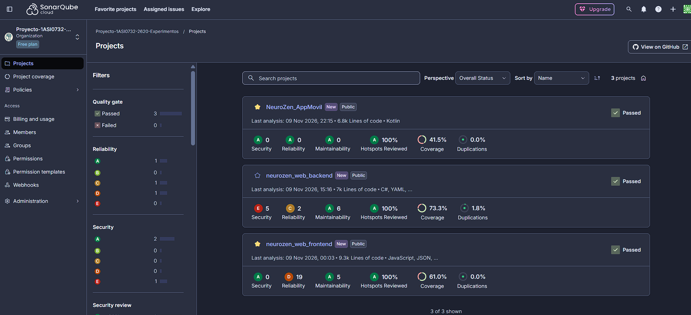
</p>
<p align="center"><b>Figura 6.2.1.</b> Proyectos de la organización en SonarQube Cloud: los tres productos con el Quality Gate aprobado (09/11/2026).</p>

**Frontend Web Application**

La calidad y la seguridad del código se evalúan con **SonarQube Cloud**, dentro de la organización del equipo `Proyecto-1ASI0732-2620-Experimentos`.

| Dato | Valor |
| :--- | :--- |
| Organization Key | `proyecto-1asi0732-2620-experimentos` |
| Project Key | `Proyecto-1ASI0732-2620-Experimentos_neurozen_web_frontend` |
| Quality Gate | *Sonar way* (evalúa el código nuevo) |
| Definición de código nuevo | *Previous version* |
| Método de análisis | Desde GitHub Actions (el análisis automático de SonarQube fue desactivado para que el reporte incluya la cobertura de las pruebas) |
| Cobertura | Reporte `coverage/lcov.info` generado por Vitest con el proveedor v8 |

**Línea base del análisis (09/11/2026).** El primer análisis del proyecto, sobre 14 000 líneas de código, arrojó los siguientes resultados:

| Dimensión | Issues | Calificación | Detalle |
| :--- | :---: | :---: | :--- |
| Security | 7 | **C** | El 100 % son de severidad media |
| Reliability | 22 | **D** | 23 % de severidad alta y 77 % de severidad media |
| Maintainability | 5 | **A** | Deuda técnica baja |
| Security Hotspots | 0 | **A** | Sin puntos sensibles pendientes de revisión |
| Duplicaciones | — | 0,0 % | Sin código duplicado |

<p align="center">
  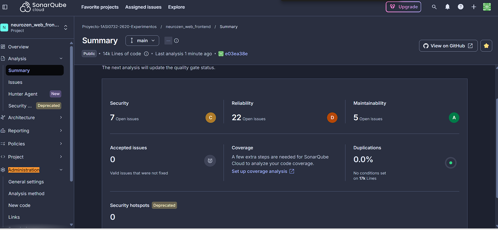
</p>
<p align="center"><b>Figura 6.2.2.</b> Resumen del primer análisis de SonarQube Cloud del Frontend Web Application.</p>

<p align="center">
  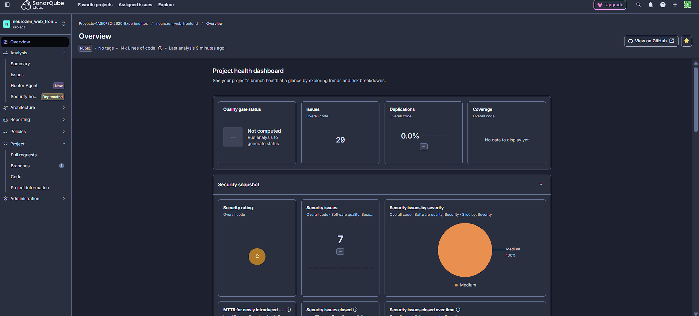
</p>
<p align="center"><b>Figura 6.2.3.</b> Panel de salud del proyecto (Project health dashboard).</p>

<p align="center">
  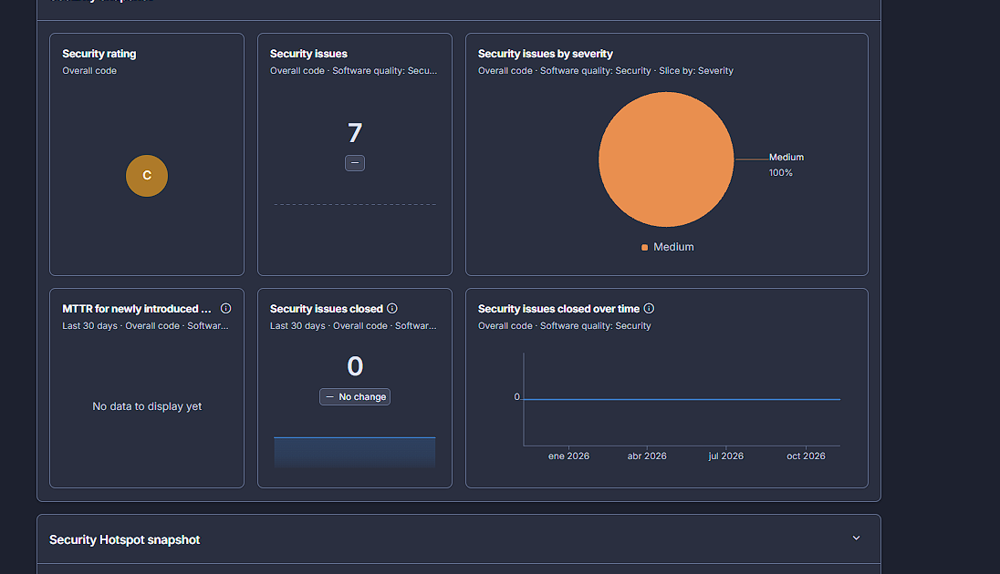
</p>
<p align="center"><b>Figura 6.2.4.</b> Detalle de seguridad: calificación C con 7 issues de severidad media.</p>

<p align="center">
  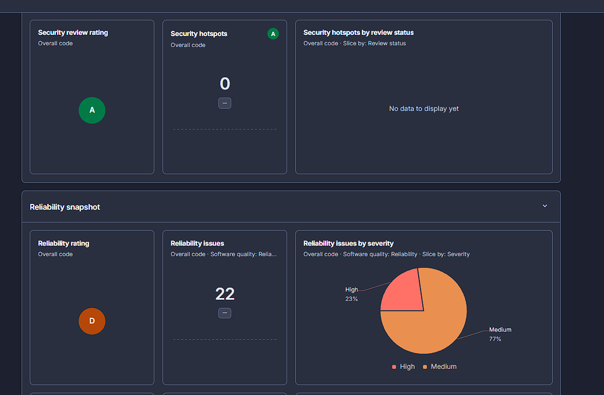
</p>
<p align="center"><b>Figura 6.2.5.</b> Security Hotspots (0, calificación A) y confiabilidad (22 issues, calificación D).</p>

<p align="center">
  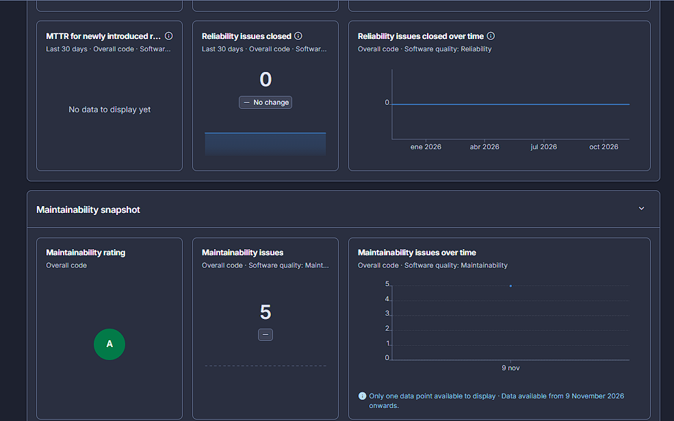
</p>
<p align="center"><b>Figura 6.2.6.</b> Detalle de mantenibilidad: calificación A con 5 issues.</p>

**Cobertura de pruebas.** La suite de pruebas del frontend se ejecuta con **Vitest** y genera el reporte de cobertura que SonarQube incorpora en cada análisis. La medición local, previa a la incorporación de la prueba de exportación de datos descrita más abajo, fue la siguiente:

| Métrica | Cobertura |
| :--- | :---: |
| Sentencias (*statements*) | 61,72 % |
| Ramas (*branches*) | 55,34 % |
| Funciones (*functions*) | 59,00 % |
| Líneas (*lines*) | 64,62 % |

**Quality Gate como control del pipeline.** El Quality Gate *Sonar way* se aplica sobre el **código nuevo**. El pipeline espera su resultado (`sonar.qualitygate.wait=true`) y, si no se cumple, el job `quality` falla y se detienen la publicación y el despliegue. Esto se comprobó en dos ejecuciones reales:

1. **Ejecución #9 (commit `179f6c2`), bloqueada.** El Quality Gate falló por una sola condición: la cobertura del código nuevo fue de **66,7 %** sobre 6 líneas nuevas, frente al mínimo de 80 %. Las líneas sin cubrir correspondían a la función `downloadData()` de `UserProfileComponent.vue`, que se había modificado al corregir una advertencia de lint y que ninguna prueba ejecutaba. Como consecuencia, no se publicó ninguna imagen ni se desplegó la versión.
2. **Ejecución #10 (commit `ad5c2c6`), aprobada.** Se agregó la prueba unitaria `tests/unit/UserProfileExport.spec.js`, que verifica que la exportación de datos personales **no incluya el token de sesión** del usuario (protección de datos, Ley N.° 29733), que conserve el perfil y los contactos de emergencia, y que libere la URL temporal de descarga. Con esta prueba, el código nuevo superó el umbral de cobertura, el Quality Gate pasó y el cambio llegó a producción.

<p align="center">
  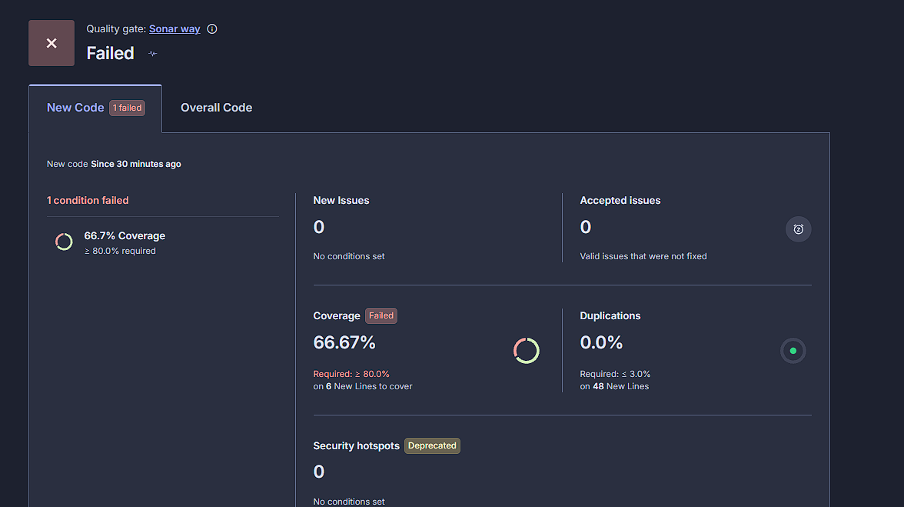
</p>
<p align="center"><b>Figura 6.2.7.</b> Quality Gate fallido en la ejecución #9: cobertura del código nuevo de 66,7 % (mínimo requerido: 80 %).</p>

**Estado del proyecto tras la integración (rama `main`, commit `ad5c2c6`).** El análisis de `main` después de la ejecución #10 muestra:

| Dimensión | Resultado | Detalle |
| :--- | :---: | :--- |
| Quality Gate | **Passed** | Código nuevo: 0 issues nuevos, cobertura de 100 % sobre 6 líneas nuevas y duplicación de 0,0 % sobre 105 líneas nuevas |
| Security | **A** | 0 issues. En los últimos 30 días se cerró 1 issue, con un tiempo medio de corrección (MTTR) de 26 minutos |
| Reliability | **D** | 19 issues: 5 % de severidad alta y 95 % de severidad media |
| Maintainability | **A** | 5 issues |
| Security Hotspots | **A** | 0 pendientes |
| Cobertura | 61,0 % | Código total del proyecto |
| Duplicaciones | 0,0 % | Código total del proyecto |
| Tamaño | 9,3 k líneas de código | — |

<p align="center">
  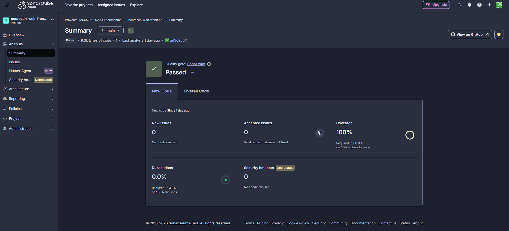
</p>
<p align="center"><b>Figura 6.2.8.</b> Quality Gate de la rama main del frontend (commit `ad5c2c6`): cobertura del código nuevo de 100 %.</p>

<p align="center">
  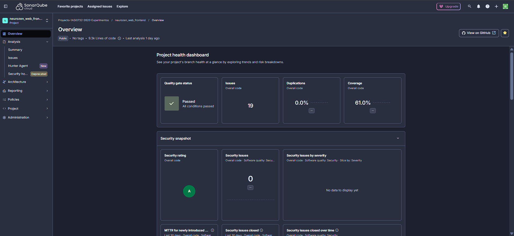
</p>
<p align="center"><b>Figura 6.2.9.</b> Panel de salud del Frontend Web Application en main: 19 issues, 0,0 % de duplicación y 61,0 % de cobertura.</p>

<p align="center">
  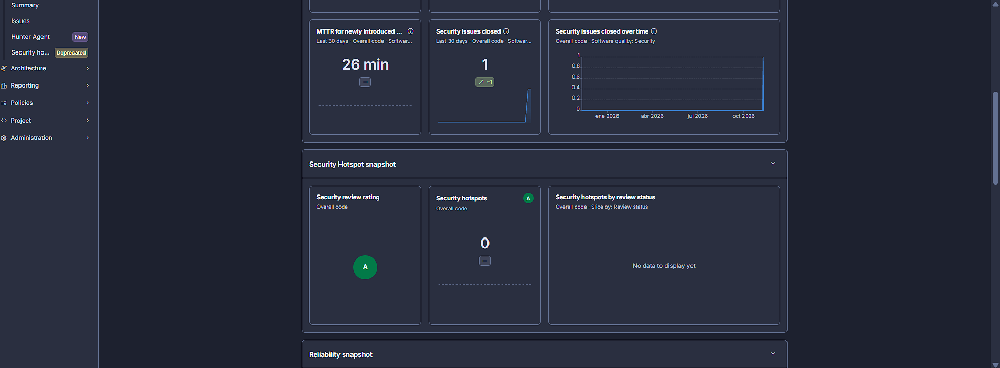
</p>
<p align="center"><b>Figura 6.2.10.</b> Seguridad: 1 issue cerrado en los últimos 30 días (MTTR de 26 minutos) y 0 Security Hotspots pendientes.</p>

<p align="center">
  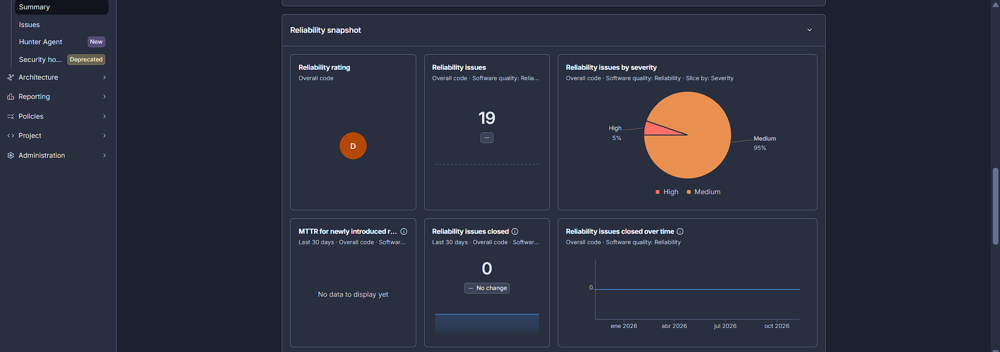
</p>
<p align="center"><b>Figura 6.2.11.</b> Confiabilidad: calificación D con 19 issues (5 % de severidad alta y 95 % media).</p>

<p align="center">
  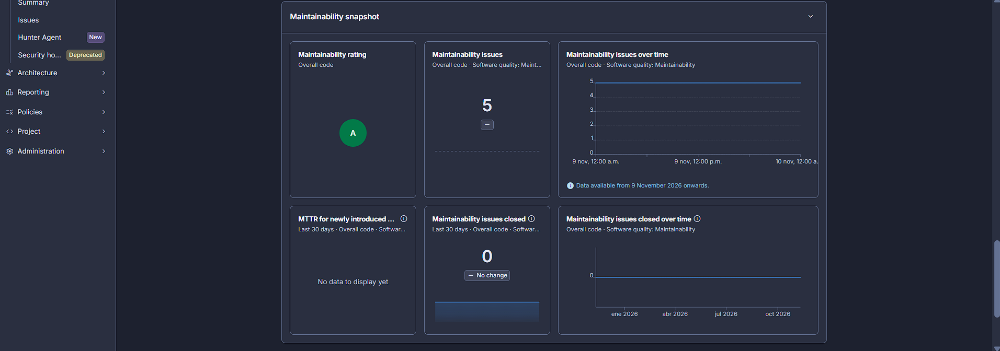
</p>
<p align="center"><b>Figura 6.2.12.</b> Mantenibilidad: calificación A con 5 issues.</p>

**Análisis y acciones pendientes.** La calificación D de confiabilidad corresponde al código existente antes de la incorporación del análisis. No bloquea el pipeline, porque el Quality Gate evalúa el código nuevo, pero el equipo la registró como deuda técnica a reducir en los siguientes sprints. La seguridad pasó de C (7 issues en la línea base) a A (0 issues) en el análisis de `main`:

| Prioridad | Acción | Indicador esperado |
| :---: | :--- | :--- |
| 1 | Revisar y corregir los issues de confiabilidad de severidad alta (5 % de los 19) y luego los de severidad media | Reliability de D a C o superior |
| ✅ | Revisar los 7 issues de seguridad de severidad media | Completado: Security A, con 0 issues en el análisis de `main` |
| 3 | Agregar pruebas a los componentes sin cobertura (por ejemplo, `BreathingSessionComponent.vue`, `ActiveBreaksComponent.vue` y `TherapistDetailComponent.vue`) | Mayor cobertura general |
| 4 | Mantener el Quality Gate *Sonar way* sobre el código nuevo | Ningún cambio nuevo por debajo del 80 % de cobertura |

**RESTful API**

La RESTful API se analiza en el mismo espacio de SonarQube Cloud del equipo, como un proyecto independiente:

| Dato | Valor |
| :--- | :--- |
| Organization Key | `proyecto-1asi0732-2620-experimentos` |
| Project Key | `Proyecto-1ASI0732-2620-Experimentos_neurozen_web_backend` |
| Quality Gate | *Sonar way* (evalúa el código nuevo) |
| Escáner | `dotnet-sonarscanner` (SonarScanner for .NET), que envuelve la compilación: `begin` → `build` → `test` → `end` |
| Cobertura | Reporte OpenCover (`coverage.opencover.xml`) generado por **coverlet** en cada ejecución de `dotnet test` |
| Resultados de pruebas | Reporte `.trx` de VSTest |
| Exclusiones | Migraciones de EF Core (`**/Migrations/**`) y código generado por Reqnroll (`**/*.feature.cs`) se excluyen del análisis; `Program.cs` se excluye solo de la cobertura |
| Control del pipeline | `sonar.qualitygate.wait=true`: si el Quality Gate falla, el job `build-and-test` falla |

**Primera integración con SonarQube.** Como las pruebas de integración del backend requieren MySQL, en la primera integración el equipo ejecutó la API y MySQL en dos contenedores Docker conectados mediante una red (`docker network`). Las capturas siguientes corresponden a esa primera etapa, anterior al Quality Gate bloqueante descrito más abajo. En el backend, las reglas de seguridad de C# cubren, entre otros aspectos, la configuración de la autenticación JWT, el uso de Entity Framework Core con consultas parametrizadas (prevención de inyección SQL) y la validación de las entradas de los controladores.

<p align="center">
  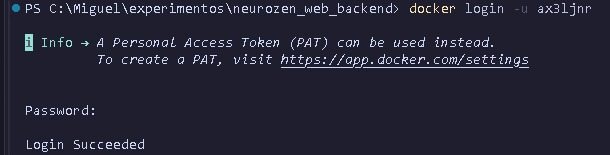
</p>
<p align="center"><b>Figura 6.2.13.</b> Primera integración del backend con SonarQube Cloud (1 de 5).</p>

<p align="center">
  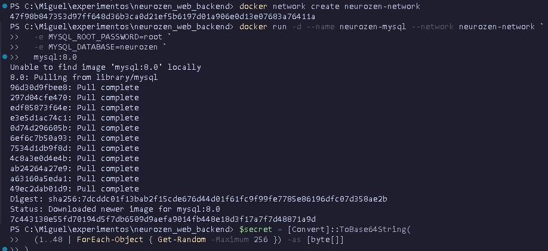
</p>
<p align="center"><b>Figura 6.2.14.</b> Primera integración del backend con SonarQube Cloud (2 de 5).</p>

<p align="center">
  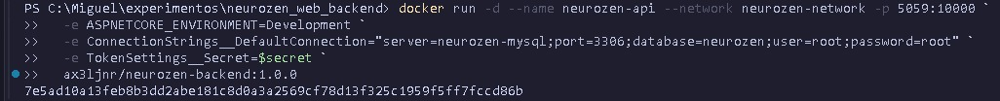
</p>
<p align="center"><b>Figura 6.2.15.</b> Primera integración del backend con SonarQube Cloud (3 de 5).</p>

<p align="center">
  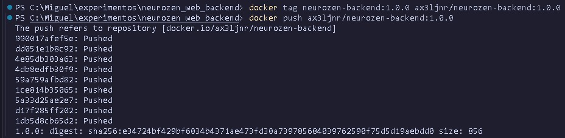
</p>
<p align="center"><b>Figura 6.2.16.</b> Primera integración del backend con SonarQube Cloud (4 de 5).</p>

<p align="center">
  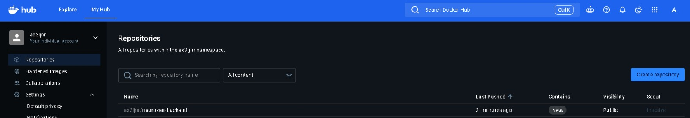
</p>
<p align="center"><b>Figura 6.2.17.</b> Primera integración del backend con SonarQube Cloud (5 de 5).</p>


**Línea base del análisis (rama `main`, antes de integrar el PR #15).** Sobre 6 400 líneas de código, el proyecto presentaba el Quality Gate aprobado, pero con deuda acumulada en el código existente:

| Dimensión | Resultado | Detalle |
| :--- | :---: | :--- |
| Quality Gate | **Passed** | Todas las condiciones sobre el código nuevo cumplidas |
| Issues totales | 13 | Código existente |
| Security | **E** | 5 issues: 20 % *blocker*, 20 % de severidad media y 60 % de severidad baja |
| Duplicaciones | 1,9 % | — |
| Cobertura | 47,7 % | Código total del proyecto |

<p align="center">
  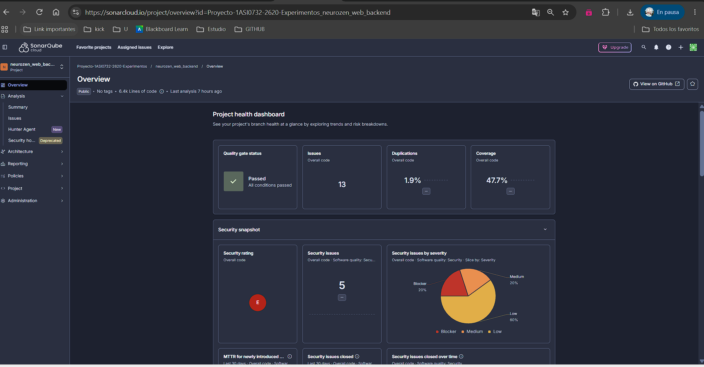
</p>
<p align="center"><b>Figura 6.2.18.</b> Panel de salud del proyecto de la RESTful API (línea base de la rama main).</p>

**Quality Gate como control del pipeline.** La integración de las mejoras del backend y del pipeline del laboratorio se realizó mediante el **Pull Request #15** (`feature/cicd-lab` → `main`, 816 líneas nuevas). El Quality Gate bloqueó el cambio en su primera versión y lo aprobó después de las correcciones:

1. **Primer análisis (commit `71b9131`), bloqueado.** El Quality Gate falló por dos condiciones:
   - **Security Rating C** en el código nuevo (se requiere A). Los 5 issues de seguridad estaban en el nuevo workflow `cd-lab-vm.yml`: tres *actions* referenciadas por etiqueta (`@v3`, `@v4`) en lugar de por hash SHA completo, y dos puntos donde un `workflow_run` hacía *checkout* de un commit que podía provenir de un *fork* no confiable.
   - **Cobertura del código nuevo de 69,57 %** sobre 391 líneas, frente al mínimo de 80 %. Las 116 líneas sin cubrir se concentraban en la capa REST de Wellness: `WellnessResources.cs` (34 líneas, 0 %) y `WellnessAssemblers.cs` (30 líneas, 0 %).
2. **Correcciones aplicadas.**
   - Todas las *actions* del workflow se fijaron por **hash SHA completo**, los mismos que el equipo ya usaba en la rama `main`.
   - El *checkout* de `head_sha` se reemplazó por el *checkout* por defecto, más una verificación de que el commit construido es el mismo que aprobó el CI, y una condición que **excluye explícitamente los forks** (`head_repository.full_name == github.repository`).
   - Se corrigió el *under-posting* de `StressLevel` (sección 6.2.1.1).
   - Se agregó la prueba `WellnessAssemblersTests.cs` (6 casos). Verifica el mapeo de métricas de salud, del dashboard con y sin próxima cita, y de meditaciones, y además comprueba que un JSON **sin** `stressLevel` sea **rechazado**, lo que protege la corrección anterior frente a regresiones.
3. **Análisis final (commit `fa0932e`), aprobado.** Cobertura del código nuevo de **85,51 %**, duplicación de 0,0 % y Quality Gate **Passed**. Con este resultado se habilitó el *merge* a `main`.

<p align="center">
  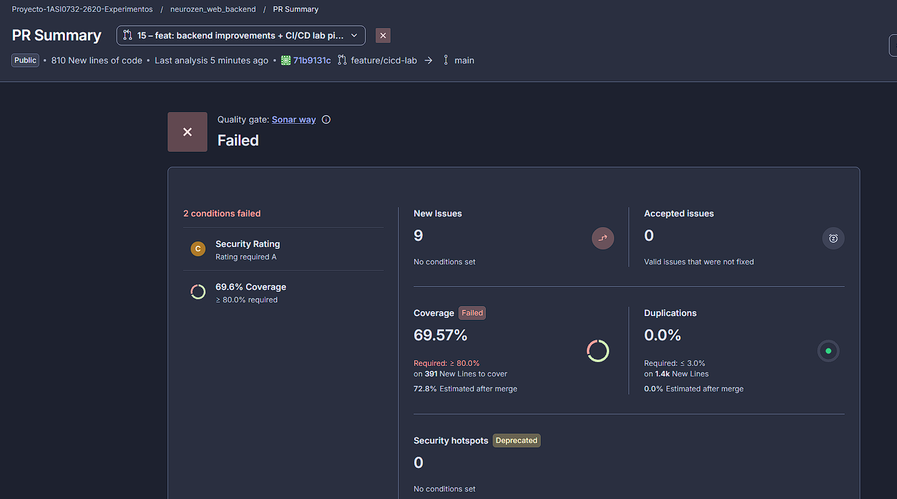
</p>
<p align="center"><b>Figura 6.2.19.</b> Primer análisis del PR #15: Quality Gate fallido por Security Rating C y cobertura del código nuevo de 69,57 %.</p>

<p align="center">
  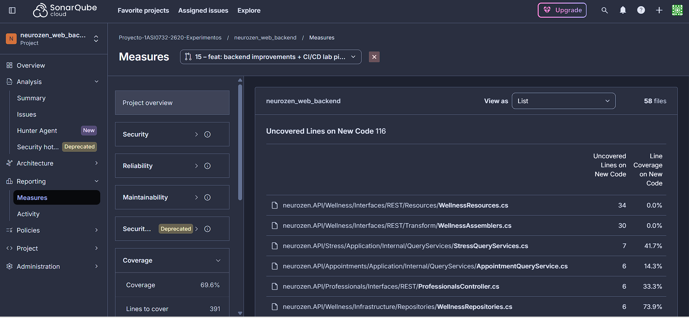
</p>
<p align="center"><b>Figura 6.2.20.</b> Líneas nuevas sin cubrir por archivo: la capa REST de Wellness concentraba 64 de las 116 líneas.</p>

<p align="center">
  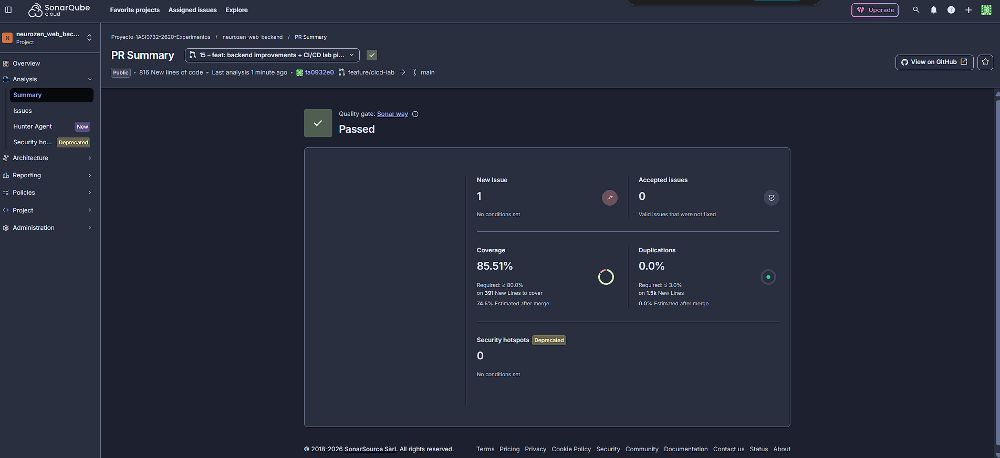
</p>
<p align="center"><b>Figura 6.2.21.</b> Análisis final del PR #15: Quality Gate aprobado con 85,51 % de cobertura del código nuevo.</p>

**Consolidación del pipeline (Pull Request #17).** Después del PR #15, el equipo unificó el CI y la entrega del backend en un solo workflow, `pipeline.yml` (sección 7.1.1). El cambio se integró mediante el **Pull Request #17** (`ci/pipeline` → `main`), y el Quality Gate volvió a actuar como control:

1. **Primer análisis (commit `93b29b4`), bloqueado.** El Quality Gate falló por **Security Rating C** en el código nuevo (se requiere A). SonarQube también analiza los archivos YAML de GitHub Actions, y marcó las 6 *actions* del nuevo workflow que estaban referenciadas por etiqueta (`@v3`, `@v4`) con la regla *Use full commit SHA hash for this dependency*. Una etiqueta puede moverse a otro commit sin aviso; un hash no. El paso *Sonar end (Quality Gate)* falló y, con él, el check obligatorio `build-and-test`.
2. **Corrección (commit `bc72990`).** Las 10 referencias `uses:` del workflow se fijaron por hash SHA completo, con la versión como comentario (por ejemplo, `actions/checkout@11bd719…  # v4.2.2`).
3. **Análisis final, aprobado.** Quality Gate **Passed**, con 0 issues nuevos y 0 Security Hotspots. La cobertura y la duplicación del código nuevo fueron 0,0 %, porque el PR solo modificó archivos del pipeline y no código C#.

<p align="center">
  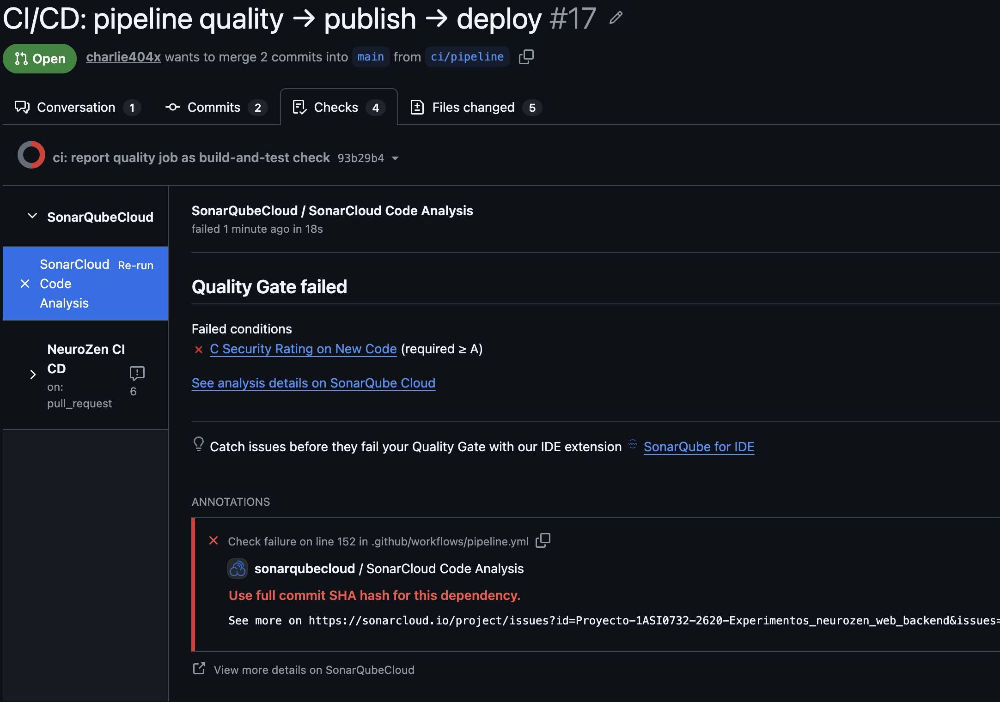
</p>
<p align="center"><b>Figura 6.2.22.</b> Primer análisis del PR #17: Quality Gate fallido por Security Rating C. La anotación señala la línea del workflow con una *action* sin hash SHA.</p>

<p align="center">
  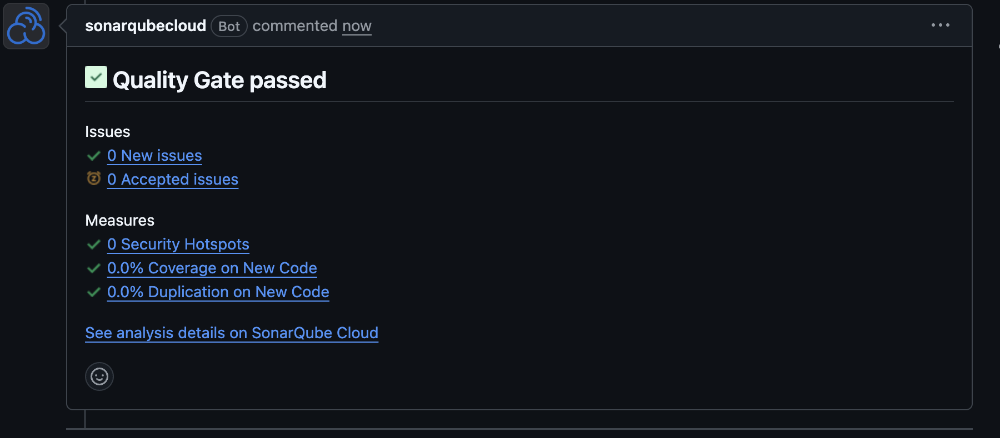
</p>
<p align="center"><b>Figura 6.2.23.</b> Análisis final del PR #17: Quality Gate aprobado tras fijar las *actions* por hash SHA.</p>

**Estado del proyecto tras la integración (rama `main`, commit `427b18a`).** El análisis de `main` después del *merge* del PR #17 muestra:

| Dimensión | Resultado | Detalle |
| :--- | :---: | :--- |
| Quality Gate | **Passed** | Código nuevo (últimos 2 días): cobertura de 85,51 % sobre 391 líneas, duplicación de 0,0 % sobre 1,6 k líneas, 1 issue nuevo y 0 Security Hotspots |
| Security | **E** | 5 issues: 20 % *blocker*, 20 % de severidad media y 60 % de severidad baja. En los últimos 30 días se cerraron 5 issues, con un tiempo medio de corrección (MTTR) de 2 horas |
| Reliability | **C** | 2 issues (1 de severidad alta y 1 media). En los últimos 30 días se cerraron 2, con un MTTR de 6 horas |
| Maintainability | **A** | 6 issues |
| Security Hotspots | **A** | 0 pendientes; 100 % revisados |
| Cobertura | 73,3 % | Código total del proyecto (línea base: 47,7 %) |
| Duplicaciones | 1,8 % | Código total del proyecto |

<p align="center">
  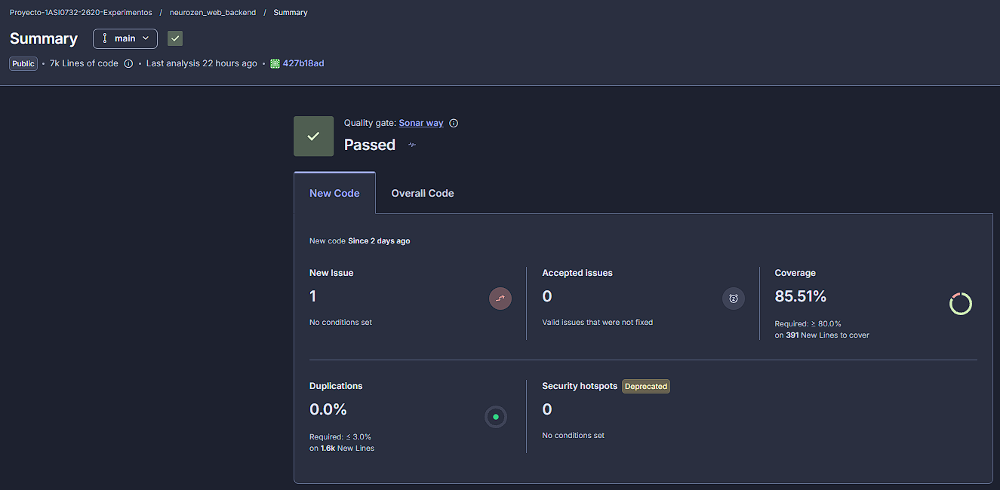
</p>
<p align="center"><b>Figura 6.2.24.</b> Quality Gate de la rama main (commit `427b18a`): cobertura del código nuevo de 85,51 %.</p>

<p align="center">
  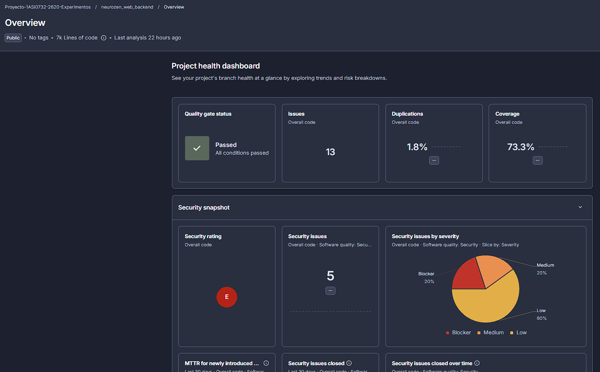
</p>
<p align="center"><b>Figura 6.2.25.</b> Panel de salud de la RESTful API en main: 13 issues, 1,8 % de duplicación y 73,3 % de cobertura.</p>

<p align="center">
  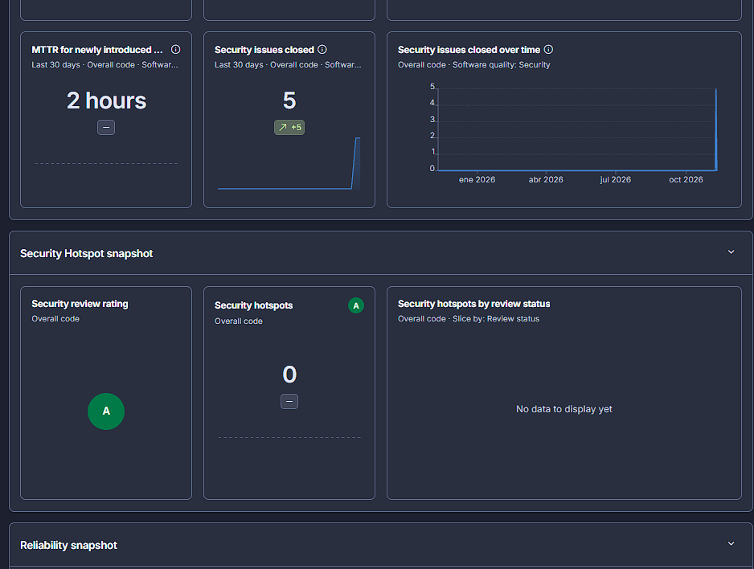
</p>
<p align="center"><b>Figura 6.2.26.</b> Seguridad: 5 issues cerrados en los últimos 30 días y 0 Security Hotspots pendientes (calificación A).</p>

<p align="center">
  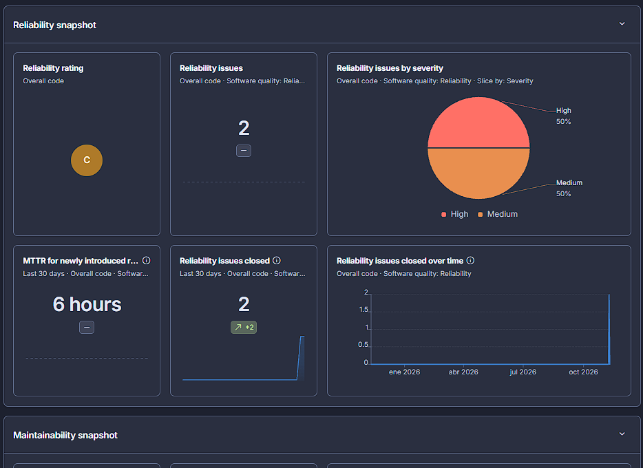
</p>
<p align="center"><b>Figura 6.2.27.</b> Confiabilidad: calificación C con 2 issues (alta y media).</p>

<p align="center">
  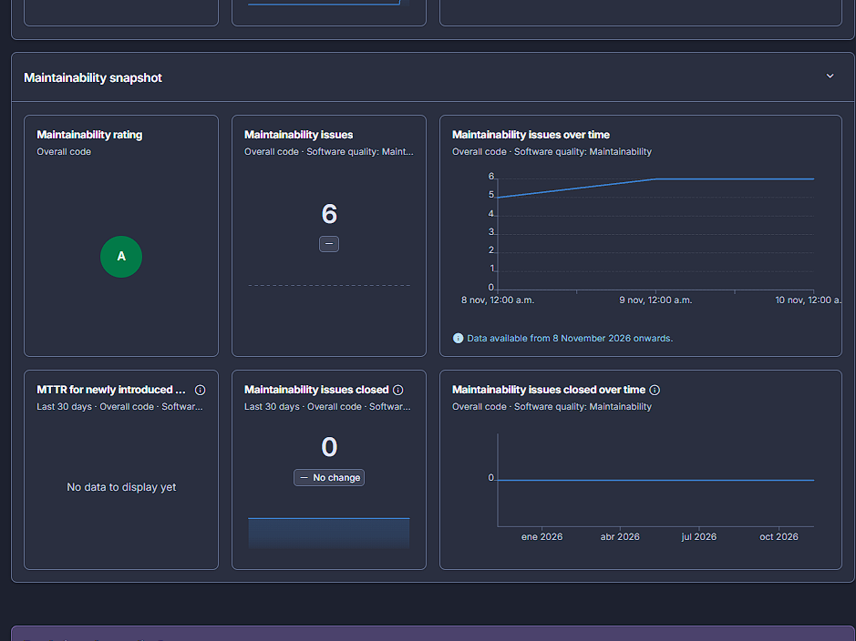
</p>
<p align="center"><b>Figura 6.2.28.</b> Mantenibilidad: calificación A con 6 issues.</p>

**Análisis y acciones pendientes.** El Quality Gate protege el código nuevo, y la cobertura general subió de 47,7 % a 73,3 %. Sin embargo, el código existente mantiene deuda en seguridad y confiabilidad, que el equipo registró para los siguientes sprints:

| Prioridad | Acción | Indicador esperado |
| :---: | :--- | :--- |
| 1 | Corregir el issue de seguridad de severidad *blocker* del código existente | Security de E a C o superior |
| 2 | Corregir los 4 issues de seguridad restantes (1 de severidad media y 3 de severidad baja) | Security A |
| 3 | Corregir los 2 issues de confiabilidad (alta y media) | Reliability A |
| 4 | Aumentar la cobertura de ramas (52 % según el reporte del pipeline, sección 7.1.2) | Cobertura de ramas superior al 65 % |
| ✅ | Fijar por hash SHA todas las *actions* de CI | Completado en el PR #17: las 10 referencias de `pipeline.yml` usan hash SHA |

**Aplicación Móvil**

La aplicación móvil se analiza como un proyecto independiente dentro de la misma organización. Además de las reglas de Kotlin, el análisis importa los resultados de las pruebas, la cobertura y los hallazgos de Android Lint, de modo que un solo panel concentra la calidad del producto. Entre los puntos sensibles de seguridad del código móvil están la comunicación con la API (Retrofit solo por HTTPS, con `usesCleartextTraffic=false` y `network_security_config`), el almacenamiento cifrado de la sesión (`CryptoManager` y DataStore), el interceptor que agrega el token JWT (`AuthInterceptor`) y la persistencia local con Room.

| Dato | Valor |
| :--- | :--- |
| Organization Key | `proyecto-1asi0732-2620-experimentos` |
| Project Key | `Proyecto-1ASI0732-2620-Experimentos_NeuroZen_AppMovil` |
| Quality Gate | *Sonar way* (evalúa el código nuevo) |
| Perfil de calidad | *Sonar way core* para Kotlin |
| Escáner | `SonarSource/sonarqube-scan-action@v6`, configurado con `sonar-project.properties` en la raíz del repositorio. La organización y el proyecto se reciben de las variables `SONAR_ORG` y `SONAR_PROJECT_KEY` |
| Método de análisis | Desde GitHub Actions; el análisis automático de SonarQube se desactivó para que el reporte incluya la cobertura y las pruebas |
| Fuentes y pruebas | Fuentes en `app/src/main/java` (55 archivos Kotlin); pruebas en `app/src/test/java` y `app/src/androidTest/java` |
| Cobertura | Reporte XML de JaCoCo generado por el Android Gradle Plugin (`createDebugUnitTestCoverageReport`) |
| Resultados de pruebas | Reportes JUnit de `testDebugUnitTest` |
| Android Lint | Reporte `app/build/reports/lint-results-debug.xml` |
| Exclusiones de cobertura | Pantallas de Compose (`*Screen*.kt`, `*Root.kt`), navegación, tema, componentes visuales, inyección de dependencias (`di`), notificaciones, `MainActivity` y `MyApplication`. Estas clases se verifican con pruebas instrumentadas o manualmente, no con pruebas unitarias de JVM |
| Control del pipeline | `sonar.qualitygate.wait=true`: si el Quality Gate falla, el job `quality` falla y no se ejecutan `smoke`, `build-release` ni `distribute` |

**Limitación del plan: análisis en la rama `main`.** En la primera ejecución del pipeline (ejecución #1, *push* a `develop`, commit `e9bf665`), las pruebas y Lint terminaron bien y el análisis se subió a SonarQube, pero la consulta del Quality Gate fue rechazada:

```text
INFO  Branch name: develop, type: short
ERROR Failed to get Quality Gate status - Organization is not allowed to access data from non main branches.
```

El plan de la organización no permite consultar el resultado de ramas distintas de la principal. Por eso, en el commit `9a127a3`, el paso de SonarQube se condicionó a la rama `main` (`if: github.ref == 'refs/heads/main'`). Además, la *action* se actualizó de `sonarqube-scan-action@v5` a `@v6`, porque la ejecución advertía que la v5 ya no tiene soporte y contiene una vulnerabilidad. Desde entonces, en `develop` y en los Pull Requests el job `quality` ejecuta las pruebas, la cobertura y Lint, y en `main` agrega el Quality Gate.

<p align="center">
  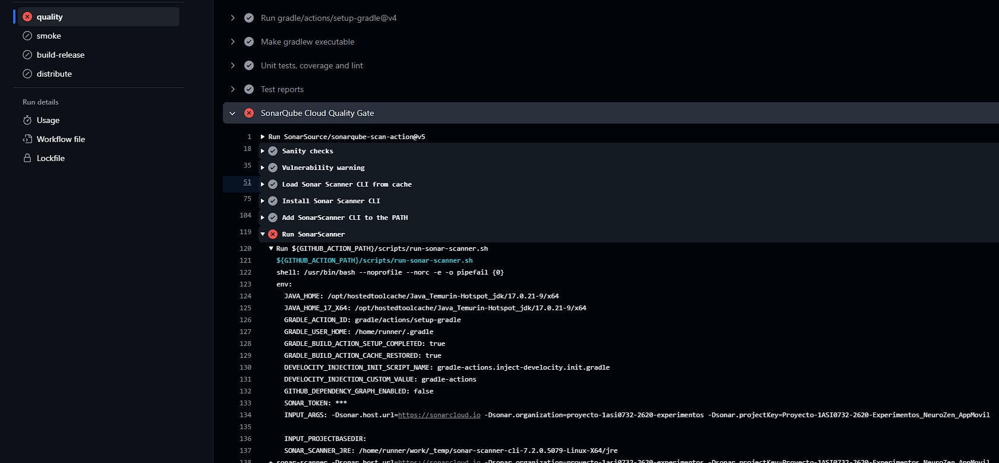
</p>
<p align="center"><b>Figura 6.2.29.</b> Ejecución #1 en `develop`: pruebas, cobertura y Lint aprobados; el paso de SonarQube falla porque el plan no permite consultar ramas distintas de `main`.</p>

**Primer análisis de `main`.** Tras integrar el Pull Request #1 (ejecución #4, commit `ff57345`), el job `quality` falló con `QUALITY GATE STATUS: FAILED`, aunque el código no tenía issues. Como era el primer análisis de la rama, SonarQube no tenía una versión anterior con la cual delimitar el código nuevo y mostraba el Quality Gate como *Not computed*; con `sonar.qualitygate.wait=true`, el escáner trata ese estado como un fallo. El pipeline se detuvo correctamente: no se ejecutaron `smoke`, `build-release` ni `distribute`. Al relanzar el job (intento #2), el segundo análisis ya calculó el Quality Gate, que resultó **Passed**, y el pipeline continuó.

Este bloqueo no se debió a código defectuoso, sino a la falta de una línea base. Por eso, el escenario en que el Quality Gate bloquea un cambio que no cumple sus condiciones queda pendiente de demostrar en la aplicación móvil (ver las acciones pendientes).

<p align="center">
  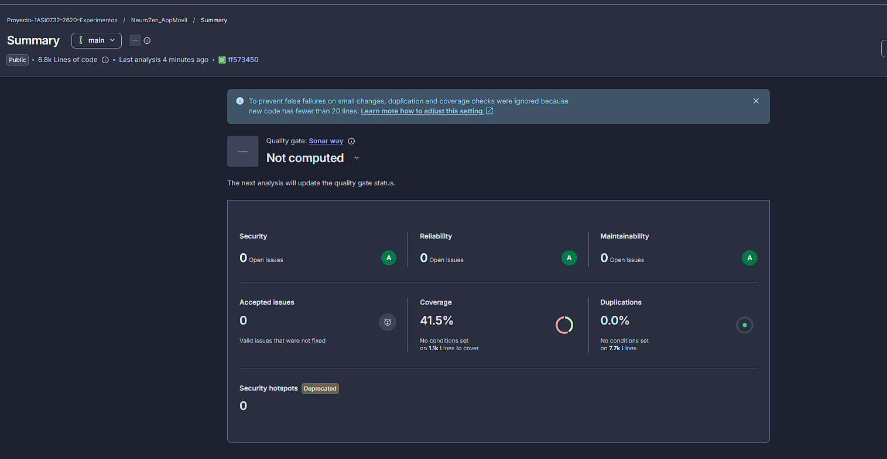
</p>
<p align="center"><b>Figura 6.2.30.</b> Primer análisis de `main` (commit `ff57345`): Quality Gate *Not computed* por falta de línea base, con 0 issues en las tres dimensiones.</p>

<p align="center">
  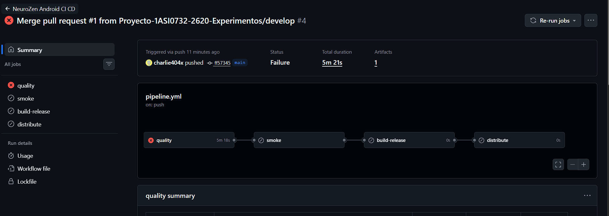
</p>
<p align="center"><b>Figura 6.2.31.</b> Ejecución #4, intento #1: el job `quality` falla en el paso del Quality Gate y los jobs siguientes no se ejecutan.</p>

**Estado del proyecto (rama `main`, commit `4306d6d`).** El análisis de la ejecución #5 muestra:

| Dimensión | Resultado | Detalle |
| :--- | :---: | :--- |
| Quality Gate | **Passed** | Código nuevo: 0 issues y 0 Security Hotspots. La cobertura y la duplicación no se evaluaron porque el cambio no tenía suficientes líneas nuevas |
| Security | **A** | 0 issues |
| Reliability | **A** | 0 issues |
| Maintainability | **A** | 0 issues |
| Security Hotspots | **A** | 0 pendientes |
| Cobertura | 41,5 % | Código total, sobre 1,1 k líneas por cubrir (sin las exclusiones de UI) |
| Duplicaciones | 0,0 % | Sobre 7,7 k líneas |
| Tamaño | 6,8 k líneas de código | 55 archivos Kotlin |

<p align="center">
  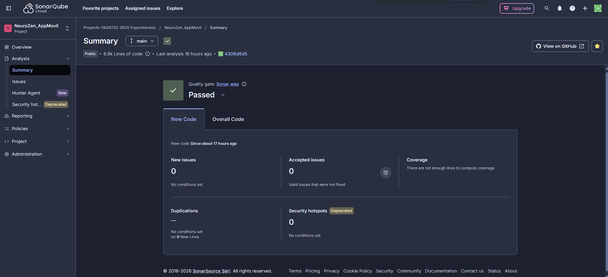
</p>
<p align="center"><b>Figura 6.2.32.</b> Quality Gate de la rama main de la aplicación móvil (commit `4306d6d`): *Passed*, con 0 issues nuevos.</p>

<p align="center">
  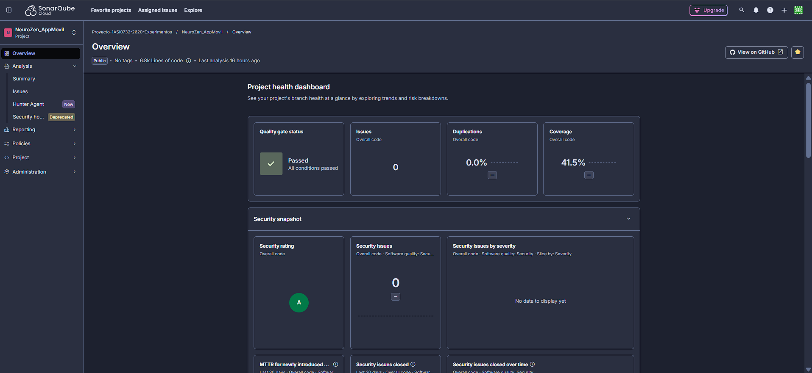
</p>
<p align="center"><b>Figura 6.2.33.</b> Panel de salud de la aplicación móvil: Quality Gate aprobado, 0 issues, 0,0 % de duplicación y 41,5 % de cobertura.</p>

<p align="center">
  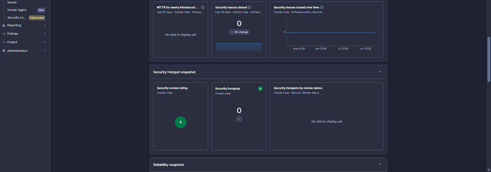
</p>
<p align="center"><b>Figura 6.2.34.</b> Seguridad: calificación A y 0 Security Hotspots pendientes.</p>

<p align="center">
  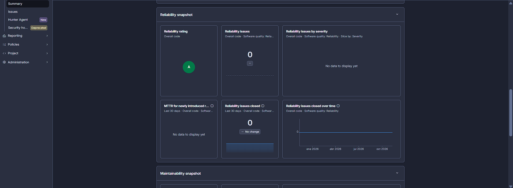
</p>
<p align="center"><b>Figura 6.2.35.</b> Confiabilidad: calificación A con 0 issues.</p>

<p align="center">
  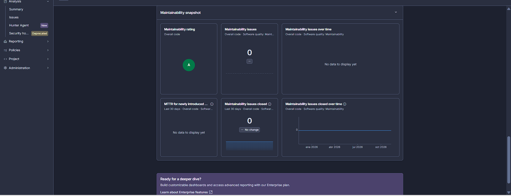
</p>
<p align="center"><b>Figura 6.2.36.</b> Mantenibilidad: calificación A con 0 issues.</p>

**Análisis y acciones pendientes.** El código móvil no tiene issues abiertos en ninguna dimensión. Sus principales brechas son la cobertura (41,5 %, la más baja de los tres productos) y que el Quality Gate se evalúa **después** del *merge* a `main` y no en el Pull Request. Esto último no permite que un cambio defectuoso se distribuya, porque `build-release` y `distribute` dependen de `quality`, pero sí permite que llegue a `main`.

| Prioridad | Acción | Indicador esperado |
| :---: | :--- | :--- |
| 1 | Ejecutar el análisis también en los Pull Requests, cambiando la condición del paso a `if: github.ref == 'refs/heads/main' \|\| github.event_name == 'pull_request'`. La restricción del plan se observó en el análisis de ramas (`develop`), y la RESTful API, en la misma organización, ya analiza sus Pull Requests | Quality Gate evaluado antes del *merge* |
| 2 | Agregar pruebas unitarias a los ViewModels y repositorios que aún no tienen pruebas | Cobertura superior al 60 % |
| 3 | Demostrar el bloqueo del Quality Gate con un cambio controlado que no cumpla sus condiciones (escenario E2) | Evidencia de bloqueo y de aprobación tras la corrección |
| 4 | Actualizar las *actions* con avisos de obsolescencia (`actions/setup-java@v4` a `@v5` y las que aún usan Node.js 20) y fijarlas por hash SHA, como en la RESTful API | Ejecuciones sin advertencias de obsolescencia |

### 6.2.2. Reviews

Además de las herramientas automáticas, el equipo aplica revisión por pares (*peer review*) mediante Pull Requests en GitHub:

1. Nadie integra cambios con *push* directo a `develop` o `main`. El código nuevo nace en una rama de trabajo (`feature/*`, o `ci/*` para cambios del pipeline).
2. La integración se realiza siempre mediante Pull Request.
3. Por acuerdo del equipo, cada Pull Request recibe al menos **una revisión** de otro integrante (por ejemplo, Carlos Paredes revisa los cambios de Jean Pool Huaman y Miguel Vila revisa los de Joao Castro).
4. El revisor comprueba que el cambio cumpla los criterios de aceptación de las historias de usuario, que respete la arquitectura (modelo C4) y que la documentación sea clara.

La aplicación técnica de estas reglas depende de la protección de ramas de cada repositorio, que se detalla a continuación por producto.

**Frontend Web Application**

La revisión del código del frontend combina una revisión automática obligatoria con la revisión entre pares:

- **Revisión automática en cada cambio:** el job `quality` del pipeline actúa como primera revisión de todo *push* y *Pull Request* hacia `main` y `develop`. Ejecuta el linter, las pruebas unitarias e integrales con cobertura, el build y el Quality Gate de SonarQube. Las ejecuciones #9 y #10 (sección 6.2.1.2) muestran que un cambio que no cumple los criterios queda bloqueado y uno corregido es aceptado.
- **Revisión entre pares mediante Pull Requests:** los cambios se integran mediante ramas de GitFlow y Pull Requests revisados por otro integrante del equipo, quien comprueba el cumplimiento de las convenciones de la sección 5.1.3, la existencia de pruebas para el código nuevo, la ausencia de credenciales en el código y el uso de nombres en inglés.

> `[Pendiente: captura de la regla de protección de la rama main (Settings → Branches) con Pull Request obligatorio y el check "Quality (lint, tests, coverage, SonarQube)" requerido]`
>
> `[Pendiente: captura de un Pull Request del frontend con comentarios del revisor y aprobación]`

**RESTful API**

En el backend, la revisión automática es **obligatoria por configuración del repositorio**. La rama `main` está protegida por el *ruleset* `protect-main` (estado *Active*, sin lista de excepciones), con las siguientes reglas:

| Regla | Efecto |
| :--- | :--- |
| *Require a pull request before merging* | Nadie puede hacer *push* directo a `main`; todo cambio entra por Pull Request |
| *Require status checks to pass* | Son obligatorios los checks `build-and-test` (GitHub Actions) y `SonarCloud Code Analysis` (Quality Gate) |
| *Block force pushes* | No se puede reescribir el historial de `main` |
| *Restrict deletions* | No se puede eliminar la rama `main` |

La regla todavía no exige un número mínimo de aprobaciones (*Required approvals* = 0), de modo que la revisión de un compañero se aplica por acuerdo del equipo. Activar *Required approvals* = 1 queda como mejora para alinear la regla técnica con la política descrita.


El Pull Request #15 muestra el flujo completo de revisión. Primero quedó **bloqueado**, con ambos checks fallidos. Luego se corrigió en la misma rama y, con los dos checks aprobados, se integró a `main` con el commit de *merge* `51af523`.

<p align="center">
  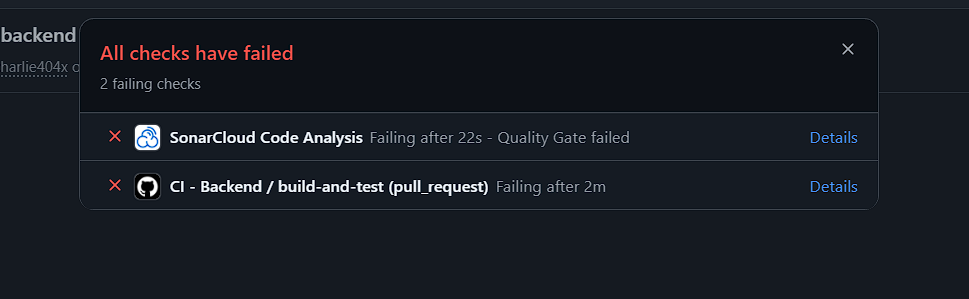
</p>
<p align="center"><b>Figura 6.2.37.</b> PR #15 bloqueado: SonarCloud Code Analysis (Quality Gate failed) y CI - Backend fallidos.</p>

<p align="center">
  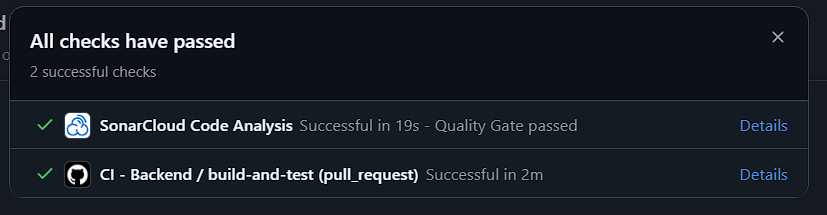
</p>
<p align="center"><b>Figura 6.2.38.</b> PR #15 aprobado tras las correcciones: ambos checks obligatorios en verde.</p>

<p align="center">
  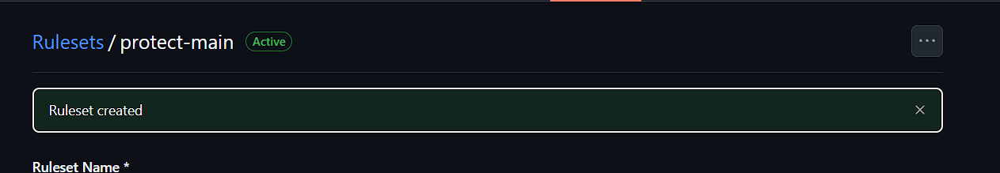
</p>
<p align="center"><b>Figura 6.2.39.</b> Ruleset `protect-main` creado y activo sobre la rama main del backend.</p>

<p align="center">
  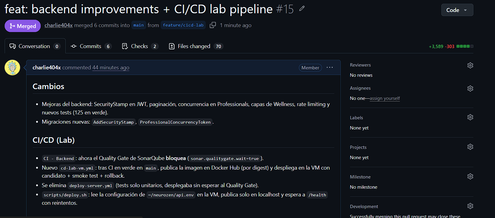
</p>
<p align="center"><b>Figura 6.2.40.</b> PR #15 integrado a main con 2 checks aprobados.</p>

El Pull Request #17 repitió el flujo con el nuevo workflow. Como el ruleset exige un check llamado exactamente `build-and-test`, el job de calidad del nuevo `pipeline.yml` conserva ese nombre visible (`name: build-and-test`). Si se hubiera llamado de otra forma, el check obligatorio nunca se habría reportado y el PR habría quedado bloqueado indefinidamente. El PR quedó bloqueado por el Quality Gate (sección 6.2.1.2), se corrigió en la misma rama y se integró con todos los checks en verde. En un Pull Request, los jobs `publish` y `deploy` aparecen como *skipped*, porque solo se ejecutan con un *push* a `main`.

<p align="center">
  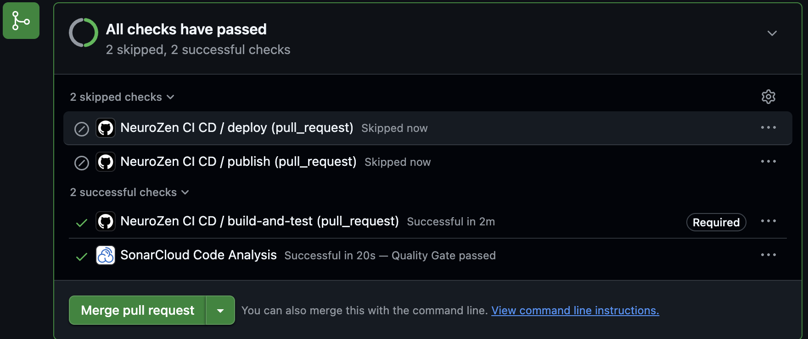
</p>
<p align="center"><b>Figura 6.2.41.</b> PR #17 listo para integrar: `build-and-test` (obligatorio) y SonarCloud Code Analysis aprobados; `publish` y `deploy` omitidos en el Pull Request.</p>

<p align="center">
  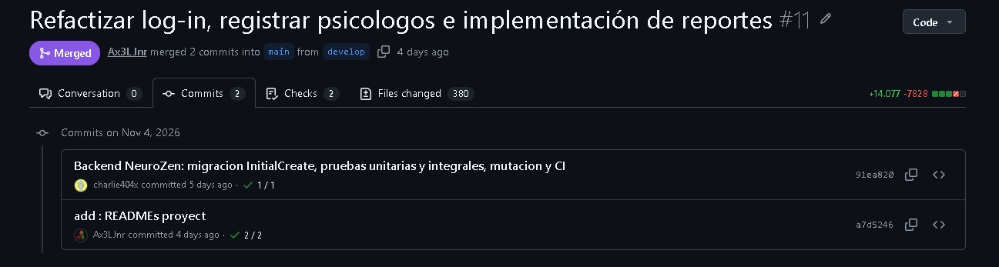
</p>
<p align="center"><b>Figura 6.2.42.</b> Evidencia de revisión de código (*Code Review*) en un Pull Request del repositorio del backend.</p>


**Aplicación Móvil**

En la aplicación móvil, la integración entre ramas sigue el mismo flujo `develop` → `main` mediante Pull Request. El Pull Request #1 (`develop` → `main`, 5 commits) integró la primera versión completa del pipeline. Antes del *merge*, se ejecutaron automáticamente tres checks y los tres se aprobaron:

| Check | Evento | Qué verifica |
| :--- | :--- | :--- |
| `quality` | *Push* a `develop` | Pruebas unitarias, cobertura y Lint de la rama de origen |
| `quality` | Pull Request | Las mismas verificaciones sobre el resultado del *merge* |
| `smoke` | Pull Request | Pruebas instrumentadas de Room y Compose UI en un emulador Android (API 34) |

Los jobs `build-release` y `distribute` aparecen como *skipped*, porque solo se ejecutan con un *push* a `main`.

<p align="center">
  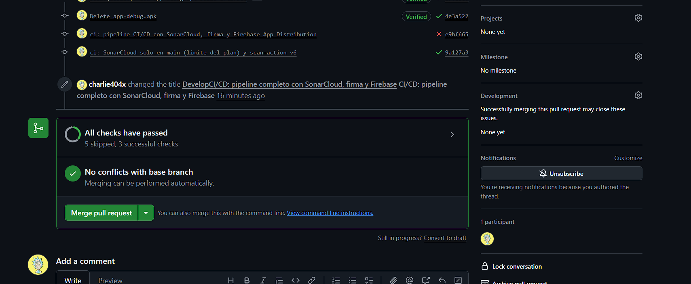
</p>
<p align="center"><b>Figura 6.2.43.</b> PR #1 de la aplicación móvil: 3 checks aprobados (`quality` y `smoke`) y 5 omitidos, sin conflictos con `main`.</p>

**Brechas detectadas.** A diferencia de la RESTful API, el repositorio móvil todavía no tiene una regla de protección para `main`. Por eso, GitHub habilitó el botón *Merge* antes de que terminaran los checks, el PR #1 se integró sin la revisión de otro integrante y la corrección posterior del pipeline (commit `4306d6d`) se integró en `main` mediante un *push* directo. Para alinear el repositorio con las reglas del equipo, se debe crear un *ruleset* equivalente al del backend:

| Regla | Efecto |
| :--- | :--- |
| *Require a pull request before merging*, con *Required approvals* = 1 | Todo cambio entra por Pull Request y requiere la aprobación de otro integrante |
| *Require status checks to pass*: `quality` y `smoke` | No se puede integrar si fallan las pruebas, Lint o las pruebas instrumentadas |
| *Block force pushes* y *Restrict deletions* | Protegen el historial y la existencia de `main` |


---


## 6.3. Validation Interviews

Para asegurar que NeuroZen realmente resuelve el problema del estrés laboral y cumple con las expectativas de nuestros segmentos objetivo, se llevó a cabo un proceso formal de validación cualitativa. Los usuarios interactuaron directamente con los productos desplegados (Landing Page, Frontend Web y Aplicación Móvil), brindando retroalimentación valiosa.

### 6.3.1. Diseño de Entrevistas

Para esta fase de validación, el diseño de las entrevistas tiene como objetivo evaluar la usabilidad, la arquitectura de información y la utilidad de NeuroZen directamente con nuestros usuarios finales. Se han diseñado sesiones estructuradas donde los participantes interactúan con la Landing Page y con una de las plataformas (Frontend Web o Aplicación Móvil), de acuerdo con su segmento objetivo.

El documento oficial del proyecto especifica que se deben realizar entre **3 a 5 entrevistas por cada segmento objetivo**. Para estructurar estas sesiones, hemos definido los siguientes perfiles representativos y sus respectivos guiones de validación (User Flows).

#### Protocolo de grabación de las sesiones

De acuerdo con el Anexo C del curso, cada sesión se graba compartiendo pantalla y con la cámara encendida, con una duración sugerida de 3 a 5 minutos por entrevista. El moderador asigna las tareas sin indicar dónde hacer clic e invita a la participante a pensar en voz alta (*Thinking Aloud*). Todas las sesiones se consolidan luego en un único video editado.

Cada sesión sigue la misma estructura en tres partes:

| Parte | Contenido | Tiempo aproximado |
| :--- | :--- | :---: |
| **A. Bienvenida y contexto** | Presentación del moderador, datos de la participante (nombre, edad, distrito, jornada laboral) y aclaración de que se evalúa la plataforma, no a la persona. | 00:00 – 00:40 |
| **B. Ejecución de tareas** | La participante realiza los tres User Flows asignados mientras comparte pantalla y comenta en voz alta. | 00:40 – 03:20 |
| **C. Preguntas de cierre** | Preguntas abiertas sobre la adecuación del producto a su rutina y sugerencias de mejora. | 03:20 – 04:10 |

#### Ficha técnica de las sesiones

| Entrevista | Perfil de usuario | Plataformas a mostrar | User Flows evaluados |
| :--- | :--- | :--- | :--- |
| **Entrevista 1 (Segmento 1)** | Mujer, 25 años. Trabajadora formal con jornada extensa (9–10 h/día). | 1. Landing Page (Desktop)<br>2. Frontend Web (Vue.js) | • Exploración de Landing y Registro<br>• Test de autoevaluación PSS-10<br>• Reserva de cita con psicólogo |
| **Entrevista 2 (Segmento 2)** | Mujer, 20 años. Trabajadora independiente / horarios flexibles. | 1. Landing Page (Móvil)<br>2. Aplicación Móvil (Android) | • Exploración de Landing y Dashboard<br>• Registro de desencadenante de estrés<br>• Consulta rápida en ZenBot + Respiración |

#### A. Diseño de Entrevista - Segmento 1: Trabajadora Formal con Jornada Extensa
*   **Perfil de prueba:** Mujer, 25 años. Trabaja en oficina con horario fijo y experimenta estrés por la carga laboral y la falta de tiempo libre.
*   **Contexto del perfil:** Joven profesional que cumple un horario de oficina extendido, sufre fatiga mental y busca una plataforma web rápida que pueda usar desde su laptop sin interrumpir su trabajo.
*   **Plataformas a evaluar:** Landing Page + Frontend Web (Escritorio).
*   **Objetivo:** Validar si la plataforma web permite una evaluación rápida del estrés y facilita agendar una cita profesional sin interrumpir su ocupada jornada.

**Guion de Validación (User Flows asignados):**
1.  **Introducción (Voz del moderador):** *"Hola, bienvenida y muchas gracias por tu tiempo. Soy integrante del equipo de NeuroZen. Hoy estamos validando nuestra plataforma web para la gestión del estrés laboral. Primero, ¿podrías comentarnos tu nombre, tu edad, en qué distrito vives y cómo es tu jornada de trabajo habitual? Recuerda que hoy evaluamos la plataforma, no a ti; no hay respuestas incorrectas. Por favor, piensa en voz alta mientras navegas y dime qué ves y qué esperas que haga cada botón."*
2.  **Flow 1 - Exploración y Registro (Landing Page):** 
    *   *Tarea:* "Imagina que un compañero del trabajo te recomendó NeuroZen. Explora la página principal, dime qué te transmite y, cuando estés lista, crea una cuenta como trabajadora."
3.  **Flow 2 - Autoevaluación PSS-10 (Frontend Web):** 
    *   *Tarea:* "Ahora que ingresaste al menú principal de la aplicación web, busca la opción para conocer tu nivel actual de estrés, completa el cuestionario y cuéntanos qué opinas del resultado."
4.  **Flow 3 - Reserva de Cita Profesional (Frontend Web):** 
    *   *Tarea:* "Dado tu resultado, deseas hablar con un especialista. Busca un psicólogo en la plataforma que te inspire confianza y reserva una sesión en un horario que no se cruce con tu oficina."

**Preguntas de Cierre (Segmento 1):**
*   ¿Qué te pareció el proceso para medir tu estrés en la web? ¿Fue muy largo para tu ritmo de trabajo?
*   ¿Te generó confianza la información mostrada de los psicólogos antes de reservar la cita?
*   ¿Sentiste que la plataforma web se adapta al poco tiempo libre que tienes en tu jornada, y hubo algún detalle visual que cambiarías?

---

#### B. Diseño de Entrevista - Segmento 2: Trabajadora con Horario Flexible / Freelance
*   **Perfil de prueba:** Mujer, 20 años. Trabaja de forma independiente (freelance) o estudia y trabaja, con horarios caóticos que fusionan su vida personal y laboral.
*   **Contexto del perfil:** No tiene horarios fijos, gestiona todo desde su smartphone y necesita herramientas inmediatas para desconectarse y controlar picos de estrés.
*   **Plataformas a evaluar:** Landing Page (Móvil) + Aplicación Móvil Android nativa (Kotlin + Jetpack Compose).
*   **Objetivo:** Validar si la aplicación móvil resulta accesible "sobre la marcha" (on-the-go) y si las herramientas de intervención rápida (ZenBot y Desencadenantes) se adaptan a un estilo de vida irregular.

**Guion de Validación (User Flows asignados):**
1.  **Introducción (Voz del moderador):** *"Hola, muchas gracias por participar en esta sesión de validación de NeuroZen, una app diseñada para ayudarte a manejar el estrés cuando sientes que el trabajo invade todo tu día. Para comenzar, ¿podrías presentarte indicando tu nombre, edad, distrito y a qué te dedicas actualmente? Vamos a probar primero nuestra página informativa y luego la aplicación móvil. Actúa con naturalidad y comenta en voz alta qué te parece cada pantalla."*
2.  **Flow 1 - Exploración Móvil y Dashboard (Landing Page en navegador móvil + App):** 
    *   *Tarea:* "Estás navegando desde tu celular y ves un anuncio de NeuroZen. Revisa brevemente la página y sus planes, busca la opción para ir a la app y luego inicia sesión en la aplicación móvil. Cuéntanos qué información identificas en la pantalla de inicio."
3.  **Flow 2 - Registro de Desencadenante (Aplicación Móvil):** 
    *   *Tarea:* "Imagina que un cliente acaba de pedirte un cambio urgente a última hora y sientes mucha tensión. Registra esa situación estresante dentro de la app."
4.  **Flow 3 - Soporte Emocional Rápido con ZenBot (Aplicación Móvil):** 
    *   *Tarea:* "Sigues sintiendo ansiedad y solo tienes cinco minutos libres antes de continuar trabajando. Usa el asistente ZenBot para pedir ayuda rápida y sigue su recomendación (ej. un ejercicio de respiración)."

**Preguntas de Cierre (Segmento 2):**
*   Teniendo un horario impredecible, ¿sientes que usar esta app desde tu celular es algo que podrías hacer en tus momentos libres?
*   ¿Qué opinas de la respuesta de ZenBot? ¿Te resultó útil y empática, o prefieres hablar directamente con un profesional?
*   Teniendo horarios tan variables, ¿consideras que la aplicación móvil te ayudaría a poner límites y manejar el estrés en tu día a día?

### 6.3.2. Registro de Entrevistas

De acuerdo con los lineamientos del curso, las sesiones de validación se registraron en un único video consolidado que documenta la interacción real de los usuarios pertenecientes a nuestros dos segmentos objetivo con la **Landing Page**, el **Frontend Web** y la **Aplicación Móvil** de **NeuroZen**. En cada sesión se evaluaron los *User Flows* principales aplicando el protocolo de pensamiento en voz alta (*Thinking Aloud*).
 
#### Segmento Objetivo #1: Trabajadores formales con jornadas extensas

##### Entrevista de Validación N.° 1 (Landing Page + Frontend Web)

*   **Nombres y Apellidos:** Veronica Candela
*   **Sexo:** Femenino
*   **Edad:** 25 años
*   **Distrito de residencia:** Chaclacayo
*   **Ocupación / Sector:** Trabajadora de oficina a tiempo completo, con entregas frecuentes bajo presión (jornada formal de 9 a 10 horas diarias frente a la computadora)
*   **Plataformas validadas:** Landing Page (Escritorio) y Frontend Web Application (`https://neurozen-web-frontend.vercel.app`)
*   **Timing en el video consolidado:** 6:33 min
*   **URL directa al segmento del video:** [https://drive.google.com/file/d/1LBCIiYV4D1FKabvFvr7FKUgq7WgQqHeT/view?usp=sharing](https://drive.google.com/file/d/1LBCIiYV4D1FKabvFvr7FKUgq7WgQqHeT/view?usp=sharing)

<p align="center">
  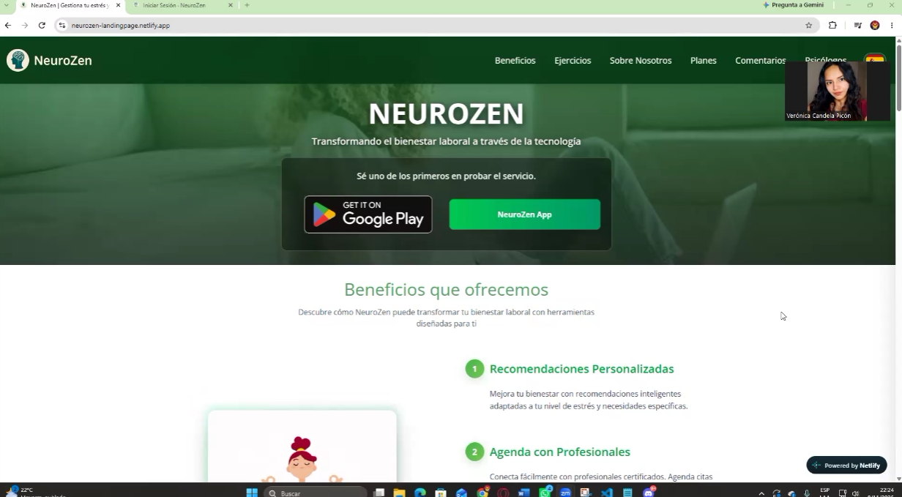
</p>
<p align="center"><b>Figura 6.3.2.1.</b> Captura de cuadro de video durante la validación de Landing Page y Frontend Web (Segmento 1).</p>

**Resumen descriptivo de apreciaciones respecto a las tareas asignadas:**

Al iniciar la sesión, Veronica se presentó como trabajadora de oficina a tiempo completo que pasa entre 9 y 10 horas diarias frente a la computadora, con bastantes entregas bajo presión.

Exploró primero la **Landing Page** desde el navegador de escritorio. Destacó que la paleta de colores en tonos verde bosque y beige cálido le relaja la vista y transmite tranquilidad tras una jornada de oficina, y comprendió con rapidez que la propuesta de valor está enfocada en el estrés laboral, así como los planes de suscripción. Al ejecutar el **User Flow 1 (Registro e Inicio de Sesión)** en el Frontend Web, se registró con su correo, completó el formulario sin errores y valoró que se solicite explícitamente el consentimiento informado sobre datos de salud.

Durante el **User Flow 2 (Autoevaluación de Estrés PSS-10)**, respondió las 10 preguntas en menos de dos minutos y obtuvo un puntaje de **22/40 (Estrés Moderado)**. Comentó que la escala de opciones es clara y que recibir el puntaje inmediato con recomendaciones puntuales le ayudó a notar que lo que siente no es solo cansancio diario de la oficina, sino estrés acumulado.

En el **User Flow 3 (Búsqueda de Psicólogo y Reserva de Cita)**, revisó el directorio de profesionales y señaló que le genera mucha confianza ver que los psicólogos están verificados con número de colegiatura y especialidad. Utilizó los filtros de modalidad y disponibilidad, pero intentó filtrar por presupuesto y, al no encontrar un filtro de tarifa, tuvo que abrir varias fichas para comparar precios. Al llegar al resumen final del asistente de reserva quiso cambiar únicamente la hora de su sesión (de 18:00 a 19:00) y tuvo que retroceder con el botón "Anterior" hasta el paso de fecha y hora. Finalmente logró reservar una sesión fuera de su horario laboral.

**Preguntas de cierre:** Veronica indicó que la plataforma web es muy directa y fácil de usar entre reuniones, por lo que se adapta a su poco tiempo libre. Como oportunidades de mejora, sugirió incorporar un filtro por rango de tarifa en el directorio de psicólogos y dar un color más fuerte al botón "Guardar" del formulario de desencadenantes para ubicarlo al instante.

---

#### Segmento Objetivo #2: Trabajadores informales o con horarios flexibles

##### Entrevista de Validación N.° 2 (Landing Page + Aplicación Móvil)

*   **Nombres y Apellidos:** Ariana Robles
*   **Sexo:** Femenino
*   **Edad:** 20 años
*   **Distrito de residencia:** Santa Eulalia
*   **Ocupación / Sector:** Trabajadora independiente; atiende pedidos y clientes desde su celular durante casi todo el día (horarios variables sin hora fija de desconexión)
*   **Plataformas validadas:** Landing Page (Vista responsiva móvil) y Aplicación Móvil Nativa Android (`NeuroZen v2.2.0`)
*   **Timing en el video consolidado:** 14:50 min
*   **URL directa al segmento del video:** [https://drive.google.com/file/d/124wXjiiDeV7VZEK2raVhSks-HBzu31tZ/view?usp=sharing](https://drive.google.com/file/d/124wXjiiDeV7VZEK2raVhSks-HBzu31tZ/view?usp=sharing)

<p align="center">
  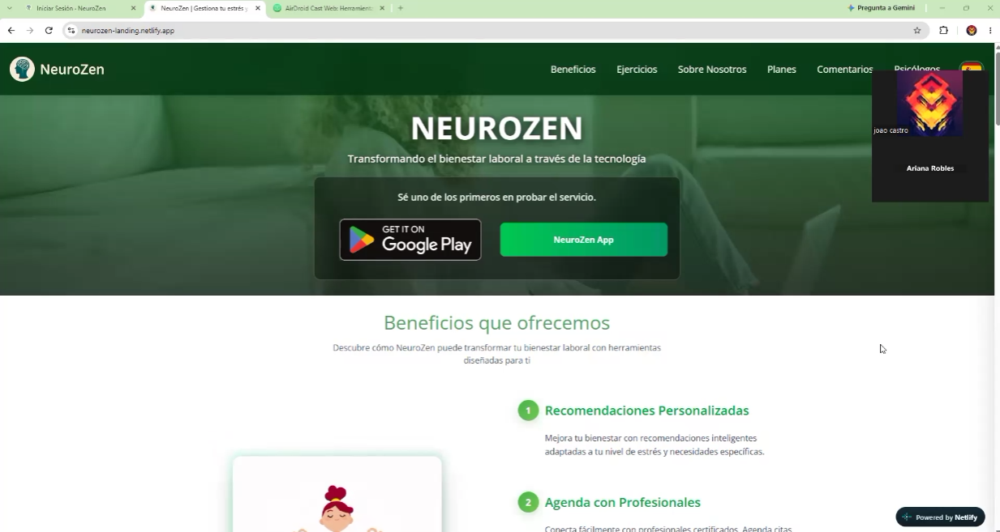
</p>
<p align="center"><b>Figura 6.3.2.2.</b> Captura de cuadro de video durante la validación de Landing Page y Aplicación Móvil (Segmento 2).</p>

**Resumen descriptivo de apreciaciones respecto a las tareas asignadas:**

Al iniciar la sesión, Ariana se presentó como trabajadora independiente con horarios variables, que atiende pedidos y clientes desde su celular casi todo el día y sin un horario fijo.

Revisó la **Landing Page** desde una vista móvil. Indicó que la estructura es limpia y que le permitió entender de inmediato que existe un plan gratuito accesible ("lo cual es genial para mí") y herramientas rápidas para gestionar picos de ansiedad entre entregas o encargos de clientes. Al presionar el botón principal "Comenzar ahora" dudó antes de hacer clic, porque no le quedaba claro si la llevaría a la versión web en el navegador o si descargaría la aplicación Android.

Al pasar a la **Aplicación Móvil (Android)** para cumplir el **User Flow 1 (Inicio de Sesión y Exploración del Dashboard)**, resaltó que la pantalla de inicio carga rápido y la fluidez de las pantallas construidas en Material Design 3, aunque observó que para visualizar el gráfico de evolución de su estrés tuvo que desplazarse hacia la parte inferior, sugiriendo ubicar el resumen estadístico más arriba.

En el **User Flow 2 (Registro de Desencadenante de Estrés)**, registró un evento reciente de sobrecarga por un cambio urgente de último minuto pedido por un cliente: eligió la categoría "Sobrecarga", el nivel de estrés en la escala del 1 al 10 y escribió una descripción. Afirmó que le gusta poder elegir la categoría y el nivel muy rápido, y que en menos de un minuto el registro ya estaba guardado en su historial.

Por último, en el **User Flow 3 (Interacción con ZenBot y Ejercicio de Respiración)**, escribió que sentía mucha presión, estrés y dificultad para desconectarse. Destacó con entusiasmo que **ZenBot** respondiera al instante sugiriéndole un ejercicio guiado de respiración de corta duración y opciones de consulta profesional. Al iniciar el ejercicio ("Respiración en caja 4-4-4-4") intentó cerrar los ojos para relajarse, pero tuvo que mantener la vista en la pantalla porque el cambio entre las fases de inhalar, retener y exhalar solo se indica de forma visual.

**Preguntas de cierre:** Ariana afirmó que la aplicación móvil sí le ayudaría a poner límites y manejar el estrés en su día a día, porque siempre lleva el celular consigo. Señaló que poder conversar con ZenBot o hacer una pausa de respiración de tres minutos le ayuda a desconectarse sin perder tiempo de trabajo, y que se adapta a sus pausas breves e impredecibles durante el día.

---

#### Tabla Resumen de Cumplimiento de Tareas en las Sesiones de Validación

| Participante | Segmento | Edad | Plataformas Evaluadas | Tareas Asignadas (User Flows) | Tasa de Éxito | Observaciones Principales (Heurística asociada) |
| :--- | :--- | :---: | :--- | :--- | :---: | :--- |
| **Veronica Candela** | Segmento 1 (Formal / Jornada extensa) | 25 años | Landing Page + Frontend Web | 1. Exploración de Landing y Registro<br>2. Autoevaluación PSS-10<br>3. Búsqueda de psicólogo y Reserva de cita | 100 % (3/3) | • Solicita filtro por rango de precios en el directorio (*Information Architecture: Is it findable?*).<br>• No puede editar la hora directamente desde el resumen de reserva (*Usability: Libertad y control del usuario*).<br>• Pide mayor contraste en el botón "Guardar" de desencadenantes (*Inclusive Design*). |
| **Ariana Robles** | Segmento 2 (Flexible / Independiente) | 20 años | Landing Page + App Móvil Android | 1. Exploración de Landing y Dashboard Móvil<br>2. Registro de desencadenante de estrés<br>3. Soporte en ZenBot y ejercicio guiado | 100 % (3/3) | • Sugiere subir la tarjeta de progreso en el Dashboard móvil (*Usability: Visibilidad del estado del sistema*).<br>• El ejercicio de respiración no tiene guía háptica ni sonora (*Inclusive Design*).<br>• Duda sobre el destino del botón "Comenzar ahora" de la Landing (*Information Architecture: Is it usable?*). |

**Análisis general de las sesiones:** ambas participantes completaron el 100 % de las tareas asignadas (6 de 6 User Flows), lo que indica que los flujos principales de NeuroZen son comprensibles para los dos segmentos. Los hallazgos no impidieron completar ninguna tarea, pero sí aumentaron el tiempo o la carga cognitiva en puntos concretos: comparación de precios y edición de la reserva en la web (Segmento 1), y jerarquía del dashboard, guía multimodal de la respiración y etiquetado de la Landing móvil (Segmento 2). Estos hallazgos se formalizan en la evaluación heurística de la sección 6.3.3.

### 6.3.3. Evaluaciones según heurísticas

A partir de las sesiones de validación ejecutadas con las representantes de ambos segmentos objetivo (Segmento 1 en Landing Page + Frontend Web y Segmento 2 en Landing Page + Aplicación Móvil), el equipo consolidó los hallazgos aplicando el formato oficial de evaluación heurística en las dimensiones de **Usability**, **Inclusive Design** e **Information Architecture**.

#### UX Heuristics & Principles Evaluation
**Usability - Inclusive Design - Information Architecture**

| Campo | Detalle |
| :--- | :--- |
| **CARRERA** | Ingeniería de Software |
| **CURSO** | Diseño de Experimentos de Ingeniería de Software (1ASI0732) |
| **NRC** | 9100 |
| **PROFESORES** | Sánchez Ponce, Alex Humberto |
| **AUDITOR** | Startup **NeuroDraw** (Castro Picón, Manuel Fernando Joao; Huaman De La Cruz, Jean Pool; Paredes Chavez, Carlos Augusto; Requena Gutiérrez, Diego Gabriel; Vila Guillen, Miguel Angel) |
| **CLIENTE(S)** | Representantes de validación:<br>• **Segmento 1 (Trabajadora formal, 25 años):** Veronica Candela<br>• **Segmento 2 (Trabajadora independiente / horario flexible, 20 años):** Ariana Robles |
| **SITE / APP A EVALUAR** | **NeuroZen** — Landing Page (`neurozen-landing.netlify.app`), Frontend Web Application (`neurozen-web-frontend.vercel.app`) y Aplicación Móvil Android Nativa (`v2.2.0`) |

#### TAREAS A EVALUAR

**El alcance de esta evaluación incluye la revisión de la usabilidad de las siguientes tareas:**
1. Exploración de beneficios, planes de suscripción y propuesta de valor en la Landing Page (versión Desktop y Mobile).
2. Registro e inicio de sesión de un usuario nuevo aceptando los términos de privacidad (Ley N.° 29733).
3. Resolución completa del Test de Autoevaluación de Estrés (PSS-10 de 10 preguntas) y visualización del resultado.
4. Búsqueda y filtrado de psicólogos verificados en el directorio de profesionales.
5. Reserva de una sesión psicológica en el flujo de agendamiento (selección de especialista, fecha, horario y modalidad).
6. Registro manual de un desencadenante de estrés (*Stress Trigger*) indicando categoría, nivel de tensión y descripción.
7. Interacción con el asistente conversacional **ZenBot** y ejecución de un ejercicio de respiración guiado.

**No están incluidas en esta versión de la evaluación las siguientes tareas:**
1. Verificación, aprobación o rechazo de colegiaturas CPsP desde el panel exclusivo de Administrador.
2. Configuración de disponibilidad horaria y confirmación de citas desde el portal exclusivo del Psicólogo.
3. Envío de informes de progreso a especialistas en formato descargable.
4. Participación en grupos de apoyo comunitarios y desafíos grupales de varios días.
5. Flujo de cancelación de suscripción o solicitud de reembolsos.

#### ESCALA DE SEVERIDAD

Los errores identificados durante las sesiones de validación fueron puntuados tomando en cuenta la siguiente escala de severidad:

| Nivel | Descripción |
| :---: | :--- |
| **1** | **Problema superficial:** puede ser fácilmente superado por el usuario u ocurre con muy poca frecuencia. No necesita ser arreglado a no ser que exista disponibilidad de tiempo. |
| **2** | **Problema menor:** puede ocurrir un poco más frecuentemente o es un poco más difícil de superar para el usuario. Se le debería asignar una prioridad baja de cara al siguiente *release*. |
| **3** | **Problema mayor:** ocurre frecuentemente o los usuarios no son capaces de resolverlo de forma directa. Es importante que sea corregido y se le debe asignar una prioridad alta. |
| **4** | **Problema muy grave:** un error de gran impacto que impide al usuario continuar con el uso de la herramienta. Es imperativo que sea corregido antes del lanzamiento. |

#### TABLA RESUMEN

| # | Problema | Escala de severidad | Heurística / Principio violado(a) |
| :---: | :--- | :---: | :--- |
| **1** | En el directorio de psicólogos (Frontend Web), no existe un filtro por rango de tarifa por sesión, obligando a entrar perfil por perfil para comparar precios. | **3** | **Information Architecture:** *Is it findable?* (Capacidad de búsqueda y filtrado) |
| **2** | En el asistente de reserva de cita en 4 pasos (Frontend Web), no hay un botón directo en el resumen final para editar solo la hora sin retroceder paso por paso. | **3** | **Usability:** Libertad y control del usuario |
| **3** | En la pantalla principal de la App Móvil, el resumen estadístico de evolución del estrés queda desplazado hacia la parte inferior y requiere hacer *scroll* para notarlo. | **2** | **Usability:** Visibilidad del estado del sistema (Jerarquía visual) |
| **4** | En el formulario de registro de desencadenantes (Web) y textos auxiliares, el color Gris Piedra (`#8C9893`) sobre fondo Beige Cálido (`#F1E9D4`) presenta bajo contraste visual. | **2** | **Inclusive Design:** Proporciona experiencias comparables (Contraste y legibilidad WCAG) |
| **5** | En los ejercicios de respiración guiados de la App Móvil (invocados desde ZenBot), la guía es únicamente visual en pantalla, sin vibración háptica ni aviso sonoro al cambiar de fase (inhalar/retener/exhalar). | **2** | **Inclusive Design:** Proporciona experiencias comparables (Soporte multimodal) |
| **6** | En la versión móvil de la Landing Page, el botón principal de acceso a la aplicación no diferencia explícitamente entre ir a la versión web o descargar el instalador APK de Android. | **1** | **Information Architecture:** *Is it usable?* (Claridad en el sistema de etiquetado) |

#### DESCRIPCIÓN DE PROBLEMAS

**PROBLEMA #1: Ausencia de filtro por rango de tarifa en el directorio de psicólogos (Frontend Web)**
*   **Severidad:** 3
*   **Heurística violada:** Information Architecture — *Is it findable?* / Usability — Flexibilidad y eficiencia de uso.
*   **Problema:** Durante la sesión de validación del Segmento 1 (Veronica, 25 años), al ejecutar la tarea de buscar un especialista y agendar una sesión, la usuaria utilizó los filtros de modalidad y disponibilidad de horarios, pero intentó filtrar a los psicólogos según su presupuesto mensual. Al no contar con un selector de rango de precios en la barra superior del directorio, tuvo que abrir las fichas individuales de varios especialistas para comparar tarifas, incrementando el tiempo de la tarea y la carga cognitiva.


*   **Recomendación:** Incorporar un filtro desplegable o control deslizante (*range slider*) de tarifa por sesión (ej. S/ 50 – S/ 200) y opción de ordenamiento por precio ascendente/descendente en la cabecera del directorio de profesionales, conectándolo con los parámetros de consulta de `TherapistService`.

**PROBLEMA #2: Falta de edición directa de pasos previos en el resumen de reserva de cita (Frontend Web)**
*   **Severidad:** 3
*   **Heurística violada:** Usability — Libertad y control del usuario.
*   **Problema:** En el flujo de agendamiento de 4 pasos (1. Especialista → 2. Fecha y Hora → 3. Modalidad → 4. Confirmación), cuando la usuaria del Segmento 1 llegó al paso 4 de revisión final y quiso cambiar únicamente la hora de su sesión de las 18:00 a las 19:00, no encontró un enlace de "Cambiar horario" junto al dato en el resumen. Para modificarlo, tuvo que presionar repetidamente el botón "Anterior" hasta regresar al paso 2 y volver a avanzar.


*   **Recomendación:** Habilitar enlaces de acción rápida ("Editar") junto a cada bloque del resumen de confirmación (Especialista, Fecha/Hora y Tipo de sesión) y permitir hacer clic directamente en los indicadores numerados de la barra de progreso superior del *wizard* para saltar al paso deseado sin perder las selecciones posteriores.

**PROBLEMA #3: Ubicación poco visible del resumen estadístico de estrés en el Home (Aplicación Móvil)**
*   **Severidad:** 2
*   **Heurística violada:** Usability — Visibilidad del estado del sistema / Reconocimiento antes que recuerdo.
*   **Problema:** En la validación del Segmento 2 (Ariana, 20 años), luego de registrar un desencadenante de estrés por sobrecarga de un cliente, la usuaria regresó a la pantalla de inicio (`HomeScreen`) esperando ver de inmediato cómo había cambiado su indicador de nivel de estrés del día. Dado que los accesos rápidos a actividades y tarjetas informativas ocupan la mitad superior de la pantalla, el resumen estadístico queda desplazado hacia abajo y requirió hacer *scroll* vertical para localizarlo.


*   **Recomendación:** Reorganizar la jerarquía de componentes en Jetpack Compose dentro de `HomeScreen`, ubicando una tarjeta compacta de estado actual ("Nivel de estrés hoy", promedio semanal y variación) inmediatamente debajo del saludo principal al usuario.

**PROBLEMA #4: Contraste insuficiente en textos auxiliares y botones secundarios sobre fondo beige (Frontend Web)**
*   **Severidad:** 2
*   **Heurística violada:** Inclusive Design — Proporciona experiencias comparables (Accesibilidad visual WCAG 2.2 AA).
*   **Problema:** Al revisar el formulario de desencadenantes de estrés en la web, la usuaria del Segmento 1 notó que el botón "Guardar", los textos de ayuda y los bordes en Gris Piedra (`#8C9893`) sobre el fondo Beige Cálido (`#F1E9D4`) se perciben tenues, especialmente con un nivel de brillo alto, exigiendo mayor esfuerzo visual para ubicar la acción principal y distinguir los campos opcionales de los obligatorios.

*   **Recomendación:** Oscurecer el tono de texto secundario a una variante de mayor contraste (por ejemplo, `#4A5550` o Verde Bosque `#2D5A4A` para etiquetas de formulario) y usar el color primario sólido en el botón "Guardar", garantizando una relación de contraste mínima de 4.5:1 conforme al estándar WCAG 2.2 Nivel AA.

**PROBLEMA #5: Ausencia de guía háptica o sonora en los ejercicios de respiración (Aplicación Móvil)**
*   **Severidad:** 2
*   **Heurística violada:** Inclusive Design — Proporciona experiencias comparables (Retroalimentación multimodal).
*   **Problema:** Cuando la usuaria del Segmento 2 siguió la sugerencia de **ZenBot** e inició un ejercicio de respiración guiado ("Respiración en caja 4-4-4-4") desde el celular, intentó cerrar los ojos para relajarse mejor. Sin embargo, tuvo que mantener la vista fija en la pantalla porque el cambio entre las fases de *Inhalar*, *Retener* y *Exhalar* solo se comunica mediante el temporizador visual en pantalla.


*   **Recomendación:** Integrar retroalimentación háptica suave (`VibrationEffect` en Android) y un indicador auditivo opcional (campana suave o voz guía activable/desactivable) en cada transición de fase del temporizador de respiración, permitiendo realizar el ejercicio con los ojos cerrados.

**PROBLEMA #6: Etiquetado ambiguo en los botones CTA de la Landing Page móvil**
*   **Severidad:** 1
*   **Heurística violada:** Information Architecture — *Is it usable?* (Claridad en *Labeling Systems*).
*   **Problema:** Durante el primer flujo de la entrevistada del Segmento 2 desde el navegador de su teléfono, al presionar el botón principal de llamado a la acción ("Comenzar ahora") en la Landing Page, no le quedó claro antes de hacer clic si el botón la llevaría a la versión web en el navegador o si descargaría directamente la aplicación móvil para Android.

*   **Recomendación:** Diferenciar explícitamente las etiquetas de los botones de acción en la sección principal (*Hero*) de la Landing Page: utilizar **"Ingresar a NeuroZen Web"** para la aplicación web y **"Descargar App Android (APK)"** para la aplicación nativa.


## 6.4. Auditoría de Experiencias de Usuario

El equipo NeuroDraw, desarrollador de NeuroZen, evaluó la experiencia de usuario de CareConnect, producto de CareStacks. La auditoría siguió el Anexo D del Final Project Statement 2026-20 y sus tres pilares: Usability, Inclusive Design e Information Architecture. Se revisaron tareas visibles para el usuario, la consistencia entre superficies y la comunicación de los estados y errores.

### 6.4.1. Auditoría realizada

#### 6.4.1.1. Información del grupo auditado

| Elemento | Información |
| :--- | :--- |
| **Startup auditada** | CareStacks |
| **Producto auditado** | CareConnect |
| **NRC del grupo auditado** | 9100 |
| **Equipo auditor** | NeuroDraw, desarrollador de NeuroZen |
| **Fecha de inspección** | 8 de noviembre de 2026 |
| **Versión evaluada** | Despliegues públicos y ejecutable APK disponibles en la fecha de inspección. No se verificó un commit específico asociado a cada despliegue. |

**Integrantes del grupo auditado, según el informe de CareStacks:**
* U202319881 - Baldeon Armas, Santiago Armando
* U202415495 - Espinoza Cruz, Angela Milagros
* U202319563 - Muñiz Huayanca, Percy Alonso
* U20221G099 - Nikaido Vargas, Javier Masaru
* U202319698 - Salcedo Champi, Matias Rodolfo

**Organización y repositorios proporcionados por el grupo auditado:**
* **Organización GitHub:** https://github.com/upc-pre-202620-1asi0732-9100-carestacks
* **Informe:** https://github.com/upc-pre-202620-1asi0732-9100-carestacks/carestacks-report
* **Landing Page:** https://github.com/upc-pre-202620-1asi0732-9100-carestacks/carestacks-landing-page
* **Frontend Web Application:** https://github.com/upc-pre-202620-1asi0732-9100-carestacks/carestacks-web
* **Mobile Application:** https://github.com/upc-pre-202620-1asi0732-9100-carestacks/carestacks-mobile-app
* **Backend RESTful API:** https://github.com/upc-pre-202620-1asi0732-9100-carestacks/carestacks-backend-api

**Estado de acceso de las superficies UX:**

| Superficie | Estado de la auditoría |
| :--- | :--- |
| **Landing Page** — https://carestacks-landing-page.vercel.app/ | Disponible y auditada funcionalmente en las tareas accesibles durante la inspección de escritorio. |
| **Frontend Web Application** — https://carestacks-web.onrender.com/ | Disponible y auditada funcionalmente con una cuenta de prueba de cuidador. Los flujos que requieren un paciente vinculado quedaron pendientes de validación. |
| **Mobile Application** — https://github.com/upc-pre-202620-1asi0732-9100-carestacks/carestacks-mobile-app/releases/tag/v1.0.0 | **Disponible y auditada funcionalmente.** Ejecutada mediante el archivo `careconnect-v1.0.0.apk` en emulador Android Studio. Se inspeccionaron los flujos de registro, autenticación, navegación principal (Inicio, Agenda, Documentos, Diario, Perfil) y manejo de estados vacíos. |

La cuenta empleada en las aplicaciones se creó exclusivamente para la auditoría. Durante la inspección no tenía pacientes vinculados ni invitaciones pendientes. La disponibilidad de documentación de las superficies no se tomó como prueba de ejecución funcional.

#### 6.4.1.2. Cronograma de auditoría realizada

No se registraron horas exactas ni se atribuyeron actividades a integrantes individuales.

| Actividad efectivamente realizada | Fecha | Responsable |
| :--- | :--- | :--- |
| Revisión del Final Project Statement, el Anexo D y las referencias proporcionadas para delimitar la auditoría | 08/11/2026 | Equipo NeuroDraw |
| Inspección funcional de la Landing Page: contenido, navegación, CTA, planes, contacto, ES/EN y recorrido básico por teclado | 08/11/2026 | Equipo NeuroDraw |
| Acceso con la cuenta de prueba e inspección funcional de Home, Agenda, Documentos, Diario, Notificaciones y Perfil de la Web App | 08/11/2026 | Equipo NeuroDraw |
| Inspección funcional de la Mobile Application: registro de usuario, autenticación, menú de navegación inferior, agenda, documentos, diario y perfil en emulador Android | 08/11/2026 | Equipo NeuroDraw |
| Pruebas de campos vacíos, correo inválido, formato de contraseña, estados sin paciente, navegación por teclado y recarga de sesión | 08/11/2026 | Equipo NeuroDraw |
| Consolidación de tareas, hallazgos confirmados, limitaciones y comparación entre superficies | 08/11/2026 | Equipo NeuroDraw |
| Elaboración de la presente sección de auditoría realizada | 08/11/2026 | Equipo NeuroDraw |

#### 6.4.1.3. Contenido de auditoría realizada

##### Objetivo, alcance y criterio de evaluación

La evaluación buscó identificar problemas observables que afectaran la comprensión de CareConnect, la navegación, la realización de tareas y la accesibilidad de las experiencias disponibles. Se prestó atención al lenguaje, la legibilidad y la claridad de las acciones debido a que el producto se dirige a cuidadores y familias.

La auditoría funcional abarcó la Landing Page, la Frontend Web Application y la Mobile Application (ejecutada mediante el APK publicado v1.0.0).

El backend, la base de datos, la arquitectura interna, la seguridad del código y los pipelines no se evaluaron directamente. Únicamente se consideró un error procedente de una solicitud cuando su texto apareció en la interfaz para el usuario.

Se registró como hallazgo confirmado solo un problema reproducido mediante interacción directa. Las observaciones sin impacto suficiente, las tareas limitadas por el estado de la cuenta y los aspectos revisados sin problemas se presentan por separado.

##### TAREAS A EVALUAR

**Landing Page**

| Código | Tarea | Resultado de la evaluación |
| :--- | :--- | :--- |
| **LP-01** | Comprender el problema que resuelve CareConnect | Ejecutada. Se revisaron la portada y la descripción del problema. |
| **LP-02** | Identificar los segmentos objetivo | Ejecutada. Se identificaron referencias a pacientes, cuidadores y familias. |
| **LP-03** | Consultar las funciones principales | Ejecutada mediante la navegación y la sección Funciones. |
| **LP-04** | Consultar los beneficios | Ejecutada mediante la navegación y la sección Beneficios. |
| **LP-05** | Consultar planes y precios | Ejecutada. Se observaron planes de $15/mes y $150/año; la acción de elegirlos presenta el Problema 03. |
| **LP-06** | Encontrar información de contacto | Ejecutada. El recorrido hacia el canal de consultas presenta el Problema 02. |
| **LP-07** | Utilizar el CTA principal | Ejecutada. Su destino presenta el Problema 01. |
| **LP-08** | Cambiar entre ES y EN | Ejecutada en ambas opciones. Se observaron los Problemas 04 y 05. |
| **LP-09** | Navegar mediante el menú principal | Ejecutada. Los enlaces internos probados llegaron a sus secciones. |
| **LP-10** | Identificar cómo acceder al producto | Intentada desde la Landing. El Problema 01 afecta esta tarea. |

**Frontend Web Application — cuenta de cuidador**

| Código | Tarea | Resultado de la evaluación |
| :--- | :--- | :--- |
| **WEB-01** | Iniciar sesión | Ejecutada. Se observó Home con el saludo «Hola, Carlos» y el rol Cuidador. |
| **WEB-02** | Revisar Home | Ejecutada. Se revisaron el estado sin pacientes, los accesos rápidos y la actividad reciente. |
| **WEB-03** | Comprender el estado del paciente en el dashboard | Evaluada parcialmente. La cuenta mostró «Aún no tienes pacientes activos»; no había información de un paciente que evaluar. |
| **WEB-04** | Consultar Agenda | Ejecutada. Se abrió el calendario y se seleccionó otro día. |
| **WEB-05** | Registrar un evento en Agenda | No ejecutable bajo las condiciones disponibles: no había paciente vinculado ni acción de creación visible en ese estado. |
| **WEB-06** | Consultar eventos existentes | Evaluada parcialmente. El acceso rápido indicó cero eventos; no existía un evento para abrir. |
| **WEB-07** | Consultar Documentos | Ejecutada. Se abrió la sección, que mostró búsqueda y estado sin paciente activo. |
| **WEB-08** | Subir o registrar un documento | No ejecutable bajo las condiciones disponibles: no se ofreció la acción sin paciente vinculado. |
| **WEB-09** | Consultar Diario | Ejecutada. Se observó el estado que requiere una invitación para leer y escribir. |
| **WEB-10** | Registrar información en el Diario | No ejecutable bajo las condiciones disponibles: no se ofreció la acción sin paciente vinculado. |
| **WEB-11** | Consultar Notificaciones | Ejecutada. El panel mostró «Avisos 0» y su estado vacío. |
| **WEB-12** | Resolver una notificación | No ejecutable bajo las condiciones disponibles: no había avisos sobre los cuales actuar. |
| **WEB-13** | Consultar y gestionar Perfil | Evaluada parcialmente. Se revisaron rol, estado, pacientes vinculados y resumen; no había pacientes ni invitaciones que gestionar. |
| **WEB-14** | Revisar opciones de configuración | Se revisaron el menú y el Perfil disponibles. No se encontró una opción visible de Configuración; no se presupone que deba existir. |
| **WEB-15** | Cerrar sesión | Ejecutada. La aplicación volvió al formulario de inicio de sesión. |
| **WEB-16** | Volver a iniciar sesión | Ejecutada. Tras el nuevo ingreso se observó nuevamente Home con «Hola, Carlos». |

**Mobile Application — ejecutable APK v1.0.0**

| Código | Tarea | Resultado de la evaluación |
| :--- | :--- | :--- |
| **MOB-01** | Registrar nueva cuenta en la app móvil | Ejecutada. Rechazó inicialmente claves simples con el mensaje `Request validation failed` (Problema 08); se completó exitosamente con formato complejo. |
| **MOB-02** | Iniciar sesión en la app móvil | Ejecutada tras la creación de la cuenta de cuidador. |
| **MOB-03** | Revisar Inicio / Dashboard en móvil | Ejecutada. Se observó el saludo «Hola, Miguel», la tarjeta de pacientes asignados y los accesos rápidos a las funciones. |
| **MOB-04** | Comprender el estado del paciente en el dashboard móvil | Evaluada. La interfaz desplegó «Aún no tienes pacientes activos» indicando la necesidad de recibir una invitación. |
| **MOB-05** | Consultar Agenda en móvil | Ejecutada. Se desplegó la vista mensual del calendario. |
| **MOB-06** | Consultar eventos en Agenda móvil | Evaluada parcialmente. Indico «No hay paciente activo» y requirió vincular un paciente para cargar actividades. |
| **MOB-07** | Consultar Documentos en móvil | Ejecutada. Se abrió la vista con buscador y mensaje de estado sin paciente activo. |
| **MOB-08** | Consultar Diario en móvil | Ejecutada. Se desplegó la vista «Registro del bienestar diario» en estado inicial. |
| **MOB-09** | Consultar y gestionar Perfil en móvil | Ejecutada. Se verificaron la credencial «Cuidador verificado», resumen de métricas (0 pacientes, 0 invitaciones, 0 avisos) y botón de cierre de sesión. |
| **MOB-10** | Navegar mediante la barra de navegación inferior (BottomNav) | Ejecutada. Transición fluida entre Inicio, Agenda, Documentos, Diario y Perfil. |
| **MOB-11** | Cerrar sesión en la app móvil | Ejecutada. Retornó al formulario de inicio de sesión. |

##### ESCALA DE SEVERIDAD

Se utiliza exclusivamente la escala del Anexo D del Final Project Statement:

| Nivel | Clasificación y criterio |
| :--- | :--- |
| **1** | **Problema superficial:** el usuario puede superarlo fácilmente o se presenta con muy poca frecuencia. |
| **2** | **Problema menor:** ocurre con mayor frecuencia o resulta algo más difícil de superar; corresponde una prioridad baja de corrección. |
| **3** | **Problema mayor:** ocurre frecuentemente o el usuario no logra resolverlo; requiere prioridad alta de corrección. |
| **4** | **Problema muy grave:** impide continuar con el uso de la herramienta y debe corregirse antes del lanzamiento. |

##### TABLA RESUMEN DE PROBLEMAS CONFIRMADOS

| # | Problema | Escala de severidad | Heurística/Principio violada(o) |
| :--- | :--- | :--- | :--- |
| **01** | «Probar app» dirige a los planes y no proporciona acceso a la Web App. | 3 | Usability: correspondencia entre la acción anunciada y su resultado. |
| **02** | El contacto general conduce a GitHub Issues, donde iniciar una consulta requiere una cuenta de GitHub. | 2 | Inclusive Design: ofrecer vías de uso accesibles para distintos usuarios. |
| **03** | Ambos botones «Elegir plan» llevan al mismo contacto sin conservar la elección. | 2 | Usability: visibilidad del resultado de la acción. |
| **04** | La vista previa del teléfono permanece en español cuando la Landing está en inglés. | 1 | Inclusive Design: experiencia comprensible y consistente con el idioma elegido. |
| **05** | La versión española mezcla rótulos en inglés y formas de tratamiento distintas. | 1 | Usability: consistencia y estándares. |
| **06** | El acceso Web muestra «Request validation failed» ante un correo con formato inválido. | 2 | Usability: ayudar a reconocer y recuperarse de errores. |
| **07** | La Landing permite seleccionar inglés, pero las pantallas examinadas de la Web App solo se mostraron en español. | 2 | Inclusive Design: experiencia comparable entre superficies. |
| **08** | El registro de la App Móvil muestra «Request validation failed» al ingresar una contraseña que no cumple las reglas del backend. | 2 | Usability: ayudar a reconocer, diagnosticar y recuperarse de errores. |

---

##### DESCRIPCIÓN DE PROBLEMAS

**Problema 01: El CTA «Probar app» dirige a planes (UX-01)**
* **Producto:** CareConnect Landing Page.
* **Pantalla o sección:** Header y portada.
* **Tarea afectada:** LP-07, utilizar el CTA principal; LP-10, acceder al producto.
* **Pilar:** Usability.
* **Heurística/Principio violada(o):** Correspondencia entre la acción anunciada y su resultado.
* **Severidad:** 3/4 - Problema mayor.
* **Problema explicado:** El botón «Probar app» del header y «Comienza ahora» de la portada dirigen a la sección de precios (#precio). En la inspección de los enlaces visibles de la Landing no se encontró un acceso a la Frontend Web Application, aunque esta estaba disponible públicamente y se ejecutó por separado durante la auditoría.
* **Impacto en el usuario:** Quien intenta ingresar o probar CareConnect desde su página pública termina comparando planes y no completa la tarea de acceso por ese recorrido.
* **Pasos para reproducir el problema:**
  1. Abrir https://carestacks-landing-page.vercel.app/.
  2. Pulsar «Probar app» en el header.
  3. Observar que la URL termina en #precio y aparece la sección de planes.
  4. Volver a Inicio y repetir con «Comienza ahora», que tiene el mismo destino.
* **Recomendaciones:**
  - Enlazar «Probar app» con el acceso ejecutable de CareConnect.
  - Si la intención del botón es presentar precios, cambiar su etiqueta a «Ver planes» y ofrecer por separado un acceso explícito al producto.

**Problema 02: El canal de contacto exige acceder a GitHub (UX-02)**
* **Producto:** CareConnect Landing Page.
* **Pantalla o sección:** Contacto y enlace «Contactar al equipo».
* **Tarea afectada:** LP-06, encontrar y utilizar el contacto.
* **Pilar:** Inclusive Design.
* **Heurística/Principio violada(o):** Ofrecer vías de uso accesibles para visitantes con distintos niveles de familiaridad digital.
* **Severidad:** 2/4 - Problema menor.
* **Problema explicado:** «Contactar al equipo» dirige a la página de Issues del repositorio del informe. En esa página, la acción «New issue» conduce al inicio de sesión de GitHub. El destino no se presenta en la llamada principal como un canal que requiere una cuenta externa.
* **Impacto en el usuario:** Una persona sin cuenta de GitHub debe crearla o iniciar sesión antes de plantear una consulta. Este requisito añade esfuerzo a una tarea que la Landing presenta como contacto general.
* **Pasos para reproducir el problema:**
  1. Abrir la Landing y pulsar «Contacto».
  2. Pulsar «Contactar al equipo».
  3. Observar la página de Issues del repositorio carestacks-report.
  4. Pulsar «New issue» y observar que conduce al inicio de sesión de GitHub.
* **Recomendaciones:**
  - Ofrecer un canal de consulta utilizable por visitantes sin cuenta de GitHub.
  - Si se mantiene Issues, nombrar el enlace «Consultas del proyecto en GitHub» e indicar el requisito de cuenta antes de salir de la Landing.

**Problema 03: La elección del plan no se conserva (UX-03)**
* **Producto:** CareConnect Landing Page.
* **Pantalla o sección:** Planes y Contacto.
* **Tarea afectada:** LP-05, consultar planes; LP-07, continuar desde una acción de conversión.
* **Pilar:** Usability.
* **Heurística/Principio violada(o):** Visibilidad del resultado de la acción.
* **Severidad:** 2/4 - Problema menor.
* **Problema explicado:** Los botones «Elegir plan» del plan mensual y del anual llevan al mismo ancla #contacto. La sección de destino no muestra cuál fue seleccionado ni ofrece un paso específico para continuar con esa elección.
* **Impacto en el usuario:** La decisión tomada en la tarjeta se pierde al avanzar. Si el visitante contacta al equipo, debe recordar y volver a comunicar el plan que le interesaba.
* **Pasos para reproducir el problema:**
  1. Abrir la sección «Precio».
  2. Pulsar «Elegir plan» en la tarjeta mensual y observar la sección Contacto.
  3. Regresar a Precio y pulsar «Elegir plan» en la tarjeta anual.
  4. Comprobar que se llega a la misma sección sin identificación del plan elegido.
* **Recomendaciones:**
  - Conservar el plan seleccionado en el siguiente paso y mostrarlo de forma visible.
  - Si todavía no existe un flujo de contratación, usar acciones específicas como «Consultar por el plan mensual» y «Consultar por el plan anual».

**Problema 04: La vista previa no sigue el idioma inglés (UX-04)**
* **Producto:** CareConnect Landing Page.
* **Pantalla o sección:** Portada con EN seleccionado.
* **Tarea afectada:** LP-08, cambiar entre ES y EN.
* **Pilar:** Inclusive Design.
* **Heurística/Principio violada(o):** Mantener una experiencia comprensible y consistente con el idioma elegido.
* **Severidad:** 1/4 - Problema superficial.
* **Problema explicado:** Al activar EN, el titular, la descripción y los botones de la portada cambian a inglés. La imagen principal del teléfono conserva textos en español, entre ellos «Hola, Mariana» y «Confirmar toma». Se trata de una representación visual de la aplicación, no de controles interactivos de la Landing.
* **Impacto en el usuario:** La muestra visual más destacada del producto no corresponde al idioma que acaba de elegir el visitante.
* **Pasos para reproducir el problema:**
  1. Abrir la Landing.
  2. Seleccionar EN en el header.
  3. Volver a Inicio.
  4. Comparar los textos de la portada con los que aparecen dentro del teléfono.
* **Recomendaciones:**
  - Utilizar una vista previa correspondiente al idioma seleccionado.
  - Si solo se dispone de la versión en español, señalar brevemente que la representación corresponde a esa versión.

**Problema 05: Inconsistencias editoriales en la versión española (UX-05)**
* **Producto:** CareConnect Landing Page.
* **Pantalla o sección:** Secciones de videos, Inicio y Planes.
* **Tarea afectada:** LP-08, verificar la consistencia de la versión española; LP-01 y LP-05, comprender los mensajes.
* **Pilar:** Usability.
* **Heurística/Principio violada(o):** Consistencia y estándares en idioma y tratamiento.
* **Severidad:** 1/4 - Problema superficial.
* **Problema explicado:** Con ES seleccionado, los rótulos de las secciones de video permanecen como «ABOUT THE TEAM» y «ABOUT THE PRODUCT», junto a títulos y descripciones en español. Además, la redacción alterna imperativos como «Gestiona» y «Comienza» con «elegí el ritmo de pago». Estos elementos no impidieron completar la navegación.
* **Impacto en el usuario:** La mezcla de idiomas y formas de tratamiento reduce la uniformidad del tono de una página dirigida a familias y cuidadores.
* **Pasos para reproducir el problema:**
  1. Seleccionar ES en la Landing.
  2. Desplazarse a las secciones «Conoce al equipo detrás de CareConnect» y «Mira cómo CareConnect organiza el cuidado diario».
  3. Leer sus rótulos superiores en inglés.
  4. Comparar «Gestiona» y «Comienza ahora» en Inicio con «elegí el ritmo de pago» en Planes.
* **Recomendaciones:**
  - Traducir los rótulos de las secciones de video para ES y mantener sus equivalentes en EN.
  - Definir una pauta de tratamiento para la versión española y revisar los verbos dirigidos al visitante.

**Problema 06: El acceso Web muestra un mensaje técnico en inglés (UX-06)**
* **Producto:** CareConnect Frontend Web Application.
* **Pantalla o sección:** Inicio de sesión.
* **Tarea afectada:** Iniciar sesión y recuperarse de un dato inválido.
* **Pilar:** Usability.
* **Heurística/Principio violada(o):** Ayudar al usuario a reconocer el error y corregirlo.
* **Severidad:** 2/4 - Problema menor.
* **Problema explicado:** Al intentar ingresar con un correo ficticio sin formato de dirección electrónica y una contraseña ficticia, la interfaz mostró literalmente «Request validation failed». El mensaje no señala el campo que debe corregirse y aparece en inglés mientras el formulario está en español. La auditoría registra el efecto visible; no atribuye una causa técnica concreta al backend.
* **Impacto en el usuario:** La persona puede reconocer que algo falló, pero no recibe una instrucción específica para corregir el correo y reintentar.
* **Pasos para reproducir el problema:**
  1. Abrir https://carestacks-web.onrender.com/ sin sesión.
  2. Introducir un texto ficticio que no tenga formato de correo en «Correo electrónico».
  3. Introducir una contraseña ficticia y pulsar «Ingresar».
  4. Observar «Request validation failed» debajo de los campos.
* **Recomendaciones:**
  - Validar el formato del correo junto al campo y mostrar una indicación específica antes de enviar el formulario.
  - Presentar en español los errores visibles de la solicitud, con una acción de corrección comprensible.

**Problema 07: El idioma elegido en la Landing no continúa en la Web App (UX-07)**
* **Producto:** CareConnect Landing Page y Frontend Web Application.
* **Pantalla o sección:** Selector ES/EN de la Landing; acceso, Home y Perfil de la Web App.
* **Tarea afectada:** LP-08, seleccionar idioma; WEB-01, iniciar sesión; WEB-02 y WEB-13, consultar Home y Perfil.
* **Pilar:** Inclusive Design.
* **Heurística/Principio violada(o):** Proporcionar una experiencia comparable entre superficies para quienes eligen otro idioma.
* **Severidad:** 2/4 - Problema menor.
* **Problema explicado:** La Landing permite seleccionar EN y presenta sus textos principales en inglés. Durante la inspección, el inicio de sesión, Home y Perfil de la Web App se mostraron en español y no ofrecieron un selector de idioma visible. Esta constatación se limita a las pantallas examinadas; no afirma el estado de funciones que no pudieron abrirse con la cuenta disponible.
* **Impacto en el usuario:** Una persona que comprendió la propuesta en inglés encuentra el acceso y las pantallas Web revisadas en otro idioma, sin una indicación previa de esa diferencia.
* **Pasos para reproducir el problema:**
  1. Abrir la Landing y seleccionar EN.
  2. Comprobar que la navegación y la portada se presentan en inglés.
  3. Abrir por separado la Frontend Web Application.
  4. Revisar el inicio de sesión y, con una cuenta de cuidador, Home y Perfil; observar el idioma y las opciones visibles.
* **Recomendaciones:**
  - Ofrecer una opción de idioma en la Web App para las pantallas dirigidas a visitantes que llegan desde EN.
  - Mientras exista la diferencia, informar en la Landing qué superficies están disponibles en cada idioma.

**Problema 08: El registro de la App Móvil muestra «Request validation failed» ante contraseñas simples (UX-MOB-01)**
* **Producto:** CareConnect Mobile Application.
* **Pantalla o sección:** Formulario de registro («Crear cuenta cuidador»).
* **Tarea afectada:** MOB-01, registrar nueva cuenta en la app móvil.
* **Pilar:** Usability.
* **Heurística/Principio violada(o):** Ayudar a los usuarios a reconocer, diagnosticar y recuperarse de los errores.
* **Severidad:** 2/4 - Problema menor.
* **Problema explicado:** Al ingresar una contraseña que no cumple con las reglas del servidor (por ejemplo, `vila12345`), la aplicación despliega únicamente el mensaje en rojo `Request validation failed` en inglés. No especifica el campo que falla ni indica los requisitos de formato para la clave (uso de mayúsculas, números o caracteres especiales).
* **Impacto en el usuario:** El usuario desconoce la razón del rechazo del registro y debe intentar distintas combinaciones de contraseña por ensayo y error.
* **Pasos para reproducir el problema:**
  1. Abrir la APK de CareConnect en el emulador.
  2. Completar los campos *Nombres y apellidos* y *Correo electrónico*.
  3. Introducir una contraseña simple (ejemplo: `vila12345`) y presionar «Crear cuenta».
  4. Observar el texto `Request validation failed` en rojo debajo de los campos del formulario.
* **Recomendaciones:**
  - Implementar validaciones en el cliente (frontend móvil) que indiquen los requisitos de la contraseña antes de realizar el envío.
  - Traducir y personalizar los mensajes de error devueltos por el backend al idioma español.

---

##### Observaciones y aspectos que requieren validación adicional

Las siguientes observaciones no integran la tabla de problemas confirmados:
- En Home de la Web App, los nombres de dos accesos rápidos aparecieron recortados visualmente como «Documentos médi…» y «Diario de segui…» en la ventana de escritorio examinada. El menú lateral mostraba los nombres completos y los accesos podían utilizarse. Se requiere comprobar otras anchuras antes de calificar su impacto.
- Perfil en la Web App mostró un «Identificador» técnico. No se comprobó que impidiera una tarea del cuidador.
- Al enviar vacío el formulario de creación de cuenta en Web, el mensaje solicitó correo y contraseña sin mencionar el campo «Nombres y apellidos». No se completaron variantes suficientes del formulario para determinar si esto dificulta una corrección posterior.
- En las pantallas de cuidador disponibles no apareció una opción de Configuración. No se presupone su obligatoriedad ni la existencia de otras pantallas.
- No se pudieron evaluar el contenido y las acciones de un paciente en profundidad, debido a que las cuentas utilizadas tenían cero pacientes vinculados y cero invitaciones pendientes. Tampoco había eventos, documentos, notas o avisos previos creados para consultar o editar. Esta condición no se calificó como defecto.
- La inspección en emulador y escritorio no permite afirmar resultados de responsive móvil en dispositivos físicos de distintas gamas ni relaciones de contraste medidas formalmente.
- El video del equipo cargó un reproductor de YouTube. La disponibilidad del video del producto enlazado a Microsoft Stream no se comprobó durante esta auditoría.

---

##### Comparación entre superficies (Landing Page, Frontend Web y Mobile App)

La marca CareConnect y el uso de violeta sobre fondos claros aparecen en las tres superficies evaluadas. Se observó una ligera diferencia entre el símbolo del logotipo de la Landing y el icono de corazón de la Web y Mobile App, pero no se demostró un impacto suficiente para elevarla a problema.

Los nombres Agenda, Documentos y Diario permiten reconocer en los menús de la Web App y de la Mobile App las funciones descritas en la Landing Page. La navegación evoluciona coherentemente desde enlaces de secciones en la página pública hacia un menú lateral en la Web App y una barra de navegación inferior (*Bottom Navigation Bar*) en la Mobile App, adaptada a la interacción táctil.

Las diferencias con impacto se documentaron en los Problemas 01 y 07: el CTA público no conduce al producto y la opción EN de la Landing no tuvo continuidad visible en las superficies de la aplicación. La Landing comunica coordinación entre familiares y cuidadores; las aplicaciones explicaron que las cuentas auditadas debían recibir una invitación para gestionar la información de un paciente. Sin un paciente vinculado, no se concluye que las funciones anunciadas estén ausentes o fallen.

---

##### Aspectos positivos comprobados

- **Landing Page:** Presentó de forma identificable su propuesta, segmentos, funciones, beneficios y dos alternativas de precio. Los enlaces internos del header probados llegaron a sus secciones. El selector ES/EN actualizó los textos principales de la Landing. El enlace «Saltar al contenido principal» apareció con foco visible y se activó con Enter.
- **Frontend Web Application:** Identificó el estado de la cuenta sin paciente y explicó la necesidad de aceptar una invitación en Home, Agenda, Documentos, Diario y Perfil. Los módulos accesibles conservaron un menú lateral reconocible; un acceso rápido de Home llevó a Agenda. La selección de otro día actualizó el encabezado del calendario. Tab enfocó controles de la Web App y Enter permitió volver a Inicio desde el menú. La sesión permaneció activa tras recargar la Web App. «Cerrar sesión» devolvió al acceso y un nuevo inicio de sesión mostró nuevamente Home con la cuenta de prueba. El panel de Notificaciones indicó expresamente que había cero avisos, evitando interpretar su espacio vacío como una carga pendiente.
- **Mobile Application (APK v1.0.0):** Mantiene una consistente identidad de marca y paleta cromática con el resto del ecosistema CareConnect. Ofrece una estructura de navegación inferior (*Bottom Navigation Bar*) cómoda para dispositivos táctiles, permitiendo conmutar entre Inicio, Agenda, Documentos, Diario y Perfil. En todas las pantallas con estados vacíos (sin paciente activo), la interfaz comunica con claridad la razón por la cual no hay datos visibles y orienta sobre cómo desbloquear las tareas. La sección de Perfil integra adecuadamente la etiqueta de «Cuidador verificado», el resumen numérico de actividades y una vía rápida para cerrar sesión.

### 6.4.2. Auditoría recibida

#### 6.4.2.1. Información del grupo auditor

La auditoría de experiencia de usuario de nuestro producto **NeuroZen** fue realizada por el **Grupo 2**, cuya startup recibe el nombre de **"CareStacks"**. A continuación, se adjunta la lista de integrantes del grupo auditor:

- Baldeon Vivar, Santiago Armando
- Espinoza Cruz, Angela Milagros
- Muñiz Huayanca, Percy Alonso
- Nikaido Vargas, Javier Masaru
- Salcedo Champi, Matías Rodolfo

La coordinación con el grupo auditor estuvo a cargo de Paredes Chavez, Carlos Augusto, y el envío de los enlaces y repositorios lo realizó Huaman De La Cruz, Jean Pool. Para el desarrollo de la auditoría, nuestro equipo compartió con el grupo auditor los siguientes enlaces y recursos:

- Aplicación web (producción): https://neurozen-web-frontend.vercel.app
- Repositorio del informe: https://github.com/Proyecto-1ASI0732-2620-Experimentos/Report-NeuroZen-Experimento
- Repositorios de código fuente de la Landing Page, el Frontend Web y la Aplicación Móvil.

El grupo auditor entregó dos documentos: la evaluación heurística en el formato del Anexo D del curso y un informe técnico complementario titulado *"Auditoría UX/UI y evaluación heurística de NeuroZen"*, que amplía la revisión a la Landing Page y a la Aplicación Móvil.

#### 6.4.2.2. Cronograma de auditoría recibida

En esta sección se registran las principales actividades realizadas durante la auditoría que el grupo "CareStacks" ejecutó sobre nuestro producto NeuroZen.

| Actividad de auditoría recibida | Fecha | Realizado por |
| :--- | :--- | :--- |
| Coordinación con el grupo auditor y solicitud de información | 07/11/2026 | Paredes Chavez, Carlos Augusto |
| Envío de enlaces y repositorios de NeuroZen al grupo auditor | 07/11/2026 | Huaman De La Cruz, Jean Pool |
| Ejecución de la auditoría | 07/11/2026 – 08/11/2026 | Baldeon Vivar, Santiago Armando<br>Espinoza Cruz, Angela Milagros |
| Elaboración del informe de la auditoría | 08/11/2026 | Baldeon Vivar, Santiago Armando<br>Espinoza Cruz, Angela Milagros |
| Envío del informe de auditoría a nuestro equipo | 08/11/2026 | Grupo CareStacks |
| Recepción del informe y coordinación con el grupo auditor | 08/11/2026 | Paredes Chavez, Carlos Augusto |
| Revisión del informe y planificación de las modificaciones | 08/11/2026 | Equipo NeuroDraw |

#### 6.4.2.3. Contenido de auditoría recibida

**SITE o APP A EVALUAR:** NeuroZen — Frontend Web Application (https://neurozen-web-frontend.vercel.app), complementada con la revisión de la Landing Page y la Aplicación Móvil.

**MÉTODO DE EVALUACIÓN:**

El grupo auditor aplicó las 10 heurísticas de usabilidad de Nielsen, criterios de arquitectura de información y las pautas de accesibilidad WCAG 2.2. Revisó el código fuente de las tres plataformas, ejecutó la Web App en el navegador en versión de escritorio y de celular, y calculó los contrastes de color con la fórmula de luminancia relativa de WCAG. La App Móvil se evaluó únicamente a partir de su código y no se realizaron pruebas con usuarios.

En total, el informe reportó 35 hallazgos de usabilidad (1 crítico, 7 mayores, 23 menores y 4 superficiales) y 15 de accesibilidad. Nuestro equipo analizó todos los hallazgos y consolidó en esta sección los 17 de mayor impacto para el usuario: los 10 de la evaluación heurística principal y 7 del informe complementario, de severidad alta o vinculados al incumplimiento de contraste mínimo, que no estaban cubiertos en la evaluación principal. Los hallazgos restantes son de severidad menor o repiten problemas ya incluidos, y se registraron en el Product Backlog para iteraciones posteriores.

**TAREAS A EVALUAR:**

El alcance de esta evaluación incluye la revisión de la usabilidad de las siguientes tareas:

1. Inicio de sesión de un usuario.
2. Creación de cuenta y elección del tipo de cuenta (usuario o psicólogo).
3. Registro de psicólogo y verificación de colegiatura.
4. Configuración inicial opcional y test de autoevaluación de estrés.
5. Navegación y lectura del panel de Inicio (estadísticas y herramientas).
6. Reserva de una sesión con un profesional.
7. Configuración de idioma y visualización de la aplicación.
8. Navegación y acceso a la plataforma desde la Landing Page (botones de llamada a la acción, planes e inicio de sesión).
9. Recuperación de contraseña y consulta del estado de citas en la Aplicación Móvil.

No están incluidas en esta versión de la evaluación las siguientes tareas:

1. Perfil del usuario y suscripciones.
2. Ejercicios de respiración, pausas activas y biblioteca de recursos.
3. Registro de desencadenantes.
4. Pruebas de rendimiento o seguridad sobre la API.

**ESCALA DE SEVERIDAD:**

Los errores serán puntuados tomando en cuenta la siguiente escala de severidad:

| Nivel | Descripción |
| :---: | :--- |
| 1 | Problema superficial: puede ser fácilmente superado por el usuario o ocurre con muy poca frecuencia. No necesita ser arreglado a no ser que exista disponibilidad de tiempo. |
| 2 | Problema menor: puede ocurrir un poco más frecuentemente o es un poco más difícil de superar para el usuario. Se le debería asignar una prioridad baja y resolverlo de cara al siguiente release. |
| 3 | Problema mayor: ocurre frecuentemente o los usuarios no son capaces de resolverlos. Es importante que sean corregidos y se les debe asignar una prioridad alta. |
| 4 | Problema muy grave: un error de gran impacto que impide al usuario continuar con el uso de la herramienta. Es imperativo que sea corregido antes del lanzamiento. |

**TABLA RESUMEN:**

| # | Problema | Escala de severidad | Heurística/Principio violada(o) |
| :---: | :--- | :---: | :--- |
| 1 | Los campos del inicio de sesión muestran el texto "null" en lugar de una guía de ingreso. | 3 | Relación entre el sistema y el mundo real |
| 2 | El panel de Inicio muestra datos de ejemplo con mensajes de tendencia que parecen reales. | 3 | Visibilidad del estado del sistema |
| 3 | La selección de fecha no indica qué días tienen horarios disponibles. | 3 | Prevención de errores |
| 4 | La tarjeta del profesional muestra datos de relleno: "$0", "health" y valoración 0.0. | 2 | Relación entre el sistema y el mundo real |
| 5 | El pie de página muestra datos de contacto de relleno. | 2 | Relación entre el sistema y el mundo real |
| 6 | El paso "Último paso" del registro no es el último y deja opciones preseleccionadas. | 2 | Visibilidad del estado del sistema |
| 7 | Los textos de ayuda del registro de psicólogo son muy pequeños y de bajo contraste. | 2 | Accessibility: Legibility and contrast |
| 8 | Se usan "sesión" y "cita" de forma indistinta para la misma acción. | 1 | Consistencia y estándares |
| 9 | Los controles de "Visualización" en Configuración son poco claros. | 1 | Visibilidad del estado del sistema |
| 10 | La pantalla "Tu cuenta está en revisión" no indica cuánto demorará la verificación. | 1 | Visibilidad del estado del sistema |
| 11 | Los botones de llamada a la acción de la Landing Page llevan a una URL inexistente (error 404). | 4 | Ayudar a reconocer, diagnosticar y recuperarse de errores |
| 12 | La Landing Page no ofrece acceso a "Iniciar sesión" ni "Registrarse". | 3 | Control y libertad del usuario |
| 13 | Los planes, precios y moneda son distintos en cada plataforma. | 3 | Consistencia y estándares |
| 14 | El nivel de estrés se expresa en escalas distintas según la pantalla y la plataforma. | 3 | Consistencia y estándares |
| 15 | En la Aplicación Móvil, restablecer la contraseña exige pegar manualmente un token. | 3 | Prevención de errores |
| 16 | Los botones principales de la Landing Page tienen texto blanco sobre verdes claros con contraste insuficiente. | 3 | Inclusive Design: Proporciona experiencias comparables (WCAG 1.4.3 Contraste mínimo) |
| 17 | Los indicadores de estado de la Aplicación Móvil (citas, nivel de estrés y valoraciones) tienen contraste insuficiente. | 2 | Inclusive Design: Proporciona experiencias comparables (WCAG 1.4.3 y 1.4.11) |

> Los problemas 1 al 10 provienen de la evaluación heurística en formato Anexo D. Los problemas 11 al 17 se seleccionaron del informe técnico complementario por ser de severidad alta o por incumplir el contraste mínimo de WCAG, y no estar cubiertos en la evaluación principal. Como el auditor reportó los problemas 16 y 17 en su análisis de accesibilidad sin asignarles severidad, nuestro equipo la asignó según la escala del curso a partir de las mediciones de contraste.

**DESCRIPCIÓN DE PROBLEMAS:**

**PROBLEMA #1: Campos del inicio de sesión con el texto "null"**

**Severidad:** 3
**Heurística violada:** Relación entre el sistema y el mundo real
**Problema:** En la pantalla de inicio de sesión, los campos "Correo Electrónico" y "Contraseña" muestran el texto "null". Es un valor técnico que se filtra a la interfaz: el usuario puede interpretarlo como un dato precargado o como un error, y dudar si debe borrarlo antes de escribir. Al ser la primera pantalla que ve cualquier usuario, transmite una impresión de producto inestable.
**Recomendación:**
- Reemplazar "null" por textos de ayuda comprensibles, por ejemplo "tucorreo@ejemplo.com" e "Ingresa tu contraseña".
- Revisar que ninguna variable sin inicializar se muestre en la interfaz.

**PROBLEMA #2: Panel de Inicio con datos de ejemplo que parecen reales**

**Severidad:** 3
**Heurística violada:** Visibilidad del estado del sistema
**Problema:** El panel de estadísticas incluye el aviso "Aún no hay registros suficientes: se muestran datos de ejemplo", pero igualmente presenta un nivel de estrés, un promedio, un gráfico semanal y un texto personalizado que habla de "tus niveles de estrés" y "tus horas pico", con una flecha roja de aumento del 5 %. Además, las señales se contradicen: el nivel actual aparece como "Bajo" y la curva termina descendiendo, mientras el texto sugiere contactar a un profesional por un aumento. En una aplicación de salud mental, un usuario nuevo puede tomar estos datos como resultados reales sobre sí mismo.
**Recomendación:**
- Mostrar un estado vacío (ilustración y un botón como "Registra tu primer desencadenante" o "Hacer el test") mientras no existan registros.
- Si se mantienen datos demostrativos, atenuarlos visualmente, rotularlos como "Ejemplo" y no mostrar recomendaciones personalizadas ni alertas de tendencia.

**PROBLEMA #3: El calendario de reserva no indica disponibilidad**

**Severidad:** 3
**Heurística violada:** Prevención de errores
**Problema:** En el paso "Fecha y hora" de la reserva, todos los días desde hoy aparecen habilitados con el mismo aspecto. Al elegir el día 12, el sistema responde "No hay horarios disponibles para este día." y el botón "Siguiente" queda deshabilitado sin explicación. El usuario debe probar día por día hasta encontrar uno con cupo, lo que puede llevarlo a abandonar la tarea principal del producto. El informe complementario agrega que el calendario también ofrece días fuera del horario del psicólogo (por ejemplo, sábados para una profesional que atiende de lunes a viernes). Además, el título del mes se muestra como "Noviembre De 2026".
**Recomendación:**
- Marcar visualmente los días con disponibilidad (por ejemplo, con un punto) y deshabilitar los que no tengan horarios del profesional.
- Complementar el mensaje vacío con una acción útil, como "Próximo horario disponible: [fecha]".
- Corregir el formato del mes a "Noviembre de 2026".

**PROBLEMA #4: Tarjeta del profesional con datos de relleno**

**Severidad:** 2
**Heurística violada:** Relación entre el sistema y el mundo real
**Problema:** En el primer paso de "Reservar Sesión", el único profesional listado aparece con precio "$0 sesión", especialidad "health" (en inglés, mientras la interfaz está en español), una valoración "0.0 (0)" y un avatar genérico. El precio en cero puede interpretarse como sesión gratuita o como un error, y la especialidad no ayuda a decidir. Asimismo, el botón "Siguiente" aparece deshabilitado sin indicar que primero hay que seleccionar un profesional.
**Recomendación:**
- Mostrar "Tarifa por definir" o un precio real; no mostrar "$0" si no es una sesión gratuita.
- Mostrar la especialidad en español y usar "Sin valoraciones aún" en lugar de "0.0 (0)".
- Agregar un texto de ayuda junto al botón deshabilitado, como "Selecciona un profesional para continuar".

**PROBLEMA #5: Pie de página con datos de contacto de relleno**

**Severidad:** 2
**Heurística violada:** Relación entre el sistema y el mundo real
**Problema:** El pie de página, presente en varias pantallas, muestra el teléfono "+1 (555) 123-4567" y la dirección "123 Wellness St, Health City, HC 12345", que son datos de ejemplo, junto con el año "© 2025". En una plataforma que trata salud mental, la confianza es clave: el usuario que necesite contactar a soporte (por ejemplo, desde la pantalla de verificación de cuenta) no tendrá un canal real.
**Recomendación:**
- Reemplazar los datos por información real de contacto (con código +51) o retirarlos hasta contar con ella, y mostrar el año de forma automática.
- Verificar que "Contactar soporte" lleve a un canal funcional.

**PROBLEMA #6: "Último paso" que no es el último y con opciones preseleccionadas**

**Severidad:** 2
**Heurística violada:** Visibilidad del estado del sistema
**Problema:** La pantalla "Cuéntanos un poco de ti" se presenta como "Último paso" y como opcional, pero el botón dice "Continuar al test" y a continuación aparece un test de 10 preguntas, por lo que el usuario no sabe cuánto falta. Además, "18-24" y "Formal" ya vienen seleccionados, de modo que quien continúe sin tocar nada registrará datos que no declaró. La opción "Omitir" es un enlace pequeño, alejado del botón principal.
**Recomendación:**
- Cambiar el encabezado por "Paso opcional" o indicar la cantidad de pasos restantes.
- No preseleccionar edad ni tipo de trabajo.
- Colocar "Omitir" como botón secundario junto a "Continuar al test".

**PROBLEMA #7: Textos de ayuda pequeños y de bajo contraste en el registro de psicólogo**

**Severidad:** 2
**Heurística violada:** Accessibility: Legibility and contrast
**Problema:** En el formulario "Registro de psicólogo", las indicaciones importantes ("Debe coincidir con tu DNI y tu registro en el CPsP", "Lo usaremos para verificar que estás habilitado para ejercer", "Mínimo 8 caracteres, con al menos una letra y un número") se muestran con una tipografía muy reducida y en gris claro sobre fondo crema. Son instrucciones que evitan errores que retrasarían la verificación de la colegiatura, por lo que deberían leerse con facilidad, sobre todo por personas con baja visión.
**Recomendación:**
- Aumentar el tamaño del texto de ayuda (mínimo 14 px) y usar un gris más oscuro que cumpla la relación de contraste 4.5:1 de WCAG.
- Presentar los requisitos de la contraseña como una lista que se marca a medida que se cumplen.

**PROBLEMA #8: Uso indistinto de "sesión" y "cita"**

**Severidad:** 1
**Heurística violada:** Consistencia y estándares
**Problema:** En el panel de Inicio la tarjeta se llama "Reservar Sesión", pero su descripción dice "Agendar cita con profesional", y la consulta posterior se llama "Mis citas" (también en el pie de página). Además, la reserva se encuentra dentro del menú "Profesionales", lo que no es evidente para quien busca "Reservar". Esto obliga al usuario a deducir que se trata de la misma función.
**Recomendación:**
- Unificar el término en toda la aplicación (por ejemplo, "Reservar cita" y "Mis citas").
- Agregar un acceso directo visible a "Reservar cita" en la barra de navegación.

**PROBLEMA #9: Controles de "Visualización" poco claros en Configuración**

**Severidad:** 1
**Heurística violada:** Visibilidad del estado del sistema
**Problema:** El control deslizante "Tamaño de texto" muestra solo "16px", sin marcas de mínimo y máximo ni una vista previa, y su control es un cuadrado negro que no sigue el estilo del resto de la interfaz. Los interruptores "Reducir animaciones" y "Alto contraste" aparecen en gris sobre gris, por lo que cuesta distinguir su estado. Estas opciones son de accesibilidad y deberían ser fáciles de usar.
**Recomendación:**
- Agregar marcas "A-" y "A+" y una línea de texto de ejemplo que cambie de tamaño.
- Reforzar el contraste de los interruptores y mostrar "Activado/Desactivado".

**PROBLEMA #10: Cuenta en revisión sin plazo estimado**

**Severidad:** 1
**Heurística violada:** Visibilidad del estado del sistema
**Problema:** El psicólogo recién registrado ve los pasos de verificación, pero no se informa un plazo estimado; solo se indica "Te avisaremos cuando puedas recibir citas". Sin un tiempo orientativo, el usuario no sabe si debe esperar horas o días y debe usar "Comprobar estado" repetidamente.
**Recomendación:**
- Indicar un plazo estimado (por ejemplo, "Suele tomar 1 a 2 días hábiles").
- Informar que se enviará un correo cuando la cuenta esté activa.

**PROBLEMA #11: Botones de llamada a la acción de la Landing Page sin destino real**

**Severidad:** 4
**Heurística violada:** Ayudar a reconocer, diagnosticar y recuperarse de errores / Visibilidad del estado del sistema
**Problema:** Los 11 botones de conversión de la Landing Page ("NeuroZen App", "Elegir plan", "Agendar cita", "Encuentra tu psicólogo ideal", entre otros) apuntan a una URL de relleno y terminan en error 404. Ningún visitante puede registrarse, contratar un plan ni agendar una cita desde la Landing, por lo que esta no cumple su función de captación.
**Recomendación:**
- Reemplazar los enlaces por rutas reales de la Web App: "Comenzar gratis" hacia el registro, "Elegir plan" hacia la compra del plan seleccionado y "Agendar cita" hacia el perfil del psicólogo, solicitando inicio de sesión cuando corresponda.

**PROBLEMA #12: La Landing Page no ofrece acceso a "Iniciar sesión" ni "Registrarse"**

**Severidad:** 3
**Heurística violada:** Control y libertad del usuario / Flexibilidad y eficiencia de uso
**Problema:** No existe un enlace de "Iniciar sesión" ni "Registrarse" en la cabecera, el menú móvil ni el pie de página de la Landing. El usuario que ya tiene cuenta no tiene forma de volver a la plataforma desde la web pública.
**Recomendación:**
- Añadir en la cabecera un enlace secundario "Iniciar sesión" y un botón primario "Crear cuenta", y repetir ambos en el menú móvil.

**PROBLEMA #13: Planes, precios y moneda distintos en cada plataforma**

**Severidad:** 3
**Heurística violada:** Consistencia y estándares
**Problema:** La Landing muestra planes en dólares con unos precios, la Web App muestra otros montos y la Aplicación Móvil presenta planes con otros nombres y en soles. Un usuario que ve un precio en la Landing y otro al momento de pagar puede desconfiar del servicio o presentar reclamos.
**Recomendación:**
- Definir un catálogo único de planes y precios servido por el backend y mostrar una sola moneda (S/) en todas las plataformas.

**PROBLEMA #14: El nivel de estrés se expresa en escalas distintas**

**Severidad:** 3
**Heurística violada:** Consistencia y estándares / Relación entre el sistema y el mundo real
**Problema:** El dashboard web muestra el estrés de 0 a 100, el inicio móvil sobre 10, el test sobre 40, y dentro de la propia web el registro de desencadenantes y el perfil usan una escala de 1 a 10. El usuario no puede comparar su evolución entre pantallas ni entre dispositivos.
**Recomendación:**
- Adoptar una sola escala visible (por ejemplo, 0–100 o niveles Bajo/Moderado/Alto) y convertir el puntaje del test a ella, mostrando el puntaje original solo como detalle.

**PROBLEMA #15: Restablecer la contraseña en la app móvil exige pegar un token**

**Severidad:** 3
**Heurística violada:** Prevención de errores / Relación entre el sistema y el mundo real
**Problema:** Para recuperar la contraseña desde la Aplicación Móvil, el usuario debe abrir el correo, copiar manualmente el valor "token" del enlace y pegarlo en la app. Es una tarea casi imposible para usuarios no técnicos y puede bloquear el acceso a la cuenta.
**Recomendación:**
- Abrir la app mediante un enlace directo (*deep link*) con el token ya cargado o, como alternativa, usar un código de 6 dígitos.

**PROBLEMA #16: Contraste insuficiente en los botones principales de la Landing Page**

**Severidad:** 3
**Heurística violada:** Inclusive Design — Proporciona experiencias comparables (WCAG 2.2, criterio 1.4.3 Contraste mínimo)
**Problema:** Los botones de llamada a la acción de la Landing usan texto blanco de 16 px en negrita sobre un degradado de verdes claros. El contraste medido va de 2.28:1 al inicio del degradado a 3.77:1 al final, y el botón del menú móvil llega solo a 1.48:1, por lo que resulta prácticamente ilegible. El mínimo exigido por WCAG para texto de ese tamaño es 4.5:1. Son las acciones más importantes de la página y no se leen bien con baja visión o con el celular al sol.
**Recomendación:**
- Reemplazar el degradado por un fondo sólido con el verde de marca de la Web App (`#2D5A4A`, contraste de 7.86:1 con texto blanco) y un tono más oscuro para el estado *hover*.
- Volver a medir el contraste de todos los botones tras el cambio.

**PROBLEMA #17: Contraste insuficiente en los indicadores de estado de la Aplicación Móvil**

**Severidad:** 2
**Heurística violada:** Inclusive Design — Proporciona experiencias comparables (WCAG 2.2, criterios 1.4.3 Contraste mínimo y 1.4.11 Contraste de componentes)
**Problema:** Las etiquetas de estado de las citas y del nivel de estrés tienen un contraste muy por debajo del mínimo: "Pendiente" y "Moderado" alcanzan 2.03:1, "Confirmada" 2.77:1 y "Cancelada" 2.66:1. Las estrellas de valoración (2.27:1) y el texto "Seguro • Privado" del inicio de sesión (2.17:1) tienen el mismo problema. Como el estado se comunica principalmente por el color, a un usuario con baja visión o daltonismo le cuesta saber si su cita está confirmada o cancelada.
**Recomendación:**
- Usar en cada etiqueta un texto en el tono oscuro de su color (por ejemplo, `#8A5A00` sobre ámbar claro) con contraste de al menos 4.5:1.
- Agregar un icono por estado (reloj, check, cruz) para no depender solo del color.
- Añadir a las estrellas una descripción accesible para TalkBack, como "4 de 5".

**Fortalezas identificadas por el grupo auditor:** la Web App presenta una base de accesibilidad bien resuelta (salto al contenido, foco visible, formularios con mensajes de error por campo, modo de alto contraste y reducción de movimiento), estados de carga, error y vacío en la mayoría de pantallas, y la detección de situaciones de crisis en ZenBot con líneas de ayuda de Perú.

#### 6.4.2.4. Resumen de modificaciones para subsanar hallazgos

A partir de la auditoría recibida, el equipo analizó los hallazgos y planificó las modificaciones correspondientes, priorizando primero los de mayor severidad. Algunos hallazgos coinciden con lo observado en nuestras entrevistas de validación (sección 6.3.3), en particular los problemas de contraste en textos auxiliares (#7). Las modificaciones se incorporan al To-Be Product Backlog y su estado se actualizará conforme se implementen.

| N.° | Problema | Severidad | Producto | Modificación realizada / planificada | Estado |
| :---: | :--- | :---: | :--- | :--- | :---: |
| 11 | CTA de la Landing sin destino real | 4 | Landing Page | Conectar los botones con las rutas de registro, compra de plan y reserva de la Web App. | Pendiente |
| 12 | Sin acceso a iniciar sesión en la Landing | 3 | Landing Page | Agregar "Iniciar sesión" y "Crear cuenta" en la cabecera y el menú móvil. | Pendiente |
| 1 | Texto "null" en el inicio de sesión | 3 | Frontend Web | Reemplazar por textos de ayuda e inicializar las variables del formulario. | Pendiente |
| 2 | Datos de ejemplo en el panel de Inicio | 3 | Frontend Web | Mostrar un estado vacío con las acciones "Hacer el test" y "Registrar desencadenante". | Pendiente |
| 3 | Calendario sin indicar disponibilidad | 3 | Frontend Web + API | Deshabilitar días sin horarios del profesional, mostrar el próximo horario disponible y corregir el formato del mes. | Pendiente |
| 13 | Planes y precios distintos por plataforma | 3 | API + todas | Catálogo único de planes servido por el backend, en soles. | Pendiente |
| 14 | Escalas de estrés distintas | 3 | Frontend Web + App Móvil | Unificar la escala de estrés y convertir el puntaje del test. | Pendiente |
| 15 | Token manual para restablecer contraseña | 3 | App Móvil | Implementar deep link con el token cargado o código de 6 dígitos. | Pendiente |
| 16 | Contraste insuficiente en botones de la Landing | 3 | Landing Page | Botones con fondo sólido `#2D5A4A` (7.86:1) en lugar del degradado y nueva medición de contraste. | Pendiente |
| 4 | Tarjeta del profesional con datos de relleno | 2 | Frontend Web | Mostrar tarifa real o "Tarifa por definir", especialidad en español y "Sin valoraciones aún". | Pendiente |
| 5 | Datos de contacto de relleno en el pie de página | 2 | Frontend Web | Usar datos reales con código +51 o retirar el bloque; año automático. | Pendiente |
| 6 | "Último paso" engañoso y opciones preseleccionadas | 2 | Frontend Web | Rotular como "Paso opcional", quitar preselecciones y destacar "Omitir". | Pendiente |
| 7 | Textos de ayuda pequeños y de bajo contraste | 2 | Frontend Web | Texto de ayuda de 14 px como mínimo con contraste ≥ 4.5:1 y checklist de contraseña. | Pendiente |
| 17 | Indicadores de estado con bajo contraste | 2 | App Móvil | Texto oscuro en las etiquetas (≥ 4.5:1), icono por estado y descripción accesible en las estrellas. | Pendiente |
| 8 | "Sesión" y "cita" usados indistintamente | 1 | Frontend Web | Unificar el término "cita" en toda la aplicación. | Pendiente |
| 9 | Controles de visualización poco claros | 1 | Frontend Web | Agregar marcas "A-"/"A+", vista previa y estado "Activado/Desactivado". | Pendiente |
| 10 | Sin plazo estimado de verificación | 1 | Frontend Web | Indicar "Suele tomar 1 a 2 días hábiles" y avisar por correo. | Pendiente |

**Conclusión de la auditoría recibida:** la auditoría permitió identificar que el principal riesgo de NeuroZen no está en una pantalla aislada, sino en la Landing Page, que hoy no conduce a la plataforma, y en la falta de coherencia entre plataformas en precios y escalas de estrés. Por ello, el equipo priorizará en el siguiente sprint los problemas 11, 12, 1 y 16, que son de severidad alta y bajo esfuerzo, seguidos de la unificación de planes (13) y de la escala de estrés (14). Los avances se registrarán en esta tabla con su estado y el commit correspondiente.


---

<div style="page-break-after: always;"></div>

# Capítulo VII: DevOps Practices
 


## 7.1. Continuous Integration

### 7.1.1. Tools and Practices

| Herramienta | Uso en NeuroZen |
| :--- | :--- |
| GitHub | Repositorios y control de versiones (un repositorio por producto) |
| GitHub Actions | Ejecución automática de los pipelines de CI/CD de cada producto |
| GitFlow simplificado | Ramas `feature/*` → `develop` → `main` |
| Protección de ramas (*rulesets*) | Impide integrar en `main` sin Pull Request y con checks fallidos |
| Conventional Commits | Mensajes estandarizados (`feat:`, `fix:`, `test:`, `docs:`, `ci:`, `chore:`) |
| MySQL 8 (*service container*) y Testcontainers | Base de datos real para las pruebas de integración del backend |

**Prácticas comunes a los tres productos:**

- **Integración frecuente:** cada integrante trabaja en una rama propia y la integra mediante Pull Request.
- **Validación automática:** el pipeline se ejecuta en cada *push* y en cada Pull Request hacia `develop` y `main`.
- **Retroalimentación rápida:** si la compilación, las pruebas o el Quality Gate fallan, el Pull Request queda bloqueado hasta corregirlo.
- **Pipelines independientes por producto:** frontend, backend y aplicación móvil tienen repositorios y workflows propios, por lo que cada pipeline solo se ejecuta con los cambios de su producto.

Las secciones siguientes detallan la configuración de cada producto.

**Frontend Web Application**

La integración continua del frontend se implementa con **GitHub Actions**, en el workflow `.github/workflows/ci-frontend.yml` (*NeuroZen Web Frontend CI CD*). El diseño se basa en el laboratorio de CI/CD visto en clase, adaptado de Java/Maven al stack de Vue 3.

| Herramienta | Uso en el pipeline | Equivalente en el laboratorio de clase |
| :--- | :--- | :--- |
| GitHub Actions | Orquestación del pipeline | GitHub Actions |
| Node.js 22 + `npm ci` | Instalación reproducible de dependencias desde `package-lock.json` | Java 21 + Maven |
| ESLint 10 | Verificación de estándares de código | — |
| Vitest 5 + cobertura v8 | Pruebas unitarias y de integración con reporte `lcov` | JUnit + JaCoCo |
| Vite | Compilación de la aplicación | `mvn package` |
| SonarQube Cloud (`SonarSource/sonarqube-scan-action`) | Análisis de calidad, seguridad y Quality Gate | Plugin de SonarQube para Maven |

**Prácticas aplicadas:**

- **Un solo pipeline por producto.** El workflow reemplazó al anterior *Vue CI - Tests*, que solo ejecutaba pruebas y build. La nueva versión conserva esos pasos y agrega lint, cobertura, Quality Gate, publicación y despliegue. El workflow anterior se conserva en el historial de commits como primera versión de la integración continua.
- **Disparadores:** se ejecuta en cada *push* y *Pull Request* hacia `main` y `develop`, y también de forma manual (`workflow_dispatch`).
- **Falla rápida (*fail fast*):** los pasos se ejecutan en orden de menor a mayor costo (lint, pruebas, build y análisis), y cualquier fallo detiene el pipeline.
- **Gestión de secretos:** ningún token se escribe en el código. Los tokens se guardan como *Repository secrets* (se muestran como `***` en los logs) y los identificadores no sensibles como *Repository variables*.
- **Permisos mínimos:** el workflow declara `permissions: contents: read`.
- **Evidencias como artefactos:** el reporte de cobertura se publica como artefacto de cada ejecución.
- **Conventional Commits:** los commits siguen el formato `ci:`, `test:`, `feat:`, `fix:` y `chore:`, como se observa en el historial de ejecuciones.

| Tipo | Nombre | Uso |
| :--- | :--- | :--- |
| Secret | `SONAR_TOKEN` | Autenticación con SonarQube Cloud |
| Secret | `DOCKERHUB_USERNAME`, `DOCKERHUB_TOKEN` | Publicación de la imagen en Docker Hub (sección 7.2) |
| Secret | `VERCEL_TOKEN`, `VERCEL_ORG_ID`, `VERCEL_PROJECT_ID` | Despliegue en Vercel (sección 7.3) |
| Variable | `SONAR_ORG` | Key de la organización en SonarQube Cloud |
| Variable | `SONAR_PROJECT_KEY` | Key del proyecto en SonarQube Cloud |

<p align="center">
  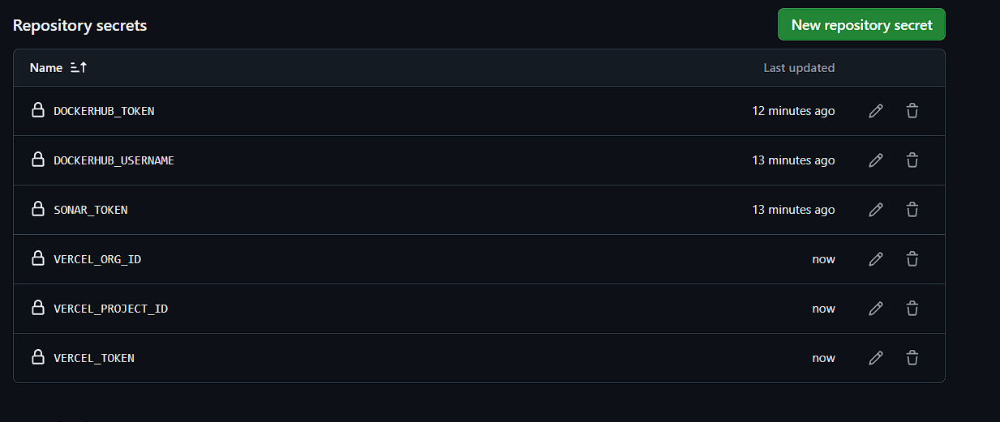
</p>
<p align="center"><b>Figura 7.1.1.</b> Repository secrets del frontend (los valores no son visibles).</p>

<p align="center">
  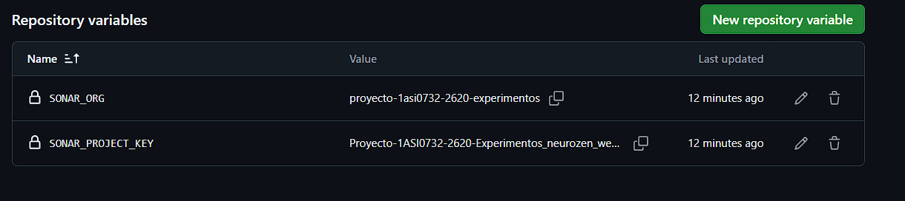
</p>
<p align="center"><b>Figura 7.1.2.</b> Repository variables con la organización y el proyecto de SonarQube Cloud.</p>

**RESTful API**

La integración continua del backend se implementa con **GitHub Actions**, en el workflow `.github/workflows/pipeline.yml` (**NeuroZen CI CD**). El diseño sigue el laboratorio de CI/CD visto en clase: un solo workflow con tres jobs encadenados, `build-and-test` → `publish` → `deploy`, adaptado de Java/Maven a .NET 9.

**Evolución del pipeline.** Inicialmente, el backend tenía dos workflows separados: **CI - Backend** (`main_neurozen-api.yml`), con las pruebas y el Quality Gate, y **CD - Lab VM** (`cd-lab-vm.yml`), con la publicación y el despliegue, encadenados mediante el evento `workflow_run`. Ese encadenamiento falló el 09/11/2026 durante un incidente de GitHub (sección 7.2.2): el CI terminó con éxito, pero el despliegue nunca se disparó. Por eso, en el PR #17 ambos workflows se reemplazaron por `pipeline.yml`, donde los jobs se encadenan con `needs` dentro de la **misma ejecución**. Así, la publicación y el despliegue usan siempre el mismo commit que se probó, sin depender de eventos entre workflows.

| Herramienta | Uso en el pipeline | Equivalente en el laboratorio de clase |
| :--- | :--- | :--- |
| GitHub Actions | Orquestación del pipeline (`build-and-test` → `publish` → `deploy`) | GitHub Actions |
| .NET 9 SDK (`actions/setup-dotnet`) | Restauración, compilación y pruebas | Java 21 + Maven |
| MySQL 8 como *service container* | Base de datos real para las pruebas de integración y BDD | — |
| xUnit + Reqnroll + `WebApplicationFactory` | Pruebas unitarias, de integración y BDD | JUnit |
| coverlet (formatos OpenCover y Cobertura) | Cobertura de código | JaCoCo |
| ReportGenerator | Resumen de cobertura publicado en el *Job Summary* de cada ejecución | Reporte HTML de JaCoCo |
| SonarScanner for .NET + Java 17 | Análisis de calidad, seguridad y Quality Gate | Plugin de SonarQube para Maven |
| Docker Buildx + Docker Hub | Construcción y publicación de la imagen inmutable (sección 7.2) | `docker build` y `docker push` |
| `scripts/deploy.sh` | Despliegue con candidato, prueba de humo y *rollback* (sección 7.3) | Despliegue con candidato y *rollback* |

**Prácticas aplicadas:**

- **Disparadores:** cada *push* y *Pull Request* hacia `main` y `develop`, y también de forma manual (`workflow_dispatch`). En un Pull Request solo se ejecuta `build-and-test`; `publish` y `deploy` solo se ejecutan en un *push* a `main`.
- **Pruebas con base de datos real:** el job levanta MySQL 8 como *service container* con *health check*, y las pruebas crean y eliminan su propia base de datos en cada ejecución mediante la variable `NEUROZEN_TEST_MYSQL`. En local, si la variable no existe, las pruebas levantan MySQL automáticamente con **Testcontainers**.
- **Quality Gate bloqueante:** `sonar.qualitygate.wait=true` hace fallar el job si el Quality Gate no se cumple, y sin `build-and-test` aprobado no se ejecutan `publish` ni `deploy`.
- **Nombre del check estable:** el job conserva el nombre visible `build-and-test`, que es el check obligatorio del ruleset `protect-main` (sección 6.2.2).
- **Dependencias de CI fijadas:** las 10 *actions* del workflow se referencian por hash SHA completo (sección 6.2.1.2).
- **Permisos mínimos:** `permissions: contents: read`.
- **Evidencias como artefactos:** los resultados `.trx` y los reportes de cobertura se publican como artefacto `test-results` en cada ejecución, incluso si fallan las pruebas.
- **Gestión de secretos:** los tokens se guardan como *Repository secrets*; los identificadores no sensibles, como *Repository variables*. El usuario de Docker Hub se guarda como **variable** y no como secreto, porque GitHub descarta las salidas de un job que contienen secretos, y el nombre de la imagen publicada lo incluye.

| Tipo | Nombre | Uso |
| :--- | :--- | :--- |
| Secret | `SONAR_TOKEN` | Autenticación con SonarQube Cloud |
| Secret | `DOCKERHUB_TOKEN` | Publicación de la imagen en Docker Hub (sección 7.2) |
| Variable | `DOCKERHUB_USERNAME` | Usuario de Docker Hub (`charlie404x`) |
| Environment `lab-production` | Sin secretos ni revisores | Agrupa y registra los despliegues del job `deploy` (sección 7.3) |
| Environment secret (`production`) | `RENDER_PROD_DEPLOY_HOOK` | Despliegue a producción en Render |
| Environment secret (`staging`) | `RENDER_STAGING_DEPLOY_HOOK` | Despliegue a *staging* en Render |

La Figura 7.1.3 corresponde a la configuración previa a la consolidación. Los secretos `DEPLOY_HOST`, `DEPLOY_USER` y `DEPLOY_SSH_KEY` (del despliegue por SSH a una VM, que se descartó en la sección 7.3.1) y `DOCKER_USERNAME`, `DOCKER_PASSWORD` y `JWT_SECRET` (del workflow retirado `deploy-server.yml`) ya no se usan en ningún workflow y se eliminarán del repositorio.

<p align="center">
  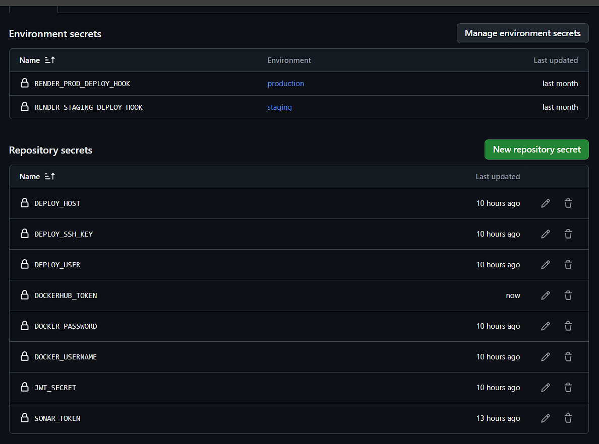
</p>
<p align="center"><b>Figura 7.1.3.</b> Secretos del backend: de repositorio y de los environments production y staging (los valores no son visibles).</p>

<p align="center">
  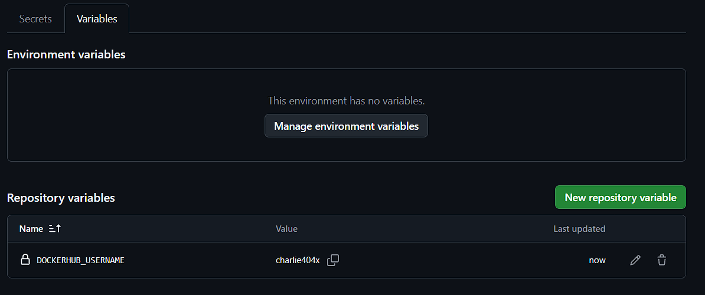
</p>
<p align="center"><b>Figura 7.1.4.</b> Repository variable `DOCKERHUB_USERNAME` del backend.</p>


**Aplicación Móvil**

La integración continua de la aplicación móvil se implementa con **GitHub Actions**, en el workflow `.github/workflows/pipeline.yml` (**NeuroZen Android CI CD**). El diseño sigue el laboratorio de CI/CD visto en clase, adaptado de Java/Maven y Docker a Android: los jobs `quality` → `smoke` → `build-release` → `distribute` se encadenan con `needs` dentro de la misma ejecución, de modo que se publica exactamente el commit que se probó.

**Evolución del pipeline.** Inicialmente, la aplicación tenía tres workflows que repetían trabajo: `android.yml`, **CI - Mobile** (`ci.yml`, pruebas unitarias y APK de depuración) y **CD - Staging Mobile** (`cd-staging-mobile.yml`, APK de depuración como artefacto). Los tres se reemplazaron por `pipeline.yml` en el PR #1. *CI - Mobile* sigue apareciendo en la lista de workflows de GitHub por sus ejecuciones anteriores, pero ya no se ejecuta.

| Herramienta | Uso en el pipeline | Equivalente en el laboratorio de clase |
| :--- | :--- | :--- |
| GitHub Actions | Orquestación del pipeline (`quality` → `smoke` → `build-release` → `distribute`) | GitHub Actions |
| JDK 17 (Temurin) + Gradle 9.3.1 (*wrapper*) | Compilación y ejecución de tareas; `gradle/actions/setup-gradle` valida el *wrapper* y administra la caché | Java 21 + Maven |
| JUnit 4, MockK, `kotlinx-coroutines-test` y MockWebServer | Pruebas unitarias y de integración de la capa de datos contra una API simulada | JUnit |
| JaCoCo (integrado en el Android Gradle Plugin) | Cobertura de las pruebas unitarias | JaCoCo |
| Android Lint | Verificación de estándares y errores de Android (sección 6.2.1.1) | — |
| SonarQube Cloud (`SonarSource/sonarqube-scan-action@v6`) | Análisis de calidad, seguridad y Quality Gate | Plugin de SonarQube para Maven |
| Emulador Android (`reactivecircus/android-emulator-runner`) | Pruebas instrumentadas de Room y Compose UI (job `smoke`) | Prueba de humo del candidato |
| R8 + `apksigner` + SHA-256 | APK y AAB de *release* optimizados, firmados y con huella verificable (sección 7.2) | `docker build` + *digest* |
| Firebase App Distribution | Entrega del APK firmado a los testers (sección 7.2) | `docker push` y despliegue |

**Prácticas aplicadas:**

- **Disparadores por rama:** `quality` se ejecuta en cada *push* y Pull Request hacia `develop` y `main`; `smoke`, en los Pull Requests hacia `main`, en los *push* a `main` y en ejecuciones manuales; `build-release` y `distribute`, solo en un *push* a `main` (`workflow_dispatch` permite lanzarlo manualmente).
- **Falla rápida:** `smoke` (unos 5 minutos de emulador) solo se ejecuta si `quality` termina bien, y `build-release` requiere ambos.
- **Ejecuciones no duplicadas:** `concurrency` con `cancel-in-progress: true` cancela la ejecución anterior de la misma rama cuando llega un *push* nuevo.
- **Permisos mínimos:** `permissions: contents: read`.
- **Versión trazable:** `versionCode = 4 + GITHUB_RUN_NUMBER` y `versionName = 2.2.<ejecución>`. Cada compilación del pipeline tiene un número mayor que el último *release* manual (versionCode 4), lo que permite a los testers actualizar la app instalada.
- **Evidencias como artefactos:** cada ejecución publica `test-reports` (JUnit, cobertura y Lint) y, en `main`, `android-test-reports` y `neurozen-release`.
- **Gestión de secretos:** los secretos de firma y de Firebase nunca se escriben en el repositorio. El `.gitignore` excluye keystores (`*.jks`), APK, AAB, `local.properties` y los JSON de cuentas de servicio. La keystore se guarda en Base64 como *secret* y se decodifica solo en el directorio temporal del runner (`$RUNNER_TEMP`).

| Tipo | Nombre | Uso |
| :--- | :--- | :--- |
| Secret | `SONAR_TOKEN` | Autenticación con SonarQube Cloud (job `quality`) |
| Secret | `KEYSTORE_BASE64`, `KEYSTORE_PASSWORD`, `KEY_ALIAS`, `KEY_PASSWORD` | Firma del APK y del AAB (`build-release` y *CD - Production Mobile*) |
| Secret | `FIREBASE_SERVICE_ACCOUNT` | Credencial JSON de la cuenta de servicio `github-actions`, con el rol mínimo *Administrador de Firebase App Distribution* (job `distribute`) |
| Variable | `SONAR_ORG`, `SONAR_PROJECT_KEY` | Organización y proyecto de SonarQube Cloud |
| Variable | `FIREBASE_APP_ID` | Identificador de la app Android en Firebase (no es un dato sensible) |
| Environment | `qa-distribution` | Agrupa y registra las distribuciones a testers; sin revisores obligatorios (sección 7.3.1) |

<p align="center">
  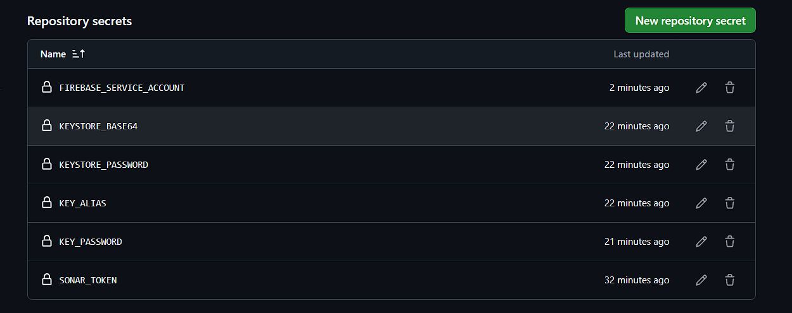
</p>
<p align="center"><b>Figura 7.1.5.</b> Repository secrets de la aplicación móvil: SonarQube, firma y Firebase (los valores no son visibles).</p>

<p align="center">
  
</p>
<p align="center"><b>Figura 7.1.6.</b> Repository variables de la aplicación móvil: organización y proyecto de SonarQube Cloud, e identificador de la app en Firebase.</p>


### 7.1.2. Build & Test Suite Pipeline Components

El pipeline de CI de cada producto compila el código y ejecuta las pruebas descritas en el Capítulo VI.

**Frontend Web Application**

El job **Quality (lint, tests, coverage, SonarQube)** se ejecuta en cada *push* y *Pull Request*:

| # | Paso | Comando / acción | Si falla |
| :---: | :--- | :--- | :--- |
| 1 | Checkout repository | `actions/checkout@v4` con historial completo (requerido por SonarQube) | — |
| 2 | Setup Node.js | `actions/setup-node@v4` con Node 22 y caché de npm | — |
| 3 | Install dependencies | `npm ci` | Se detiene el pipeline |
| 4 | Lint | `npm run lint` | Se detiene el pipeline |
| 5 | Run unit and integration tests with coverage | `npm run test:coverage` (genera `coverage/lcov.info`) | Se detiene el pipeline |
| 6 | Build Vue app | `npm run build` | Se detiene el pipeline |
| 7 | Upload coverage report | Artefacto `coverage-report` | Se ejecuta siempre (`if: always()`) |
| 8 | SonarQube Cloud Quality Gate | `sonarqube-scan-action` con `sonar.qualitygate.wait=true` | El job falla y no se publica ni despliega |

```yaml
quality:
  name: Quality (lint, tests, coverage, SonarQube)
  runs-on: ubuntu-latest
  steps:
    - uses: actions/checkout@v4
      with:
        fetch-depth: 0
    - uses: actions/setup-node@v4
      with:
        node-version: 22
        cache: npm
    - run: npm ci
    - run: npm run lint
    - run: npm run test:coverage
    - run: npm run build
    - uses: actions/upload-artifact@v4
      if: always()
      with:
        name: coverage-report
        path: coverage/
    - uses: SonarSource/sonarqube-scan-action@v5
      env:
        SONAR_TOKEN: ${{ secrets.SONAR_TOKEN }}
      with:
        args: >
          -Dsonar.organization=${{ vars.SONAR_ORG }}
          -Dsonar.projectKey=${{ vars.SONAR_PROJECT_KEY }}
          -Dsonar.qualitygate.wait=true
```

**Suite de pruebas automatizadas.** La suite está compuesta por **36 archivos y 95 pruebas**, todas aprobadas:

| Tipo | Archivos | Cobertura funcional |
| :--- | :---: | :--- |
| Integración (`tests/integration/`) | 14 | Inicio de sesión por rol, registro de cuentas, protección de rutas, seguridad de la cuenta, test de estrés, registro de desencadenantes, ZenBot (incluida la detección de crisis), directorio de psicólogos, reserva de sesiones, citas del usuario, portal del profesional, verificación por administrador, suscripción y biblioteca de recursos |
| Unitarias (`tests/unit/`) | 22 | Servicios (autenticación, citas, terapeutas, reportes, suscripciones, dashboard, entre otros), validaciones, roles, sesión, fechas, motor de ZenBot, consistencia de traducciones (i18n) y exportación de datos del perfil |

Durante la configuración del pipeline se agregaron dos pruebas:

- **`i18n.spec.js`:** verifica que `public/es.json` y `public/en.json` tengan exactamente las mismas claves, para cumplir el requisito de internacionalización (en_US y es_419).
- **`UserProfileExport.spec.js`:** verifica que la exportación de datos personales excluya el token de sesión (ver sección 6.2.1.2).

**Resultados de ejecución.** La siguiente tabla resume las dos ejecuciones con las que se validó el pipeline:

| Ejecución | Commit | Resultado | Duración | Observación |
| :---: | :---: | :---: | :---: | :--- |
| #9 | `179f6c2` | ❌ Fallida | 1 min 49 s | Lint, pruebas y build aprobados; Quality Gate fallido por cobertura del código nuevo (66,7 %). No se ejecutaron *publish* ni *deploy*. |
| #10 | `ad5c2c6` | ✅ Exitosa | 3 min 14 s | Quality (1 min 26 s) → Publish (36 s) → Deploy (1 min 5 s). Se generaron 2 artefactos. |

<p align="center">
  
</p>
<p align="center"><b>Figura 7.1.7.</b> Historial de ejecuciones: la #9 bloqueada por el Quality Gate y la #10 aprobada tras agregar la prueba.</p>

<p align="center">
  
</p>
<p align="center"><b>Figura 7.1.8.</b> Ejecución #10: los jobs Quality, Publish Docker image y Deploy to Vercel completados.</p>

<p align="center">
  
</p>
<p align="center"><b>Figura 7.1.9.</b> *Job Summary* de la ejecución #10: reporte de Vitest con 36 archivos y 95 pruebas aprobadas.</p>

<p align="center">
  
</p>
<p align="center"><b>Figura 7.1.10.</b> Historial completo del workflow del frontend en GitHub Actions: 10 ejecuciones en `main`, desde la configuración inicial de Vercel (#2) hasta la ejecución #9, bloqueada por el Quality Gate, y la #10, aprobada.</p>

**Primera versión del pipeline.** Antes del pipeline actual, el workflow *Vue CI - Tests* instalaba las dependencias, ejecutaba 10 pruebas con Vitest (7 unitarias y 3 de integración) y compilaba la aplicación, sin lint, cobertura ni Quality Gate.

<p align="center">
  
</p>
<p align="center"><b>Figura 7.1.11.</b> Primera versión del CI del frontend (*Vue CI - Tests*): 10 pruebas y compilación en 31 s.</p>

**RESTful API**

El job **build-and-test** de *NeuroZen CI CD* se ejecuta en cada *push* y *Pull Request*:

| # | Paso | Comando / acción | Si falla |
| :---: | :--- | :--- | :--- |
| 1 | Checkout | `actions/checkout` (fijada por SHA, v4.2.2) con historial completo, requerido por SonarQube | — |
| 2 | Setup .NET 9 y Java 17 | Java es requerido por el escáner de SonarQube | — |
| 3 | Restore dependencies | `dotnet restore` | Se detiene el pipeline |
| 4 | Install SonarScanner | `dotnet tool install --global dotnet-sonarscanner` | Se detiene el pipeline |
| 5 | Sonar begin | `dotnet sonarscanner begin` con la organización, el proyecto, las rutas de cobertura, las exclusiones y `sonar.qualitygate.wait=true` | Se detiene el pipeline |
| 6 | Build | `dotnet build --configuration Release` | Se detiene el pipeline |
| 7 | Run all tests | `dotnet test` con cobertura OpenCover y Cobertura, y resultados `.trx` | Se detiene el pipeline |
| 8 | Sonar end (Quality Gate) | `dotnet sonarscanner end`; espera el veredicto del Quality Gate | El job falla y no se publica ni despliega |
| 9 | Coverage report | ReportGenerator publica el resumen de cobertura en el *Job Summary* | Se ejecuta siempre |
| 10 | Upload test results | Artefacto `test-results` | Se ejecuta siempre |

```yaml
quality:
  name: build-and-test            # nombre del check obligatorio del ruleset protect-main
  runs-on: ubuntu-latest
  env:
    NEUROZEN_TEST_MYSQL: "server=127.0.0.1;port=3306;user=root;password=root"
  services:
    mysql:
      image: mysql:8.0
      env:
        MYSQL_ROOT_PASSWORD: root
      ports: ["3306:3306"]
  steps:
    - uses: actions/checkout@11bd71901bbe5b1630ceea73d27597364c9af683 # v4.2.2
      with:
        fetch-depth: 0
    - uses: actions/setup-dotnet@67a3573c9a986a3f9c594539f4ab511d57bb3ce9 # v4.3.1
      with:
        dotnet-version: '9.0.x'
    - uses: actions/setup-java@cf277c60eb25467037889841efdb72551f06f6c3 # v4.9.1
      with:
        distribution: temurin
        java-version: '17'
    - run: dotnet restore
    - run: dotnet tool install --global dotnet-sonarscanner
    - run: >
        dotnet sonarscanner begin
        /k:"Proyecto-1ASI0732-2620-Experimentos_neurozen_web_backend"
        /o:"proyecto-1asi0732-2620-experimentos"
        /d:sonar.token="$SONAR_TOKEN"
        /d:sonar.cs.opencover.reportsPaths="**/coverage.opencover.xml"
        /d:sonar.cs.vstest.reportsPaths="**/*.trx"
        /d:sonar.qualitygate.wait=true
    - run: dotnet build --no-restore --configuration Release
    - run: >
        dotnet test --no-build -c Release
        --logger "trx;LogFileName=test-results.trx"
        --collect:"XPlat Code Coverage"
        --results-directory ./TestResults
        -- DataCollectionRunSettings.DataCollectors.DataCollector.Configuration.Format=opencover,cobertura
    - run: dotnet sonarscanner end /d:sonar.token="$SONAR_TOKEN"
```

El fragmento omite, por brevedad, el *health check* del servicio MySQL, la variable `SONAR_TOKEN` de los pasos de Sonar, las exclusiones del análisis y los pasos de reporte y artefactos. La credencial `root/root` corresponde únicamente al contenedor MySQL efímero del runner, que se destruye al terminar el job. No se usa en ningún entorno real.

**Suite de pruebas automatizadas.** La suite del backend cuenta con **131 pruebas, todas aprobadas** (125 existentes y 6 agregadas durante la configuración del pipeline), que se ejecutan en unos 100 segundos:

| Tipo | Ubicación | Cobertura funcional |
| :--- | :--- | :--- |
| Unitarias | `neurozen.API.Tests/Unit/` | Servicios de comandos y consultas de IAM (registro, inicio de sesión, política de contraseñas, *hashing*, recuperación de contraseña, cuenta), Appointments, Professionals (perfil, verificación, reseñas, concurrencia), Stress (evaluaciones, reportes, desencadenantes), Subscriptions y Wellness (servicios, paginación, *assemblers* y recursos REST) |
| Integración | `neurozen.API.Tests/Integration/` | Flujos de negocio y seguridad de punta a punta sobre la API real (`WebApplicationFactory`) con MySQL 8 |
| BDD (Reqnroll) | `neurozen.API.Tests/BDD/Features/` | Escenarios en Gherkin: ciclo de la cita, reserva de sesión, seguridad de la cuenta y verificación de psicólogos |

**Resultados de ejecución.** La siguiente tabla resume las ejecuciones con las que se validó el pipeline del backend, primero con el workflow anterior (*CI - Backend*) y luego con el actual (*NeuroZen CI CD*):

| Workflow | Ejecución | Evento | Resultado | Duración | Observación |
| :--- | :---: | :--- | :---: | :---: | :--- |
| CI - Backend | #41 | Pull Request #15 abierto | ❌ Fallida | 2 min 39 s | Pruebas aprobadas; Quality Gate fallido (Security C y cobertura de 69,57 %). |
| CI - Backend | #42 | Pull Request #15 actualizado | ❌ Fallida | 2 min 18 s | Correcciones intermedias; el Quality Gate seguía sin cumplirse. |
| CI - Backend | #43 | Pull Request #15 actualizado | ✅ Exitosa | 2 min 34 s | Quality Gate aprobado (cobertura de 85,51 %). |
| CI - Backend | #44 | *Push* a `main` (merge, commit `51af523`) | ✅ Exitosa | 2 min 32 s | CI en `main`; los workflows de despliegue no se dispararon por el incidente de GitHub (sección 7.2.2). |
| NeuroZen CI CD | #1 | Pull Request #17 abierto (commit `93b29b4`) | ❌ Fallida | 2 min 31 s | Pruebas aprobadas; Quality Gate fallido (Security C por *actions* sin hash SHA). |
| NeuroZen CI CD | #2 | Pull Request #17 actualizado (commit `bc72990`) | ✅ Exitosa | 2 min 36 s | `build-and-test` aprobado; `publish` y `deploy` omitidos por ser un Pull Request. |
| NeuroZen CI CD | **#3** | *Push* a `main` (merge del PR #17, commit `427b18a`) | ✅ Exitosa | **3 min 34 s** | `build-and-test` (2 min 3 s) → `publish` (41 s) → `deploy` (42 s); se generó 1 artefacto. |
| NeuroZen CI CD | #4 | Pull Request #18 abierto | ✅ Exitosa | 2 min 38 s | Corrección del disparador de Render; solo `build-and-test`. |
| NeuroZen CI CD | #5 | Pull Request #18 actualizado | ✅ Exitosa | 2 min 33 s | Solo `build-and-test`. |
| NeuroZen CI CD | **#6** | *Push* a `main` (merge del PR #18, commit `b42191e`) | ✅ Exitosa | **4 min 15 s** | `build-and-test` (2 min 39 s) → `publish` (51 s) → `deploy` (36 s). Al terminar, disparó *CD - Production Backend* #13 (sección 7.3.2). |

Con las seis ejecuciones de *NeuroZen CI CD*, el job `build-and-test` tomó entre 2 min 3 s y 2 min 39 s, y el ciclo completo en `main` (#3 y #6), entre 3 min 34 s y 4 min 15 s.

<p align="center">
  
</p>
<p align="center"><b>Figura 7.1.12.</b> Ejecución #3 de *NeuroZen CI CD* sobre main: `build-and-test`, `publish` y `deploy` completados en 3 min 34 s.</p>

<p align="center">
  
</p>
<p align="center"><b>Figura 7.1.13.</b> Historial de *Actions* del backend: ejecuciones #1 a #6 de *NeuroZen CI CD* (la #1 bloqueada por el Quality Gate) y *CD - Production Backend* #13, disparada automáticamente al terminar la #6.</p>

**Cobertura reportada por el pipeline.** En la ejecución #3, ReportGenerator publicó el siguiente resumen en el *Job Summary*:

| Métrica | Resultado |
| :--- | :---: |
| Cobertura de líneas | **88,9 %** (7 230 de 8 131 líneas cubribles) |
| Cobertura de ramas | **52 %** (675 de 1 296 ramas) |
| Clases / archivos analizados | 271 clases en 195 archivos del ensamblado `neurozen.API` |

Este porcentaje difiere del 73,3 % que muestra SonarQube (sección 6.2.1.2) porque cada herramienta calcula la cobertura sobre un conjunto distinto de líneas: ReportGenerator usa las líneas que coverlet instrumenta en el ensamblado compilado, mientras que SonarQube usa las líneas de código fuente que analiza, con sus propias exclusiones. El Quality Gate se basa en la cifra de SonarQube.

<p align="center">
  
</p>
<p align="center"><b>Figura 7.1.14.</b> *Job Summary* de la ejecución #3: cobertura de líneas de 88,9 % y de ramas de 52 %.</p>

<p align="center">
  
</p>
<p align="center"><b>Figura 7.1.15.</b> Historial de ejecuciones del workflow anterior *CI - Backend*: las #41 y #42 bloqueadas por el Quality Gate, y las #43 y #44 aprobadas.</p>

<p align="center">
  
</p>
<p align="center"><b>Figura 7.1.16.</b> Ejecución #44 de *CI - Backend* sobre main: job build-and-test completado en 2 min 30 s.</p>


**Versión inicial del workflow.** La primera versión de *CI - Backend* restauraba, compilaba y ejecutaba las pruebas con MySQL en el runner, sin cobertura ni análisis de SonarQube. La versión actual conserva esos pasos y agrega la cobertura, los reportes, el Quality Gate bloqueante, la publicación y el despliegue.

<p align="center">
  
</p>
<p align="center"><b>Figura 7.1.17.</b> Ejecución de la versión inicial de *CI - Backend* en GitHub Actions.</p>

**Aplicación Móvil**

El job **quality** de *NeuroZen Android CI CD* se ejecuta en cada *push* y Pull Request:

| # | Paso | Comando / acción | Si falla |
| :---: | :--- | :--- | :--- |
| 1 | Checkout | `actions/checkout@v4` con historial completo (requerido por SonarQube) | — |
| 2 | Setup Java 17 y Gradle | `actions/setup-java@v4` (Temurin) y `gradle/actions/setup-gradle@v4` | — |
| 3 | Make gradlew executable | `chmod +x gradlew` | — |
| 4 | Unit tests, coverage and lint | `./gradlew testDebugUnitTest createDebugUnitTestCoverageReport lintDebug` | Se detiene el pipeline |
| 5 | Test reports | Artefacto `test-reports` (JUnit, cobertura y Lint) | Se ejecuta siempre (`if: always()`) |
| 6 | SonarQube Cloud Quality Gate | `sonarqube-scan-action@v6` con `sonar.qualitygate.wait=true`, solo en `main` (sección 6.2.1.2) | El job falla y no se ejecutan `smoke`, `build-release` ni `distribute` |

El job **smoke** depende de `quality` y ejecuta las pruebas instrumentadas en un emulador Android:

| # | Paso | Comando / acción | Si falla |
| :---: | :--- | :--- | :--- |
| 1 | Enable KVM | Habilita la aceleración por hardware del runner para el emulador | — |
| 2 | Instrumented tests on emulator | `reactivecircus/android-emulator-runner@v2` (API 34, `x86_64`, `google_apis`, animaciones desactivadas) con `./gradlew connectedDebugAndroidTest` | Se detiene el pipeline |
| 3 | Instrumented reports | Artefacto `android-test-reports` | Se ejecuta siempre |

```yaml
quality:
  runs-on: ubuntu-latest
  steps:
    - uses: actions/checkout@v4
      with:
        fetch-depth: 0
    - uses: actions/setup-java@v4
      with:
        distribution: temurin
        java-version: '17'
    - uses: gradle/actions/setup-gradle@v4
    - run: chmod +x gradlew
    - name: Unit tests, coverage and lint
      run: ./gradlew testDebugUnitTest createDebugUnitTestCoverageReport lintDebug --stacktrace
    - name: Test reports
      if: always()
      uses: actions/upload-artifact@v4
      with:
        name: test-reports
        path: |
          app/build/test-results/
          app/build/reports/
    - name: SonarQube Cloud Quality Gate
      if: github.ref == 'refs/heads/main'
      uses: SonarSource/sonarqube-scan-action@v6
      env:
        SONAR_TOKEN: ${{ secrets.SONAR_TOKEN }}
      with:
        args: >
          -Dsonar.host.url=https://sonarcloud.io
          -Dsonar.organization=${{ vars.SONAR_ORG }}
          -Dsonar.projectKey=${{ vars.SONAR_PROJECT_KEY }}

smoke:
  needs: quality
  if: >
    github.event_name == 'workflow_dispatch' ||
    (github.event_name == 'push' && github.ref == 'refs/heads/main') ||
    (github.event_name == 'pull_request' && github.base_ref == 'main')
  runs-on: ubuntu-latest
  timeout-minutes: 45
  steps:
    # checkout, Java 17, Gradle y KVM (igual que en quality)
    - uses: reactivecircus/android-emulator-runner@v2
      with:
        api-level: 34
        arch: x86_64
        target: google_apis
        disable-animations: true
        script: ./gradlew connectedDebugAndroidTest --stacktrace
```

**Suite de pruebas automatizadas.** La suite de la aplicación móvil cuenta con **77 pruebas**: 70 unitarias (12 archivos), que se ejecutan en el job `quality`, y 7 instrumentadas (2 archivos), que se ejecutan en el emulador del job `smoke`.

| Tipo | Archivos | Pruebas | Cobertura funcional |
| :--- | :---: | :---: | :--- |
| Unitarias de dominio (`domain/`) | 8 | 49 | Puntaje del test de autoevaluación (`AssessmentScoring`), reglas de citas, validadores de formularios y de tarjetas, fechas y recordatorios, estadísticas de estrés y recomendaciones, motor de ZenBot y la clase `Outcome` |
| Integración de datos (`data/`) | 3 | 14 | Repositorios de autenticación y de citas contra una API simulada con MockWebServer, y traducción de errores HTTP a errores de dominio (`ErrorMapper`) |
| ViewModels (`presentation/`) | 1 | 7 | Estados de la interfaz de los ViewModels principales |
| Instrumentadas (`androidTest/`) | 2 | 7 | Base de datos Room real en el dispositivo (4) y pantallas de Jetpack Compose (3) |

Durante la configuración del pipeline se agregó `OutcomeTest.kt`, que verifica la clase `Outcome` usada por todos los repositorios para devolver un resultado o un error.

**Resultados de ejecución.** La siguiente tabla resume las ejecuciones con las que se validó el pipeline:

| Ejecución | Evento | Resultado | Duración | Observación |
| :---: | :--- | :---: | :---: | :--- |
| #1 | *Push* a `develop` (commit `e9bf665`) | ❌ Fallida | 4 min 37 s | Pruebas, cobertura y Lint aprobados; el paso de SonarQube falló por la limitación del plan en ramas distintas de `main` (sección 6.2.1.2). |
| #2 | *Push* a `develop` (commit `9a127a3`) | ✅ Exitosa | 3 min 52 s | Solo `quality`, con SonarQube restringido a `main`. Los demás jobs se omiten en `develop`. |
| #3 | Pull Request #1 abierto (`develop` → `main`) | ✅ Exitosa | 12 min 35 s | `quality` y `smoke` (emulador) aprobados; `build-release` y `distribute` omitidos por ser un Pull Request. |
| #4 | *Push* a `main` (merge del PR #1, commit `ff57345`) | ❌ Fallida | 16 min 50 s | Intento #1: Quality Gate *Not computed* en el primer análisis de `main`. Intento #2: `quality`, `smoke` y `build-release` aprobados; `distribute` falló porque no recibió el nombre del APK (sección 7.2.2). |
| **#5** | *Push* a `main` (commit `4306d6d`) | ✅ Exitosa | **13 min 8 s** | `quality` (4 min 50 s) → `smoke` (4 min 59 s) → `build-release` (2 min 39 s) → `distribute` (29 s). Se generaron 3 artefactos. |

En la ejecución #5, el ciclo completo desde el *push* hasta la entrega a los testers tomó 13 minutos y 8 segundos. El job `smoke` es la etapa más costosa del pipeline: representa casi el 40 % del tiempo total, por el arranque del emulador.

<p align="center">
  
</p>
<p align="center"><b>Figura 7.1.18.</b> Ejecución #5 de *NeuroZen Android CI CD* sobre main: `quality`, `smoke`, `build-release` y `distribute` completados en 13 min 8 s.</p>

<p align="center">
  
</p>
<p align="center"><b>Figura 7.1.19.</b> Historial de *Actions* de la aplicación móvil: ejecuciones #1 a #5 de *NeuroZen Android CI CD* y, debajo, las ejecuciones de los workflows anteriores *CI - Mobile* y *CD - Staging Mobile*.</p>

<p align="center">
  
</p>
<p align="center"><b>Figura 7.1.20.</b> Ejecución #2 sobre `develop`: solo se ejecuta `quality` (3 min 50 s); `smoke`, `build-release` y `distribute` se omiten.</p>

**Primera versión del pipeline.** Antes del pipeline actual, el workflow *CI - Mobile* (`ci.yml`) ejecutaba las pruebas unitarias (`./gradlew testDebugUnitTest`) y compilaba el APK de depuración (`./gradlew assembleDebug`), sin cobertura, Lint, Quality Gate, pruebas instrumentadas ni firma.

<p align="center">
  
</p>
<p align="center"><b>Figura 7.1.21.</b> Primera versión del CI de la aplicación móvil (*CI - Mobile*): pruebas unitarias y compilación del APK de depuración en 5 min 15 s.</p>

---

## 7.2. Continuous Delivery

### 7.2.1. Tools and Practices

| Herramienta | Uso |
| :--- | :--- |
| GitHub Actions | Orquesta la publicación y el despliegue en cada entorno |
| Docker | Empaqueta el frontend (nginx) y el backend (ASP.NET Core) en imágenes idénticas para todos los entornos |
| Docker Hub | Registro de las imágenes versionadas del frontend y del backend |
| Render | Hosting del backend en *staging* y producción |
| Vercel | Hosting del frontend en producción |
| Gradle + R8 + `apksigner` | Generación del APK y del AAB de *release* de la aplicación móvil, optimizados y firmados |
| Firebase App Distribution | Entrega automática del APK firmado a los testers de la aplicación móvil |
| GitHub Environments | Secretos separados por entorno (`staging`, `production`, `lab-production`, `qa-distribution`) |

**Prácticas comunes:**

- La rama `develop` debe estar siempre en estado desplegable: solo se integra código con el pipeline de CI en verde.
- Cada integración en `develop` despliega el backend en **staging**, donde QA y el cliente validan las nuevas funcionalidades antes de publicarlas. En la aplicación móvil, el equivalente es la distribución del APK firmado a los testers del grupo `qa` mediante Firebase App Distribution.
- Los entornos tienen configuraciones y bases de datos separadas. Las credenciales se guardan en *GitHub Secrets*, en los *environments* o en el panel del proveedor, nunca en el repositorio.
- Las migraciones de Entity Framework Core se aplican automáticamente al iniciar la API en staging, para verificarlas antes de llegar a producción.

Las secciones siguientes detallan la configuración de cada producto.

**Frontend Web Application**

La entrega continua del frontend genera, en cada *push* a `main` que supera el job `quality`, una **imagen Docker inmutable** de la aplicación, lista para desplegarse en cualquier entorno.

| Herramienta | Uso |
| :--- | :--- |
| Docker (*Dockerfile* multietapa) | Etapa 1: `node:22-alpine` instala dependencias y compila con `npm run build`. Etapa 2: `nginx:1.27-alpine` sirve solo los archivos estáticos de `dist/`. |
| nginx (`nginx.conf`) | Sirve la aplicación, redirige las rutas de Vue Router a `index.html` y expone el endpoint `/health`, que responde `200 UP` para las pruebas de humo |
| Docker Buildx | Construcción de la imagen para la plataforma `linux/amd64` |
| Docker Hub | Registro de imágenes: [`charlie404x/neurozen-web-frontend`](https://hub.docker.com/r/charlie404x/neurozen-web-frontend) |

**Prácticas aplicadas:**

- **Imagen inmutable y trazable:** cada imagen se etiqueta con el commit que la originó (`sha-<commit>`) y el pipeline registra su *digest*. Así, cada versión desplegable se vincula de forma única con su código fuente.
- **Solo se publica código verificado:** el job `publish` depende de `quality` (`needs: quality`) y solo se ejecuta en *push* a `main`.
- **Imagen mínima:** la imagen final contiene únicamente nginx y los archivos compilados, sin código fuente ni dependencias de desarrollo. Pesa 25,2 MB en Docker Hub.
- **Contexto de construcción controlado:** el archivo `.dockerignore` excluye `node_modules`, `coverage`, `.git`, `.vercel` y los archivos `.env` locales.

**RESTful API**

La entrega continua del backend genera una **imagen Docker inmutable** de la API por cada cambio en `main` que supera `build-and-test`. La genera el job `publish` del mismo workflow *NeuroZen CI CD*.

| Herramienta | Uso |
| :--- | :--- |
| Docker (*Dockerfile* multietapa) | Etapa 1: `mcr.microsoft.com/dotnet/sdk:9.0` restaura y publica la API en `Release`. Etapa 2: `mcr.microsoft.com/dotnet/aspnet:9.0` contiene solo los binarios publicados. |
| Puerto configurable | La API escucha en el puerto indicado por la variable `PORT` (10000 por defecto, como requiere Render) |
| Docker Buildx | Construcción de la imagen para la plataforma `linux/amd64` |
| Docker Hub | Registro de imágenes: [`charlie404x/neurozen-backend`](https://hub.docker.com/r/charlie404x/neurozen-backend) |
| `.dockerignore` | Excluye `bin/`, `obj/`, `.git`, `TestResults/`, `coverage-report/` y archivos `.env` |

**Prácticas aplicadas:**

- **Solo se publica código verificado:** el job `publish` depende de `build-and-test` (`needs: quality`) y solo se ejecuta en un *push* a `main` (`if: github.event_name == 'push' && github.ref == 'refs/heads/main'`). En un Pull Request aparece como *skipped*.
- **Lo que se construye es lo que se probó:** `publish` se ejecuta en la misma ejecución del workflow y sobre el mismo commit (`github.sha`) que aprobó las pruebas y el Quality Gate. Por eso ya no hace falta el paso *Verify tested commit* del workflow anterior, que comparaba dos ejecuciones distintas.
- **Imagen inmutable y trazable:** cada imagen se etiqueta como `sha-<commit>` (además de `latest`) y el despliegue usa su *digest* (`imagen@sha256:...`), no una etiqueta que pueda cambiar.
- **Dependencias de CI fijadas:** todas las *actions* del workflow se referencian por hash SHA completo (sección 6.2.1.2).
- **Secretos fuera de la imagen:** la cadena de conexión y la clave JWT no se incluyen en la imagen; se inyectan como variables de entorno al ejecutar el contenedor. La API **se niega a arrancar** si `TokenSettings__Secret` no existe o tiene menos de 32 bytes, lo que impide desplegar por error con una clave débil.

**Aplicación Móvil**

La entrega continua de la aplicación móvil genera, en cada *push* a `main` que supera `quality` y `smoke`, un **APK y un AAB de *release* firmados**, y entrega el APK a los testers. Lo hacen los jobs `build-release` y `distribute` del mismo workflow *NeuroZen Android CI CD*. En una app móvil no hay un servidor donde desplegar una imagen Docker; por eso, el equivalente de publicar la imagen es generar un binario firmado y trazable, y el equivalente del despliegue es distribuirlo a los dispositivos de prueba.

| Herramienta | Uso |
| :--- | :--- |
| Gradle (`assembleRelease` y `bundleRelease`) | Genera el APK (instalación directa) y el AAB (formato requerido por Google Play) |
| R8 (`isMinifyEnabled` e `isShrinkResources`) | Reduce y ofusca el código y elimina los recursos sin uso. `proguard-rules.pro` conserva los DTO y modelos que Gson serializa, y las reglas de Retrofit |
| Firma de *release* | `signingConfigs.release` lee la keystore y sus claves de variables de entorno (`KEYSTORE_PATH`, `KEYSTORE_PASSWORD`, `KEY_ALIAS`, `KEY_PASSWORD`). Sin `KEYSTORE_PATH`, el build genera un APK sin firmar en lugar de fallar, lo que permite compilar en local sin la keystore |
| `apksigner verify --print-certs` | Verifica la firma del APK antes de distribuirlo |
| SHA-256 (`sha256sum`) | Huella del APK, que se registra en las notas de la versión distribuida |
| Firebase App Distribution (`firebase-tools`) | Entrega el APK al grupo de testers `qa` y les envía la invitación por correo |
| Cuenta de servicio `github-actions` (Google Cloud) | Credencial de GitHub Actions para Firebase, con el rol mínimo *Administrador de Firebase App Distribution* |

**Prácticas aplicadas:**

- **Solo se entrega código verificado:** `build-release` depende de `quality` y de `smoke` (`needs: [quality, smoke]`) y solo se ejecuta en un *push* a `main`. En un Pull Request aparece como *skipped*.
- **Lo que se entrega es lo que se probó:** los cuatro jobs se ejecutan en la misma ejecución y sobre el mismo commit (`github.sha`).
- **Binario trazable:** el APK se nombra `neurozen-sha-<commit>.apk`, lleva un `versionCode` único por ejecución (sección 7.1.1) y su SHA-256 se publica en las notas de la versión de Firebase. Así, cada instalación se vincula de forma única con su código fuente.
- **Secretos fuera del repositorio:** la keystore se decodifica solo en `$RUNNER_TEMP` durante el job, y la credencial de Firebase se escribe en un archivo temporal del runner. Ninguna de las dos queda en el código ni en los artefactos.
- **Mínimo privilegio:** se descartó la clave del *Firebase Admin SDK*, que da acceso a todo el proyecto, y se creó una cuenta de servicio que solo puede distribuir versiones de prueba.

<p align="center">
  
</p>
<p align="center"><b>Figura 7.2.1.</b> Cuentas de servicio del proyecto `neurozen-mobile`: la cuenta `github-actions`, dedicada al pipeline, junto a la del *Firebase Admin SDK*, que no se usa.</p>

### 7.2.2. Stages Deployment Pipeline Components

**Frontend Web Application**

**Validación manual previa (local).** Antes de automatizar la publicación, la imagen se construyó y validó en local siguiendo las etapas del laboratorio:

| Etapa | Comando | Resultado |
| :--- | :--- | :--- |
| Construcción | `docker build -t neurozen-web-frontend:1.0.0 .` | Imagen multietapa construida |
| Ejecución | `docker run -d --name nz-web -p 8080:80 neurozen-web-frontend:1.0.0` | Contenedor `nz-web` en ejecución en el puerto 8080 |
| Prueba de humo | `curl.exe -i http://localhost:8080/health` | `HTTP/1.1 200 OK` · `UP` |
| Publicación | `docker push charlie404x/neurozen-web-frontend:1.0.0` | Etiqueta `1.0.0` en Docker Hub |
| Recuperación desde el registro | `docker pull` y `docker run` de la imagen publicada | Mismo *digest* y `200 OK` · `UP` |

<p align="center">
  
</p>
<p align="center"><b>Figura 7.2.2.</b> Construcción de la imagen: etapa Node 22 (build) y etapa nginx 1.27 (servidor).</p>

<p align="center">
  
</p>
<p align="center"><b>Figura 7.2.3.</b> Contenedor `nz-web` en ejecución con el puerto 8080:80.</p>

Recuperación de la imagen desde Docker Hub y prueba de humo:

```text
PS> docker pull charlie404x/neurozen-web-frontend:1.0.0
Digest: sha256:abb07d87ade4fdc05e7cbcadedbcc024ab54cc1e5a0241dca158d16c6b49d311
Status: Downloaded newer image for charlie404x/neurozen-web-frontend:1.0.0

PS> docker run -d --name nz-web -p 8080:80 charlie404x/neurozen-web-frontend:1.0.0
PS> curl.exe -i http://localhost:8080/health
HTTP/1.1 200 OK
Server: nginx/1.27.5
Content-Type: text/plain

UP
```

<p align="center">
  
</p>
<p align="center"><b>Figura 7.2.4.</b> Repositorio público `charlie404x/neurozen-web-frontend` en Docker Hub con la etiqueta 1.0.0.</p>

**Job `publish` del pipeline.** Automatiza la publicación tras cada cambio aprobado en `main`:

| # | Paso | Descripción |
| :---: | :--- | :--- |
| 1 | Checkout repository | Descarga el código del commit aprobado |
| 2 | Login to Docker Hub | Autenticación con `DOCKERHUB_USERNAME` y `DOCKERHUB_TOKEN` |
| 3 | Setup Docker Buildx | Prepara el constructor de imágenes |
| 4 | Build and push image | Construye para `linux/amd64` y publica `charlie404x/neurozen-web-frontend:sha-<commit>` |
| 5 | Save image digest | Guarda la referencia `imagen@sha256:...` como salida del job |

En la ejecución #10, el job `publish` se completó en 36 segundos y publicó la imagen correspondiente al commit `ad5c2c6`.

El repositorio conserva las etiquetas `1.0.0` (publicación manual) y `sha-ad5c2c67ad1fff2…` (publicada por el pipeline en la ejecución #10).

<p align="center">
  
</p>
<p align="center"><b>Figura 7.2.5.</b> Repositorio `charlie404x/neurozen-web-frontend` en Docker Hub con la etiqueta `sha-ad5c2c67ad1fff2…` publicada por el pipeline y la etiqueta `1.0.0`.</p>

**RESTful API**

**Validación manual previa (local).** Antes de automatizar la publicación, la imagen del backend se construyó y validó en local, con MySQL en un contenedor:

| Etapa | Comando | Resultado |
| :--- | :--- | :--- |
| Pruebas | `dotnet test neurozen.API.sln -c Release --collect:"XPlat Code Coverage"` | 125/125 aprobadas (131/131 tras agregar `WellnessAssemblersTests`) y reporte `coverage.opencover.xml` |
| Construcción | `docker build -t neurozen-backend:1.0.0 .` | Imagen multietapa de 103 MB comprimida |
| Ejecución | `docker run -d --name neurozen-api -p 5080:8080 -e PORT=8080 -e ConnectionStrings__DefaultConnection=... -e TokenSettings__Secret=... neurozen-backend:1.0.0` | API en ejecución en el puerto 5080; migraciones aplicadas al arrancar |
| Prueba de seguridad | Ejecución sin `TokenSettings__Secret` | La API no arranca: `TokenSettings:Secret must be at least 32 bytes (256 bits)` |
| Prueba de humo | `http://localhost:5080/swagger` | Swagger UI disponible con los **40 endpoints** de `/api/v1`, agrupados en 11 secciones: Authentication, Users, Admin - Professionals, Appointments, Professionals, Resource library, Stress - Assessments, Stress - Reports, Stress - Triggers, Subscriptions y Wellness |
| Publicación | `docker push charlie404x/neurozen-backend:1.0.0` | Etiqueta `1.0.0` en Docker Hub |

```text
PS> docker push charlie404x/neurozen-backend:1.0.0
The push refers to repository [docker.io/charlie404x/neurozen-backend]
...
1.0.0: digest: sha256:c0b53175cfe525f4ebadc963ab85922678f31c53d5d88fa052babe61557cf9b3 size: 856
```

<p align="center">
  
</p>
<p align="center"><b>Figura 7.2.6.</b> RESTful API ejecutándose en un contenedor local: Swagger UI en localhost:5080 con los 40 endpoints de `/api/v1`, agrupados en 11 secciones.</p>

**Job `publish` del pipeline.** Automatiza la publicación tras cada cambio aprobado en `main`:

| # | Paso | Descripción |
| :---: | :--- | :--- |
| 1 | Checkout | Descarga el código del commit aprobado (*action* fijada por SHA) |
| 2 | Login to Docker Hub | Autenticación con `DOCKERHUB_USERNAME` (variable) y `DOCKERHUB_TOKEN` (secreto) |
| 3 | Setup Docker Buildx | Prepara el constructor de imágenes |
| 4 | Build and push image | Construye para `linux/amd64` y publica `charlie404x/neurozen-backend:sha-<commit>` y `:latest` |
| 5 | Save image digest | Guarda la referencia `charlie404x/neurozen-backend@sha256:...` como salida del job, para el despliegue |

En la ejecución #3, el job `publish` se completó en **41 segundos** y publicó la imagen del commit `427b18a`. El repositorio de Docker Hub conserva las tres etiquetas de la RESTful API: `1.0.0` (publicación manual de la validación local), `sha-427b18ad014e9e…` (publicada por el pipeline) y `latest`. La imagen ocupa 106,3 MB.

<p align="center">
  
</p>
<p align="center"><b>Figura 7.2.7.</b> Repositorio `charlie404x/neurozen-backend` en Docker Hub con las etiquetas `latest`, `sha-427b18ad014e9e…` y `1.0.0`.</p>

**Incidente del 09/11/2026 y consolidación del pipeline.** Tras el *merge* del PR #15, *CI - Backend* (#44) terminó con éxito, pero GitHub no disparó los workflows dependientes (`workflow_run`), ni **CD - Lab VM** ni **CD - Production Backend**. La causa fue un **incidente de GitHub con Actions y Webhooks**, reportado el 09/11/2026 desde las 10:00 UTC. Como primera respuesta, el equipo abrió el PR #16 para agregar un disparador manual a *CD - Lab VM*. La solución definitiva fue el PR #17, que eliminó la dependencia de `workflow_run`: `build-and-test`, `publish` y `deploy` ahora forman parte de una sola ejecución, encadenados con `needs`. Con esto, el PR #16 quedó obsoleto. Los tiempos medidos durante la ventana del incidente se excluyen del análisis por no ser representativos.

<p align="center">
  
</p>
<p align="center"><b>Figura 7.2.8.</b> Incidente de GitHub con Actions y Webhooks (09/11/2026), que impidió el disparo automático de los workflows de despliegue.</p>


**Despliegue a *staging* (Render).** El workflow *CD - Staging Backend* (`.github/workflows/deploy-staging.yml`) se ejecuta cuando el workflow de CI termina con éxito en un *push* a `develop`, y dispara el *deploy hook* de Render guardado en el environment `staging`.

> **Ajuste tras la consolidación (PR #18).** Los workflows de Render se encadenan por el **nombre** del workflow de CI. Cuando el PR #17 reemplazó *CI - Backend* por *NeuroZen CI CD*, *CD - Staging Backend* y *CD - Production Backend* dejaron de dispararse. El **Pull Request #18** actualizó esa línea a `workflows: ["NeuroZen CI CD"]` en `deploy-staging.yml` y `deploy-production.yml`. El despliegue a producción se verificó con la ejecución #13 de *CD - Production Backend* (sección 7.3.2). El de *staging* se activará con el próximo *push* a `develop`.


```yaml
name: CD - Staging Backend

on:
  workflow_run:
    workflows: ["NeuroZen CI CD"]
    branches: [develop]
    types: [completed]

jobs:
  deploy-staging:
    if: >
      github.event.workflow_run.conclusion == 'success' &&
      github.event.workflow_run.event == 'push' &&
      github.event.workflow_run.head_branch == 'develop'
    runs-on: ubuntu-latest
    environment:
      name: staging

    steps:
      - name: Trigger Render deploy
        run: |
          curl --fail --show-error --silent \
            --request POST \
            "${{ secrets.RENDER_STAGING_DEPLOY_HOOK }}"
```

<p align="center">
  
</p>
<p align="center"><b>Figura 7.2.9.</b> Ejecución de *CD - Staging Backend* en GitHub Actions.</p>

<p align="center">
  
</p>
<p align="center"><b>Figura 7.2.10.</b> Despliegue del backend en Render.</p>

**Aplicación Móvil**

La entrega continua de la aplicación móvil tiene dos etapas, ambas en *NeuroZen Android CI CD*:

| Etapa (job) | Depende de | Pasos | Resultado |
| :--- | :--- | :--- | :--- |
| **build-release** | `quality` y `smoke` | 1. Checkout, Java 17 y Gradle. 2. Decodificar la keystore en `$RUNNER_TEMP`. 3. `./gradlew assembleRelease bundleRelease`. 4. Renombrar el APK a `neurozen-sha-<commit>.apk`, verificar su firma con `apksigner` y calcular su SHA-256. 5. Publicar el artefacto `neurozen-release` (APK y AAB). | APK y AAB firmados, y su huella SHA-256 |
| **distribute** | `build-release` | 1. Descargar el artefacto `neurozen-release`. 2. Configurar Node.js 22. 3. Escribir la credencial de la cuenta de servicio en un archivo temporal. 4. Ejecutar `firebase-tools appdistribution:distribute` hacia el grupo `qa`, con el commit y el SHA-256 en las notas de la versión. | Versión disponible para los testers e invitación por correo |

```yaml
build-release:
  if: github.event_name == 'push' && github.ref == 'refs/heads/main'
  needs: [quality, smoke]
  runs-on: ubuntu-latest
  outputs:
    sha256: ${{ steps.meta.outputs.sha256 }}
  steps:
    # checkout, Java 17 y Gradle
    - name: Decode keystore
      env:
        KEYSTORE_BASE64: ${{ secrets.KEYSTORE_BASE64 }}
      run: printf '%s' "$KEYSTORE_BASE64" | base64 --decode > "$RUNNER_TEMP/neurozen-release.jks"
    - name: Build signed APK and AAB
      env:
        KEYSTORE_PATH: ${{ runner.temp }}/neurozen-release.jks
        KEYSTORE_PASSWORD: ${{ secrets.KEYSTORE_PASSWORD }}
        KEY_ALIAS: ${{ secrets.KEY_ALIAS }}
        KEY_PASSWORD: ${{ secrets.KEY_PASSWORD }}
      run: ./gradlew assembleRelease bundleRelease --stacktrace
    - name: Name, verify signature and fingerprint
      id: meta
      run: |
        APK="neurozen-sha-${GITHUB_SHA::7}.apk"
        mv app/build/outputs/apk/release/app-release.apk "$APK"
        BT=$(ls -d "$ANDROID_HOME"/build-tools/*/ | sort -V | tail -1)
        "${BT}apksigner" verify --print-certs "$APK"
        echo "sha256=$(sha256sum "$APK" | cut -d' ' -f1)" >> "$GITHUB_OUTPUT"
    - uses: actions/upload-artifact@v4
      with:
        name: neurozen-release
        path: |
          neurozen-sha-*.apk
          app/build/outputs/bundle/release/*.aab

distribute:
  needs: build-release
  runs-on: ubuntu-latest
  environment: qa-distribution
  steps:
    - uses: actions/download-artifact@v4
      with:
        name: neurozen-release
    - uses: actions/setup-node@v4
      with:
        node-version: '22'
    - name: Write service account
      env:
        FIREBASE_SERVICE_ACCOUNT: ${{ secrets.FIREBASE_SERVICE_ACCOUNT }}
      run: printf '%s' "$FIREBASE_SERVICE_ACCOUNT" > "$RUNNER_TEMP/sa.json"
    - name: Distribute to testers
      env:
        GOOGLE_APPLICATION_CREDENTIALS: ${{ runner.temp }}/sa.json
        FIREBASE_APP_ID: ${{ vars.FIREBASE_APP_ID }}
        SHA256: ${{ needs.build-release.outputs.sha256 }}
      run: |
        APK=$(ls neurozen-sha-*.apk | head -n 1)
        echo "APK encontrado: $APK"
        npx --yes firebase-tools appdistribution:distribute "$APK" \
          --app "$FIREBASE_APP_ID" \
          --groups "qa" \
          --release-notes "commit ${GITHUB_SHA::7} | sha256 ${SHA256}"
```

**Incidente durante la primera entrega (ejecución #4).** En el intento #2 de la ejecución #4, `build-release` generó y firmó el APK, pero `distribute` falló con `Error: must specify a release binary file`: la variable con el nombre del APK llegó vacía. La causa fue el mismo comportamiento de GitHub que se documentó en la RESTful API (sección 7.1.1): **GitHub descarta las salidas (*outputs*) de un job que contienen el valor de un secreto**, para evitar filtraciones. El nombre del APK se pasaba como *output* de `build-release` y contenía, por coincidencia, el valor de uno de los secretos de firma, de modo que GitHub no lo envió a `distribute`.

La corrección (commit `4306d6d`) eliminó ese *output*: ahora `distribute` localiza el APK dentro del artefacto que descarga (`ls neurozen-sha-*.apk`). La huella SHA-256, que no contiene secretos, se sigue recibiendo como *output*. Con este cambio, la ejecución #5 completó los cuatro jobs y entregó la versión a los testers en 29 segundos.

<p align="center">
  
</p>
<p align="center"><b>Figura 7.2.11.</b> Ejecución #4, intento #2: `quality`, `smoke` y `build-release` aprobados; `distribute` falla porque no recibió el nombre del APK.</p>

<p align="center">
  
</p>
<p align="center"><b>Figura 7.2.12.</b> App Android `com.example.neurozen_front` registrada en el proyecto de Firebase `neurozen-mobile`, con el identificador usado en la variable `FIREBASE_APP_ID`. No se agregó el SDK de Firebase a la app, porque App Distribution recibe el APK desde el pipeline.</p>

**Verificación de la entrega en Firebase.** La versión entregada por la ejecución #5 aparece en Firebase App Distribution como **2.2.5 (9)**, publicada el 9 de noviembre de 2026 a las 10:25 p. m. (UTC-5). El número de versión confirma la trazabilidad del pipeline: `versionName = 2.2.5` y `versionCode = 9` (4 + ejecución #5). Las notas de la versión registran el commit `4306d6d` y la huella `sha256 b95eed9a1842ae4db1a1b6…`, la misma que calculó `build-release`, por lo que cualquier tester puede comprobar que el APK instalado corresponde al commit probado. Firebase envió la invitación a los 6 verificadores del grupo `qa`. Al momento de la captura, ninguno la había aceptado ni había descargado la versión (0 aceptadas y 0 descargas).

<p align="center">
  
</p>
<p align="center"><b>Figura 7.2.13.</b> Firebase App Distribution: versión 2.2.5 (9) entregada por la ejecución #5, con el commit `4306d6d` y el SHA-256 en las notas, e invitación enviada a 6 verificadores.</p>

<p align="center">
  
</p>
<p align="center"><b>Figura 7.2.14.</b> Grupo de verificadores `qa`: 6 verificadores y 1 versión recibida (correos difuminados para proteger los datos personales).</p>

> `[Pendiente: captura del correo de invitación y de la app 2.2.5 instalada en un dispositivo de prueba]`

**Primera versión de la entrega.** Antes del pipeline actual, el workflow *CD - Staging Mobile* (`cd-staging-mobile.yml`) compilaba en cada *push* a `develop` o `main` el APK de **depuración** (`./gradlew assembleDebug`) y lo publicaba como artefacto `neurozen-staging-apk`. No dependía de las pruebas, no firmaba el APK con una clave propia y obligaba a los testers a descargarlo manualmente desde GitHub.

<p align="center">
  
</p>
<p align="center"><b>Figura 7.2.15.</b> Primera versión de la entrega: ejecución de *CD - Staging Mobile* en GitHub Actions.</p>

<p align="center">
  
</p>
<p align="center"><b>Figura 7.2.16.</b> Artefacto `neurozen-staging-apk` (APK de depuración) publicado por la primera versión.</p>

> *Evidencia de la primera versión:* [CI - NeuroZen App Móvil: ejecución #37090257267](https://github.com/Proyecto-1ASI0732-2620-Experimentos/NeuroZen_AppMovil/actions/runs/37090257267)

---

## 7.3. Continuous deployment

### 7.3.1. Tools and Practices

| Herramienta | Uso |
| :--- | :--- |
| GitHub Actions | Dispara el despliegue automático al integrar en `main` |
| Render | Producción del backend (ASP.NET Core en Docker) |
| Vercel | Producción del frontend, desplegada desde el pipeline |
| GitHub Releases | Publicación del APK de *release* firmado y versionado de la aplicación móvil |
| Firebase App Distribution | Despliegue automático del APK firmado a los testers de la aplicación móvil |
| Semantic Versioning | Versionado de los *releases* (`v1.0.0`, `v1.1.0`, …) |

**Prácticas comunes:**

- Los cambios llegan a `main` solo mediante Pull Request y con el CI en verde. En el frontend y el backend, el Quality Gate se exige en el Pull Request; en la aplicación móvil, se evalúa en `main` antes de generar y distribuir el APK (sección 6.2.1.2).
- Cada integración en `main` despliega a producción sin pasos manuales.
- **Rollback:** en el backend, el script de despliegue mantiene activa la versión anterior si la nueva no supera la prueba de humo. En la aplicación móvil, cada *release* lleva una etiqueta semántica, y el APK de cada versión queda disponible en GitHub Releases y en Firebase App Distribution. Android no permite instalar encima una versión con un `versionCode` menor, por lo que la vuelta atrás se hace publicando una versión nueva con el código anterior (*revert* + nueva etiqueta), que recibe un `versionCode` mayor.
- Las variables y secretos de producción (cadena de conexión, clave JWT) están aislados en el environment `production` de GitHub y en el panel de Render.
- Tras cada despliegue se verifica la salud del servicio mediante el endpoint `/health`.

Las secciones siguientes detallan la configuración de cada producto.

**Frontend Web Application**

El frontend se despliega automáticamente en producción en **Vercel** (proyecto `neurozen-web-frontend` del equipo *NeuroZen*), cada vez que un cambio en `main` supera los jobs `quality` y `publish`.

| Herramienta / configuración | Uso |
| :--- | :--- |
| Vercel CLI | `vercel pull`, `vercel build --prod` y `vercel deploy --prebuilt --prod` desde el pipeline |
| `vercel.json` → `"git": { "deploymentEnabled": false }` | Desactiva el despliegue automático de Vercel en cada *push*, para que producción **solo** se actualice desde el pipeline, después del Quality Gate |
| `vercel.json` → `rewrites` | Redirige todas las rutas a `index.html` para el enrutamiento de Vue Router |
| Environment `Production` de GitHub | Agrupa los despliegues a producción y registra su historial |
| Secrets `VERCEL_TOKEN`, `VERCEL_ORG_ID`, `VERCEL_PROJECT_ID` | Autenticación con el equipo de Vercel; el token tiene alcance del equipo y vence a los 90 días |

**Continuous Deployment frente a Continuous Delivery.** El environment `Production` está configurado **sin revisores obligatorios** y sin restricción de ramas. Por eso todo cambio que supera las verificaciones se despliega automáticamente, lo que corresponde a **Continuous Deployment**. Para pasar a **Continuous Delivery**, basta con activar *Required reviewers* en el environment: el job `deploy` esperará la aprobación manual de un integrante antes de publicar.

<p align="center">
  
</p>
<p align="center"><b>Figura 7.3.1.</b> Environment `Production` sin revisores obligatorios ni restricción de ramas (Continuous Deployment).</p>

**RESTful API**

La RESTful API tiene dos tipos de despliegue automatizado:

| Workflow / job | Disparador | Destino | Mecanismo |
| :--- | :--- | :--- | :--- |
| **NeuroZen CI CD → `deploy`** | *Push* a `main` con `build-and-test` y `publish` aprobados | Runner Ubuntu de GitHub Actions (entorno efímero del laboratorio) | `scripts/deploy.sh` con la imagen por *digest*: candidato, prueba de humo, promoción o *rollback* |
| **CD - Production Backend** | CI exitoso en un *push* a `main` | Render (producción), `https://neurozen-backend-mobile.onrender.com` | *Deploy hook* del environment `production`, seguido de un *health check* a `/health` con hasta 18 intentos cada 10 s |
| **CD - Staging Backend** | CI exitoso en un *push* a `develop` | Render (*staging*) | *Deploy hook* guardado en el environment `staging` |

Desde el PR #18, ambos workflows de Render se disparan al terminar con éxito *NeuroZen CI CD* (sección 7.2.2).

**Decisión de diseño: runner de GitHub en lugar de una VM.** El laboratorio de clase propone desplegar en una VM Ubuntu propia. El equipo llegó a provisionarla en Azure for Students. La política de la suscripción solo admite algunas regiones, y la creación fue rechazada en West Central US y Mexico Central antes de completarse en North Central US. Con la indicación del docente, se optó por desplegar en el **runner Ubuntu de GitHub Actions**, que ya incluye Docker. Esta decisión elimina la VM, su costo y los secretos de SSH (`DEPLOY_HOST`, `DEPLOY_USER`, `DEPLOY_SSH_KEY` y `DEPLOY_HOST_KEY`), y conserva las mismas etapas: imagen por *digest*, candidato, prueba de humo y promoción o *rollback*. La VM se eliminó para no consumir crédito.

| Herramienta / configuración | Uso |
| :--- | :--- |
| Runner `ubuntu-latest` de GitHub Actions | Host del despliegue; incluye Docker y se destruye al terminar el job |
| Environment `lab-production` de GitHub | Registra el historial de despliegues del job `deploy`; no tiene revisores obligatorios |
| MySQL 8 en la red Docker `neurozen-network` | Base de datos de la API desplegada, creada dentro del job |
| `~/neurozen/api.env` (generado en el job) | Cadena de conexión, clave JWT aleatoria (`openssl rand -base64 48`) y versión del servidor de MySQL; nunca se versiona en Git y desaparece con el runner |
| `scripts/deploy.sh` | Despliegue con candidato, prueba de humo y *rollback* |
| Environments `staging` y `production` de GitHub | Aíslan los *deploy hooks* de Render |

**Continuous Deployment frente a Continuous Delivery.** El job `deploy` y los despliegues a Render se ejecutan automáticamente cuando el pipeline aprueba un cambio, lo que corresponde a **Continuous Deployment**. Para pasar a **Continuous Delivery**, basta con activar *Required reviewers* en el environment correspondiente (`lab-production` o `production`): el job de despliegue esperará la aprobación de un integrante.

**Aplicación Móvil**

La aplicación móvil tiene dos destinos de despliegue, con niveles de automatización distintos:

| Workflow / job | Disparador | Destino | Modalidad |
| :--- | :--- | :--- | :--- |
| **NeuroZen Android CI CD → `distribute`** | *Push* a `main` con `quality`, `smoke` y `build-release` aprobados | Testers del grupo `qa` en Firebase App Distribution | **Continuous Deployment**: el environment `qa-distribution` no tiene revisores obligatorios, por lo que cada cambio aprobado llega a los testers sin intervención manual |
| **CD - Production Mobile** | Creación de una etiqueta semántica `vX.Y.Z` | GitHub Releases (APK firmado para instalar en los dispositivos) | **Continuous Delivery**: todo cambio en `main` queda listo para publicarse, pero el equipo decide cuándo crear la etiqueta |

Para que la distribución a testers también requiera aprobación, basta con activar *Required reviewers* en el environment `qa-distribution`: el job `distribute` esperará la aprobación de un integrante.

<p align="center">
  
</p>
<p align="center"><b>Figura 7.3.2.</b> Environment `qa-distribution` sin revisores obligatorios ni restricción de ramas (Continuous Deployment a los testers).</p>

### 7.3.2. Production Deployment Pipeline Components

**Frontend Web Application**

El job **Deploy to Vercel (production)** depende de `publish` (`needs: publish`) y usa el environment `production`:

| # | Paso | Descripción |
| :---: | :--- | :--- |
| 1 | Checkout repository | Descarga el código del commit aprobado |
| 2 | Setup Node.js | Node 22 |
| 3 | Install Vercel CLI | `npm install --global vercel` |
| 4 | Pull Vercel project settings | Descarga la configuración y las variables de entorno de producción |
| 5 | Build for production | Compila la aplicación con la configuración de producción |
| 6 | Deploy to production | Publica la compilación en `https://neurozen-web-frontend.vercel.app` |

**Flujo completo de un cambio hasta producción:**

```text
push a main
   │
   ▼
[quality]  lint → pruebas + cobertura → build → Quality Gate ── falla ──► se detiene (ej.: ejecución #9)
   │ aprobado
   ▼
[publish]  imagen Docker inmutable charlie404x/neurozen-web-frontend:sha-<commit>
   │
   ▼
[deploy]   Vercel producción → https://neurozen-web-frontend.vercel.app
```

En la ejecución #10 (commit `ad5c2c6`), el job `deploy` se completó en 1 minuto y 5 segundos, y el ciclo completo, desde el *push* hasta producción, tomó **3 minutos y 14 segundos** (Figura 7.1.8).

> `[Pendiente: captura del despliegue en Vercel (Deployments) con el commit ad5c2c6 y la aplicación en producción]`


**RESTful API**

**Despliegue a producción (Render).** El workflow *CD - Production Backend* (`.github/workflows/deploy-production.yml`) se ejecuta cuando el workflow de CI termina con éxito en un *push* a `main`. Valida que exista el *deploy hook*, dispara el despliegue en Render y comprueba `/health` hasta 18 veces, cada 10 segundos:

```yaml
name: CD - Production Backend

on:
  workflow_run:
    workflows: ["NeuroZen CI CD"]
    branches: [main]
    types: [completed]

jobs:
  deploy-production:
    if: >
      github.event.workflow_run.conclusion == 'success' &&
      github.event.workflow_run.event == 'push' &&
      github.event.workflow_run.head_branch == 'main'
    runs-on: ubuntu-latest
    environment:
      name: production

    steps:
      - name: Validate Render deploy hook
        env:
          RENDER_PROD_DEPLOY_HOOK: ${{ secrets.RENDER_PROD_DEPLOY_HOOK }}
        run: |
          if [ -z "$RENDER_PROD_DEPLOY_HOOK" ]; then
            echo "::error::The RENDER_PROD_DEPLOY_HOOK secret is missing from the production environment."
            exit 1
          fi

      - name: Trigger Render deploy (production)
        env:
          RENDER_PROD_DEPLOY_HOOK: ${{ secrets.RENDER_PROD_DEPLOY_HOOK }}
        run: |
          curl --fail --show-error --silent \
            --request POST \
            "$RENDER_PROD_DEPLOY_HOOK"

      - name: Health check
        run: |
          for attempt in {1..18}; do
            if curl --fail --show-error --silent \
              "https://neurozen-backend-mobile.onrender.com/health"; then
              exit 0
            fi
            echo "Production is not ready yet (attempt $attempt/18)."
            sleep 10
          done
          echo "::error::Production health check failed after 180 seconds."
          exit 1
```

<p align="center">
  
</p>
<p align="center"><b>Figura 7.3.3.</b> Ejecución de *CD - Production Backend* en GitHub Actions.</p>

<p align="center">
  
</p>
<p align="center"><b>Figura 7.3.4.</b> Despliegue a producción del backend y verificación del *health check*.</p>

**Verificación del encadenamiento (ejecución #13).** Tras el *merge* del PR #18, la ejecución #6 de *NeuroZen CI CD* terminó con éxito sobre el commit `b42191e`, y GitHub disparó automáticamente *CD - Production Backend* #13 (*Triggered via workflow run*). El job `deploy-production` validó el *deploy hook*, lo invocó y obtuvo respuesta de `/health` en el primer intento. Toda la ejecución tomó 8 segundos.

<p align="center">
  
</p>
<p align="center"><b>Figura 7.3.5.</b> Ejecución #6 de *NeuroZen CI CD* sobre main (merge del PR #18): `build-and-test`, `publish` y `deploy` completados en 4 min 15 s.</p>

<p align="center">
  
</p>
<p align="center"><b>Figura 7.3.6.</b> *CD - Production Backend* #13, disparada por la ejecución #6 (`workflow_run`) sobre el commit `b42191e` y completada en 8 s.</p>

**Limitación observada.** El *deploy hook* de Render solo **inicia** el despliegue; la construcción y el reinicio del servicio continúan de forma asíncrona en Render. Por eso, una respuesta de `/health` en el primer intento, a los pocos segundos, puede provenir todavía de la versión anterior. Como mejora, el *health check* debería comprobar que responde la versión nueva, por ejemplo consultando el estado del despliegue mediante la API de Render o exponiendo el commit desplegado en un endpoint de versión.

**Despliegue en el runner (job `deploy`).** El job **deploy** de *NeuroZen CI CD* depende de `publish` (`needs: publish`), usa el environment `lab-production` y despliega la imagen identificada por su *digest*:

| # | Paso | Descripción |
| :---: | :--- | :--- |
| 1 | Checkout | Descarga `scripts/deploy.sh` del commit aprobado |
| 2 | Login to Docker Hub | Autenticación para descargar la imagen publicada |
| 3 | Prepare runner (MySQL + api.env) | Crea la red `neurozen-network`, levanta MySQL 8, espera a que acepte conexiones y genera `~/neurozen/api.env` con permisos `600` |
| 4 | Deploy immutable image | Verifica que `publish` haya entregado la imagen y ejecuta `deploy.sh 'charlie404x/neurozen-backend@sha256:...'` |
| 5 | Deployment evidence | Muestra los contenedores activos, la imagen en ejecución y la respuesta de `/health`, y los registra en el *Job Summary* |

```yaml
deploy:
  needs: publish
  runs-on: ubuntu-latest
  environment: lab-production
  steps:
    - uses: actions/checkout@11bd71901bbe5b1630ceea73d27597364c9af683 # v4.2.2
    - uses: docker/login-action@343f7c4344506bcbf9b4de18042ae17996df046d # v3
      with:
        username: ${{ vars.DOCKERHUB_USERNAME }}
        password: ${{ secrets.DOCKERHUB_TOKEN }}
    - name: Prepare runner (MySQL + api.env)
      run: |
        docker network create neurozen-network
        docker run -d --name neurozen-mysql --network neurozen-network \
          -e MYSQL_ROOT_PASSWORD=root -e MYSQL_DATABASE=neurozen mysql:8.0
        # ...espera a que MySQL acepte conexiones y genera ~/neurozen/api.env
    - name: Deploy immutable image (candidate -> smoke -> promote)
      env:
        IMAGE: ${{ needs.publish.outputs.image }}
      run: |
        test -n "$IMAGE" || { echo "::error::publish no entrego la imagen"; exit 1; }
        bash scripts/deploy.sh "$IMAGE"
```

El script `deploy.sh` implementa el despliegue con **candidato y *rollback***. Partió del script que el equipo ya tenía y se reforzó:

1. Descarga la imagen por *digest* y levanta un **candidato** en `127.0.0.1:18080`, con la configuración de `~/neurozen/api.env`.
2. Ejecuta la **prueba de humo**: consulta `/health` hasta 30 veces, cada 3 segundos. El endpoint incluye la verificación de la conexión con MySQL, por lo que valida la API y su base de datos.
3. Si el candidato **no responde**, muestra su estado y sus registros, lo elimina y termina con error. La versión en ejecución **no se reemplaza** (*rollback*) y el job queda en rojo.
4. Si responde, **promueve** la imagen a `127.0.0.1:8080` con `--restart unless-stopped`, elimina el candidato y verifica `/health` de nuevo.

Respecto de la versión anterior del script, se eliminó la contraseña de MySQL escrita en el código, la clave JWT dejó de pasarse como argumento, los puertos se publican solo en `localhost` y la espera fija de 20 segundos se reemplazó por reintentos.

**Alcance del entorno efímero.** El runner se destruye al terminar el job, por lo que la API desplegada no queda disponible después: el despliegue se demuestra en el registro del job y en su *Job Summary*. Por la misma razón, en cada ejecución no existe una versión anterior en el runner, y el *rollback* consiste en **no promover** el candidato fallido. En un host persistente, el mismo script mantiene activa la versión previa. El servicio público de la API sigue siendo el de Render.

En la ejecución #3 (commit `427b18a`), el job `deploy` se completó en **42 segundos**, y el ciclo completo, desde el *push* hasta el despliegue verificado, tomó **3 minutos y 34 segundos** (Figura 7.1.12).

> `[Pendiente: captura del paso "Deploy immutable image" del job deploy (candidato, prueba de humo y promoción) y de la sección "Despliegue" del Job Summary de la ejecución #3]`

**Flujo completo de un cambio hasta producción (backend):**

```text
Pull Request a main
   │
   ▼
[build-and-test]  build → 131 pruebas (MySQL 8) + cobertura → Quality Gate ── falla ──► PR bloqueado (ej.: PR #17, commit 93b29b4)
   │ aprobado + merge (push a main)
   ▼
[build-and-test en main] ── éxito ──► [publish]  imagen charlie404x/neurozen-backend:sha-<commit> → digest
                                          │
                                          ▼
                                      [deploy]  candidato :18080 → /health → promoción :8080
                                                (si falla: no se promueve, rollback)

[NeuroZen CI CD en main] ── éxito ──► [CD - Production Backend]  Render producción + health check (ej.: ejecución #13)
```

**Estado actual y trabajo para la siguiente entrega.** El pipeline completo (`build-and-test` → `publish` → `deploy`) está operativo en `main` desde la ejecución #3, y desde la #6 también dispara el despliegue a producción en Render (PR #18). Para la siguiente entrega quedan:

| Pendiente | Detalle |
| :--- | :--- |
| *Health check* de Render | Verificar que responde la versión nueva y no la anterior (ver la limitación descrita arriba) |
| PR #16 | Cerrarlo sin integrar: el disparador manual que agregaba quedó cubierto por `workflow_dispatch` en `pipeline.yml` |
| Experimento | Completar los escenarios con 3 repeticiones cada uno. Hasta ahora, E2 (Quality Gate) se ejecutó en el PR #17, y E3 (entrega) y E4 (despliegue) en las ejecuciones #3 y #6. Faltan E1 (regresión) y E5 (*rollback*, por ejemplo con un candidato que no responda en `/health`) |
| Limpieza | Eliminar los secretos sin uso: `DEPLOY_HOST`, `DEPLOY_USER`, `DEPLOY_SSH_KEY`, `DOCKER_USERNAME`, `DOCKER_PASSWORD` y `JWT_SECRET` |
| Revisión entre pares | Activar *Required approvals* = 1 en el ruleset `protect-main` (sección 6.2.2) |

**Aplicación Móvil**

El despliegue a producción de la aplicación móvil está en `.github/workflows/cd-production-mobile.yml` (**CD - Production Mobile (GitHub Release)**). Se activa al crear una etiqueta de versión semántica (`v*.*.*`). GitHub Actions ejecuta las pruebas unitarias, compila el **APK de *release* firmado** con la misma keystore del pipeline, verifica su firma y, con `softprops/action-gh-release`, publica un *release* oficial en GitHub con el APK adjunto.

| # | Paso | Descripción |
| :---: | :--- | :--- |
| 1 | Checkout, Java 17 y Gradle | Descarga el código de la etiqueta |
| 2 | Unit tests | `./gradlew testDebugUnitTest`: si alguna prueba falla, no se publica el *release* |
| 3 | Decode keystore | Decodifica la keystore en `$RUNNER_TEMP` |
| 4 | Build signed release APK | `./gradlew assembleRelease`, renombra el APK a `neurozen-<etiqueta>.apk` y verifica la firma con `apksigner` |
| 5 | Create GitHub Release | Publica el *release* `NeuroZen Mobile <etiqueta>` con el APK adjunto (`permissions: contents: write`) |

```yaml
name: CD - Production Mobile (GitHub Release)

on:
  push:
    tags: ['v*.*.*']

jobs:
  release-apk:
    runs-on: ubuntu-latest
    permissions:
      contents: write
    steps:
      # checkout, Java 17 y Gradle
      - name: Unit tests
        run: ./gradlew testDebugUnitTest --stacktrace
      - name: Decode keystore
        env:
          KEYSTORE_BASE64: ${{ secrets.KEYSTORE_BASE64 }}
        run: printf '%s' "$KEYSTORE_BASE64" | base64 --decode > "$RUNNER_TEMP/neurozen-release.jks"
      - name: Build signed release APK
        env:
          KEYSTORE_PATH: ${{ runner.temp }}/neurozen-release.jks
          KEYSTORE_PASSWORD: ${{ secrets.KEYSTORE_PASSWORD }}
          KEY_ALIAS: ${{ secrets.KEY_ALIAS }}
          KEY_PASSWORD: ${{ secrets.KEY_PASSWORD }}
        run: |
          ./gradlew assembleRelease --stacktrace
          mv app/build/outputs/apk/release/app-release.apk "neurozen-${GITHUB_REF_NAME}.apk"
          BT=$(ls -d "$ANDROID_HOME"/build-tools/*/ | sort -V | tail -1)
          "${BT}apksigner" verify --print-certs "neurozen-${GITHUB_REF_NAME}.apk"
      - name: Create GitHub Release
        uses: softprops/action-gh-release@v2
        with:
          files: neurozen-${{ github.ref_name }}.apk
          name: NeuroZen Mobile ${{ github.ref_name }}
          draft: false
          prerelease: false
```

**Flujo completo de un cambio hasta los dispositivos:**

```text
Pull Request a main
   │
   ▼
[quality]  pruebas unitarias + cobertura + Lint ── falla ──► check fallido en el PR
   │ aprobado
   ▼
[smoke]  pruebas instrumentadas en emulador (Room + Compose UI)
   │ aprobado + merge (push a main)
   ▼
[quality en main]  ... + Quality Gate de SonarQube ── falla ──► se detiene (ej.: ejecución #4, intento #1)
   │ aprobado
   ▼
[smoke] ──► [build-release]  APK/AAB firmados + apksigner + SHA-256
                 │
                 ▼
             [distribute]  Firebase App Distribution → grupo qa (ej.: ejecución #5)

etiqueta vX.Y.Z ──► [CD - Production Mobile]  pruebas → APK firmado → GitHub Release
```

**Diferencia con la primera versión.** La versión anterior de este workflow compilaba y publicaba el APK de **depuración** (`assembleDebug`), firmado con la clave de depuración genérica de Android y sin pruebas previas. Así se publicó el *release* v1.0.0. La versión actual publica un APK de *release* firmado con la clave del equipo, por lo que las actualizaciones se pueden instalar sobre la versión anterior sin desinstalarla.

<p align="center">
  
</p>
<p align="center"><b>Figura 7.3.7.</b> Ejecución de la primera versión de *CD - Production Mobile* en GitHub Actions.</p>

<p align="center">
  
</p>
<p align="center"><b>Figura 7.3.8.</b> *Release* v1.0.0 publicado en GitHub Releases con el APK de depuración adjunto (primera versión del workflow).</p>

> *Evidencia:* [Release v1.0.0 publicado en GitHub Releases](https://github.com/Proyecto-1ASI0732-2620-Experimentos/NeuroZen_AppMovil/releases/tag/v1.0.0)

**Estado actual y trabajo para la siguiente entrega.** El pipeline completo (`quality` → `smoke` → `build-release` → `distribute`) está operativo en `main` desde la ejecución #5. Para la siguiente entrega quedan:

| Pendiente | Detalle |
| :--- | :--- |
| *Release* firmado | Crear la etiqueta `v2.3.0` para publicar el primer *release* firmado con el workflow actual y capturar la evidencia |
| Evidencia de Firebase | La versión 2.2.5 (9) ya figura en Firebase App Distribution (sección 7.2.2). Falta que los testers acepten la invitación e instalen la app, y capturar la app instalada |
| Protección de `main` | Crear el *ruleset* con Pull Request obligatorio, los checks `quality` y `smoke`, y *Required approvals* = 1 (sección 6.2.2) |
| Quality Gate en Pull Requests | Ejecutar el análisis de SonarQube también en los Pull Requests (sección 6.2.1.2) |
| Numeración de versiones | `versionCode` depende del número de ejecución de **cada** workflow. Como *CD - Production Mobile* tiene su propio contador, su primer *release* firmado tendría un `versionCode` menor que los APK ya distribuidos a los testers (por ejemplo, 9 en la ejecución #5), y Android no lo instalaría encima. Se debe derivar `versionCode` de un contador común (por ejemplo, el número de commits con `git rev-list --count HEAD`) y `versionName` de la etiqueta |
| Experimento | Completar los escenarios con 3 repeticiones cada uno. Hasta ahora, E3 (entrega) y E4 (despliegue a testers) se ejecutaron en la ejecución #5, con la versión 2.2.5 (9) registrada en Firebase App Distribution. Faltan E1 (regresión controlada, por ejemplo en `AssessmentScoring`, cubierto por `AssessmentScoringTest`), E2 (Quality Gate) y E5 (vuelta a una versión anterior) |

---

### URLs de producción

| Componente | URL |
| :--- | :--- |
| RESTful API (Swagger) | [https://neurozen-backend-mobile.onrender.com/swagger/index.html](https://neurozen-backend-mobile.onrender.com/swagger/index.html) |
| Frontend Web Application | [https://neurozen-web-frontend.vercel.app](https://neurozen-web-frontend.vercel.app) |
| Aplicación Móvil (producción) | [GitHub Releases del repositorio `NeuroZen_AppMovil`](https://github.com/Proyecto-1ASI0732-2620-Experimentos/NeuroZen_AppMovil/releases) |
| Aplicación Móvil (testers) | Firebase App Distribution, proyecto `neurozen-mobile`, grupo `qa` (acceso por invitación) |


## 7.4. Continuous Monitoring

### 7.4.1. Tools and Practices

### 7.4.2. Monitoring Pipeline Components

### 7.4.3. Alerting Pipeline Components

### 7.4.4. Notification Pipeline Components

---

<div style="page-break-after: always;"></div>

# Parte III: Experiment-Driven Lifecycle

## Capítulo VIII: Experiment-Driven Development

En este capítulo, el equipo de NeuroDraw aplica el proceso de Experiment-Driven Product Development (XDPD) sobre NeuroZen. El punto de partida no son ideas sueltas, sino la evidencia recogida en las entrevistas de validación (sección 6.3) y en la auditoría de experiencia de usuario recibida del grupo CareStacks (sección 6.4.2). A partir de esa evidencia se formulan preguntas, se priorizan y se diseñan los experimentos que permitirán tomar decisiones de producto basadas en datos.

### 8.1. Experiment Planning

#### 8.1.1. As-Is Summary

NeuroZen es una plataforma para la gestión del estrés laboral dirigida a dos segmentos: trabajadores formales con jornadas extensas y trabajadores informales o con horarios flexibles. Actualmente la solución está compuesta por:

- **Landing Page** (Astro + Tailwind, ES/EN), que presenta la propuesta de valor, los planes y el directorio de psicólogos.
- **Frontend Web** (Vue 3 + PrimeVue, desplegado en Vercel), con registro de usuarios y psicólogos, test de autoevaluación PSS-10, panel de estadísticas de estrés, registro de desencadenantes, ejercicios de respiración, pausas activas, directorio de psicólogos verificados por CPsP, reserva de citas en un asistente de 4 pasos, suscripciones y el asistente ZenBot.
- **Aplicación Móvil** Android nativa (Kotlin + Jetpack Compose), con navegación en 5 pestañas (Inicio, Bienestar, Psicólogos, Mis citas y Perfil), registro de desencadenantes, ZenBot con detección de crisis y ejercicios guiados.
- **RESTful API** (ASP.NET Core) que da soporte a las aplicaciones web y móvil.

Lo que sabemos hoy a partir de la evidencia recogida:

- En las **entrevistas de validación (6.3)**, las participantes de ambos segmentos completaron todas las tareas asignadas. Sin embargo, aparecieron fricciones concretas: la falta de un filtro por tarifa en el directorio, la imposibilidad de editar la hora desde el resumen de la reserva, el resumen de estrés poco visible en el inicio móvil, el bajo contraste de textos auxiliares, la ausencia de guía háptica o sonora en la respiración guiada y la ambigüedad del botón principal de la Landing móvil.
- En la **auditoría recibida (6.4.2)**, el grupo auditor reportó 17 problemas de mayor impacto. Los más graves afectan la entrada al producto (botones de la Landing que terminan en error 404 y ausencia de acceso a "Iniciar sesión"), la reserva de citas (calendario que no indica disponibilidad), el primer uso (panel de Inicio con datos de ejemplo que parecen reales) y la coherencia entre plataformas (precios y escalas de estrés distintas).

Estos hallazgos describen **qué** ocurre, pero no explican **cuánto** afecta al negocio ni **qué** cambio produce la mejora esperada. Esa es la brecha que este capítulo busca cerrar mediante experimentación. Las correcciones que son errores evidentes (enlaces rotos, texto "null", datos de contacto de relleno) se tratan como *hotfixes* y no como experimentos, porque no hay ninguna duda que responder sobre ellas.

#### 8.1.2. Raw Material: Assumptions, Knowledge Gaps, Ideas, Claims

La siguiente tabla reúne el material bruto del que surgirán las preguntas. Cada elemento indica su fuente, para mantener la trazabilidad con la evidencia.

| ID | Tipo | Material bruto | Fuente |
| :---: | :--- | :--- | :--- |
| RM-01 | Assumption | Los visitantes de la Landing se registrarán si encuentran un único camino claro hacia la plataforma, en lugar de varios botones con destinos distintos. | Auditoría, problemas 11 y 12; validación, problema 6 |
| RM-02 | Assumption | Los usuarios abandonan la reserva cuando eligen un día sin horarios y no saben qué otro día elegir. | Auditoría, problema 3 |
| RM-03 | Assumption | Un usuario nuevo que ve un estado inicial con una acción clara ("Hacer el test") completa más el test que uno que ve estadísticas de ejemplo. | Auditoría, problema 2 |
| RM-04 | Assumption | El precio es un factor decisivo para elegir psicólogo en el segmento de trabajadores formales. | Validación, problema 1; entrevistada 1 |
| RM-05 | Assumption | Una guía háptica o sonora hace que más usuarios terminen el ejercicio de respiración. | Validación, problema 5 |
| RM-06 | Knowledge Gap | No sabemos en qué paso del asistente de reserva abandonan los usuarios ni con qué frecuencia. | Auditoría, problema 3; validación, problema 2 |
| RM-07 | Knowledge Gap | No sabemos en qué momentos del día ni con qué frecuencia los trabajadores con horario flexible usan ZenBot y los ejercicios rápidos. | Validación, entrevistada 2 |
| RM-08 | Knowledge Gap | No sabemos cómo interpretan los usuarios su nivel de estrés cuando ven escalas distintas (0–100, /10 y /40). | Auditoría, problema 14 |
| RM-09 | Idea | Agregar un filtro por rango de tarifa en el directorio de psicólogos. *(Premisa a probar: el precio condiciona la elección del profesional).* | Validación, problema 1 |
| RM-10 | Idea | Permitir editar la fecha y hora desde el resumen de la reserva. *(Premisa a probar: volver atrás paso por paso genera abandono).* | Validación, problema 2 |
| RM-11 | Idea | Ubicar el resumen de nivel de estrés debajo del saludo en el inicio móvil. *(Premisa a probar: ver el estado de inmediato motiva a volver a la app).* | Validación, problema 3 |
| RM-12 | Claim | "Me da mucha confianza ver que están verificados con colegiatura." | Entrevistada 1 (Segmento 1) |
| RM-13 | Claim | "Es muy directa y fácil de usar entre reuniones." | Entrevistada 1 (Segmento 1) |
| RM-14 | Claim | "Poder conversar con ZenBot o hacer una pausa de respiración de tres minutos me ayuda a desconectarme sin perder tiempo de trabajo." | Entrevistada 2 (Segmento 2) |
| RM-15 | Claim | "En la página vi que hay un plan gratuito, lo cual es genial para mí." | Entrevistada 2 (Segmento 2) |

#### 8.1.3. Experiment-Ready Questions

A partir del material bruto se formularon preguntas que pueden responderse con un experimento en un tiempo razonable. Las preguntas **belief-led** (impulsadas por creencias) prueban una premisa; las **exploratorias** buscan conocimiento donde el equipo no tiene una creencia previa.

| ID | Tipo | Pregunta lista para experimentar | Material de origen |
| :---: | :--- | :--- | :--- |
| Q1 | Belief-led | ¿Un único camino de acción hacia el registro en la Landing aumenta la conversión de visitantes a usuarios registrados frente a varios botones con destinos distintos? | RM-01 |
| Q2 | Belief-led | ¿Indicar qué días tienen horarios disponibles y permitir editar la fecha desde el resumen aumenta la proporción de reservas completadas? | RM-02, RM-06, RM-10 |
| Q3 | Belief-led | ¿Mostrar a los usuarios nuevos un estado inicial con acceso directo al test, en lugar de estadísticas de ejemplo, aumenta la proporción que completa el test en su primera sesión? | RM-03 |
| Q4 | Exploratoria | ¿En qué momentos de la jornada, con qué frecuencia y por qué motivo usan ZenBot y los ejercicios rápidos los trabajadores con horario flexible? | RM-07, RM-14 |
| Q5 | Belief-led | ¿Un filtro por rango de tarifa en el directorio aumenta la proporción de visitas al directorio que terminan en una reserva iniciada? | RM-04, RM-09 |
| Q6 | Belief-led | ¿Una guía háptica durante la respiración guiada aumenta la proporción de ejercicios completados? | RM-05 |
| Q7 | Belief-led | ¿Ubicar el resumen de estrés al inicio de la pantalla principal móvil aumenta la frecuencia con que los usuarios vuelven a la app durante la semana? | RM-11 |
| Q8 | Exploratoria | ¿Cómo interpretan los usuarios su nivel de estrés cuando el test, el panel y el registro de desencadenantes usan escalas distintas? | RM-08 |

**Aplicación de las 5W + 1H a la pregunta exploratoria Q4:**

| Dimensión | Pregunta derivada |
| :---: | :--- |
| Who | ¿Qué perfil del Segmento 2 usa ZenBot (freelancers, estudiantes que trabajan, emprendedores)? |
| What | ¿Qué le piden a ZenBot y qué recomendación siguen después? |
| Where | ¿Desde qué plataforma lo usan (móvil o web) y desde qué pantalla lo abren? |
| When | ¿En qué franjas horarias se concentran las conversaciones y los ejercicios? |
| Why | ¿Qué situación los lleva a abrirlo (sobrecarga, conflicto con un cliente, falta de desconexión)? |
| How | ¿Cuánto dura la interacción y cuántas terminan en un ejercicio completado? |

#### 8.1.4. Question Backlog

Las preguntas se priorizaron con cuatro criterios puntuados de 1 a 5:

- **Confianza:** se puntúa de forma inversa; 5 significa que el equipo tiene muy poca confianza en conocer hoy la respuesta, por lo que hay más valor en investigarla.
- **Riesgo:** cuánto daño sufre el negocio si la creencia resulta falsa y no se investiga.
- **Impacto:** cuánto puede mejorar una métrica de negocio si la respuesta es favorable.
- **Interés:** relevancia para los stakeholders y para los segmentos objetivo.

En caso de empate en el puntaje total, se prioriza la pregunta con mayor **Riesgo**.

| Prioridad | ID | Pregunta (resumen) | Por qué (motivación) | Confianza | Riesgo | Impacto | Interés | Total |
| :---: | :---: | :--- | :--- | :---: | :---: | :---: | :---: | :---: |
| 1 | Q1 | Camino único al registro en la Landing | Sin captación en la Landing no hay usuarios para ningún otro flujo; hoy la conversión es nula por los enlaces rotos. | 4 | 5 | 5 | 4 | **18** |
| 2 | Q2 | Disponibilidad visible y edición en la reserva | La reserva de citas es la principal fuente de ingresos y fue el flujo con más fricción en validación y auditoría. | 4 | 5 | 5 | 3 | **17** |
| 3 | Q3 | Estado inicial con acceso al test | Mostrar datos de estrés que no son del usuario es un riesgo ético en salud mental y puede frenar la activación. | 4 | 4 | 4 | 4 | **16** |
| 4 | Q4 | Uso de ZenBot por trabajadores flexibles | Es la propuesta diferencial para el Segmento 2 y no tenemos datos sobre cómo se usa en su jornada. | 5 | 3 | 3 | 5 | **16** |
| 5 | Q5 | Filtro por tarifa en el directorio | Fue el pedido explícito de la usuaria del Segmento 1, pero hoy solo hay un perfil de evidencia. | 3 | 3 | 4 | 4 | **14** |
| 6 | Q8 | Interpretación de escalas de estrés distintas | Puede generar desconfianza, pero primero debe unificarse la escala como corrección. | 3 | 4 | 3 | 3 | **13** |
| 7 | Q7 | Resumen de estrés al inicio en el móvil | Afecta la retención, pero el cambio es de bajo riesgo. | 3 | 2 | 3 | 3 | **11** |
| 8 | Q6 | Guía háptica en la respiración | Mejora la inclusión, pero el impacto en el negocio es indirecto. | 3 | 2 | 2 | 3 | **10** |

Q3 y Q4 empatan con 16 puntos; Q3 queda primero por tener mayor Riesgo.

**Estructura del backlog:** el backlog es **amplio** (*broad*), porque cubre varias etapas del recorrido del usuario: adquisición (Q1), activación (Q3), conversión en reservas (Q2 y Q5) y engagement (Q4, Q6 y Q7). Para este ciclo se seleccionan las cuatro preguntas de mayor prioridad (Q1 a Q4). Las demás se mantienen en el backlog y se volverán a puntuar con los resultados (sección 8.4.2).

#### 8.1.5. Experiment Cards

##### Experiment Card E1 — Camino único hacia el registro en la Landing

| Lado frontal | |
| :--- | :--- |
| **Pregunta** | ¿Un único camino de acción hacia el registro en la Landing aumenta la conversión de visitantes a usuarios registrados frente a varios botones con destinos distintos? |
| **Por qué** | La Landing es la puerta de entrada al producto. La auditoría mostró que hoy ningún visitante puede avanzar, y la validación mostró dudas sobre el destino del botón principal. |
| **Hipótesis** | Creemos que una sección principal con un único botón "Comenzar gratis" que lleva al registro aumentará la conversión Landing → registro en al menos 5 puntos porcentuales. |
| **Qué (Simplest Useful Thing)** | Una variante de la sección principal de la Landing con un solo botón primario y un enlace secundario "Iniciar sesión", comparada con la Landing actual con los enlaces ya reparados. |

| Lado posterior | |
| :--- | :--- |
| **Medidas** | Primaria: MB-01 Conversión Landing → registro. Secundaria: MB-02 Tasa de clic en CTA. |
| **Condiciones** | Control (A): Landing actual con sus varios botones, todos con destino funcional. Experimental (B): sección principal con un único botón primario hacia el registro. |
| **Escala** | 435 visitantes únicos por grupo (870 en total), significancia 5 %, potencia 80 %, MDE de 5 puntos porcentuales. Duración máxima: 4 semanas. |

##### Experiment Card E2 — Disponibilidad visible y edición en la reserva

| Lado frontal | |
| :--- | :--- |
| **Pregunta** | ¿Indicar qué días tienen horarios disponibles y permitir editar la fecha desde el resumen aumenta la proporción de reservas completadas? |
| **Por qué** | La reserva de citas es el flujo que genera ingresos. Tanto la usuaria del Segmento 1 como el auditor encontraron fricciones al elegir y corregir la fecha y la hora. |
| **Hipótesis** | Creemos que marcar los días con disponibilidad y permitir editar fecha y hora desde el resumen aumentará la tasa de reservas completadas en al menos 10 puntos porcentuales. |
| **Qué (Simplest Useful Thing)** | Una variante del asistente de reserva en la Web App con días sin horarios deshabilitados, aviso del próximo horario disponible y opción de edición desde el resumen. |

| Lado posterior | |
| :--- | :--- |
| **Medidas** | Primaria: MB-03 Tasa de reservas completadas. Secundaria: MB-04 Tiempo medio de reserva. |
| **Condiciones** | Control (A): asistente actual. Experimental (B): asistente con disponibilidad visible y edición desde el resumen. |
| **Escala** | 388 reservas iniciadas por grupo (776 en total), significancia 5 %, potencia 80 %, MDE de 10 puntos porcentuales. |

##### Experiment Card E3 — Estado inicial con acceso directo al test

| Lado frontal | |
| :--- | :--- |
| **Pregunta** | ¿Mostrar a los usuarios nuevos un estado inicial con acceso directo al test, en lugar de estadísticas de ejemplo, aumenta la proporción que completa el test en su primera sesión? |
| **Por qué** | La auditoría detectó que un usuario nuevo puede tomar datos de ejemplo como propios. En una aplicación de salud mental eso es un riesgo ético y además puede desviar la atención de la primera acción de valor: conocer su nivel de estrés real. |
| **Hipótesis** | Creemos que un estado inicial sin datos de ejemplo y con acceso directo al test aumentará la tasa de activación en al menos 10 puntos porcentuales. |
| **Qué (Simplest Useful Thing)** | Una variante del panel de Inicio para usuarios sin registros, con un mensaje de bienvenida y dos acciones: "Hacer el test" y "Registrar cómo me siento". |

| Lado posterior | |
| :--- | :--- |
| **Medidas** | Primaria: MB-05 Tasa de activación. Secundaria: MB-06 Registro temprano de desencadenantes. Salvaguarda: MB-07 Retención a 7 días. |
| **Condiciones** | Control (A): panel con datos de ejemplo atenuados, rotulados como "Ejemplo" y sin recomendaciones personalizadas. Experimental (B): estado inicial sin datos con las dos acciones. |
| **Escala** | 388 usuarios nuevos por grupo (776 en total), significancia 5 %, potencia 80 %, MDE de 10 puntos porcentuales. |

##### Experiment Card E4 — Uso de ZenBot por trabajadores con horario flexible (exploratorio)

| Lado frontal | |
| :--- | :--- |
| **Pregunta** | ¿En qué momentos de la jornada, con qué frecuencia y por qué motivo usan ZenBot y los ejercicios rápidos los trabajadores con horario flexible? |
| **Por qué** | ZenBot y los ejercicios rápidos son la propuesta diferencial para el Segmento 2, y la validación indicó que encajan con sus pausas impredecibles. Antes de invertir en mejorarlos necesitamos saber cómo se usan realmente. |
| **Hipótesis** | No aplica (pregunta exploratoria). |
| **Qué (Simplest Useful Thing)** | Instrumentar eventos anónimos de uso de ZenBot y de los ejercicios en la App Móvil durante 2 semanas, y complementar con entrevistas breves de seguimiento. |

| Lado posterior | |
| :--- | :--- |
| **Medidas** | MB-08 Derivación ZenBot → ejercicio, MB-09 Finalización de ejercicios, distribución de uso por franja horaria y motivos declarados. |
| **Condiciones** | Usuarios de la App Móvil que se identificaron en el registro como trabajadores informales o con horario flexible, mayores de 18 años, que aceptaron el tratamiento de datos. |
| **Escala** | Todos los usuarios del segmento activos durante 2 semanas, más 3 a 5 entrevistas de seguimiento para interpretar los patrones. |

### 8.2. Experiment Design

#### 8.2.1. Hypotheses

Cada hipótesis se redacta con la estructura del curso: *creemos que [creencia], la evidencia se reflejará en [medidas], bajo las circunstancias de [condiciones]*. Cada una se acompaña de su hipótesis nula. Las hipótesis se **prueban**, no se validan.

| Exp. | Hipótesis de trabajo (H1) | Hipótesis nula (H0) |
| :---: | :--- | :--- |
| E1 | Creemos que una sección principal con un único botón que lleva al registro aumenta la conversión de visitantes en usuarios registrados. La evidencia se reflejará en una conversión Landing → registro (MB-01) al menos 5 puntos porcentuales mayor en el grupo experimental, bajo las circunstancias de visitantes únicos asignados al azar a cada versión durante un máximo de 4 semanas. | La versión con un único botón no modifica la conversión Landing → registro; cualquier diferencia observada entre los grupos se debe al azar. |
| E2 | Creemos que indicar los días con disponibilidad y permitir editar la fecha desde el resumen reduce el abandono de la reserva. La evidencia se reflejará en una tasa de reservas completadas (MB-03) al menos 10 puntos porcentuales mayor en el grupo experimental, bajo las circunstancias de usuarios de la Web App que inician una reserva y son asignados al azar a cada versión del asistente. | Mostrar la disponibilidad y permitir la edición desde el resumen no modifica la tasa de reservas completadas; cualquier diferencia se debe al azar. |
| E3 | Creemos que un estado inicial sin datos de ejemplo y con acceso directo al test aumenta la activación de los usuarios nuevos. La evidencia se reflejará en una tasa de activación (MB-05) al menos 10 puntos porcentuales mayor en el grupo experimental, sin una caída de la retención a 7 días (MB-07), bajo las circunstancias de usuarios recién registrados asignados al azar a cada versión del panel. | El estado inicial con acceso directo al test no modifica la tasa de activación; cualquier diferencia se debe al azar. |

La pregunta Q4 (experimento E4) es exploratoria, por lo que no lleva hipótesis. Su resultado será la base para formular hipótesis en el siguiente ciclo.

**Criterio de decisión (definido antes de ejecutar, para evitar el sesgo de confirmación):** se rechaza H0 solo si el valor p de la prueba de diferencia de proporciones es menor que 0,05 **y** la diferencia observada alcanza el MDE definido. Si no se cumple alguna de las dos condiciones, se mantiene H0 y la variante no se adopta solo por "verse mejor".

#### 8.2.2. Domain Business Metrics

Estas son todas las métricas del dominio de negocio que se usarán para evaluar los experimentos. Las Experiment Cards solo hacen referencia a métricas de esta tabla. Las metas corresponden a objetivos del negocio para NeuroZen; los valores base se medirán con la analítica antes de iniciar cada experimento.

| ID | Métrica | Fórmula de cálculo | Técnica de recolección | Meta |
| :---: | :--- | :--- | :--- | :--- |
| MB-01 | Conversión Landing → registro | (Registros completados con origen en la Landing ÷ Visitantes únicos de la Landing) × 100 | Eventos `landing_view` y `signup_completed` en Google Analytics 4, con el origen enviado como parámetro | ≥ 10 % |
| MB-02 | Tasa de clic en CTA | (Visitantes que hacen clic en un botón de acción ÷ Visitantes únicos de la Landing) × 100 | Evento `landing_cta_click` en Google Analytics 4 | ≥ 25 % |
| MB-03 | Tasa de reservas completadas | (Reservas confirmadas ÷ Reservas iniciadas) × 100 | Eventos `booking_started` y `booking_confirmed` en Google Analytics 4, contrastados con los registros de citas en la base de datos | ≥ 60 % |
| MB-04 | Tiempo medio de reserva | Promedio de (hora de `booking_confirmed` − hora de `booking_started`) por reserva completada | Marcas de tiempo de los eventos en Google Analytics 4 | ≤ 90 segundos |
| MB-05 | Tasa de activación | (Usuarios nuevos que completan el test PSS-10 en su primera sesión ÷ Usuarios nuevos registrados) × 100 | Eventos `signup_completed` y `stress_test_completed`, contrastados con los resultados de test en la base de datos | ≥ 50 % |
| MB-06 | Registro temprano de desencadenantes | (Usuarios nuevos con al menos un desencadenante registrado en sus primeros 7 días ÷ Usuarios nuevos registrados) × 100 | Registros de la tabla de desencadenantes en la base de datos | ≥ 30 % |
| MB-07 | Retención a 7 días | (Usuarios de una cohorte que vuelven a iniciar sesión el día 7 o después ÷ Usuarios de la cohorte) × 100 | Eventos `session_start` (GA4 en web y Firebase Analytics en móvil) agrupados por cohorte de registro | ≥ 25 % |
| MB-08 | Derivación ZenBot → ejercicio | (Conversaciones con ZenBot que terminan en un ejercicio iniciado ÷ Conversaciones con ZenBot) × 100 | Eventos `zenbot_opened` y `breathing_started` con origen ZenBot en Firebase Analytics | ≥ 40 % |
| MB-09 | Finalización de ejercicios | (Ejercicios de respiración completados ÷ Ejercicios iniciados) × 100 | Eventos `breathing_started` y `breathing_completed` en Firebase Analytics y GA4 | ≥ 70 % |
| MB-10 | Conversión directorio → reserva | (Reservas iniciadas desde el directorio ÷ Visitas al directorio de psicólogos) × 100 | Eventos `directory_view` y `booking_started` con origen directorio en GA4 | ≥ 20 % |

#### 8.2.3. Measures

Para cada experimento se eligieron solo las medidas necesarias para responder la pregunta, durante el tiempo justo. Además de la medida principal, se incluyen medidas secundarias que explican el resultado y medidas de salvaguarda que alertan si el cambio causa un efecto no deseado.

| Exp. | Medida principal | Medidas secundarias | Medida de salvaguarda | Periodo de medición |
| :---: | :--- | :--- | :--- | :--- |
| E1 | MB-01 Conversión Landing → registro | MB-02 Tasa de clic en CTA | Proporción de visitantes que usan "Iniciar sesión" (para confirmar que los usuarios existentes no pierden su acceso) | Hasta alcanzar 870 visitantes o un máximo de 4 semanas |
| E2 | MB-03 Tasa de reservas completadas | MB-04 Tiempo medio de reserva; paso del asistente en que ocurre el abandono | Tasa de cancelación de citas en las 48 horas siguientes a la reserva | Hasta alcanzar 776 reservas iniciadas o un máximo de 6 semanas |
| E3 | MB-05 Tasa de activación | MB-06 Registro temprano de desencadenantes | MB-07 Retención a 7 días | Hasta alcanzar 776 usuarios nuevos o un máximo de 6 semanas, más 7 días de seguimiento |
| E4 | MB-08 Derivación ZenBot → ejercicio | MB-09 Finalización de ejercicios; franja horaria de uso; motivo declarado en entrevistas | Activación del protocolo de crisis de ZenBot (se monitorea, nunca se modifica) | 2 semanas de observación y 1 semana de entrevistas |

#### 8.2.4. Conditions

| Exp. | Condición de control (A) — se asume H0 | Condición experimental (B) — evidencia a favor de H1 | Unidad de asignación |
| :---: | :--- | :--- | :--- |
| E1 | Landing actual con sus varios botones de acción, todos con destino funcional tras el *hotfix* de los enlaces. | Sección principal con un título orientado al beneficio, un único botón primario "Comenzar gratis" hacia el registro y un enlace secundario "Iniciar sesión". | Visitante único (identificador anónimo de navegador), 50 % / 50 % |
| E2 | Asistente de reserva actual: todos los días habilitados y retroceso paso a paso. | Asistente con días sin horarios deshabilitados, aviso del próximo horario disponible y edición de fecha y hora desde el resumen. | Usuario autenticado (identificador de usuario), 50 % / 50 % |
| E3 | Panel con datos de ejemplo atenuados, rotulados como "Ejemplo" y sin mensajes de tendencia ni recomendaciones personalizadas. | Estado inicial sin datos, con mensaje de bienvenida y las acciones "Hacer el test" y "Registrar cómo me siento". | Usuario recién registrado, 50 % / 50 % |

**Límites del grupo de estudio para la pregunta exploratoria (E4):** usuarios de la App Móvil mayores de 18 años, que indicaron en su perfil un trabajo informal o con horario flexible y que aceptaron el tratamiento de sus datos según la Ley N.° 29733. Se excluyen los psicólogos y las cuentas de prueba del equipo.

En E3, la condición de control **no** reproduce el comportamiento actual con mensajes personalizados sobre datos falsos. Se decidió atenuar y rotular los datos de ejemplo en ambas versiones porque mantener la versión actual expondría a la mitad de los usuarios a información de salud que no les pertenece.

#### 8.2.5. Scale Calculations and Decisions

**Parámetros de certeza y precisión:**

- **Nivel de significancia (α):** 5 %, para limitar la probabilidad de un error Tipo I (adoptar un cambio que en realidad no funciona).
- **Poder estadístico (1 − β):** 80 %, para limitar la probabilidad de un error Tipo II (descartar un cambio que sí funciona). Se eligió el extremo inferior del rango recomendado (80 %–95 %) por el volumen de tráfico esperado de una plataforma en lanzamiento.
- **Efecto mínimo detectable (MDE):** la diferencia más pequeña que tiene valor para el negocio en cada experimento.

**Fórmula utilizada** (tamaño de muestra por grupo para comparar dos proporciones, prueba bilateral):

$$n = \frac{\left(z_{1-\alpha/2}\sqrt{2\bar{p}(1-\bar{p})} + z_{1-\beta}\sqrt{p_1(1-p_1) + p_2(1-p_2)}\right)^2}{(p_2 - p_1)^2}$$

donde $p_1$ es la tasa base (control), $p_2 = p_1 + \text{MDE}$, $\bar{p} = (p_1 + p_2)/2$, $z_{1-\alpha/2} = 1{,}96$ y $z_{1-\beta} = 0{,}84$.

| Exp. | Métrica | Tasa base supuesta ($p_1$) | MDE | $p_2$ | n por grupo (80 %) | n por grupo (90 %, referencia) | n total |
| :---: | :--- | :---: | :---: | :---: | :---: | :---: | :---: |
| E1 | MB-01 | 5 % | +5 p.p. | 10 % | **435** | 582 | 870 |
| E2 | MB-03 | 50 % | +10 p.p. | 60 % | **388** | 519 | 776 |
| E3 | MB-05 | 40 % | +10 p.p. | 50 % | **388** | 519 | 776 |

**Decisiones de escala:**

1. **Tasas base.** Como la Landing no tiene hoy un camino funcional y la analítica aún no está instrumentada, las tasas base son supuestos del equipo. Antes de iniciar cada experimento se medirá la tasa real durante una semana con la versión de control; si difiere del supuesto, se recalculará el tamaño de muestra con la misma fórmula.
2. **MDE de E1.** Con un MDE de 3 puntos (de 5 % a 8 %) se necesitarían 1.059 visitantes por grupo, un volumen poco realista para la etapa de lanzamiento. Se decidió usar un MDE de 5 puntos, aceptando que solo se detectarán mejoras de esa magnitud o mayores.
3. **Duración máxima.** Si al cumplirse la duración máxima no se alcanzó la muestra, el resultado se reportará como **no concluyente** y se usará solo como evidencia direccional, sin rechazar H0.
4. **Datos representativos.** Se excluyen del análisis las cuentas de prueba del equipo y los accesos desde direcciones internas, para que los resultados representen a los segmentos objetivo.
5. **Experimento exploratorio (E4).** No requiere cálculo de muestra estadística: se observa a todos los usuarios del segmento durante el periodo, y el número de entrevistas (3 a 5) se fija por saturación de los temas encontrados.

#### 8.2.6. Methods Selection

Para cada pregunta se eligió el método más simple que permite alcanzar la muestra y las condiciones necesarias (*Simplest Useful Thing*). El objeto de investigación es la pregunta o hipótesis; el método es solo la técnica para responderla.

| Exp. | Método seleccionado | Plataforma | Justificación |
| :---: | :--- | :---: | :--- |
| E1 | Prueba A/B con asignación aleatoria 50/50 | Landing Page | Compara directamente dos versiones de la sección principal con tráfico real; no requiere cambios en el backend. |
| E2 | Prueba A/B con asignación aleatoria por usuario | Web App | La reserva requiere usuario autenticado, lo que permite asignar por identificador y evitar que un mismo usuario vea ambas versiones. |
| E3 | Prueba A/B con asignación aleatoria al registrarse | Web App | Solo afecta a usuarios nuevos, que es exactamente la población de la pregunta. |
| E4 | Analítica descriptiva de eventos + entrevistas de seguimiento | App Móvil | La pregunta es exploratoria: primero hay que observar el comportamiento y luego entender sus motivos. |

**Reglas aplicadas en la selección:**

- **Un solo experimento por tema y por usuario.** E1 y E3 afectan a la misma etapa del recorrido (de visitante a usuario activo), por lo que **E3 empieza cuando E1 termina**. E2 trata un tema distinto (reserva de citas) y puede correr en paralelo, porque no comparte la medida principal con los otros.
- **No causar daño.** Ningún experimento modifica la detección de crisis de ZenBot ni las líneas de ayuda. En E3 se eliminaron los mensajes personalizados sobre datos de ejemplo en ambas condiciones. Si en cualquier experimento la medida de salvaguarda empeora de forma sostenida, el experimento se detiene.
- **Privacidad.** No se registra el contenido de las conversaciones con ZenBot, ni las respuestas individuales del test, ni la descripción de los desencadenantes. Solo se registran eventos anónimos y categorías, conforme a la Ley N.° 29733 y a los Términos y Condiciones.

#### 8.2.7. Data Analytics: Goals, KPIs and Metrics Selection

Las métricas se organizan desde el objetivo de negocio hacia los indicadores. Así se evita medir datos que no ayudan a decidir y se reduce el sesgo de confirmación, porque el criterio de éxito queda definido antes de ver los resultados.

| Objetivo de negocio | KPI | Métricas que lo componen | Experimento | Criterio de éxito |
| :--- | :--- | :--- | :---: | :--- |
| **Adquisición:** convertir a los visitantes de la Landing en usuarios registrados | Conversión Landing → registro | MB-01, MB-02 | E1 | Diferencia ≥ 5 p.p. con p < 0,05 |
| **Conversión de servicio:** que los usuarios que buscan ayuda profesional concreten una cita | Tasa de reservas completadas | MB-03, MB-04, MB-10 | E2 | Diferencia ≥ 10 p.p. con p < 0,05 |
| **Activación:** que los usuarios nuevos conozcan su nivel de estrés real desde el primer uso | Tasa de activación | MB-05, MB-06, MB-07 | E3 | Diferencia ≥ 10 p.p. con p < 0,05 y sin caída de MB-07 |
| **Engagement del Segmento 2:** que los trabajadores flexibles usen las intervenciones rápidas en su jornada | Derivación ZenBot → ejercicio | MB-08, MB-09 | E4 | Exploratorio: describir patrones de uso para formular hipótesis del siguiente ciclo |

**Tipos de KPI:** E1 mide un KPI de **adquisición**, E2 y E3 miden KPI de **comportamiento y conversión**, y E4 mide un KPI de **engagement**. Para el análisis, las medidas principales se comparan con una prueba Z de diferencia de dos proporciones; MB-04 (tiempo) se compara con la prueba U de Mann-Whitney, porque los tiempos de tarea no suelen tener una distribución normal.

#### 8.2.8. Web and Mobile Tracking Plan

El plan de seguimiento define los eventos que se instrumentarán en cada plataforma. Se usará **Google Analytics 4** en la Landing Page y la Web App, y **Firebase Analytics** en la App Móvil. Todos los eventos de los experimentos llevan los parámetros `experiment_id` y `variant` para separar los grupos durante el análisis.

| Evento | Plataforma | Disparador | Parámetros | Métrica que alimenta | Exp. |
| :--- | :---: | :--- | :--- | :---: | :---: |
| `experiment_exposure` | Landing, Web | El usuario ve por primera vez la versión asignada | `experiment_id`, `variant` | Todas las de A/B | E1, E2, E3 |
| `landing_view` | Landing | Carga de la Landing | `variant`, `device_type`, `language` | MB-01, MB-02 | E1 |
| `landing_cta_click` | Landing | Clic en un botón de acción | `cta_id`, `variant`, `section` | MB-02 | E1 |
| `login_link_click` | Landing | Clic en "Iniciar sesión" | `variant` | Salvaguarda E1 | E1 |
| `signup_completed` | Web, Móvil | Cuenta creada correctamente | `source` (landing / directo), `account_type`, `variant` | MB-01, MB-05 | E1, E3 |
| `dashboard_view` | Web | Primera carga del panel de Inicio | `state` (sin datos / con datos), `variant` | MB-05 | E3 |
| `stress_test_started` | Web, Móvil | Inicio del test PSS-10 | `entry_point` | MB-05 | E3 |
| `stress_test_completed` | Web, Móvil | Envío del test | `level` (bajo / moderado / alto), `is_first_session` | MB-05 | E3 |
| `trigger_logged` | Web, Móvil | Registro de un desencadenante | `category`, `days_since_signup` | MB-06 | E3 |
| `session_start` | Web, Móvil | Inicio de sesión del usuario | `days_since_signup` | MB-07 | E3 |
| `directory_view` | Web | Carga del directorio de psicólogos | `filters_used` | MB-10 | — |
| `booking_started` | Web | Inicio del asistente de reserva | `source` (directorio / inicio / perfil), `variant` | MB-03, MB-04, MB-10 | E2 |
| `booking_step_viewed` | Web | Cambio de paso en el asistente | `step` (1–4), `variant` | MB-03 | E2 |
| `booking_date_selected` | Web | Selección de una fecha | `has_availability` (sí / no), `variant` | MB-03 | E2 |
| `booking_summary_edit` | Web | Edición de un dato desde el resumen | `field` (fecha / hora / tipo), `variant` | MB-03, MB-04 | E2 |
| `booking_confirmed` | Web | Reserva confirmada | `variant`, `session_type` | MB-03, MB-04 | E2 |
| `appointment_cancelled` | Web, Móvil | Cancelación de una cita | `hours_since_booking` | Salvaguarda E2 | E2 |
| `zenbot_opened` | Móvil | Apertura de ZenBot | `screen`, `hour_of_day` | MB-08 | E4 |
| `zenbot_suggestion_shown` | Móvil | ZenBot muestra una recomendación | `suggestion_type` (respiración / pausa / profesional) | MB-08 | E4 |
| `breathing_started` | Web, Móvil | Inicio de un ejercicio de respiración | `source` (ZenBot / menú), `exercise_type`, `hour_of_day` | MB-08, MB-09 | E4 |
| `breathing_completed` | Web, Móvil | Ejercicio terminado | `exercise_type`, `duration_seconds` | MB-09 | E4 |

**Reglas de privacidad del plan:** los eventos no incluyen nombres, correos, contenido de conversaciones, respuestas individuales del test ni descripciones de desencadenantes. El usuario se identifica solo mediante un identificador anónimo, y la recolección se activa únicamente si el usuario aceptó el uso de datos analíticos.

### 8.3. Experimentation

#### 8.3.1. To-Be User Stories

Las siguientes historias permiten implementar las condiciones experimentales, la asignación de variantes y el seguimiento de eventos. Se agrupan en la épica **EP-EXP: Experimentación del producto**. Los criterios de aceptación siguen la estructura de Gherkin.

| Story ID | User | Priority | Epic |
| :---: | :--- | :---: | :--- |
| **EX-01** | Visitante | Alta | EP-EXP |
| **Title** | Acceder al registro mediante un camino único | | |
| **Description** | Como visitante de la Landing Page, quiero tener un único camino para comenzar a usar NeuroZen, para registrarme sin dudar sobre el destino de cada opción. | | |
| **Acceptance Criteria** | **Escenario 1: Visitante asignado a la versión experimental**<br>Dado que el visitante está asignado a la versión experimental de la Landing Page,<br>cuando elige comenzar a usar NeuroZen,<br>entonces el sistema lo dirige al registro de la aplicación web.<br><br>**Escenario 2: Visitante con cuenta existente**<br>Dado que el visitante ya tiene una cuenta,<br>cuando elige iniciar sesión desde la Landing Page,<br>entonces el sistema lo dirige al inicio de sesión de la aplicación web. | | |

| Story ID | User | Priority | Epic |
| :---: | :--- | :---: | :--- |
| **EX-02** | Developer | Alta | EP-EXP |
| **Title** | Asignar variantes de experimento de forma aleatoria y estable | | |
| **Description** | Como developer, quiero asignar a cada visitante o usuario una variante de experimento de forma aleatoria y estable, para que los grupos de control y experimental sean comparables y nadie vea ambas versiones. | | |
| **Acceptance Criteria** | **Escenario 1: Primera asignación**<br>Dado que un visitante no tiene una variante asignada para un experimento activo,<br>cuando accede por primera vez al producto evaluado,<br>entonces el sistema le asigna la variante A o B con una probabilidad del 50 %<br>y registra el evento `experiment_exposure`.<br><br>**Escenario 2: Visita posterior**<br>Dado que un visitante ya tiene una variante asignada,<br>cuando vuelve a acceder al producto evaluado,<br>entonces el sistema le presenta la misma variante.<br><br>**Escenario 3: Experimento finalizado**<br>Dado que un experimento fue marcado como finalizado,<br>cuando un visitante accede al producto evaluado,<br>entonces el sistema le presenta la versión adoptada sin asignar variantes. | | |

| Story ID | User | Priority | Epic |
| :---: | :--- | :---: | :--- |
| **EX-03** | Trabajador | Alta | EP-EXP |
| **Title** | Conocer los días con disponibilidad al reservar | | |
| **Description** | Como trabajador que busca apoyo profesional, quiero saber qué días tiene disponibles el psicólogo, para reservar mi cita sin probar día por día. | | |
| **Acceptance Criteria** | **Escenario 1: Día con horarios disponibles**<br>Dado que el usuario está asignado a la versión experimental y eligió un psicólogo,<br>cuando consulta las fechas para su cita,<br>entonces el sistema distingue los días con horarios disponibles de los días sin horarios.<br><br>**Escenario 2: Día sin horarios**<br>Dado que el usuario está asignado a la versión experimental,<br>cuando un día no tiene horarios del psicólogo,<br>entonces el sistema no permite seleccionarlo<br>e informa la próxima fecha con horarios disponibles. | | |

| Story ID | User | Priority | Epic |
| :---: | :--- | :---: | :--- |
| **EX-04** | Trabajador | Alta | EP-EXP |
| **Title** | Modificar la fecha y hora desde el resumen de la reserva | | |
| **Description** | Como trabajador que revisa su reserva, quiero modificar la fecha o la hora sin repetir los pasos anteriores, para ajustar mi cita a mi horario laboral rápidamente. | | |
| **Acceptance Criteria** | **Escenario 1: Edición de la hora**<br>Dado que el usuario está asignado a la versión experimental y se encuentra en el resumen de su reserva,<br>cuando solicita modificar la hora,<br>entonces el sistema le permite elegir un nuevo horario disponible<br>y conserva el psicólogo y el tipo de sesión seleccionados.<br><br>**Escenario 2: Retorno al resumen**<br>Dado que el usuario modificó la fecha o la hora,<br>cuando confirma el cambio,<br>entonces el sistema le presenta el resumen actualizado. | | |

| Story ID | User | Priority | Epic |
| :---: | :--- | :---: | :--- |
| **EX-05** | Developer | Alta | EP-EXP |
| **Title** | Consultar la disponibilidad de un psicólogo por rango de fechas | | |
| **Description** | Como developer, quiero consultar mediante la API los días con horarios disponibles de un psicólogo en un rango de fechas, para que la Web App pueda indicar la disponibilidad al reservar. | | |
| **Acceptance Criteria** | **Escenario 1: Consulta exitosa**<br>Dado que existe un psicólogo verificado con horarios configurados,<br>cuando se envía una solicitud GET de disponibilidad con un rango de fechas válido,<br>entonces la API responde con estado 200<br>y la lista de fechas con la cantidad de horarios libres en cada una.<br><br>**Escenario 2: Rango inválido**<br>Dado que el rango enviado tiene la fecha final anterior a la inicial,<br>cuando se envía la solicitud GET de disponibilidad,<br>entonces la API responde con estado 400 y un mensaje de error descriptivo.<br><br>**Escenario 3: Psicólogo inexistente**<br>Dado que el identificador del psicólogo no existe,<br>cuando se envía la solicitud GET de disponibilidad,<br>entonces la API responde con estado 404. | | |

| Story ID | User | Priority | Epic |
| :---: | :--- | :---: | :--- |
| **EX-06** | Usuario nuevo | Alta | EP-EXP |
| **Title** | Iniciar el uso con acceso directo al test de estrés | | |
| **Description** | Como usuario nuevo de NeuroZen, quiero que mi panel inicial me indique cómo empezar y no muestre datos que no son míos, para conocer mi nivel de estrés real desde el primer uso. | | |
| **Acceptance Criteria** | **Escenario 1: Usuario sin registros en la versión experimental**<br>Dado que el usuario está asignado a la versión experimental y no tiene registros de estrés,<br>cuando accede a su panel de Inicio,<br>entonces el sistema no presenta estadísticas de estrés<br>y le ofrece realizar el test de estrés o registrar cómo se siente.<br><br>**Escenario 2: Usuario sin registros en la versión de control**<br>Dado que el usuario está asignado a la versión de control y no tiene registros de estrés,<br>cuando accede a su panel de Inicio,<br>entonces el sistema identifica los datos presentados como ejemplo<br>y no muestra recomendaciones personalizadas basadas en ellos.<br><br>**Escenario 3: Usuario con registros**<br>Dado que el usuario ya completó el test o registró un desencadenante,<br>cuando accede a su panel de Inicio,<br>entonces el sistema presenta sus propias estadísticas en ambas versiones. | | |

| Story ID | User | Priority | Epic |
| :---: | :--- | :---: | :--- |
| **EX-07** | Developer | Alta | EP-EXP |
| **Title** | Registrar eventos de analítica en la Landing Page y la Web App | | |
| **Description** | Como developer, quiero registrar en Google Analytics 4 los eventos definidos en el plan de seguimiento, para calcular las métricas de los experimentos E1, E2 y E3. | | |
| **Acceptance Criteria** | **Escenario 1: Evento con consentimiento**<br>Dado que el usuario aceptó el uso de datos analíticos,<br>cuando realiza una acción definida en el plan de seguimiento,<br>entonces el sistema envía el evento con su nombre y parámetros, incluidos `experiment_id` y `variant` cuando corresponda.<br><br>**Escenario 2: Usuario sin consentimiento**<br>Dado que el usuario no aceptó el uso de datos analíticos,<br>cuando realiza una acción definida en el plan de seguimiento,<br>entonces el sistema no envía ningún evento.<br><br>**Escenario 3: Protección de datos sensibles**<br>Dado que un evento se envía a Google Analytics 4,<br>cuando se revisan sus parámetros,<br>entonces no contienen nombres, correos, respuestas del test ni textos escritos por el usuario. | | |

| Story ID | User | Priority | Epic |
| :---: | :--- | :---: | :--- |
| **EX-08** | Developer | Media | EP-EXP |
| **Title** | Registrar eventos de analítica en la App Móvil | | |
| **Description** | Como developer, quiero registrar en Firebase Analytics los eventos de uso de ZenBot y de los ejercicios de respiración, para responder la pregunta exploratoria del experimento E4. | | |
| **Acceptance Criteria** | **Escenario 1: Recomendación seguida desde ZenBot**<br>Dado que el usuario aceptó el uso de datos analíticos,<br>cuando inicia un ejercicio de respiración recomendado por ZenBot,<br>entonces la aplicación registra el evento `breathing_started` con origen ZenBot y la franja horaria.<br><br>**Escenario 2: Contenido de la conversación**<br>Dado que el usuario conversa con ZenBot,<br>cuando la aplicación registra los eventos de la conversación,<br>entonces no envía el contenido de los mensajes. | | |

| Story ID | User | Priority | Epic |
| :---: | :--- | :---: | :--- |
| **SP-EX-01** | Developer | Alta | EP-EXP |
| **Title** | Investigar herramientas para pruebas A/B y asignación de variantes | | |
| **Description** | Como developer, quiero investigar alternativas para asignar variantes y gestionar pruebas A/B en Astro, Vue y Android, para elegir la opción más simple y compatible con nuestra arquitectura antes de implementar los experimentos. | | |
| **Acceptance Criteria** | Dado que se evalúan al menos tres alternativas (por ejemplo, asignación propia en el frontend, Firebase Remote Config y GrowthBook),<br>cuando se comparan según compatibilidad, costo, esfuerzo de integración y protección de datos,<br>entonces se documenta la alternativa recomendada<br>y se presenta un prototipo mínimo que asigna una variante y registra el evento `experiment_exposure`. | | |

#### 8.3.2. To-Be Product Backlog

El orden del To-Be Product Backlog sigue el valor para el negocio definido en el Question Backlog (sección 8.1.4): primero lo que permite ejecutar E1, luego E2, E3 y E4. La investigación SP-EX-01 y la asignación de variantes (EX-02) se ubican al inicio porque son requisito para cualquier prueba A/B.

| # Orden | User Story Id | Título | Descripción | Story Points (1 / 2 / 3 / 5 / 8) |
| :---: | :---: | :--- | :--- | :---: |
| 1 | SP-EX-01 | Investigar herramientas para pruebas A/B y asignación de variantes | Como developer, quiero investigar alternativas para asignar variantes y gestionar pruebas A/B, para elegir la opción más simple y compatible con nuestra arquitectura. | 2 |
| 2 | EX-02 | Asignar variantes de experimento de forma aleatoria y estable | Como developer, quiero asignar a cada visitante o usuario una variante de forma aleatoria y estable, para que los grupos sean comparables y nadie vea ambas versiones. | 5 |
| 3 | EX-07 | Registrar eventos de analítica en la Landing Page y la Web App | Como developer, quiero registrar en Google Analytics 4 los eventos del plan de seguimiento, para calcular las métricas de los experimentos E1, E2 y E3. | 5 |
| 4 | EX-01 | Acceder al registro mediante un camino único | Como visitante de la Landing Page, quiero tener un único camino para comenzar a usar NeuroZen, para registrarme sin dudar sobre el destino de cada opción. | 3 |
| 5 | EX-05 | Consultar la disponibilidad de un psicólogo por rango de fechas | Como developer, quiero consultar mediante la API los días con horarios disponibles de un psicólogo, para que la Web App pueda indicar la disponibilidad al reservar. | 3 |
| 6 | EX-03 | Conocer los días con disponibilidad al reservar | Como trabajador que busca apoyo profesional, quiero saber qué días tiene disponibles el psicólogo, para reservar mi cita sin probar día por día. | 3 |
| 7 | EX-04 | Modificar la fecha y hora desde el resumen de la reserva | Como trabajador que revisa su reserva, quiero modificar la fecha o la hora sin repetir los pasos anteriores, para ajustar mi cita a mi horario laboral rápidamente. | 3 |
| 8 | EX-06 | Iniciar el uso con acceso directo al test de estrés | Como usuario nuevo de NeuroZen, quiero que mi panel inicial me indique cómo empezar y no muestre datos que no son míos, para conocer mi nivel de estrés real desde el primer uso. | 3 |
| 9 | EX-08 | Registrar eventos de analítica en la App Móvil | Como developer, quiero registrar en Firebase Analytics los eventos de uso de ZenBot y de los ejercicios, para responder la pregunta exploratoria del experimento E4. | 3 |
| | | | **Total** | **30** |

Las correcciones directas identificadas en la auditoría (enlaces rotos de la Landing, texto "null" en el inicio de sesión, datos de contacto de relleno, entre otras) no forman parte de este backlog de experimentación, porque no responden ninguna pregunta: se implementan como *hotfixes* y se registran en la sección 6.4.2.4. En particular, la reparación de los enlaces de la Landing es requisito previo de E1, ya que la condición de control debe tener destinos funcionales.


### 8.3.3. Pipeline-supported, Experiment-Driven To-Be Software Platform Lifecycle

#### 8.3.3.1. To-Be Sprint Backlogs

#### 8.3.3.2. Implemented To-Be Landing Page Evidence

#### 8.3.3.3. Implemented To-Be Frontend-Web Application Evidence

#### 8.3.3.4. Implemented To-Be Native-Mobile Application Evidence

#### 8.3.3.5. Implemented To-Be RESTful API and/or Serverless Backend Evidence

#### 8.3.3.6. Team Collaboration Insights

### 8.3.4. To-Be Validation Interviews

#### 8.3.4.1. Diseño de Entrevistas

#### 8.3.4.2. Registro de Entrevistas

## 8.4. Experiment Aftermath & Analysis

### 8.4.1. Analysis and Interpretation of Results

### 8.4.2. Re-scored and Re-prioritized Question Backlog

## 8.5. Continuous Learning

### 8.5.1. Shareback Session Artifacts: Learning Workflow

## 8.6. To-Be Software Platform Pre-launch

### 8.6.1. About-the-Product Intro Video

### 8.6.2. Resumen usando Gees Framework

### 8.6.3. Matriz de Evaluación Ética y de Impacto

<div style="page-break-after: always;"></div>

# Conclusiones

## Conclusiones y recomendaciones

1. El análisis del problema confirmó que el estrés laboral afecta tanto a trabajadores formales con jornadas extensas como a trabajadores independientes con horarios irregulares. Las entrevistas, User Personas y Journey Maps evidenciaron que ambos segmentos necesitan una herramienta accesible desde el móvil, flexible y que les ayude a distinguir el estrés del simple cansancio.
2. El proceso Lean UX (problem statements, assumptions, hipótesis y canvas) permitió definir una propuesta de valor clara para NeuroZen: detección temprana del estrés, recomendaciones personalizadas y conexión con psicólogos.
3. El análisis competitivo frente a Calm, Wysa y Equoo mostró una oportunidad en el enfoque específico en el estrés laboral y en el acceso directo a profesionales de salud mental dentro de la misma plataforma.
4. La especificación de requisitos quedó organizada en épicas, User Stories, Technical Stories y Spike Stories con criterios de aceptación en Gherkin, lo que facilitó la planificación de los sprints y la trazabilidad con el Product Backlog.
5. La arquitectura basada en Domain-Driven Design y el modelo C4 permitió dividir el sistema en bounded contexts (IAM, Assessments, Recommendations, Health Tracking, Professionals & Appointments, Community y Notifications), lo que ordenó el trabajo paralelo del equipo.
6. A la fecha se cuenta con la Landing Page, la aplicación web, las aplicaciones móviles (Android nativo y Flutter) orientadas al psicólogo y un backend RESTful documentado con Swagger y desplegado en Render, cubriendo autenticación, perfiles, profesionales, citas, suscripciones, desencadenantes y biblioteca de recursos.
7. El uso de GitFlow, Conventional Commits y guías de estilo por tecnología mejoró la colaboración y la calidad del código entre los repositorios.

**Recomendaciones**

1. Unificar en el informe las tecnologías reales de la Landing Page y del Frontend Web, y publicar las URLs de producción.
2. Implementar las funcionalidades pendientes de mayor valor para el usuario: análisis biométrico (US05), dashboard personal (US10) e informes de progreso (US11).
3. Ejecutar pruebas unitarias, de integración y BDD (Capítulo VI) antes de agregar nuevas funcionalidades.
4. Validar con usuarios reales las oportunidades detectadas en los Journey Maps, en especial las recomendaciones para horarios irregulares y los recordatorios inteligentes.
5. Reforzar la seguridad y privacidad de los datos de salud (cifrado, consentimiento informado y control de acceso por roles), dado el carácter sensible de la información.
6. Definir las hipótesis y métricas del Capítulo VIII para guiar el desarrollo basado en experimentos.

## Video About-the-Team


<div style="page-break-after: always;"></div>

# Bibliografía

Airbnb. (s. f.). *Airbnb JavaScript Style Guide*. GitHub. https://github.com/airbnb/javascript

Brown, S. (s. f.). *The C4 model for visualising software architecture*. https://c4model.com/

Calm. (s. f.). *Calm – Sleep, meditate, relax*. https://www.calm.com/

Cohn, M. (2004). *User stories applied: For agile software development*. Addison-Wesley.

Conventional Commits. (s. f.). *Conventional Commits 1.0.0*. https://www.conventionalcommits.org/en/v1.0.0/

Dart. (s. f.). *Effective Dart*. https://dart.dev/effective-dart

Driessen, V. (2010). *A successful Git branching model*. https://nvie.com/posts/a-successful-git-branching-model/

Evans, E. (2003). *Domain-driven design: Tackling complexity in the heart of software*. Addison-Wesley.

Google. (s. f.). *Google HTML/CSS Style Guide*. https://google.github.io/styleguide/htmlcssguide.html

Gothelf, J., & Seiden, J. (2021). *Lean UX: Designing great products with agile teams* (3.ª ed.). O'Reilly Media.

JetBrains. (s. f.). *Kotlin coding conventions*. https://kotlinlang.org/docs/coding-conventions.html

Microsoft. (s. f.). *Common C# code conventions*. Microsoft Learn. https://learn.microsoft.com/dotnet/csharp/fundamentals/coding-style/coding-conventions

Organización Mundial de la Salud. (2024). *La salud mental en el trabajo* [Nota descriptiva]. https://www.who.int/es/news-room/fact-sheets/detail/mental-health-at-work

Organización Mundial de la Salud & Organización Internacional del Trabajo. (2022). *Mental health at work: Policy brief*. https://www.who.int/publications/i/item/9789240057944

SmartBear. (s. f.). *OpenAPI Specification*. Swagger. https://swagger.io/specification/

Vernon, V. (2013). *Implementing domain-driven design*. Addison-Wesley.

Vue.js. (s. f.). *Style Guide*. https://vuejs.org/style-guide/

Wysa. (s. f.). *Wysa – Everyday mental health*. https://www.wysa.com/

<div style="page-break-after: always;"></div>

# Anexos

## Anexo A. Estructura para la sección Objetivo del Estudiante (Student Outcome)

La sección **Student Outcome** del informe sigue la estructura solicitada: criterio ABET – EAC – Student Outcome 4, criterios específicos 4.c.1 y 4.c.2, acciones realizadas por cada integrante y conclusiones del equipo por hito. Para los siguientes hitos se agregará una nueva línea de acciones (TB1, AV2, TB2) debajo de las del AV1, sin borrar las anteriores.

## Anexo B. Estructura para el Informe de participación

Evidencia de participación del equipo en el repositorio del informe y en los repositorios del producto:

<!-- Imágenes de commits y colaboración - descomentar cuando estén disponibles -->

<p align="center">
  
</p>
<p align="center">
  
</p>


| Integrante | Contribución principal (a la fecha) |
| :--- | :--- |
| Castro Picón, Manuel Fernando Joao | Arquitectura de software, base de datos y Service Booking. |
| Huaman De La Cruz, Jean Pool | Frontend Web Application, Auth & Profile y User Personas. |
| Paredes Chavez, Carlos Augusto | Auth & Profile y análisis competitivo. |
| Requena Gutiérrez, Diego Gabriel | Dashboard & Navigation e Impact Mapping. |
| Vila Guillen, Miguel Angel | Endpoints de Service Booking y configuración de despliegue. |

## Anexo C. Indicaciones para secciones que incluyen Videos

| Video | Sección | Duración sugerida | Link |
| :--- | :--- | :--- | :--- |
| About-the-Product | 5.3 | 3–5 min | https://drive.google.com/file/d/1-_v0KUTrHYfdEqTVUWcZBBUHyfarLtC4/view?usp=sharing |

Todos los videos deben estar en Google Drive o YouTube con acceso público ("Cualquier persona con el enlace"), incluir subtítulos o narración en español y mostrar a los integrantes que participaron.

## Anexo D. Formato para Evaluación de User Experience según Heurísticas


| # | Problema | Escala de severidad (0–4) | Heurística violada | Recomendación |
| :--- | :--- | :--- | :--- | :--- |
| 1 | | | | |

## Anexo E. Errores típicos en la traducción y uso de términos para Ingeniería de Software

| Término en inglés | Uso correcto en el informe | Evitar |
| :--- | :--- | :--- |
| Software | software | "el programa" |
| Framework | framework | "marco de trabajo" (en contexto técnico) |
| Bounded Context | bounded context | "contexto limitado" |
| Endpoint | endpoint | "punto final" |
| Deployment | despliegue | "desplegamiento" |
| Wireframe / Mock-up | wireframe / mock-up | "maqueta de alambre" |
| User Story | User Story / historia de usuario | "cuento de usuario" |
| Commit | commit | "cometer" |
| Feature | funcionalidad | "característica" (cuando es funcionalidad) |
| Library | biblioteca | "librería" |

## Anexo F. Matriz de Evaluación Ética y de Impacto


| Dimensión | Riesgo | Impacto | Medida de mitigación |
| :--- | :--- | :--- | :--- |
| Privacidad | Filtración de datos de salud y biométricos | Alto | Cifrado, control de acceso por roles y consentimiento informado. |
| Salud del usuario | Que el usuario reemplace la atención profesional por la app | Alto | Aviso de que NeuroZen no sustituye un diagnóstico; derivación a psicólogos. |
| Social | Exclusión de usuarios sin smartphone o sin conexión estable | Medio | Versión web liviana y plan gratuito. |
| Económico | Costo de los planes para trabajadores informales | Medio | Plan Free y planes corporativos. |
| Ambiental | Consumo de recursos en la nube | Bajo | Despliegue optimizado y escalado solo bajo demanda. |

## Anexo G. Enlaces de Productos Desplegados

| Producto | Enlace |
| :--- | :--- |
| Landing Page | [https://neurozen-landing.netlify.app/](https://neurozen-landing.netlify.app/) |
| Frontend |  https://neurozen-web-frontend.vercel.app |
| Backend | https://neurozen-backend-mobile.onrender.com/swagger/index.html |
Este es un simulador conectado con github:
| Aplicación Móvil | [https://appetize.io/app/android/com.example.neurozen_front?device=pixel7&osVersion=13.0&toolbar=true](https://appetize.io/app/android/com.example.neurozen_front?device=pixel7&osVersion=13.0&toolbar=true) |
Este es nuestro NeuroZen Mobile Release v1.0.0 para descarga directa del apk:
| Aplicación Móvil | [https://github.com/Proyecto-1ASI0732-2620-Experimentos/NeuroZen_AppMovil/releases/tag/v1.0.0](https://github.com/Proyecto-1ASI0732-2620-Experimentos/NeuroZen_AppMovil/releases/tag/v1.0.0) |

